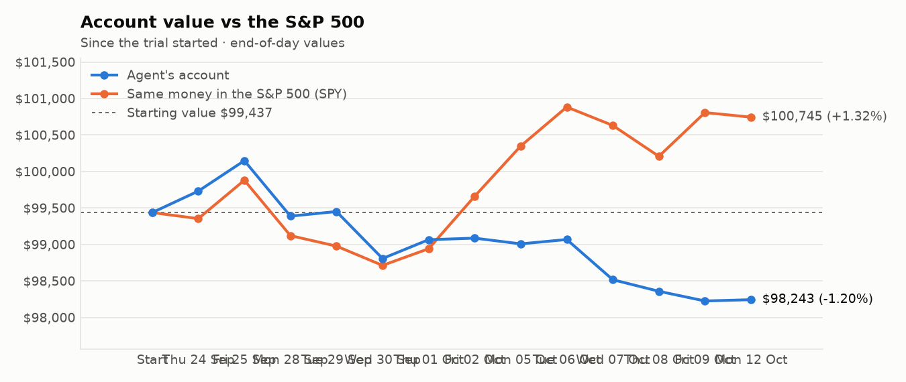
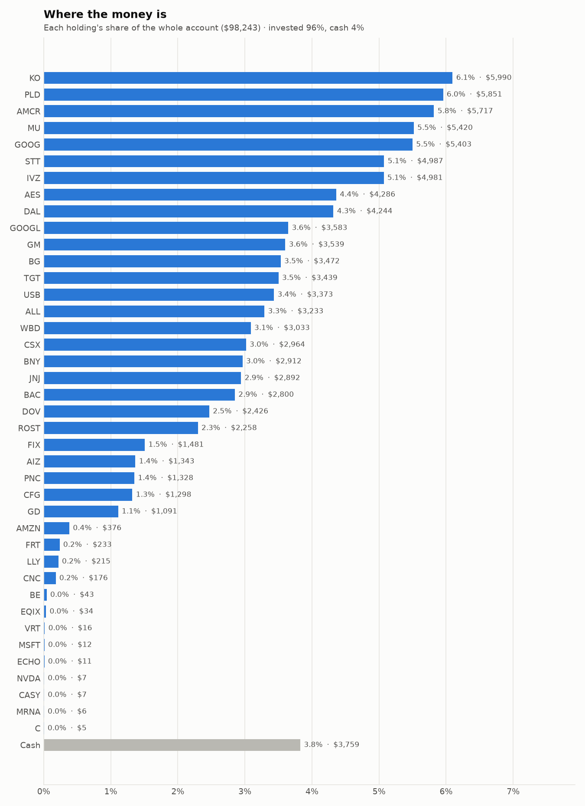
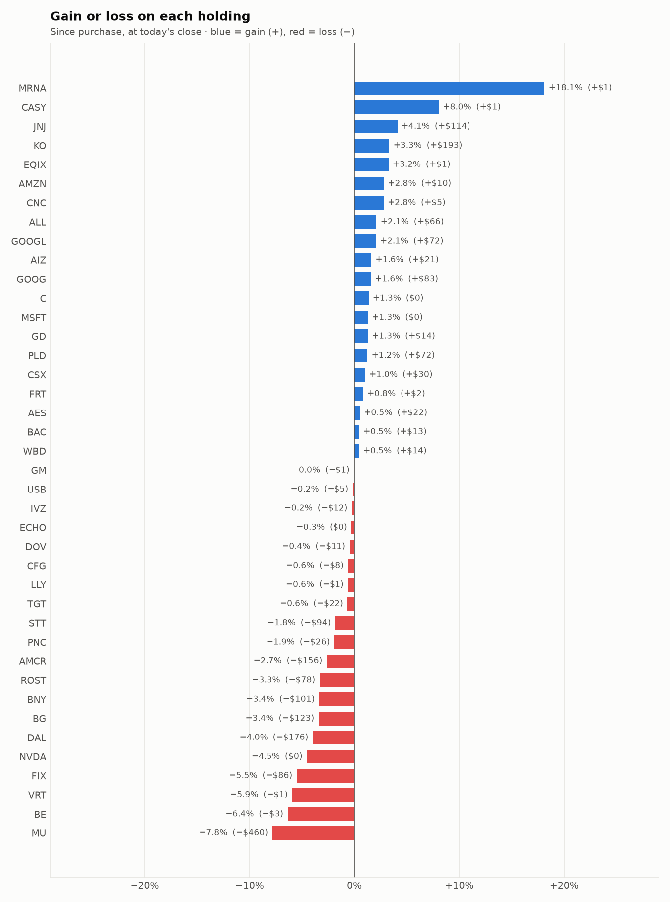

# Daily trading report — Monday 12 October 2026

## Summary

- **Account value:** $98,243 (+$18, +0.0% today)
- **S&P 500 (SPY) today:** -0.1% — the agent was ahead of the index by 0.08%
- **Trades:** 4 buy(s) ($16,587), 8 sell(s) ($17,789)
- **2026-10-12 Morning rebalance:** traded — 12 order(s) placed
- **2026-10-12 Afternoon risk check:** no trades needed — Risk-checked 40 holding(s): none was 10%+ below its purchase price, and none had both clearly negative news and a price drop of 3%+ since entry.

## Charts

## Why I bought

### PLD — bought 44.165 shares at ~$130.85 ($5,779)

**Why:** combined score +0.73; ranked #6 of 503; driven mainly by research (news + analyst consensus) +1.50, price momentum +0.97; entering/adding to the top-ranked target portfolio; research detail: 4 recent headline(s), net positive tone (+2); analyst consensus +0.87/2 (5 strong buy, 10 buy, 8 hold, 0 sell, 0 strong sell)

**Research scores** (combined +0.73, ranked #6 in the S&P 500, sector: Real Estate):

| Factor | Score | Measures |
|---|---|---|
| Value | +0.35 | cheap vs. sector peers on P/E and P/B |
| Quality | +0.34 | profitability (ROE, margins) and balance-sheet strength |
| Momentum | +0.97 | 12-month price trend, excluding the last month |
| Low volatility | +0.36 | steadier price than sector peers |
| Research | +1.50 | recent news tone + analyst consensus |

**Company financials (Finnhub, trailing 12 months):** P/E 29.8, P/B 2.4, return on equity 7.9%, gross margin 74.3%, debt/equity 0.68

**Price trend (Alpaca):** 12-month return (excl. last month) +19.9%, last month -3.6%, volatility 17.9%/yr

**News (Finnhub): 4 headline(s) in the last 2 days, net tone +2.** Most influential:
- [Will Texas Power Limits on Hutto Data Center Rethink Prologis' (PLD) Development-Led Growth Narrative](https://finnhub.io/api/news?id=ac9e12ac7cfd3168d10888d87554b01da6d2289d4b023b28278b93705f9eadf2) — 10 Oct, Yahoo (tone +2)
- [Dimensional Fund Advisors Ltd. : Form 8.3 - PROLOGIS INC - Ordinary Shares](https://finnhub.io/api/news?id=d711a803dfef501d91dec420eb95c78e7a68587ec0b8795df6d88881ed0667b4) — 12 Oct, Yahoo (tone +0)
- [Prologis (PLD) Draws Fresh Ownership Focus, Is The Stock Still Undervalued?](https://finnhub.io/api/news?id=ceaf3adb52a3d333c1b88d867a10d22525d8207e4a7e449521dc2951d72bb212) — 10 Oct, Yahoo (tone +0)
- [Prologis (PLD) Stock Looks Near Fair Value As Its 30% Run Continues](https://finnhub.io/api/news?id=be698f96c0cd13f1e50396132c602e768235e3795daadb0bc91b3681517a59e5) — 10 Oct, Yahoo (tone +0)

**Analysts (Finnhub, 2026-09-01):** 5 strong buy, 10 buy, 8 hold, 0 sell, 0 strong sell — consensus +0.87 on a -2 (strong sell) to +2 (strong buy) scale.

### IVZ — bought 170.232 shares at ~$29.33 ($4,993)

**Why:** combined score +0.89; ranked #2 of 503; driven mainly by value (cheapness) +1.98, price momentum +1.57; entering/adding to the top-ranked target portfolio; research detail: 8 recent headline(s), net positive tone (+3); analyst consensus +0.50/2 (1 strong buy, 7 buy, 10 hold, 0 sell, 0 strong sell)

**Research scores** (combined +0.89, ranked #2 in the S&P 500, sector: Financials):

| Factor | Score | Measures |
|---|---|---|
| Value | +1.98 | cheap vs. sector peers on P/E and P/B |
| Quality | -0.27 | profitability (ROE, margins) and balance-sheet strength |
| Momentum | +1.57 | 12-month price trend, excluding the last month |
| Low volatility | -0.72 | steadier price than sector peers |
| Research | +1.31 | recent news tone + analyst consensus |

**Company financials (Finnhub, trailing 12 months):** P/B 0.9, return on equity -0.5%, gross margin 66.0%, debt/equity 0.85

**Price trend (Alpaca):** 12-month return (excl. last month) +43.7%, last month -7.6%, volatility 28.3%/yr

**News (Finnhub): 8 headline(s) in the last 2 days, net tone +3.** Most influential:
- [Which Healthcare ETF Is the Better Buy: Fidelity’s Broad FHLC or Invesco’s Biotech-Focused PBE?](https://finnhub.io/api/news?id=a2233f3ac8ac300e4b043ee5e18605976d7173c51718e741e1ea6a0adefcae9d) — 11 Oct, Yahoo (tone +1)
- [Better Invesco Healthcare ETF: PJP Targeting Pharmaceuticals vs. RSPH's Broader Sector Lens](https://finnhub.io/api/news?id=d3ab46fd22bbc21dc5d04a82a27bd3f492c72e8b6fdff45025d96774a52a2809) — 11 Oct, Yahoo (tone +1)
- [Invesco (IVZ) Stock Could Be 39% Undervalued On Excess Returns](https://finnhub.io/api/news?id=a30042d84794fbe982718d1d27bd26636564b187cd85dc25afdb302263e34b26) — 10 Oct, Yahoo (tone +1)
- [Should Invesco Russell 1000 Equal Weight ETF (EQAL) Be on Your Investing Radar?](https://finnhub.io/api/news?id=a735e21d7df3fdef73047ee637aacf1a23239ae77de0e67ad65fca423379871d) — 12 Oct, Yahoo (tone +0)
- [Should Invesco S&P MidCap 400 Pure Value ETF (RFV) Be on Your Investing Radar?](https://finnhub.io/api/news?id=94f96406dcf4f87212dfae831eee7995a3dd7589dff94c5c5da39b958b7f27a5) — 12 Oct, Yahoo (tone +0)

**Analysts (Finnhub, 2026-09-01):** 1 strong buy, 7 buy, 10 hold, 0 sell, 0 strong sell — consensus +0.50 on a -2 (strong sell) to +2 (strong buy) scale.

### USB — bought 58.742 shares at ~$57.51 ($3,378)

**Why:** combined score +0.64; ranked #12 of 503; driven mainly by research (news + analyst consensus) +1.05, price momentum +0.84; entering/adding to the top-ranked target portfolio; research detail: 1 recent headline(s), net positive tone (+2); analyst consensus +0.78/2 (6 strong buy, 10 buy, 10 hold, 1 sell, 0 strong sell)

**Research scores** (combined +0.64, ranked #12 in the S&P 500, sector: Financials):

| Factor | Score | Measures |
|---|---|---|
| Value | +0.70 | cheap vs. sector peers on P/E and P/B |
| Quality | -0.19 | profitability (ROE, margins) and balance-sheet strength |
| Momentum | +0.84 | 12-month price trend, excluding the last month |
| Low volatility | +0.83 | steadier price than sector peers |
| Research | +1.05 | recent news tone + analyst consensus |

**Company financials (Finnhub, trailing 12 months):** P/E 10.9, P/B 1.4, return on equity 12.5%, debt/equity 1.42

**Price trend (Alpaca):** 12-month return (excl. last month) +26.5%, last month -8.6%, volatility 18.7%/yr

**News (Finnhub): 1 headline(s) in the last 2 days, net tone +2.** Most influential:
- [Cautious Optimism Heading Into Q3 Earnings For U.S. Bancorp](https://finnhub.io/api/news?id=e52361c1ac3f002afc5cac0daffd972585cee5c441a2c512275e00de13293f46) — 10 Oct, SeekingAlpha (tone +2)

**Analysts (Finnhub, 2026-09-01):** 6 strong buy, 10 buy, 10 hold, 1 sell, 0 strong sell — consensus +0.78 on a -2 (strong sell) to +2 (strong buy) scale.

### DOV — bought 12.707 shares at ~$191.74 ($2,436)

**Why:** combined score +0.56; ranked #22 of 503; driven mainly by research (news + analyst consensus) +1.61, value (cheapness) +0.83; entering/adding to the top-ranked target portfolio; research detail: 1 recent headline(s), net positive tone (+2); analyst consensus +1.00/2 (6 strong buy, 11 buy, 6 hold, 0 sell, 0 strong sell)

**Research scores** (combined +0.56, ranked #22 in the S&P 500, sector: Industrials):

| Factor | Score | Measures |
|---|---|---|
| Value | +0.83 | cheap vs. sector peers on P/E and P/B |
| Quality | +0.00 | profitability (ROE, margins) and balance-sheet strength |
| Momentum | -0.18 | 12-month price trend, excluding the last month |
| Low volatility | +0.78 | steadier price than sector peers |
| Research | +1.61 | recent news tone + analyst consensus |

**Company financials (Finnhub, trailing 12 months):** P/E 22.4, P/B 3.9, return on equity 15.0%, gross margin 40.1%, debt/equity 0.42

**Price trend (Alpaca):** 12-month return (excl. last month) +7.2%, last month +0.7%, volatility 25.6%/yr

**News (Finnhub): 1 headline(s) in the last 2 days, net tone +2.** Most influential:
- [Dover: Quality Is Unfortunately Not Cheap](https://finnhub.io/api/news?id=69ce02c0156af98d3def80eaf6c3e1bdba0aec7fcf561b5032327b48dae90685) — 11 Oct, SeekingAlpha (tone +2)

**Analysts (Finnhub, 2026-09-01):** 6 strong buy, 11 buy, 6 hold, 0 sell, 0 strong sell — consensus +1.00 on a -2 (strong sell) to +2 (strong buy) scale.

## Why I sold

### FIX — sold 2.403 shares at ~$1,698.80 ($4,082)

**Why:** combined score +0.52; ranked #24 of 503; driven mainly by price momentum +2.96, low volatility -1.43; trimmed toward target weight, or dropped out of the top-ranked names; research detail: 1 recent headline(s), neutral/mixed tone; analyst consensus +1.31/2 (7 strong buy, 7 buy, 2 hold, 0 sell, 0 strong sell)

**Research scores** (combined +0.52, ranked #24 in the S&P 500, sector: Industrials):

| Factor | Score | Measures |
|---|---|---|
| Value | -0.82 | cheap vs. sector peers on P/E and P/B |
| Quality | +0.21 | profitability (ROE, margins) and balance-sheet strength |
| Momentum | +2.96 | 12-month price trend, excluding the last month |
| Low volatility | -1.43 | steadier price than sector peers |
| Research | +0.58 | recent news tone + analyst consensus |

**Company financials (Finnhub, trailing 12 months):** P/E 42.1, P/B 21.7, return on equity 53.5%, gross margin 25.7%, debt/equity 0.02

**Price trend (Alpaca):** 12-month return (excl. last month) +123.6%, last month +7.9%, volatility 53.9%/yr

**News (Finnhub): 1 headline(s) in the last 2 days, net tone +0.** Most influential:
- [Comfort Systems USA: A Sneaky Winner In The AI Infrastructure Buildout](https://finnhub.io/api/news?id=41fc9353ca0f95ee9393a02afa9ccb4c1277bb7436c9a0af5cecfdf677a87618) — 11 Oct, SeekingAlpha (tone +0)

**Analysts (Finnhub, 2026-09-01):** 7 strong buy, 7 buy, 2 hold, 0 sell, 0 strong sell — consensus +1.31 on a -2 (strong sell) to +2 (strong buy) scale.

### FRT — sold 34.28 shares at ~$105.92 ($3,631)

**Why:** combined score +0.46; ranked #31 of 503; driven mainly by low volatility +1.76, price momentum +0.72; trimmed toward target weight, or dropped out of the top-ranked names; research detail: analyst consensus +0.92/2 (6 strong buy, 11 buy, 8 hold, 0 sell, 0 strong sell)

**Research scores** (combined +0.46, ranked #31 in the S&P 500, sector: Real Estate):

| Factor | Score | Measures |
|---|---|---|
| Value | +0.00 | cheap vs. sector peers on P/E and P/B |
| Quality | +0.00 | profitability (ROE, margins) and balance-sheet strength |
| Momentum | +0.72 | 12-month price trend, excluding the last month |
| Low volatility | +1.76 | steadier price than sector peers |
| Research | +0.08 | recent news tone + analyst consensus |

**Price trend (Alpaca):** 12-month return (excl. last month) +14.5%, last month -7.5%, volatility 11.9%/yr

**News (Finnhub):** no headlines in the last 2 days.

**Analysts (Finnhub, 2026-09-01):** 6 strong buy, 11 buy, 8 hold, 0 sell, 0 strong sell — consensus +0.92 on a -2 (strong sell) to +2 (strong buy) scale.

### C — sold 16.93 shares at ~$130.49 ($2,209)

**Why:** combined score +0.41; ranked #45 of 503; driven mainly by price momentum +1.51, quality (profitability/balance sheet) -0.99; trimmed toward target weight, or dropped out of the top-ranked names; research detail: 3 recent headline(s), neutral/mixed tone; analyst consensus +1.04/2 (7 strong buy, 15 buy, 6 hold, 0 sell, 0 strong sell)

**Research scores** (combined +0.41, ranked #45 in the S&P 500, sector: Financials):

| Factor | Score | Measures |
|---|---|---|
| Value | +0.88 | cheap vs. sector peers on P/E and P/B |
| Quality | -0.99 | profitability (ROE, margins) and balance-sheet strength |
| Momentum | +1.51 | 12-month price trend, excluding the last month |
| Low volatility | +0.04 | steadier price than sector peers |
| Research | +0.24 | recent news tone + analyst consensus |

**Company financials (Finnhub, trailing 12 months):** P/E 12.2, P/B 1.1, return on equity 8.4%, debt/equity 3.84

**Price trend (Alpaca):** 12-month return (excl. last month) +42.3%, last month -6.4%, volatility 24.2%/yr

**News (Finnhub): 3 headline(s) in the last 2 days, net tone +0.** Most influential:
- [Market Chatter: Citigroup Seeks to Speed Up Efforts to Resolve Regulatory Orders](https://finnhub.io/api/news?id=ef27e2b3c2b52ee48921e0679b7e784f451bb5562cd1f9510caa644769513fef) — 12 Oct, Yahoo (tone +0)
- [Citigroup (C) Q3 Earnings Report Preview: What To Look For](https://finnhub.io/api/news?id=3ca6c8538056e181fa47a324dc7aab0ad6dd2d1058507143221c6a3178bf6690) — 12 Oct, Yahoo (tone +0)
- [Visible Alpha Breakdown Of U.S. Banks' Q3 2026 Earnings Expectations](https://finnhub.io/api/news?id=e0a1bf7e6e65ee6abe78b73033df69d4da08fb13b65265f5f19838dc282f2505) — 09 Oct, SeekingAlpha (tone +0)

**Analysts (Finnhub, 2026-09-01):** 7 strong buy, 15 buy, 6 hold, 0 sell, 0 strong sell — consensus +1.04 on a -2 (strong sell) to +2 (strong buy) scale.

### ALL — sold 9.335 shares at ~$232.72 ($2,172)

**Why:** combined score +0.64; ranked #13 of 503; driven mainly by value (cheapness) +1.60, quality (profitability/balance sheet) +1.10; trimmed toward target weight, or dropped out of the top-ranked names; research detail: analyst consensus +0.47/2 (5 strong buy, 9 buy, 12 hold, 3 sell, 1 strong sell)

**Research scores** (combined +0.64, ranked #13 in the S&P 500, sector: Financials):

| Factor | Score | Measures |
|---|---|---|
| Value | +1.60 | cheap vs. sector peers on P/E and P/B |
| Quality | +1.10 | profitability (ROE, margins) and balance-sheet strength |
| Momentum | +0.81 | 12-month price trend, excluding the last month |
| Low volatility | -0.25 | steadier price than sector peers |
| Research | -0.35 | recent news tone + analyst consensus |

**Company financials (Finnhub, trailing 12 months):** P/E 4.4, P/B 1.8, return on equity 43.1%, debt/equity 0.22

**Price trend (Alpaca):** 12-month return (excl. last month) +25.9%, last month -8.9%, volatility 28.7%/yr

**News (Finnhub):** no headlines in the last 2 days.

**Analysts (Finnhub, 2026-09-01):** 5 strong buy, 9 buy, 12 hold, 3 sell, 1 strong sell — consensus +0.47 on a -2 (strong sell) to +2 (strong buy) scale.

### GM — sold 22.437 shares at ~$82.49 ($1,851)

**Why:** combined score +0.61; ranked #18 of 503; driven mainly by price momentum +1.97, quality (profitability/balance sheet) -0.68; trimmed toward target weight, or dropped out of the top-ranked names; research detail: 2 recent headline(s), net positive tone (+1); analyst consensus +1.05/2 (11 strong buy, 19 buy, 7 hold, 1 sell, 0 strong sell)

**Research scores** (combined +0.61, ranked #18 in the S&P 500, sector: Consumer Discretionary):

| Factor | Score | Measures |
|---|---|---|
| Value | +0.62 | cheap vs. sector peers on P/E and P/B |
| Quality | -0.68 | profitability (ROE, margins) and balance-sheet strength |
| Momentum | +1.97 | 12-month price trend, excluding the last month |
| Low volatility | +0.05 | steadier price than sector peers |
| Research | +0.60 | recent news tone + analyst consensus |

**Company financials (FMP, trailing 12 months):** P/E 41.3, P/B 1.2, return on equity 3.0%, gross margin 5.7%, debt/equity 2.06

**Price trend (Alpaca):** 12-month return (excl. last month) +48.5%, last month -3.9%, volatility 34.6%/yr

**News (Finnhub): 2 headline(s) in the last 2 days, net tone +1.** Most influential:
- [How GM is Secretly Winning the US EV Race](https://finnhub.io/api/news?id=6445d6b5f05936a95ad823fe638841b683dd196226a2631cdd0087b411b589a2) — 11 Oct, Yahoo (tone +1)
- [General Motors Stock Is Up 7% in October While Ending Silverado 1500 Production in Canada. Here’s Where the Stock Could Go by 2030](https://finnhub.io/api/news?id=eef613a938e7fda29bb58d45b8b8e72aa4616a45ea1ad9970bfe4dcee58542ff) — 10 Oct, Yahoo (tone +0)

**Analysts (Finnhub, 2026-09-01):** 11 strong buy, 19 buy, 7 hold, 1 sell, 0 strong sell — consensus +1.05 on a -2 (strong sell) to +2 (strong buy) scale.

### GOOGL — sold 5.189 shares at ~$353.13 ($1,832)

**Why:** combined score +0.61; ranked #17 of 503; driven mainly by price momentum +1.73, research (news + analyst consensus) +1.41; trimmed toward target weight, or dropped out of the top-ranked names; research detail: 14 recent headline(s), net positive tone (+6); analyst consensus +1.19/2 (20 strong buy, 43 buy, 7 hold, 0 sell, 0 strong sell)

**Research scores** (combined +0.61, ranked #17 in the S&P 500, sector: Communication Services):

| Factor | Score | Measures |
|---|---|---|
| Value | -0.76 | cheap vs. sector peers on P/E and P/B |
| Quality | +0.11 | profitability (ROE, margins) and balance-sheet strength |
| Momentum | +1.73 | 12-month price trend, excluding the last month |
| Low volatility | +0.18 | steadier price than sector peers |
| Research | +1.41 | recent news tone + analyst consensus |

**Company financials (FMP, trailing 12 months):** P/E 17.4, P/B 6.6, return on equity 50.8%, gross margin 60.9%, debt/equity 0.18

**Price trend (Alpaca):** 12-month return (excl. last month) +38.8%, last month +5.7%, volatility 32.7%/yr

**News (Finnhub): 14 headline(s) in the last 2 days, net tone +6.** Most influential:
- [S&P 500 Profits Set to Surge More Than 30% in Q3 With AI Giants Dominating Growth](https://finnhub.io/api/news?id=1917345743a23d58722801b3085bdf94a02612adcf39a7db5434c73f042e6ab6) — 12 Oct, Yahoo (tone +3)
- [Amazon and Alphabet Just Committed $420 Billion to Data Centers. 1 Stock Is the Better Buy.](https://finnhub.io/api/news?id=01a786a0f135b8e34ae002f5c662d8c407607d5e071fa680ed969b0df4cb99ef) — 11 Oct, Yahoo (tone +1)
- [Alphabet (GOOGL) Has A $5 Billion Waymo Loan And A $50 Billion AI Bet](https://finnhub.io/api/news?id=15d4e383c6f8cfe12e94b3325cd165a34cb68ad14194efdb76c2fb917500a520) — 10 Oct, Yahoo (tone +1)
- [Sundar Pichai Reported Alphabet's Cloud Revenue Grew 82% to $24.8 Billion Last Quarter, With the Gemini App Reaching 950 Million Monthly Users. Is Google Cloud Becoming a Bigger Growth Driver Than Search?](https://finnhub.io/api/news?id=6bea1f0ad582883844af27c929239d63c4e89a68d209c266ac30b10264e83fe7) — 10 Oct, Yahoo (tone +1)
- [Waymo Just Borrowed $5 Billion for the First Time](https://finnhub.io/api/news?id=bba5134703ce67f02fb19e61b262f7eb8288cd3b5a8dc64d28d5854c9af70ea9) — 12 Oct, Yahoo (tone +0)

**Analysts (Finnhub, 2026-09-01):** 20 strong buy, 43 buy, 7 hold, 0 sell, 0 strong sell — consensus +1.19 on a -2 (strong sell) to +2 (strong buy) scale.

### BNY — sold 12.23 shares at ~$143.56 ($1,756)

**Why:** combined score +0.62; ranked #15 of 503; driven mainly by price momentum +2.05, low volatility +1.01; trimmed toward target weight, or dropped out of the top-ranked names; research detail: analyst consensus +0.81/2 (3 strong buy, 11 buy, 7 hold, 0 sell, 0 strong sell)

**Research scores** (combined +0.62, ranked #15 in the S&P 500, sector: Financials):

| Factor | Score | Measures |
|---|---|---|
| Value | -0.10 | cheap vs. sector peers on P/E and P/B |
| Quality | -0.13 | profitability (ROE, margins) and balance-sheet strength |
| Momentum | +2.05 | 12-month price trend, excluding the last month |
| Low volatility | +1.01 | steadier price than sector peers |
| Research | +0.00 | recent news tone + analyst consensus |

**Company financials (Finnhub, trailing 12 months):** P/E 15.4, P/B 2.2, return on equity 14.2%, debt/equity 1.38

**Price trend (Alpaca):** 12-month return (excl. last month) +55.2%, last month -12.3%, volatility 18.2%/yr

**News (Finnhub):** no headlines in the last 2 days.

**Analysts (Finnhub, 2026-09-01):** 3 strong buy, 11 buy, 7 hold, 0 sell, 0 strong sell — consensus +0.81 on a -2 (strong sell) to +2 (strong buy) scale.

### STT — sold 1.458 shares at ~$175.41 ($256)

**Why:** combined score +0.66; ranked #11 of 503; driven mainly by price momentum +2.22, low volatility +0.52; trimmed toward target weight, or dropped out of the top-ranked names; research detail: 6 recent headline(s), neutral/mixed tone; analyst consensus +0.81/2 (3 strong buy, 11 buy, 7 hold, 0 sell, 0 strong sell)

**Research scores** (combined +0.66, ranked #11 in the S&P 500, sector: Financials):

| Factor | Score | Measures |
|---|---|---|
| Value | +0.25 | cheap vs. sector peers on P/E and P/B |
| Quality | -0.10 | profitability (ROE, margins) and balance-sheet strength |
| Momentum | +2.22 | 12-month price trend, excluding the last month |
| Low volatility | +0.52 | steadier price than sector peers |
| Research | +0.00 | recent news tone + analyst consensus |

**Company financials (Finnhub, trailing 12 months):** P/E 13.9, P/B 1.7, return on equity 12.4%, debt/equity 1.08

**Price trend (Alpaca):** 12-month return (excl. last month) +70.7%, last month -8.6%, volatility 21.1%/yr

**News (Finnhub): 6 headline(s) in the last 2 days, net tone +0.** Most influential:
- [70 Million Kids Just Got Trump Accounts. The Bigger Winner Could Be State Street](https://finnhub.io/api/news?id=27117fbf8b9aaff8146d8f4a72ed078f2465f6c5bf7b7b04df8252f512a53318) — 12 Oct, Yahoo (tone +0)
- [Which Global Real Estate ETF Is the Better Buy: State Street’s RWO or Xtrackers’ HAUZ?](https://finnhub.io/api/news?id=96fea1ce73e733c2debf88160a49611b30822626823432595810bc5add326d3d) — 11 Oct, Yahoo (tone +0)
- [Which Corporate Bond ETF Is the Better Buy: iShares’ LQD or State Street’s SPLB?](https://finnhub.io/api/news?id=006f7fcb0a1178c036f6134ec3e4d74e82f88ac00990d5dbb22f72e57b2afc50) — 11 Oct, Yahoo (tone +0)
- [Better Healthcare ETF: VanEck's Biotech-Focused BBH vs. State Street's XPH Targeting Pharma](https://finnhub.io/api/news?id=4160b4f1b99445faad76dd0a6898dcc053dd2ff9b22ada1f8a0250d02f92ac50) — 10 Oct, Yahoo (tone +0)
- [A Battle of REIT ETFs: Which REIT ETF Offers Better Value for Income-Oriented Investors?](https://finnhub.io/api/news?id=90885ece06d6c6d054d9201c7f0f6c7d791bdfc5434746b3870a02c7734b92bc) — 10 Oct, Yahoo (tone +0)

**Analysts (Finnhub, 2026-09-01):** 3 strong buy, 11 buy, 7 hold, 0 sell, 0 strong sell — consensus +0.81 on a -2 (strong sell) to +2 (strong buy) scale.

## Holdings at the close

| Stock | Shares | Avg cost | Price | Market value | % of account | Today | Gain/loss $ | Gain/loss % |
|---|---:|---:|---:|---:|---:|---:|---:|---:|
| KO | 66.736 | $86.86 | $89.75 | $5,990 | 6.1% | +1.93% | +$193 | +3.33% |
| PLD | 44.165 | $130.85 | $132.47 | $5,851 | 6.0% | +2.30% | +$72 | +1.24% |
| AMCR | 137.493 | $42.71 | $41.58 | $5,717 | 5.8% | -0.34% | −$156 | -2.66% |
| MU | 5.491 | $1,070.99 | $987.15 | $5,420 | 5.5% | -4.07% | −$460 | -7.83% |
| GOOG | 15.467 | $343.95 | $349.30 | $5,403 | 5.5% | +0.41% | +$83 | +1.56% |
| STT | 28.507 | $178.22 | $174.93 | $4,987 | 5.1% | -0.02% | −$94 | -1.85% |
| IVZ | 170.232 | $29.33 | $29.26 | $4,981 | 5.1% | -0.85% | −$12 | -0.24% |
| AES | 286.093 | $14.90 | $14.98 | $4,286 | 4.4% | +0.27% | +$22 | +0.52% |
| DAL | 53 | $83.40 | $80.08 | $4,244 | 4.3% | -2.54% | −$176 | -3.98% |
| GOOGL | 10.156 | $345.65 | $352.75 | $3,583 | 3.6% | +0.31% | +$72 | +2.05% |
| GM | 42.962 | $82.40 | $82.37 | $3,539 | 3.6% | -0.44% | −$1 | -0.04% |
| BG | 33.312 | $107.91 | $104.22 | $3,472 | 3.5% | +1.45% | −$123 | -3.42% |
| TGT | 22.387 | $154.62 | $153.62 | $3,439 | 3.5% | -0.01% | −$22 | -0.65% |
| USB | 58.742 | $57.51 | $57.42 | $3,373 | 3.4% | +0.60% | −$5 | -0.16% |
| ALL | 13.899 | $227.82 | $232.60 | $3,233 | 3.3% | +1.38% | +$66 | +2.10% |
| WBD | 98 | $30.81 | $30.95 | $3,033 | 3.1% | +0.00% | +$14 | +0.45% |
| CSX | 62.293 | $47.10 | $47.58 | $2,964 | 3.0% | +0.68% | +$30 | +1.02% |
| BNY | 20.366 | $147.98 | $143.00 | $2,912 | 3.0% | +0.20% | −$101 | -3.36% |
| JNJ | 10.937 | $254.00 | $264.39 | $2,892 | 2.9% | +1.13% | +$114 | +4.09% |
| BAC | 51.217 | $54.42 | $54.67 | $2,800 | 2.9% | +0.64% | +$13 | +0.46% |
| DOV | 12.707 | $191.74 | $190.88 | $2,426 | 2.5% | +1.09% | −$11 | -0.45% |
| ROST | 10 | $233.61 | $225.84 | $2,258 | 2.3% | +1.54% | −$78 | -3.33% |
| FIX | 0.904 | $1,733.36 | $1,638.00 | $1,481 | 1.5% | -4.53% | −$86 | -5.50% |
| AIZ | 5 | $264.38 | $268.63 | $1,343 | 1.4% | +0.80% | +$21 | +1.61% |
| PNC | 6 | $225.64 | $221.26 | $1,328 | 1.4% | +0.94% | −$26 | -1.94% |
| CFG | 20.32 | $64.28 | $63.90 | $1,298 | 1.3% | +0.52% | −$8 | -0.59% |
| GD | 3.251 | $331.27 | $335.46 | $1,091 | 1.1% | +1.26% | +$14 | +1.26% |
| AMZN | 1.448 | $252.59 | $259.65 | $376 | 0.4% | -1.06% | +$10 | +2.80% |
| FRT | 2.191 | $105.54 | $106.42 | $233 | 0.2% | +0.24% | +$2 | +0.83% |
| LLY | 0.182 | $1,189.78 | $1,182.62 | $215 | 0.2% | +0.28% | −$1 | -0.60% |
| CNC | 2.63 | $65.21 | $67.02 | $176 | 0.2% | +2.54% | +$5 | +2.78% |
| BE | 0.166 | $279.83 | $262.02 | $43 | 0.0% | -6.59% | −$3 | -6.36% |
| EQIX | 0.033 | $1,000.20 | $1,032.60 | $34 | 0.0% | +0.64% | +$1 | +3.24% |
| VRT | 0.067 | $254.61 | $239.50 | $16 | 0.0% | -1.35% | −$1 | -5.93% |
| MSFT | 0.023 | $533.80 | $540.60 | $12 | 0.0% | +1.03% | +$0 | +1.27% |
| ECHO | 0.116 | $95.87 | $95.61 | $11 | 0.0% | +0.81% | −$0 | -0.27% |
| NVDA | 0.032 | $236.88 | $226.14 | $7 | 0.0% | -1.37% | −$0 | -4.53% |
| CASY | 0.011 | $597.62 | $645.72 | $7 | 0.0% | -0.09% | +$1 | +8.05% |
| MRNA | 0.028 | $181.06 | $213.90 | $6 | 0.0% | -4.93% | +$1 | +18.14% |
| C | 0.036 | $130.05 | $131.80 | $5 | 0.0% | +1.67% | +$0 | +1.34% |
| **Invested** | | | | **$94,484** | **96.2%** | | **−$633** | |
| **Cash** | | | | $3,759 | 3.8% | | | |
| **Total account** | | | | **$98,243** | 100% | | | |

_Scores are sector-neutral z-scores: 0 is average for the stock's sector, +1 is one standard deviation better. News tone is a keyword count over recent headlines, not a deep read. None of this guarantees a stock will rise; a few days of results can't show whether the strategy has a real edge over the S&P 500._
