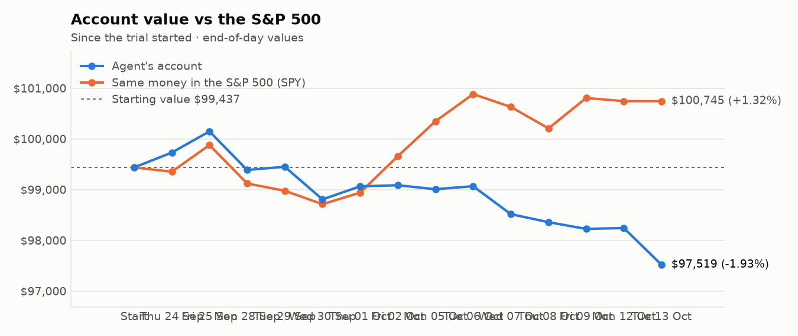
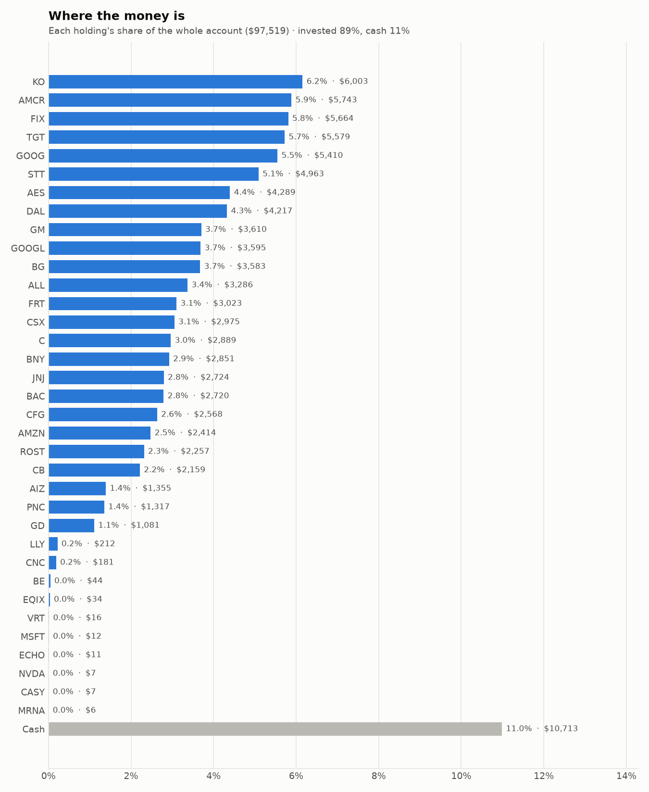
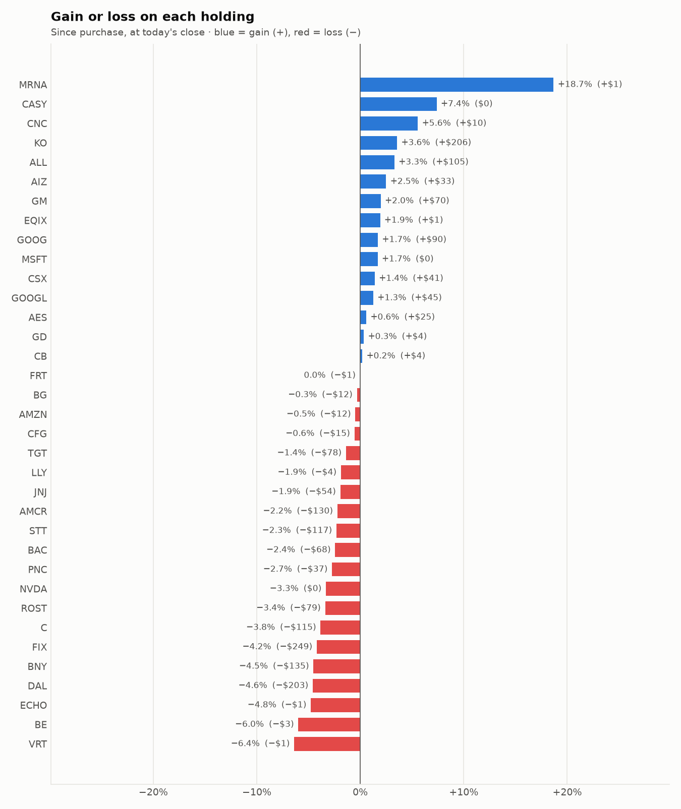

# Daily trading report — Tuesday 13 October 2026

## Summary

- **Account value:** $97,519 (-$724, -0.7% today)
- **S&P 500 (SPY) today:** +0.0% — the agent was behind the index by 0.74%
- **Trades:** 7 buy(s) ($17,776), 5 sell(s) ($21,691)
- **2026-10-13 Morning rebalance:** traded — 11 order(s) placed
- **2026-10-13 Afternoon risk check:** traded — Sold 1 position(s) on the risk check (stop-loss: MU)

## Charts

## Why I bought

### FIX — bought 2.681 shares at ~$1,602.98 ($4,298)

**Why:** combined score +0.86; ranked #5 of 503; driven mainly by price momentum +2.99, research (news + analyst consensus) +2.26; entering/adding to the top-ranked target portfolio; research detail: 2 recent headline(s), net positive tone (+4); analyst consensus +1.31/2 (7 strong buy, 7 buy, 2 hold, 0 sell, 0 strong sell)

**Research scores** (combined +0.86, ranked #5 in the S&P 500, sector: Industrials):

| Factor | Score | Measures |
|---|---|---|
| Value | -0.83 | cheap vs. sector peers on P/E and P/B |
| Quality | +0.23 | profitability (ROE, margins) and balance-sheet strength |
| Momentum | +2.99 | 12-month price trend, excluding the last month |
| Low volatility | -1.45 | steadier price than sector peers |
| Research | +2.26 | recent news tone + analyst consensus |

**Company financials (Finnhub, trailing 12 months):** P/E 41.2, P/B 21.7, return on equity 53.5%, gross margin 25.7%, debt/equity 0.02

**Price trend (Alpaca):** 12-month return (excl. last month) +124.1%, last month -3.0%, volatility 54.8%/yr

**News (Finnhub): 2 headline(s) in the last 2 days, net tone +4.** Most influential:
- [Comfort Systems' Rich Valuation After 84% Rally: Is Caution Warranted?](https://finnhub.io/api/news?id=4b6e6b1c67f6dce3d886e1da456fb768a35624040411522b462098c00f737479) — 12 Oct, Yahoo (tone +4)
- [Comfort Systems USA: A Sneaky Winner In The AI Infrastructure Buildout](https://finnhub.io/api/news?id=41fc9353ca0f95ee9393a02afa9ccb4c1277bb7436c9a0af5cecfdf677a87618) — 11 Oct, SeekingAlpha (tone +0)

**Analysts (Finnhub, 2026-09-01):** 7 strong buy, 7 buy, 2 hold, 0 sell, 0 strong sell — consensus +1.31 on a -2 (strong sell) to +2 (strong buy) scale.

### C — bought 23.12 shares at ~$129.73 ($2,999)

**Why:** combined score +0.66; ranked #15 of 503; driven mainly by price momentum +1.48, research (news + analyst consensus) +1.29; entering/adding to the top-ranked target portfolio; research detail: 10 recent headline(s), net positive tone (+5); analyst consensus +1.04/2 (7 strong buy, 15 buy, 6 hold, 0 sell, 0 strong sell)

**Research scores** (combined +0.66, ranked #15 in the S&P 500, sector: Financials):

| Factor | Score | Measures |
|---|---|---|
| Value | +0.99 | cheap vs. sector peers on P/E and P/B |
| Quality | -0.86 | profitability (ROE, margins) and balance-sheet strength |
| Momentum | +1.48 | 12-month price trend, excluding the last month |
| Low volatility | +0.06 | steadier price than sector peers |
| Research | +1.29 | recent news tone + analyst consensus |

**Company financials (Finnhub, trailing 12 months):** P/E 12.3, P/B 1.1, return on equity 8.4%, debt/equity 3.84

**Price trend (Alpaca):** 12-month return (excl. last month) +42.8%, last month -4.9%, volatility 24.2%/yr

**News (Finnhub): 10 headline(s) in the last 2 days, net tone +5.** Most influential:
- [Citigroup (NYSE:C) Q3 2026 Earnings Beat Profit as Revenue Lands Just Below Consensus](https://finnhub.io/api/news?id=7c7bc72b01c053471313f24830756ab25149f8fd4cfdc1ed23f5b4b791ef9920) — 13 Oct, ChartMill (tone +2)
- [The Zacks Analyst Blog Highlights JPMorgan Chase, Goldman Sachs, Citigroup, Wells Fargo Morgan Stanley and Bank of America](https://finnhub.io/api/news?id=ef943e1f93dd867834e337f21774e0904f4889a06bdced2675218aed4f1d6c03) — 13 Oct, Yahoo (tone +2)
- [JPMorgan, Citigroup, Pepsi, Micron and Nike are part of Zacks Earnings Preview](https://finnhub.io/api/news?id=90a8c1ac6c93e9f26cae87a2cdf1a81e3ad7b5a6b07d92e9b5fec3a5eca8621e) — 12 Oct, Yahoo (tone +1)
- [JPMorgan, Wells Fargo Kick Off Bank Earnings With Goldman, Citigroup Due](https://finnhub.io/api/news?id=02dcd6654121e3a4ce657f71f1812e39cabf990a6503f7ef8440c3148ab5a36e) — 13 Oct, Yahoo (tone +0)
- [Earnings from banks and  J&J and home sales data: What to Watch](https://finnhub.io/api/news?id=0ed83cae897d5328a440303c15e0d102a8864a028c818d7dfc195d227dedb301) — 12 Oct, Yahoo (tone +0)

**Analysts (Finnhub, 2026-09-01):** 7 strong buy, 15 buy, 6 hold, 0 sell, 0 strong sell — consensus +1.04 on a -2 (strong sell) to +2 (strong buy) scale.

### FRT — bought 26.399 shares at ~$105.79 ($2,793)

**Why:** combined score +0.63; ranked #20 of 503; driven mainly by low volatility +1.76, value (cheapness) +0.68; entering/adding to the top-ranked target portfolio; research detail: analyst consensus +0.92/2 (6 strong buy, 11 buy, 8 hold, 0 sell, 0 strong sell)

**Research scores** (combined +0.63, ranked #20 in the S&P 500, sector: Real Estate):

| Factor | Score | Measures |
|---|---|---|
| Value | +0.68 | cheap vs. sector peers on P/E and P/B |
| Quality | +0.24 | profitability (ROE, margins) and balance-sheet strength |
| Momentum | +0.67 | 12-month price trend, excluding the last month |
| Low volatility | +1.76 | steadier price than sector peers |
| Research | +0.09 | recent news tone + analyst consensus |

**Company financials (Finnhub, trailing 12 months):** P/E 21.3, P/B 3.2, return on equity 13.3%, gross margin 67.5%, debt/equity 1.42

**Price trend (Alpaca):** 12-month return (excl. last month) +13.8%, last month -6.9%, volatility 11.8%/yr

**News (Finnhub):** no headlines in the last 2 days.

**Analysts (Finnhub, 2026-09-01):** 6 strong buy, 11 buy, 8 hold, 0 sell, 0 strong sell — consensus +0.92 on a -2 (strong sell) to +2 (strong buy) scale.

### TGT — bought 14.319 shares at ~$153.33 ($2,196)

**Why:** combined score +0.81; ranked #6 of 503; driven mainly by price momentum +2.83, research (news + analyst consensus) +0.53; entering/adding to the top-ranked target portfolio; research detail: 8 recent headline(s), net positive tone (+4); analyst consensus +0.44/2 (7 strong buy, 8 buy, 25 hold, 3 sell, 0 strong sell)

**Research scores** (combined +0.81, ranked #6 in the S&P 500, sector: Consumer Staples):

| Factor | Score | Measures |
|---|---|---|
| Value | +0.35 | cheap vs. sector peers on P/E and P/B |
| Quality | -0.13 | profitability (ROE, margins) and balance-sheet strength |
| Momentum | +2.83 | 12-month price trend, excluding the last month |
| Low volatility | -0.29 | steadier price than sector peers |
| Research | +0.53 | recent news tone + analyst consensus |

**Company financials (FMP, trailing 12 months):** P/E 15.8, P/B 3.9, return on equity 26.7%, gross margin 29.3%, debt/equity 1.05

**Price trend (Alpaca):** 12-month return (excl. last month) +71.7%, last month -1.4%, volatility 27.7%/yr

**News (Finnhub): 8 headline(s) in the last 2 days, net tone +4.** Most influential:
- [Can Target's Non-Merchandise Growth Become a Bigger Earnings Driver?](https://finnhub.io/api/news?id=5450acf3e9d70c1f67e241c79de7a31a97d7b349c6927790a5d1036cec3c5723) — 12 Oct, Yahoo (tone +2)
- [Best Momentum Stocks to Buy for October 13th](https://finnhub.io/api/news?id=3bbb205bd9f2bd9ca87f29e6fbaf4b026bd08aabb98d3113815ee35b321d4e91) — 13 Oct, Yahoo (tone +1)
- [Target’s Intern-to-CEO Story Isn't Alone](https://finnhub.io/api/news?id=b2d9ec1c55e98c1cf9abfdd8bfd6a25edc5b36688ad1bc66b4c736a912bd9e23) — 12 Oct, Yahoo (tone +1)
- [If I Could Invest $1,000 in Just 1 Dividend Stock for the Next 5 Years, I'd Pick This Clear Standout Over the Vanguard S&P 500 ETF (VOO)](https://finnhub.io/api/news?id=c064f8d4582f40722916d9eb44649743d8d732fe62c4ac1431832bec9456eab6) — 13 Oct, Yahoo (tone +0)
- [Should You Buy Target Stock At This Price?](https://finnhub.io/api/news?id=f0ed77ab805a7c8e1eab98efece0d8cb00ca29f19ee6a87a9f5ddc5374d7aa8e) — 12 Oct, Yahoo (tone +0)

**Analysts (Finnhub, 2026-09-01):** 7 strong buy, 8 buy, 25 hold, 3 sell, 0 strong sell — consensus +0.44 on a -2 (strong sell) to +2 (strong buy) scale.

### CB — bought 6.238 shares at ~$345.47 ($2,155)

**Why:** combined score +0.59; ranked #23 of 503; driven mainly by low volatility +0.94, research (news + analyst consensus) +0.90; entering/adding to the top-ranked target portfolio; research detail: 5 recent headline(s), net positive tone (+5); analyst consensus +0.66/2 (8 strong buy, 10 buy, 15 hold, 1 sell, 1 strong sell)

**Research scores** (combined +0.59, ranked #23 in the S&P 500, sector: Financials):

| Factor | Score | Measures |
|---|---|---|
| Value | +0.43 | cheap vs. sector peers on P/E and P/B |
| Quality | +0.18 | profitability (ROE, margins) and balance-sheet strength |
| Momentum | +0.60 | 12-month price trend, excluding the last month |
| Low volatility | +0.94 | steadier price than sector peers |
| Research | +0.90 | recent news tone + analyst consensus |

**Company financials (Finnhub, trailing 12 months):** P/E 11.9, P/B 1.8, return on equity 15.2%, debt/equity 0.24

**Price trend (Alpaca):** 12-month return (excl. last month) +22.0%, last month +2.0%, volatility 19.0%/yr

**News (Finnhub): 5 headline(s) in the last 2 days, net tone +5.** Most influential:
- [CB Stock Rises 22% in a Year: What Should Investors Know?](https://finnhub.io/api/news?id=f36d24a9452570c0bf498c3a04ad4704ffaa4b52f5d2113630355efbc6f75713) — 12 Oct, Yahoo (tone +3)
- [Keefe, Bruyette & Woods Maintains Outperform on Chubb, Lowers Price Target to $387](https://finnhub.io/api/news?id=b0ead37e2331a2c5da3242f9d48e9449423cb31f6a9ec2771c16d57d3fa31538) — 12 Oct, Benzinga (tone +1)
- [Chubb Wealth and Hamilton Lane Form Partnership to Expand Access to Private Markets in Hong Kong](https://finnhub.io/api/news?id=6bc718b346e2b2c72fcb4896402f1a4f3384d3d17bc15d4f54e67434c61bd1f0) — 11 Oct, Yahoo (tone +1)
- [Chubb (CB) Increases Despite Market Slip: Here's What You Need to Know](https://finnhub.io/api/news?id=ccfa54a70b23f887665f3a90c85946871f612af9665f4dda46a128702d871060) — 12 Oct, Yahoo (tone +0)
- [Chubb (CB) vs. Travelers (TRV): Which P&C Insurance Giant Is the Better Buy?](https://finnhub.io/api/news?id=384e412596fadafb56d4430ef08fc7cc752d7a139ef49890d845fa746ca33ada) — 11 Oct, Yahoo (tone +0)

**Analysts (Finnhub, 2026-09-01):** 8 strong buy, 10 buy, 15 hold, 1 sell, 1 strong sell — consensus +0.66 on a -2 (strong sell) to +2 (strong buy) scale.

### AMZN — bought 7.896 shares at ~$260.87 ($2,060)

**Why:** combined score +0.59; ranked #24 of 503; driven mainly by research (news + analyst consensus) +2.13, price momentum +0.68; entering/adding to the top-ranked target portfolio; research detail: 47 recent headline(s), net positive tone (+17); analyst consensus +1.20/2 (20 strong buy, 49 buy, 5 hold, 0 sell, 0 strong sell)

**Research scores** (combined +0.59, ranked #24 in the S&P 500, sector: Consumer Discretionary):

| Factor | Score | Measures |
|---|---|---|
| Value | -0.06 | cheap vs. sector peers on P/E and P/B |
| Quality | +0.19 | profitability (ROE, margins) and balance-sheet strength |
| Momentum | +0.68 | 12-month price trend, excluding the last month |
| Low volatility | -0.20 | steadier price than sector peers |
| Research | +2.13 | recent news tone + analyst consensus |

**Company financials (FMP, trailing 12 months):** P/E 20.8, P/B 5.1, return on equity 30.5%, gross margin 50.8%, debt/equity 0.40

**Price trend (Alpaca):** 12-month return (excl. last month) +11.5%, last month +1.1%, volatility 42.1%/yr

**News (Finnhub): 47 headline(s) in the last 2 days, net tone +17.** Most influential:
- [T-Mobile Rises on Upgrade; IonQ to Buy Elisity / Stock Movers](https://finnhub.io/api/news?id=89c3d822f205bdeb54b62e1e5383e5999f3d6655f1182baed48635a5d0deded8) — 12 Oct, Yahoo (tone +3)
- [Zacks Investment Ideas feature highlights: Qualcomm, Alphabet, Tesla, AMD, Amazon, Taiwan Semiconductor, NVIDIA, Intel, Apple, Broadcom and SpaceX](https://finnhub.io/api/news?id=2b32edb09e61822e1df182f7d813ab3b9a0b6ff19bb137bb5cda166ece4db10d) — 12 Oct, Yahoo (tone +3)
- [S&P 500 Profits Set to Surge More Than 30% in Q3 With AI Giants Dominating Growth](https://finnhub.io/api/news?id=1917345743a23d58722801b3085bdf94a02612adcf39a7db5434c73f042e6ab6) — 12 Oct, Yahoo (tone +3)
- [Amazon Analysts Slash Price Targets Ahead Of Q3 – Wells Fargo Sees AWS Acceleration To Continue In Q4](https://finnhub.io/api/news?id=96c8d5485d0852edd2bda6231d52eb125ba5b795a7f2e93592dd82f71497b485) — 12 Oct, Yahoo (tone +2)
- [Amazon To $310? Here Are 10 Top Analyst Forecasts For Monday](https://finnhub.io/api/news?id=f389101aa4c1f3ce5a1e056dd6abe2c42740272aa5c798e83d3cd32e7df70d89) — 12 Oct, Benzinga (tone +2)

**Analysts (Finnhub, 2026-09-01):** 20 strong buy, 49 buy, 5 hold, 0 sell, 0 strong sell — consensus +1.20 on a -2 (strong sell) to +2 (strong buy) scale.

### CFG — bought 20.243 shares at ~$63.04 ($1,276)

**Why:** combined score +0.69; ranked #13 of 503; driven mainly by price momentum +1.19, value (cheapness) +0.96; entering/adding to the top-ranked target portfolio; research detail: 1 recent headline(s), net positive tone (+3); analyst consensus +1.04/2 (5 strong buy, 14 buy, 4 hold, 0 sell, 0 strong sell)

**Research scores** (combined +0.69, ranked #13 in the S&P 500, sector: Financials):

| Factor | Score | Measures |
|---|---|---|
| Value | +0.96 | cheap vs. sector peers on P/E and P/B |
| Quality | -0.08 | profitability (ROE, margins) and balance-sheet strength |
| Momentum | +1.19 | 12-month price trend, excluding the last month |
| Low volatility | +0.37 | steadier price than sector peers |
| Research | +0.81 | recent news tone + analyst consensus |

**Company financials (Finnhub, trailing 12 months):** P/E 12.6, P/B 1.1, return on equity 8.1%, debt/equity 0.40

**Price trend (Alpaca):** 12-month return (excl. last month) +36.0%, last month -9.3%, volatility 21.0%/yr

**News (Finnhub): 1 headline(s) in the last 2 days, net tone +3.** Most influential:
- [Citizens Financial: Increasing Profit Makes 7.3% Preferred Dividend Yield Safer](https://finnhub.io/api/news?id=0c2182029c116f23a37d18140f65e1348b75c1996096542f89fb07718e78cb1c) — 12 Oct, SeekingAlpha (tone +3)

**Analysts (Finnhub, 2026-09-01):** 5 strong buy, 14 buy, 4 hold, 0 sell, 0 strong sell — consensus +1.04 on a -2 (strong sell) to +2 (strong buy) scale.

## Why I sold

### PLD — sold 44.165 shares at ~$132.98 ($5,873)

**Why:** combined score +0.32; ranked #69 of 503; driven mainly by price momentum +1.08, low volatility +0.30; trimmed toward target weight, or dropped out of the top-ranked names; research detail: 2 recent headline(s), neutral/mixed tone; analyst consensus +0.87/2 (5 strong buy, 10 buy, 8 hold, 0 sell, 0 strong sell)

**Research scores** (combined +0.32, ranked #69 in the S&P 500, sector: Real Estate):

| Factor | Score | Measures |
|---|---|---|
| Value | +0.00 | cheap vs. sector peers on P/E and P/B |
| Quality | +0.00 | profitability (ROE, margins) and balance-sheet strength |
| Momentum | +1.08 | 12-month price trend, excluding the last month |
| Low volatility | +0.30 | steadier price than sector peers |
| Research | +0.00 | recent news tone + analyst consensus |

**Price trend (Alpaca):** 12-month return (excl. last month) +22.3%, last month -2.4%, volatility 18.6%/yr

**News (Finnhub): 2 headline(s) in the last 2 days, net tone +0.** Most influential:
- [Dimensional Fund Advisors Ltd. : Form 8.3 - PROLOGIS INC - Ordinary Shares](https://finnhub.io/api/news?id=396a071a2bfd24a5d2f815eeb70bcd9ab0c431ccea415fd277c6e925ff5eae01) — 13 Oct, Yahoo (tone +0)
- [Form 8.3 Prologis, Inc](https://finnhub.io/api/news?id=a1a6b1b62ba43ffd27daca5e9e7d5083bb2c132b16883087265cb6c6e0a5a239) — 12 Oct, Yahoo (tone +0)

**Analysts (Finnhub, 2026-09-01):** 5 strong buy, 10 buy, 8 hold, 0 sell, 0 strong sell — consensus +0.87 on a -2 (strong sell) to +2 (strong buy) scale.

### MU — sold 5.491 shares at ~$937.67 ($5,149)

**Why:** stop-loss: -12.4% below the average purchase price of $1,070.99 (limit -10%); sold the whole position and won't buy it back for 7 days

**What triggered it:** the afternoon risk check trims a holding only when BOTH its recent news turns clearly negative AND its price is down 3%+ since purchase (it was -12.4%).

**News (Finnhub): 84 headline(s) in the last 2 days, net tone +35.** Most influential:
- [Zacks Investment Ideas feature highlights: Micron, NVIDIA and Hewlett Packard Enterprise](https://finnhub.io/api/news?id=f0206f64aba7dd869887b655e31fd861eb44dd2756e48af7eb9b375e71df0fcc) — 12 Oct, Yahoo (tone +4)
- [Prediction: 2 Stocks That Will Be Worth More Than Micron 5 Years From Now](https://finnhub.io/api/news?id=98895c41c1081169862f9b3d8bd6c12f1ec0238cd52c6ec7f1a9b4ca434fc7d6) — 13 Oct, Yahoo (tone +3)
- [Micron: More For Longer](https://finnhub.io/api/news?id=12948d248f42facb18710cfdce95e1c6c869d0cc3aa38c5af16238c36871f161) — 12 Oct, SeekingAlpha (tone +3)
- [Micron Q4 FY2026 Review: The Earnings Did The Work, The Multiple Did Not](https://finnhub.io/api/news?id=efce40a60cebb252604fb6401e59b757c07c329ce3580f8895010dd9902836a6) — 12 Oct, SeekingAlpha (tone +3)
- [Micron: The HBM Pricing Reset Makes Me A Buyer (Rating Upgrade)](https://finnhub.io/api/news?id=a8ea04b85b5768c8aebe782244822752bd52957e81ab2306c9dbc26450ef8548) — 13 Oct, SeekingAlpha (tone +2)

### IVZ — sold 170.232 shares at ~$28.85 ($4,911)

**Why:** combined score +0.34; ranked #63 of 503; driven mainly by price momentum +1.60, low volatility -0.73; trimmed toward target weight, or dropped out of the top-ranked names; research detail: 12 recent headline(s), net positive tone (+3); analyst consensus +0.50/2 (1 strong buy, 7 buy, 10 hold, 0 sell, 0 strong sell)

**Research scores** (combined +0.34, ranked #63 in the S&P 500, sector: Financials):

| Factor | Score | Measures |
|---|---|---|
| Value | +0.00 | cheap vs. sector peers on P/E and P/B |
| Quality | +0.00 | profitability (ROE, margins) and balance-sheet strength |
| Momentum | +1.60 | 12-month price trend, excluding the last month |
| Low volatility | -0.73 | steadier price than sector peers |
| Research | +0.25 | recent news tone + analyst consensus |

**Price trend (Alpaca):** 12-month return (excl. last month) +45.7%, last month -9.4%, volatility 28.0%/yr

**News (Finnhub): 12 headline(s) in the last 2 days, net tone +3.** Most influential:
- [Invesco's AUM Falls in September: Will Growth Momentum Rebound?](https://finnhub.io/api/news?id=e3e3037fec9680c3424e0029635f485a6e64f7d9870de708adfd5d648d4f29af) — 12 Oct, Yahoo (tone +1)
- [Which Healthcare ETF Is the Better Buy: Fidelity’s Broad FHLC or Invesco’s Biotech-Focused PBE?](https://finnhub.io/api/news?id=a2233f3ac8ac300e4b043ee5e18605976d7173c51718e741e1ea6a0adefcae9d) — 11 Oct, Yahoo (tone +1)
- [Better Invesco Healthcare ETF: PJP Targeting Pharmaceuticals vs. RSPH's Broader Sector Lens](https://finnhub.io/api/news?id=d3ab46fd22bbc21dc5d04a82a27bd3f492c72e8b6fdff45025d96774a52a2809) — 11 Oct, Yahoo (tone +1)
- [Should Invesco S&P MidCap Quality ETF (XMHQ) Be on Your Investing Radar?](https://finnhub.io/api/news?id=d06a265c2be47a665e2ea5fb9f4eea705a27903ca25facdc8f2be9bce459919f) — 13 Oct, Yahoo (tone +0)
- [Should You Invest in the Invesco Biotechnology & Genome ETF (PBE)?](https://finnhub.io/api/news?id=d94a266b2fd6dd514d0e125c620b7fcc162e94f2d5e5f6377a8651bdd6ecd16e) — 13 Oct, Yahoo (tone +0)

**Analysts (Finnhub, 2026-09-01):** 1 strong buy, 7 buy, 10 hold, 0 sell, 0 strong sell — consensus +0.50 on a -2 (strong sell) to +2 (strong buy) scale.

### USB — sold 58.742 shares at ~$56.75 ($3,334)

**Why:** combined score +0.39; ranked #44 of 503; driven mainly by price momentum +0.84, low volatility +0.82; trimmed toward target weight, or dropped out of the top-ranked names; research detail: 2 recent headline(s), net positive tone (+2); analyst consensus +0.78/2 (6 strong buy, 10 buy, 10 hold, 1 sell, 0 strong sell)

**Research scores** (combined +0.39, ranked #44 in the S&P 500, sector: Financials):

| Factor | Score | Measures |
|---|---|---|
| Value | +0.00 | cheap vs. sector peers on P/E and P/B |
| Quality | +0.00 | profitability (ROE, margins) and balance-sheet strength |
| Momentum | +0.84 | 12-month price trend, excluding the last month |
| Low volatility | +0.82 | steadier price than sector peers |
| Research | +0.29 | recent news tone + analyst consensus |

**Price trend (Alpaca):** 12-month return (excl. last month) +27.7%, last month -8.6%, volatility 18.6%/yr

**News (Finnhub): 2 headline(s) in the last 2 days, net tone +2.** Most influential:
- [NII Growth to Aid U.S. Bancorp's Q3 Earnings, High Costs to Ail](https://finnhub.io/api/news?id=4a1e3d66d3d86b45ffa50341f4a61ad1a0be559e720c4dd8a2783777bb3df8be) — 12 Oct, Yahoo (tone +2)
- [Insights Into U.S. Bancorp (USB) Q3: Wall Street Projections for Key Metrics](https://finnhub.io/api/news?id=2f726610ea32f9e0f213f0602a554c608ac77b212abd8e86235aaa83b14cb454) — 12 Oct, Yahoo (tone +0)

**Analysts (Finnhub, 2026-09-01):** 6 strong buy, 10 buy, 10 hold, 1 sell, 0 strong sell — consensus +0.78 on a -2 (strong sell) to +2 (strong buy) scale.

### DOV — sold 12.707 shares at ~$190.80 ($2,424)

**Why:** combined score +0.43; ranked #33 of 503; driven mainly by research (news + analyst consensus) +0.98, value (cheapness) +0.80; trimmed toward target weight, or dropped out of the top-ranked names; research detail: 1 recent headline(s), net positive tone (+2); analyst consensus +1.00/2 (6 strong buy, 11 buy, 6 hold, 0 sell, 0 strong sell)

**Research scores** (combined +0.43, ranked #33 in the S&P 500, sector: Industrials):

| Factor | Score | Measures |
|---|---|---|
| Value | +0.80 | cheap vs. sector peers on P/E and P/B |
| Quality | +0.01 | profitability (ROE, margins) and balance-sheet strength |
| Momentum | -0.18 | 12-month price trend, excluding the last month |
| Low volatility | +0.77 | steadier price than sector peers |
| Research | +0.98 | recent news tone + analyst consensus |

**Company financials (Finnhub, trailing 12 months):** P/E 22.9, P/B 3.9, return on equity 15.0%, gross margin 40.1%, debt/equity 0.42

**Price trend (Alpaca):** 12-month return (excl. last month) +7.6%, last month +1.0%, volatility 25.6%/yr

**News (Finnhub): 1 headline(s) in the last 2 days, net tone +2.** Most influential:
- [Dover: Quality Is Unfortunately Not Cheap](https://finnhub.io/api/news?id=69ce02c0156af98d3def80eaf6c3e1bdba0aec7fcf561b5032327b48dae90685) — 11 Oct, SeekingAlpha (tone +2)

**Analysts (Finnhub, 2026-09-01):** 6 strong buy, 11 buy, 6 hold, 0 sell, 0 strong sell — consensus +1.00 on a -2 (strong sell) to +2 (strong buy) scale.

## Holdings at the close

| Stock | Shares | Avg cost | Price | Market value | % of account | Today | Gain/loss $ | Gain/loss % |
|---|---:|---:|---:|---:|---:|---:|---:|---:|
| KO | 66.736 | $86.86 | $89.95 | $6,003 | 6.2% | +0.18% | +$206 | +3.56% |
| AMCR | 137.493 | $42.71 | $41.77 | $5,743 | 5.9% | +0.46% | −$130 | -2.21% |
| FIX | 3.585 | $1,649.37 | $1,580.00 | $5,664 | 5.8% | -3.54% | −$249 | -4.21% |
| TGT | 36.706 | $154.12 | $151.99 | $5,579 | 5.7% | -1.06% | −$78 | -1.38% |
| GOOG | 15.467 | $343.95 | $349.80 | $5,410 | 5.5% | +0.24% | +$90 | +1.70% |
| STT | 28.507 | $178.20 | $174.10 | $4,963 | 5.1% | -0.47% | −$117 | -2.30% |
| AES | 286.093 | $14.90 | $14.99 | $4,289 | 4.4% | +0.07% | +$25 | +0.58% |
| DAL | 53 | $83.40 | $79.57 | $4,217 | 4.3% | -0.67% | −$203 | -4.59% |
| GM | 42.962 | $82.40 | $84.03 | $3,610 | 3.7% | +2.02% | +$70 | +1.98% |
| GOOGL | 10.156 | $349.57 | $353.96 | $3,595 | 3.7% | +0.35% | +$45 | +1.26% |
| BG | 33.312 | $107.91 | $107.56 | $3,583 | 3.7% | +3.20% | −$12 | -0.32% |
| ALL | 13.899 | $228.84 | $236.40 | $3,286 | 3.4% | +1.63% | +$105 | +3.30% |
| FRT | 28.59 | $105.77 | $105.75 | $3,023 | 3.1% | -0.63% | −$1 | -0.02% |
| CSX | 62.293 | $47.10 | $47.76 | $2,975 | 3.1% | +0.02% | +$41 | +1.40% |
| C | 23.156 | $129.73 | $124.76 | $2,889 | 3.0% | -5.43% | −$115 | -3.84% |
| BNY | 20.366 | $146.64 | $140.01 | $2,851 | 2.9% | -1.99% | −$135 | -4.52% |
| JNJ | 10.937 | $254.00 | $249.10 | $2,724 | 2.8% | -5.55% | −$54 | -1.93% |
| BAC | 51.217 | $54.42 | $53.10 | $2,720 | 2.8% | -2.71% | −$68 | -2.43% |
| CFG | 40.563 | $63.66 | $63.30 | $2,568 | 2.6% | -0.94% | −$15 | -0.56% |
| AMZN | 9.344 | $259.59 | $258.35 | $2,414 | 2.5% | -0.45% | −$12 | -0.48% |
| ROST | 10 | $233.61 | $225.68 | $2,257 | 2.3% | -0.07% | −$79 | -3.39% |
| CB | 6.238 | $345.47 | $346.16 | $2,159 | 2.2% | +0.32% | +$4 | +0.20% |
| AIZ | 5 | $264.38 | $270.99 | $1,355 | 1.4% | +0.88% | +$33 | +2.50% |
| PNC | 6 | $225.64 | $219.48 | $1,317 | 1.4% | -0.80% | −$37 | -2.73% |
| GD | 3.251 | $331.27 | $332.42 | $1,081 | 1.1% | -0.91% | +$4 | +0.35% |
| LLY | 0.182 | $1,189.78 | $1,167.54 | $212 | 0.2% | -1.28% | −$4 | -1.87% |
| CNC | 2.63 | $65.21 | $68.84 | $181 | 0.2% | +2.72% | +$10 | +5.57% |
| BE | 0.166 | $279.83 | $263.09 | $44 | 0.0% | +0.31% | −$3 | -5.98% |
| EQIX | 0.033 | $1,000.20 | $1,019.40 | $34 | 0.0% | -1.28% | +$1 | +1.92% |
| VRT | 0.067 | $254.61 | $238.35 | $16 | 0.0% | -0.42% | −$1 | -6.39% |
| MSFT | 0.023 | $533.80 | $542.78 | $12 | 0.0% | +0.30% | +$0 | +1.68% |
| ECHO | 0.116 | $95.87 | $91.29 | $11 | 0.0% | -4.01% | −$1 | -4.78% |
| NVDA | 0.032 | $236.88 | $229.02 | $7 | 0.0% | +1.19% | −$0 | -3.32% |
| CASY | 0.011 | $597.62 | $641.74 | $7 | 0.0% | -0.62% | +$0 | +7.38% |
| MRNA | 0.028 | $181.06 | $214.89 | $6 | 0.0% | +0.54% | +$1 | +18.68% |
| **Invested** | | | | **$86,806** | **89.0%** | | **−$676** | |
| **Cash** | | | | $10,713 | 11.0% | | | |
| **Total account** | | | | **$97,519** | 100% | | | |

_Scores are sector-neutral z-scores: 0 is average for the stock's sector, +1 is one standard deviation better. News tone is a keyword count over recent headlines, not a deep read. None of this guarantees a stock will rise; a few days of results can't show whether the strategy has a real edge over the S&P 500._
