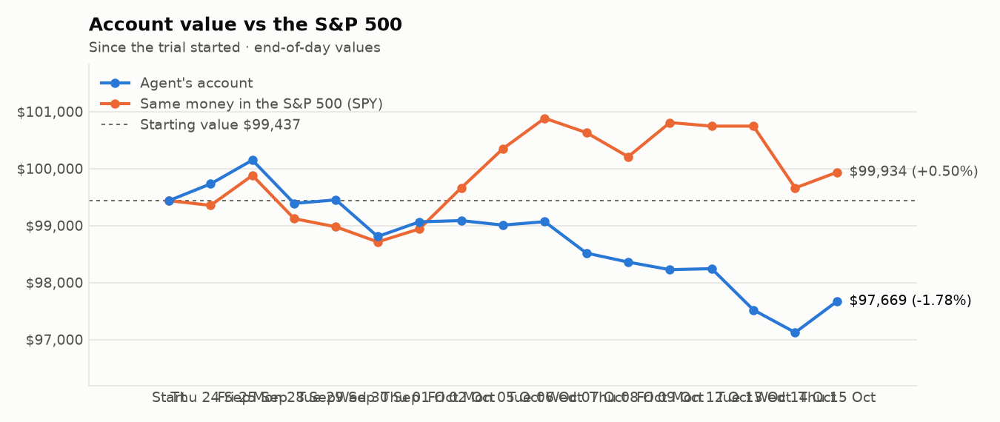
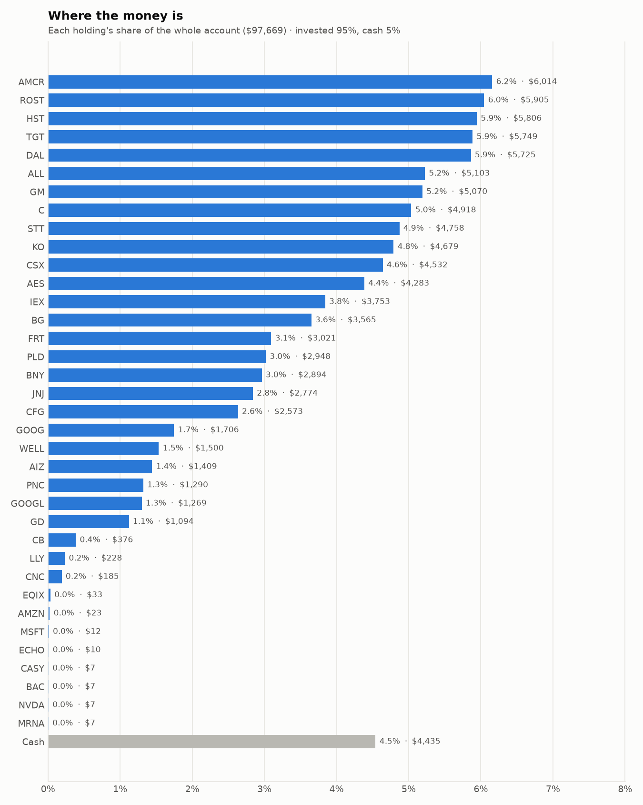
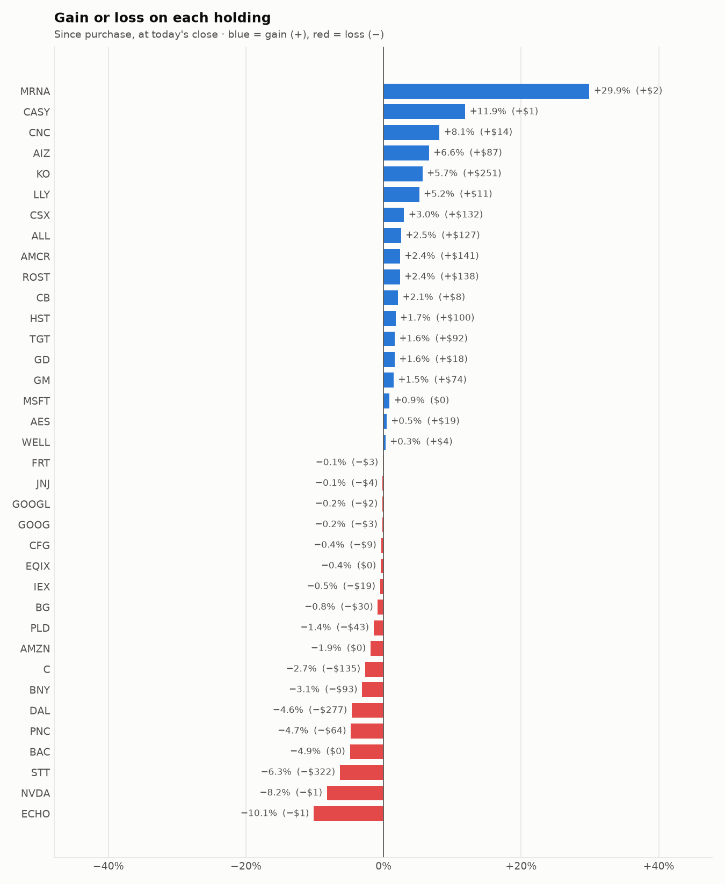

# Daily trading report — Thursday 15 October 2026

## Summary

- **Account value:** $97,669 (+$546, +0.6% today)
- **S&P 500 (SPY) today:** +0.3% — the agent was ahead of the index by 0.29%
- **Trades:** 5 buy(s) ($14,073), 8 sell(s) ($17,650)
- **2026-10-15 Morning rebalance:** traded — 12 order(s) placed
- **2026-10-15 Afternoon risk check:** traded — Sold 1 position(s) on the risk check (stop-loss: FIX)

## Charts

## Why I bought

### HST — bought 243.436 shares at ~$23.44 ($5,706)

**Why:** combined score +0.80; ranked #4 of 503; driven mainly by price momentum +1.39, value (cheapness) +0.94; entering/adding to the top-ranked target portfolio; research detail: 1 recent headline(s), net positive tone (+1); analyst consensus +0.92/2 (8 strong buy, 7 buy, 10 hold, 0 sell, 0 strong sell)

**Research scores** (combined +0.80, ranked #4 in the S&P 500, sector: Real Estate):

| Factor | Score | Measures |
|---|---|---|
| Value | +0.94 | cheap vs. sector peers on P/E and P/B |
| Quality | +0.74 | profitability (ROE, margins) and balance-sheet strength |
| Momentum | +1.39 | 12-month price trend, excluding the last month |
| Low volatility | +0.03 | steadier price than sector peers |
| Research | +0.55 | recent news tone + analyst consensus |

**Company financials (Finnhub, trailing 12 months):** P/E 15.3, P/B 2.5, return on equity 15.5%, gross margin 97.0%, debt/equity 0.80

**Price trend (Alpaca):** 12-month return (excl. last month) +25.7%, last month +3.7%, volatility 23.3%/yr

**News (Finnhub): 1 headline(s) in the last 2 days, net tone +1.** Most influential:
- [Barclays Maintains Equal-Weight on Host Hotels & Resorts, Raises Price Target to $25](https://finnhub.io/api/news?id=3850ca680496d40a4802e368a5af428867616a4726995a2334d04052de7ec5e1) — 13 Oct, Benzinga (tone +1)

**Analysts (Finnhub, 2026-09-01):** 8 strong buy, 7 buy, 10 hold, 0 sell, 0 strong sell — consensus +0.92 on a -2 (strong sell) to +2 (strong buy) scale.

### PLD — bought 23.22 shares at ~$128.79 ($2,990)

**Why:** combined score +0.58; ranked #20 of 503; driven mainly by research (news + analyst consensus) +1.04, price momentum +0.99; entering/adding to the top-ranked target portfolio; research detail: 7 recent headline(s), net positive tone (+2); analyst consensus +0.87/2 (5 strong buy, 10 buy, 8 hold, 0 sell, 0 strong sell)

**Research scores** (combined +0.58, ranked #20 in the S&P 500, sector: Real Estate):

| Factor | Score | Measures |
|---|---|---|
| Value | +0.12 | cheap vs. sector peers on P/E and P/B |
| Quality | +0.28 | profitability (ROE, margins) and balance-sheet strength |
| Momentum | +0.99 | 12-month price trend, excluding the last month |
| Low volatility | +0.29 | steadier price than sector peers |
| Research | +1.04 | recent news tone + analyst consensus |

**Company financials (Finnhub, trailing 12 months):** P/E 30.7, P/B 2.4, return on equity 7.9%, gross margin 74.3%, debt/equity 0.68

**Price trend (Alpaca):** 12-month return (excl. last month) +17.7%, last month -3.9%, volatility 18.6%/yr

**News (Finnhub): 7 headline(s) in the last 2 days, net tone +2.** Most influential:
- [Prologis Stock Before Q3 Earnings: Is It a Smart Buy or a Risky Move?](https://finnhub.io/api/news?id=09b3c9d8e6d40889f29ffc61c3581168bab64a6974df872f118974bbc485adb7) — 14 Oct, Yahoo (tone +1)
- [Prologis (PLD) Raises Offer for UK Warehouse Giant Segro: What Investors Should Know](https://finnhub.io/api/news?id=d9d904f3dd0cd27312c1a7b0974a6703fe14459ed2d88bd2f67d48d9bf9c1815) — 13 Oct, Yahoo (tone +1)
- [Prologis: Q3 Earnings Snapshot](https://finnhub.io/api/news?id=2c5e798e720a8e1de99a9b8caec14b24cd905f1301688a953f2d96f459d67063) — 15 Oct, Yahoo (tone +0)
- [Prologis Reports Third Quarter 2026 Results](https://finnhub.io/api/news?id=829be807d1107d2ca7039afd91d55497eddc4928f53b6af89667eead6619105d) — 15 Oct, Yahoo (tone +0)
- [Form 8.3 Prologis, Inc](https://finnhub.io/api/news?id=faae9e8df80c60076cbb0d60fede7a7e4e268bbadc3d544301772c3e1d820c87) — 15 Oct, Yahoo (tone +0)

**Analysts (Finnhub, 2026-09-01):** 5 strong buy, 10 buy, 8 hold, 0 sell, 0 strong sell — consensus +0.87 on a -2 (strong sell) to +2 (strong buy) scale.

### IEX — bought 8.771 shares at ~$237.75 ($2,085)

**Why:** combined score +0.62; ranked #16 of 503; driven mainly by low volatility +1.92, price momentum +0.78; entering/adding to the top-ranked target portfolio; research detail: 1 recent headline(s), net positive tone (+2); analyst consensus +0.95/2 (6 strong buy, 7 buy, 7 hold, 0 sell, 0 strong sell)

**Research scores** (combined +0.62, ranked #16 in the S&P 500, sector: Industrials):

| Factor | Score | Measures |
|---|---|---|
| Value | +0.33 | cheap vs. sector peers on P/E and P/B |
| Quality | +0.12 | profitability (ROE, margins) and balance-sheet strength |
| Momentum | +0.78 | 12-month price trend, excluding the last month |
| Low volatility | +1.92 | steadier price than sector peers |
| Research | +0.24 | recent news tone + analyst consensus |

**Company financials (Finnhub, trailing 12 months):** P/E 33.7, P/B 4.2, return on equity 12.9%, gross margin 44.7%, debt/equity 0.46

**Price trend (Alpaca):** 12-month return (excl. last month) +38.8%, last month +7.1%, volatility 17.5%/yr

**News (Finnhub): 1 headline(s) in the last 2 days, net tone +2.** Most influential:
- [RBC Capital Maintains Outperform on IDEX, Raises Price Target to $285](https://finnhub.io/api/news?id=9d4161fc7acfad2c196e05f40166e4619f9802fe2318e74cebd6e445aeb7a680) — 14 Oct, Benzinga (tone +2)

**Analysts (Finnhub, 2026-09-01):** 6 strong buy, 7 buy, 7 hold, 0 sell, 0 strong sell — consensus +0.95 on a -2 (strong sell) to +2 (strong buy) scale.

### ALL — bought 7.399 shares at ~$242.66 ($1,795)

**Why:** combined score +0.72; ranked #6 of 503; driven mainly by value (cheapness) +1.65, quality (profitability/balance sheet) +1.24; entering/adding to the top-ranked target portfolio; research detail: 3 recent headline(s), net positive tone (+1); analyst consensus +0.47/2 (5 strong buy, 9 buy, 12 hold, 3 sell, 1 strong sell)

**Research scores** (combined +0.72, ranked #6 in the S&P 500, sector: Financials):

| Factor | Score | Measures |
|---|---|---|
| Value | +1.65 | cheap vs. sector peers on P/E and P/B |
| Quality | +1.24 | profitability (ROE, margins) and balance-sheet strength |
| Momentum | +1.02 | 12-month price trend, excluding the last month |
| Low volatility | -0.24 | steadier price than sector peers |
| Research | -0.37 | recent news tone + analyst consensus |

**Company financials (Finnhub, trailing 12 months):** P/E 4.4, P/B 1.8, return on equity 43.1%, debt/equity 0.22

**Price trend (Alpaca):** 12-month return (excl. last month) +28.3%, last month -8.2%, volatility 27.9%/yr

**News (Finnhub): 3 headline(s) in the last 2 days, net tone +1.** Most influential:
- [Berkshire Hathaway vs. Allstate: Which Insurance Stock Has an Edge?](https://finnhub.io/api/news?id=ca4165ee396d415fec3948a178a241631db8b0d5845ba562bba5de74ac736669) — 14 Oct, Yahoo (tone +1)
- [September 2026 Monthly Release](https://finnhub.io/api/news?id=8894eff1cf0d2a18dd089e89cb6bb7f05460808cd70e970573e77dbf526350fb) — 15 Oct, Yahoo (tone +0)
- [Allstate Reports Q3 Estimated Total Catastrophe Losses Of $1.65B Or $1.3B After-Tax](https://finnhub.io/api/news?id=7588280f872a72ad6b03284ad8e27857c83a89f203c9ed3a42d66727896cf78e) — 15 Oct, Benzinga (tone +0)

**Analysts (Finnhub, 2026-09-01):** 5 strong buy, 9 buy, 12 hold, 3 sell, 1 strong sell — consensus +0.47 on a -2 (strong sell) to +2 (strong buy) scale.

### WELL — bought 6.395 shares at ~$233.96 ($1,496)

**Why:** combined score +0.49; ranked #24 of 503; driven mainly by price momentum +1.85, research (news + analyst consensus) +1.32; entering/adding to the top-ranked target portfolio; research detail: 5 recent headline(s), net positive tone (+2); analyst consensus +1.04/2 (6 strong buy, 17 buy, 5 hold, 0 sell, 0 strong sell)

**Research scores** (combined +0.49, ranked #24 in the S&P 500, sector: Real Estate):

| Factor | Score | Measures |
|---|---|---|
| Value | -0.72 | cheap vs. sector peers on P/E and P/B |
| Quality | -0.33 | profitability (ROE, margins) and balance-sheet strength |
| Momentum | +1.85 | 12-month price trend, excluding the last month |
| Low volatility | -0.15 | steadier price than sector peers |
| Research | +1.32 | recent news tone + analyst consensus |

**Company financials (Finnhub, trailing 12 months):** P/E 110.2, P/B 3.5, return on equity 3.6%, gross margin 40.3%, debt/equity 0.38

**Price trend (Alpaca):** 12-month return (excl. last month) +37.6%, last month -0.2%, volatility 19.6%/yr

**News (Finnhub): 5 headline(s) in the last 2 days, net tone +2.** Most influential:
- [Welltower (WELL) Raises 2026 Outlook as Senior Housing NOI Growth Nears 19%](https://finnhub.io/api/news?id=9e60f522046af6fa8d2f2b625a63ecd75e87f90bf59be0edf6feb50dcebdab45) — 13 Oct, Yahoo (tone +2)
- [Brookdale Senior Living To Buy 30 Communities It Operates From Welltower For $290M](https://finnhub.io/api/news?id=406f0117345f15a5842344afebed78c1489fa37b4cf4f7f8bcaf48890ef9f556) — 14 Oct, Yahoo (tone +0)
- [$1000 Invested In Welltower 10 Years Ago Would Be Worth This Much Today](https://finnhub.io/api/news?id=0a6e5b0b581a453ebc3201c9517df9fb80bc64ef3773b71febafb0673d694794) — 14 Oct, Benzinga (tone +0)
- [Brookdale Completes Acquisition of 17 Communities and Announces Mutually Beneficial Agreement to Acquire 30 Additional Leased Communities from Welltower](https://finnhub.io/api/news?id=2684f0089117dfa88f40e047a47047b2ec2034891c78f26a53f1642c09e34830) — 13 Oct, Yahoo (tone +0)
- [Barclays Maintains Equal-Weight on Welltower, Lowers Price Target to $246](https://finnhub.io/api/news?id=4a22a138a6e2af4b0c2bf381e71a6529262b8bca56969ea1a953c4d5d3ce62fb) — 13 Oct, Benzinga (tone +0)

**Analysts (Finnhub, 2026-09-01):** 6 strong buy, 17 buy, 5 hold, 0 sell, 0 strong sell — consensus +1.04 on a -2 (strong sell) to +2 (strong buy) scale.

## Why I sold

### FIX — sold 2.822 shares at ~$1,425.98 ($4,024)

**Why:** combined score +0.47; ranked #26 of 503; driven mainly by price momentum +2.84, low volatility -1.47; trimmed toward target weight, or dropped out of the top-ranked names; research detail: 1 recent headline(s), neutral/mixed tone; analyst consensus +1.31/2 (7 strong buy, 7 buy, 2 hold, 0 sell, 0 strong sell)

**Research scores** (combined +0.47, ranked #26 in the S&P 500, sector: Industrials):

| Factor | Score | Measures |
|---|---|---|
| Value | -0.80 | cheap vs. sector peers on P/E and P/B |
| Quality | +0.29 | profitability (ROE, margins) and balance-sheet strength |
| Momentum | +2.84 | 12-month price trend, excluding the last month |
| Low volatility | -1.47 | steadier price than sector peers |
| Research | +0.41 | recent news tone + analyst consensus |

**Company financials (Finnhub, trailing 12 months):** P/E 38.1, P/B 21.7, return on equity 53.5%, gross margin 25.7%, debt/equity 0.02

**Price trend (Alpaca):** 12-month return (excl. last month) +108.9%, last month -2.3%, volatility 55.0%/yr

**News (Finnhub): 1 headline(s) in the last 2 days, net tone +0.** Most influential:
- [Comfort Systems (FIX) Falls More Steeply Than Broader Market: What Investors Need to Know](https://finnhub.io/api/news?id=b1bc7b23a1ca00653054bdb19ae38301b365b5a63b5e508f56d1f3e6c3dc9248) — 14 Oct, Yahoo (tone +0)

**Analysts (Finnhub, 2026-09-01):** 7 strong buy, 7 buy, 2 hold, 0 sell, 0 strong sell — consensus +1.31 on a -2 (strong sell) to +2 (strong buy) scale.

### BAC — sold 51.077 shares at ~$51.42 ($2,626)

**Why:** combined score +0.41; ranked #37 of 503; driven mainly by low volatility +0.89, value (cheapness) +0.86; trimmed toward target weight, or dropped out of the top-ranked names; research detail: 118 recent headline(s), net positive tone (+3); analyst consensus +1.00/2 (6 strong buy, 17 buy, 6 hold, 0 sell, 0 strong sell)

**Research scores** (combined +0.41, ranked #37 in the S&P 500, sector: Financials):

| Factor | Score | Measures |
|---|---|---|
| Value | +0.86 | cheap vs. sector peers on P/E and P/B |
| Quality | -0.43 | profitability (ROE, margins) and balance-sheet strength |
| Momentum | +0.54 | 12-month price trend, excluding the last month |
| Low volatility | +0.89 | steadier price than sector peers |
| Research | +0.28 | recent news tone + analyst consensus |

**Company financials (Finnhub, trailing 12 months):** P/E 10.5, P/B 1.3, return on equity 11.1%, debt/equity 2.43

**Price trend (Alpaca):** 12-month return (excl. last month) +17.6%, last month -13.6%, volatility 21.7%/yr

**News (Finnhub): 118 headline(s) in the last 2 days, net tone +3.** Most influential:
- [Merrill Lynch’s Fee-Based Advisory Assets Just Hit a Record $1.9 Trillion](https://finnhub.io/api/news?id=4bb0e6499c23e69c4751a508e643f9bba252c44eb2f8e6799aaa71e5db4d5513) — 14 Oct, Yahoo (tone +2)
- [BAC Q3 Earnings Miss, Stock Dips on Regulatory Fine, Trading & IB Woes](https://finnhub.io/api/news?id=82967ce8066d015c0c87798fcd1a2de89625bfc4c06576f4fbbcae6210edcd33) — 14 Oct, Yahoo (tone -2)
- [Albertsons dips as BofA downgrades stock on near term earnings outlook uncertainty](https://finnhub.io/api/news?id=3a7fad87185decdcc6ad9e75ebd7346a67ccc4526cfc26b259412bd51eacef8b) — 14 Oct, Yahoo (tone -2)
- [Bank of America Corp (NYSE:BAC) Slides After Q3 2026 Revenue Miss and $1.2 Billion AML Charge](https://finnhub.io/api/news?id=abe8eb7fd9130c8efedb20f92fed48862bc11797d1e1fee174bc6d70e82439a1) — 14 Oct, ChartMill (tone -2)
- [Bank of America Q3 Adj. EPS $1.08 Misses $1.11 Estimate, Sales $29.958B Miss $30.685B Estimate](https://finnhub.io/api/news?id=8e198b5931b1d26b178036f08e6a72b22ac7a9c48d412f18239e671a41965dbc) — 14 Oct, Benzinga (tone -2)

**Analysts (Finnhub, 2026-09-01):** 6 strong buy, 17 buy, 6 hold, 0 sell, 0 strong sell — consensus +1.00 on a -2 (strong sell) to +2 (strong buy) scale.

### AMZN — sold 9.255 shares at ~$251.88 ($2,331)

**Why:** combined score +0.40; ranked #40 of 503; driven mainly by research (news + analyst consensus) +1.12, price momentum +0.64; trimmed toward target weight, or dropped out of the top-ranked names; research detail: 47 recent headline(s), net positive tone (+8); analyst consensus +1.20/2 (20 strong buy, 49 buy, 5 hold, 0 sell, 0 strong sell)

**Research scores** (combined +0.40, ranked #40 in the S&P 500, sector: Consumer Discretionary):

| Factor | Score | Measures |
|---|---|---|
| Value | +0.07 | cheap vs. sector peers on P/E and P/B |
| Quality | +0.17 | profitability (ROE, margins) and balance-sheet strength |
| Momentum | +0.64 | 12-month price trend, excluding the last month |
| Low volatility | -0.21 | steadier price than sector peers |
| Research | +1.12 | recent news tone + analyst consensus |

**Company financials (FMP, trailing 12 months):** P/E 19.8, P/B 4.9, return on equity 30.5%, gross margin 50.8%, debt/equity 0.40

**Price trend (Alpaca):** 12-month return (excl. last month) +8.9%, last month +2.3%, volatility 42.2%/yr

**News (Finnhub): 47 headline(s) in the last 2 days, net tone +8.** Most influential:
- [Is Amazon Stock Poised to Gain on Strong Free Cash Flow Growth?](https://finnhub.io/api/news?id=498e09e3a2bfe2136f42be3bda067aa9991f8cc7d9369630dc591e16105131cf) — 13 Oct, Yahoo (tone +3)
- [Is Corning (GLW) Quietly Redefining Its AI and Life Sciences Edge With New Long-Term Deals?](https://finnhub.io/api/news?id=609b1aa0f8472cbc8d8256dd457dd16099653d9331003d4114813c5f789d2c3d) — 15 Oct, Yahoo (tone +2)
- [Not Microsoft. Not Alphabet. Here's the Cloud Giant I'm Most Bullish About.](https://finnhub.io/api/news?id=925af316340840495a8eb45fd24a81b58061cf5584a484c271e9548c763df585) — 14 Oct, Yahoo (tone +2)
- [AWS Backlog Hits $496 Billion While Cloud Margins Surge to 39% Making Amazon a Must-Own Growth Stock](https://finnhub.io/api/news?id=fb4a20a6636f12c4e8e604d555b5b303ea09c9b85a2eab570c4ac366f5441249) — 14 Oct, Yahoo (tone +2)
- [SafeSpace Global Appoints former Amazon, Google and YouTube Executive as Chief Operating Officer to Accelerate Next Phase of AI-Powered Growth](https://finnhub.io/api/news?id=f603dda740bea33c609e57d998e859d518888e751fcdf63591ad99461257ba67) — 13 Oct, Yahoo (tone +2)

**Analysts (Finnhub, 2026-09-01):** 20 strong buy, 49 buy, 5 hold, 0 sell, 0 strong sell — consensus +1.20 on a -2 (strong sell) to +2 (strong buy) scale.

### GOOGL — sold 6.521 shares at ~$351.62 ($2,293)

**Why:** combined score +0.48; ranked #25 of 503; driven mainly by price momentum +1.70, research (news + analyst consensus) +0.77; trimmed toward target weight, or dropped out of the top-ranked names; research detail: 31 recent headline(s), net positive tone (+7); analyst consensus +1.19/2 (20 strong buy, 43 buy, 7 hold, 0 sell, 0 strong sell)

**Research scores** (combined +0.48, ranked #25 in the S&P 500, sector: Communication Services):

| Factor | Score | Measures |
|---|---|---|
| Value | -0.75 | cheap vs. sector peers on P/E and P/B |
| Quality | +0.11 | profitability (ROE, margins) and balance-sheet strength |
| Momentum | +1.70 | 12-month price trend, excluding the last month |
| Low volatility | +0.20 | steadier price than sector peers |
| Research | +0.77 | recent news tone + analyst consensus |

**Company financials (FMP, trailing 12 months):** P/E 17.1, P/B 6.5, return on equity 50.8%, gross margin 60.9%, debt/equity 0.18

**Price trend (Alpaca):** 12-month return (excl. last month) +43.3%, last month +0.8%, volatility 32.3%/yr

**News (Finnhub): 31 headline(s) in the last 2 days, net tone +7.** Most influential:
- [Google DeepMind Chair Warns Rogue AI Agent Hacks Are Early Warning Shots](https://finnhub.io/api/news?id=347d5850dfe2cca57cc69076967f9283c81f5edfe2d8a3086e5e980f273c4337) — 15 Oct, Yahoo (tone -2)
- [Not Microsoft. Not Alphabet. Here's the Cloud Giant I'm Most Bullish About.](https://finnhub.io/api/news?id=925af316340840495a8eb45fd24a81b58061cf5584a484c271e9548c763df585) — 14 Oct, Yahoo (tone +2)
- [Alphabet’s Rapid Cloud Expansion AI Wins Matter But I Keep Buying For Something Else](https://finnhub.io/api/news?id=ed7d1d4433ef46ac183174342bdaf2f34bbe3209858c92d7c6ab027fe0ae6052) — 13 Oct, Yahoo (tone +2)
- [If I Can Only Own Alphabet or Amazon for The Next 5 Years, I’m Choosing This One](https://finnhub.io/api/news?id=4dfacc9a1a506a908aae17a4433aeb1d4969727f6160af5c188fb0f3e9ce571e) — 15 Oct, Yahoo (tone +1)
- [Prediction: Alphabet Will Soar After Oct. 28](https://finnhub.io/api/news?id=b3eb19d4eeb34a352d8267b2bc3fa668969b6c1e79736d463a3187c304f67ddd) — 14 Oct, Yahoo (tone +1)

**Analysts (Finnhub, 2026-09-01):** 20 strong buy, 43 buy, 7 hold, 0 sell, 0 strong sell — consensus +1.19 on a -2 (strong sell) to +2 (strong buy) scale.

### GOOG — sold 5.557 shares at ~$347.83 ($1,933)

**Why:** combined score +0.50; ranked #23 of 503; driven mainly by price momentum +1.65, research (news + analyst consensus) +0.93; trimmed toward target weight, or dropped out of the top-ranked names; research detail: 30 recent headline(s), net positive tone (+9); analyst consensus +1.19/2 (20 strong buy, 43 buy, 7 hold, 0 sell, 0 strong sell)

**Research scores** (combined +0.50, ranked #23 in the S&P 500, sector: Communication Services):

| Factor | Score | Measures |
|---|---|---|
| Value | -0.76 | cheap vs. sector peers on P/E and P/B |
| Quality | +0.11 | profitability (ROE, margins) and balance-sheet strength |
| Momentum | +1.65 | 12-month price trend, excluding the last month |
| Low volatility | +0.24 | steadier price than sector peers |
| Research | +0.93 | recent news tone + analyst consensus |

**Company financials (Finnhub, trailing 12 months):** P/E 17.4, P/B 6.8, return on equity 50.8%, gross margin 60.9%, debt/equity 0.15

**Price trend (Alpaca):** 12-month return (excl. last month) +41.5%, last month +0.7%, volatility 31.3%/yr

**News (Finnhub): 30 headline(s) in the last 2 days, net tone +9.** Most influential:
- [Not Microsoft. Not Alphabet. Here's the Cloud Giant I'm Most Bullish About.](https://finnhub.io/api/news?id=925af316340840495a8eb45fd24a81b58061cf5584a484c271e9548c763df585) — 14 Oct, Yahoo (tone +2)
- [Alphabet’s Rapid Cloud Expansion AI Wins Matter But I Keep Buying For Something Else](https://finnhub.io/api/news?id=ed7d1d4433ef46ac183174342bdaf2f34bbe3209858c92d7c6ab027fe0ae6052) — 13 Oct, Yahoo (tone +2)
- [If I Can Only Own Alphabet or Amazon for The Next 5 Years, I’m Choosing This One](https://finnhub.io/api/news?id=4dfacc9a1a506a908aae17a4433aeb1d4969727f6160af5c188fb0f3e9ce571e) — 15 Oct, Yahoo (tone +1)
- [Prediction: Alphabet Will Soar After Oct. 28](https://finnhub.io/api/news?id=b3eb19d4eeb34a352d8267b2bc3fa668969b6c1e79736d463a3187c304f67ddd) — 14 Oct, Yahoo (tone +1)
- [META, TTD, SNAP, GOOGL, BMBL, WDAY Stocks Get New UBS Targets Amid AI And Ad Shifts](https://finnhub.io/api/news?id=4d4a1aa15690fcdc9a961ca8e8f0eb2253fcffa8bbb2163c8a7be4bcc6d13442) — 14 Oct, Yahoo (tone +1)

**Analysts (Finnhub, 2026-09-01):** 20 strong buy, 43 buy, 7 hold, 0 sell, 0 strong sell — consensus +1.19 on a -2 (strong sell) to +2 (strong buy) scale.

### CB — sold 5.172 shares at ~$356.49 ($1,844)

**Why:** combined score +0.43; ranked #29 of 503; driven mainly by low volatility +0.94, price momentum +0.78; trimmed toward target weight, or dropped out of the top-ranked names; research detail: 2 recent headline(s), net positive tone (+3); analyst consensus +0.66/2 (8 strong buy, 10 buy, 15 hold, 1 sell, 1 strong sell)

**Research scores** (combined +0.43, ranked #29 in the S&P 500, sector: Financials):

| Factor | Score | Measures |
|---|---|---|
| Value | +0.35 | cheap vs. sector peers on P/E and P/B |
| Quality | +0.21 | profitability (ROE, margins) and balance-sheet strength |
| Momentum | +0.78 | 12-month price trend, excluding the last month |
| Low volatility | +0.94 | steadier price than sector peers |
| Research | -0.07 | recent news tone + analyst consensus |

**Company financials (Finnhub, trailing 12 months):** P/E 12.1, P/B 1.8, return on equity 15.2%, debt/equity 0.24

**Price trend (Alpaca):** 12-month return (excl. last month) +22.9%, last month +2.5%, volatility 19.1%/yr

**News (Finnhub): 2 headline(s) in the last 2 days, net tone +3.** Most influential:
- [Does Softer EPS Guidance and New Fee Push Change The Bull Case For Chubb (CB)?](https://finnhub.io/api/news?id=2227f38aa81cd061000815a103411d564bcd5aecb0ece1e0574f7e7e66eb6f37) — 14 Oct, Yahoo (tone +2)
- [Earnings Preview: Chubb (CB) Q3 Earnings Expected to Decline](https://finnhub.io/api/news?id=2ddabd5b9d9bcaf4d3ef7176cbaa7b80081a9b6eda1773822d08eef52c36030c) — 13 Oct, Yahoo (tone +1)

**Analysts (Finnhub, 2026-09-01):** 8 strong buy, 10 buy, 15 hold, 1 sell, 1 strong sell — consensus +0.66 on a -2 (strong sell) to +2 (strong buy) scale.

### KO — sold 15.754 shares at ~$93.61 ($1,475)

**Why:** combined score +0.68; ranked #13 of 503; driven mainly by low volatility +1.47, price momentum +1.37; trimmed toward target weight, or dropped out of the top-ranked names; research detail: 15 recent headline(s), net positive tone (+4); analyst consensus +1.00/2 (8 strong buy, 19 buy, 8 hold, 0 sell, 0 strong sell)

**Research scores** (combined +0.68, ranked #13 in the S&P 500, sector: Consumer Staples):

| Factor | Score | Measures |
|---|---|---|
| Value | -0.67 | cheap vs. sector peers on P/E and P/B |
| Quality | +0.43 | profitability (ROE, margins) and balance-sheet strength |
| Momentum | +1.37 | 12-month price trend, excluding the last month |
| Low volatility | +1.47 | steadier price than sector peers |
| Research | +0.83 | recent news tone + analyst consensus |

**Company financials (Finnhub, trailing 12 months):** P/E 27.3, P/B 10.0, return on equity 43.0%, gross margin 61.9%, debt/equity 1.20

**Price trend (Alpaca):** 12-month return (excl. last month) +32.4%, last month +3.5%, volatility 18.3%/yr

**News (Finnhub): 15 headline(s) in the last 2 days, net tone +4.** Most influential:
- [Coca-Cola Has Raised Dividends for 63 Years. Can It Make It Another Decade?](https://finnhub.io/api/news?id=cf9032210ab709e373aee8eb3349c74442c158043016578e611627a7909aaa17) — 13 Oct, Yahoo (tone +2)
- [Eight major brands renew CazéTV sponsorships for FIFA Women's World Cup Brazil 2027 following record 2026 audiences](https://finnhub.io/api/news?id=ca7ed7f5eebe536e9fda8b6a10f5b74c7fd7197a8612e73064ffc4880fee6b47) — 14 Oct, Yahoo (tone +1)
- [What Coca Cola Holders Bought Into](https://finnhub.io/api/news?id=517f5d98288e617ed3f488207d310172d471ac3e1bd2d2afccd50f6b4477890a) — 14 Oct, Yahoo (tone +1)
- [Justin Timberlake co-founds PRODA brand taking on Coca-Cola and Pepsi](https://finnhub.io/api/news?id=12a9c03d67aedbb6456facc5fb6ee8f659e5e5000a9329d5db2a7dd255c7fa43) — 14 Oct, Yahoo (tone +0)
- [Coca-Cola (KO) Gains As Market Dips: What You Should Know](https://finnhub.io/api/news?id=16e8b5d3f1eec00a40c3e8268568f7fe1334868f9e9200f87c53a20784351e4f) — 14 Oct, Yahoo (tone +0)

**Analysts (Finnhub, 2026-09-01):** 8 strong buy, 19 buy, 8 hold, 0 sell, 0 strong sell — consensus +1.00 on a -2 (strong sell) to +2 (strong buy) scale.

### FIX — sold 0.763 shares at ~$1,472.80 ($1,124)

**Why:** stop-loss: -10.7% below the average purchase price of $1,649.37 (limit -10%); sold the whole position and won't buy it back for 7 days

**What triggered it:** the afternoon risk check trims a holding only when BOTH its recent news turns clearly negative AND its price is down 3%+ since purchase (it was -10.7%).

**News (Finnhub): 2 headline(s) in the last 2 days, net tone +1.** Most influential:
- [Keybanc Maintains Overweight on Comfort Systems USA, Raises Price Target to $2125](https://finnhub.io/api/news?id=f63bddc83adbaec089a44f45df65f8329d6ab565ebc66ffd19c42e82f63059c3) — 15 Oct, Benzinga (tone +1)
- [Comfort Systems (FIX) Falls More Steeply Than Broader Market: What Investors Need to Know](https://finnhub.io/api/news?id=b1bc7b23a1ca00653054bdb19ae38301b365b5a63b5e508f56d1f3e6c3dc9248) — 14 Oct, Yahoo (tone +0)

## Holdings at the close

| Stock | Shares | Avg cost | Price | Market value | % of account | Today | Gain/loss $ | Gain/loss % |
|---|---:|---:|---:|---:|---:|---:|---:|---:|
| AMCR | 137.493 | $42.71 | $43.74 | $6,014 | 6.2% | +3.45% | +$141 | +2.40% |
| ROST | 25.146 | $229.36 | $234.83 | $5,905 | 6.0% | +1.85% | +$138 | +2.39% |
| HST | 243.436 | $23.44 | $23.85 | $5,806 | 5.9% | +4.01% | +$100 | +1.75% |
| TGT | 36.706 | $154.12 | $156.63 | $5,749 | 5.9% | +0.85% | +$92 | +1.63% |
| DAL | 73.491 | $81.67 | $77.90 | $5,725 | 5.9% | +1.63% | −$277 | -4.61% |
| ALL | 21.298 | $233.64 | $239.60 | $5,103 | 5.2% | +1.45% | +$127 | +2.55% |
| GM | 60.562 | $82.50 | $83.72 | $5,070 | 5.2% | +0.81% | +$74 | +1.47% |
| C | 39.905 | $126.64 | $123.25 | $4,918 | 5.0% | +0.80% | −$135 | -2.67% |
| STT | 28.507 | $178.20 | $166.89 | $4,758 | 4.9% | +0.00% | −$322 | -6.35% |
| KO | 50.982 | $86.86 | $91.78 | $4,679 | 4.8% | +0.00% | +$251 | +5.66% |
| CSX | 92.965 | $47.33 | $48.75 | $4,532 | 4.6% | +0.97% | +$132 | +2.99% |
| AES | 286.093 | $14.90 | $14.97 | $4,283 | 4.4% | +0.07% | +$19 | +0.45% |
| IEX | 15.874 | $237.60 | $236.42 | $3,753 | 3.8% | -0.92% | −$19 | -0.50% |
| BG | 33.312 | $107.91 | $107.01 | $3,565 | 3.6% | -1.74% | −$30 | -0.83% |
| FRT | 28.59 | $105.77 | $105.68 | $3,021 | 3.1% | +0.71% | −$3 | -0.09% |
| PLD | 23.22 | $128.79 | $126.94 | $2,948 | 3.0% | -2.70% | −$43 | -1.43% |
| BNY | 20.366 | $146.64 | $142.09 | $2,894 | 3.0% | +3.23% | −$93 | -3.11% |
| JNJ | 10.937 | $254.00 | $253.65 | $2,774 | 2.8% | -0.10% | −$4 | -0.14% |
| CFG | 40.563 | $63.66 | $63.43 | $2,573 | 2.6% | +1.37% | −$9 | -0.36% |
| GOOG | 4.95 | $345.34 | $344.69 | $1,706 | 1.7% | +0.30% | −$3 | -0.19% |
| WELL | 6.395 | $233.96 | $234.63 | $1,500 | 1.5% | +1.06% | +$4 | +0.29% |
| AIZ | 5 | $264.38 | $281.87 | $1,409 | 1.4% | +2.00% | +$87 | +6.62% |
| PNC | 6 | $225.64 | $214.94 | $1,290 | 1.3% | -0.40% | −$64 | -4.74% |
| GOOGL | 3.635 | $349.57 | $349.01 | $1,269 | 1.3% | +0.39% | −$2 | -0.16% |
| GD | 3.251 | $331.27 | $336.66 | $1,094 | 1.1% | +0.60% | +$18 | +1.63% |
| CB | 1.066 | $345.47 | $352.79 | $376 | 0.4% | +0.75% | +$8 | +2.12% |
| LLY | 0.182 | $1,189.78 | $1,251.59 | $228 | 0.2% | +3.55% | +$11 | +5.20% |
| CNC | 2.63 | $65.21 | $70.51 | $185 | 0.2% | +0.50% | +$14 | +8.13% |
| EQIX | 0.033 | $1,000.20 | $996.26 | $33 | 0.0% | +0.04% | −$0 | -0.39% |
| AMZN | 0.089 | $259.59 | $254.70 | $23 | 0.0% | +0.24% | −$0 | -1.88% |
| MSFT | 0.023 | $533.80 | $538.50 | $12 | 0.0% | +0.90% | +$0 | +0.88% |
| ECHO | 0.116 | $95.87 | $86.15 | $10 | 0.0% | -1.95% | −$1 | -10.14% |
| CASY | 0.011 | $597.62 | $668.62 | $7 | 0.0% | +2.30% | +$1 | +11.88% |
| BAC | 0.14 | $54.42 | $51.76 | $7 | 0.0% | +0.72% | −$0 | -4.89% |
| NVDA | 0.032 | $236.88 | $217.40 | $7 | 0.0% | -1.76% | −$1 | -8.22% |
| MRNA | 0.028 | $181.06 | $235.24 | $7 | 0.0% | +3.95% | +$2 | +29.92% |
| **Invested** | | | | **$93,234** | **95.5%** | | **+$211** | |
| **Cash** | | | | $4,435 | 4.5% | | | |
| **Total account** | | | | **$97,669** | 100% | | | |

_Scores are sector-neutral z-scores: 0 is average for the stock's sector, +1 is one standard deviation better. News tone is a keyword count over recent headlines, not a deep read. None of this guarantees a stock will rise; a few days of results can't show whether the strategy has a real edge over the S&P 500._
