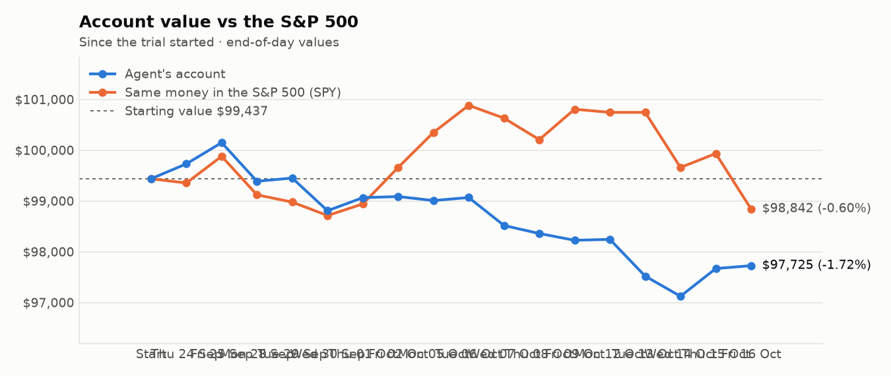
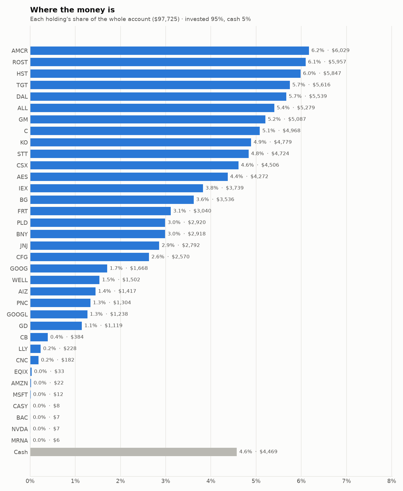
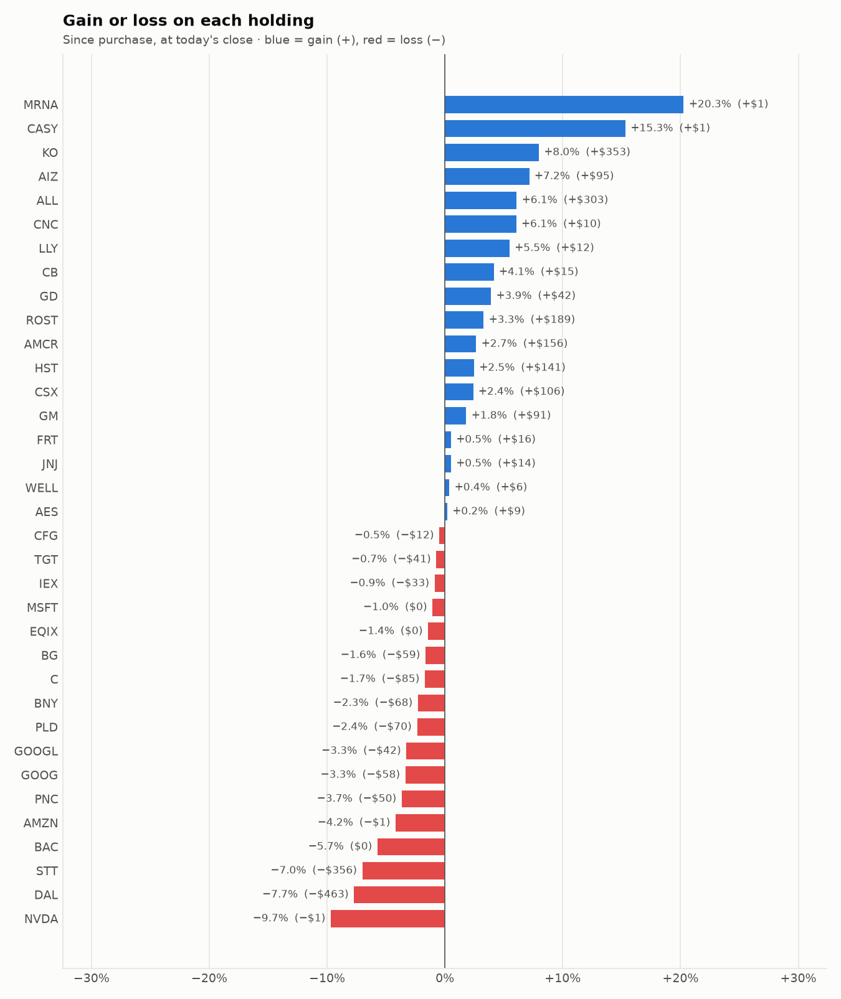

# Daily trading report — Friday 16 October 2026

## Summary

- **Account value:** $97,725 (+$56, +0.1% today)
- **S&P 500 (SPY) today:** -1.1% — the agent was ahead of the index by 1.15%
- **Trades:** 0 buy(s) ($0), 1 sell(s) ($10)
- **2026-10-16 Afternoon risk check:** traded — Sold 1 position(s) on the risk check (stop-loss: ECHO)
- **2026-10-16 Morning rebalance:** DID NOT RUN — no runner started it (a technical fault, not a trading decision).

## Charts

## Why I bought

No stocks were bought.

## Why I sold

### ECHO — sold 0.116 shares at ~$84.79 ($10)

**Why:** stop-loss: -11.5% below the average purchase price of $95.87 (limit -10%); sold the whole position and won't buy it back for 7 days

**What triggered it:** the afternoon risk check trims a holding only when BOTH its recent news turns clearly negative AND its price is down 3%+ since purchase (it was -11.5%).

**News (Finnhub): 3 headline(s) in the last 2 days, net tone +2.** Most influential:
- [This Semtech Analyst Turns Bullish; Here Are Top 5 Upgrades For Friday](https://finnhub.io/api/news?id=4dc74f10e0cb44a00533b3c02338502f7beb0dab585c48cd1ad6a5cc2c3a863c) — 16 Oct, Benzinga (tone +2)
- [Why Are SPCX, ECHO, KO Stocks Moving Premarket Today?](https://finnhub.io/api/news?id=9e72571ca0e9473cc5705b9fb290241be875169f5668ea075c904f937e865217) — 16 Oct, Yahoo (tone +0)
- [JP Morgan Upgrades EchoStar to Overweight, Announces $144 Price Target](https://finnhub.io/api/news?id=a76809b2564e0dbe1b1ddaf44c3717e1eba52e178190f995f9caed968e9f60ba) — 16 Oct, Benzinga (tone +0)

## Holdings at the close

| Stock | Shares | Avg cost | Price | Market value | % of account | Today | Gain/loss $ | Gain/loss % |
|---|---:|---:|---:|---:|---:|---:|---:|---:|
| AMCR | 137.493 | $42.71 | $43.85 | $6,029 | 6.2% | +0.25% | +$156 | +2.66% |
| ROST | 25.146 | $229.36 | $236.89 | $5,957 | 6.1% | +0.88% | +$189 | +3.28% |
| HST | 243.436 | $23.44 | $24.02 | $5,847 | 6.0% | +0.71% | +$141 | +2.47% |
| TGT | 36.706 | $154.12 | $153.00 | $5,616 | 5.7% | -2.32% | −$41 | -0.72% |
| DAL | 73.491 | $81.67 | $75.37 | $5,539 | 5.7% | -3.47% | −$463 | -7.71% |
| ALL | 21.298 | $233.64 | $247.88 | $5,279 | 5.4% | +3.46% | +$303 | +6.09% |
| GM | 60.562 | $82.50 | $84.00 | $5,087 | 5.2% | +0.41% | +$91 | +1.81% |
| C | 39.905 | $126.64 | $124.49 | $4,968 | 5.1% | +1.04% | −$85 | -1.69% |
| KO | 50.982 | $86.82 | $93.74 | $4,779 | 4.9% | +1.89% | +$353 | +7.98% |
| STT | 28.507 | $178.20 | $165.72 | $4,724 | 4.8% | -1.12% | −$356 | -7.00% |
| CSX | 92.965 | $47.33 | $48.47 | $4,506 | 4.6% | -0.45% | +$106 | +2.40% |
| AES | 286.093 | $14.90 | $14.93 | $4,272 | 4.4% | -0.25% | +$9 | +0.20% |
| IEX | 15.874 | $237.60 | $235.55 | $3,739 | 3.8% | -0.37% | −$33 | -0.86% |
| BG | 33.312 | $107.91 | $106.14 | $3,536 | 3.6% | -0.81% | −$59 | -1.64% |
| FRT | 28.59 | $105.77 | $106.32 | $3,040 | 3.1% | +0.61% | +$16 | +0.52% |
| PLD | 23.22 | $128.79 | $125.75 | $2,920 | 3.0% | -0.94% | −$70 | -2.36% |
| BNY | 20.366 | $146.64 | $143.30 | $2,918 | 3.0% | +0.85% | −$68 | -2.28% |
| JNJ | 10.937 | $254.00 | $255.31 | $2,792 | 2.9% | +0.80% | +$14 | +0.52% |
| CFG | 40.563 | $63.66 | $63.36 | $2,570 | 2.6% | -0.11% | −$12 | -0.47% |
| GOOG | 4.95 | $348.62 | $336.95 | $1,668 | 1.7% | -2.31% | −$58 | -3.35% |
| WELL | 6.395 | $233.96 | $234.85 | $1,502 | 1.5% | +0.09% | +$6 | +0.38% |
| AIZ | 5 | $264.38 | $283.31 | $1,417 | 1.4% | +0.51% | +$95 | +7.16% |
| PNC | 6 | $225.64 | $217.39 | $1,304 | 1.3% | +1.14% | −$50 | -3.66% |
| GOOGL | 3.635 | $352.08 | $340.60 | $1,238 | 1.3% | -2.47% | −$42 | -3.26% |
| GD | 3.251 | $331.27 | $344.23 | $1,119 | 1.1% | +2.14% | +$42 | +3.91% |
| CB | 1.066 | $345.47 | $359.79 | $384 | 0.4% | +1.98% | +$15 | +4.15% |
| LLY | 0.182 | $1,189.78 | $1,255.00 | $228 | 0.2% | +0.27% | +$12 | +5.48% |
| CNC | 2.63 | $65.21 | $69.16 | $182 | 0.2% | -1.91% | +$10 | +6.06% |
| EQIX | 0.033 | $1,000.20 | $985.98 | $33 | 0.0% | -1.03% | −$0 | -1.42% |
| AMZN | 0.089 | $260.90 | $250.00 | $22 | 0.0% | -1.87% | −$1 | -4.18% |
| MSFT | 0.023 | $533.80 | $528.22 | $12 | 0.0% | -2.08% | −$0 | -1.05% |
| CASY | 0.011 | $597.62 | $689.22 | $8 | 0.0% | +2.31% | +$1 | +15.33% |
| BAC | 0.14 | $54.42 | $51.31 | $7 | 0.0% | -0.75% | −$0 | -5.71% |
| NVDA | 0.032 | $236.88 | $213.95 | $7 | 0.0% | -1.51% | −$1 | -9.68% |
| MRNA | 0.028 | $181.06 | $217.76 | $6 | 0.0% | -7.92% | +$1 | +20.27% |
| **Invested** | | | | **$93,256** | **95.4%** | | **+$221** | |
| **Cash** | | | | $4,469 | 4.6% | | | |
| **Total account** | | | | **$97,725** | 100% | | | |

_Scores are sector-neutral z-scores: 0 is average for the stock's sector, +1 is one standard deviation better. News tone is a keyword count over recent headlines, not a deep read. None of this guarantees a stock will rise; a few days of results can't show whether the strategy has a real edge over the S&P 500._
