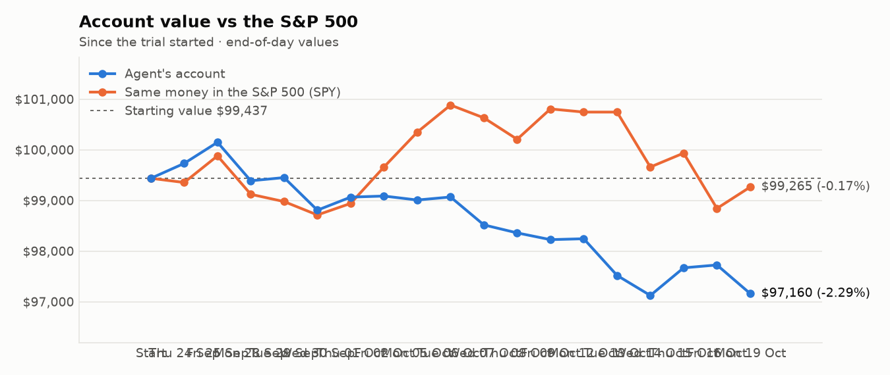
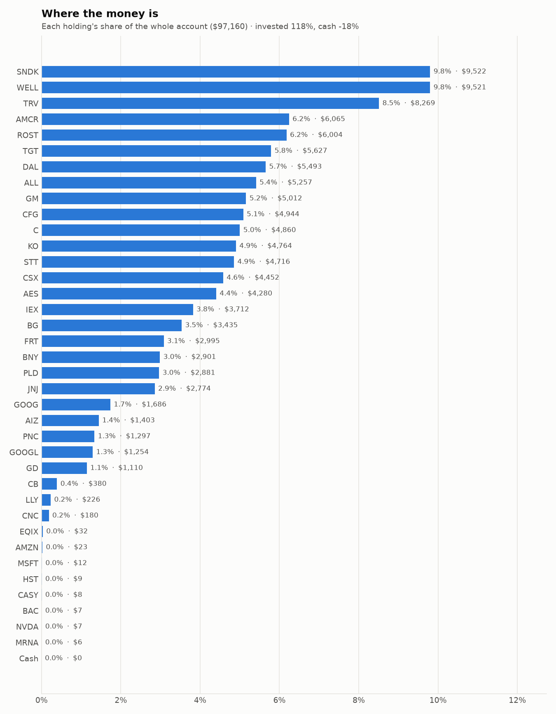
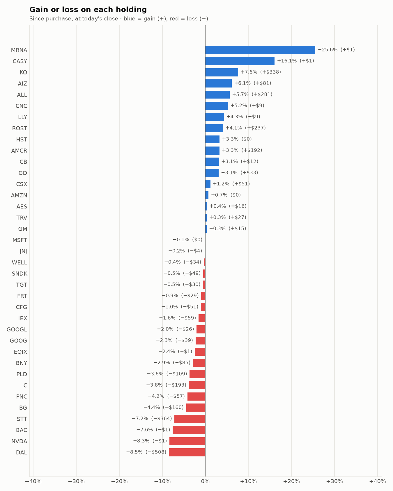

# Daily trading report — Monday 19 October 2026

## Summary

- **Account value:** $97,160 (-$565, -0.6% today)
- **S&P 500 (SPY) today:** +0.4% — the agent was behind the index by 1.01%
- **Trades:** 4 buy(s) ($28,286), 1 sell(s) ($5,849)
- **2026-10-19 Morning rebalance:** traded — 5 order(s) placed
- **2026-10-19 Afternoon risk check:** no trades needed — Risk-checked 37 holding(s): none was 12%+ below its purchase price, and none had both clearly negative news and a price drop of 3%+ since entry.

## Charts

## Why I bought

### SNDK — bought 6.938 shares at ~$1,379.50 ($9,571)

**Why:** combined score +1.43; ranked #2 of 503; driven mainly by price momentum +3.00, low volatility -1.36; entering/adding to the top-ranked target portfolio; research detail: 14 recent headline(s), net positive tone (+4); analyst consensus +1.18/2 (11 strong buy, 17 buy, 5 hold, 0 sell, 0 strong sell)

**Research scores** (combined +1.43, ranked #2 in the S&P 500, sector: Information Technology):

| Factor | Score | Measures |
|---|---|---|
| Value | +0.34 | cheap vs. sector peers on P/E and P/B |
| Quality | +0.83 | profitability (ROE, margins) and balance-sheet strength |
| Momentum | +3.00 | 12-month price trend, excluding the last month |
| Low volatility | -1.36 | steadier price than sector peers |
| Research | +1.03 | recent news tone + analyst consensus |

**Company financials (Finnhub, trailing 12 months):** P/E 16.4, P/B 16.4, return on equity 93.1%, gross margin 71.5%, debt/equity 0.00

**Price trend (Alpaca):** 12-month return (excl. last month) +1663.3%, last month -19.5%, volatility 105.7%/yr

**News (Finnhub): 14 headline(s) in the last 2 days, net tone +4.** Most influential:
- [Micron Technology vs. Sandisk: Which AI Memory Stock Is the Better Investment?](https://finnhub.io/api/news?id=309bcc166c8163e50d52451d0535d90e773c546669687709a1c6091bd979ca19) — 17 Oct, Yahoo (tone +2)
- [Dear Sandisk Stock Fans, Mark Your Calendar for October 29](https://finnhub.io/api/news?id=eba3ddae28d63bc0135784d06b0a0078b50f07be3977906f7007abfdb13fa875) — 18 Oct, Yahoo (tone +1)
- [The Best Growth Stock to Invest $10,000 in Right Now](https://finnhub.io/api/news?id=b7fcc2b45f4052e82a401295febec0036b949bf21668ec4ca201cb45bf953ccb) — 18 Oct, Yahoo (tone +1)
- [Sandisk Stock Is Still Up 488% This Year Despite a 40% Drop. Is It a Buy Now?](https://finnhub.io/api/news?id=cc6bd8240dfd1fca17ab1be851e2b0d2652ca80a46cccbcd3af2c74f2f8f5ec9) — 17 Oct, Yahoo (tone +1)
- [Missed Out On Micron and Sandisk? Make Sure You Don't Miss Out On This Memory Stock.](https://finnhub.io/api/news?id=910d4a121a7ae0884eef5028d8b66ce2bfc3980ce3e450190fc50363e729dad0) — 17 Oct, Yahoo (tone -1)

**Analysts (Finnhub, 2026-09-01):** 11 strong buy, 17 buy, 5 hold, 0 sell, 0 strong sell — consensus +1.18 on a -2 (strong sell) to +2 (strong buy) scale.

### TRV — bought 21.44 shares at ~$384.46 ($8,243)

**Why:** combined score +0.99; ranked #7 of 503; driven mainly by price momentum +1.53, research (news + analyst consensus) +0.99; entering/adding to the top-ranked target portfolio; research detail: 8 recent headline(s), net positive tone (+6); analyst consensus +0.20/2 (3 strong buy, 6 buy, 21 hold, 5 sell, 0 strong sell)

**Research scores** (combined +0.99, ranked #7 in the S&P 500, sector: Financials):

| Factor | Score | Measures |
|---|---|---|
| Value | +0.49 | cheap vs. sector peers on P/E and P/B |
| Quality | +0.58 | profitability (ROE, margins) and balance-sheet strength |
| Momentum | +1.53 | 12-month price trend, excluding the last month |
| Low volatility | +0.39 | steadier price than sector peers |
| Research | +0.99 | recent news tone + analyst consensus |

**Company financials (Finnhub, trailing 12 months):** P/E 9.8, P/B 2.1, return on equity 25.6%, debt/equity 0.27

**Price trend (Alpaca):** 12-month return (excl. last month) +39.6%, last month +2.5%, volatility 19.9%/yr

**News (Finnhub): 8 headline(s) in the last 2 days, net tone +6.** Most influential:
- [Earnings Beat Could Be A Big Moment For Travelers Stock (TRV)](https://finnhub.io/api/news?id=586f9c47ee6f605721650fc7005cad86b283b327bf347d83aea58502356b0482) — 17 Oct, Yahoo (tone +3)
- [TRV Q3 Deep Dive: Underwriting and Investment Strength Drive Stable Results](https://finnhub.io/api/news?id=fec114343190a544b09dd58ca11411fad50bf236ecf3ddff73f41a51d22fc781) — 19 Oct, Yahoo (tone +1)
- [Travelers (TRV) Q3 Results Reinforce Underwriting Strength As Pricing Softens](https://finnhub.io/api/news?id=2876c246cea22413881842ebda269ce3984cf74fe8aac936e9ba34de1fd8160c) — 17 Oct, Yahoo (tone +1)
- [Travelers: Strong Q3 Results, But Rising Interest Rates Pressure The Bond Portfolio](https://finnhub.io/api/news?id=00420bb91ffb242bdf6648cac31d91e29c22fbb9f269c75e6e3ab037bf36b68b) — 17 Oct, SeekingAlpha (tone +1)
- [Travelers’s Q3 Earnings Call: Our Top 5 Analyst Questions](https://finnhub.io/api/news?id=cbbaef7f8d06a5960a1f7590910d20f5f39dcf0a402fb939a8903fea972c337b) — 19 Oct, Yahoo (tone +0)

**Analysts (Finnhub, 2026-09-01):** 3 strong buy, 6 buy, 21 hold, 5 sell, 0 strong sell — consensus +0.20 on a -2 (strong sell) to +2 (strong buy) scale.

### WELL — bought 34.379 shares at ~$234.41 ($8,059)

**Why:** combined score +1.01; ranked #6 of 503; driven mainly by research (news + analyst consensus) +2.00, price momentum +1.95; entering/adding to the top-ranked target portfolio; research detail: 2 recent headline(s), net positive tone (+4); analyst consensus +1.04/2 (6 strong buy, 17 buy, 5 hold, 0 sell, 0 strong sell)

**Research scores** (combined +1.01, ranked #6 in the S&P 500, sector: Real Estate):

| Factor | Score | Measures |
|---|---|---|
| Value | -0.64 | cheap vs. sector peers on P/E and P/B |
| Quality | -0.23 | profitability (ROE, margins) and balance-sheet strength |
| Momentum | +1.95 | 12-month price trend, excluding the last month |
| Low volatility | -0.16 | steadier price than sector peers |
| Research | +2.00 | recent news tone + analyst consensus |

**Company financials (Finnhub, trailing 12 months):** P/E 111.4, P/B 3.5, return on equity 3.6%, gross margin 40.3%, debt/equity 0.38

**Price trend (Alpaca):** 12-month return (excl. last month) +40.5%, last month +1.2%, volatility 19.7%/yr

**News (Finnhub): 2 headline(s) in the last 2 days, net tone +4.** Most influential:
- [Ventas vs. Welltower: Which Senior Housing REIT Pays Retirees Better?](https://finnhub.io/api/news?id=e9adcba806ba8736db5ef0241c898861d60f95e47690c69d8148ee35dd807657) — 17 Oct, Yahoo (tone +2)
- [Welltower (NYSE:WELL): High Growth Momentum Meets a Breakout Setup](https://finnhub.io/api/news?id=592918d0fb9d1d9258dc0dfceb053652bcc84e5669eff361b641f66ada99aac2) — 17 Oct, ChartMill (tone +2)

**Analysts (Finnhub, 2026-09-01):** 6 strong buy, 17 buy, 5 hold, 0 sell, 0 strong sell — consensus +1.04 on a -2 (strong sell) to +2 (strong buy) scale.

### CFG — bought 38.221 shares at ~$63.14 ($2,413)

**Why:** combined score +1.09; ranked #4 of 503; driven mainly by research (news + analyst consensus) +1.92, price momentum +1.19; entering/adding to the top-ranked target portfolio; research detail: 9 recent headline(s), net positive tone (+12); analyst consensus +1.04/2 (5 strong buy, 14 buy, 4 hold, 0 sell, 0 strong sell)

**Research scores** (combined +1.09, ranked #4 in the S&P 500, sector: Financials):

| Factor | Score | Measures |
|---|---|---|
| Value | +0.94 | cheap vs. sector peers on P/E and P/B |
| Quality | -0.11 | profitability (ROE, margins) and balance-sheet strength |
| Momentum | +1.19 | 12-month price trend, excluding the last month |
| Low volatility | +0.41 | steadier price than sector peers |
| Research | +1.92 | recent news tone + analyst consensus |

**Company financials (Finnhub, trailing 12 months):** P/E 12.6, P/B 1.1, return on equity 8.1%, debt/equity 0.40

**Price trend (Alpaca):** 12-month return (excl. last month) +31.9%, last month -6.0%, volatility 21.1%/yr

**News (Finnhub): 9 headline(s) in the last 2 days, net tone +12.** Most influential:
- [5 Insightful Analyst Questions From Citizens Financial Group’s Q3 Earnings Call](https://finnhub.io/api/news?id=1c9faeaaa528fb9e7724731183503e3fd5e45ebc23069052fb15a6f46b17be65) — 19 Oct, Yahoo (tone +3)
- [CFG Q3 Deep Dive: Private Bank Growth and Deposit Discipline Offset Mixed Fee Trends](https://finnhub.io/api/news?id=c0f443bea3d056c2473a12822d841ebd722421c07840ab1e87a63b8a601c06e7) — 19 Oct, Yahoo (tone +2)
- [Citizens Financial Group (CFG) Stock Ignores Record Q3 Earnings Momentum](https://finnhub.io/api/news?id=858f2481db2362586fae1251fd3fea9c50deaf7c319bbd9f0522e8dd6f74c395) — 18 Oct, Yahoo (tone +2)
- [Citizens Financial Group (CFG) Lifts Dividend 13% After Strong Q3 And Bigger Buyback](https://finnhub.io/api/news?id=8ba53d9e7585a738bd59f8b9340637c7ff0221a574a7f66a0cbb8908419695c8) — 17 Oct, Yahoo (tone +2)
- [Citizens Financial Group: Reassessing Preferred Securities In A Dynamic Market Environment](https://finnhub.io/api/news?id=771fc66fcee8b9d018ccd4ec2c7849acd9d20ae3a5376f26f879d0639aef3920) — 18 Oct, SeekingAlpha (tone +1)

**Analysts (Finnhub, 2026-09-01):** 5 strong buy, 14 buy, 4 hold, 0 sell, 0 strong sell — consensus +1.04 on a -2 (strong sell) to +2 (strong buy) scale.

## Why I sold

### HST — sold 243.081 shares at ~$24.06 ($5,849)

**Why:** combined score +0.47; ranked #59 of 503; driven mainly by price momentum +1.25, research (news + analyst consensus) +0.12; trimmed toward target weight, or dropped out of the top-ranked names; research detail: analyst consensus +0.92/2 (8 strong buy, 7 buy, 10 hold, 0 sell, 0 strong sell)

**Research scores** (combined +0.47, ranked #59 in the S&P 500, sector: Real Estate):

| Factor | Score | Measures |
|---|---|---|
| Value | +0.00 | cheap vs. sector peers on P/E and P/B |
| Quality | +0.00 | profitability (ROE, margins) and balance-sheet strength |
| Momentum | +1.25 | 12-month price trend, excluding the last month |
| Low volatility | -0.05 | steadier price than sector peers |
| Research | +0.12 | recent news tone + analyst consensus |

**Price trend (Alpaca):** 12-month return (excl. last month) +24.0%, last month +9.4%, volatility 24.4%/yr

**News (Finnhub):** no headlines in the last 2 days.

**Analysts (Finnhub, 2026-09-01):** 8 strong buy, 7 buy, 10 hold, 0 sell, 0 strong sell — consensus +0.92 on a -2 (strong sell) to +2 (strong buy) scale.

## Holdings at the close

| Stock | Shares | Avg cost | Price | Market value | % of account | Today | Gain/loss $ | Gain/loss % |
|---|---:|---:|---:|---:|---:|---:|---:|---:|
| SNDK | 6.938 | $1,379.50 | $1,372.50 | $9,522 | 9.8% | +5.63% | −$49 | -0.51% |
| WELL | 40.774 | $234.34 | $233.51 | $9,521 | 9.8% | -0.57% | −$34 | -0.35% |
| TRV | 21.44 | $384.46 | $385.70 | $8,269 | 8.5% | -0.99% | +$27 | +0.32% |
| AMCR | 137.493 | $42.71 | $44.11 | $6,065 | 6.2% | +0.60% | +$192 | +3.27% |
| ROST | 25.146 | $229.36 | $238.78 | $6,004 | 6.2% | +0.80% | +$237 | +4.11% |
| TGT | 36.706 | $154.12 | $153.29 | $5,627 | 5.8% | -0.63% | −$30 | -0.54% |
| DAL | 73.491 | $81.67 | $74.75 | $5,493 | 5.7% | -0.82% | −$508 | -8.47% |
| ALL | 21.298 | $233.64 | $246.85 | $5,257 | 5.4% | -0.42% | +$281 | +5.65% |
| GM | 60.562 | $82.50 | $82.75 | $5,012 | 5.2% | -1.44% | +$15 | +0.30% |
| CFG | 78.784 | $63.41 | $62.76 | $4,944 | 5.1% | -0.95% | −$51 | -1.02% |
| C | 39.905 | $126.64 | $121.80 | $4,860 | 5.0% | -1.98% | −$193 | -3.82% |
| KO | 50.982 | $86.82 | $93.45 | $4,764 | 4.9% | -0.48% | +$338 | +7.64% |
| STT | 28.507 | $178.20 | $165.43 | $4,716 | 4.9% | -0.17% | −$364 | -7.17% |
| CSX | 92.965 | $47.33 | $47.88 | $4,452 | 4.6% | -1.63% | +$51 | +1.16% |
| AES | 286.093 | $14.90 | $14.96 | $4,280 | 4.4% | +0.07% | +$16 | +0.38% |
| IEX | 15.874 | $237.60 | $233.86 | $3,712 | 3.8% | -0.72% | −$59 | -1.58% |
| BG | 33.312 | $107.91 | $103.11 | $3,435 | 3.5% | -2.85% | −$160 | -4.45% |
| FRT | 28.59 | $105.77 | $104.77 | $2,995 | 3.1% | -1.46% | −$29 | -0.95% |
| BNY | 20.366 | $146.64 | $142.45 | $2,901 | 3.0% | -0.59% | −$85 | -2.86% |
| PLD | 23.22 | $128.79 | $124.09 | $2,881 | 3.0% | -1.32% | −$109 | -3.65% |
| JNJ | 10.937 | $254.00 | $253.62 | $2,774 | 2.9% | -0.76% | −$4 | -0.15% |
| GOOG | 4.95 | $348.62 | $340.66 | $1,686 | 1.7% | +1.11% | −$39 | -2.28% |
| AIZ | 5 | $264.38 | $280.56 | $1,403 | 1.4% | -0.97% | +$81 | +6.12% |
| PNC | 6 | $225.64 | $216.21 | $1,297 | 1.3% | -0.54% | −$57 | -4.18% |
| GOOGL | 3.635 | $352.08 | $344.92 | $1,254 | 1.3% | +1.27% | −$26 | -2.03% |
| GD | 3.251 | $331.27 | $341.43 | $1,110 | 1.1% | -0.81% | +$33 | +3.07% |
| CB | 1.066 | $345.47 | $356.27 | $380 | 0.4% | -0.98% | +$12 | +3.13% |
| LLY | 0.182 | $1,189.78 | $1,241.06 | $226 | 0.2% | -1.27% | +$9 | +4.31% |
| CNC | 2.63 | $65.21 | $68.63 | $180 | 0.2% | -0.77% | +$9 | +5.24% |
| EQIX | 0.033 | $1,000.20 | $975.71 | $32 | 0.0% | -1.04% | −$1 | -2.45% |
| AMZN | 0.089 | $260.90 | $262.82 | $23 | 0.0% | +5.13% | +$0 | +0.74% |
| MSFT | 0.023 | $533.80 | $533.40 | $12 | 0.0% | +0.82% | −$0 | -0.07% |
| HST | 0.355 | $23.44 | $24.21 | $9 | 0.0% | +1.00% | +$0 | +3.28% |
| CASY | 0.011 | $597.62 | $693.73 | $8 | 0.0% | +0.65% | +$1 | +16.08% |
| BAC | 0.14 | $54.42 | $50.30 | $7 | 0.0% | -1.82% | −$1 | -7.58% |
| NVDA | 0.032 | $236.88 | $217.13 | $7 | 0.0% | +1.40% | −$1 | -8.34% |
| MRNA | 0.028 | $181.06 | $227.34 | $6 | 0.0% | +4.28% | +$1 | +25.56% |
| **Invested** | | | | **$115,128** | **118.5%** | | **−$495** | |
| **Cash** | | | | $-17,968 | -18.5% | | | |
| **Total account** | | | | **$97,160** | 100% | | | |

_Scores are sector-neutral z-scores: 0 is average for the stock's sector, +1 is one standard deviation better. News tone is a keyword count over recent headlines, not a deep read. None of this guarantees a stock will rise; a few days of results can't show whether the strategy has a real edge over the S&P 500._
