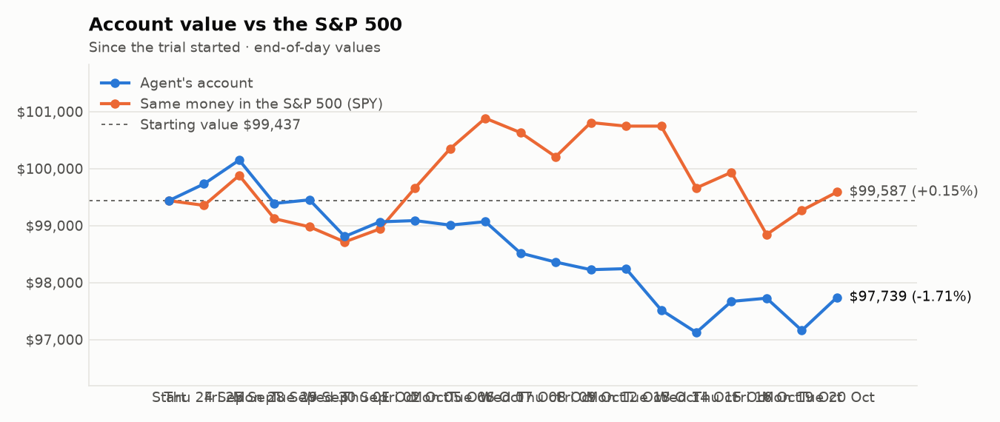
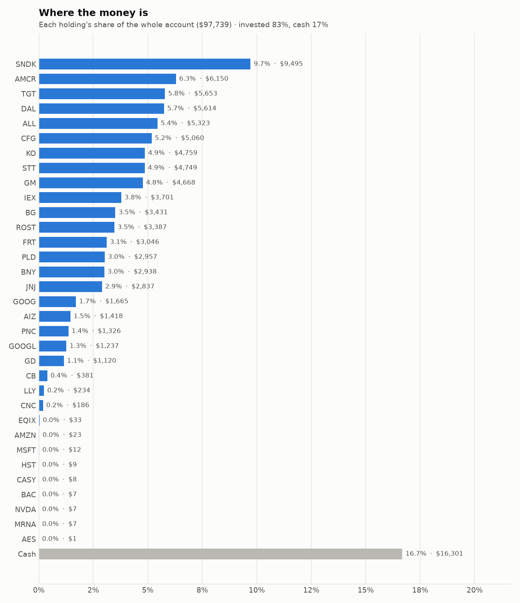
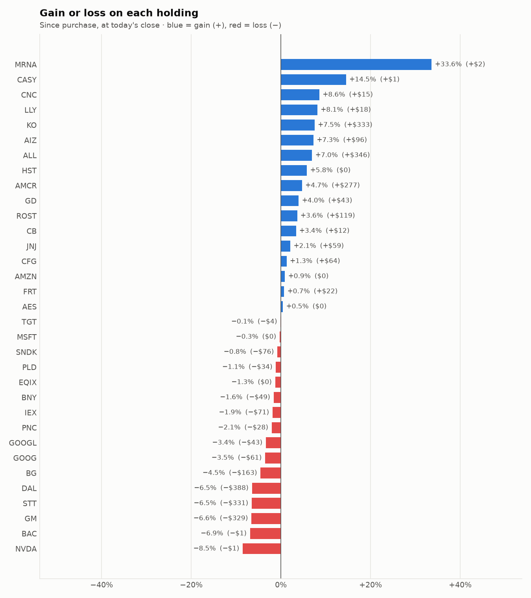

# Daily trading report — Tuesday 20 October 2026

## Summary

- **Account value:** $97,739 (+$579, +0.6% today)
- **S&P 500 (SPY) today:** +0.3% — the agent was ahead of the index by 0.27%
- **Trades:** 0 buy(s) ($0), 6 sell(s) ($34,269)
- **2026-10-20 Morning rebalance:** traded — 6 order(s) placed
- **2026-10-20 Afternoon risk check:** no trades needed — Risk-checked 33 holding(s): none was 12%+ below its purchase price, and none had both clearly negative news and a price drop of 3%+ since entry.

## Charts

## Why I bought

No stocks were bought.

## Why I sold

### WELL — sold 40.774 shares at ~$236.65 ($9,649)

**Why:** combined score +0.55; ranked #40 of 503; driven mainly by price momentum +1.85, value (cheapness) -0.72; trimmed toward target weight, or dropped out of the top-ranked names; research detail: analyst consensus +1.07/2 (6 strong buy, 18 buy, 4 hold, 0 sell, 0 strong sell)

**Research scores** (combined +0.55, ranked #40 in the S&P 500, sector: Real Estate):

| Factor | Score | Measures |
|---|---|---|
| Value | -0.72 | cheap vs. sector peers on P/E and P/B |
| Quality | -0.30 | profitability (ROE, margins) and balance-sheet strength |
| Momentum | +1.85 | 12-month price trend, excluding the last month |
| Low volatility | -0.16 | steadier price than sector peers |
| Research | +0.39 | recent news tone + analyst consensus |

**Company financials (Finnhub, trailing 12 months):** P/E 111.1, P/B 3.5, return on equity 3.6%, gross margin 40.3%, debt/equity 0.38

**Price trend (Alpaca):** 12-month return (excl. last month) +37.9%, last month +2.1%, volatility 19.1%/yr

**News (Finnhub):** no headlines in the last 2 days.

**Analysts (Finnhub, 2026-10-01):** 6 strong buy, 18 buy, 4 hold, 0 sell, 0 strong sell — consensus +1.07 on a -2 (strong sell) to +2 (strong buy) scale.

### TRV — sold 21.44 shares at ~$392.20 ($8,409)

**Why:** combined score +0.53; ranked #45 of 503; driven mainly by price momentum +1.44, low volatility +0.37; trimmed toward target weight, or dropped out of the top-ranked names; research detail: 9 recent headline(s), net positive tone (+5); analyst consensus +0.20/2 (3 strong buy, 6 buy, 21 hold, 5 sell, 0 strong sell)

**Research scores** (combined +0.53, ranked #45 in the S&P 500, sector: Financials):

| Factor | Score | Measures |
|---|---|---|
| Value | +0.00 | cheap vs. sector peers on P/E and P/B |
| Quality | +0.00 | profitability (ROE, margins) and balance-sheet strength |
| Momentum | +1.44 | 12-month price trend, excluding the last month |
| Low volatility | +0.37 | steadier price than sector peers |
| Research | +0.03 | recent news tone + analyst consensus |

**Price trend (Alpaca):** 12-month return (excl. last month) +36.2%, last month +2.9%, volatility 19.1%/yr

**News (Finnhub): 9 headline(s) in the last 2 days, net tone +5.** Most influential:
- [TRV Q3 Earnings Call Highlights Underwriting Strength and 2027 Outlook](https://finnhub.io/api/news?id=facd5b261ddc0b2f1ccf2e658a803456601094e165a7ad64e1f171ddade55512) — 19 Oct, Yahoo (tone +1)
- [Evercore ISI Group Maintains In-Line on Travelers Companies, Raises Price Target to $372](https://finnhub.io/api/news?id=7ab38139029607e70abd0f5953a6e5b596c9595d904c095cd5011a1aae81b243) — 19 Oct, Benzinga (tone +1)
- [Truist Securities Maintains Buy on Travelers Companies, Raises Price Target to $435](https://finnhub.io/api/news?id=1b37082255cd66bf0a1bbb862738eac60a801d1a1b535de1d6721f14b16e3146) — 19 Oct, Benzinga (tone +1)
- [TRV Q3 Deep Dive: Underwriting and Investment Strength Drive Stable Results](https://finnhub.io/api/news?id=fec114343190a544b09dd58ca11411fad50bf236ecf3ddff73f41a51d22fc781) — 19 Oct, Yahoo (tone +1)
- [Travelers (TRV) Q3 Results Reinforce Underwriting Strength As Pricing Softens](https://finnhub.io/api/news?id=2876c246cea22413881842ebda269ce3984cf74fe8aac936e9ba34de1fd8160c) — 17 Oct, Yahoo (tone +1)

**Analysts (Finnhub, 2026-10-01):** 3 strong buy, 6 buy, 21 hold, 5 sell, 0 strong sell — consensus +0.20 on a -2 (strong sell) to +2 (strong buy) scale.

### C — sold 39.905 shares at ~$122.01 ($4,869)

**Why:** combined score +0.67; ranked #27 of 503; driven mainly by value (cheapness) +1.28, price momentum +1.13; trimmed toward target weight, or dropped out of the top-ranked names; research detail: 5 recent headline(s), net positive tone (+3); analyst consensus +1.04/2 (7 strong buy, 15 buy, 6 hold, 0 sell, 0 strong sell)

**Research scores** (combined +0.67, ranked #27 in the S&P 500, sector: Financials):

| Factor | Score | Measures |
|---|---|---|
| Value | +1.28 | cheap vs. sector peers on P/E and P/B |
| Quality | -0.81 | profitability (ROE, margins) and balance-sheet strength |
| Momentum | +1.13 | 12-month price trend, excluding the last month |
| Low volatility | -0.10 | steadier price than sector peers |
| Research | +0.58 | recent news tone + analyst consensus |

**Company financials (Finnhub, trailing 12 months):** P/E 10.6, P/B 1.0, return on equity 9.2%, debt/equity 3.90

**Price trend (Alpaca):** 12-month return (excl. last month) +29.4%, last month -7.6%, volatility 26.6%/yr

**News (Finnhub): 5 headline(s) in the last 2 days, net tone +3.** Most influential:
- [Citigroup Declares Common Stock Dividend](https://finnhub.io/api/news?id=dba4c5af7f5c96535554e3176196ea9c2dd429b3454b29bb0afe2e61cd160560) — 19 Oct, Yahoo (tone +1)
- [Citigroup Stock Is Up 29% in the Past Year. Buy Now or Wait for the Capital Rules?](https://finnhub.io/api/news?id=18beee3d9facf96fe4cddb91835ee199502fc3e37029f3f9c6eaa6b7cb299a75) — 18 Oct, Yahoo (tone +1)
- [Big Banks Outperform Sector, But Risks Shine Bright](https://finnhub.io/api/news?id=055f3ee9597222a62dc95d2323f1bb5c5ed39a2c73dcca30af18abc700b7ba1f) — 18 Oct, SeekingAlpha (tone +1)
- [Citi’s Manthey Sees French Equities Volatile Beyond April Vote](https://finnhub.io/api/news?id=61e2ce992b5fd287ad6a93477530a75bc9753b18e033bd5898f903c8ef523c0d) — 19 Oct, Yahoo (tone +0)
- [Is Citigroup Stock a Buy 13% Below Its 52-Week High?](https://finnhub.io/api/news?id=b9a28514298cff306eb328292b2a8a7f2ef3d556bc44dfc067b4df650acdb712) — 18 Oct, Yahoo (tone +0)

**Analysts (Finnhub, 2026-10-01):** 7 strong buy, 15 buy, 6 hold, 0 sell, 0 strong sell — consensus +1.04 on a -2 (strong sell) to +2 (strong buy) scale.

### CSX — sold 92.965 shares at ~$48.01 ($4,463)

**Why:** combined score +0.48; ranked #54 of 503; driven mainly by low volatility +1.25, price momentum +0.92; trimmed toward target weight, or dropped out of the top-ranked names; research detail: 2 recent headline(s), neutral/mixed tone; analyst consensus +0.90/2 (7 strong buy, 14 buy, 8 hold, 1 sell, 0 strong sell)

**Research scores** (combined +0.48, ranked #54 in the S&P 500, sector: Industrials):

| Factor | Score | Measures |
|---|---|---|
| Value | +0.12 | cheap vs. sector peers on P/E and P/B |
| Quality | +0.60 | profitability (ROE, margins) and balance-sheet strength |
| Momentum | +0.92 | 12-month price trend, excluding the last month |
| Low volatility | +1.25 | steadier price than sector peers |
| Research | -0.06 | recent news tone + analyst consensus |

**Company financials (Finnhub, trailing 12 months):** P/E 27.7, P/B 6.3, return on equity 24.1%, gross margin 71.5%, debt/equity 1.34

**Price trend (Alpaca):** 12-month return (excl. last month) +43.7%, last month +1.7%, volatility 17.7%/yr

**News (Finnhub): 2 headline(s) in the last 2 days, net tone +0.** Most influential:
- [CSX (CSX) Q3 Earnings Report Preview: What To Look For](https://finnhub.io/api/news?id=968f4dffcbb7ab85d74f0849ebce81c8528217692eb19d34ca8a6be1249d4b97) — 20 Oct, Yahoo (tone +0)
- [CSX Stock And North American Rail Shares Facing A Diesel Margin Test](https://finnhub.io/api/news?id=d6ff2ad9a051c032059e2ff17c88d1bd1d2fb059dcf40253e06d230d1d5da2f1) — 18 Oct, Yahoo (tone +0)

**Analysts (Finnhub, 2026-10-01):** 7 strong buy, 14 buy, 8 hold, 1 sell, 0 strong sell — consensus +0.90 on a -2 (strong sell) to +2 (strong buy) scale.

### AES — sold 285.997 shares at ~$14.96 ($4,279)

**Why:** combined score +0.55; ranked #39 of 503; driven mainly by low volatility +3.00, value (cheapness) +1.73; trimmed toward target weight, or dropped out of the top-ranked names; research detail: analyst consensus -0.35/2 (0 strong buy, 0 buy, 12 hold, 4 sell, 1 strong sell)

**Research scores** (combined +0.55, ranked #39 in the S&P 500, sector: Utilities):

| Factor | Score | Measures |
|---|---|---|
| Value | +1.73 | cheap vs. sector peers on P/E and P/B |
| Quality | -0.74 | profitability (ROE, margins) and balance-sheet strength |
| Momentum | +1.53 | 12-month price trend, excluding the last month |
| Low volatility | +3.00 | steadier price than sector peers |
| Research | -1.48 | recent news tone + analyst consensus |

**Company financials (Finnhub, trailing 12 months):** P/E 5.7, P/B 2.1, return on equity 43.3%, gross margin 20.3%, debt/equity 6.50

**Price trend (Alpaca):** 12-month return (excl. last month) +18.5%, last month +0.9%, volatility 3.4%/yr

**News (Finnhub):** no headlines in the last 2 days.

**Analysts (Finnhub, 2026-10-01):** 0 strong buy, 0 buy, 12 hold, 4 sell, 1 strong sell — consensus -0.35 on a -2 (strong sell) to +2 (strong buy) scale.

### ROST — sold 10.899 shares at ~$238.62 ($2,601)

**Why:** combined score +0.77; ranked #18 of 503; driven mainly by price momentum +1.96, low volatility +0.81; trimmed toward target weight, or dropped out of the top-ranked names; research detail: 4 recent headline(s), net positive tone (+5); analyst consensus +1.04/2 (9 strong buy, 10 buy, 8 hold, 0 sell, 0 strong sell)

**Research scores** (combined +0.77, ranked #18 in the S&P 500, sector: Consumer Discretionary):

| Factor | Score | Measures |
|---|---|---|
| Value | -0.54 | cheap vs. sector peers on P/E and P/B |
| Quality | -0.09 | profitability (ROE, margins) and balance-sheet strength |
| Momentum | +1.96 | 12-month price trend, excluding the last month |
| Low volatility | +0.81 | steadier price than sector peers |
| Research | +0.64 | recent news tone + analyst consensus |

**Company financials (Finnhub, trailing 12 months):** P/E 28.8, P/B 12.0, return on equity 42.3%, gross margin 28.6%, debt/equity 0.15

**Price trend (Alpaca):** 12-month return (excl. last month) +54.5%, last month +5.4%, volatility 23.1%/yr

**News (Finnhub): 4 headline(s) in the last 2 days, net tone +5.** Most influential:
- [Buy 5 Top-Ranked High-Flying Non-Tech, Non-AI Stocks for a Strong Q4](https://finnhub.io/api/news?id=1abace20564cc92e002e3e06649663a35486bb3e0c1f6d29f2ad68d16f94a1e9) — 20 Oct, Yahoo (tone +3)
- [Can ROST Sustain Double-Digit Comps Amid Tougher Comparisons?](https://finnhub.io/api/news?id=cc49f011149fab9dd53285e1121ab2475f2400b21d34d289b8664bfcf06b9f8e) — 20 Oct, Yahoo (tone +1)
- [The Zacks Analyst Blog Highlights Ross Stores, Roku, APA, Corcept Therapeutics and Halozyme Therapeutics](https://finnhub.io/api/news?id=c0584ac4dc400289cb4bbcf4f0604a50724f59376fabb3b013c5a60889b15c77) — 19 Oct, Yahoo (tone +1)
- [Is Ross Stores (ROST) Stock Outpacing Its Retail-Wholesale Peers This Year?](https://finnhub.io/api/news?id=e350b873c28dba291f07d7225b485df996278697f2b70c5a3c15da55cb4ab083) — 19 Oct, Yahoo (tone +0)

**Analysts (Finnhub, 2026-10-01):** 9 strong buy, 10 buy, 8 hold, 0 sell, 0 strong sell — consensus +1.04 on a -2 (strong sell) to +2 (strong buy) scale.

## Holdings at the close

| Stock | Shares | Avg cost | Price | Market value | % of account | Today | Gain/loss $ | Gain/loss % |
|---|---:|---:|---:|---:|---:|---:|---:|---:|
| SNDK | 6.938 | $1,379.50 | $1,368.49 | $9,495 | 9.7% | -0.19% | −$76 | -0.80% |
| AMCR | 137.493 | $42.71 | $44.73 | $6,150 | 6.3% | +1.77% | +$277 | +4.72% |
| TGT | 36.706 | $154.12 | $154.00 | $5,653 | 5.8% | +0.46% | −$4 | -0.08% |
| DAL | 73.491 | $81.67 | $76.39 | $5,614 | 5.7% | +2.36% | −$388 | -6.46% |
| ALL | 21.298 | $233.64 | $249.91 | $5,323 | 5.4% | +1.24% | +$346 | +6.96% |
| CFG | 78.784 | $63.41 | $64.22 | $5,060 | 5.2% | +2.33% | +$64 | +1.28% |
| KO | 50.982 | $86.82 | $93.34 | $4,759 | 4.9% | -0.09% | +$333 | +7.51% |
| STT | 28.507 | $178.20 | $166.58 | $4,749 | 4.9% | +0.70% | −$331 | -6.52% |
| GM | 60.562 | $82.50 | $77.07 | $4,668 | 4.8% | -6.86% | −$329 | -6.58% |
| IEX | 15.874 | $237.60 | $233.16 | $3,701 | 3.8% | -0.30% | −$71 | -1.87% |
| BG | 33.312 | $107.91 | $103.00 | $3,431 | 3.5% | -0.11% | −$163 | -4.55% |
| ROST | 14.247 | $229.36 | $237.70 | $3,387 | 3.5% | -0.40% | +$119 | +3.64% |
| FRT | 28.59 | $105.77 | $106.53 | $3,046 | 3.1% | +1.68% | +$22 | +0.72% |
| PLD | 23.22 | $128.79 | $127.34 | $2,957 | 3.0% | +2.62% | −$34 | -1.12% |
| BNY | 20.366 | $146.64 | $144.25 | $2,938 | 3.0% | +1.27% | −$49 | -1.63% |
| JNJ | 10.937 | $254.00 | $259.36 | $2,837 | 2.9% | +2.19% | +$59 | +2.11% |
| GOOG | 4.95 | $348.62 | $336.35 | $1,665 | 1.7% | -1.12% | −$61 | -3.52% |
| AIZ | 5 | $264.38 | $283.61 | $1,418 | 1.5% | +1.09% | +$96 | +7.27% |
| PNC | 6 | $225.64 | $220.99 | $1,326 | 1.4% | +2.21% | −$28 | -2.06% |
| GOOGL | 3.635 | $352.08 | $340.24 | $1,237 | 1.3% | -1.14% | −$43 | -3.36% |
| GD | 3.251 | $331.27 | $344.44 | $1,120 | 1.1% | +0.88% | +$43 | +3.98% |
| CB | 1.066 | $345.47 | $357.12 | $381 | 0.4% | +0.24% | +$12 | +3.37% |
| LLY | 0.182 | $1,189.78 | $1,286.66 | $234 | 0.2% | +3.73% | +$18 | +8.14% |
| CNC | 2.63 | $65.21 | $70.81 | $186 | 0.2% | +3.18% | +$15 | +8.59% |
| EQIX | 0.033 | $1,000.20 | $987.44 | $33 | 0.0% | +1.20% | −$0 | -1.28% |
| AMZN | 0.089 | $260.90 | $263.25 | $23 | 0.0% | +0.30% | +$0 | +0.90% |
| MSFT | 0.023 | $533.80 | $532.29 | $12 | 0.0% | -0.23% | −$0 | -0.28% |
| HST | 0.355 | $23.44 | $24.80 | $9 | 0.0% | +2.52% | +$0 | +5.80% |
| CASY | 0.011 | $597.62 | $684.51 | $8 | 0.0% | -1.33% | +$1 | +14.54% |
| BAC | 0.14 | $54.42 | $50.67 | $7 | 0.0% | +0.56% | −$1 | -6.89% |
| NVDA | 0.032 | $236.88 | $216.67 | $7 | 0.0% | -0.19% | −$1 | -8.53% |
| MRNA | 0.028 | $181.06 | $241.96 | $7 | 0.0% | +6.64% | +$2 | +33.63% |
| AES | 0.096 | $14.90 | $14.97 | $1 | 0.0% | +0.07% | +$0 | +0.45% |
| **Invested** | | | | **$81,438** | **83.3%** | | **−$172** | |
| **Cash** | | | | $16,301 | 16.7% | | | |
| **Total account** | | | | **$97,739** | 100% | | | |

_Scores are sector-neutral z-scores: 0 is average for the stock's sector, +1 is one standard deviation better. News tone is a keyword count over recent headlines, not a deep read. None of this guarantees a stock will rise; a few days of results can't show whether the strategy has a real edge over the S&P 500._
