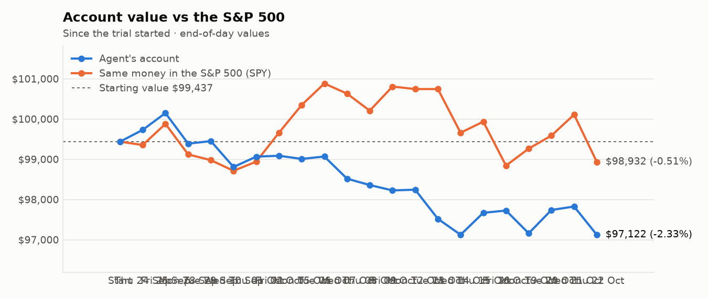
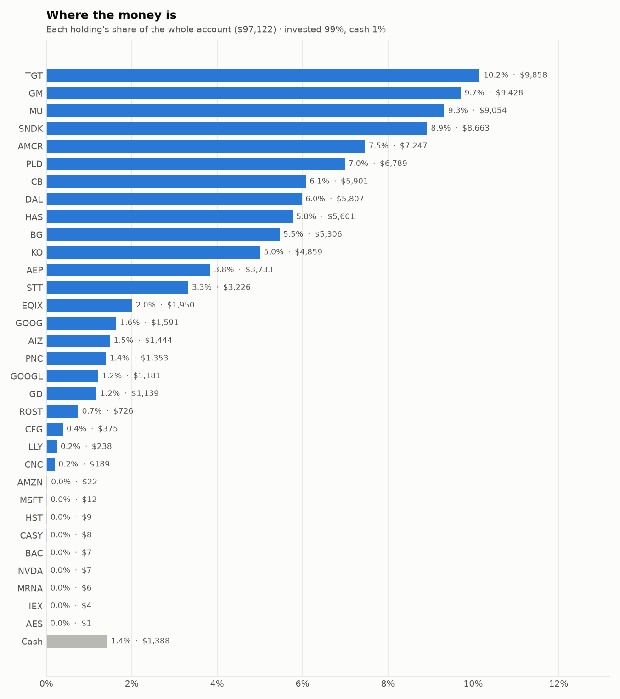
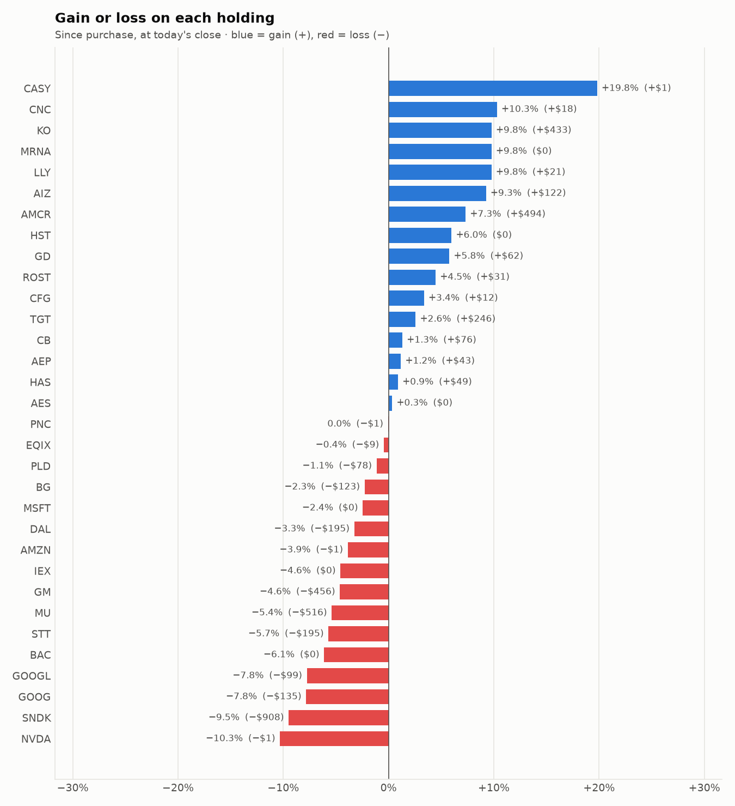

# Daily trading report — Thursday 22 October 2026

## Summary

- **Account value:** $97,122 (-$703, -0.7% today)
- **S&P 500 (SPY) today:** -1.2% — the agent was ahead of the index by 0.46%
- **Trades:** 9 buy(s) ($31,188), 1 sell(s) ($2,982)
- **2026-10-22 Morning rebalance:** traded — 10 order(s) placed
- **2026-10-22 Afternoon risk check:** no trades needed — Risk-checked 32 holding(s): none was 12%+ below its purchase price, and none had both clearly negative news and a price drop of 3%+ since entry.

## Charts

## Why I bought

### CB — bought 15.149 shares at ~$360.23 ($5,457)

**Why:** combined score +0.88; ranked #8 of 503; driven mainly by research (news + analyst consensus) +1.51, price momentum +0.97; entering/adding to the top-ranked target portfolio; research detail: 23 recent headline(s), net positive tone (+24); analyst consensus +0.66/2 (8 strong buy, 10 buy, 15 hold, 1 sell, 1 strong sell)

**Research scores** (combined +0.88, ranked #8 in the S&P 500, sector: Financials):

| Factor | Score | Measures |
|---|---|---|
| Value | +0.42 | cheap vs. sector peers on P/E and P/B |
| Quality | +0.21 | profitability (ROE, margins) and balance-sheet strength |
| Momentum | +0.97 | 12-month price trend, excluding the last month |
| Low volatility | +0.95 | steadier price than sector peers |
| Research | +1.51 | recent news tone + analyst consensus |

**Company financials (Finnhub, trailing 12 months):** P/E 12.2, P/B 1.7, return on equity 15.2%, debt/equity 0.25

**Price trend (Alpaca):** 12-month return (excl. last month) +22.6%, last month +5.7%, volatility 17.0%/yr

**News (Finnhub): 23 headline(s) in the last 2 days, net tone +24.** Most influential:
- [2 Insurance Stocks to Buy That Keep About 16 Cents of Every Premium Dollar as Underwriting Profit](https://finnhub.io/api/news?id=2684431e1251d1cb5a9145df27b3d3e3be1ff33285c49abc8e5f5aac12b56f38) — 21 Oct, Yahoo (tone +3)
- [Chubb Q3 Earnings Beat Estimates on Investment and Life Income Growth](https://finnhub.io/api/news?id=c916658121c299e25733fcdef8044159285a375d05bbb2480799c59bf3038ec5) — 21 Oct, Yahoo (tone +3)
- [Chubb beats Q3 profit estimates on strong underwriting income](https://finnhub.io/api/news?id=a06c88adb190d6daceff5a0ddc8de90f2b7555c4e6b23a80f40e4f484c5c9be6) — 20 Oct, Yahoo (tone +3)
- [What Chubb (CB) Said on Its Q3 Earnings Call](https://finnhub.io/api/news?id=454aa051faf512c906cfec0c1152e63ea9e3981850fd4082c2904b98f7d7f533) — 21 Oct, Yahoo (tone +2)
- [Chubb: Strong Q3 Reflected In Valuation](https://finnhub.io/api/news?id=6c703c8e5f388c2943558f6e0ffcb4b2fc846e3bdf82bfc5ed90d689da27f1b1) — 21 Oct, SeekingAlpha (tone +2)

**Analysts (Finnhub, 2026-10-01):** 8 strong buy, 10 buy, 15 hold, 1 sell, 1 strong sell — consensus +0.66 on a -2 (strong sell) to +2 (strong buy) scale.

### GM — bought 62.602 shares at ~$78.08 ($4,888)

**Why:** combined score +1.28; ranked #4 of 503; driven mainly by research (news + analyst consensus) +2.03, price momentum +1.70; entering/adding to the top-ranked target portfolio; research detail: 85 recent headline(s), net positive tone (+67); analyst consensus +1.14/2 (11 strong buy, 18 buy, 6 hold, 0 sell, 0 strong sell)

**Research scores** (combined +1.28, ranked #4 in the S&P 500, sector: Consumer Discretionary):

| Factor | Score | Measures |
|---|---|---|
| Value | +1.41 | cheap vs. sector peers on P/E and P/B |
| Quality | -0.66 | profitability (ROE, margins) and balance-sheet strength |
| Momentum | +1.70 | 12-month price trend, excluding the last month |
| Low volatility | -0.03 | steadier price than sector peers |
| Research | +2.03 | recent news tone + analyst consensus |

**Company financials (FMP, trailing 12 months):** P/E 17.7, P/B 1.1, return on equity 6.3%, gross margin 9.0%, debt/equity 2.05

**Price trend (Alpaca):** 12-month return (excl. last month) +41.5%, last month -8.8%, volatility 32.2%/yr

**News (Finnhub): 85 headline(s) in the last 2 days, net tone +67.** Most influential:
- [GM Stock Drops 5% Despite Q3 Earnings Beat — Automaker Keeps Profit Outlook Unchanged, Unveils $20B Buyback](https://finnhub.io/api/news?id=a9e6fe7b45fe4b6fc19d2d19016431e607c8771d8c34fb8fa39a174fdb798bb3) — 20 Oct, Yahoo (tone +5)
- [GM Falls Despite a Q3 Beat and $20 Billion Buyback as Its Profit Outlook Stays Put](https://finnhub.io/api/news?id=2023b58a2967974406dcd2ed5e054341b22361a788cd7606b9e49bfa350f9923) — 21 Oct, Yahoo (tone +3)
- [General Motors Stock Falls Despite Strong Earnings And New Buyback Program](https://finnhub.io/api/news?id=7529075daa567f0692536a6322d20f568604c9a5a68d2e5221ccb5a16548ccb0) — 21 Oct, Yahoo (tone +3)
- [GM (GM) Q3 2026 Earnings Call Transcript](https://finnhub.io/api/news?id=52b0fcd5bad24fdb4f42117736d2539307203b7a8ad42afb0570c02c9c1d5a24) — 20 Oct, Yahoo (tone +3)
- [GM Q3 Earnings Beat Estimates on North America Strength](https://finnhub.io/api/news?id=133b2a673491fff3ad8ecd362ea8a30ce90788d25019df0ddd8bd5cef24939e2) — 20 Oct, Yahoo (tone +3)

**Analysts (Finnhub, 2026-10-01):** 11 strong buy, 18 buy, 6 hold, 0 sell, 0 strong sell — consensus +1.14 on a -2 (strong sell) to +2 (strong buy) scale.

### HAS — bought 40.54 shares at ~$115.44 ($4,680)

**Why:** combined score +0.87; ranked #9 of 503; driven mainly by research (news + analyst consensus) +2.04, price momentum +0.90; entering/adding to the top-ranked target portfolio; research detail: 43 recent headline(s), net positive tone (+50); analyst consensus +1.20/2 (8 strong buy, 8 buy, 4 hold, 0 sell, 0 strong sell)

**Research scores** (combined +0.87, ranked #9 in the S&P 500, sector: Consumer Discretionary):

| Factor | Score | Measures |
|---|---|---|
| Value | -0.31 | cheap vs. sector peers on P/E and P/B |
| Quality | +0.74 | profitability (ROE, margins) and balance-sheet strength |
| Momentum | +0.90 | 12-month price trend, excluding the last month |
| Low volatility | -0.11 | steadier price than sector peers |
| Research | +2.04 | recent news tone + analyst consensus |

**Company financials (Finnhub, trailing 12 months):** P/E 19.7, P/B 16.9, return on equity 138.2%, gross margin 64.8%, debt/equity 5.02

**Price trend (Alpaca):** 12-month return (excl. last month) +17.2%, last month +31.0%, volatility 32.4%/yr

**News (Finnhub): 43 headline(s) in the last 2 days, net tone +50.** Most influential:
- [Hasbro Stock Gains Focus After Earnings Beat](https://finnhub.io/api/news?id=ddb355bd20959e4d080724ae6837c3297880ebcaecee671931149aa61a1b1634) — 20 Oct, Yahoo (tone +5)
- [Hasbro raises 2026 outlook as Magic: The Gathering revenue tops $600 million](https://finnhub.io/api/news?id=8e13463ffa3349e1a2cc22bbae093fd4a8d494dcbd8a367c5a6c628034881158) — 20 Oct, Yahoo (tone +4)
- [HAS Q3 Earnings Beat Estimates on Magic Growth, Outlook Raised](https://finnhub.io/api/news?id=8f3a7722b847c6cc280f6fdcdd96d1759455cfdf950a72eb850b15e9eb42173a) — 20 Oct, Yahoo (tone +4)
- [Hasbro Raises 2026 Outlook, Doubles Stock Buyback Target As Magic: the Gathering Sales Hit Record High](https://finnhub.io/api/news?id=e744980ec6db3c5a48687fb45eb0a4f4d2fe1b2e72ecd0177013afca72061f90) — 20 Oct, Benzinga (tone +4)
- [Zacks Investment Ideas feature highlights: Accenture, Hasbro and MSCI](https://finnhub.io/api/news?id=a334440d3d29ade65c2aa1666023fd2e539bf15e3632f535e1cb0411c11aca94) — 22 Oct, Yahoo (tone +2)

**Analysts (Finnhub, 2026-10-01):** 8 strong buy, 8 buy, 4 hold, 0 sell, 0 strong sell — consensus +1.20 on a -2 (strong sell) to +2 (strong buy) scale.

### TGT — bought 25.644 shares at ~$154.22 ($3,955)

**Why:** combined score +1.30; ranked #3 of 503; driven mainly by price momentum +3.00, research (news + analyst consensus) +0.78; entering/adding to the top-ranked target portfolio; research detail: 21 recent headline(s), net positive tone (+11); analyst consensus +0.47/2 (7 strong buy, 9 buy, 24 hold, 3 sell, 0 strong sell)

**Research scores** (combined +1.30, ranked #3 in the S&P 500, sector: Consumer Staples):

| Factor | Score | Measures |
|---|---|---|
| Value | +0.47 | cheap vs. sector peers on P/E and P/B |
| Quality | -0.19 | profitability (ROE, margins) and balance-sheet strength |
| Momentum | +3.00 | 12-month price trend, excluding the last month |
| Low volatility | -0.27 | steadier price than sector peers |
| Research | +0.78 | recent news tone + analyst consensus |

**Company financials (FMP, trailing 12 months):** P/E 15.9, P/B 3.9, return on equity 26.7%, gross margin 29.3%, debt/equity 1.05

**Price trend (Alpaca):** 12-month return (excl. last month) +80.5%, last month -4.2%, volatility 26.8%/yr

**News (Finnhub): 21 headline(s) in the last 2 days, net tone +11.** Most influential:
- [Buy 5 Top-Ranked High-Flying Non-Tech, Non-AI Stocks for a Strong Q4](https://finnhub.io/api/news?id=1abace20564cc92e002e3e06649663a35486bb3e0c1f6d29f2ad68d16f94a1e9) — 20 Oct, Yahoo (tone +3)
- [Walmart, Target and Costco Win Over Digital Shoppers With Speed](https://finnhub.io/api/news?id=20c6aca97371e1ba2d9ac833c22fb047324e59fd6a4b8a86f0c4e34f42bd7db0) — 20 Oct, Yahoo (tone +2)
- [Should Value Investors Buy Target (TGT) Stock?](https://finnhub.io/api/news?id=2ed1c3ff1fd3882b65d9589ccc8d027b220188b1335dfafc4c133211aa6ec0ff) — 20 Oct, Yahoo (tone +2)
- [How WMT, TGT & BJ Are Betting Big on AI-Powered Shopping](https://finnhub.io/api/news?id=4e0a0deb880d56e6faa124604db980113f9f131378d7a778c105f49f1347f3d3) — 21 Oct, Yahoo (tone +1)
- [The Zacks Analyst Blog Highlights Ross Stores, Roku, Interactive Brokers, Target and Nucor](https://finnhub.io/api/news?id=d2a36498164b36163f7e647dca864a1599b88b34b75af511e13969323397da3c) — 21 Oct, Yahoo (tone +1)

**Analysts (Finnhub, 2026-10-01):** 7 strong buy, 9 buy, 24 hold, 3 sell, 0 strong sell — consensus +0.47 on a -2 (strong sell) to +2 (strong buy) scale.

### PLD — bought 30.38 shares at ~$127.59 ($3,876)

**Why:** combined score +0.93; ranked #7 of 503; driven mainly by research (news + analyst consensus) +1.70, price momentum +1.00; entering/adding to the top-ranked target portfolio; research detail: 7 recent headline(s), net positive tone (+6); analyst consensus +0.86/2 (4 strong buy, 10 buy, 7 hold, 0 sell, 0 strong sell)

**Research scores** (combined +0.93, ranked #7 in the S&P 500, sector: Real Estate):

| Factor | Score | Measures |
|---|---|---|
| Value | +0.48 | cheap vs. sector peers on P/E and P/B |
| Quality | +0.37 | profitability (ROE, margins) and balance-sheet strength |
| Momentum | +1.00 | 12-month price trend, excluding the last month |
| Low volatility | +0.18 | steadier price than sector peers |
| Research | +1.70 | recent news tone + analyst consensus |

**Company financials (Finnhub, trailing 12 months):** P/E 29.2, P/B 2.3, return on equity 7.9%, gross margin 74.3%, debt/equity 0.66

**Price trend (Alpaca):** 12-month return (excl. last month) +19.8%, last month -6.1%, volatility 18.8%/yr

**News (Finnhub): 7 headline(s) in the last 2 days, net tone +6.** Most influential:
- [This Zoom Analyst Turns Bullish; Here Are Top 5 Upgrades For Wednesday](https://finnhub.io/api/news?id=5f0471f07be354869f2cb23319f36e5d0eb3a9f0b256f4eb71a7d89786dd8ad3) — 21 Oct, Benzinga (tone +2)
- [Prologis: The Sell-Off Created A Buying Opportunity (Rating Upgrade)](https://finnhub.io/api/news?id=7bd93b0d16cc4b398bc9f906586e752c70696a84e2191f725bf0e5c7e3584c48) — 20 Oct, SeekingAlpha (tone +2)
- [Raymond James Upgrades Prologis to Outperform, Announces $163 Price Target](https://finnhub.io/api/news?id=eff0e8f0672f288a181466a6ab679bb0042ba6e247b7af8a2e254752d7e83f9c) — 21 Oct, Benzinga (tone +1)
- [Prologis (PLD) Stock Gets Fair Value Trim As Analysts Rework Growth And Cost Assumptions](https://finnhub.io/api/news?id=fe95ece59dcbc6414c55e3297bff3aca560095a08c238b7abf22427edb662e7d) — 20 Oct, Yahoo (tone +1)
- [Dimensional Fund Advisors Ltd. : Form 8.3 - PROLOGIS INC - Ordinary Shares](https://finnhub.io/api/news?id=f368b334fb452aeaa270ac4a11b49ff1e48f444bf542606e26783a706c5f5cfc) — 22 Oct, Yahoo (tone +0)

**Analysts (Finnhub, 2026-10-01):** 4 strong buy, 10 buy, 7 hold, 0 sell, 0 strong sell — consensus +0.86 on a -2 (strong sell) to +2 (strong buy) scale.

### AEP — bought 28.576 shares at ~$129.14 ($3,690)

**Why:** combined score +0.77; ranked #13 of 503; driven mainly by research (news + analyst consensus) +1.57, price momentum +1.27; entering/adding to the top-ranked target portfolio; research detail: 9 recent headline(s), net positive tone (+7); analyst consensus +0.79/2 (6 strong buy, 10 buy, 12 hold, 0 sell, 0 strong sell)

**Research scores** (combined +0.77, ranked #13 in the S&P 500, sector: Utilities):

| Factor | Score | Measures |
|---|---|---|
| Value | -0.31 | cheap vs. sector peers on P/E and P/B |
| Quality | +0.01 | profitability (ROE, margins) and balance-sheet strength |
| Momentum | +1.27 | 12-month price trend, excluding the last month |
| Low volatility | -0.07 | steadier price than sector peers |
| Research | +1.57 | recent news tone + analyst consensus |

**Company financials (Finnhub, trailing 12 months):** P/E 22.1, P/B 2.4, return on equity 10.0%, gross margin 41.9%, debt/equity 1.64

**Price trend (Alpaca):** 12-month return (excl. last month) +12.4%, last month +5.9%, volatility 17.2%/yr

**News (Finnhub): 9 headline(s) in the last 2 days, net tone +7.** Most influential:
- [American Electric Power (AEP) Reports Next Week: Wall Street Expects Earnings Growth](https://finnhub.io/api/news?id=9086c0b18904e344cd88db2108def896f3af46ea05177619f905d46714012495) — 21 Oct, Yahoo (tone +2)
- [This American Electric Power Analyst Turns Bullish; Here Are Top 5 Upgrades For Tuesday](https://finnhub.io/api/news?id=97a66c4e704f4ec53593850a6190923ce66a2624a48b72f4509156ffd8705d13) — 20 Oct, Benzinga (tone +2)
- [AEP (AEP) Upgraded to Buy: What Does It Mean for the Stock?](https://finnhub.io/api/news?id=8e8913dd7fbd3407f5ae1a3f1235a58e6b5adb88e34f72f04141d991a0d02db9) — 21 Oct, Yahoo (tone +1)
- [AEP’s Dividend Keeps Growing. But Can the Utility Afford Bigger Payouts?](https://finnhub.io/api/news?id=2fcae8b8080c250b80c4b2726c6a4c7b6591bf806778a8eaf87ee2b17a9ec99c) — 20 Oct, Yahoo (tone +1)
- [American Electric Power Raises Quarterly Dividend From $0.95 To $0.97 Per Share](https://finnhub.io/api/news?id=7b6dd3a2471a4c470a6c2335f2b3efa6de4850adcda12b7bdff14e6024f4c8d5) — 20 Oct, Benzinga (tone +1)

**Analysts (Finnhub, 2026-10-01):** 6 strong buy, 10 buy, 12 hold, 0 sell, 0 strong sell — consensus +0.79 on a -2 (strong sell) to +2 (strong buy) scale.

### EQIX — bought 2.019 shares at ~$954.01 ($1,926)

**Why:** combined score +0.69; ranked #20 of 503; driven mainly by price momentum +1.68, research (news + analyst consensus) +1.05; entering/adding to the top-ranked target portfolio; research detail: 5 recent headline(s), net positive tone (+2); analyst consensus +1.15/2 (12 strong buy, 22 buy, 6 hold, 0 sell, 0 strong sell)

**Research scores** (combined +0.69, ranked #20 in the S&P 500, sector: Real Estate):

| Factor | Score | Measures |
|---|---|---|
| Value | -0.66 | cheap vs. sector peers on P/E and P/B |
| Quality | -0.14 | profitability (ROE, margins) and balance-sheet strength |
| Momentum | +1.68 | 12-month price trend, excluding the last month |
| Low volatility | -0.17 | steadier price than sector peers |
| Research | +1.05 | recent news tone + analyst consensus |

**Company financials (Finnhub, trailing 12 months):** P/E 63.7, P/B 7.1, return on equity 10.8%, gross margin 51.5%, debt/equity 1.53

**Price trend (Alpaca):** 12-month return (excl. last month) +34.0%, last month -6.1%, volatility 25.8%/yr

**News (Finnhub): 5 headline(s) in the last 2 days, net tone +2.** Most influential:
- [This Equinix Analyst Begins Coverage On A Bullish Note; Here Are Top 5 Initiations For Wednesday](https://finnhub.io/api/news?id=2d1e65830ef9d6f941d93d2ef56a09d6955554d2651864a6ab843a57e7ebb6ad) — 21 Oct, Benzinga (tone +2)
- [Equinix Opens Innovation Centers Globally to Accelerate Enterprise Infrastructure Deployments](https://finnhub.io/api/news?id=6cd59914e878a5d39891a3cd682d0e3a4157c1c5963a7f0fda2a3044786f1904) — 21 Oct, Yahoo (tone +0)
- [CIBC Initiates Coverage On Equinix with Outperformer Rating, Announces Price Target of $1200](https://finnhub.io/api/news?id=5f36678a43a058cf1948e92e53cc3d1d812d33bda69161d3711a8bc6857452ed) — 21 Oct, Benzinga (tone +0)
- [iShares Select U.S. REIT ETF (ICF) Sells Welltower and Equinix on Oct. 16](https://finnhub.io/api/news?id=74d4d0dda0c2b0d51cd6f2065ae80ed56c89534ea60b1a6a7969353765688ffa) — 20 Oct, Yahoo (tone +0)
- [Guggenheim Reiterates Buy on Equinix, Maintains $1235 Price Target](https://finnhub.io/api/news?id=8bf1bae39a550e66eb3fa9862e04f8fda5fe04a51e2a4d5d658c939edac9a987) — 20 Oct, Benzinga (tone +0)

**Analysts (Finnhub, 2026-10-01):** 12 strong buy, 22 buy, 6 hold, 0 sell, 0 strong sell — consensus +1.15 on a -2 (strong sell) to +2 (strong buy) scale.

### BG — bought 18.13 shares at ~$101.20 ($1,835)

**Why:** combined score +0.85; ranked #11 of 503; driven mainly by price momentum +1.75, value (cheapness) +1.24; entering/adding to the top-ranked target portfolio; research detail: analyst consensus +1.15/2 (5 strong buy, 13 buy, 2 hold, 0 sell, 0 strong sell)

**Research scores** (combined +0.85, ranked #11 in the S&P 500, sector: Consumer Staples):

| Factor | Score | Measures |
|---|---|---|
| Value | +1.24 | cheap vs. sector peers on P/E and P/B |
| Quality | -0.61 | profitability (ROE, margins) and balance-sheet strength |
| Momentum | +1.75 | 12-month price trend, excluding the last month |
| Low volatility | -0.45 | steadier price than sector peers |
| Research | +0.42 | recent news tone + analyst consensus |

**Company financials (Finnhub, trailing 12 months):** P/E 19.5, P/B 1.3, return on equity 6.3%, gross margin 4.9%, debt/equity 0.96

**Price trend (Alpaca):** 12-month return (excl. last month) +40.0%, last month -7.8%, volatility 35.0%/yr

**News (Finnhub):** no headlines in the last 2 days.

**Analysts (Finnhub, 2026-10-01):** 5 strong buy, 13 buy, 2 hold, 0 sell, 0 strong sell — consensus +1.15 on a -2 (strong sell) to +2 (strong buy) scale.

### AMCR — bought 19.106 shares at ~$46.09 ($881)

**Why:** combined score +0.99; ranked #5 of 503; driven mainly by price momentum +3.00, quality (profitability/balance sheet) -0.44; entering/adding to the top-ranked target portfolio; research detail: 1 recent headline(s), neutral/mixed tone; analyst consensus +0.90/2 (5 strong buy, 8 buy, 7 hold, 0 sell, 0 strong sell)

**Research scores** (combined +0.99, ranked #5 in the S&P 500, sector: Materials):

| Factor | Score | Measures |
|---|---|---|
| Value | +0.24 | cheap vs. sector peers on P/E and P/B |
| Quality | -0.44 | profitability (ROE, margins) and balance-sheet strength |
| Momentum | +3.00 | 12-month price trend, excluding the last month |
| Low volatility | +0.23 | steadier price than sector peers |
| Research | -0.20 | recent news tone + analyst consensus |

**Company financials (Finnhub, trailing 12 months):** P/E 18.7, P/B 1.7, return on equity 9.4%, gross margin 20.0%, debt/equity 1.19

**Price trend (Alpaca):** 12-month return (excl. last month) +423.2%, last month +4.7%, volatility 22.5%/yr

**News (Finnhub): 1 headline(s) in the last 2 days, net tone +0.** Most influential:
- [Amcor to report September 2026 results](https://finnhub.io/api/news?id=655192d9062e5a3ddbc5a33d3e20034c50b1de4f20c0b716b9bafddde6eb6794) — 21 Oct, Yahoo (tone +0)

**Analysts (Finnhub, 2026-10-01):** 5 strong buy, 8 buy, 7 hold, 0 sell, 0 strong sell — consensus +0.90 on a -2 (strong sell) to +2 (strong buy) scale.

## Why I sold

### CFG — sold 45.365 shares at ~$65.74 ($2,982)

**Why:** combined score +0.61; ranked #28 of 503; driven mainly by value (cheapness) +1.08, price momentum +0.95; trimmed toward target weight, or dropped out of the top-ranked names; research detail: 4 recent headline(s), net positive tone (+1); analyst consensus +1.04/2 (5 strong buy, 14 buy, 4 hold, 0 sell, 0 strong sell)

**Research scores** (combined +0.61, ranked #28 in the S&P 500, sector: Financials):

| Factor | Score | Measures |
|---|---|---|
| Value | +1.08 | cheap vs. sector peers on P/E and P/B |
| Quality | -0.06 | profitability (ROE, margins) and balance-sheet strength |
| Momentum | +0.95 | 12-month price trend, excluding the last month |
| Low volatility | +0.34 | steadier price than sector peers |
| Research | +0.20 | recent news tone + analyst consensus |

**Company financials (Finnhub, trailing 12 months):** P/E 11.9, P/B 1.1, return on equity 8.7%, debt/equity 0.41

**Price trend (Alpaca):** 12-month return (excl. last month) +22.3%, last month -0.9%, volatility 21.1%/yr

**News (Finnhub): 4 headline(s) in the last 2 days, net tone +1.** Most influential:
- [This Bank Stock Just Raised Its Dividend by 13%](https://finnhub.io/api/news?id=d12358f8841f8fa4a9a901f13215a084e80c8f09eae67c97a2cc558b5af6a2b2) — 20 Oct, Yahoo (tone +1)
- [Citigroup Maintains Buy on Citizens Financial Group, Lowers Price Target to $74](https://finnhub.io/api/news?id=a203a12061df9209ab569860254db66a1d7beb13e7c12801a98767b7ecd299b8) — 20 Oct, Benzinga (tone +0)
- [Truist Securities Maintains Hold on Citizens Financial Group, Lowers Price Target to $70](https://finnhub.io/api/news?id=0481a8aba7aadf2426aa5547f3fcb833ed799f4e98a2e3fc2edd01bdd9be64f9) — 20 Oct, Benzinga (tone +0)
- [Stephens & Co. Maintains Equal-Weight on Citizens Financial Group, Lowers Price Target to $65](https://finnhub.io/api/news?id=b5745def8dd7bd25753f100375d1da75e63030f9408a2da032bc7befc1e6745a) — 20 Oct, Benzinga (tone +0)

**Analysts (Finnhub, 2026-10-01):** 5 strong buy, 14 buy, 4 hold, 0 sell, 0 strong sell — consensus +1.04 on a -2 (strong sell) to +2 (strong buy) scale.

## Holdings at the close

| Stock | Shares | Avg cost | Price | Market value | % of account | Today | Gain/loss $ | Gain/loss % |
|---|---:|---:|---:|---:|---:|---:|---:|---:|
| TGT | 62.35 | $154.16 | $158.11 | $9,858 | 10.2% | +3.76% | +$246 | +2.56% |
| GM | 123.164 | $80.26 | $76.55 | $9,428 | 9.7% | +0.58% | −$456 | -4.62% |
| MU | 10.591 | $903.65 | $854.91 | $9,054 | 9.3% | -6.43% | −$516 | -5.39% |
| SNDK | 6.938 | $1,379.50 | $1,248.65 | $8,663 | 8.9% | -9.40% | −$908 | -9.49% |
| AMCR | 156.599 | $43.13 | $46.28 | $7,247 | 7.5% | +2.23% | +$494 | +7.31% |
| PLD | 53.6 | $128.11 | $126.66 | $6,789 | 7.0% | -0.74% | −$78 | -1.13% |
| CB | 16.215 | $359.26 | $363.95 | $5,901 | 6.1% | +2.54% | +$76 | +1.31% |
| DAL | 73.491 | $81.67 | $79.01 | $5,807 | 6.0% | +1.73% | −$195 | -3.25% |
| HAS | 48.313 | $114.91 | $115.93 | $5,601 | 5.8% | +1.69% | +$49 | +0.89% |
| BG | 51.442 | $105.54 | $103.15 | $5,306 | 5.5% | +0.90% | −$123 | -2.27% |
| KO | 50.982 | $86.82 | $95.30 | $4,859 | 5.0% | +2.83% | +$433 | +9.77% |
| AEP | 28.576 | $129.14 | $130.64 | $3,733 | 3.8% | +2.55% | +$43 | +1.16% |
| STT | 19.22 | $177.99 | $167.84 | $3,226 | 3.3% | -0.66% | −$195 | -5.70% |
| EQIX | 2.052 | $954.75 | $950.49 | $1,950 | 2.0% | -4.47% | −$9 | -0.45% |
| GOOG | 4.95 | $348.62 | $321.35 | $1,591 | 1.6% | -2.90% | −$135 | -7.82% |
| AIZ | 5 | $264.38 | $288.85 | $1,444 | 1.5% | +1.60% | +$122 | +9.26% |
| PNC | 6 | $225.64 | $225.53 | $1,353 | 1.4% | +1.18% | −$1 | -0.05% |
| GOOGL | 3.635 | $352.08 | $324.77 | $1,181 | 1.2% | -2.98% | −$99 | -7.76% |
| GD | 3.251 | $331.27 | $350.38 | $1,139 | 1.2% | +1.64% | +$62 | +5.77% |
| ROST | 3.067 | $226.55 | $236.67 | $726 | 0.7% | +1.06% | +$31 | +4.47% |
| CFG | 5.744 | $63.12 | $65.24 | $375 | 0.4% | +0.55% | +$12 | +3.36% |
| LLY | 0.182 | $1,189.78 | $1,306.00 | $238 | 0.2% | +2.77% | +$21 | +9.77% |
| CNC | 2.63 | $65.21 | $71.92 | $189 | 0.2% | +2.39% | +$18 | +10.29% |
| AMZN | 0.089 | $260.90 | $250.80 | $22 | 0.0% | -4.41% | −$1 | -3.87% |
| MSFT | 0.023 | $533.80 | $520.73 | $12 | 0.0% | -2.29% | −$0 | -2.45% |
| HST | 0.355 | $23.44 | $24.84 | $9 | 0.0% | -0.99% | +$0 | +5.98% |
| CASY | 0.011 | $597.62 | $716.00 | $8 | 0.0% | +2.99% | +$1 | +19.81% |
| BAC | 0.14 | $54.42 | $51.09 | $7 | 0.0% | +0.61% | −$0 | -6.12% |
| NVDA | 0.032 | $236.88 | $212.46 | $7 | 0.0% | -4.28% | −$1 | -10.31% |
| MRNA | 0.028 | $181.06 | $198.75 | $6 | 0.0% | -19.14% | +$0 | +9.77% |
| IEX | 0.018 | $237.75 | $226.89 | $4 | 0.0% | -3.63% | −$0 | -4.57% |
| AES | 0.096 | $14.92 | $14.97 | $1 | 0.0% | +0.00% | +$0 | +0.34% |
| **Invested** | | | | **$95,735** | **98.6%** | | **−$1,108** | |
| **Cash** | | | | $1,388 | 1.4% | | | |
| **Total account** | | | | **$97,122** | 100% | | | |

_Scores are sector-neutral z-scores: 0 is average for the stock's sector, +1 is one standard deviation better. News tone is a keyword count over recent headlines, not a deep read. None of this guarantees a stock will rise; a few days of results can't show whether the strategy has a real edge over the S&P 500._
