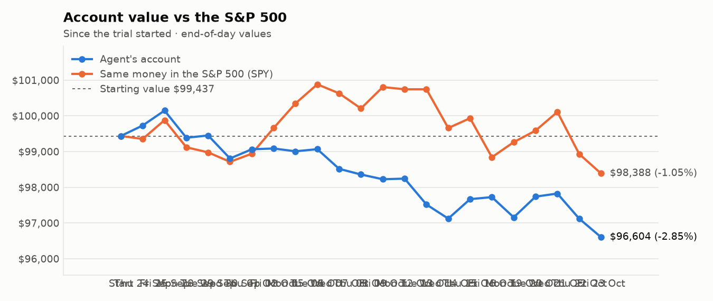
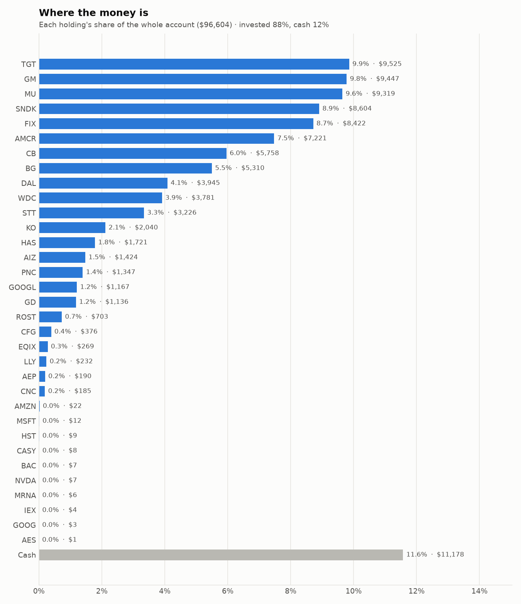
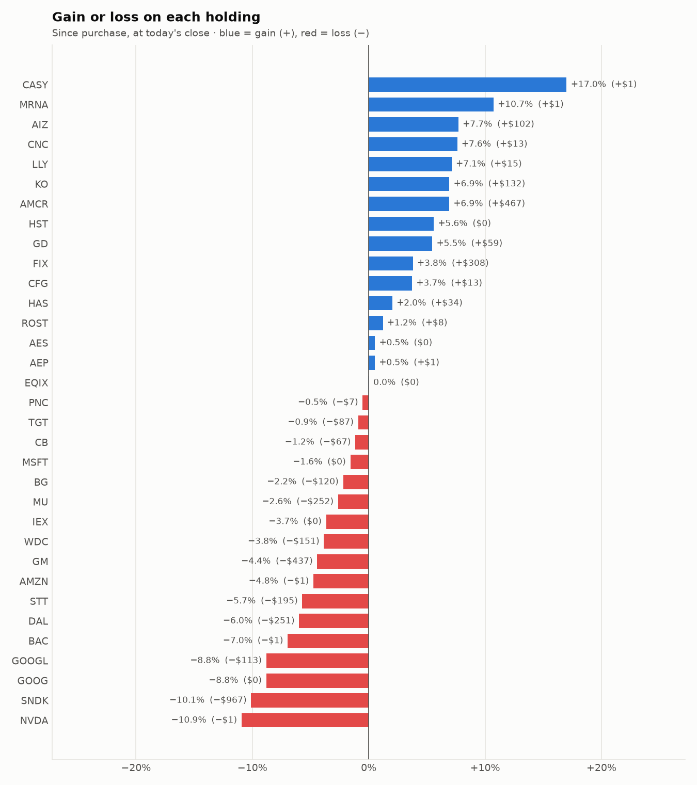

# Daily trading report — Friday 23 October 2026

## Summary

- **Account value:** $96,604 (-$518, -0.5% today)
- **S&P 500 (SPY) today:** -0.5% — the agent was ahead of the index by 0.02%
- **Trades:** 2 buy(s) ($12,047), 7 sell(s) ($21,838)
- **2026-10-23 Morning rebalance:** traded — 9 order(s) placed
- **2026-10-23 Afternoon risk check:** no trades needed — Risk-checked 33 holding(s): none was 12%+ below its purchase price, and none had both clearly negative news and a price drop of 3%+ since entry.

## Charts

## Why I bought

### FIX — bought 7.241 shares at ~$1,120.53 ($8,114)

**Why:** combined score +1.02; ranked #5 of 503; driven mainly by price momentum +2.69, low volatility -1.51; entering/adding to the top-ranked target portfolio; research detail: 15 recent headline(s), net positive tone (+10); analyst consensus +1.31/2 (7 strong buy, 7 buy, 2 hold, 0 sell, 0 strong sell)

**Research scores** (combined +1.02, ranked #5 in the S&P 500, sector: Industrials):

| Factor | Score | Measures |
|---|---|---|
| Value | -0.63 | cheap vs. sector peers on P/E and P/B |
| Quality | +0.22 | profitability (ROE, margins) and balance-sheet strength |
| Momentum | +2.69 | 12-month price trend, excluding the last month |
| Low volatility | -1.51 | steadier price than sector peers |
| Research | +1.01 | recent news tone + analyst consensus |

**Company financials (Finnhub, trailing 12 months):** P/E 31.4, P/B 21.7, return on equity 53.5%, gross margin 25.7%, debt/equity 0.02

**Price trend (Alpaca):** 12-month return (excl. last month) +97.9%, last month -21.3%, volatility 55.2%/yr

**News (Finnhub): 15 headline(s) in the last 2 days, net tone +10.** Most influential:
- [Comfort Systems USA (FIX) Earnings Beat Puts Valuation Back In Focus](https://finnhub.io/api/news?id=c5c22ec506a5cc367a871c155071aff6ed69888deaaef3e64cdcef299e1270ad) — 22 Oct, Yahoo (tone +3)
- [Comfort Systems USA (NYSE:FIX) Q3 Beat Overshadowed by After-Hours Selloff](https://finnhub.io/api/news?id=dde2c30e7210eee30c2b24502f06dedd74a4c2a33d32d338d58be6bfa79b38e6) — 22 Oct, ChartMill (tone +3)
- [Comfort Systems beats estimates but falls on CFO change, no guidance](https://finnhub.io/api/news?id=de9037d879ecdbf37c123d9bfbccd62499037f863d38555ee617170ad32fca27) — 22 Oct, Yahoo (tone +1)
- [Comfort Systems: Q3 Earnings Snapshot](https://finnhub.io/api/news?id=18a8720e9bdcf90d5919430acc4c9a8e172da75845c6cdd512fd49ccfedcea7a) — 22 Oct, Yahoo (tone +1)
- [Comfort Systems (NYSE:FIX) reports upbeat Q3 2026 but stock drops](https://finnhub.io/api/news?id=fa3e257941c04a64201f1afaaff584ce78098b2122cbb3884bfce678a2be453f) — 22 Oct, Yahoo (tone +1)

**Analysts (Finnhub, 2026-10-01):** 7 strong buy, 7 buy, 2 hold, 0 sell, 0 strong sell — consensus +1.31 on a -2 (strong sell) to +2 (strong buy) scale.

### WDC — bought 11.057 shares at ~$355.69 ($3,933)

**Why:** combined score +0.96; ranked #7 of 503; driven mainly by price momentum +1.64, research (news + analyst consensus) +1.08; entering/adding to the top-ranked target portfolio; research detail: 37 recent headline(s), net positive tone (+23); analyst consensus +1.00/2 (7 strong buy, 17 buy, 7 hold, 0 sell, 0 strong sell)

**Research scores** (combined +0.96, ranked #7 in the S&P 500, sector: Information Technology):

| Factor | Score | Measures |
|---|---|---|
| Value | +0.45 | cheap vs. sector peers on P/E and P/B |
| Quality | +0.46 | profitability (ROE, margins) and balance-sheet strength |
| Momentum | +1.64 | 12-month price trend, excluding the last month |
| Low volatility | -0.92 | steadier price than sector peers |
| Research | +1.08 | recent news tone + analyst consensus |

**Company financials (Finnhub, trailing 12 months):** P/E 15.0, P/B 22.5, return on equity 117.8%, gross margin 48.9%, debt/equity 0.12

**Price trend (Alpaca):** 12-month return (excl. last month) +321.5%, last month -25.3%, volatility 75.3%/yr

**News (Finnhub): 37 headline(s) in the last 2 days, net tone +23.** Most influential:
- [Western Digital (NASDAQ:WDC) Beats Q1 Estimates and Guides Q2 Revenue Above Consensus](https://finnhub.io/api/news?id=64ab0a2b224cbfebf6b3b77e4a180bee5ab3b402578e1a147db663aed09dc5b9) — 22 Oct, ChartMill (tone +3)
- [Dividend Hike Could Change The Case For Western Digital Stock](https://finnhub.io/api/news?id=9727a8b4cd8226177ceb7c8c5c974180826f064f24efb6f06bc8605fc93135a8) — 22 Oct, Yahoo (tone +2)
- [Western Digital (NASDAQ:WDC) surprises with strong Q3 but inventory levels increase](https://finnhub.io/api/news?id=ebd8bfee6eb7fa7b0c85cc8600a90efdaff5e9de0967d6bee1c6fbcd48b57f79) — 22 Oct, Yahoo (tone +2)
- [Zacks Investment Ideas feature highlights: Meta Platforms, Bloom Energy and Western Digital](https://finnhub.io/api/news?id=039577c7b8ed9d72c1cb8f61016a893bdef70a5d145919f6daefaf5fdc1f7593) — 21 Oct, Yahoo (tone +2)
- [Nasdaq, Dow, S&P 500 Futures Drop Premarket: NVDA, AMD, META, CRWV, MRNA, WDC, BE In Focus](https://finnhub.io/api/news?id=5922972d586f65fcf83214c46c06e90ef1c3a8fbb7f6857fb86f2fb48028df32) — 23 Oct, Yahoo (tone -1)

**Analysts (Finnhub, 2026-10-01):** 7 strong buy, 17 buy, 7 hold, 0 sell, 0 strong sell — consensus +1.00 on a -2 (strong sell) to +2 (strong buy) scale.

## Why I sold

### PLD — sold 53.6 shares at ~$126.50 ($6,780)

**Why:** combined score +0.59; ranked #33 of 503; driven mainly by price momentum +0.98, research (news + analyst consensus) +0.93; trimmed toward target weight, or dropped out of the top-ranked names; research detail: 6 recent headline(s), net positive tone (+5); analyst consensus +0.86/2 (4 strong buy, 10 buy, 7 hold, 0 sell, 0 strong sell)

**Research scores** (combined +0.59, ranked #33 in the S&P 500, sector: Real Estate):

| Factor | Score | Measures |
|---|---|---|
| Value | +0.00 | cheap vs. sector peers on P/E and P/B |
| Quality | +0.00 | profitability (ROE, margins) and balance-sheet strength |
| Momentum | +0.98 | 12-month price trend, excluding the last month |
| Low volatility | +0.26 | steadier price than sector peers |
| Research | +0.93 | recent news tone + analyst consensus |

**Price trend (Alpaca):** 12-month return (excl. last month) +17.5%, last month -5.4%, volatility 18.8%/yr

**News (Finnhub): 6 headline(s) in the last 2 days, net tone +5.** Most influential:
- [This Zoom Analyst Turns Bullish; Here Are Top 5 Upgrades For Wednesday](https://finnhub.io/api/news?id=5f0471f07be354869f2cb23319f36e5d0eb3a9f0b256f4eb71a7d89786dd8ad3) — 21 Oct, Benzinga (tone +2)
- [What Is Driving SEGRO (LSE:SGRO) After 32% New Rent Growth And Deal Progress?](https://finnhub.io/api/news?id=6497a829b081e5c1e74b318dd41b9de92de7220f481998ab91de7a70201084c4) — 23 Oct, Yahoo (tone +1)
- [Raymond James Upgrades Prologis to Outperform, Announces $163 Price Target](https://finnhub.io/api/news?id=eff0e8f0672f288a181466a6ab679bb0042ba6e247b7af8a2e254752d7e83f9c) — 21 Oct, Benzinga (tone +1)
- [Prologis (PLD) Stock Gets Fair Value Trim As Analysts Rework Growth And Cost Assumptions](https://finnhub.io/api/news?id=fe95ece59dcbc6414c55e3297bff3aca560095a08c238b7abf22427edb662e7d) — 20 Oct, Yahoo (tone +1)
- [Dimensional Fund Advisors Ltd. : Form 8.3 - PROLOGIS INC - Ordinary Shares](https://finnhub.io/api/news?id=5bf7fb92075eda974bc82e0894ea234245ea452548e48d2b7f12939ed26f69f3) — 23 Oct, Yahoo (tone +0)

**Analysts (Finnhub, 2026-10-01):** 4 strong buy, 10 buy, 7 hold, 0 sell, 0 strong sell — consensus +0.86 on a -2 (strong sell) to +2 (strong buy) scale.

### HAS — sold 33.636 shares at ~$115.95 ($3,900)

**Why:** combined score +0.69; ranked #19 of 503; driven mainly by research (news + analyst consensus) +1.36, price momentum +0.89; trimmed toward target weight, or dropped out of the top-ranked names; research detail: 11 recent headline(s), net positive tone (+16); analyst consensus +1.20/2 (8 strong buy, 8 buy, 4 hold, 0 sell, 0 strong sell)

**Research scores** (combined +0.69, ranked #19 in the S&P 500, sector: Consumer Discretionary):

| Factor | Score | Measures |
|---|---|---|
| Value | -0.34 | cheap vs. sector peers on P/E and P/B |
| Quality | +0.74 | profitability (ROE, margins) and balance-sheet strength |
| Momentum | +0.89 | 12-month price trend, excluding the last month |
| Low volatility | -0.09 | steadier price than sector peers |
| Research | +1.36 | recent news tone + analyst consensus |

**Company financials (Finnhub, trailing 12 months):** P/E 20.6, P/B 16.9, return on equity 138.2%, gross margin 64.8%, debt/equity 5.02

**Price trend (Alpaca):** 12-month return (excl. last month) +15.8%, last month +35.5%, volatility 32.6%/yr

**News (Finnhub): 11 headline(s) in the last 2 days, net tone +16.** Most influential:
- [Hasbro Stock Gains Focus After Earnings Beat](https://finnhub.io/api/news?id=ddb355bd20959e4d080724ae6837c3297880ebcaecee671931149aa61a1b1634) — 20 Oct, Yahoo (tone +5)
- [Zacks Investment Ideas feature highlights: Accenture, Hasbro and MSCI](https://finnhub.io/api/news?id=a334440d3d29ade65c2aa1666023fd2e539bf15e3632f535e1cb0411c11aca94) — 22 Oct, Yahoo (tone +2)
- [HAS Q3 Deep Dive: Magic Momentum, Licensing Expansion, and Cost Discipline Drive Upside](https://finnhub.io/api/news?id=782815a4c83ff2d0c1b28066a488c35e7a30f63f62546fd81bbd03cef2db0a32) — 21 Oct, Yahoo (tone +2)
- [BNP Paribas Reiterates Outperform on Hasbro, Raises Price Target to $127](https://finnhub.io/api/news?id=24708c0c78eadedb01dfeb1224dc263702fff975e7e7d0bb1e57c79352e36b25) — 21 Oct, Benzinga (tone +2)
- [Best Income Stocks to Buy for October 23rd](https://finnhub.io/api/news?id=ec5b1bdc130dd6ba8279f1bdee8f27e22553e1404a806574588ab627582ca8d1) — 23 Oct, Yahoo (tone +1)

**Analysts (Finnhub, 2026-10-01):** 8 strong buy, 8 buy, 4 hold, 0 sell, 0 strong sell — consensus +1.20 on a -2 (strong sell) to +2 (strong buy) scale.

### AEP — sold 27.113 shares at ~$129.62 ($3,514)

**Why:** combined score +0.61; ranked #29 of 503; driven mainly by price momentum +1.27, research (news + analyst consensus) +0.98; trimmed toward target weight, or dropped out of the top-ranked names; research detail: 8 recent headline(s), net positive tone (+6); analyst consensus +0.79/2 (6 strong buy, 10 buy, 12 hold, 0 sell, 0 strong sell)

**Research scores** (combined +0.61, ranked #29 in the S&P 500, sector: Utilities):

| Factor | Score | Measures |
|---|---|---|
| Value | -0.39 | cheap vs. sector peers on P/E and P/B |
| Quality | +0.00 | profitability (ROE, margins) and balance-sheet strength |
| Momentum | +1.27 | 12-month price trend, excluding the last month |
| Low volatility | -0.06 | steadier price than sector peers |
| Research | +0.98 | recent news tone + analyst consensus |

**Company financials (Finnhub, trailing 12 months):** P/E 22.6, P/B 2.4, return on equity 10.0%, gross margin 41.9%, debt/equity 1.64

**Price trend (Alpaca):** 12-month return (excl. last month) +10.7%, last month +10.3%, volatility 17.3%/yr

**News (Finnhub): 8 headline(s) in the last 2 days, net tone +6.** Most influential:
- [American Electric Power (AEP) Reports Next Week: Wall Street Expects Earnings Growth](https://finnhub.io/api/news?id=9086c0b18904e344cd88db2108def896f3af46ea05177619f905d46714012495) — 21 Oct, Yahoo (tone +2)
- [X-Energy Stock Surges on Potential Nuclear Energy Deal](https://finnhub.io/api/news?id=742c7c2d4d4b7df6ebb227d45fa20ba736c94283fcf9e8afa4b5e9bb520b0f4a) — 22 Oct, Yahoo (tone +1)
- [Earnings Preview: What to Expect From American Electric Power's Report](https://finnhub.io/api/news?id=98be14bf0263db57bdf90726886451cb28f4ba0470147d2ebc5bedcf515c9a21) — 22 Oct, Yahoo (tone +1)
- [AEP (AEP) Upgraded to Buy: What Does It Mean for the Stock?](https://finnhub.io/api/news?id=8e8913dd7fbd3407f5ae1a3f1235a58e6b5adb88e34f72f04141d991a0d02db9) — 21 Oct, Yahoo (tone +1)
- [Morgan Stanley Maintains Overweight on American Electric Power, Raises Price Target to $130](https://finnhub.io/api/news?id=d2a5e07bbb6e2abbf39b092e3aa2878f97e5323b5606632f2df12077c1ae762d) — 21 Oct, Benzinga (tone +1)

**Analysts (Finnhub, 2026-10-01):** 6 strong buy, 10 buy, 12 hold, 0 sell, 0 strong sell — consensus +0.79 on a -2 (strong sell) to +2 (strong buy) scale.

### KO — sold 29.001 shares at ~$93.32 ($2,706)

**Why:** combined score +0.71; ranked #17 of 503; driven mainly by low volatility +1.52, price momentum +1.34; trimmed toward target weight, or dropped out of the top-ranked names; research detail: 21 recent headline(s), net positive tone (+8); analyst consensus +1.03/2 (8 strong buy, 19 buy, 7 hold, 0 sell, 0 strong sell)

**Research scores** (combined +0.71, ranked #17 in the S&P 500, sector: Consumer Staples):

| Factor | Score | Measures |
|---|---|---|
| Value | -0.62 | cheap vs. sector peers on P/E and P/B |
| Quality | +0.35 | profitability (ROE, margins) and balance-sheet strength |
| Momentum | +1.34 | 12-month price trend, excluding the last month |
| Low volatility | +1.52 | steadier price than sector peers |
| Research | +0.96 | recent news tone + analyst consensus |

**Company financials (Finnhub, trailing 12 months):** P/E 28.2, P/B 10.0, return on equity 43.0%, gross margin 61.9%, debt/equity 1.20

**Price trend (Alpaca):** 12-month return (excl. last month) +33.0%, last month +8.2%, volatility 15.9%/yr

**News (Finnhub): 21 headline(s) in the last 2 days, net tone +8.** Most influential:
- [Procter & Gamble Jumps 6% as Earnings Beat Draws Defensive Buyers; Johnson & Johnson Rises 3%, Coca-Cola Ticks Up](https://finnhub.io/api/news?id=4d7a018f3d84e317a422679d6e281251ef3b9cae0203cc0e3d19918750c90cda) — 22 Oct, Yahoo (tone +3)
- [The Coca-Cola Company Selects Agency Partners to Accelerate the Future of Marketing](https://finnhub.io/api/news?id=2bfd2325e1872579e7db3765953e19a0c0357d5d8c83b2a3a00f81bdb5c5ac06) — 22 Oct, Yahoo (tone +1)
- [Keurig Dr Pepper (KDP) vs. KO and PEP: Can the JDE Peet’s Acquisition and Planned Split Unlock Value Despite Rising Debt?](https://finnhub.io/api/news?id=8ce0e9c72ad31270e146ab877826ceb219e3e3b9341f1da84ce0424539aac7b5) — 22 Oct, Yahoo (tone +1)
- [Unstoppable Momentum? Coca-Cola Aims for Flawless Earnings Streak as Q3 Sales Projections Top $12.9 Billion](https://finnhub.io/api/news?id=b45dafaa75e46f92d938d9bbd4e8406c88f91cdf126dcffc10fa1cb99335cc8f) — 22 Oct, Yahoo (tone +1)
- [Coca-Cola Shows Mixed Trends Pre-Q3 Earnings: To Buy or Not to Buy?](https://finnhub.io/api/news?id=da5eb6c999d14f01f04d1dbbdf6e2954864f74e938eaa849c839999cc87bb52d) — 22 Oct, Yahoo (tone +1)

**Analysts (Finnhub, 2026-10-01):** 8 strong buy, 19 buy, 7 hold, 0 sell, 0 strong sell — consensus +1.03 on a -2 (strong sell) to +2 (strong buy) scale.

### EQIX — sold 1.77 shares at ~$948.79 ($1,679)

**Why:** combined score +0.62; ranked #27 of 503; driven mainly by price momentum +1.58, research (news + analyst consensus) +0.80; trimmed toward target weight, or dropped out of the top-ranked names; research detail: 4 recent headline(s), net positive tone (+2); analyst consensus +1.15/2 (12 strong buy, 22 buy, 6 hold, 0 sell, 0 strong sell)

**Research scores** (combined +0.62, ranked #27 in the S&P 500, sector: Real Estate):

| Factor | Score | Measures |
|---|---|---|
| Value | -0.56 | cheap vs. sector peers on P/E and P/B |
| Quality | -0.10 | profitability (ROE, margins) and balance-sheet strength |
| Momentum | +1.58 | 12-month price trend, excluding the last month |
| Low volatility | -0.21 | steadier price than sector peers |
| Research | +0.80 | recent news tone + analyst consensus |

**Company financials (Finnhub, trailing 12 months):** P/E 61.3, P/B 7.1, return on equity 10.8%, gross margin 51.5%, debt/equity 1.53

**Price trend (Alpaca):** 12-month return (excl. last month) +29.9%, last month -8.1%, volatility 26.6%/yr

**News (Finnhub): 4 headline(s) in the last 2 days, net tone +2.** Most influential:
- [This Equinix Analyst Begins Coverage On A Bullish Note; Here Are Top 5 Initiations For Wednesday](https://finnhub.io/api/news?id=2d1e65830ef9d6f941d93d2ef56a09d6955554d2651864a6ab843a57e7ebb6ad) — 21 Oct, Benzinga (tone +2)
- [Is Equinix (EQIX) Cheap On Its EPIC Rollout Or Is The AI Story Priced In?](https://finnhub.io/api/news?id=06d37d62494ef234fa2a566086bfbe5f6ef7c3d0ab95bdb15d644f9aad9e85f5) — 22 Oct, Yahoo (tone +0)
- [Equinix Opens Innovation Centers Globally to Accelerate Enterprise Infrastructure Deployments](https://finnhub.io/api/news?id=6cd59914e878a5d39891a3cd682d0e3a4157c1c5963a7f0fda2a3044786f1904) — 21 Oct, Yahoo (tone +0)
- [CIBC Initiates Coverage On Equinix with Outperformer Rating, Announces Price Target of $1200](https://finnhub.io/api/news?id=5f36678a43a058cf1948e92e53cc3d1d812d33bda69161d3711a8bc6857452ed) — 21 Oct, Benzinga (tone +0)

**Analysts (Finnhub, 2026-10-01):** 12 strong buy, 22 buy, 6 hold, 0 sell, 0 strong sell — consensus +1.15 on a -2 (strong sell) to +2 (strong buy) scale.

### DAL — sold 22.106 shares at ~$75.76 ($1,675)

**Why:** combined score +0.81; ranked #14 of 503; driven mainly by value (cheapness) +2.09, price momentum +0.86; trimmed toward target weight, or dropped out of the top-ranked names; research detail: 2 recent headline(s), net positive tone (+2); analyst consensus +1.13/2 (7 strong buy, 20 buy, 3 hold, 0 sell, 0 strong sell)

**Research scores** (combined +0.81, ranked #14 in the S&P 500, sector: Industrials):

| Factor | Score | Measures |
|---|---|---|
| Value | +2.09 | cheap vs. sector peers on P/E and P/B |
| Quality | +0.14 | profitability (ROE, margins) and balance-sheet strength |
| Momentum | +0.86 | 12-month price trend, excluding the last month |
| Low volatility | -0.37 | steadier price than sector peers |
| Research | +0.35 | recent news tone + analyst consensus |

**Company financials (Finnhub, trailing 12 months):** P/E 15.5, P/B 2.4, return on equity 15.4%, gross margin 45.9%, debt/equity 0.57

**Price trend (Alpaca):** 12-month return (excl. last month) +38.8%, last month -3.0%, volatility 29.9%/yr

**News (Finnhub): 2 headline(s) in the last 2 days, net tone +2.** Most influential:
- [Delta Air Lines Shares Rose Even As Profit Fell](https://finnhub.io/api/news?id=c3bbf93a851b97f8f9b992195e7bf15631938a7cfc13b577fac15c625229df5f) — 22 Oct, Yahoo (tone +1)
- [Delta Air Lines (DAL) Stock May Be Undervalued As Fuel Cost Pressure Bites](https://finnhub.io/api/news?id=1bbe53146a37f5a9a8c3aa771f6ee0cead544fad1bc9e54d933cfc6b694ee235) — 20 Oct, Yahoo (tone +1)

**Analysts (Finnhub, 2026-10-01):** 7 strong buy, 20 buy, 3 hold, 0 sell, 0 strong sell — consensus +1.13 on a -2 (strong sell) to +2 (strong buy) scale.

### GOOG — sold 4.941 shares at ~$320.21 ($1,582)

**Why:** combined score +0.58; ranked #35 of 503; driven mainly by price momentum +1.55, value (cheapness) -0.71; trimmed toward target weight, or dropped out of the top-ranked names; research detail: 37 recent headline(s), net positive tone (+15); analyst consensus +1.21/2 (20 strong buy, 41 buy, 6 hold, 0 sell, 0 strong sell)

**Research scores** (combined +0.58, ranked #35 in the S&P 500, sector: Communication Services):

| Factor | Score | Measures |
|---|---|---|
| Value | -0.71 | cheap vs. sector peers on P/E and P/B |
| Quality | +0.12 | profitability (ROE, margins) and balance-sheet strength |
| Momentum | +1.55 | 12-month price trend, excluding the last month |
| Low volatility | +0.21 | steadier price than sector peers |
| Research | +0.61 | recent news tone + analyst consensus |

**Company financials (Finnhub, trailing 12 months):** P/E 16.3, P/B 6.8, return on equity 50.8%, gross margin 60.9%, debt/equity 0.15

**Price trend (Alpaca):** 12-month return (excl. last month) +32.5%, last month -4.2%, volatility 28.5%/yr

**News (Finnhub): 37 headline(s) in the last 2 days, net tone +15.** Most influential:
- [Zacks Earnings Trends Highlights: Meta, Tesla, Nvidia, Micron and Alphabet](https://finnhub.io/api/news?id=42596daf9e255d2ce6b1b7775d33d4feb6c5dacd671e4d304151fc50c2133ebe) — 22 Oct, Yahoo (tone +3)
- [Alphabet Inc-CL C (NASDAQ:GOOG) Fits the GARP Mold With Durable Growth](https://finnhub.io/api/news?id=a510b0e5a11815e6a9e180f188f2cb0bb01251967ae155d584b8b92367a8d024) — 23 Oct, ChartMill (tone +2)
- [Alphabet (GOOGL) vs. MSFT and AMZN: Can AI Investments and Google Cloud Growth Unlock a 26% Upside?](https://finnhub.io/api/news?id=76c1bd26b5efefa54a8a958e66f717ce5ce0aa2140eca2591ecdad295e7ba06b) — 22 Oct, Yahoo (tone +2)
- [Meta Falls 3% as Higher AI Spending Outlook Overshadows Earnings Beat; Alphabet Dips, Microsoft Holds Steady](https://finnhub.io/api/news?id=a9c4017ecaabc34a2d160d193865c8b20e70bf2e4c76506a197240bb36d46753) — 22 Oct, Yahoo (tone +2)
- [Stocktwits AI Roundup: Meta’s Capex, Lam’s Supply Warning Hit Tech Stocks As Netflix Disappoints](https://finnhub.io/api/news?id=5e1e3d36c8fe2045e4e58c1aa3a9799c513a26848abfa5aeab802511c0ddcf10) — 23 Oct, Yahoo (tone -1)

**Analysts (Finnhub, 2026-10-01):** 20 strong buy, 41 buy, 6 hold, 0 sell, 0 strong sell — consensus +1.21 on a -2 (strong sell) to +2 (strong buy) scale.

## Holdings at the close

| Stock | Shares | Avg cost | Price | Market value | % of account | Today | Gain/loss $ | Gain/loss % |
|---|---:|---:|---:|---:|---:|---:|---:|---:|
| TGT | 62.35 | $154.16 | $152.76 | $9,525 | 9.9% | -3.38% | −$87 | -0.91% |
| GM | 123.164 | $80.26 | $76.71 | $9,447 | 9.8% | -0.65% | −$437 | -4.42% |
| MU | 10.591 | $903.65 | $879.85 | $9,319 | 9.6% | +2.73% | −$252 | -2.63% |
| SNDK | 6.938 | $1,379.50 | $1,240.10 | $8,604 | 8.9% | -1.65% | −$967 | -10.11% |
| FIX | 7.241 | $1,120.53 | $1,163.05 | $8,422 | 8.7% | -9.09% | +$308 | +3.79% |
| AMCR | 156.599 | $43.13 | $46.11 | $7,221 | 7.5% | -0.37% | +$467 | +6.92% |
| CB | 16.215 | $359.26 | $355.11 | $5,758 | 6.0% | -2.43% | −$67 | -1.16% |
| BG | 51.442 | $105.54 | $103.22 | $5,310 | 5.5% | +0.07% | −$120 | -2.20% |
| DAL | 51.385 | $81.67 | $76.78 | $3,945 | 4.1% | -3.13% | −$251 | -5.98% |
| WDC | 11.057 | $355.69 | $342.00 | $3,781 | 3.9% | -3.44% | −$151 | -3.85% |
| STT | 19.22 | $177.99 | $167.83 | $3,226 | 3.3% | -0.01% | −$195 | -5.71% |
| KO | 21.981 | $86.82 | $92.83 | $2,040 | 2.1% | -2.63% | +$132 | +6.93% |
| HAS | 14.677 | $114.91 | $117.24 | $1,721 | 1.8% | +0.01% | +$34 | +2.03% |
| AIZ | 5 | $264.38 | $284.75 | $1,424 | 1.5% | -1.42% | +$102 | +7.70% |
| PNC | 6 | $225.64 | $224.46 | $1,347 | 1.4% | -0.47% | −$7 | -0.52% |
| GOOGL | 3.635 | $352.08 | $321.08 | $1,167 | 1.2% | -0.97% | −$113 | -8.80% |
| GD | 3.251 | $331.27 | $349.36 | $1,136 | 1.2% | -0.41% | +$59 | +5.46% |
| ROST | 3.067 | $226.55 | $229.30 | $703 | 0.7% | -3.11% | +$8 | +1.21% |
| CFG | 5.744 | $63.15 | $65.50 | $376 | 0.4% | +0.40% | +$13 | +3.72% |
| EQIX | 0.282 | $954.75 | $955.03 | $269 | 0.3% | +0.25% | +$0 | +0.03% |
| LLY | 0.182 | $1,189.78 | $1,274.54 | $232 | 0.2% | -2.46% | +$15 | +7.12% |
| AEP | 1.463 | $129.14 | $129.82 | $190 | 0.2% | -0.63% | +$1 | +0.53% |
| CNC | 2.63 | $65.21 | $70.17 | $185 | 0.2% | -1.50% | +$13 | +7.61% |
| AMZN | 0.089 | $260.90 | $248.50 | $22 | 0.0% | -0.75% | −$1 | -4.75% |
| MSFT | 0.023 | $533.80 | $525.36 | $12 | 0.0% | +0.82% | −$0 | -1.58% |
| HST | 0.355 | $23.44 | $24.75 | $9 | 0.0% | -0.48% | +$0 | +5.59% |
| CASY | 0.011 | $597.62 | $699.26 | $8 | 0.0% | -2.02% | +$1 | +17.01% |
| BAC | 0.14 | $54.42 | $50.63 | $7 | 0.0% | -0.88% | −$1 | -6.96% |
| NVDA | 0.032 | $236.88 | $210.99 | $7 | 0.0% | -0.57% | −$1 | -10.93% |
| MRNA | 0.028 | $181.06 | $200.47 | $6 | 0.0% | -1.07% | +$1 | +10.72% |
| IEX | 0.018 | $237.75 | $229.05 | $4 | 0.0% | +0.96% | −$0 | -3.66% |
| GOOG | 0.009 | $348.62 | $317.92 | $3 | 0.0% | -0.89% | −$0 | -8.81% |
| AES | 0.096 | $14.92 | $15.00 | $1 | 0.0% | +0.20% | +$0 | +0.54% |
| **Invested** | | | | **$85,426** | **88.4%** | | **−$1,495** | |
| **Cash** | | | | $11,178 | 11.6% | | | |
| **Total account** | | | | **$96,604** | 100% | | | |

_Scores are sector-neutral z-scores: 0 is average for the stock's sector, +1 is one standard deviation better. News tone is a keyword count over recent headlines, not a deep read. None of this guarantees a stock will rise; a few days of results can't show whether the strategy has a real edge over the S&P 500._
