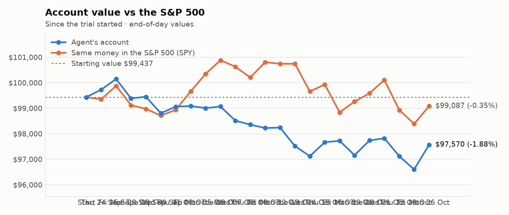
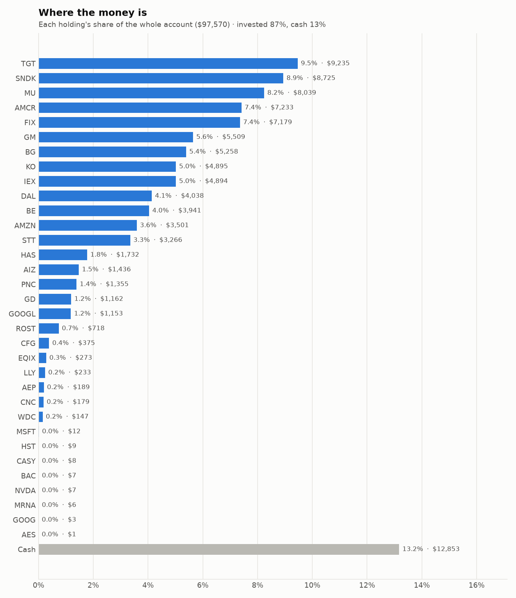
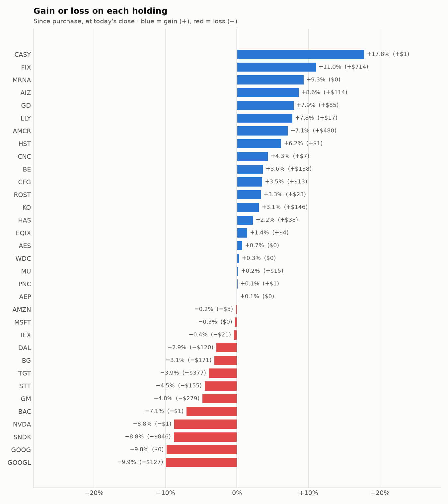

# Daily trading report — Monday 26 October 2026

## Summary

- **Account value:** $97,570 (+$966, +1.0% today)
- **S&P 500 (SPY) today:** +0.7% — the agent was ahead of the index by 0.29%
- **Trades:** 4 buy(s) ($15,040), 5 sell(s) ($16,714)
- **2026-10-26 Morning rebalance:** traded — 9 order(s) placed
- **2026-10-26 Afternoon risk check:** no trades needed — Risk-checked 33 holding(s): none was 12%+ below its purchase price, and none had both clearly negative news and a price drop of 3%+ since entry.

## Charts

## Why I bought

### IEX — bought 21.161 shares at ~$232.06 ($4,911)

**Why:** combined score +0.97; ranked #6 of 503; driven mainly by low volatility +1.84, research (news + analyst consensus) +1.84; entering/adding to the top-ranked target portfolio; research detail: 1 recent headline(s), net positive tone (+5); analyst consensus +1.00/2 (6 strong buy, 8 buy, 6 hold, 0 sell, 0 strong sell)

**Research scores** (combined +0.97, ranked #6 in the S&P 500, sector: Industrials):

| Factor | Score | Measures |
|---|---|---|
| Value | +0.32 | cheap vs. sector peers on P/E and P/B |
| Quality | +0.07 | profitability (ROE, margins) and balance-sheet strength |
| Momentum | +0.98 | 12-month price trend, excluding the last month |
| Low volatility | +1.84 | steadier price than sector peers |
| Research | +1.84 | recent news tone + analyst consensus |

**Company financials (Finnhub, trailing 12 months):** P/E 32.5, P/B 4.2, return on equity 12.9%, gross margin 44.7%, debt/equity 0.46

**Price trend (Alpaca):** 12-month return (excl. last month) +43.4%, last month +0.2%, volatility 18.5%/yr

**News (Finnhub): 1 headline(s) in the last 2 days, net tone +5.** Most influential:
- [IDEX Corporation Is Growing Nicely, But Not Enough To Justify A Bullish Rating](https://finnhub.io/api/news?id=c8e768724124221b25d7f40e15a064c244b99be6c5662a6a4ff1c02414f6fe02) — 24 Oct, SeekingAlpha (tone +5)

**Analysts (Finnhub, 2026-10-01):** 6 strong buy, 8 buy, 6 hold, 0 sell, 0 strong sell — consensus +1.00 on a -2 (strong sell) to +2 (strong buy) scale.

### BE — bought 19.192 shares at ~$198.16 ($3,803)

**Why:** combined score +0.89; ranked #10 of 503; driven mainly by price momentum +3.00, low volatility -2.41; entering/adding to the top-ranked target portfolio; research detail: 15 recent headline(s), net positive tone (+11); analyst consensus +0.72/2 (6 strong buy, 17 buy, 15 hold, 1 sell, 0 strong sell)

**Research scores** (combined +0.89, ranked #10 in the S&P 500, sector: Industrials):

| Factor | Score | Measures |
|---|---|---|
| Value | -1.57 | cheap vs. sector peers on P/E and P/B |
| Quality | -0.40 | profitability (ROE, margins) and balance-sheet strength |
| Momentum | +3.00 | 12-month price trend, excluding the last month |
| Low volatility | -2.41 | steadier price than sector peers |
| Research | +1.34 | recent news tone + analyst consensus |

**Company financials (Finnhub, trailing 12 months):** P/E 232.4, P/B 53.4, return on equity 24.8%, gross margin 31.2%, debt/equity 1.67

**Price trend (Alpaca):** 12-month return (excl. last month) +244.5%, last month -27.5%, volatility 84.0%/yr

**News (Finnhub): 15 headline(s) in the last 2 days, net tone +11.** Most influential:
- [Bloom Energy: Strong Results Not Sufficient To Overcome Deteriorating Big Picture](https://finnhub.io/api/news?id=a33d32c984a08d61f4179baa05fe916cd9a39dc4beea782a115d93fa45f8b435) — 24 Oct, SeekingAlpha (tone +3)
- [Why Bloom Energy (BE) shares are falling today](https://finnhub.io/api/news?id=13a0899cf9185d4ef0208371a1423fe547c0c9a616e7e7c675a35d6b4ba62f73) — 23 Oct, Yahoo (tone +3)
- [Bloom Energy Is 44% Below Its June Record. Here’s the Number That Sank It After Earnings](https://finnhub.io/api/news?id=0a41487d75bee2af1d35ecc9e24d0475de9f4e26e56c2628427f8c43f94ebdf0) — 25 Oct, Yahoo (tone +2)
- [Bloom Energy Raised Its 2026 Forecast for the Third Time. Is the Stock a Buy More Than a Third Below Its Record?](https://finnhub.io/api/news?id=f1e9032a32e41d0b5d7eed1278bccaed1f2f93d01e291062fac8be9f32917e65) — 24 Oct, Yahoo (tone +2)
- [Bloom Energy Just Reported—Its Biggest Order Is Still Waiting on a Pipeline](https://finnhub.io/api/news?id=9fc43f900867e47fb15ab6139847e550923e842138dc0c69d342195951ad92d1) — 24 Oct, Yahoo (tone +1)

**Analysts (Finnhub, 2026-10-01):** 6 strong buy, 17 buy, 15 hold, 1 sell, 0 strong sell — consensus +0.72 on a -2 (strong sell) to +2 (strong buy) scale.

### AMZN — bought 13.967 shares at ~$249.35 ($3,483)

**Why:** combined score +0.82; ranked #12 of 503; driven mainly by research (news + analyst consensus) +2.14, price momentum +0.82; entering/adding to the top-ranked target portfolio; research detail: 40 recent headline(s), net positive tone (+11); analyst consensus +1.23/2 (19 strong buy, 48 buy, 3 hold, 0 sell, 0 strong sell)

**Research scores** (combined +0.82, ranked #12 in the S&P 500, sector: Consumer Discretionary):

| Factor | Score | Measures |
|---|---|---|
| Value | -0.03 | cheap vs. sector peers on P/E and P/B |
| Quality | +0.12 | profitability (ROE, margins) and balance-sheet strength |
| Momentum | +0.82 | 12-month price trend, excluding the last month |
| Low volatility | -0.29 | steadier price than sector peers |
| Research | +2.14 | recent news tone + analyst consensus |

**Company financials (FMP, trailing 12 months):** P/E 19.7, P/B 4.8, return on equity 30.5%, gross margin 50.8%, debt/equity 0.40

**Price trend (Alpaca):** 12-month return (excl. last month) +13.0%, last month -0.5%, volatility 42.6%/yr

**News (Finnhub): 40 headline(s) in the last 2 days, net tone +11.** Most influential:
- [Amazon Q3 Preview: AWS Backlog Conversion Justifies The Capex Surge](https://finnhub.io/api/news?id=d6f8f03deadb4caf5a215bb7afc02ed864c3ed0b0b23b12053cdf43a9c055f2e) — 26 Oct, SeekingAlpha (tone +2)
- [Morgan Stanley Sees Amazon Stock Surging 100% with AWS Hitting $1 Trillion in Revenue Sooner Than People Think](https://finnhub.io/api/news?id=62532f93cf91eaed619f78039c7cdac09ac0ee44e98c5bdba6961283198a4f78) — 25 Oct, Yahoo (tone +2)
- [Prediction: Amazon Stock Will Skyrocket After Oct. 29 Thanks to AWS Growth](https://finnhub.io/api/news?id=e04180e1efd8cffcaa3e53fcae6fe055c0b890ed61efec4cde3855bca252aa9a) — 25 Oct, Yahoo (tone +2)
- [Hyperscaler Earnings Previews: Alphabet, Microsoft And Amazon - Maybe The Bearish Sentiment Will Help](https://finnhub.io/api/news?id=c82629cbf1dea357a8228bbe7e5d25ec804d2ecd9cc2693c6d122a3a2ae58013) — 26 Oct, SeekingAlpha (tone -1)
- [3 Big Tech Earnings Reports to Watch as AI Bills Keep Growing](https://finnhub.io/api/news?id=a8ce3263b39afbcadb0f1aef650e8578053c1a7fd7770dc2281fd8b9803984bf) — 25 Oct, Yahoo (tone +1)

**Analysts (Finnhub, 2026-10-01):** 19 strong buy, 48 buy, 3 hold, 0 sell, 0 strong sell — consensus +1.23 on a -2 (strong sell) to +2 (strong buy) scale.

### KO — bought 30.784 shares at ~$92.36 ($2,843)

**Why:** combined score +0.90; ranked #9 of 503; driven mainly by research (news + analyst consensus) +1.65, low volatility +1.49; entering/adding to the top-ranked target portfolio; research detail: 8 recent headline(s), net positive tone (+2); analyst consensus +1.03/2 (8 strong buy, 19 buy, 7 hold, 0 sell, 0 strong sell)

**Research scores** (combined +0.90, ranked #9 in the S&P 500, sector: Consumer Staples):

| Factor | Score | Measures |
|---|---|---|
| Value | -0.62 | cheap vs. sector peers on P/E and P/B |
| Quality | +0.35 | profitability (ROE, margins) and balance-sheet strength |
| Momentum | +1.38 | 12-month price trend, excluding the last month |
| Low volatility | +1.49 | steadier price than sector peers |
| Research | +1.65 | recent news tone + analyst consensus |

**Company financials (Finnhub, trailing 12 months):** P/E 27.9, P/B 10.0, return on equity 43.0%, gross margin 61.9%, debt/equity 1.20

**Price trend (Alpaca):** 12-month return (excl. last month) +32.0%, last month +5.2%, volatility 16.9%/yr

**News (Finnhub): 8 headline(s) in the last 2 days, net tone +2.** Most influential:
- [What Does Omnicom Group (OMC) Winning A Major Media Mandate Mean For Investors?](https://finnhub.io/api/news?id=d80b39596091c048019ac22c8e9467e34840850a0b906f0290e69eda036fb7f1) — 24 Oct, Yahoo (tone +2)
- [Boeing, Coca-Cola Earnings Previews: A Turnaround Story and a Defensive Staple Face the Same Test](https://finnhub.io/api/news?id=ee14c040952ff2624ca76b038dd09b5213d973a3984375ab14b1a0b21fbc6e41) — 26 Oct, Yahoo (tone +0)
- [Coca-Cola (KO) Q3 earnings: what to expect](https://finnhub.io/api/news?id=4eccc950fba835530bd62b7288b34a9b4aab0819c527e7ae01da932534a0a616) — 26 Oct, Yahoo (tone +0)
- [The Fed, Inflation, Verizon, Boeing, Alphabet, GE Vernova, Amazon, and Many More Stocks to Watch This Week](https://finnhub.io/api/news?id=3f8421ce6d8985ba1bfded18bf2eda36b9f4aa0e0de6be4dddb7ee069b173a5f) — 25 Oct, Yahoo (tone +0)
- [PepsiCo Pays More, Coca-Cola Looks Stronger. Which Dividend Wins for Retirement?](https://finnhub.io/api/news?id=d0527715bc993645fb3e57e43324e32c1de5a5524b2d067401b762f62c38d009) — 25 Oct, Yahoo (tone +0)

**Analysts (Finnhub, 2026-10-01):** 8 strong buy, 19 buy, 7 hold, 0 sell, 0 strong sell — consensus +1.03 on a -2 (strong sell) to +2 (strong buy) scale.

## Why I sold

### CB — sold 16.215 shares at ~$358.02 ($5,805)

**Why:** combined score +0.45; ranked #63 of 503; driven mainly by price momentum +0.95, low volatility +0.91; trimmed toward target weight, or dropped out of the top-ranked names; research detail: analyst consensus +0.66/2 (8 strong buy, 10 buy, 15 hold, 1 sell, 1 strong sell)

**Research scores** (combined +0.45, ranked #63 in the S&P 500, sector: Financials):

| Factor | Score | Measures |
|---|---|---|
| Value | +0.39 | cheap vs. sector peers on P/E and P/B |
| Quality | +0.20 | profitability (ROE, margins) and balance-sheet strength |
| Momentum | +0.95 | 12-month price trend, excluding the last month |
| Low volatility | +0.91 | steadier price than sector peers |
| Research | -0.16 | recent news tone + analyst consensus |

**Company financials (Finnhub, trailing 12 months):** P/E 12.2, P/B 1.7, return on equity 15.2%, debt/equity 0.25

**Price trend (Alpaca):** 12-month return (excl. last month) +21.5%, last month +6.0%, volatility 17.1%/yr

**News (Finnhub):** no headlines in the last 2 days.

**Analysts (Finnhub, 2026-10-01):** 8 strong buy, 10 buy, 15 hold, 1 sell, 1 strong sell — consensus +0.66 on a -2 (strong sell) to +2 (strong buy) scale.

### GM — sold 51.042 shares at ~$76.58 ($3,909)

**Why:** combined score +0.93; ranked #7 of 503; driven mainly by price momentum +1.65, value (cheapness) +1.44; trimmed toward target weight, or dropped out of the top-ranked names; research detail: 5 recent headline(s), net positive tone (+2); analyst consensus +1.14/2 (11 strong buy, 18 buy, 6 hold, 0 sell, 0 strong sell)

**Research scores** (combined +0.93, ranked #7 in the S&P 500, sector: Consumer Discretionary):

| Factor | Score | Measures |
|---|---|---|
| Value | +1.44 | cheap vs. sector peers on P/E and P/B |
| Quality | -0.66 | profitability (ROE, margins) and balance-sheet strength |
| Momentum | +1.65 | 12-month price trend, excluding the last month |
| Low volatility | -0.01 | steadier price than sector peers |
| Research | +0.67 | recent news tone + analyst consensus |

**Company financials (FMP, trailing 12 months):** P/E 17.3, P/B 1.1, return on equity 6.3%, gross margin 9.0%, debt/equity 2.05

**Price trend (Alpaca):** 12-month return (excl. last month) +37.5%, last month -5.8%, volatility 32.4%/yr

**News (Finnhub): 5 headline(s) in the last 2 days, net tone +2.** Most influential:
- [GM Just Announced a $20 Billion Buyback. Tesla Trades at 350 Times Earnings. Here's Which Auto Stock I'd Buy Today.](https://finnhub.io/api/news?id=665ca2406b45703c147072223103005d8408b7b5fa09db2c9cb33a8a4948908f) — 25 Oct, Yahoo (tone +1)
- [Ford, GM, Stellantis stocks decline for week ending Oct. 23](https://finnhub.io/api/news?id=310fa0c7a0ab51904768a162f0532cfd40a591586c589f9eb4d6731be3e3cd0b) — 24 Oct, Yahoo (tone +1)
- [Is General Motors Stock Stronger Than It Looks?](https://finnhub.io/api/news?id=2ef859b7374a29b1030de98218bc25631b7fd9501d25a690d727c2425163bb20) — 26 Oct, Yahoo (tone +0)
- [Forget Ford's Lucrative Dividend. GM Has a Different and Perhaps Better Way to Reward Investors.](https://finnhub.io/api/news?id=aa5883d14ff315cdab57208ede071167f22a15cc31076e3abe2a4ef46dba0bc7) — 25 Oct, Yahoo (tone +0)
- [MarketBeat Week in Review – 10/19 - 10/23](https://finnhub.io/api/news?id=7c98aef69dc9fa8ac289a42b47811016e0ac37976738cdf148d4f1e459a2be6f) — 24 Oct, Yahoo (tone +0)

**Analysts (Finnhub, 2026-10-01):** 11 strong buy, 18 buy, 6 hold, 0 sell, 0 strong sell — consensus +1.14 on a -2 (strong sell) to +2 (strong buy) scale.

### WDC — sold 10.646 shares at ~$345.30 ($3,676)

**Why:** combined score +0.63; ranked #29 of 503; driven mainly by price momentum +1.58, low volatility -0.92; trimmed toward target weight, or dropped out of the top-ranked names; research detail: 4 recent headline(s), net positive tone (+3); analyst consensus +1.00/2 (7 strong buy, 17 buy, 7 hold, 0 sell, 0 strong sell)

**Research scores** (combined +0.63, ranked #29 in the S&P 500, sector: Information Technology):

| Factor | Score | Measures |
|---|---|---|
| Value | +0.00 | cheap vs. sector peers on P/E and P/B |
| Quality | +0.00 | profitability (ROE, margins) and balance-sheet strength |
| Momentum | +1.58 | 12-month price trend, excluding the last month |
| Low volatility | -0.92 | steadier price than sector peers |
| Research | +0.49 | recent news tone + analyst consensus |

**Price trend (Alpaca):** 12-month return (excl. last month) +308.7%, last month -23.7%, volatility 67.9%/yr

**News (Finnhub): 4 headline(s) in the last 2 days, net tone +3.** Most influential:
- [Why Western Digital's AI Storage Boom Defies the Chip Sell-Off](https://finnhub.io/api/news?id=b95d50f055aa9d1bfc1fd5eb3a06cf4d29fa9c815b5a47e6611dad1955cf862f) — 24 Oct, Yahoo (tone +2)
- [Western Digital: Cracks In Its AI Supercycle Are Worsening (Rating Downgrade)](https://finnhub.io/api/news?id=6c7aea3e227e9b81f25a81cb4f03786ba9dcc188f5c5167c1e99909e0fdc2d21) — 25 Oct, SeekingAlpha (tone -1)
- [Western Digital (WDC) Stock Price Drops As Q1 Results Spur Profit Quality Concerns](https://finnhub.io/api/news?id=1f905c3b89d8b03c27de1dabd712e1c42f582c332fd1fe82dc3ced3b6b557f8c) — 23 Oct, Yahoo (tone +1)
- [Western Digital Stock Has Fallen 53% Since June. I'd Consider a Small Position After Its Latest Report.](https://finnhub.io/api/news?id=a6877fa373b05fe73aeaafe4de725210d879ea249ad327b402cc3dda13d9305c) — 23 Oct, Yahoo (tone +1)

**Analysts (Finnhub, 2026-10-01):** 7 strong buy, 17 buy, 7 hold, 0 sell, 0 strong sell — consensus +1.00 on a -2 (strong sell) to +2 (strong buy) scale.

### FIX — sold 1.471 shares at ~$1,230.41 ($1,810)

**Why:** combined score +1.36; ranked #3 of 503; driven mainly by price momentum +2.80, research (news + analyst consensus) +2.11; trimmed toward target weight, or dropped out of the top-ranked names; research detail: 4 recent headline(s), net positive tone (+4); analyst consensus +1.31/2 (7 strong buy, 7 buy, 2 hold, 0 sell, 0 strong sell)

**Research scores** (combined +1.36, ranked #3 in the S&P 500, sector: Industrials):

| Factor | Score | Measures |
|---|---|---|
| Value | -0.46 | cheap vs. sector peers on P/E and P/B |
| Quality | +0.16 | profitability (ROE, margins) and balance-sheet strength |
| Momentum | +2.80 | 12-month price trend, excluding the last month |
| Low volatility | -1.55 | steadier price than sector peers |
| Research | +2.11 | recent news tone + analyst consensus |

**Company financials (Finnhub, trailing 12 months):** P/E 28.5, P/B 21.7, return on equity 53.5%, gross margin 25.7%, debt/equity 0.02

**Price trend (Alpaca):** 12-month return (excl. last month) +104.1%, last month -29.4%, volatility 52.4%/yr

**News (Finnhub): 4 headline(s) in the last 2 days, net tone +4.** Most influential:
- [FIX Q3 deep dive: backlog surge and margin mix drive investor debate](https://finnhub.io/api/news?id=73547d06bee95191137928b6f84c36aef3154707dd4a17c31093b9581bcc3a32) — 25 Oct, Yahoo (tone +2)
- [Comfort Systems USA (FIX) Stock Price Slides After Q3 Earnings Strength](https://finnhub.io/api/news?id=574900d19dd9c81ab08933fc2005acc99b931add62a14c6b3ab06d532c40c57e) — 24 Oct, Yahoo (tone +1)
- [Why Comfort Systems (FIX) shares are plunging today](https://finnhub.io/api/news?id=aaaed646a2790a28bb3041c95a51bcf087a283a662a152995727bd1da5fa9da4) — 23 Oct, Yahoo (tone +1)
- [Comfort Systems USA, Inc. 2026 Q3 - Results - Earnings Call Presentation](https://finnhub.io/api/news?id=f03ffc5b9ccdf07ab6971544539f81014a72aabf34d4ccb58f1eb639b5a7ec42) — 25 Oct, SeekingAlpha (tone +0)

**Analysts (Finnhub, 2026-10-01):** 7 strong buy, 7 buy, 2 hold, 0 sell, 0 strong sell — consensus +1.31 on a -2 (strong sell) to +2 (strong buy) scale.

### MU — sold 1.711 shares at ~$885.02 ($1,514)

**Why:** combined score +1.57; ranked #1 of 503; driven mainly by price momentum +3.00, value (cheapness) +1.11; trimmed toward target weight, or dropped out of the top-ranked names; research detail: 16 recent headline(s), net positive tone (+3); analyst consensus +1.25/2 (18 strong buy, 35 buy, 4 hold, 0 sell, 0 strong sell)

**Research scores** (combined +1.57, ranked #1 in the S&P 500, sector: Information Technology):

| Factor | Score | Measures |
|---|---|---|
| Value | +1.11 | cheap vs. sector peers on P/E and P/B |
| Quality | +0.92 | profitability (ROE, margins) and balance-sheet strength |
| Momentum | +3.00 | 12-month price trend, excluding the last month |
| Low volatility | -1.04 | steadier price than sector peers |
| Research | +0.85 | recent news tone + analyst consensus |

**Company financials (Finnhub, trailing 12 months):** P/E 11.7, P/B 7.8, return on equity 91.8%, gross margin 80.7%, debt/equity 0.04

**Price trend (Alpaca):** 12-month return (excl. last month) +548.8%, last month -18.8%, volatility 53.5%/yr

**News (Finnhub): 16 headline(s) in the last 2 days, net tone +3.** Most influential:
- [Micron: I Was Bearish Before, But This Call May Be Even More Controversial (Upgrade)](https://finnhub.io/api/news?id=ca3449657e90d7c01341d9b4b560052a2d6eeb79d52c4de29f2d48454f2da113) — 26 Oct, SeekingAlpha (tone +2)
- [Here’s What a $10,000 Investment in Micron Stock Will Be Worth by 2030](https://finnhub.io/api/news?id=4b8c9c1de3f6bd98b1dad67d98429521fcd61442d901da637b2f21155e54b535) — 26 Oct, Yahoo (tone +1)
- [“Durability and Predictability”: Micron Is Up 200% in 2026. Take Profits, or Buy More?](https://finnhub.io/api/news?id=22ef8b28d7ddec37e6af88ba002958b836ab61c58a04de8f2c6a649d8ded0d7b) — 26 Oct, Yahoo (tone +1)
- [Micron Says AI Cut Its Data Center SSD Development Time by 60%. Here’s Where the Stock Could Go by 2031](https://finnhub.io/api/news?id=fcc703b9e130da98ffa315aedd6e9288583f863af3ffbffaf1b3177cd9c9b585) — 24 Oct, Yahoo (tone -1)
- [Micron and Sandisk Hit Record Memory Margins. There's One Clear Winner.](https://finnhub.io/api/news?id=ac41fb7f78cd2354dd834e4123fed82c58023bdc28635b1eecb6c159bd51cf68) — 24 Oct, Yahoo (tone +1)

**Analysts (Finnhub, 2026-10-01):** 18 strong buy, 35 buy, 4 hold, 0 sell, 0 strong sell — consensus +1.25 on a -2 (strong sell) to +2 (strong buy) scale.

## Holdings at the close

| Stock | Shares | Avg cost | Price | Market value | % of account | Today | Gain/loss $ | Gain/loss % |
|---|---:|---:|---:|---:|---:|---:|---:|---:|
| TGT | 62.35 | $154.16 | $148.11 | $9,235 | 9.5% | -3.04% | −$377 | -3.92% |
| SNDK | 6.938 | $1,379.50 | $1,257.50 | $8,725 | 8.9% | +1.57% | −$846 | -8.84% |
| MU | 8.88 | $903.65 | $905.30 | $8,039 | 8.2% | +3.16% | +$15 | +0.18% |
| AMCR | 156.599 | $43.13 | $46.19 | $7,233 | 7.4% | +0.17% | +$480 | +7.10% |
| FIX | 5.77 | $1,120.53 | $1,244.19 | $7,179 | 7.4% | +7.18% | +$714 | +11.04% |
| GM | 72.122 | $80.26 | $76.38 | $5,509 | 5.6% | +0.61% | −$279 | -4.83% |
| BG | 51.442 | $105.54 | $102.22 | $5,258 | 5.4% | -0.97% | −$171 | -3.15% |
| KO | 52.765 | $90.01 | $92.78 | $4,895 | 5.0% | +0.07% | +$146 | +3.08% |
| IEX | 21.179 | $232.06 | $231.06 | $4,894 | 5.0% | +0.88% | −$21 | -0.43% |
| DAL | 51.385 | $80.92 | $78.58 | $4,038 | 4.1% | +2.35% | −$120 | -2.89% |
| BE | 19.192 | $198.16 | $205.35 | $3,941 | 4.0% | +6.24% | +$138 | +3.63% |
| AMZN | 14.056 | $249.42 | $249.05 | $3,501 | 3.6% | +0.42% | −$5 | -0.15% |
| STT | 19.22 | $177.99 | $169.94 | $3,266 | 3.3% | +1.26% | −$155 | -4.52% |
| HAS | 14.677 | $115.42 | $117.99 | $1,732 | 1.8% | +0.47% | +$38 | +2.22% |
| AIZ | 5 | $264.38 | $287.15 | $1,436 | 1.5% | +0.84% | +$114 | +8.61% |
| PNC | 6 | $225.64 | $225.84 | $1,355 | 1.4% | +0.61% | +$1 | +0.09% |
| GD | 3.251 | $331.27 | $357.50 | $1,162 | 1.2% | +2.33% | +$85 | +7.92% |
| GOOGL | 3.635 | $352.08 | $317.13 | $1,153 | 1.2% | -0.96% | −$127 | -9.93% |
| ROST | 3.067 | $226.55 | $234.11 | $718 | 0.7% | +2.10% | +$23 | +3.34% |
| CFG | 5.744 | $63.15 | $65.37 | $375 | 0.4% | +0.35% | +$13 | +3.52% |
| EQIX | 0.282 | $954.01 | $967.65 | $273 | 0.3% | +1.32% | +$4 | +1.43% |
| LLY | 0.182 | $1,189.78 | $1,281.99 | $233 | 0.2% | +0.67% | +$17 | +7.75% |
| AEP | 1.463 | $129.15 | $129.22 | $189 | 0.2% | -0.36% | +$0 | +0.05% |
| CNC | 2.63 | $65.21 | $68.03 | $179 | 0.2% | -3.05% | +$7 | +4.32% |
| WDC | 0.411 | $355.69 | $356.72 | $147 | 0.2% | +3.80% | +$0 | +0.29% |
| MSFT | 0.023 | $533.80 | $532.40 | $12 | 0.0% | +1.50% | −$0 | -0.26% |
| HST | 0.355 | $23.44 | $24.89 | $9 | 0.0% | +0.69% | +$1 | +6.19% |
| CASY | 0.011 | $597.62 | $703.93 | $8 | 0.0% | +0.67% | +$1 | +17.79% |
| BAC | 0.14 | $54.42 | $50.58 | $7 | 0.0% | +0.04% | −$1 | -7.06% |
| NVDA | 0.032 | $236.88 | $216.12 | $7 | 0.0% | +2.44% | −$1 | -8.77% |
| MRNA | 0.028 | $181.06 | $197.93 | $6 | 0.0% | -1.08% | +$0 | +9.32% |
| GOOG | 0.009 | $348.62 | $314.34 | $3 | 0.0% | -0.93% | −$0 | -9.83% |
| AES | 0.096 | $14.92 | $15.03 | $1 | 0.0% | +0.20% | +$0 | +0.74% |
| **Invested** | | | | **$84,717** | **86.8%** | | **−$307** | |
| **Cash** | | | | $12,853 | 13.2% | | | |
| **Total account** | | | | **$97,570** | 100% | | | |

_Scores are sector-neutral z-scores: 0 is average for the stock's sector, +1 is one standard deviation better. News tone is a keyword count over recent headlines, not a deep read. None of this guarantees a stock will rise; a few days of results can't show whether the strategy has a real edge over the S&P 500._
