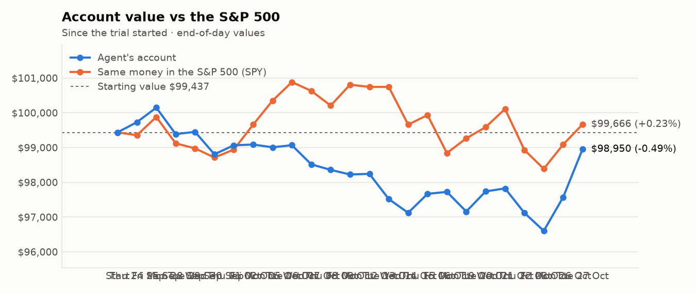
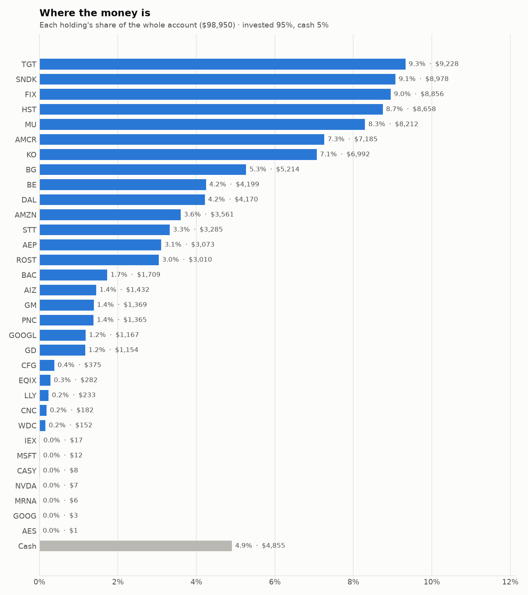
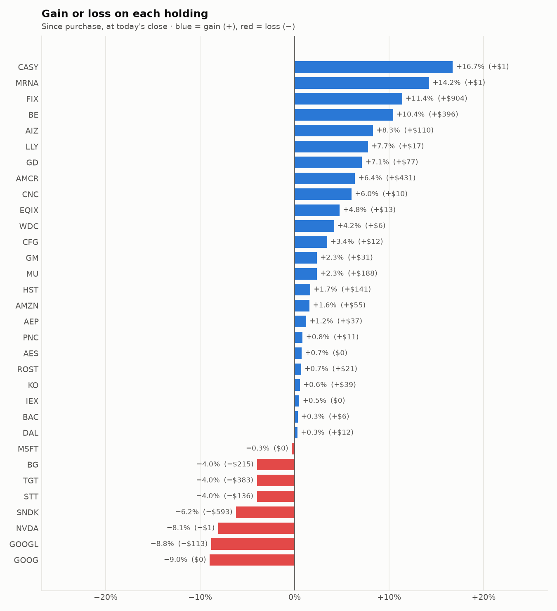

# Daily trading report — Tuesday 27 October 2026

## Summary

- **Account value:** $98,950 (+$1,381, +1.4% today)
- **S&P 500 (SPY) today:** +0.6% — the agent was ahead of the index by 0.83%
- **Trades:** 6 buy(s) ($19,036), 3 sell(s) ($11,039)
- **2026-10-27 Morning rebalance:** traded — 9 order(s) placed
- **2026-10-27 Afternoon risk check:** no trades needed — Risk-checked 32 holding(s): none was 12%+ below its purchase price, and none had both clearly negative news and a price drop of 3%+ since entry.

## Charts

## Why I bought

### HST — bought 342.948 shares at ~$24.81 ($8,509)

**Why:** combined score +1.09; ranked #5 of 503; driven mainly by price momentum +1.56, research (news + analyst consensus) +0.96; entering/adding to the top-ranked target portfolio; research detail: 3 recent headline(s), net positive tone (+3); analyst consensus +0.92/2 (8 strong buy, 7 buy, 10 hold, 0 sell, 0 strong sell)

**Research scores** (combined +1.09, ranked #5 in the S&P 500, sector: Real Estate):

| Factor | Score | Measures |
|---|---|---|
| Value | +0.96 | cheap vs. sector peers on P/E and P/B |
| Quality | +0.72 | profitability (ROE, margins) and balance-sheet strength |
| Momentum | +1.56 | 12-month price trend, excluding the last month |
| Low volatility | -0.07 | steadier price than sector peers |
| Research | +0.96 | recent news tone + analyst consensus |

**Company financials (Finnhub, trailing 12 months):** P/E 16.7, P/B 2.5, return on equity 15.5%, gross margin 97.0%, debt/equity 0.80

**Price trend (Alpaca):** 12-month return (excl. last month) +29.1%, last month +11.7%, volatility 24.0%/yr

**News (Finnhub): 3 headline(s) in the last 2 days, net tone +3.** Most influential:
- [Host Hotels & Resorts, Other Lodging REITs Set to Benefit From Strong Q3 Trends, BofA Says](https://finnhub.io/api/news?id=75f007ed27a7ac22fdfb5cce4a4f6415434df449fc98e7ef334832056060c38b) — 26 Oct, Yahoo (tone +1)
- [Evercore ISI Group Maintains In-Line on Host Hotels & Resorts, Raises Price Target to $26](https://finnhub.io/api/news?id=04c24a9edcb880a6557e18bf5ad4118917ab8b2a9e34efddcddb6c007e50068e) — 26 Oct, Benzinga (tone +1)
- [Wells Fargo Maintains Overweight on Host Hotels & Resorts, Raises Price Target to $27](https://finnhub.io/api/news?id=50c42249e67f850288e8504a22331d251522cc2bb4466307b7e2658821f1806b) — 26 Oct, Benzinga (tone +1)

**Analysts (Finnhub, 2026-10-01):** 8 strong buy, 7 buy, 10 hold, 0 sell, 0 strong sell — consensus +0.92 on a -2 (strong sell) to +2 (strong buy) scale.

### AEP — bought 22.121 shares at ~$128.70 ($2,847)

**Why:** combined score +0.79; ranked #16 of 503; driven mainly by price momentum +1.45, research (news + analyst consensus) +1.45; entering/adding to the top-ranked target portfolio; research detail: 6 recent headline(s), net positive tone (+6); analyst consensus +0.79/2 (6 strong buy, 10 buy, 12 hold, 0 sell, 0 strong sell)

**Research scores** (combined +0.79, ranked #16 in the S&P 500, sector: Utilities):

| Factor | Score | Measures |
|---|---|---|
| Value | -0.38 | cheap vs. sector peers on P/E and P/B |
| Quality | +0.02 | profitability (ROE, margins) and balance-sheet strength |
| Momentum | +1.45 | 12-month price trend, excluding the last month |
| Low volatility | -0.06 | steadier price than sector peers |
| Research | +1.45 | recent news tone + analyst consensus |

**Company financials (Finnhub, trailing 12 months):** P/E 22.4, P/B 2.4, return on equity 10.0%, gross margin 41.9%, debt/equity 1.64

**Price trend (Alpaca):** 12-month return (excl. last month) +8.7%, last month +9.2%, volatility 17.1%/yr

**News (Finnhub): 6 headline(s) in the last 2 days, net tone +6.** Most influential:
- [This Utility Stock Just Raised Its Dividend by 2%](https://finnhub.io/api/news?id=c0f3bddc44b1668e4e7c4a3fcceaf9780ee7d614ec3fbad1f970cc779150fa36) — 26 Oct, Yahoo (tone +2)
- [NextEra Energy (NEE) vs. DUK and AEP: Can Its Dividend Moat and Earnings Growth Close the Valuation Gap?](https://finnhub.io/api/news?id=fe498ce3e8b9ea7e92aea71b4bdc9b949f118e47c71af57763d76a131d811a53) — 26 Oct, Yahoo (tone +2)
- [American Electric Power to Release Q3 Earnings: Here's What to Expect](https://finnhub.io/api/news?id=ad3581382602a0f71b24a2a73c972d7603fe4c748d0d114af50377b9431252c2) — 26 Oct, Yahoo (tone +2)
- [GEV, D, CMS, AEP And PWR To Report Earnings This Week – A Look At What Investors Are Watching](https://finnhub.io/api/news?id=4e1fd7f606da97c2f6c4696fb7a6f6ec7d95fc9d0e383704cb05d6a05ec536b8) — 26 Oct, Yahoo (tone +0)
- [The Energy Stocks With the Most at Stake in the Midterms](https://finnhub.io/api/news?id=36f55e0511c9d9070145ee6337ea368cc6c5f70f2af265a62ac8b45c8b4b1b3c) — 26 Oct, Yahoo (tone +0)

**Analysts (Finnhub, 2026-10-01):** 6 strong buy, 10 buy, 12 hold, 0 sell, 0 strong sell — consensus +0.79 on a -2 (strong sell) to +2 (strong buy) scale.

### ROST — bought 10.015 shares at ~$229.11 ($2,295)

**Why:** combined score +0.79; ranked #18 of 503; driven mainly by price momentum +2.02, low volatility +0.75; entering/adding to the top-ranked target portfolio; research detail: 7 recent headline(s), net positive tone (+8); analyst consensus +1.04/2 (9 strong buy, 10 buy, 8 hold, 0 sell, 0 strong sell)

**Research scores** (combined +0.79, ranked #18 in the S&P 500, sector: Consumer Discretionary):

| Factor | Score | Measures |
|---|---|---|
| Value | -0.59 | cheap vs. sector peers on P/E and P/B |
| Quality | -0.14 | profitability (ROE, margins) and balance-sheet strength |
| Momentum | +2.02 | 12-month price trend, excluding the last month |
| Low volatility | +0.75 | steadier price than sector peers |
| Research | +0.74 | recent news tone + analyst consensus |

**Company financials (Finnhub, trailing 12 months):** P/E 28.2, P/B 12.0, return on equity 42.3%, gross margin 28.6%, debt/equity 0.15

**Price trend (Alpaca):** 12-month return (excl. last month) +57.9%, last month -0.8%, volatility 23.3%/yr

**News (Finnhub): 7 headline(s) in the last 2 days, net tone +8.** Most influential:
- [What Is Ross Stores (ROST) Telling Investors With UBS's Upgrade?](https://finnhub.io/api/news?id=3cdbc49a36f89dd70cf369b882df10add2d9ae64f55af002ec6caf9392ac3546) — 27 Oct, Yahoo (tone +3)
- [Ross Stores upgraded by UBS as store productivity gap offers growth potential](https://finnhub.io/api/news?id=2dfa067c1ffe9884d9dc329dc0be83a0bb26953fd857e90d8ff7478819c13c04) — 26 Oct, Yahoo (tone +3)
- [Ross Stores climbs as UBS upgrades shares to Buy on stronger sales outlook](https://finnhub.io/api/news?id=f74f9e8486c8035cf8ca996f4c54e4f6915777fda05dbcba123aee5f5e0b09a4) — 26 Oct, Yahoo (tone +2)
- [Ross Stores Marketing, Merchandising Push Underappreciated, UBS Says](https://finnhub.io/api/news?id=016e996d8fcd804c2e7df4f2a902cf257d064327ebb5e62a65e65f58ee9dd42c) — 26 Oct, Yahoo (tone +0)
- [Ross Stores Has Fallen Behind TJX. Catching Up Could Unlock Billions.](https://finnhub.io/api/news?id=4c9cadd4cead844d430a273c1c799de5b37cc8e1d4daca8f44a3d1d233a0a2ff) — 26 Oct, Yahoo (tone +0)

**Analysts (Finnhub, 2026-10-01):** 9 strong buy, 10 buy, 8 hold, 0 sell, 0 strong sell — consensus +1.04 on a -2 (strong sell) to +2 (strong buy) scale.

### KO — bought 23.878 shares at ~$92.29 ($2,204)

**Why:** combined score +1.01; ranked #6 of 503; driven mainly by research (news + analyst consensus) +2.05, low volatility +1.63; entering/adding to the top-ranked target portfolio; research detail: 42 recent headline(s), net positive tone (+19); analyst consensus +1.03/2 (8 strong buy, 19 buy, 7 hold, 0 sell, 0 strong sell)

**Research scores** (combined +1.01, ranked #6 in the S&P 500, sector: Consumer Staples):

| Factor | Score | Measures |
|---|---|---|
| Value | -0.67 | cheap vs. sector peers on P/E and P/B |
| Quality | +0.43 | profitability (ROE, margins) and balance-sheet strength |
| Momentum | +1.39 | 12-month price trend, excluding the last month |
| Low volatility | +1.63 | steadier price than sector peers |
| Research | +2.05 | recent news tone + analyst consensus |

**Company financials (Finnhub, trailing 12 months):** P/E 27.8, P/B 10.0, return on equity 43.0%, gross margin 61.9%, debt/equity 1.20

**Price trend (Alpaca):** 12-month return (excl. last month) +32.2%, last month +5.6%, volatility 16.7%/yr

**News (Finnhub): 42 headline(s) in the last 2 days, net tone +19.** Most influential:
- [Coca-Cola (NYSE:KO) Q3 2026 Results Meet Estimates as Guidance Rises](https://finnhub.io/api/news?id=d2b0a9fe9a836900c9aa93590f03ef68c60f5247ab15c5cedafe44aa52376811) — 27 Oct, ChartMill (tone +3)
- [Coca-Cola raises earnings outlook as North America business slows](https://finnhub.io/api/news?id=46eb95a0871f24a1e2960b23c2bf2983bc60a96d5d500440c616e887dc555195) — 27 Oct, Yahoo (tone +2)
- [Coca-Cola beats third quarter estimates on strong revenue](https://finnhub.io/api/news?id=775bc5286131c3b6feacfe40cff966d06ca45991e79465ab3879dde59211be49) — 27 Oct, Yahoo (tone +2)
- [Coca-Cola Reports Third Quarter 2026 Results and Raises Full Year Guidance](https://finnhub.io/api/news?id=18f62544d0d21c16e0749e6057d809a8449506be4c630ed8914eee7f3e8dd0d6) — 27 Oct, Yahoo (tone +2)
- [Coca-Cola Exec Says Encouraged By Performance In Asia Pacific Markets; India Delivered Strong Volume Growth; Expanding Consumer Base, Enhancing Execution](https://finnhub.io/api/news?id=5b66b8dd6a0efe34f433131382599ffaa392d1db4128abfdbd63623cb5bba0e0) — 27 Oct, Benzinga (tone +2)

**Analysts (Finnhub, 2026-10-01):** 8 strong buy, 19 buy, 7 hold, 0 sell, 0 strong sell — consensus +1.03 on a -2 (strong sell) to +2 (strong buy) scale.

### BAC — bought 33.562 shares at ~$50.53 ($1,696)

**Why:** combined score +0.72; ranked #19 of 503; driven mainly by research (news + analyst consensus) +1.82, low volatility +0.92; entering/adding to the top-ranked target portfolio; research detail: 15 recent headline(s), net positive tone (+10); analyst consensus +1.04/2 (6 strong buy, 17 buy, 5 hold, 0 sell, 0 strong sell)

**Research scores** (combined +0.72, ranked #19 in the S&P 500, sector: Financials):

| Factor | Score | Measures |
|---|---|---|
| Value | +0.88 | cheap vs. sector peers on P/E and P/B |
| Quality | -0.51 | profitability (ROE, margins) and balance-sheet strength |
| Momentum | +0.35 | 12-month price trend, excluding the last month |
| Low volatility | +0.92 | steadier price than sector peers |
| Research | +1.82 | recent news tone + analyst consensus |

**Company financials (Finnhub, trailing 12 months):** P/E 11.0, P/B 1.3, return on equity 10.7%, debt/equity 2.35

**Price trend (Alpaca):** 12-month return (excl. last month) +9.7%, last month -10.8%, volatility 21.1%/yr

**News (Finnhub): 15 headline(s) in the last 2 days, net tone +10.** Most influential:
- [Verizon raises 2026 outlook after record customer growth](https://finnhub.io/api/news?id=42202fe68b4bbdd1ae9366616aa677c65485cd945035ebf4e37d898f5f120d76) — 26 Oct, Yahoo (tone +4)
- [Amazon cloud growth expected to beat forecasts as AI demand strengthens](https://finnhub.io/api/news?id=a0101930e1db8247162c1ba4dad762c053c83845139a93021bd6d2589f43fa8e) — 26 Oct, Yahoo (tone +3)
- [Accelevation's SkyBridge bookings strengthen Bank of America's bullish outlook](https://finnhub.io/api/news?id=422b42da44e4fcca0c20b6340a5add97492025a4d9f15a4a74a2116759b39204) — 26 Oct, Yahoo (tone +2)
- [BofA names top application software stocks heading into Q3 earnings](https://finnhub.io/api/news?id=6c8fdb4b3a5cd53db78a1657b7cc01c69c07203424e1ac04c524de5b6f7f61ec) — 26 Oct, Yahoo (tone +1)
- [Bank of America sends SpaceX stock investors strong signal](https://finnhub.io/api/news?id=10d478c92200449a1056585207be16a433219ff87f5560807f22813b89a95f78) — 25 Oct, Yahoo (tone +1)

**Analysts (Finnhub, 2026-10-01):** 6 strong buy, 17 buy, 5 hold, 0 sell, 0 strong sell — consensus +1.04 on a -2 (strong sell) to +2 (strong buy) scale.

### FIX — bought 1.176 shares at ~$1,263.78 ($1,486)

**Why:** combined score +1.19; ranked #3 of 503; driven mainly by price momentum +2.76, low volatility -1.57; entering/adding to the top-ranked target portfolio; research detail: 5 recent headline(s), net positive tone (+5); analyst consensus +1.31/2 (7 strong buy, 7 buy, 2 hold, 0 sell, 0 strong sell)

**Research scores** (combined +1.19, ranked #3 in the S&P 500, sector: Industrials):

| Factor | Score | Measures |
|---|---|---|
| Value | -0.34 | cheap vs. sector peers on P/E and P/B |
| Quality | +0.17 | profitability (ROE, margins) and balance-sheet strength |
| Momentum | +2.76 | 12-month price trend, excluding the last month |
| Low volatility | -1.57 | steadier price than sector peers |
| Research | +1.36 | recent news tone + analyst consensus |

**Company financials (Finnhub, trailing 12 months):** P/E 26.9, P/B 17.5, return on equity 55.2%, gross margin 25.6%, debt/equity 0.01

**Price trend (Alpaca):** 12-month return (excl. last month) +108.3%, last month -25.0%, volatility 54.6%/yr

**News (Finnhub): 5 headline(s) in the last 2 days, net tone +5.** Most influential:
- [FIX Q3 Earnings Call Highlights Backlog Growth and 2027 Outlook](https://finnhub.io/api/news?id=fae870209bcee744cbbf6f897765bbf53b0ba2a3e1091b133cf29dc8adb4afaf) — 26 Oct, Yahoo (tone +3)
- [FIX Q3 deep dive: backlog surge and margin mix drive investor debate](https://finnhub.io/api/news?id=73547d06bee95191137928b6f84c36aef3154707dd4a17c31093b9581bcc3a32) — 25 Oct, Yahoo (tone +2)
- [S&P 500 Top Movers: Gainers and Losers in Today's US Session](https://finnhub.io/api/news?id=74c0b7f2c5da50ee872c7a076ef3214548b26f90b75e56289a9ae5a628750a1a) — 26 Oct, ChartMill (tone +0)
- [Keybanc Maintains Overweight on Comfort Systems USA, Lowers Price Target to $1979](https://finnhub.io/api/news?id=e1b3d5b3fd0151bcff0c7f395ee5fa306a141a44e4aa7bac1d72d1d97e1e4cb6) — 26 Oct, Benzinga (tone +0)
- [Comfort Systems USA, Inc. 2026 Q3 - Results - Earnings Call Presentation](https://finnhub.io/api/news?id=f03ffc5b9ccdf07ab6971544539f81014a72aabf34d4ccb58f1eb639b5a7ec42) — 25 Oct, SeekingAlpha (tone +0)

**Analysts (Finnhub, 2026-10-01):** 7 strong buy, 7 buy, 2 hold, 0 sell, 0 strong sell — consensus +1.31 on a -2 (strong sell) to +2 (strong buy) scale.

## Why I sold

### IEX — sold 21.107 shares at ~$232.36 ($4,904)

**Why:** combined score +0.51; ranked #51 of 503; driven mainly by low volatility +1.84, price momentum +0.92; trimmed toward target weight, or dropped out of the top-ranked names; research detail: 2 recent headline(s), net positive tone (+2); analyst consensus +1.00/2 (6 strong buy, 8 buy, 6 hold, 0 sell, 0 strong sell)

**Research scores** (combined +0.51, ranked #51 in the S&P 500, sector: Industrials):

| Factor | Score | Measures |
|---|---|---|
| Value | +0.00 | cheap vs. sector peers on P/E and P/B |
| Quality | +0.00 | profitability (ROE, margins) and balance-sheet strength |
| Momentum | +0.92 | 12-month price trend, excluding the last month |
| Low volatility | +1.84 | steadier price than sector peers |
| Research | +0.40 | recent news tone + analyst consensus |

**Price trend (Alpaca):** 12-month return (excl. last month) +44.2%, last month +0.3%, volatility 18.3%/yr

**News (Finnhub): 2 headline(s) in the last 2 days, net tone +2.** Most influential:
- [IDEX Gears Up to Report Q3 Earnings: What's in the Cards?](https://finnhub.io/api/news?id=446d5469a94c02ee58019b8a3671cf9eb9dc11735a30d116b17fffab07c0d0a4) — 26 Oct, Yahoo (tone +2)
- [IDEX (IEX) to report earnings tomorrow: here is what to expect](https://finnhub.io/api/news?id=46ab6a31dd0d8de2e697c445f3d65e1048a85c021de9cc6885900128311581fe) — 27 Oct, Yahoo (tone +0)

**Analysts (Finnhub, 2026-10-01):** 6 strong buy, 8 buy, 6 hold, 0 sell, 0 strong sell — consensus +1.00 on a -2 (strong sell) to +2 (strong buy) scale.

### GM — sold 55.121 shares at ~$80.04 ($4,412)

**Why:** combined score +0.70; ranked #23 of 503; driven mainly by price momentum +1.66, research (news + analyst consensus) +0.49; trimmed toward target weight, or dropped out of the top-ranked names; research detail: 8 recent headline(s), net positive tone (+2); analyst consensus +1.14/2 (11 strong buy, 18 buy, 6 hold, 0 sell, 0 strong sell)

**Research scores** (combined +0.70, ranked #23 in the S&P 500, sector: Consumer Discretionary):

| Factor | Score | Measures |
|---|---|---|
| Value | +0.00 | cheap vs. sector peers on P/E and P/B |
| Quality | +0.00 | profitability (ROE, margins) and balance-sheet strength |
| Momentum | +1.66 | 12-month price trend, excluding the last month |
| Low volatility | +0.00 | steadier price than sector peers |
| Research | +0.49 | recent news tone + analyst consensus |

**Price trend (Alpaca):** 12-month return (excl. last month) +38.0%, last month -7.7%, volatility 32.4%/yr

**News (Finnhub): 8 headline(s) in the last 2 days, net tone +2.** Most influential:
- [General Motors Next Gen Full-Size Pickups Riding To The Rescue Of Q4 Financials](https://finnhub.io/api/news?id=4231f1372df20af4ea1a1aa5b06b24d0352e3e98da8f1848720326b9272bb5ff) — 26 Oct, SeekingAlpha (tone +1)
- [GM Just Announced a $20 Billion Buyback. Tesla Trades at 350 Times Earnings. Here's Which Auto Stock I'd Buy Today.](https://finnhub.io/api/news?id=665ca2406b45703c147072223103005d8408b7b5fa09db2c9cb33a8a4948908f) — 25 Oct, Yahoo (tone +1)
- [General Motors Company to Transfer Common Stock Listing to Nasdaq on November 17, 2026](https://finnhub.io/api/news?id=e7eb3805d17824ff3a119bd789e26c6a1727c0a02a8c0f94fecbed57eb1baeea) — 27 Oct, Fintel (tone +0)
- [GM to move stock listing to Nasdaq in November, shares gain](https://finnhub.io/api/news?id=8a9d4974d7496f72306580e608441b29dae288df24d8bbbc6651ef7adf95a67d) — 27 Oct, Yahoo (tone +0)
- [Nasdaq's huge week: GM moves stock listing from NYSE and it bags the Anthropic IPO](https://finnhub.io/api/news?id=f393c878655e11f4b5339c4cf8d4cfb304d1826a25cbfcef6bc57d5bf9b1213e) — 27 Oct, Yahoo (tone +0)

**Analysts (Finnhub, 2026-10-01):** 11 strong buy, 18 buy, 6 hold, 0 sell, 0 strong sell — consensus +1.14 on a -2 (strong sell) to +2 (strong buy) scale.

### HAS — sold 14.677 shares at ~$117.35 ($1,722)

**Why:** combined score +0.52; ranked #50 of 503; driven mainly by price momentum +0.96, research (news + analyst consensus) +0.77; trimmed toward target weight, or dropped out of the top-ranked names; research detail: 3 recent headline(s), net positive tone (+5); analyst consensus +1.20/2 (8 strong buy, 8 buy, 4 hold, 0 sell, 0 strong sell)

**Research scores** (combined +0.52, ranked #50 in the S&P 500, sector: Consumer Discretionary):

| Factor | Score | Measures |
|---|---|---|
| Value | +0.00 | cheap vs. sector peers on P/E and P/B |
| Quality | +0.00 | profitability (ROE, margins) and balance-sheet strength |
| Momentum | +0.96 | 12-month price trend, excluding the last month |
| Low volatility | -0.08 | steadier price than sector peers |
| Research | +0.77 | recent news tone + analyst consensus |

**Price trend (Alpaca):** 12-month return (excl. last month) +17.2%, last month +33.8%, volatility 32.5%/yr

**News (Finnhub): 3 headline(s) in the last 2 days, net tone +5.** Most influential:
- [Hasbro and Campbell's have been highlighted as Zacks Bull and Bear of the Day](https://finnhub.io/api/news?id=c436db84c5f4aa30c029470efe915263e6597726c4282a8bf872b16bc8a556b6) — 26 Oct, Yahoo (tone +2)
- [Bull of the Day: Hasbro (HAS)](https://finnhub.io/api/news?id=dade3a56ead78de9152b6af0841e0e976f26a725f5fa8dec32713b2c4a53e975) — 26 Oct, Yahoo (tone +2)
- [Stocktwits Retail Therapy: Defensive Bets Hold Firm As Hasbro, Kohl’s, Boston Beer Lead Weekly Consumer Gains](https://finnhub.io/api/news?id=ffc57a546fb470ad8127f4cda24e1b9112d4b55273feebe504e397125961784e) — 26 Oct, Yahoo (tone +1)

**Analysts (Finnhub, 2026-10-01):** 8 strong buy, 8 buy, 4 hold, 0 sell, 0 strong sell — consensus +1.20 on a -2 (strong sell) to +2 (strong buy) scale.

## Holdings at the close

| Stock | Shares | Avg cost | Price | Market value | % of account | Today | Gain/loss $ | Gain/loss % |
|---|---:|---:|---:|---:|---:|---:|---:|---:|
| TGT | 62.35 | $154.16 | $148.01 | $9,228 | 9.3% | -0.35% | −$383 | -3.99% |
| SNDK | 6.938 | $1,379.50 | $1,293.99 | $8,978 | 9.1% | +3.06% | −$593 | -6.20% |
| FIX | 6.946 | $1,144.78 | $1,275.00 | $8,856 | 9.0% | +2.48% | +$904 | +11.37% |
| HST | 343.303 | $24.81 | $25.22 | $8,658 | 8.7% | +0.64% | +$141 | +1.66% |
| MU | 8.88 | $903.65 | $924.80 | $8,212 | 8.3% | +2.33% | +$188 | +2.34% |
| AMCR | 156.599 | $43.13 | $45.88 | $7,185 | 7.3% | -0.67% | +$431 | +6.38% |
| KO | 76.643 | $90.72 | $91.22 | $6,992 | 7.1% | -1.59% | +$39 | +0.56% |
| BG | 51.442 | $105.54 | $101.36 | $5,214 | 5.3% | -0.84% | −$215 | -3.96% |
| BE | 19.192 | $198.16 | $218.80 | $4,199 | 4.2% | +7.30% | +$396 | +10.42% |
| DAL | 51.385 | $80.92 | $81.16 | $4,170 | 4.2% | +2.53% | +$12 | +0.30% |
| AMZN | 14.056 | $249.42 | $253.35 | $3,561 | 3.6% | +1.71% | +$55 | +1.57% |
| STT | 19.22 | $177.99 | $170.89 | $3,285 | 3.3% | +0.56% | −$136 | -3.99% |
| AEP | 23.584 | $128.73 | $130.30 | $3,073 | 3.1% | +0.84% | +$37 | +1.22% |
| ROST | 13.082 | $228.51 | $230.09 | $3,010 | 3.0% | -1.72% | +$21 | +0.69% |
| BAC | 33.702 | $50.55 | $50.71 | $1,709 | 1.7% | +0.38% | +$6 | +0.32% |
| AIZ | 5 | $264.38 | $286.30 | $1,432 | 1.4% | -0.30% | +$110 | +8.29% |
| GM | 17.001 | $78.70 | $80.54 | $1,369 | 1.4% | +5.54% | +$31 | +2.34% |
| PNC | 6 | $225.64 | $227.54 | $1,365 | 1.4% | +0.75% | +$11 | +0.84% |
| GOOGL | 3.635 | $352.08 | $321.01 | $1,167 | 1.2% | +1.33% | −$113 | -8.82% |
| GD | 3.251 | $331.27 | $354.89 | $1,154 | 1.2% | -0.60% | +$77 | +7.13% |
| CFG | 5.744 | $63.15 | $65.31 | $375 | 0.4% | -0.09% | +$12 | +3.42% |
| EQIX | 0.282 | $954.01 | $999.38 | $282 | 0.3% | +3.28% | +$13 | +4.76% |
| LLY | 0.182 | $1,189.78 | $1,281.91 | $233 | 0.2% | +0.22% | +$17 | +7.74% |
| CNC | 2.63 | $65.21 | $69.13 | $182 | 0.2% | +1.62% | +$10 | +6.01% |
| WDC | 0.411 | $355.69 | $370.50 | $152 | 0.2% | +4.04% | +$6 | +4.16% |
| IEX | 0.072 | $232.06 | $233.21 | $17 | 0.0% | +0.93% | +$0 | +0.49% |
| MSFT | 0.023 | $533.80 | $532.23 | $12 | 0.0% | -0.07% | −$0 | -0.29% |
| CASY | 0.011 | $597.62 | $697.62 | $8 | 0.0% | -0.90% | +$1 | +16.73% |
| NVDA | 0.032 | $236.88 | $217.74 | $7 | 0.0% | +0.81% | −$1 | -8.08% |
| MRNA | 0.028 | $181.06 | $206.82 | $6 | 0.0% | +4.01% | +$1 | +14.23% |
| GOOG | 0.009 | $348.62 | $317.29 | $3 | 0.0% | +0.99% | −$0 | -8.99% |
| AES | 0.096 | $14.92 | $15.03 | $1 | 0.0% | +0.00% | +$0 | +0.74% |
| **Invested** | | | | **$94,095** | **95.1%** | | **+$1,077** | |
| **Cash** | | | | $4,855 | 4.9% | | | |
| **Total account** | | | | **$98,950** | 100% | | | |

_Scores are sector-neutral z-scores: 0 is average for the stock's sector, +1 is one standard deviation better. News tone is a keyword count over recent headlines, not a deep read. None of this guarantees a stock will rise; a few days of results can't show whether the strategy has a real edge over the S&P 500._
