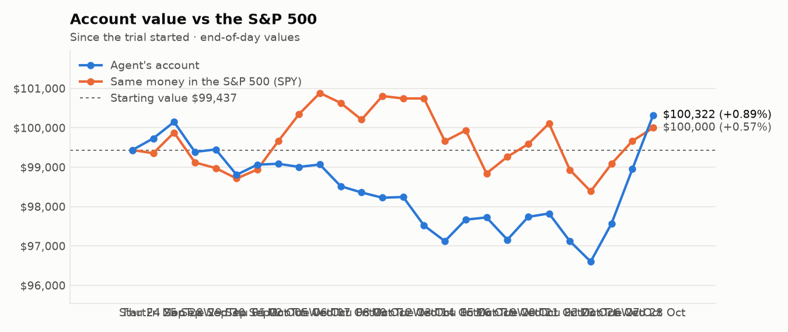
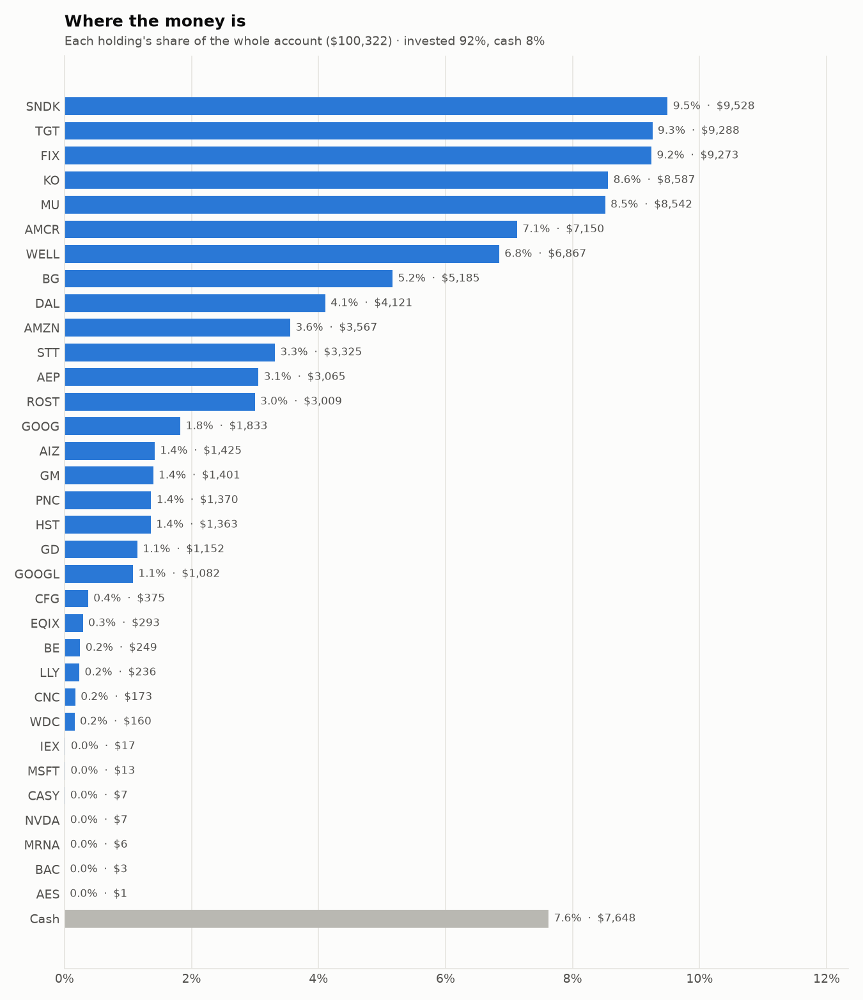
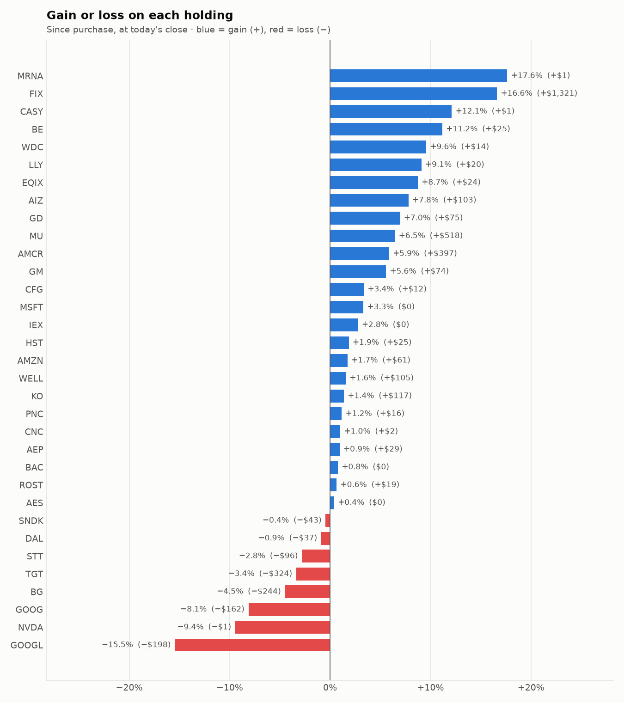

# Daily trading report — Wednesday 28 October 2026

## Summary

- **Account value:** $100,322 (+$1,371, +1.4% today)
- **S&P 500 (SPY) today:** +0.3% — the agent was ahead of the index by 1.05%
- **Trades:** 3 buy(s) ($10,271), 3 sell(s) ($13,064)
- **2026-10-28 Morning rebalance:** traded — 6 order(s) placed
- **2026-10-28 Afternoon risk check:** no trades needed — Risk-checked 33 holding(s): none was 12%+ below its purchase price, and none had both clearly negative news and a price drop of 3%+ since entry.

## Charts

## Why I bought

### WELL — bought 30.226 shares at ~$223.71 ($6,762)

**Why:** combined score +0.91; ranked #7 of 503; driven mainly by research (news + analyst consensus) +1.88, price momentum +1.77; entering/adding to the top-ranked target portfolio; research detail: 23 recent headline(s), net positive tone (+15); analyst consensus +1.07/2 (6 strong buy, 18 buy, 4 hold, 0 sell, 0 strong sell)

**Research scores** (combined +0.91, ranked #7 in the S&P 500, sector: Real Estate):

| Factor | Score | Measures |
|---|---|---|
| Value | -0.68 | cheap vs. sector peers on P/E and P/B |
| Quality | -0.27 | profitability (ROE, margins) and balance-sheet strength |
| Momentum | +1.77 | 12-month price trend, excluding the last month |
| Low volatility | -0.15 | steadier price than sector peers |
| Research | +1.88 | recent news tone + analyst consensus |

**Company financials (Finnhub, trailing 12 months):** P/E 96.5, P/B 3.4, return on equity 3.7%, gross margin 40.0%, debt/equity 0.40

**Price trend (Alpaca):** 12-month return (excl. last month) +35.7%, last month -2.5%, volatility 22.0%/yr

**News (Finnhub): 23 headline(s) in the last 2 days, net tone +15.** Most influential:
- [WELL's Q3 FFO Beat Estimates on Strong SHO Portfolio Growth](https://finnhub.io/api/news?id=9f2fbadbc1d1b7e64eeb2ddceeb1842efe2cca18fe5bc24770b796ae88f8323b) — 27 Oct, Yahoo (tone +4)
- [Welltower Inc (NYSE:WELL) Posts In-Line Q3 2026 Revenue and Strong Non-GAAP EPS Beat](https://finnhub.io/api/news?id=b4224fe30b98b32ea93014a1672c7907a69742b23a941be0dd96b70647e91c24) — 26 Oct, ChartMill (tone +3)
- [Welltower (WELL) Stock Looks Reasonable On Its 212% Five Year Run](https://finnhub.io/api/news?id=8226254e4a1b707338d5d070f17a039cdf708b29f1eb720ef843571ff402e463) — 27 Oct, Yahoo (tone +2)
- [Welltower shares drop as earnings miss offsets strong FFO growth](https://finnhub.io/api/news?id=7f788d2873d60128091a03b4910382d8514c5395a1035769e980bb4de7f284a6) — 27 Oct, Yahoo (tone +2)
- [What Welltower Doubters Got Wrong](https://finnhub.io/api/news?id=1f0496f6236dda0f161fb5d98a95ea5cc610094b266db2256cd650af747f7f82) — 28 Oct, Yahoo (tone +1)

**Analysts (Finnhub, 2026-10-01):** 6 strong buy, 18 buy, 4 hold, 0 sell, 0 strong sell — consensus +1.07 on a -2 (strong sell) to +2 (strong buy) scale.

### GOOG — bought 6.203 shares at ~$321.05 ($1,991)

**Why:** combined score +0.71; ranked #20 of 503; driven mainly by price momentum +1.64, research (news + analyst consensus) +0.99; entering/adding to the top-ranked target portfolio; research detail: 75 recent headline(s), net positive tone (+23); analyst consensus +1.21/2 (20 strong buy, 41 buy, 6 hold, 0 sell, 0 strong sell)

**Research scores** (combined +0.71, ranked #20 in the S&P 500, sector: Communication Services):

| Factor | Score | Measures |
|---|---|---|
| Value | -0.71 | cheap vs. sector peers on P/E and P/B |
| Quality | +0.12 | profitability (ROE, margins) and balance-sheet strength |
| Momentum | +1.64 | 12-month price trend, excluding the last month |
| Low volatility | +0.24 | steadier price than sector peers |
| Research | +0.99 | recent news tone + analyst consensus |

**Company financials (Finnhub, trailing 12 months):** P/E 16.1, P/B 6.8, return on equity 50.8%, gross margin 60.9%, debt/equity 0.15

**Price trend (Alpaca):** 12-month return (excl. last month) +37.7%, last month -6.6%, volatility 22.7%/yr

**News (Finnhub): 75 headline(s) in the last 2 days, net tone +23.** Most influential:
- [Can Strong Search and Cloud Growth Drive GOOGL's Q3 Earnings?](https://finnhub.io/api/news?id=689399883a23d7d49ce034d905f92d5805759fd9c464b2ab920a5cb1493b294b) — 27 Oct, Yahoo (tone +2)
- [Apple (AAPL) vs. MSFT and GOOGL: Is the Post-Earnings Selloff Creating a Long-Term Buying Opportunity?](https://finnhub.io/api/news?id=adf9893d477c3185c3854151060128e74e2c9b8f5adbcbc72a9f6c1256e34d1c) — 27 Oct, Yahoo (tone +2)
- [The Zacks Analyst Blog Highlights Intel, Alphabet, NVIDIA and AMD](https://finnhub.io/api/news?id=ac2d41f67fb5a274378a63dcf6705de86d352d46ecc5a08cbc9267b693f1fd78) — 27 Oct, Yahoo (tone +2)
- [Will Alphabet Stock Surge After Oct. 28?](https://finnhub.io/api/news?id=13ee3b86115367248d5949ea15691b5b4422275b131c93bf036900a38fed5b6b) — 26 Oct, Yahoo (tone +2)
- [Alphabet (GOOG) Could Be a Key Rival to Meta in the Race for AI Assistants, Burke Wealth Says](https://finnhub.io/api/news?id=061b6d47916a135a079bb47678a760e463a09a5c5e153bffe87fc80f1218425b) — 26 Oct, Yahoo (tone +2)

**Analysts (Finnhub, 2026-10-01):** 20 strong buy, 41 buy, 6 hold, 0 sell, 0 strong sell — consensus +1.21 on a -2 (strong sell) to +2 (strong buy) scale.

### KO — bought 16.554 shares at ~$91.67 ($1,518)

**Why:** combined score +0.98; ranked #5 of 503; driven mainly by research (news + analyst consensus) +2.05, low volatility +1.59; entering/adding to the top-ranked target portfolio; research detail: 69 recent headline(s), net positive tone (+50); analyst consensus +1.03/2 (8 strong buy, 19 buy, 7 hold, 0 sell, 0 strong sell)

**Research scores** (combined +0.98, ranked #5 in the S&P 500, sector: Consumer Staples):

| Factor | Score | Measures |
|---|---|---|
| Value | -0.68 | cheap vs. sector peers on P/E and P/B |
| Quality | +0.43 | profitability (ROE, margins) and balance-sheet strength |
| Momentum | +1.32 | 12-month price trend, excluding the last month |
| Low volatility | +1.59 | steadier price than sector peers |
| Research | +2.05 | recent news tone + analyst consensus |

**Company financials (Finnhub, trailing 12 months):** P/E 27.8, P/B 10.0, return on equity 43.0%, gross margin 61.9%, debt/equity 1.20

**Price trend (Alpaca):** 12-month return (excl. last month) +32.1%, last month +4.6%, volatility 17.0%/yr

**News (Finnhub): 69 headline(s) in the last 2 days, net tone +50.** Most influential:
- [Coca-Cola Q3 Earnings Beat Estimates on Volume Growth, Outlook Raised](https://finnhub.io/api/news?id=9fd86134fa50eb69720d7c04ae9235a1a7b5f7625275a902ef6f7f7e041cdb1f) — 27 Oct, Yahoo (tone +4)
- [Coca-Cola Raises Full-Year Earnings Growth Outlook Following Fiscal Third-Quarter Beat](https://finnhub.io/api/news?id=695bfa61e4313fb18f9ea46925bf18f869babbb6f1710e3ed6822d00024a2624) — 27 Oct, Yahoo (tone +4)
- [Coca-Cola Raises 2026 Earnings Outlook After Q3 Revenue and Profit Exceed Estimates](https://finnhub.io/api/news?id=59c62107ddf1e68cb0a231b9910786eb6ec904e8709b4343f10615d10a19aeb6) — 27 Oct, Yahoo (tone +3)
- [Coca-Cola beats Q3 expectations despite US flatness](https://finnhub.io/api/news?id=5ecf7208f68fe6ab72bd36dbbb0c094d02753f9f92057646ca2725c81efaf5c1) — 27 Oct, Yahoo (tone +3)
- [Coca-Cola (NYSE:KO) Q3 2026 Results Meet Estimates as Guidance Rises](https://finnhub.io/api/news?id=d2b0a9fe9a836900c9aa93590f03ef68c60f5247ab15c5cedafe44aa52376811) — 27 Oct, ChartMill (tone +3)

**Analysts (Finnhub, 2026-10-01):** 8 strong buy, 19 buy, 7 hold, 0 sell, 0 strong sell — consensus +1.03 on a -2 (strong sell) to +2 (strong buy) scale.

## Why I sold

### HST — sold 289.376 shares at ~$25.34 ($7,333)

**Why:** combined score +0.68; ranked #24 of 503; driven mainly by price momentum +1.60, research (news + analyst consensus) +0.49; trimmed toward target weight, or dropped out of the top-ranked names; research detail: 6 recent headline(s), net positive tone (+5); analyst consensus +0.92/2 (8 strong buy, 7 buy, 10 hold, 0 sell, 0 strong sell)

**Research scores** (combined +0.68, ranked #24 in the S&P 500, sector: Real Estate):

| Factor | Score | Measures |
|---|---|---|
| Value | +0.00 | cheap vs. sector peers on P/E and P/B |
| Quality | +0.00 | profitability (ROE, margins) and balance-sheet strength |
| Momentum | +1.60 | 12-month price trend, excluding the last month |
| Low volatility | -0.06 | steadier price than sector peers |
| Research | +0.49 | recent news tone + analyst consensus |

**Price trend (Alpaca):** 12-month return (excl. last month) +30.8%, last month +11.4%, volatility 24.1%/yr

**News (Finnhub): 6 headline(s) in the last 2 days, net tone +5.** Most influential:
- [Host Hotels & Resorts (HST) Nears Earnings, Is It 17% Overvalued?](https://finnhub.io/api/news?id=807fcad4f16c42df0bef03c57be8a8ed71d0bb1af909bb2eda571b9945b843f4) — 27 Oct, Yahoo (tone +1)
- [How Upcoming Earnings At Host Hotels & Resorts (HST) Has Changed Its Investment Story](https://finnhub.io/api/news?id=5bda52eaefdd997bed307e45bea0e5b8e15560e557289a2c641e36453bfaa722) — 27 Oct, Yahoo (tone +1)
- [Host Hotels & Resorts, Other Lodging REITs Set to Benefit From Strong Q3 Trends, BofA Says](https://finnhub.io/api/news?id=75f007ed27a7ac22fdfb5cce4a4f6415434df449fc98e7ef334832056060c38b) — 26 Oct, Yahoo (tone +1)
- [Evercore ISI Group Maintains In-Line on Host Hotels & Resorts, Raises Price Target to $26](https://finnhub.io/api/news?id=04c24a9edcb880a6557e18bf5ad4118917ab8b2a9e34efddcddb6c007e50068e) — 26 Oct, Benzinga (tone +1)
- [Wells Fargo Maintains Overweight on Host Hotels & Resorts, Raises Price Target to $27](https://finnhub.io/api/news?id=50c42249e67f850288e8504a22331d251522cc2bb4466307b7e2658821f1806b) — 26 Oct, Benzinga (tone +1)

**Analysts (Finnhub, 2026-10-01):** 8 strong buy, 7 buy, 10 hold, 0 sell, 0 strong sell — consensus +0.92 on a -2 (strong sell) to +2 (strong buy) scale.

### BE — sold 18.06 shares at ~$222.60 ($4,020)

**Why:** combined score +0.64; ranked #30 of 503; driven mainly by price momentum +3.00, low volatility -2.29; trimmed toward target weight, or dropped out of the top-ranked names; research detail: 23 recent headline(s), net positive tone (+7); analyst consensus +0.72/2 (6 strong buy, 17 buy, 15 hold, 1 sell, 0 strong sell)

**Research scores** (combined +0.64, ranked #30 in the S&P 500, sector: Industrials):

| Factor | Score | Measures |
|---|---|---|
| Value | -1.42 | cheap vs. sector peers on P/E and P/B |
| Quality | -0.14 | profitability (ROE, margins) and balance-sheet strength |
| Momentum | +3.00 | 12-month price trend, excluding the last month |
| Low volatility | -2.29 | steadier price than sector peers |
| Research | +0.02 | recent news tone + analyst consensus |

**Company financials (Finnhub, trailing 12 months):** P/E 125.2, P/B 42.2, return on equity 39.6%, gross margin 32.3%, debt/equity 1.38

**Price trend (Alpaca):** 12-month return (excl. last month) +283.0%, last month -16.9%, volatility 85.1%/yr

**News (Finnhub): 23 headline(s) in the last 2 days, net tone +7.** Most influential:
- [Bloom Energy Is 44% Below Its June Record. Here’s the Number That Sank It After Earnings](https://finnhub.io/api/news?id=0a41487d75bee2af1d35ecc9e24d0475de9f4e26e56c2628427f8c43f94ebdf0) — 25 Oct, Yahoo (tone +2)
- [Bloom Energy: Buckle Up, Things Are About To Change (Rating Downgrade)](https://finnhub.io/api/news?id=5bab4058fb1797874039dbae481e332bfa173c1c4b971fea34967fb3d57d3b74) — 27 Oct, SeekingAlpha (tone -1)
- [Bloom Energy Stock Has Plunged Despite Explosive Growth. Is It Time to Buy?](https://finnhub.io/api/news?id=690f4eb2d6c63b17af7a896f0295d384d5cfe3853dad3f2ecdf1f6c14e58bc8c) — 27 Oct, Yahoo (tone +1)
- [Bloom Energy Soars 7% on Barclays Price Target Hike After Post-Earnings Rout](https://finnhub.io/api/news?id=82f8198c8599ebcbfca0e6b52ee5edd906112c2bc05e399588c44ce2db01a7ec) — 26 Oct, Yahoo (tone +1)
- [Zacks Investment Ideas feature highlights: Bloom Energy, SanDisk, AMD, CoreWeave, Nebius, NVIDIA and SpaceX's](https://finnhub.io/api/news?id=8487999513321352a36d11d2c183b62406a0cb58b0b65d2eb5a0293c09618daa) — 26 Oct, Yahoo (tone +1)

**Analysts (Finnhub, 2026-10-01):** 6 strong buy, 17 buy, 15 hold, 1 sell, 0 strong sell — consensus +0.72 on a -2 (strong sell) to +2 (strong buy) scale.

### BAC — sold 33.648 shares at ~$50.84 ($1,711)

**Why:** combined score +0.57; ranked #44 of 503; driven mainly by research (news + analyst consensus) +1.32, low volatility +0.90; trimmed toward target weight, or dropped out of the top-ranked names; research detail: 17 recent headline(s), net positive tone (+12); analyst consensus +1.04/2 (6 strong buy, 17 buy, 5 hold, 0 sell, 0 strong sell)

**Research scores** (combined +0.57, ranked #44 in the S&P 500, sector: Financials):

| Factor | Score | Measures |
|---|---|---|
| Value | +0.88 | cheap vs. sector peers on P/E and P/B |
| Quality | -0.50 | profitability (ROE, margins) and balance-sheet strength |
| Momentum | +0.26 | 12-month price trend, excluding the last month |
| Low volatility | +0.90 | steadier price than sector peers |
| Research | +1.32 | recent news tone + analyst consensus |

**Company financials (Finnhub, trailing 12 months):** P/E 10.9, P/B 1.3, return on equity 10.7%, debt/equity 2.35

**Price trend (Alpaca):** 12-month return (excl. last month) +7.0%, last month -8.6%, volatility 20.9%/yr

**News (Finnhub): 17 headline(s) in the last 2 days, net tone +12.** Most influential:
- [Verizon raises 2026 outlook after record customer growth](https://finnhub.io/api/news?id=42202fe68b4bbdd1ae9366616aa677c65485cd945035ebf4e37d898f5f120d76) — 26 Oct, Yahoo (tone +4)
- [Amazon cloud growth expected to beat forecasts as AI demand strengthens](https://finnhub.io/api/news?id=a0101930e1db8247162c1ba4dad762c053c83845139a93021bd6d2589f43fa8e) — 26 Oct, Yahoo (tone +3)
- [Accelevation's SkyBridge bookings strengthen Bank of America's bullish outlook](https://finnhub.io/api/news?id=422b42da44e4fcca0c20b6340a5add97492025a4d9f15a4a74a2116759b39204) — 26 Oct, Yahoo (tone +2)
- [Bank Of America Opens First Financial Centers In Wisconsin, Sets 2027 Entry Into Alabama & Louisiana; Plans 19 Financial Centers Across Wisconsin Through 2030, Creating Nearly 130 New Jobs; To Open 10 Financial Centers Across Alabama Beginning In Q1 2027 & 8 In Greater New Orleans In H2 2027; Plans To Open About 50 New Financial Centers A Year](https://finnhub.io/api/news?id=2856a41522be45479f181a6b8dd60fe6583f9a90c231252a0315ed41f872de6e) — 28 Oct, Benzinga (tone +1)
- [Take-Two stock has upside as Bank of America sees GTA Online driving long-term growth](https://finnhub.io/api/news?id=c7ac7cba64f0e86ed974d2cb17b228db109125884a229563fa43c7784d8fcf53) — 27 Oct, Yahoo (tone +1)

**Analysts (Finnhub, 2026-10-01):** 6 strong buy, 17 buy, 5 hold, 0 sell, 0 strong sell — consensus +1.04 on a -2 (strong sell) to +2 (strong buy) scale.

## Holdings at the close

| Stock | Shares | Avg cost | Price | Market value | % of account | Today | Gain/loss $ | Gain/loss % |
|---|---:|---:|---:|---:|---:|---:|---:|---:|
| SNDK | 6.938 | $1,379.50 | $1,373.31 | $9,528 | 9.5% | +5.25% | −$43 | -0.45% |
| TGT | 62.35 | $154.16 | $148.96 | $9,288 | 9.3% | +0.64% | −$324 | -3.37% |
| FIX | 6.946 | $1,144.78 | $1,335.00 | $9,273 | 9.2% | +3.60% | +$1,321 | +16.62% |
| KO | 93.197 | $90.89 | $92.14 | $8,587 | 8.6% | +1.05% | +$117 | +1.38% |
| MU | 8.88 | $903.65 | $961.99 | $8,542 | 8.5% | +3.58% | +$518 | +6.46% |
| AMCR | 156.599 | $43.13 | $45.66 | $7,150 | 7.1% | -0.61% | +$397 | +5.87% |
| WELL | 30.226 | $223.71 | $227.20 | $6,867 | 6.8% | +0.21% | +$105 | +1.56% |
| BG | 51.442 | $105.54 | $100.80 | $5,185 | 5.2% | -0.55% | −$244 | -4.49% |
| DAL | 51.385 | $80.92 | $80.20 | $4,121 | 4.1% | -1.53% | −$37 | -0.88% |
| AMZN | 14.056 | $249.42 | $253.77 | $3,567 | 3.6% | +0.26% | +$61 | +1.74% |
| STT | 19.22 | $177.99 | $173.00 | $3,325 | 3.3% | +1.23% | −$96 | -2.80% |
| AEP | 23.584 | $128.73 | $129.95 | $3,065 | 3.1% | -0.27% | +$29 | +0.95% |
| ROST | 13.082 | $228.51 | $229.99 | $3,009 | 3.0% | -0.04% | +$19 | +0.65% |
| GOOG | 6.212 | $321.09 | $295.00 | $1,833 | 1.8% | -6.89% | −$162 | -8.13% |
| AIZ | 5 | $264.38 | $284.99 | $1,425 | 1.4% | -0.46% | +$103 | +7.80% |
| GM | 17.001 | $78.08 | $82.43 | $1,401 | 1.4% | +2.35% | +$74 | +5.57% |
| PNC | 6 | $225.64 | $228.25 | $1,370 | 1.4% | +0.31% | +$16 | +1.16% |
| HST | 53.927 | $24.81 | $25.27 | $1,363 | 1.4% | +0.20% | +$25 | +1.86% |
| GD | 3.251 | $331.27 | $354.35 | $1,152 | 1.1% | -0.15% | +$75 | +6.97% |
| GOOGL | 3.635 | $352.08 | $297.65 | $1,082 | 1.1% | -7.15% | −$198 | -15.46% |
| CFG | 5.744 | $63.15 | $65.27 | $375 | 0.4% | -0.06% | +$12 | +3.36% |
| EQIX | 0.282 | $954.01 | $1,037.36 | $293 | 0.3% | +3.80% | +$24 | +8.74% |
| BE | 1.132 | $198.16 | $220.30 | $249 | 0.2% | +0.82% | +$25 | +11.17% |
| LLY | 0.182 | $1,189.78 | $1,297.99 | $236 | 0.2% | +1.25% | +$20 | +9.09% |
| CNC | 2.63 | $65.21 | $65.87 | $173 | 0.2% | -4.13% | +$2 | +1.01% |
| WDC | 0.411 | $355.69 | $389.74 | $160 | 0.2% | +2.33% | +$14 | +9.57% |
| IEX | 0.072 | $232.06 | $238.50 | $17 | 0.0% | +2.27% | +$0 | +2.78% |
| MSFT | 0.023 | $533.80 | $551.53 | $13 | 0.0% | +3.80% | +$0 | +3.32% |
| CASY | 0.011 | $597.62 | $670.02 | $7 | 0.0% | -3.95% | +$1 | +12.11% |
| NVDA | 0.032 | $236.88 | $214.50 | $7 | 0.0% | -1.58% | −$1 | -9.45% |
| MRNA | 0.028 | $181.06 | $213.00 | $6 | 0.0% | +2.42% | +$1 | +17.64% |
| BAC | 0.054 | $50.55 | $50.94 | $3 | 0.0% | +0.51% | +$0 | +0.78% |
| AES | 0.096 | $14.92 | $14.98 | $1 | 0.0% | -0.33% | +$0 | +0.40% |
| **Invested** | | | | **$92,674** | **92.4%** | | **+$1,854** | |
| **Cash** | | | | $7,648 | 7.6% | | | |
| **Total account** | | | | **$100,322** | 100% | | | |

_Scores are sector-neutral z-scores: 0 is average for the stock's sector, +1 is one standard deviation better. News tone is a keyword count over recent headlines, not a deep read. None of this guarantees a stock will rise; a few days of results can't show whether the strategy has a real edge over the S&P 500._
