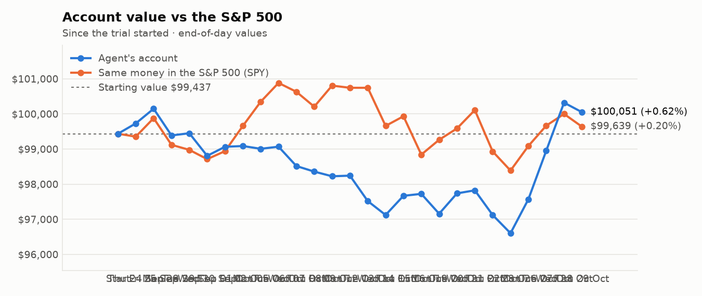
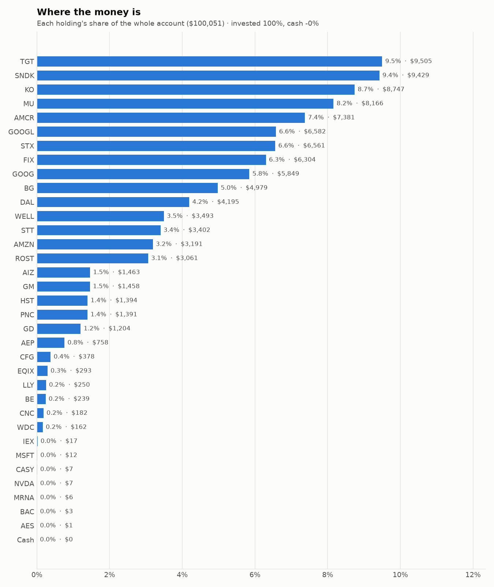
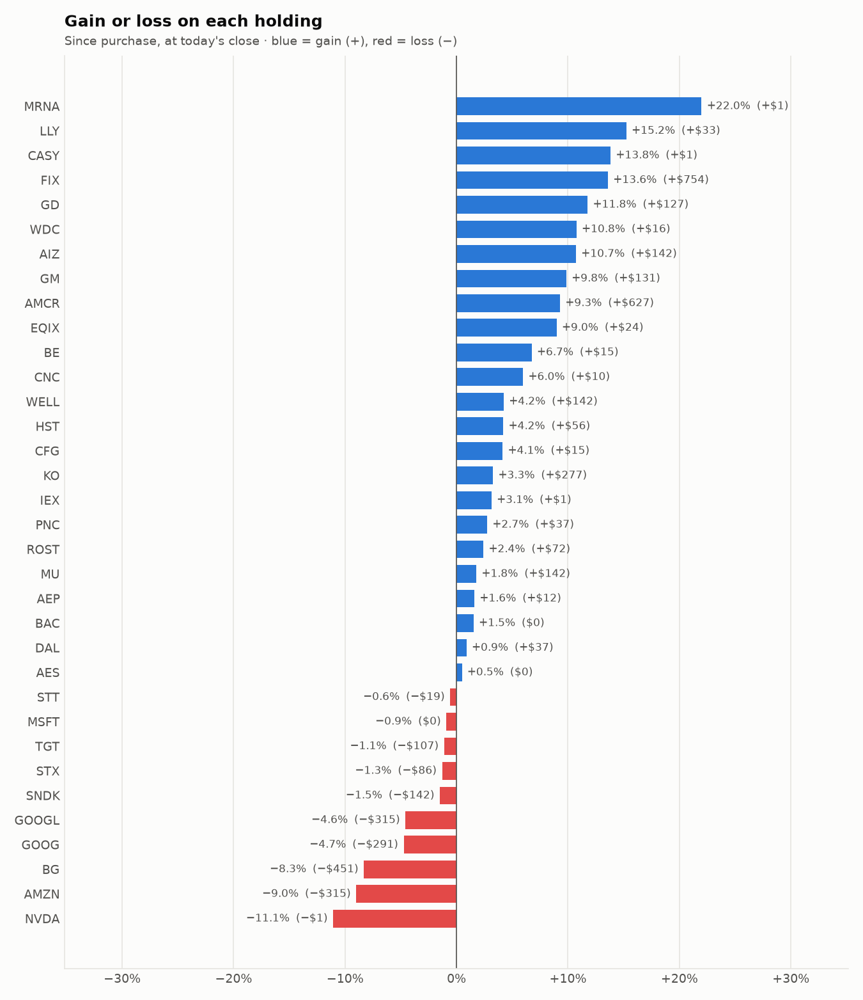

# Daily trading report — Thursday 29 October 2026

## Summary

- **Account value:** $100,051 (-$270, -0.3% today)
- **S&P 500 (SPY) today:** -0.4% — the agent was ahead of the index by 0.09%
- **Trades:** 3 buy(s) ($16,410), 3 sell(s) ($8,740)
- **2026-10-29 Morning rebalance:** traded — 6 order(s) placed
- **2026-10-29 Afternoon risk check:** no trades needed — Risk-checked 34 holding(s): none was 12%+ below its purchase price, and none had both clearly negative news and a price drop of 3%+ since entry.

## Charts

## Why I bought

### STX — bought 9.456 shares at ~$702.90 ($6,647)

**Why:** combined score +0.98; ranked #6 of 503; driven mainly by research (news + analyst consensus) +1.78, price momentum +1.59; entering/adding to the top-ranked target portfolio; research detail: 60 recent headline(s), net positive tone (+48); analyst consensus +1.10/2 (7 strong buy, 19 buy, 4 hold, 0 sell, 0 strong sell)

**Research scores** (combined +0.98, ranked #6 in the S&P 500, sector: Information Technology):

| Factor | Score | Measures |
|---|---|---|
| Value | -0.47 | cheap vs. sector peers on P/E and P/B |
| Quality | +0.73 | profitability (ROE, margins) and balance-sheet strength |
| Momentum | +1.59 | 12-month price trend, excluding the last month |
| Low volatility | -0.72 | steadier price than sector peers |
| Research | +1.78 | recent news tone + analyst consensus |

**Company financials (Finnhub, trailing 12 months):** P/E 36.1, P/B 56.3, return on equity 245.1%, gross margin 50.4%, debt/equity 0.68

**Price trend (Alpaca):** 12-month return (excl. last month) +320.0%, last month -23.6%, volatility 67.1%/yr

**News (Finnhub): 60 headline(s) in the last 2 days, net tone +48.** Most influential:
- [STX Q1 Earnings & Revenues Beat, Record Cash Flow Boosts Profitability](https://finnhub.io/api/news?id=0b274dfa9dcecd44e6690cb2dda83538f9121df82233a6d1a513314d05a733ab) — 28 Oct, Yahoo (tone +4)
- [Seagate Technology shares fall 6% despite Q1 earnings beat and raised guidance](https://finnhub.io/api/news?id=f0875c92cedc83bccd8fa5e0b87dc7a331b788d00bba4cc16c5f492f1db41269) — 27 Oct, Yahoo (tone +4)
- [SK Hynix Jumps 7%, Micron Rises 3% on Memory Shortage Call Through 2030 While Seagate Slips Despite Upbeat Guidance](https://finnhub.io/api/news?id=8878a5a00ff7ca93ba6103a1bed0a256049f4137f6bd1a266e7ea88c8b08515e) — 28 Oct, Yahoo (tone +3)
- [Seagate Q1 Earnings Call Highlights Strong Demand and HAMR Expansion](https://finnhub.io/api/news?id=8efcafa71088e98ce660b5af1878f7e0b463bd89188e37b9414316e262625cd3) — 28 Oct, Yahoo (tone +3)
- [Seagate revenue jumps 61% as storage demand drives record profits](https://finnhub.io/api/news?id=35ae1de830e9b557d97483e7dd3ffc42a4481a0022ebaa12741f842236f2cc4c) — 28 Oct, Yahoo (tone +3)

**Analysts (Finnhub, 2026-10-01):** 7 strong buy, 19 buy, 4 hold, 0 sell, 0 strong sell — consensus +1.10 on a -2 (strong sell) to +2 (strong buy) scale.

### GOOGL — bought 19.677 shares at ~$285.50 ($5,618)

**Why:** combined score +0.94; ranked #8 of 503; driven mainly by research (news + analyst consensus) +1.75, price momentum +1.70; entering/adding to the top-ranked target portfolio; research detail: 96 recent headline(s), net positive tone (+36); analyst consensus +1.21/2 (20 strong buy, 41 buy, 6 hold, 0 sell, 0 strong sell)

**Research scores** (combined +0.94, ranked #8 in the S&P 500, sector: Communication Services):

| Factor | Score | Measures |
|---|---|---|
| Value | -0.64 | cheap vs. sector peers on P/E and P/B |
| Quality | +0.08 | profitability (ROE, margins) and balance-sheet strength |
| Momentum | +1.70 | 12-month price trend, excluding the last month |
| Low volatility | +0.49 | steadier price than sector peers |
| Research | +1.75 | recent news tone + analyst consensus |

**Company financials (FMP, trailing 12 months):** P/E 14.7, P/B 5.1, return on equity 42.6%, gross margin 60.9%, debt/equity 0.21

**Price trend (Alpaca):** 12-month return (excl. last month) +38.3%, last month -4.6%, volatility 24.0%/yr

**News (Finnhub): 96 headline(s) in the last 2 days, net tone +36.** Most influential:
- [Alphabet Q3: The Market Is Selling The Wrong Line Items And I Think This Is An Opportunity](https://finnhub.io/api/news?id=36d63b4fea75137d24a7f466c031f6519833f9307399b509794484ba7a7e75fa) — 29 Oct, SeekingAlpha (tone +3)
- [GOOGL Stock Slumps 11% After-Hours: Alphabet’s Surge in AI Spending Pressures Third-Quarter Profits And Cash Flows](https://finnhub.io/api/news?id=ddbc66ec15558900a7b83d2162cad4ba6b2edb321a31a43b966c83016b1ed82a) — 28 Oct, Yahoo (tone +3)
- [Amazon (AMZN) vs. MSFT and GOOGL: Can Higher-Margin Businesses Turn Amazon Into an AI-Driven Compounder?](https://finnhub.io/api/news?id=2680439668c60c19bd89911c4f0b7789c839db2e0311d9f0014262f71fc5db48) — 28 Oct, Yahoo (tone +3)
- [Robinhood, Microsoft And 3 Stocks To Watch Heading Into Wednesday](https://finnhub.io/api/news?id=43b799b1e39a37a78b3a0faa57c77fe9f211cc7d5f1c92ec5c8aafbb1f33b5f8) — 27 Oct, Benzinga (tone +3)
- [Alphabet Stock Finally Got What It Deserved (Rating Upgrade)](https://finnhub.io/api/news?id=c5552c41cf3429cb3171a54d06322d002cb23fd352ae3bd1a1cfc3c192511a23) — 29 Oct, SeekingAlpha (tone +2)

**Analysts (Finnhub, 2026-10-01):** 20 strong buy, 41 buy, 6 hold, 0 sell, 0 strong sell — consensus +1.21 on a -2 (strong sell) to +2 (strong buy) scale.

### GOOG — bought 14.62 shares at ~$283.53 ($4,145)

**Why:** combined score +0.92; ranked #10 of 503; driven mainly by research (news + analyst consensus) +1.75, price momentum +1.65; entering/adding to the top-ranked target portfolio; research detail: 98 recent headline(s), net positive tone (+36); analyst consensus +1.21/2 (20 strong buy, 41 buy, 6 hold, 0 sell, 0 strong sell)

**Research scores** (combined +0.92, ranked #10 in the S&P 500, sector: Communication Services):

| Factor | Score | Measures |
|---|---|---|
| Value | -0.73 | cheap vs. sector peers on P/E and P/B |
| Quality | +0.13 | profitability (ROE, margins) and balance-sheet strength |
| Momentum | +1.65 | 12-month price trend, excluding the last month |
| Low volatility | +0.57 | steadier price than sector peers |
| Research | +1.75 | recent news tone + analyst consensus |

**Company financials (Finnhub, trailing 12 months):** P/E 16.3, P/B 6.8, return on equity 50.8%, gross margin 60.9%, debt/equity 0.15

**Price trend (Alpaca):** 12-month return (excl. last month) +36.5%, last month -4.5%, volatility 22.9%/yr

**News (Finnhub): 98 headline(s) in the last 2 days, net tone +36.** Most influential:
- [Alphabet Q3: The Market Is Selling The Wrong Line Items And I Think This Is An Opportunity](https://finnhub.io/api/news?id=36d63b4fea75137d24a7f466c031f6519833f9307399b509794484ba7a7e75fa) — 29 Oct, SeekingAlpha (tone +3)
- [GOOGL Stock Slumps 11% After-Hours: Alphabet’s Surge in AI Spending Pressures Third-Quarter Profits And Cash Flows](https://finnhub.io/api/news?id=ddbc66ec15558900a7b83d2162cad4ba6b2edb321a31a43b966c83016b1ed82a) — 28 Oct, Yahoo (tone +3)
- [Amazon (AMZN) vs. MSFT and GOOGL: Can Higher-Margin Businesses Turn Amazon Into an AI-Driven Compounder?](https://finnhub.io/api/news?id=2680439668c60c19bd89911c4f0b7789c839db2e0311d9f0014262f71fc5db48) — 28 Oct, Yahoo (tone +3)
- [Robinhood, Microsoft And 3 Stocks To Watch Heading Into Wednesday](https://finnhub.io/api/news?id=43b799b1e39a37a78b3a0faa57c77fe9f211cc7d5f1c92ec5c8aafbb1f33b5f8) — 27 Oct, Benzinga (tone +3)
- [Alphabet Stock Finally Got What It Deserved (Rating Upgrade)](https://finnhub.io/api/news?id=c5552c41cf3429cb3171a54d06322d002cb23fd352ae3bd1a1cfc3c192511a23) — 29 Oct, SeekingAlpha (tone +2)

**Analysts (Finnhub, 2026-10-01):** 20 strong buy, 41 buy, 6 hold, 0 sell, 0 strong sell — consensus +1.21 on a -2 (strong sell) to +2 (strong buy) scale.

## Why I sold

### WELL — sold 15.246 shares at ~$233.45 ($3,559)

**Why:** combined score +0.78; ranked #16 of 503; driven mainly by price momentum +1.74, research (news + analyst consensus) +1.39; trimmed toward target weight, or dropped out of the top-ranked names; research detail: 17 recent headline(s), net positive tone (+15); analyst consensus +1.07/2 (6 strong buy, 18 buy, 4 hold, 0 sell, 0 strong sell)

**Research scores** (combined +0.78, ranked #16 in the S&P 500, sector: Real Estate):

| Factor | Score | Measures |
|---|---|---|
| Value | -0.64 | cheap vs. sector peers on P/E and P/B |
| Quality | -0.24 | profitability (ROE, margins) and balance-sheet strength |
| Momentum | +1.74 | 12-month price trend, excluding the last month |
| Low volatility | -0.12 | steadier price than sector peers |
| Research | +1.39 | recent news tone + analyst consensus |

**Company financials (Finnhub, trailing 12 months):** P/E 96.7, P/B 3.4, return on equity 3.7%, gross margin 40.0%, debt/equity 0.40

**Price trend (Alpaca):** 12-month return (excl. last month) +33.2%, last month -2.5%, volatility 21.9%/yr

**News (Finnhub): 17 headline(s) in the last 2 days, net tone +15.** Most influential:
- [WELL's Q3 FFO Beat Estimates on Strong SHO Portfolio Growth](https://finnhub.io/api/news?id=9f2fbadbc1d1b7e64eeb2ddceeb1842efe2cca18fe5bc24770b796ae88f8323b) — 27 Oct, Yahoo (tone +4)
- [Welltower Upgraded After Q3 Results Solidify Its Role As Investment-Grade Senior REIT](https://finnhub.io/api/news?id=f675eb326ffa54dd18c64e336db2d56ee418a4fe446ab8ed432010a5c9599a68) — 28 Oct, SeekingAlpha (tone +3)
- [Welltower (WELL) Stock Looks Reasonable On Its 212% Five Year Run](https://finnhub.io/api/news?id=8226254e4a1b707338d5d070f17a039cdf708b29f1eb720ef843571ff402e463) — 27 Oct, Yahoo (tone +2)
- [Welltower shares drop as earnings miss offsets strong FFO growth](https://finnhub.io/api/news?id=7f788d2873d60128091a03b4910382d8514c5395a1035769e980bb4de7f284a6) — 27 Oct, Yahoo (tone +2)
- [Welltower (WELL) Q3 Earnings Lift FFO Outlook As Stock Slips](https://finnhub.io/api/news?id=931c4f471b95b03fa333de70f4a835ad6ef4576a271e9a80f9a0bde5fe77a4bc) — 28 Oct, Yahoo (tone +1)

**Analysts (Finnhub, 2026-10-01):** 6 strong buy, 18 buy, 4 hold, 0 sell, 0 strong sell — consensus +1.07 on a -2 (strong sell) to +2 (strong buy) scale.

### FIX — sold 2.098 shares at ~$1,374.62 ($2,884)

**Why:** combined score +0.94; ranked #9 of 503; driven mainly by price momentum +2.71, low volatility -1.53; trimmed toward target weight, or dropped out of the top-ranked names; research detail: 3 recent headline(s), net positive tone (+1); analyst consensus +1.31/2 (7 strong buy, 7 buy, 2 hold, 0 sell, 0 strong sell)

**Research scores** (combined +0.94, ranked #9 in the S&P 500, sector: Industrials):

| Factor | Score | Measures |
|---|---|---|
| Value | -0.42 | cheap vs. sector peers on P/E and P/B |
| Quality | +0.16 | profitability (ROE, margins) and balance-sheet strength |
| Momentum | +2.71 | 12-month price trend, excluding the last month |
| Low volatility | -1.53 | steadier price than sector peers |
| Research | +0.50 | recent news tone + analyst consensus |

**Company financials (Finnhub, trailing 12 months):** P/E 28.6, P/B 17.5, return on equity 55.2%, gross margin 25.6%, debt/equity 0.01

**Price trend (Alpaca):** 12-month return (excl. last month) +106.6%, last month -18.9%, volatility 55.9%/yr

**News (Finnhub): 3 headline(s) in the last 2 days, net tone +1.** Most influential:
- [3 HVAC Stocks to Watch as Heating & Cooling Demand Accelerates](https://finnhub.io/api/news?id=d44c97c27be892fd3300612c47f7795b05931f65000f32eebb52474dec16fa39) — 28 Oct, Yahoo (tone +1)
- [Comfort Systems USA, Inc. Reports Q3 2026 Financial Results and Backlog of $17,815 Million](https://finnhub.io/api/news?id=16efc564cc9765ffa0d27448e1babd510145620c5a7e7ba688336f930a16f7e8) — 28 Oct, Fintel (tone +0)
- [Why Comfort Systems USA Stock Is Tied To The AI Data Center Buildout](https://finnhub.io/api/news?id=b8ca11d38965be4b398dfd9769c43bfa2b9d31fa148ef23e5e3a6c4b228bd0f6) — 27 Oct, Yahoo (tone +0)

**Analysts (Finnhub, 2026-10-01):** 7 strong buy, 7 buy, 2 hold, 0 sell, 0 strong sell — consensus +1.31 on a -2 (strong sell) to +2 (strong buy) scale.

### AEP — sold 17.786 shares at ~$129.14 ($2,297)

**Why:** combined score +0.65; ranked #26 of 503; driven mainly by price momentum +1.46, research (news + analyst consensus) +0.88; trimmed toward target weight, or dropped out of the top-ranked names; research detail: 15 recent headline(s), net positive tone (+9); analyst consensus +0.79/2 (6 strong buy, 10 buy, 12 hold, 0 sell, 0 strong sell)

**Research scores** (combined +0.65, ranked #26 in the S&P 500, sector: Utilities):

| Factor | Score | Measures |
|---|---|---|
| Value | -0.38 | cheap vs. sector peers on P/E and P/B |
| Quality | +0.02 | profitability (ROE, margins) and balance-sheet strength |
| Momentum | +1.46 | 12-month price trend, excluding the last month |
| Low volatility | -0.08 | steadier price than sector peers |
| Research | +0.88 | recent news tone + analyst consensus |

**Company financials (Finnhub, trailing 12 months):** P/E 22.2, P/B 2.4, return on equity 10.0%, gross margin 41.9%, debt/equity 1.64

**Price trend (Alpaca):** 12-month return (excl. last month) +9.3%, last month +7.5%, volatility 17.5%/yr

**News (Finnhub): 15 headline(s) in the last 2 days, net tone +9.** Most influential:
- [AEP Q3 2026 Earnings Call Transcript](https://finnhub.io/api/news?id=630ce5e13af266978bdf444be237b6405012d0e1cf886317c5dab32e79c7fd1d) — 28 Oct, Yahoo (tone +2)
- [American Electric Power (NASDAQ:AEP) Surges on Q3 Earnings Beat and Above-Guidance Outlook](https://finnhub.io/api/news?id=2beb1623e03fb31534be7773475b757768b59245e43b884f9fa69cf8a7d3c567) — 28 Oct, ChartMill (tone +2)
- [American Electric Power Q3 Adj. EPS $2.23 Beats $2.05 Estimate, Sales $6.832B Beat $6.546B Estimate](https://finnhub.io/api/news?id=8d48671a5dd3accd4ee96bee2dbcda05e55a17f4165258001466e57850658285) — 28 Oct, Benzinga (tone +2)
- [What American Electric Power (AEP) Said on Its Q3 Earnings Call](https://finnhub.io/api/news?id=5e68eb9b5b1147387879af9d80668f87c482bd1e801dadd3dae3200955de9af1) — 28 Oct, Yahoo (tone +1)
- [AEP: Q3 Earnings Snapshot](https://finnhub.io/api/news?id=6ef787e8dabcf35dedc522055d95fb200211afee69aa1b40c29a64f508aa959e) — 28 Oct, Yahoo (tone +1)

**Analysts (Finnhub, 2026-10-01):** 6 strong buy, 10 buy, 12 hold, 0 sell, 0 strong sell — consensus +0.79 on a -2 (strong sell) to +2 (strong buy) scale.

## Holdings at the close

| Stock | Shares | Avg cost | Price | Market value | % of account | Today | Gain/loss $ | Gain/loss % |
|---|---:|---:|---:|---:|---:|---:|---:|---:|
| TGT | 62.35 | $154.16 | $152.45 | $9,505 | 9.5% | +2.34% | −$107 | -1.11% |
| SNDK | 6.938 | $1,379.50 | $1,359.00 | $9,429 | 9.4% | -3.26% | −$142 | -1.49% |
| KO | 93.197 | $90.89 | $93.86 | $8,747 | 8.7% | +2.32% | +$277 | +3.27% |
| MU | 8.88 | $903.65 | $919.63 | $8,166 | 8.2% | -6.47% | +$142 | +1.77% |
| AMCR | 156.599 | $43.13 | $47.13 | $7,381 | 7.4% | +3.22% | +$627 | +9.28% |
| GOOGL | 23.312 | $295.88 | $282.35 | $6,582 | 6.6% | -13.09% | −$315 | -4.57% |
| STX | 9.456 | $702.90 | $693.85 | $6,561 | 6.6% | -0.59% | −$86 | -1.29% |
| FIX | 4.848 | $1,144.78 | $1,300.25 | $6,304 | 6.3% | -3.38% | +$754 | +13.58% |
| GOOG | 20.832 | $294.73 | $280.77 | $5,849 | 5.8% | -12.77% | −$291 | -4.74% |
| BG | 51.442 | $105.54 | $96.78 | $4,979 | 5.0% | -3.99% | −$451 | -8.30% |
| DAL | 51.385 | $80.92 | $81.64 | $4,195 | 4.2% | +1.61% | +$37 | +0.89% |
| WELL | 14.98 | $223.71 | $233.17 | $3,493 | 3.5% | +2.63% | +$142 | +4.23% |
| STT | 19.22 | $177.99 | $177.00 | $3,402 | 3.4% | +1.99% | −$19 | -0.56% |
| AMZN | 14.056 | $249.42 | $227.00 | $3,191 | 3.2% | -10.84% | −$315 | -8.99% |
| ROST | 13.082 | $228.51 | $234.01 | $3,061 | 3.1% | +2.64% | +$72 | +2.41% |
| AIZ | 5 | $264.38 | $292.69 | $1,463 | 1.5% | +2.70% | +$142 | +10.71% |
| GM | 17.001 | $78.08 | $85.77 | $1,458 | 1.5% | +3.99% | +$131 | +9.85% |
| HST | 53.927 | $24.81 | $25.85 | $1,394 | 1.4% | +2.30% | +$56 | +4.19% |
| PNC | 6 | $225.64 | $231.83 | $1,391 | 1.4% | +1.57% | +$37 | +2.74% |
| GD | 3.251 | $331.27 | $370.22 | $1,204 | 1.2% | +4.48% | +$127 | +11.76% |
| AEP | 5.798 | $128.73 | $130.78 | $758 | 0.8% | +2.01% | +$12 | +1.59% |
| CFG | 5.744 | $63.15 | $65.76 | $378 | 0.4% | +0.75% | +$15 | +4.13% |
| EQIX | 0.282 | $954.01 | $1,039.62 | $293 | 0.3% | +3.17% | +$24 | +8.97% |
| LLY | 0.182 | $1,189.78 | $1,371.00 | $250 | 0.2% | +6.42% | +$33 | +15.23% |
| BE | 1.132 | $198.16 | $211.51 | $239 | 0.2% | -7.26% | +$15 | +6.74% |
| CNC | 2.63 | $65.21 | $69.10 | $182 | 0.2% | +3.06% | +$10 | +5.97% |
| WDC | 0.411 | $355.69 | $393.94 | $162 | 0.2% | -0.63% | +$16 | +10.75% |
| IEX | 0.072 | $232.06 | $239.33 | $17 | 0.0% | +0.33% | +$1 | +3.13% |
| MSFT | 0.023 | $533.80 | $528.99 | $12 | 0.0% | -0.38% | −$0 | -0.90% |
| CASY | 0.011 | $597.62 | $680.17 | $7 | 0.0% | +1.51% | +$1 | +13.81% |
| NVDA | 0.032 | $236.88 | $210.68 | $7 | 0.0% | -2.18% | −$1 | -11.06% |
| MRNA | 0.028 | $181.06 | $220.87 | $6 | 0.0% | +3.13% | +$1 | +21.99% |
| BAC | 0.054 | $50.53 | $51.30 | $3 | 0.0% | +0.88% | +$0 | +1.52% |
| AES | 0.096 | $14.92 | $14.99 | $1 | 0.0% | +0.08% | +$0 | +0.48% |
| **Invested** | | | | **$100,071** | **100.0%** | | **+$943** | |
| **Cash** | | | | $-19 | -0.0% | | | |
| **Total account** | | | | **$100,051** | 100% | | | |

_Scores are sector-neutral z-scores: 0 is average for the stock's sector, +1 is one standard deviation better. News tone is a keyword count over recent headlines, not a deep read. None of this guarantees a stock will rise; a few days of results can't show whether the strategy has a real edge over the S&P 500._
