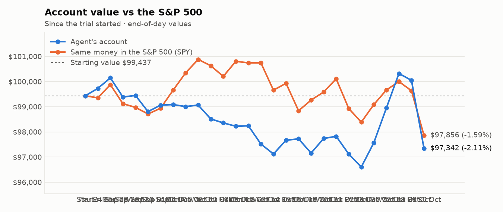
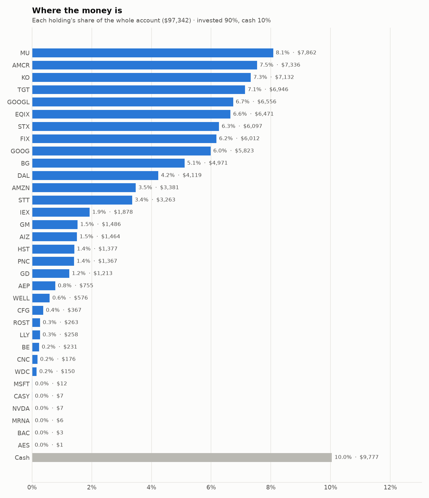
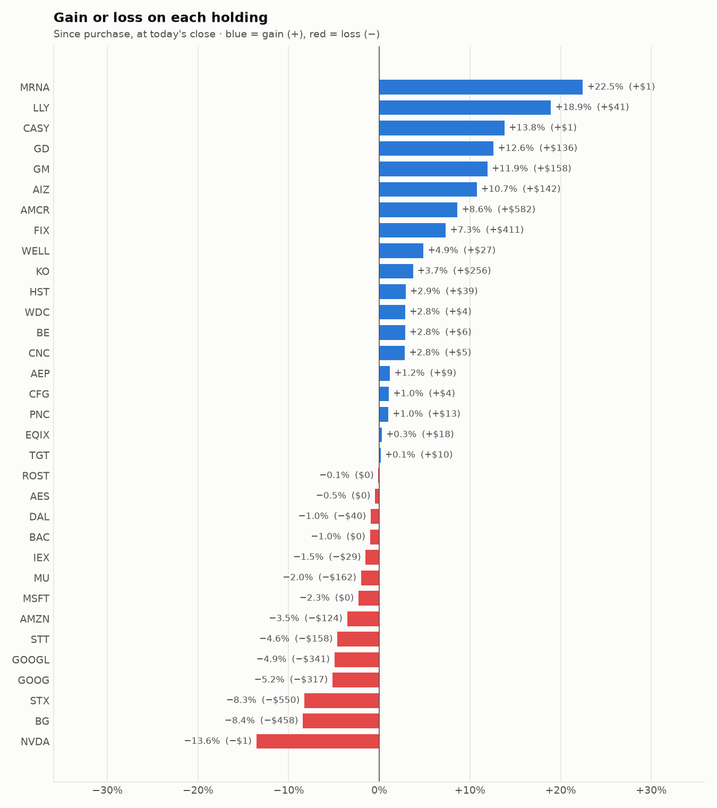

# Daily trading report — Friday 30 October 2026

## Summary

- **Account value:** $97,342 (-$2,709, -2.7% today)
- **S&P 500 (SPY) today:** -1.8% — the agent was behind the index by 0.92%
- **Trades:** 2 buy(s) ($8,074), 5 sell(s) ($17,873)
- **2026-10-30 Morning rebalance:** traded — 6 order(s) placed
- **2026-10-30 Afternoon risk check:** traded — Sold 1 position(s) on the risk check (stop-loss: SNDK)

## Charts

## Why I bought

### EQIX — bought 6.102 shares at ~$1,013.54 ($6,185)

**Why:** combined score +0.97; ranked #6 of 503; driven mainly by research (news + analyst consensus) +2.17, price momentum +1.67; entering/adding to the top-ranked target portfolio; research detail: 25 recent headline(s), net positive tone (+27); analyst consensus +1.15/2 (12 strong buy, 22 buy, 6 hold, 0 sell, 0 strong sell)

**Research scores** (combined +0.97, ranked #6 in the S&P 500, sector: Real Estate):

| Factor | Score | Measures |
|---|---|---|
| Value | -0.64 | cheap vs. sector peers on P/E and P/B |
| Quality | -0.11 | profitability (ROE, margins) and balance-sheet strength |
| Momentum | +1.67 | 12-month price trend, excluding the last month |
| Low volatility | -0.29 | steadier price than sector peers |
| Research | +2.17 | recent news tone + analyst consensus |

**Company financials (Finnhub, trailing 12 months):** P/E 62.0, P/B 6.9, return on equity 11.5%, gross margin 51.6%, debt/equity 1.72

**Price trend (Alpaca):** 12-month return (excl. last month) +29.5%, last month +2.4%, volatility 26.1%/yr

**News (Finnhub): 25 headline(s) in the last 2 days, net tone +27.** Most influential:
- [Equinix Inc (NASDAQ:EQIX) Posts Inline Q3 Revenue, Strong EPS Beat, and Raises 2026 Guidance](https://finnhub.io/api/news?id=09a4232e92ad31687fbbb7c583d69d4ebc779ae761f1296811bddde75bb2a766) — 28 Oct, ChartMill (tone +6)
- [Equinix Q3 AFFO Beat Estimates on Record Bookings, Strong Pricing](https://finnhub.io/api/news?id=be7568b381f51484a1dfe359b38f2434234ed148f9dceb52b91f11540ec04091) — 29 Oct, Yahoo (tone +4)
- [Is Equinix (EQIX) Fully Priced for Its Cash Flow Growth?](https://finnhub.io/api/news?id=ccbe7837dcc4c31402678e48751bbc15b30b27d953d41e4998ad1e457e71e768) — 29 Oct, Yahoo (tone +2)
- [Is Earnings Beat Altering The Investment Case For Equinix (EQIX)?](https://finnhub.io/api/news?id=b25610ae852e2fa11e199a4d9761ea1e74d825bd2a3debb22c5b10a67ebed898) — 29 Oct, Yahoo (tone +2)
- [Equinix (EQIX) Q3 2026 Earnings Call Transcript](https://finnhub.io/api/news?id=b897469f3ea2c4b8d7d14de4096a424654d84c25402d31a506b34e4ae6a4cb4d) — 29 Oct, Yahoo (tone +2)

**Analysts (Finnhub, 2026-10-01):** 12 strong buy, 22 buy, 6 hold, 0 sell, 0 strong sell — consensus +1.15 on a -2 (strong sell) to +2 (strong buy) scale.

### IEX — bought 7.957 shares at ~$237.47 ($1,890)

**Why:** combined score +0.81; ranked #16 of 503; driven mainly by low volatility +2.21, research (news + analyst consensus) +1.27; entering/adding to the top-ranked target portfolio; research detail: 20 recent headline(s), net positive tone (+31); analyst consensus +1.00/2 (6 strong buy, 8 buy, 6 hold, 0 sell, 0 strong sell)

**Research scores** (combined +0.81, ranked #16 in the S&P 500, sector: Industrials):

| Factor | Score | Measures |
|---|---|---|
| Value | +0.26 | cheap vs. sector peers on P/E and P/B |
| Quality | +0.08 | profitability (ROE, margins) and balance-sheet strength |
| Momentum | +0.91 | 12-month price trend, excluding the last month |
| Low volatility | +2.21 | steadier price than sector peers |
| Research | +1.27 | recent news tone + analyst consensus |

**Company financials (Finnhub, trailing 12 months):** P/E 33.6, P/B 4.2, return on equity 12.9%, gross margin 44.7%, debt/equity 0.46

**Price trend (Alpaca):** 12-month return (excl. last month) +40.6%, last month +4.9%, volatility 18.4%/yr

**News (Finnhub): 20 headline(s) in the last 2 days, net tone +31.** Most influential:
- [IDEX Corp (NYSE:IEX) Q3 Earnings Beat, Raised Guidance and Strong Orders Fuel Premarket Rally](https://finnhub.io/api/news?id=b50542eb4a03958be27edbf2811af0d3aac417df6de82bd7a54aaf69e36844b8) — 28 Oct, ChartMill (tone +7)
- [IDEX Q3 Earnings Beat Estimates on HST Strength, View Raised](https://finnhub.io/api/news?id=30135a8a0ddee876135ba740c6ac4f4fc0666521cb49cfa10657f7b141ec259e) — 28 Oct, Yahoo (tone +5)
- [Learn Why The Bull Case For IDEX (IEX) Could Change Following Earnings Beat](https://finnhub.io/api/news?id=58d3480cbaf585a8090b0bc0fbb73425e6ebc00b6d64b63524345517b3a54876) — 29 Oct, Yahoo (tone +4)
- [Oppenheimer Maintains Outperform on IDEX, Raises Price Target to $280](https://finnhub.io/api/news?id=7c645fcb2a1325b042b2df3f6b2f0ce1dcdb3222160f7d2d1ee98d75cb0dac6d) — 29 Oct, Benzinga (tone +2)
- [IDEX (IEX) Q3 2026 Earnings Call Transcript](https://finnhub.io/api/news?id=81f01cc0815740ae8b4bb3d5a4c19cce4d05d05f2ae979d6fc656a09e6e580c2) — 28 Oct, Yahoo (tone +2)

**Analysts (Finnhub, 2026-10-01):** 6 strong buy, 8 buy, 6 hold, 0 sell, 0 strong sell — consensus +1.00 on a -2 (strong sell) to +2 (strong buy) scale.

## Why I sold

### SNDK — sold 6.938 shares at ~$1,129.23 ($7,835)

**Why:** stop-loss: -17.9% below the average purchase price of $1,379.50 (limit -12%); sold the whole position and won't buy it back for 7 days

**What triggered it:** the afternoon risk check trims a holding only when BOTH its recent news turns clearly negative AND its price is down 3%+ since purchase (it was -17.9%).

**News (Finnhub): 65 headline(s) in the last 2 days, net tone +45.** Most influential:
- [Sandisk Sinks 12% Despite Earnings Beat and 8-for-1 Split as Memory Stocks Slide: “It’s Absurd”](https://finnhub.io/api/news?id=f557c8141d70e993cfa78d31247772badb3e41a8f73099a7430a4b32b41a6585) — 30 Oct, Yahoo (tone +3)
- [Sandisk shares slide 8% despite earnings beat as investors weigh valuation](https://finnhub.io/api/news?id=abbef4e175da06554bde61bbe96faeb6a3efe497b4f8abeb2bce7bb962cf6b01) — 30 Oct, Yahoo (tone +3)
- [Sandisk Sinks 9% Despite Earnings Beat, Raised Guidance and 8-for-1 Split; Western Digital Tumbles 8%, Seagate Slides 7%, Micron Falls 6%](https://finnhub.io/api/news?id=f69bafad3da32bf7459890c8e19694ff814943466021c9678fb2954cc7dabe33) — 30 Oct, Yahoo (tone +3)
- [SNDK Q1 Earnings Call Highlights AI Demand and Supply Discipline](https://finnhub.io/api/news?id=36a9cafe809e833b1150d3ce1d60c19f551cb0ce0ceaaf85d0aa4621e313417f) — 30 Oct, Yahoo (tone +3)
- [SANDISK CORP (NASDAQ:SNDK) EPS Beat With In-Line Revenue as Datacenter Surges](https://finnhub.io/api/news?id=fb1832808e988af291ce4d292507c8071b3f8937176857bd53f308e8bb765ee5) — 29 Oct, ChartMill (tone +3)

### WELL — sold 12.526 shares at ~$238.10 ($2,982)

**Why:** combined score +0.63; ranked #28 of 503; driven mainly by price momentum +1.72, research (news + analyst consensus) +0.87; trimmed toward target weight, or dropped out of the top-ranked names; research detail: 8 recent headline(s), net positive tone (+8); analyst consensus +1.07/2 (6 strong buy, 18 buy, 4 hold, 0 sell, 0 strong sell)

**Research scores** (combined +0.63, ranked #28 in the S&P 500, sector: Real Estate):

| Factor | Score | Measures |
|---|---|---|
| Value | -0.69 | cheap vs. sector peers on P/E and P/B |
| Quality | -0.28 | profitability (ROE, margins) and balance-sheet strength |
| Momentum | +1.72 | 12-month price trend, excluding the last month |
| Low volatility | -0.13 | steadier price than sector peers |
| Research | +0.87 | recent news tone + analyst consensus |

**Company financials (Finnhub, trailing 12 months):** P/E 99.1, P/B 3.4, return on equity 3.7%, gross margin 40.0%, debt/equity 0.40

**Price trend (Alpaca):** 12-month return (excl. last month) +30.8%, last month +1.2%, volatility 22.2%/yr

**News (Finnhub): 8 headline(s) in the last 2 days, net tone +8.** Most influential:
- [Welltower Upgraded After Q3 Results Solidify Its Role As Investment-Grade Senior REIT](https://finnhub.io/api/news?id=f675eb326ffa54dd18c64e336db2d56ee418a4fe446ab8ed432010a5c9599a68) — 28 Oct, SeekingAlpha (tone +3)
- [Welltower (WELL) Stock Looks Reasonable On Its 212% Five Year Run](https://finnhub.io/api/news?id=8226254e4a1b707338d5d070f17a039cdf708b29f1eb720ef843571ff402e463) — 27 Oct, Yahoo (tone +2)
- [Welltower (WELL) Q3 Earnings Lift FFO Outlook As Stock Slips](https://finnhub.io/api/news?id=931c4f471b95b03fa333de70f4a835ad6ef4576a271e9a80f9a0bde5fe77a4bc) — 28 Oct, Yahoo (tone +1)
- [What Welltower Doubters Got Wrong](https://finnhub.io/api/news?id=1f0496f6236dda0f161fb5d98a95ea5cc610094b266db2256cd650af747f7f82) — 28 Oct, Yahoo (tone +1)
- [Welltower Stock Slumps Despite $21B Buying Spree, Soaring Income](https://finnhub.io/api/news?id=3d90c01134a2de40ab61a88a28740a07284d79976e7615f28a318246354358ac) — 27 Oct, Yahoo (tone +1)

**Analysts (Finnhub, 2026-10-01):** 6 strong buy, 18 buy, 4 hold, 0 sell, 0 strong sell — consensus +1.07 on a -2 (strong sell) to +2 (strong buy) scale.

### ROST — sold 11.929 shares at ~$230.46 ($2,749)

**Why:** combined score +0.61; ranked #29 of 503; driven mainly by price momentum +1.98, low volatility +0.67; trimmed toward target weight, or dropped out of the top-ranked names; research detail: 3 recent headline(s), net positive tone (+1); analyst consensus +1.04/2 (9 strong buy, 10 buy, 8 hold, 0 sell, 0 strong sell)

**Research scores** (combined +0.61, ranked #29 in the S&P 500, sector: Consumer Discretionary):

| Factor | Score | Measures |
|---|---|---|
| Value | -0.57 | cheap vs. sector peers on P/E and P/B |
| Quality | -0.14 | profitability (ROE, margins) and balance-sheet strength |
| Momentum | +1.98 | 12-month price trend, excluding the last month |
| Low volatility | +0.67 | steadier price than sector peers |
| Research | +0.09 | recent news tone + analyst consensus |

**Company financials (Finnhub, trailing 12 months):** P/E 27.9, P/B 12.0, return on equity 42.3%, gross margin 28.6%, debt/equity 0.15

**Price trend (Alpaca):** 12-month return (excl. last month) +53.7%, last month -0.5%, volatility 23.8%/yr

**News (Finnhub): 3 headline(s) in the last 2 days, net tone +1.** Most influential:
- [Here's What to Expect From Ross Stores' Next Earnings Report](https://finnhub.io/api/news?id=32d097eb82d22b6dfcd7f6050fa566294481d974b93c325b70e38a8d5b2300ff) — 28 Oct, Yahoo (tone +1)
- [Ross Stores has a plan to win over TJ Maxx shoppers](https://finnhub.io/api/news?id=c4f6dbf5cfcee24b2a14c14e582e44b964f49c463d69baf2fbf2e48cde055e6d) — 29 Oct, Yahoo (tone +0)
- [Freight Costs Force Bank of America to Cut Target Price on Off-Price](https://finnhub.io/api/news?id=7ecb89a7f613fff3ce48127bad0be20354fe8f487c44b7c0bd267705e8319397) — 29 Oct, Yahoo (tone +0)

**Analysts (Finnhub, 2026-10-01):** 9 strong buy, 10 buy, 8 hold, 0 sell, 0 strong sell — consensus +1.04 on a -2 (strong sell) to +2 (strong buy) scale.

### TGT — sold 17.355 shares at ~$152.86 ($2,653)

**Why:** combined score +0.99; ranked #5 of 503; driven mainly by price momentum +2.86, value (cheapness) +0.41; trimmed toward target weight, or dropped out of the top-ranked names; research detail: 10 recent headline(s), net positive tone (+3); analyst consensus +0.47/2 (7 strong buy, 9 buy, 24 hold, 3 sell, 0 strong sell)

**Research scores** (combined +0.99, ranked #5 in the S&P 500, sector: Consumer Staples):

| Factor | Score | Measures |
|---|---|---|
| Value | +0.41 | cheap vs. sector peers on P/E and P/B |
| Quality | -0.14 | profitability (ROE, margins) and balance-sheet strength |
| Momentum | +2.86 | 12-month price trend, excluding the last month |
| Low volatility | -0.34 | steadier price than sector peers |
| Research | -0.21 | recent news tone + analyst consensus |

**Company financials (FMP, trailing 12 months):** P/E 15.8, P/B 3.9, return on equity 26.7%, gross margin 29.3%, debt/equity 1.05

**Price trend (Alpaca):** 12-month return (excl. last month) +76.3%, last month -3.1%, volatility 28.7%/yr

**News (Finnhub): 10 headline(s) in the last 2 days, net tone +3.** Most influential:
- [Home Depot vs. Target: Which Consumer Stock Is a Better Buy in 2026?](https://finnhub.io/api/news?id=a1dc71105b615e6f9f23cd578bffc82f6ba73c8c86c544840665bef3e05db6d6) — 28 Oct, Yahoo (tone +1)
- [Costco vs. Target: Which Discount Retailer Should You Bet On?](https://finnhub.io/api/news?id=f9d6748994ecf40a988829fa5ce89538195ab991065ad392a035c58b0dd76bde) — 28 Oct, Yahoo (tone +1)
- [Target Earnings Preview: What to Expect](https://finnhub.io/api/news?id=2820de3ab5b3960914ed66e490ede51af85d14e0fec601323792b43e106b4d0e) — 28 Oct, Yahoo (tone +1)
- [Walmart and Target face FTC inquiry over dynamic pricing and worker pay](https://finnhub.io/api/news?id=c26546e773ae2e664482ab6d5a797ac94878d8f2ed34beb81f25de7ea6e0bc72) — 30 Oct, Yahoo (tone +0)
- [Target (TGT) Ascends While Market Falls: Some Facts to Note](https://finnhub.io/api/news?id=159b50ef3b1e631b8c81123bfb43daf7af28af4f74b11e21e680c288eebd41e0) — 29 Oct, Yahoo (tone +0)

**Analysts (Finnhub, 2026-10-01):** 7 strong buy, 9 buy, 24 hold, 3 sell, 0 strong sell — consensus +0.47 on a -2 (strong sell) to +2 (strong buy) scale.

### KO — sold 17.541 shares at ~$94.31 ($1,654)

**Why:** combined score +1.01; ranked #4 of 503; driven mainly by research (news + analyst consensus) +2.05, low volatility +1.58; trimmed toward target weight, or dropped out of the top-ranked names; research detail: 37 recent headline(s), net positive tone (+29); analyst consensus +1.03/2 (8 strong buy, 19 buy, 7 hold, 0 sell, 0 strong sell)

**Research scores** (combined +1.01, ranked #4 in the S&P 500, sector: Consumer Staples):

| Factor | Score | Measures |
|---|---|---|
| Value | -0.66 | cheap vs. sector peers on P/E and P/B |
| Quality | +0.43 | profitability (ROE, margins) and balance-sheet strength |
| Momentum | +1.39 | 12-month price trend, excluding the last month |
| Low volatility | +1.58 | steadier price than sector peers |
| Research | +2.05 | recent news tone + analyst consensus |

**Company financials (Finnhub, trailing 12 months):** P/E 27.2, P/B 9.9, return on equity 42.0%, gross margin 62.3%, debt/equity 1.11

**Price trend (Alpaca):** 12-month return (excl. last month) +30.3%, last month +7.9%, volatility 17.1%/yr

**News (Finnhub): 37 headline(s) in the last 2 days, net tone +29.** Most influential:
- [KO Q3 Earnings Call Highlights Raised Outlook and Volume Growth](https://finnhub.io/api/news?id=ad6b7829198eeece5bfc65c7e4ca52fbe63e34e34d09e6a35195ff7aa35799d4) — 28 Oct, Yahoo (tone +3)
- [Why Coca-Cola ETFs Are Good Bets After Q3 Earnings Beat](https://finnhub.io/api/news?id=d2e2fb33ff1c8d129b2870b74c424a1067df77883e2233686a617fd01f4c7407) — 28 Oct, Yahoo (tone +3)
- [Jim Cramer Says Buy Coca-Cola. Is Its Dividend Still Worth It After a 35% Rally?](https://finnhub.io/api/news?id=85203110da0a0eebbef970ae1e16deb5126b56dc05fc8281d5f1dbeecc917c2b) — 29 Oct, Yahoo (tone +2)
- [Coca-Cola Raised Its 2026 Outlook. I'd Still Wait for a Lower Price to Buy the Stock.](https://finnhub.io/api/news?id=3ea2abe077f457ecf440ac791170d618f42c890a26e85e0a1dbb665430754d41) — 29 Oct, Yahoo (tone +2)
- [Is Coca-Cola a Buy After Its Latest Earnings Report?](https://finnhub.io/api/news?id=df1214611d99da94a8c34368c60844d2ecf519a77f39a65a93b83dcf7cc37e61) — 28 Oct, Yahoo (tone +2)

**Analysts (Finnhub, 2026-10-01):** 8 strong buy, 19 buy, 7 hold, 0 sell, 0 strong sell — consensus +1.03 on a -2 (strong sell) to +2 (strong buy) scale.

## Holdings at the close

| Stock | Shares | Avg cost | Price | Market value | % of account | Today | Gain/loss $ | Gain/loss % |
|---|---:|---:|---:|---:|---:|---:|---:|---:|
| MU | 8.88 | $903.65 | $885.38 | $7,862 | 8.1% | -5.23% | −$162 | -2.02% |
| AMCR | 156.599 | $43.13 | $46.84 | $7,336 | 7.5% | -0.61% | +$582 | +8.62% |
| KO | 75.656 | $90.89 | $94.27 | $7,132 | 7.3% | +1.56% | +$256 | +3.72% |
| TGT | 44.995 | $154.16 | $154.38 | $6,946 | 7.1% | +1.69% | +$10 | +0.14% |
| GOOGL | 23.312 | $295.88 | $281.24 | $6,556 | 6.7% | -0.91% | −$341 | -4.95% |
| EQIX | 6.384 | $1,010.91 | $1,013.70 | $6,471 | 6.6% | -2.22% | +$18 | +0.28% |
| STX | 9.456 | $702.90 | $644.77 | $6,097 | 6.3% | -7.95% | −$550 | -8.27% |
| FIX | 4.848 | $1,155.28 | $1,240.00 | $6,012 | 6.2% | -6.50% | +$411 | +7.33% |
| GOOG | 20.832 | $294.73 | $279.50 | $5,823 | 6.0% | -1.00% | −$317 | -5.17% |
| BG | 51.442 | $105.54 | $96.64 | $4,971 | 5.1% | +0.65% | −$458 | -8.44% |
| DAL | 51.385 | $80.92 | $80.15 | $4,119 | 4.2% | -1.83% | −$40 | -0.95% |
| AMZN | 14.056 | $249.42 | $240.57 | $3,381 | 3.5% | -1.32% | −$124 | -3.55% |
| STT | 19.22 | $177.99 | $169.77 | $3,263 | 3.4% | -2.29% | −$158 | -4.62% |
| IEX | 8.029 | $237.42 | $233.84 | $1,878 | 1.9% | -2.29% | −$29 | -1.51% |
| GM | 17.001 | $78.08 | $87.40 | $1,486 | 1.5% | +1.96% | +$158 | +11.94% |
| AIZ | 5 | $264.38 | $292.80 | $1,464 | 1.5% | +0.04% | +$142 | +10.75% |
| HST | 53.927 | $24.81 | $25.53 | $1,377 | 1.4% | -0.66% | +$39 | +2.90% |
| PNC | 6 | $225.64 | $227.86 | $1,367 | 1.4% | -1.71% | +$13 | +0.98% |
| GD | 3.251 | $331.27 | $373.00 | $1,213 | 1.2% | +0.59% | +$136 | +12.60% |
| AEP | 5.798 | $128.70 | $130.21 | $755 | 0.8% | +0.67% | +$9 | +1.17% |
| WELL | 2.454 | $223.71 | $234.60 | $576 | 0.6% | +0.61% | +$27 | +4.87% |
| CFG | 5.744 | $63.15 | $63.81 | $367 | 0.4% | -2.97% | +$4 | +1.05% |
| ROST | 1.153 | $228.51 | $228.28 | $263 | 0.3% | -1.73% | −$0 | -0.10% |
| LLY | 0.182 | $1,189.78 | $1,415.15 | $258 | 0.3% | +3.02% | +$41 | +18.94% |
| BE | 1.132 | $198.16 | $203.80 | $231 | 0.2% | -8.32% | +$6 | +2.85% |
| CNC | 2.63 | $65.21 | $67.05 | $176 | 0.2% | -2.29% | +$5 | +2.82% |
| WDC | 0.411 | $355.69 | $365.82 | $150 | 0.2% | -7.48% | +$4 | +2.85% |
| MSFT | 0.023 | $533.80 | $521.58 | $12 | 0.0% | -1.62% | −$0 | -2.29% |
| CASY | 0.011 | $597.62 | $680.19 | $7 | 0.0% | +0.36% | +$1 | +13.82% |
| NVDA | 0.032 | $236.88 | $204.74 | $7 | 0.0% | -4.17% | −$1 | -13.57% |
| MRNA | 0.028 | $181.06 | $221.72 | $6 | 0.0% | -0.47% | +$1 | +22.46% |
| BAC | 0.054 | $50.53 | $50.01 | $3 | 0.0% | -2.21% | −$0 | -1.03% |
| AES | 0.096 | $14.92 | $14.85 | $1 | 0.0% | -1.33% | −$0 | -0.47% |
| **Invested** | | | | **$87,565** | **90.0%** | | **−$319** | |
| **Cash** | | | | $9,777 | 10.0% | | | |
| **Total account** | | | | **$97,342** | 100% | | | |

_Scores are sector-neutral z-scores: 0 is average for the stock's sector, +1 is one standard deviation better. News tone is a keyword count over recent headlines, not a deep read. None of this guarantees a stock will rise; a few days of results can't show whether the strategy has a real edge over the S&P 500._
