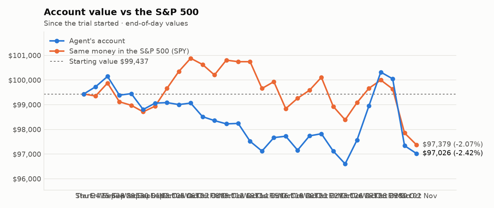
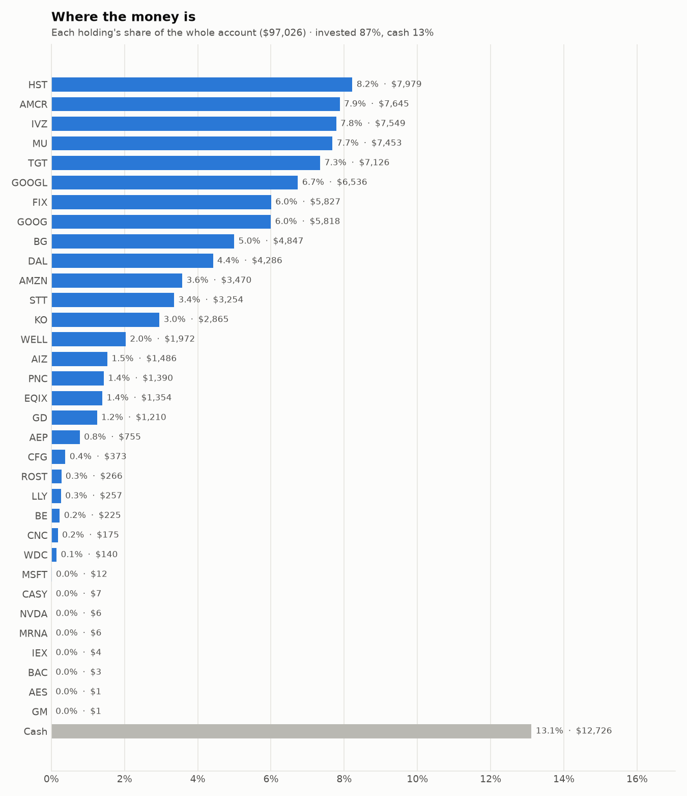
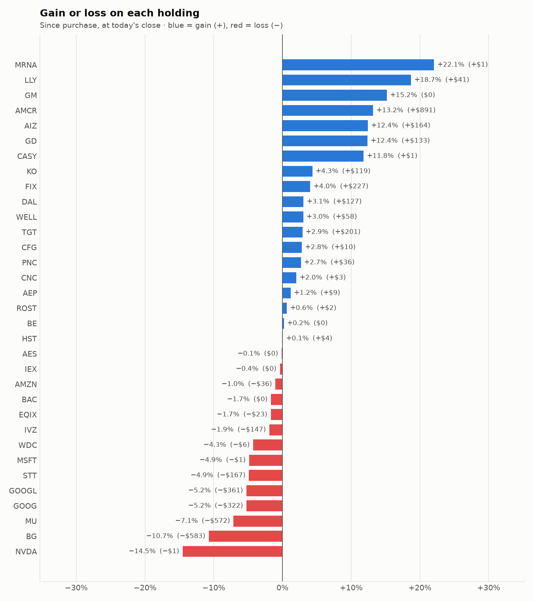

# Daily trading report — Monday 02 November 2026

## Summary

- **Account value:** $97,026 (-$316, -0.3% today)
- **S&P 500 (SPY) today:** -0.5% — the agent was ahead of the index by 0.16%
- **Trades:** 3 buy(s) ($15,699), 5 sell(s) ($18,648)
- **2026-11-02 Morning rebalance:** traded — 8 order(s) placed
- **2026-11-02 Afternoon risk check:** no trades needed — Risk-checked 33 holding(s): none was 12%+ below its purchase price, and none had both clearly negative news and a price drop of 3%+ since entry.

## Charts

## Why I bought

### IVZ — bought 269.576 shares at ~$28.55 ($7,696)

**Why:** combined score +0.96; ranked #6 of 503; driven mainly by price momentum +1.62, value (cheapness) +1.57; entering/adding to the top-ranked target portfolio; research detail: 2 recent headline(s), net positive tone (+3); analyst consensus +0.55/2 (1 strong buy, 9 buy, 10 hold, 0 sell, 0 strong sell)

**Research scores** (combined +0.96, ranked #6 in the S&P 500, sector: Financials):

| Factor | Score | Measures |
|---|---|---|
| Value | +1.57 | cheap vs. sector peers on P/E and P/B |
| Quality | -0.31 | profitability (ROE, margins) and balance-sheet strength |
| Momentum | +1.62 | 12-month price trend, excluding the last month |
| Low volatility | -0.77 | steadier price than sector peers |
| Research | +0.68 | recent news tone + analyst consensus |

**Company financials (Finnhub, trailing 12 months):** P/B 1.1, return on equity -0.6%, gross margin 65.9%, debt/equity 0.82

**Price trend (Alpaca):** 12-month return (excl. last month) +32.7%, last month -8.7%, volatility 25.8%/yr

**News (Finnhub): 2 headline(s) in the last 2 days, net tone +3.** Most influential:
- [IVZ Q3 deep dive: margin expansion driven by global inflows and expense discipline](https://finnhub.io/api/news?id=25ea30226d726bdd89d579015c8412e5a064a67f8b6e6658a1c8793433d18b0c) — 30 Oct, Yahoo (tone +2)
- [Is Invesco Equally-Weighted S&P 500 A (VADAX) a Strong Mutual Fund Pick Right Now?](https://finnhub.io/api/news?id=835e2f6716e87167028918854eca7ae87ac5754e3c1623bb7837090bba265c8c) — 02 Nov, Yahoo (tone +1)

**Analysts (Finnhub, 2026-11-01):** 1 strong buy, 9 buy, 10 hold, 0 sell, 0 strong sell — consensus +0.55 on a -2 (strong sell) to +2 (strong buy) scale.

### HST — bought 257.747 shares at ~$25.75 ($6,637)

**Why:** combined score +0.98; ranked #4 of 503; driven mainly by price momentum +1.83, value (cheapness) +0.72; entering/adding to the top-ranked target portfolio; research detail: 1 recent headline(s), net positive tone (+1); analyst consensus +0.92/2 (8 strong buy, 7 buy, 10 hold, 0 sell, 0 strong sell)

**Research scores** (combined +0.98, ranked #4 in the S&P 500, sector: Real Estate):

| Factor | Score | Measures |
|---|---|---|
| Value | +0.72 | cheap vs. sector peers on P/E and P/B |
| Quality | +0.68 | profitability (ROE, margins) and balance-sheet strength |
| Momentum | +1.83 | 12-month price trend, excluding the last month |
| Low volatility | -0.06 | steadier price than sector peers |
| Research | +0.39 | recent news tone + analyst consensus |

**Company financials (Finnhub, trailing 12 months):** P/E 16.9, P/B 2.5, return on equity 15.5%, gross margin 97.0%, debt/equity 0.80

**Price trend (Alpaca):** 12-month return (excl. last month) +32.3%, last month +12.4%, volatility 19.5%/yr

**News (Finnhub): 1 headline(s) in the last 2 days, net tone +1.** Most influential:
- [Host Hotels & Resorts: With A 9% Return Is A Hold](https://finnhub.io/api/news?id=3d154371486effc090126bee719135e150eaa3959bc6adbdf2ff42899f19996d) — 31 Oct, SeekingAlpha (tone +1)

**Analysts (Finnhub, 2026-11-01):** 8 strong buy, 7 buy, 10 hold, 0 sell, 0 strong sell — consensus +0.92 on a -2 (strong sell) to +2 (strong buy) scale.

### WELL — bought 5.796 shares at ~$235.52 ($1,365)

**Why:** combined score +0.77; ranked #16 of 503; driven mainly by price momentum +1.64, research (news + analyst consensus) +1.62; entering/adding to the top-ranked target portfolio; research detail: 2 recent headline(s), net positive tone (+3); analyst consensus +1.11/2 (6 strong buy, 19 buy, 3 hold, 0 sell, 0 strong sell)

**Research scores** (combined +0.77, ranked #16 in the S&P 500, sector: Real Estate):

| Factor | Score | Measures |
|---|---|---|
| Value | -0.75 | cheap vs. sector peers on P/E and P/B |
| Quality | -0.32 | profitability (ROE, margins) and balance-sheet strength |
| Momentum | +1.64 | 12-month price trend, excluding the last month |
| Low volatility | -0.13 | steadier price than sector peers |
| Research | +1.62 | recent news tone + analyst consensus |

**Company financials (Finnhub, trailing 12 months):** P/E 101.3, P/B 3.4, return on equity 3.7%, gross margin 40.0%, debt/equity 0.40

**Price trend (Alpaca):** 12-month return (excl. last month) +27.5%, last month +3.4%, volatility 22.2%/yr

**News (Finnhub): 2 headline(s) in the last 2 days, net tone +3.** Most influential:
- [Evercore ISI Group Maintains Outperform on Welltower, Raises Price Target to $265](https://finnhub.io/api/news?id=629856de829ecd279e75c045f1d8b8acf931f536fdfe712894caa7fe47edb93c) — 02 Nov, Benzinga (tone +2)
- [The Zacks Analyst Blog Highlights Welltower, T-Mobile US and Starbucks](https://finnhub.io/api/news?id=1ece9f5b6aee84f562c3cd964c05c0242fca63f947999fa90a6376f66e7a9e97) — 02 Nov, Yahoo (tone +1)

**Analysts (Finnhub, 2026-11-01):** 6 strong buy, 19 buy, 3 hold, 0 sell, 0 strong sell — consensus +1.11 on a -2 (strong sell) to +2 (strong buy) scale.

## Why I sold

### STX — sold 9.456 shares at ~$614.48 ($5,811)

**Why:** combined score +0.56; ranked #32 of 503; driven mainly by price momentum +1.51, low volatility -0.68; trimmed toward target weight, or dropped out of the top-ranked names; research detail: 3 recent headline(s), net positive tone (+2); analyst consensus +1.10/2 (7 strong buy, 20 buy, 4 hold, 0 sell, 0 strong sell)

**Research scores** (combined +0.56, ranked #32 in the S&P 500, sector: Information Technology):

| Factor | Score | Measures |
|---|---|---|
| Value | +0.00 | cheap vs. sector peers on P/E and P/B |
| Quality | +0.00 | profitability (ROE, margins) and balance-sheet strength |
| Momentum | +1.51 | 12-month price trend, excluding the last month |
| Low volatility | -0.68 | steadier price than sector peers |
| Research | +0.28 | recent news tone + analyst consensus |

**Price trend (Alpaca):** 12-month return (excl. last month) +300.4%, last month -31.8%, volatility 68.8%/yr

**News (Finnhub): 3 headline(s) in the last 2 days, net tone +2.** Most influential:
- [Seagate: The Real Risk Isn't Toshiba, It's The 2028 Supply Wave (Downgrade)](https://finnhub.io/api/news?id=d2c790ea13489ecf284713cf69cf1c23568e47798e28c3451632f3a9a083dcf5) — 31 Oct, SeekingAlpha (tone +1)
- [STX Q3 deep dive: data center strength and technology transition drive outperformance](https://finnhub.io/api/news?id=19f9e959768e9a11f787531ea519337e60f17c8403ece2cecf6c599289490604) — 31 Oct, Yahoo (tone +1)
- [Is Seagate Still The Business You Bought?](https://finnhub.io/api/news?id=0754beb2c6a959972783e9ee6e21e1a5349d2efaecd4258be01185a16feea01d) — 02 Nov, Yahoo (tone +0)

**Analysts (Finnhub, 2026-11-01):** 7 strong buy, 20 buy, 4 hold, 0 sell, 0 strong sell — consensus +1.10 on a -2 (strong sell) to +2 (strong buy) scale.

### EQIX — sold 5.021 shares at ~$1,005.52 ($5,049)

**Why:** combined score +0.66; ranked #21 of 503; driven mainly by price momentum +1.73, low volatility -0.31; trimmed toward target weight, or dropped out of the top-ranked names; research detail: analyst consensus +1.15/2 (12 strong buy, 23 buy, 6 hold, 0 sell, 0 strong sell)

**Research scores** (combined +0.66, ranked #21 in the S&P 500, sector: Real Estate):

| Factor | Score | Measures |
|---|---|---|
| Value | +0.00 | cheap vs. sector peers on P/E and P/B |
| Quality | +0.00 | profitability (ROE, margins) and balance-sheet strength |
| Momentum | +1.73 | 12-month price trend, excluding the last month |
| Low volatility | -0.31 | steadier price than sector peers |
| Research | +0.28 | recent news tone + analyst consensus |

**Price trend (Alpaca):** 12-month return (excl. last month) +29.3%, last month +0.1%, volatility 26.5%/yr

**News (Finnhub):** no headlines in the last 2 days.

**Analysts (Finnhub, 2026-11-01):** 12 strong buy, 23 buy, 6 hold, 0 sell, 0 strong sell — consensus +1.15 on a -2 (strong sell) to +2 (strong buy) scale.

### KO — sold 45.765 shares at ~$95.02 ($4,349)

**Why:** combined score +0.73; ranked #18 of 503; driven mainly by low volatility +1.55, price momentum +1.38; trimmed toward target weight, or dropped out of the top-ranked names; research detail: 5 recent headline(s), net positive tone (+5); analyst consensus +1.03/2 (8 strong buy, 20 buy, 7 hold, 0 sell, 0 strong sell)

**Research scores** (combined +0.73, ranked #18 in the S&P 500, sector: Consumer Staples):

| Factor | Score | Measures |
|---|---|---|
| Value | -0.67 | cheap vs. sector peers on P/E and P/B |
| Quality | +0.43 | profitability (ROE, margins) and balance-sheet strength |
| Momentum | +1.38 | 12-month price trend, excluding the last month |
| Low volatility | +1.55 | steadier price than sector peers |
| Research | +0.95 | recent news tone + analyst consensus |

**Company financials (Finnhub, trailing 12 months):** P/E 27.7, P/B 9.9, return on equity 42.0%, gross margin 62.3%, debt/equity 1.11

**Price trend (Alpaca):** 12-month return (excl. last month) +29.8%, last month +9.3%, volatility 17.3%/yr

**News (Finnhub): 5 headline(s) in the last 2 days, net tone +5.** Most influential:
- [Coca-Cola Delivers Strong Growth - But is KO Stock Undervalued?](https://finnhub.io/api/news?id=d0d0961e36bc92768ae36ca268c6523082b4776537207c2d90fd8417831370e9) — 01 Nov, Yahoo (tone +2)
- [KO Q3 deep dive: broad-based volume gains and disciplined margin expansion amid cost pressures](https://finnhub.io/api/news?id=5a6f0822f4b8d6268fec9871e18318867cee3ef0e5294781e10dee1ecd5fb39b) — 31 Oct, Yahoo (tone +2)
- [What Coca-Cola Holders Saw Early](https://finnhub.io/api/news?id=ece276a4ad807351c9e6260374b7fcbbb834e88aaf6198b62cf2890c5e7e8392) — 01 Nov, Yahoo (tone +1)
- [Coca-Cola vs. UPS: Which Dividend Stock Could Make You Richer Over the Next 10 Years?](https://finnhub.io/api/news?id=399227059ca90e6013d243c629a3e0118ca0abb27ea6ccf7588c507453792dbb) — 01 Nov, Yahoo (tone +0)
- [Coca-Cola and Procter & Gamble Are Up This Month. Which Dow Dividend Stock Is the Better Buy Now?](https://finnhub.io/api/news?id=6ca4bc61dbf090fede4e9c14491f6e8424b23711d7363e09d22783a300a2b019) — 31 Oct, Yahoo (tone +0)

**Analysts (Finnhub, 2026-11-01):** 8 strong buy, 20 buy, 7 hold, 0 sell, 0 strong sell — consensus +1.03 on a -2 (strong sell) to +2 (strong buy) scale.

### IEX — sold 8.011 shares at ~$239.45 ($1,918)

**Why:** combined score +0.43; ranked #62 of 503; driven mainly by low volatility +2.15, price momentum +0.92; trimmed toward target weight, or dropped out of the top-ranked names; research detail: 1 recent headline(s), neutral/mixed tone; analyst consensus +1.00/2 (6 strong buy, 8 buy, 6 hold, 0 sell, 0 strong sell)

**Research scores** (combined +0.43, ranked #62 in the S&P 500, sector: Industrials):

| Factor | Score | Measures |
|---|---|---|
| Value | +0.00 | cheap vs. sector peers on P/E and P/B |
| Quality | +0.00 | profitability (ROE, margins) and balance-sheet strength |
| Momentum | +0.92 | 12-month price trend, excluding the last month |
| Low volatility | +2.15 | steadier price than sector peers |
| Research | -0.01 | recent news tone + analyst consensus |

**Price trend (Alpaca):** 12-month return (excl. last month) +41.2%, last month +1.8%, volatility 18.8%/yr

**News (Finnhub): 1 headline(s) in the last 2 days, net tone +0.** Most influential:
- [5 must-read analyst questions from IDEX’s Q3 earnings call](https://finnhub.io/api/news?id=0c608f6cd1e17d62bd84ced1752bbdae30f46ab413a0ca9a2335b7a27ed0d252) — 31 Oct, Yahoo (tone +0)

**Analysts (Finnhub, 2026-11-01):** 6 strong buy, 8 buy, 6 hold, 0 sell, 0 strong sell — consensus +1.00 on a -2 (strong sell) to +2 (strong buy) scale.

### GM — sold 16.986 shares at ~$89.60 ($1,522)

**Why:** combined score +0.55; ranked #34 of 503; driven mainly by price momentum +1.43, research (news + analyst consensus) +0.22; trimmed toward target weight, or dropped out of the top-ranked names; research detail: 5 recent headline(s), neutral/mixed tone; analyst consensus +1.14/2 (11 strong buy, 18 buy, 6 hold, 0 sell, 0 strong sell)

**Research scores** (combined +0.55, ranked #34 in the S&P 500, sector: Consumer Discretionary):

| Factor | Score | Measures |
|---|---|---|
| Value | +0.00 | cheap vs. sector peers on P/E and P/B |
| Quality | +0.00 | profitability (ROE, margins) and balance-sheet strength |
| Momentum | +1.43 | 12-month price trend, excluding the last month |
| Low volatility | -0.17 | steadier price than sector peers |
| Research | +0.22 | recent news tone + analyst consensus |

**Price trend (Alpaca):** 12-month return (excl. last month) +30.1%, last month +10.2%, volatility 35.6%/yr

**News (Finnhub): 5 headline(s) in the last 2 days, net tone +0.** Most influential:
- [Can General Motors and Ford Survive the Flood of Cheap Chinese EVs?](https://finnhub.io/api/news?id=9b93f47dbcebc2234a81890056957674508c6a78aa93cbbc5accdb16883dd452) — 01 Nov, Yahoo (tone +0)
- [GE & GM Earnings, Plus Deals, Deals, Deals](https://finnhub.io/api/news?id=e45c71a7c1dfd8d468bebb2ff1e53065f986c0f93b62ecdd8b04b47755f44d99) — 01 Nov, Yahoo (tone +0)
- [“A Natural Home”: General Motors Soars 15% in a Week on Its Nasdaq Switch and Hybrid Pivot](https://finnhub.io/api/news?id=770969ee4e4ce156f22b132ebb8e2996b6ca404bb038d0af17bde5b1acbd6fd4) — 31 Oct, Yahoo (tone +0)
- [Ford, General Motors stocks had this in common for week ending Oct. 30](https://finnhub.io/api/news?id=7c4264d7fc03b2c9a90e8867ba5c309d9a8f162c4ead88da00c7f7e94de5116d) — 31 Oct, Yahoo (tone +0)
- [Automakers like Rivian and Ford are ‘democratizing 3D printing’ to reduce costs and increase speed](https://finnhub.io/api/news?id=fa13c61bde5b0672be34b38bcd34d1cfc3ba744ca9692e532ea84f243063e550) — 31 Oct, CNBC (tone +0)

**Analysts (Finnhub, 2026-11-01):** 11 strong buy, 18 buy, 6 hold, 0 sell, 0 strong sell — consensus +1.14 on a -2 (strong sell) to +2 (strong buy) scale.

## Holdings at the close

| Stock | Shares | Avg cost | Price | Market value | % of account | Today | Gain/loss $ | Gain/loss % |
|---|---:|---:|---:|---:|---:|---:|---:|---:|
| HST | 311.674 | $25.59 | $25.60 | $7,979 | 8.2% | +1.19% | +$4 | +0.06% |
| AMCR | 156.599 | $43.13 | $48.82 | $7,645 | 7.9% | +3.01% | +$891 | +13.19% |
| IVZ | 269.576 | $28.55 | $28.00 | $7,549 | 7.8% | +0.88% | −$147 | -1.92% |
| MU | 8.88 | $903.65 | $839.26 | $7,453 | 7.7% | -5.14% | −$572 | -7.13% |
| TGT | 44.995 | $153.91 | $158.38 | $7,126 | 7.3% | +2.59% | +$201 | +2.90% |
| GOOGL | 23.312 | $295.88 | $280.38 | $6,536 | 6.7% | +0.19% | −$361 | -5.24% |
| FIX | 4.848 | $1,155.28 | $1,202.00 | $5,827 | 6.0% | -2.49% | +$227 | +4.04% |
| GOOG | 20.832 | $294.73 | $279.29 | $5,818 | 6.0% | +0.38% | −$322 | -5.24% |
| BG | 51.442 | $105.54 | $94.22 | $4,847 | 5.0% | -2.50% | −$583 | -10.73% |
| DAL | 51.385 | $80.92 | $83.40 | $4,286 | 4.4% | +4.05% | +$127 | +3.07% |
| AMZN | 14.056 | $249.42 | $246.88 | $3,470 | 3.6% | +2.72% | −$36 | -1.02% |
| STT | 19.22 | $177.99 | $169.31 | $3,254 | 3.4% | -0.27% | −$167 | -4.88% |
| KO | 29.891 | $91.86 | $95.85 | $2,865 | 3.0% | +1.88% | +$119 | +4.35% |
| WELL | 8.25 | $232.01 | $239.00 | $1,972 | 2.0% | +1.88% | +$58 | +3.01% |
| AIZ | 5 | $264.38 | $297.23 | $1,486 | 1.5% | +1.51% | +$164 | +12.43% |
| PNC | 6 | $225.64 | $231.66 | $1,390 | 1.4% | +1.67% | +$36 | +2.67% |
| EQIX | 1.363 | $1,010.91 | $993.69 | $1,354 | 1.4% | -1.97% | −$23 | -1.70% |
| GD | 3.251 | $331.27 | $372.22 | $1,210 | 1.2% | -0.10% | +$133 | +12.36% |
| AEP | 5.798 | $128.70 | $130.25 | $755 | 0.8% | +0.03% | +$9 | +1.20% |
| CFG | 5.744 | $63.15 | $64.93 | $373 | 0.4% | +1.76% | +$10 | +2.82% |
| ROST | 1.153 | $229.11 | $230.59 | $266 | 0.3% | +1.01% | +$2 | +0.65% |
| LLY | 0.182 | $1,189.78 | $1,412.50 | $257 | 0.3% | -0.36% | +$41 | +18.72% |
| BE | 1.132 | $198.16 | $198.55 | $225 | 0.2% | -2.27% | +$0 | +0.20% |
| CNC | 2.63 | $65.21 | $66.53 | $175 | 0.2% | -2.80% | +$3 | +2.02% |
| WDC | 0.411 | $355.69 | $340.50 | $140 | 0.1% | -7.00% | −$6 | -4.27% |
| MSFT | 0.023 | $533.80 | $507.87 | $12 | 0.0% | -2.69% | −$1 | -4.86% |
| CASY | 0.011 | $597.62 | $668.17 | $7 | 0.0% | -1.77% | +$1 | +11.81% |
| NVDA | 0.032 | $236.88 | $202.48 | $6 | 0.0% | -1.06% | −$1 | -14.52% |
| MRNA | 0.028 | $181.06 | $221.00 | $6 | 0.0% | -0.32% | +$1 | +22.06% |
| IEX | 0.018 | $237.42 | $236.52 | $4 | 0.0% | +1.15% | −$0 | -0.38% |
| BAC | 0.054 | $50.53 | $49.69 | $3 | 0.0% | -0.64% | −$0 | -1.66% |
| AES | 0.096 | $14.92 | $14.90 | $1 | 0.0% | +0.47% | −$0 | -0.13% |
| GM | 0.015 | $78.08 | $89.94 | $1 | 0.0% | +2.91% | +$0 | +15.19% |
| **Invested** | | | | **$84,300** | **86.9%** | | **−$191** | |
| **Cash** | | | | $12,726 | 13.1% | | | |
| **Total account** | | | | **$97,026** | 100% | | | |

_Scores are sector-neutral z-scores: 0 is average for the stock's sector, +1 is one standard deviation better. News tone is a keyword count over recent headlines, not a deep read. None of this guarantees a stock will rise; a few days of results can't show whether the strategy has a real edge over the S&P 500._
