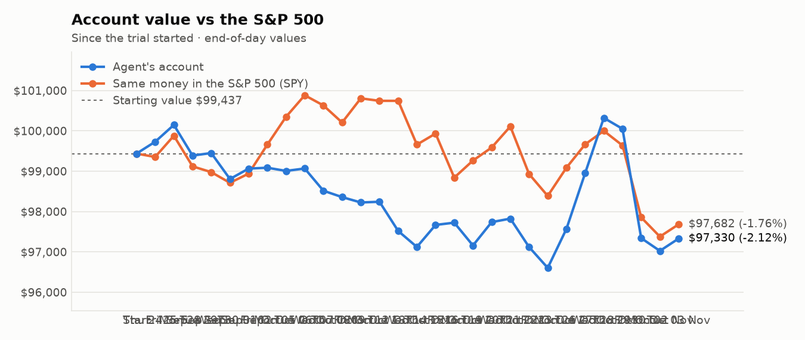
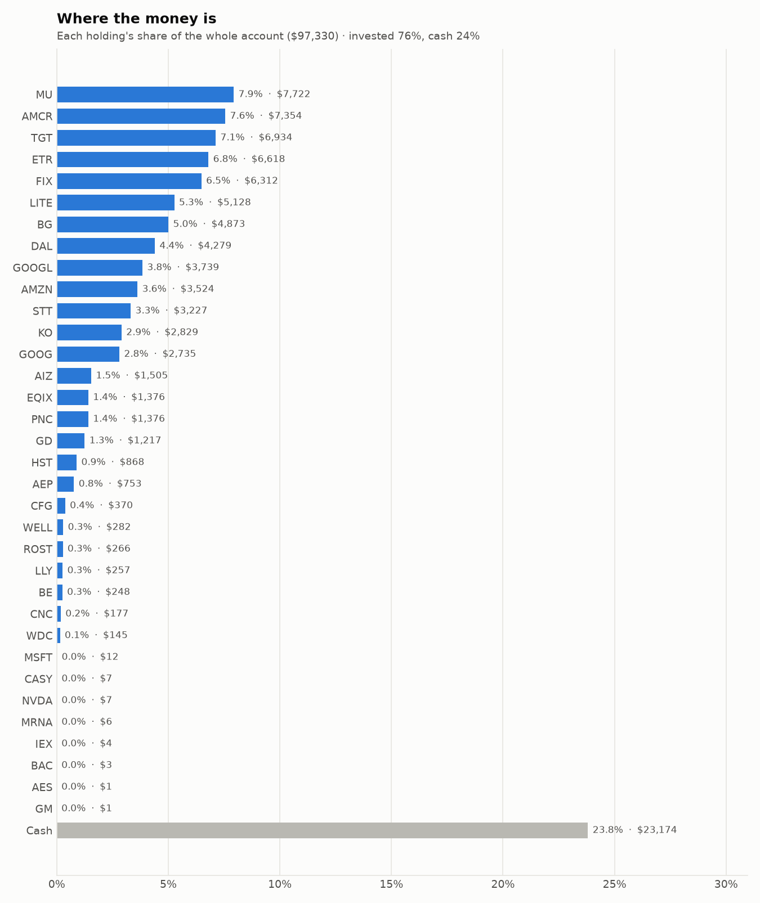
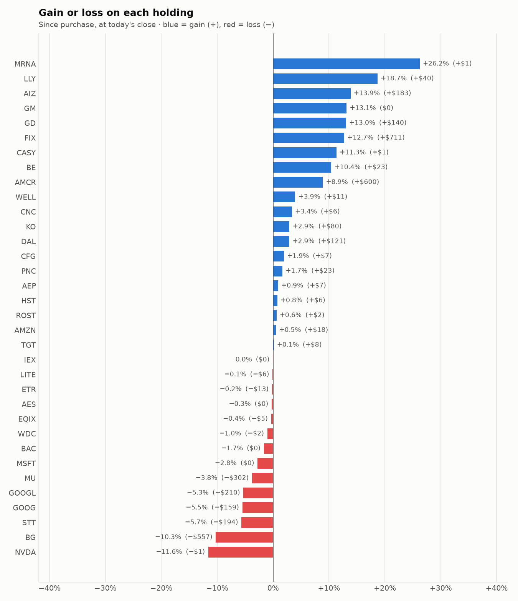

# Daily trading report — Tuesday 03 November 2026

## Summary

- **Account value:** $97,330 (+$305, +0.3% today)
- **S&P 500 (SPY) today:** +0.3% — the agent matched the index
- **Trades:** 2 buy(s) ($11,765), 5 sell(s) ($22,214)
- **2026-11-03 Morning rebalance:** traded — 7 order(s) placed
- **2026-11-03 Afternoon risk check:** no trades needed — Risk-checked 34 holding(s): none was 12%+ below its purchase price, and none had both clearly negative news and a price drop of 3%+ since entry.

## Charts

## Why I bought

### ETR — bought 60.76 shares at ~$109.14 ($6,631)

**Why:** combined score +0.82; ranked #8 of 503; driven mainly by research (news + analyst consensus) +1.88, price momentum +1.51; entering/adding to the top-ranked target portfolio; research detail: 22 recent headline(s), net positive tone (+22); analyst consensus +1.00/2 (7 strong buy, 15 buy, 7 hold, 0 sell, 0 strong sell)

**Research scores** (combined +0.82, ranked #8 in the S&P 500, sector: Utilities):

| Factor | Score | Measures |
|---|---|---|
| Value | -0.89 | cheap vs. sector peers on P/E and P/B |
| Quality | -0.01 | profitability (ROE, margins) and balance-sheet strength |
| Momentum | +1.51 | 12-month price trend, excluding the last month |
| Low volatility | -0.02 | steadier price than sector peers |
| Research | +1.88 | recent news tone + analyst consensus |

**Company financials (Finnhub, trailing 12 months):** P/E 28.9, P/B 2.8, return on equity 10.3%, gross margin 42.0%, debt/equity 1.87

**Price trend (Alpaca):** 12-month return (excl. last month) +8.1%, last month +8.9%, volatility 16.4%/yr

**News (Finnhub): 22 headline(s) in the last 2 days, net tone +22.** Most influential:
- [Entergy Corp (ETR) Q3 2026 Earnings Call Highlights: Strong EPS, Google Expansion, and a ...](https://finnhub.io/api/news?id=41c1ccd0bdaf62a5fe272e30856c30b6bed30411fe53a5ec17d3afef131d9d66) — 03 Nov, Yahoo (tone +3)
- [Entergy Q3 Earnings Top Estimates, Revenues Increase Year Over Year](https://finnhub.io/api/news?id=02e397ed46b023e05263f64593eacb91782bf6b928e089d646ab42dc12b4b9c4) — 02 Nov, Yahoo (tone +3)
- [Entergy (ETR) Q3 2026 Earnings Call Transcript](https://finnhub.io/api/news?id=e54196d11e8617e766cf9324b52c7ae5072d59bd29060ad9f7f7524c8b1faf7a) — 02 Nov, Yahoo (tone +2)
- [Entergy Q3 Adj. EPS $1.98 Beats $1.71 Estimate, Sales $4.365B Beat $4.116B Estimate](https://finnhub.io/api/news?id=fbadcfd3686b992156246aab83bf8845f787ad219c046f3c9777a93c3a8c1e52) — 02 Nov, Benzinga (tone +2)
- [Entergy Q3 Adj. EPS $1.98 Beats $1.71 Estimate](https://finnhub.io/api/news?id=771dad082abd2d7bced1565970c027b01aaf49db2e1fdd63fff572b7f04454c5) — 02 Nov, Benzinga (tone +2)

**Analysts (Finnhub, 2026-11-01):** 7 strong buy, 15 buy, 7 hold, 0 sell, 0 strong sell — consensus +1.00 on a -2 (strong sell) to +2 (strong buy) scale.

### LITE — bought 7.419 shares at ~$692.02 ($5,134)

**Why:** combined score +0.80; ranked #9 of 503; driven mainly by price momentum +3.00, low volatility -1.14; entering/adding to the top-ranked target portfolio; research detail: 82 recent headline(s), net positive tone (+5); analyst consensus +1.11/2 (9 strong buy, 22 buy, 5 hold, 0 sell, 0 strong sell)

**Research scores** (combined +0.80, ranked #9 in the S&P 500, sector: Information Technology):

| Factor | Score | Measures |
|---|---|---|
| Value | -0.48 | cheap vs. sector peers on P/E and P/B |
| Quality | -1.12 | profitability (ROE, margins) and balance-sheet strength |
| Momentum | +3.00 | 12-month price trend, excluding the last month |
| Low volatility | -1.14 | steadier price than sector peers |
| Research | +0.28 | recent news tone + analyst consensus |

**Company financials (Finnhub, trailing 12 months):** P/B 14.3, return on equity -300.1%, gross margin 41.7%, debt/equity 0.35

**Price trend (Alpaca):** 12-month return (excl. last month) +532.9%, last month -37.0%, volatility 96.7%/yr

**News (Finnhub): 82 headline(s) in the last 2 days, net tone +5.** Most influential:
- [COHR Stock Draws Upgrade As Marvell’s $115B Lumentum Deal Highlights ‘Value Of Scarce AI Optics’](https://finnhub.io/api/news?id=719c8dbbdf4f4e3bc3986ec3982fbc8d91732dcbdbd2ddc969d142cf328be7f2) — 02 Nov, Yahoo (tone +3)
- [Analysts downgrade Marvell and slash price targets over Lumentum deal](https://finnhub.io/api/news?id=0b755e10bac1e8daf5d2df51a80046a9e240460b981502b0db1f35123a973593) — 03 Nov, Yahoo (tone -2)
- [MRVL Stock Price Target Slashed In Half: ‘Material Headwinds’ After Lumentum Deal, TD Cowen Says In Downgrade](https://finnhub.io/api/news?id=5fdabbf162942e4ba5a81129757e283adbc18f9b6bab02f01de72eb39280912e) — 03 Nov, Yahoo (tone -2)
- [3 Penny Stocks With Revenue Growth Up To 72% To Watch](https://finnhub.io/api/news?id=883d132d68010062222923d842b17370cc112b83a6f0e825d02ca20760ec21d3) — 02 Nov, Yahoo (tone +2)
- [Lumentum Holdings Q1 Adj. EPS $4.57 Beats $4.19 Estimate, Sales $1.263B Beat $1.249B Estimate](https://finnhub.io/api/news?id=e6b0e63f4d4b748eb1b0e67c52f9d8f33d89791e17dd7dd69ec668a07e18d964) — 02 Nov, Benzinga (tone +2)

**Analysts (Finnhub, 2026-11-01):** 9 strong buy, 22 buy, 5 hold, 0 sell, 0 strong sell — consensus +1.11 on a -2 (strong sell) to +2 (strong buy) scale.

## Why I sold

### IVZ — sold 269.576 shares at ~$27.88 ($7,516)

**Why:** combined score +0.46; ranked #59 of 503; driven mainly by price momentum +1.51, low volatility -0.75; trimmed toward target weight, or dropped out of the top-ranked names; research detail: 5 recent headline(s), net positive tone (+1); analyst consensus +0.55/2 (1 strong buy, 9 buy, 10 hold, 0 sell, 0 strong sell)

**Research scores** (combined +0.46, ranked #59 in the S&P 500, sector: Financials):

| Factor | Score | Measures |
|---|---|---|
| Value | +0.00 | cheap vs. sector peers on P/E and P/B |
| Quality | +0.00 | profitability (ROE, margins) and balance-sheet strength |
| Momentum | +1.51 | 12-month price trend, excluding the last month |
| Low volatility | -0.75 | steadier price than sector peers |
| Research | -0.15 | recent news tone + analyst consensus |

**Price trend (Alpaca):** 12-month return (excl. last month) +32.8%, last month -9.4%, volatility 25.8%/yr

**News (Finnhub): 5 headline(s) in the last 2 days, net tone +1.** Most influential:
- [Is Invesco Equally-Weighted S&P 500 A (VADAX) a Strong Mutual Fund Pick Right Now?](https://finnhub.io/api/news?id=835e2f6716e87167028918854eca7ae87ac5754e3c1623bb7837090bba265c8c) — 02 Nov, Yahoo (tone +1)
- [Should You Invest in the Invesco S&P SmallCap Information Technology ETF (PSCT)?](https://finnhub.io/api/news?id=2b0459a225f5d46ccf5487c566ac5b4df09d1de81ab7c0eeb7e06fbbf08451e9) — 03 Nov, Yahoo (tone +0)
- [Should You Invest in the Invesco Pharmaceuticals ETF (PJP)?](https://finnhub.io/api/news?id=f2bf8e1013fd58e53c7d64016c00b9e1e5bab65225b274693372c66030dab151) — 03 Nov, Yahoo (tone +0)
- [Should Invesco S&P 500 Revenue ETF (RWL) Be on Your Investing Radar?](https://finnhub.io/api/news?id=1e1dca594a290e083c1e73193a9661bf53fcfa324e271419b47f794cee6124f7) — 03 Nov, Yahoo (tone +0)
- [Invesco Closed-End Funds Declare Dividends](https://finnhub.io/api/news?id=5b24f9c1301a031f93366e76bd3d24169bfd628bc750fae2c52aa12cf2d7e477) — 02 Nov, Yahoo (tone +0)

**Analysts (Finnhub, 2026-11-01):** 1 strong buy, 9 buy, 10 hold, 0 sell, 0 strong sell — consensus +0.55 on a -2 (strong sell) to +2 (strong buy) scale.

### HST — sold 277.992 shares at ~$25.80 ($7,172)

**Why:** combined score +0.61; ranked #26 of 503; driven mainly by price momentum +1.83, research (news + analyst consensus) -0.13; trimmed toward target weight, or dropped out of the top-ranked names; research detail: 1 recent headline(s), neutral/mixed tone; analyst consensus +0.92/2 (8 strong buy, 7 buy, 10 hold, 0 sell, 0 strong sell)

**Research scores** (combined +0.61, ranked #26 in the S&P 500, sector: Real Estate):

| Factor | Score | Measures |
|---|---|---|
| Value | +0.00 | cheap vs. sector peers on P/E and P/B |
| Quality | +0.00 | profitability (ROE, margins) and balance-sheet strength |
| Momentum | +1.83 | 12-month price trend, excluding the last month |
| Low volatility | -0.02 | steadier price than sector peers |
| Research | -0.13 | recent news tone + analyst consensus |

**Price trend (Alpaca):** 12-month return (excl. last month) +32.4%, last month +13.4%, volatility 19.5%/yr

**News (Finnhub): 1 headline(s) in the last 2 days, net tone +0.** Most influential:
- [Host Hotels Gears Up to Report Q3 Earnings: Key Factors to Consider](https://finnhub.io/api/news?id=0dadfa0ca29834043c8d6a6d524f5cf3618fdf519431b51b7339948717f560fb) — 02 Nov, Yahoo (tone +0)

**Analysts (Finnhub, 2026-11-01):** 8 strong buy, 7 buy, 10 hold, 0 sell, 0 strong sell — consensus +0.92 on a -2 (strong sell) to +2 (strong buy) scale.

### GOOG — sold 11.013 shares at ~$277.33 ($3,054)

**Why:** combined score +0.68; ranked #18 of 503; driven mainly by price momentum +1.67, research (news + analyst consensus) +0.85; trimmed toward target weight, or dropped out of the top-ranked names; research detail: 68 recent headline(s), net positive tone (+12); analyst consensus +1.19/2 (20 strong buy, 41 buy, 7 hold, 0 sell, 0 strong sell)

**Research scores** (combined +0.68, ranked #18 in the S&P 500, sector: Communication Services):

| Factor | Score | Measures |
|---|---|---|
| Value | -0.70 | cheap vs. sector peers on P/E and P/B |
| Quality | +0.09 | profitability (ROE, margins) and balance-sheet strength |
| Momentum | +1.67 | 12-month price trend, excluding the last month |
| Low volatility | +0.11 | steadier price than sector peers |
| Research | +0.85 | recent news tone + analyst consensus |

**Company financials (Finnhub, trailing 12 months):** P/E 14.7, P/B 6.2, return on equity 42.6%, gross margin 60.9%, debt/equity 0.18

**Price trend (Alpaca):** 12-month return (excl. last month) +38.6%, last month -18.3%, volatility 33.0%/yr

**News (Finnhub): 68 headline(s) in the last 2 days, net tone +12.** Most influential:
- [Zacks Investment Ideas feature highlights: Amazon, Alphabet, Meta Platforms and Nvidia](https://finnhub.io/api/news?id=9c668c5c8a6e2bd5fc33e43e9d2d19466b65c20d940e24a51bdab6ed620cecc7) — 02 Nov, Yahoo (tone +3)
- [Reddit Sinks 34% in a Week on a Weak Outlook: “AI Mode Does Not Drive Traffic”](https://finnhub.io/api/news?id=6d3504f63f0ed09ed8b226a96d53b24be14d8fc668e04bb75beaafe874bfad2c) — 03 Nov, Yahoo (tone -2)
- [GOOGL Q3 deep dive: AI investment drives revenue growth but profit falls short of expectations](https://finnhub.io/api/news?id=1d275b182fabb5d961c47402220b945d98910d263c580dffd511e5a26b95af21) — 02 Nov, Yahoo (tone +2)
- [Amazon Climbs 5% as Upgrade Fuels Post-Earnings Rebound on AWS Strength; Walmart Rises 2%, Alphabet Edges Higher](https://finnhub.io/api/news?id=e24da536dde8260b35c1a98f2569eae56b86968b888e365c3ce2e7cd9a12ef14) — 02 Nov, Yahoo (tone +2)
- [Snap Sinks 14% in a Week on Social Ad Fears, Then Settles Its Teen Addiction Trial](https://finnhub.io/api/news?id=b3a4f23829b6d4c6cf77f59ce81d3d78f9b60f272c4d203036166e59740cef4a) — 03 Nov, Yahoo (tone -1)

**Analysts (Finnhub, 2026-11-01):** 20 strong buy, 41 buy, 7 hold, 0 sell, 0 strong sell — consensus +1.19 on a -2 (strong sell) to +2 (strong buy) scale.

### GOOGL — sold 9.964 shares at ~$278.23 ($2,772)

**Why:** combined score +0.71; ranked #16 of 503; driven mainly by price momentum +1.71, research (news + analyst consensus) +0.92; trimmed toward target weight, or dropped out of the top-ranked names; research detail: 72 recent headline(s), net positive tone (+13); analyst consensus +1.19/2 (20 strong buy, 41 buy, 7 hold, 0 sell, 0 strong sell)

**Research scores** (combined +0.71, ranked #16 in the S&P 500, sector: Communication Services):

| Factor | Score | Measures |
|---|---|---|
| Value | -0.65 | cheap vs. sector peers on P/E and P/B |
| Quality | +0.09 | profitability (ROE, margins) and balance-sheet strength |
| Momentum | +1.71 | 12-month price trend, excluding the last month |
| Low volatility | +0.03 | steadier price than sector peers |
| Research | +0.92 | recent news tone + analyst consensus |

**Company financials (FMP, trailing 12 months):** P/E 14.3, P/B 5.0, return on equity 42.6%, gross margin 60.9%, debt/equity 0.21

**Price trend (Alpaca):** 12-month return (excl. last month) +40.3%, last month -18.8%, volatility 34.4%/yr

**News (Finnhub): 72 headline(s) in the last 2 days, net tone +13.** Most influential:
- [Zacks Investment Ideas feature highlights: Amazon, Alphabet, Meta Platforms and Nvidia](https://finnhub.io/api/news?id=9c668c5c8a6e2bd5fc33e43e9d2d19466b65c20d940e24a51bdab6ed620cecc7) — 02 Nov, Yahoo (tone +3)
- [Reddit Sinks 34% in a Week on a Weak Outlook: “AI Mode Does Not Drive Traffic”](https://finnhub.io/api/news?id=6d3504f63f0ed09ed8b226a96d53b24be14d8fc668e04bb75beaafe874bfad2c) — 03 Nov, Yahoo (tone -2)
- [GOOGL Q3 deep dive: AI investment drives revenue growth but profit falls short of expectations](https://finnhub.io/api/news?id=1d275b182fabb5d961c47402220b945d98910d263c580dffd511e5a26b95af21) — 02 Nov, Yahoo (tone +2)
- [Amazon Climbs 5% as Upgrade Fuels Post-Earnings Rebound on AWS Strength; Walmart Rises 2%, Alphabet Edges Higher](https://finnhub.io/api/news?id=e24da536dde8260b35c1a98f2569eae56b86968b888e365c3ce2e7cd9a12ef14) — 02 Nov, Yahoo (tone +2)
- [Snap Sinks 14% in a Week on Social Ad Fears, Then Settles Its Teen Addiction Trial](https://finnhub.io/api/news?id=b3a4f23829b6d4c6cf77f59ce81d3d78f9b60f272c4d203036166e59740cef4a) — 03 Nov, Yahoo (tone -1)

**Analysts (Finnhub, 2026-11-01):** 20 strong buy, 41 buy, 7 hold, 0 sell, 0 strong sell — consensus +1.19 on a -2 (strong sell) to +2 (strong buy) scale.

### WELL — sold 7.079 shares at ~$240.02 ($1,699)

**Why:** combined score +0.59; ranked #29 of 503; driven mainly by price momentum +1.57, research (news + analyst consensus) +0.90; trimmed toward target weight, or dropped out of the top-ranked names; research detail: 2 recent headline(s), net positive tone (+3); analyst consensus +1.11/2 (6 strong buy, 19 buy, 3 hold, 0 sell, 0 strong sell)

**Research scores** (combined +0.59, ranked #29 in the S&P 500, sector: Real Estate):

| Factor | Score | Measures |
|---|---|---|
| Value | -0.71 | cheap vs. sector peers on P/E and P/B |
| Quality | -0.28 | profitability (ROE, margins) and balance-sheet strength |
| Momentum | +1.57 | 12-month price trend, excluding the last month |
| Low volatility | -0.12 | steadier price than sector peers |
| Research | +0.90 | recent news tone + analyst consensus |

**Company financials (Finnhub, trailing 12 months):** P/E 101.8, P/B 3.4, return on equity 3.7%, gross margin 40.0%, debt/equity 0.40

**Price trend (Alpaca):** 12-month return (excl. last month) +27.1%, last month +4.9%, volatility 22.5%/yr

**News (Finnhub): 2 headline(s) in the last 2 days, net tone +3.** Most influential:
- [Evercore ISI Group Maintains Outperform on Welltower, Raises Price Target to $265](https://finnhub.io/api/news?id=629856de829ecd279e75c045f1d8b8acf931f536fdfe712894caa7fe47edb93c) — 02 Nov, Benzinga (tone +2)
- [The Zacks Analyst Blog Highlights Welltower, T-Mobile US and Starbucks](https://finnhub.io/api/news?id=1ece9f5b6aee84f562c3cd964c05c0242fca63f947999fa90a6376f66e7a9e97) — 02 Nov, Yahoo (tone +1)

**Analysts (Finnhub, 2026-11-01):** 6 strong buy, 19 buy, 3 hold, 0 sell, 0 strong sell — consensus +1.11 on a -2 (strong sell) to +2 (strong buy) scale.

## Holdings at the close

| Stock | Shares | Avg cost | Price | Market value | % of account | Today | Gain/loss $ | Gain/loss % |
|---|---:|---:|---:|---:|---:|---:|---:|---:|
| MU | 8.88 | $903.65 | $869.61 | $7,722 | 7.9% | +4.32% | −$302 | -3.77% |
| AMCR | 156.599 | $43.13 | $46.96 | $7,354 | 7.6% | -4.20% | +$600 | +8.89% |
| TGT | 44.995 | $153.91 | $154.10 | $6,934 | 7.1% | -2.70% | +$8 | +0.12% |
| ETR | 60.76 | $109.14 | $108.92 | $6,618 | 6.8% | -0.86% | −$13 | -0.20% |
| FIX | 4.848 | $1,155.28 | $1,302.00 | $6,312 | 6.5% | +8.49% | +$711 | +12.70% |
| LITE | 7.419 | $692.02 | $691.25 | $5,128 | 5.3% | +1.00% | −$6 | -0.11% |
| BG | 51.442 | $105.54 | $94.72 | $4,873 | 5.0% | +0.53% | −$557 | -10.26% |
| DAL | 51.385 | $80.92 | $83.28 | $4,279 | 4.4% | -0.17% | +$121 | +2.92% |
| GOOGL | 13.348 | $295.88 | $280.14 | $3,739 | 3.8% | +0.41% | −$210 | -5.32% |
| AMZN | 14.056 | $249.42 | $250.69 | $3,524 | 3.6% | +2.06% | +$18 | +0.51% |
| STT | 19.22 | $177.99 | $167.90 | $3,227 | 3.3% | -0.83% | −$194 | -5.67% |
| KO | 29.891 | $91.95 | $94.64 | $2,829 | 2.9% | -1.24% | +$80 | +2.93% |
| GOOG | 9.819 | $294.73 | $278.50 | $2,735 | 2.8% | +0.17% | −$159 | -5.51% |
| AIZ | 5 | $264.38 | $301.00 | $1,505 | 1.5% | +1.27% | +$183 | +13.85% |
| EQIX | 1.363 | $1,013.54 | $1,009.90 | $1,376 | 1.4% | +1.63% | −$5 | -0.36% |
| PNC | 6 | $225.64 | $229.41 | $1,376 | 1.4% | -0.97% | +$23 | +1.67% |
| GD | 3.251 | $331.27 | $374.46 | $1,217 | 1.3% | +0.27% | +$140 | +13.04% |
| HST | 33.682 | $25.59 | $25.78 | $868 | 0.9% | +0.82% | +$6 | +0.75% |
| AEP | 5.798 | $128.70 | $129.86 | $753 | 0.8% | -0.36% | +$7 | +0.90% |
| CFG | 5.744 | $63.15 | $64.37 | $370 | 0.4% | -0.86% | +$7 | +1.93% |
| WELL | 1.171 | $232.01 | $241.17 | $282 | 0.3% | +0.91% | +$11 | +3.95% |
| ROST | 1.153 | $229.11 | $230.51 | $266 | 0.3% | -0.03% | +$2 | +0.61% |
| LLY | 0.182 | $1,189.78 | $1,411.85 | $257 | 0.3% | +0.06% | +$40 | +18.66% |
| BE | 1.132 | $198.16 | $218.80 | $248 | 0.3% | +11.49% | +$23 | +10.42% |
| CNC | 2.63 | $65.21 | $67.40 | $177 | 0.2% | +1.31% | +$6 | +3.36% |
| WDC | 0.411 | $355.69 | $352.00 | $145 | 0.1% | +3.96% | −$2 | -1.04% |
| MSFT | 0.023 | $533.80 | $518.93 | $12 | 0.0% | +2.33% | −$0 | -2.79% |
| CASY | 0.011 | $597.62 | $665.39 | $7 | 0.0% | -0.42% | +$1 | +11.34% |
| NVDA | 0.032 | $236.88 | $209.40 | $7 | 0.0% | +3.63% | −$1 | -11.60% |
| MRNA | 0.028 | $181.06 | $228.52 | $6 | 0.0% | +3.48% | +$1 | +26.21% |
| IEX | 0.018 | $237.47 | $237.36 | $4 | 0.0% | +0.36% | −$0 | -0.05% |
| BAC | 0.054 | $50.53 | $49.69 | $3 | 0.0% | +0.25% | −$0 | -1.66% |
| AES | 0.096 | $14.92 | $14.88 | $1 | 0.0% | -0.13% | −$0 | -0.27% |
| GM | 0.015 | $78.08 | $88.34 | $1 | 0.0% | -1.78% | +$0 | +13.14% |
| **Invested** | | | | **$74,157** | **76.2%** | | **+$541** | |
| **Cash** | | | | $23,174 | 23.8% | | | |
| **Total account** | | | | **$97,330** | 100% | | | |

_Scores are sector-neutral z-scores: 0 is average for the stock's sector, +1 is one standard deviation better. News tone is a keyword count over recent headlines, not a deep read. None of this guarantees a stock will rise; a few days of results can't show whether the strategy has a real edge over the S&P 500._
