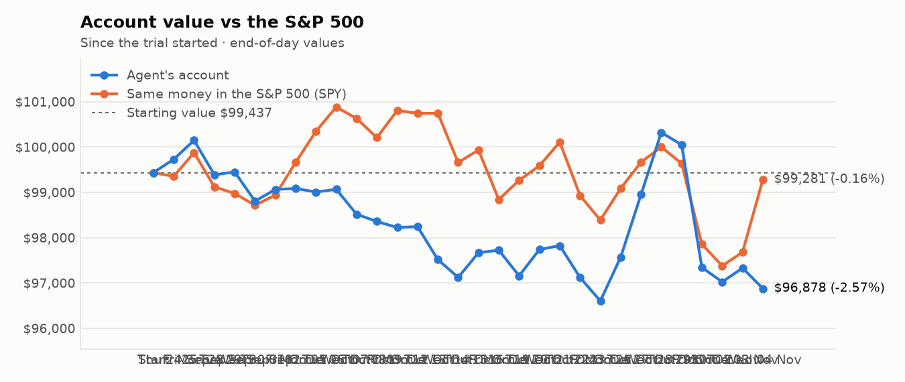
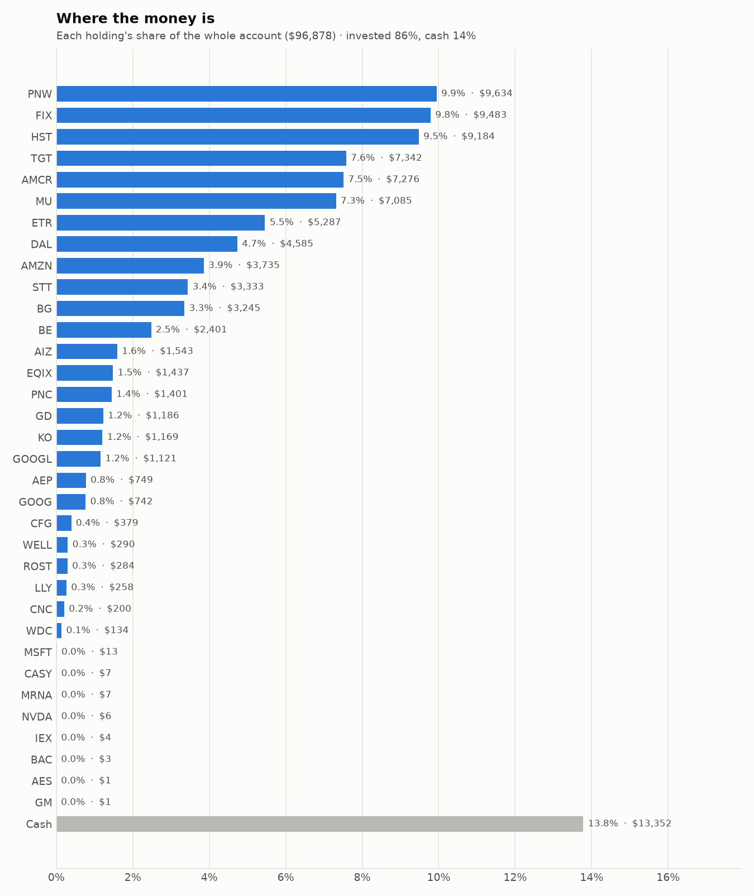
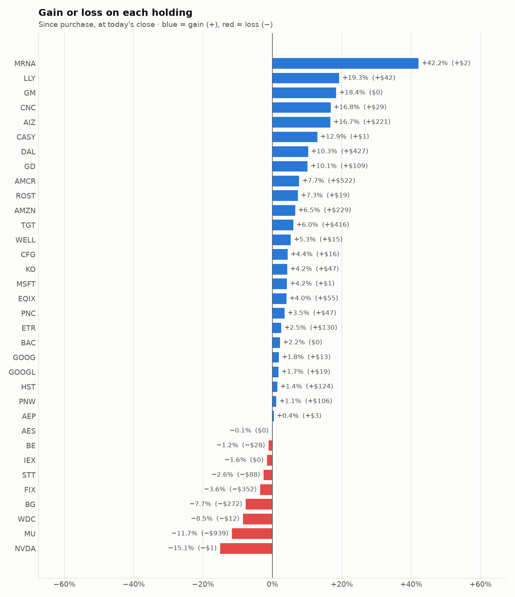

# Daily trading report — Wednesday 04 November 2026

## Summary

- **Account value:** $96,878 (-$452, -0.5% today)
- **S&P 500 (SPY) today:** +1.6% — the agent was behind the index by 2.10%
- **Trades:** 4 buy(s) ($24,160), 6 sell(s) ($14,339)
- **2026-11-04 Morning rebalance:** traded — 9 order(s) placed
- **2026-11-04 Afternoon risk check:** traded — Sold 1 position(s) on the risk check (stop-loss: LITE)

## Charts

## Why I bought

### PNW — bought 91.258 shares at ~$104.41 ($9,528)

**Why:** combined score +0.99; ranked #5 of 503; driven mainly by price momentum +1.52, research (news + analyst consensus) +1.39; entering/adding to the top-ranked target portfolio; research detail: 17 recent headline(s), net positive tone (+16); analyst consensus +0.61/2 (5 strong buy, 4 buy, 14 hold, 0 sell, 0 strong sell)

**Research scores** (combined +0.99, ranked #5 in the S&P 500, sector: Utilities):

| Factor | Score | Measures |
|---|---|---|
| Value | +0.59 | cheap vs. sector peers on P/E and P/B |
| Quality | -0.11 | profitability (ROE, margins) and balance-sheet strength |
| Momentum | +1.52 | 12-month price trend, excluding the last month |
| Low volatility | +0.13 | steadier price than sector peers |
| Research | +1.39 | recent news tone + analyst consensus |

**Company financials (Finnhub, trailing 12 months):** P/E 20.1, P/B 1.8, return on equity 9.0%, debt/equity 1.62

**Price trend (Alpaca):** 12-month return (excl. last month) +9.2%, last month +12.3%, volatility 16.6%/yr

**News (Finnhub): 17 headline(s) in the last 2 days, net tone +16.** Most influential:
- [Pinnacle West Q3 Earnings Beat Estimates on Strong Sales Growth](https://finnhub.io/api/news?id=243622899120a60a1186530e124dbd3fa4bd0c92b9afc858e9b2276b3d7208c8) — 03 Nov, Yahoo (tone +4)
- [What Pinnacle West Capital (PNW) Said on Its Q3 Earnings Call](https://finnhub.io/api/news?id=444b9934862e747f5e63fd2a8d6bb7af3d4ad93faf34612d8291c879d2d220d2) — 04 Nov, Yahoo (tone +2)
- [Pinnacle West Capital Corp (PNW) (Q3 2026) Earnings Call Highlights: Raised Guidance and 9. ...](https://finnhub.io/api/news?id=1d81705fbcfdd14ce93e2e465af1dbd663d141df081d1d65bed7b555c7cea4c4) — 04 Nov, Yahoo (tone +2)
- [Pinnacle West (PNW) Stock Could Be 21% Overvalued After Record Demand](https://finnhub.io/api/news?id=4fd3fabf97efba35d650abcab6ca253adc6921023ba414175be6278067b7ab76) — 03 Nov, Yahoo (tone +2)
- [Pinnacle West Capital Q3 EPS $3.49 Beats $3.23 Estimate, Sales $1.973B Beat $1.900B Estimate](https://finnhub.io/api/news?id=6d18ace5a8b7ecc9d8ae9e5fb90a5b6814af1a89c6914dd5fc501c13b75b5caf) — 03 Nov, Benzinga (tone +2)

**Analysts (Finnhub, 2026-11-01):** 5 strong buy, 4 buy, 14 hold, 0 sell, 0 strong sell — consensus +0.61 on a -2 (strong sell) to +2 (strong buy) scale.

### HST — bought 317.774 shares at ~$25.78 ($8,192)

**Why:** combined score +0.94; ranked #6 of 503; driven mainly by price momentum +1.78, value (cheapness) +0.80; entering/adding to the top-ranked target portfolio; research detail: 2 recent headline(s), net positive tone (+2); analyst consensus +0.92/2 (8 strong buy, 7 buy, 10 hold, 0 sell, 0 strong sell)

**Research scores** (combined +0.94, ranked #6 in the S&P 500, sector: Real Estate):

| Factor | Score | Measures |
|---|---|---|
| Value | +0.80 | cheap vs. sector peers on P/E and P/B |
| Quality | +0.72 | profitability (ROE, margins) and balance-sheet strength |
| Momentum | +1.78 | 12-month price trend, excluding the last month |
| Low volatility | -0.05 | steadier price than sector peers |
| Research | +0.20 | recent news tone + analyst consensus |

**Company financials (Finnhub, trailing 12 months):** P/E 17.2, P/B 2.5, return on equity 15.5%, gross margin 97.0%, debt/equity 0.80

**Price trend (Alpaca):** 12-month return (excl. last month) +31.2%, last month +14.7%, volatility 18.7%/yr

**News (Finnhub): 2 headline(s) in the last 2 days, net tone +2.** Most influential:
- [3 Hotel REITs to Watch for Potential Upside This Earnings Season](https://finnhub.io/api/news?id=0697a3e9a9f8b81e204f3b4708704bc014633c290511f0f347505b6e526399b4) — 03 Nov, Yahoo (tone +2)
- [Host Hotels Gears Up to Report Q3 Earnings: Key Factors to Consider](https://finnhub.io/api/news?id=0dadfa0ca29834043c8d6a6d524f5cf3618fdf519431b51b7339948717f560fb) — 02 Nov, Yahoo (tone +0)

**Analysts (Finnhub, 2026-11-01):** 8 strong buy, 7 buy, 10 hold, 0 sell, 0 strong sell — consensus +0.92 on a -2 (strong sell) to +2 (strong buy) scale.

### FIX — bought 3.819 shares at ~$1,108.85 ($4,235)

**Why:** combined score +1.02; ranked #4 of 503; driven mainly by price momentum +2.79, low volatility -1.57; entering/adding to the top-ranked target portfolio; research detail: 3 recent headline(s), net positive tone (+3); analyst consensus +1.31/2 (7 strong buy, 7 buy, 2 hold, 0 sell, 0 strong sell)

**Research scores** (combined +1.02, ranked #4 in the S&P 500, sector: Industrials):

| Factor | Score | Measures |
|---|---|---|
| Value | -0.34 | cheap vs. sector peers on P/E and P/B |
| Quality | +0.17 | profitability (ROE, margins) and balance-sheet strength |
| Momentum | +2.79 | 12-month price trend, excluding the last month |
| Low volatility | -1.57 | steadier price than sector peers |
| Research | +0.67 | recent news tone + analyst consensus |

**Company financials (Finnhub, trailing 12 months):** P/E 27.3, P/B 17.5, return on equity 55.2%, gross margin 25.6%, debt/equity 0.01

**Price trend (Alpaca):** 12-month return (excl. last month) +105.0%, last month -24.9%, volatility 59.9%/yr

**News (Finnhub): 3 headline(s) in the last 2 days, net tone +3.** Most influential:
- [Is a 90% Backlog Jump Enough to Lift Comfort Systems' 2027 Growth?](https://finnhub.io/api/news?id=a2d64fecc13c10c42be83a50f605205a0e023a19b2f9c2ea0c1fa223ea6e481b) — 03 Nov, Yahoo (tone +2)
- [Comfort Systems and PulteGroup have been highlighted as Zacks Bull and Bear of the Day](https://finnhub.io/api/news?id=0037256e9a479688a1c25b4a68dbc06b69ca61ab715ee18c5ecb4fb16a3a7eb1) — 03 Nov, Yahoo (tone +1)
- [Bull of the Day: Comfort Systems USA (FIX)](https://finnhub.io/api/news?id=7cb45d23b6937d0a8faf196a0f777432c94204ae4324bcac84959fcc6f2d9070) — 03 Nov, Yahoo (tone +0)

**Analysts (Finnhub, 2026-11-01):** 7 strong buy, 7 buy, 2 hold, 0 sell, 0 strong sell — consensus +1.31 on a -2 (strong sell) to +2 (strong buy) scale.

### BE — bought 10.774 shares at ~$204.68 ($2,205)

**Why:** combined score +0.76; ranked #15 of 503; driven mainly by price momentum +3.00, low volatility -2.32; entering/adding to the top-ranked target portfolio; research detail: 29 recent headline(s), net positive tone (+12); analyst consensus +0.75/2 (7 strong buy, 17 buy, 15 hold, 1 sell, 0 strong sell)

**Research scores** (combined +0.76, ranked #15 in the S&P 500, sector: Industrials):

| Factor | Score | Measures |
|---|---|---|
| Value | -1.33 | cheap vs. sector peers on P/E and P/B |
| Quality | -0.14 | profitability (ROE, margins) and balance-sheet strength |
| Momentum | +3.00 | 12-month price trend, excluding the last month |
| Low volatility | -2.32 | steadier price than sector peers |
| Research | +0.45 | recent news tone + analyst consensus |

**Company financials (Finnhub, trailing 12 months):** P/E 122.0, P/B 42.2, return on equity 39.6%, gross margin 32.3%, debt/equity 1.38

**Price trend (Alpaca):** 12-month return (excl. last month) +225.6%, last month -25.3%, volatility 88.2%/yr

**News (Finnhub): 29 headline(s) in the last 2 days, net tone +12.** Most influential:
- [Bloom Energy Is Up 146% in 2026: Take Profits, or Buy More?](https://finnhub.io/api/news?id=0becaaf23fda4498ed00d5178c2a0d6e777f0da5a3976cf589dea0e374a243f6) — 03 Nov, Yahoo (tone +2)
- [Barclays raises Bloom Energy to Overweight on stronger-than-expected demand](https://finnhub.io/api/news?id=d7460cfafba67273dd5c0e5c367cdfc967af004611342a91c214fca30f0ab243) — 03 Nov, Yahoo (tone +2)
- [California Resources Stock Earnings Beat Meets Bloom Energy Partnership](https://finnhub.io/api/news?id=08976a04da4cfd2ffcea44c589d75a371408bcbad9766eaa16748ddd8cd948b3) — 03 Nov, Yahoo (tone +2)
- [Bloom Energy's New Guidance Implies Up to $1.55 Billion in Q4 Revenue. Can It Deliver?](https://finnhub.io/api/news?id=4acbc6169755e39c1ac9e8e7435b4cdb205b4d45299b4a2e23a75b636bc2836d) — 04 Nov, Yahoo (tone +1)
- [BE Stock Heads For Best Week In Over A Month: This Analyst Says Bloom’s Demand Trends Are Getting ‘Harder To Ignore’](https://finnhub.io/api/news?id=886ccc692493ed6f9fc490d79f822b59d574f71afb47bf6921d850dbbdf53a22) — 03 Nov, Yahoo (tone +1)

**Analysts (Finnhub, 2026-11-01):** 7 strong buy, 17 buy, 15 hold, 1 sell, 0 strong sell — consensus +0.75 on a -2 (strong sell) to +2 (strong buy) scale.

## Why I sold

### LITE — sold 7.419 shares at ~$607.81 ($4,509)

**Why:** stop-loss: -12.1% below the average purchase price of $692.02 (limit -12%); sold the whole position and won't buy it back for 7 days

**What triggered it:** the afternoon risk check trims a holding only when BOTH its recent news turns clearly negative AND its price is down 3%+ since purchase (it was -12.1%).

**News (Finnhub): 115 headline(s) in the last 2 days, net tone +9.** Most influential:
- [AI Stocks Surge on Tuesday: AEHR, Fabrinet, and Lattice Semiconductor All Jump More than 10%](https://finnhub.io/api/news?id=a07c96379b20aa350507d34e3ea9cba4f741f054b32cb1615ac7736ef40d1e9f) — 03 Nov, Yahoo (tone +3)
- [COHR Stock Draws Upgrade As Marvell’s $115B Lumentum Deal Highlights ‘Value Of Scarce AI Optics’](https://finnhub.io/api/news?id=719c8dbbdf4f4e3bc3986ec3982fbc8d91732dcbdbd2ddc969d142cf328be7f2) — 02 Nov, Yahoo (tone +3)
- [Applied Optoelectronics Lost 17% in a Week. Northland Sees 88% Upside From Here](https://finnhub.io/api/news?id=84dbee9a51d531dda69dfda9e1f4ef7761e4cfe3c971a97a2227445136897987) — 04 Nov, Yahoo (tone +2)
- [Marvell cut to "neutral" by BofA as UBS backs Lumentum deal](https://finnhub.io/api/news?id=47b8ce77c6bdc219815a4d182b01777df27355a45ea8c11a67ee1a54082eb766) — 03 Nov, Yahoo (tone -2)
- [Analysts downgrade Marvell and slash price targets over Lumentum deal](https://finnhub.io/api/news?id=0b755e10bac1e8daf5d2df51a80046a9e240460b981502b0db1f35123a973593) — 03 Nov, Yahoo (tone -2)

### GOOGL — sold 9.488 shares at ~$294.14 ($2,791)

**Why:** combined score +0.64; ranked #25 of 503; driven mainly by price momentum +1.68, research (news + analyst consensus) +0.67; trimmed toward target weight, or dropped out of the top-ranked names; research detail: 64 recent headline(s), net positive tone (+10); analyst consensus +1.19/2 (20 strong buy, 41 buy, 7 hold, 0 sell, 0 strong sell)

**Research scores** (combined +0.64, ranked #25 in the S&P 500, sector: Communication Services):

| Factor | Score | Measures |
|---|---|---|
| Value | -0.65 | cheap vs. sector peers on P/E and P/B |
| Quality | +0.09 | profitability (ROE, margins) and balance-sheet strength |
| Momentum | +1.68 | 12-month price trend, excluding the last month |
| Low volatility | +0.01 | steadier price than sector peers |
| Research | +0.67 | recent news tone + analyst consensus |

**Company financials (FMP, trailing 12 months):** P/E 14.8, P/B 5.2, return on equity 42.6%, gross margin 60.9%, debt/equity 0.21

**Price trend (Alpaca):** 12-month return (excl. last month) +41.1%, last month -19.2%, volatility 34.4%/yr

**News (Finnhub): 64 headline(s) in the last 2 days, net tone +10.** Most influential:
- [Apple’s ‘Free-Rider’ Status Isn’t Changing Anytime Soon](https://finnhub.io/api/news?id=03af6a6e66a8da3750239125e7ca6ec784a6de1a9c759c7bc45a39a6e2b4037d) — 04 Nov, Yahoo (tone +2)
- [Alphabet: Q3 Selloff Overlooks Its Growing AI Payoff](https://finnhub.io/api/news?id=217f6876e332dd3ea28539e2c66e9fb446b0eddd47fa22f8dafedfde3eab61b5) — 03 Nov, SeekingAlpha (tone +2)
- [Alphabet's P/E Distortion Masks 2027 Upside](https://finnhub.io/api/news?id=2830b277da5d5778db8fa5d6c357bd9ecf4a1e96a5f6f3f438f187489bc77377) — 03 Nov, SeekingAlpha (tone +2)
- [Reddit Sinks 34% in a Week on a Weak Outlook: “AI Mode Does Not Drive Traffic”](https://finnhub.io/api/news?id=6d3504f63f0ed09ed8b226a96d53b24be14d8fc668e04bb75beaafe874bfad2c) — 03 Nov, Yahoo (tone -2)
- [GOOGL Q3 deep dive: AI investment drives revenue growth but profit falls short of expectations](https://finnhub.io/api/news?id=1d275b182fabb5d961c47402220b945d98910d263c580dffd511e5a26b95af21) — 02 Nov, Yahoo (tone +2)

**Analysts (Finnhub, 2026-11-01):** 20 strong buy, 41 buy, 7 hold, 0 sell, 0 strong sell — consensus +1.19 on a -2 (strong sell) to +2 (strong buy) scale.

### GOOG — sold 7.248 shares at ~$292.37 ($2,119)

**Why:** combined score +0.62; ranked #27 of 503; driven mainly by price momentum +1.64, value (cheapness) -0.68; trimmed toward target weight, or dropped out of the top-ranked names; research detail: 67 recent headline(s), net positive tone (+10); analyst consensus +1.19/2 (20 strong buy, 41 buy, 7 hold, 0 sell, 0 strong sell)

**Research scores** (combined +0.62, ranked #27 in the S&P 500, sector: Communication Services):

| Factor | Score | Measures |
|---|---|---|
| Value | -0.68 | cheap vs. sector peers on P/E and P/B |
| Quality | +0.09 | profitability (ROE, margins) and balance-sheet strength |
| Momentum | +1.64 | 12-month price trend, excluding the last month |
| Low volatility | +0.09 | steadier price than sector peers |
| Research | +0.67 | recent news tone + analyst consensus |

**Company financials (Finnhub, trailing 12 months):** P/E 14.6, P/B 6.2, return on equity 42.6%, gross margin 60.9%, debt/equity 0.18

**Price trend (Alpaca):** 12-month return (excl. last month) +39.5%, last month -19.1%, volatility 33.0%/yr

**News (Finnhub): 67 headline(s) in the last 2 days, net tone +10.** Most influential:
- [Apple’s ‘Free-Rider’ Status Isn’t Changing Anytime Soon](https://finnhub.io/api/news?id=03af6a6e66a8da3750239125e7ca6ec784a6de1a9c759c7bc45a39a6e2b4037d) — 04 Nov, Yahoo (tone +2)
- [Alphabet: Q3 Selloff Overlooks Its Growing AI Payoff](https://finnhub.io/api/news?id=217f6876e332dd3ea28539e2c66e9fb446b0eddd47fa22f8dafedfde3eab61b5) — 03 Nov, SeekingAlpha (tone +2)
- [Alphabet's P/E Distortion Masks 2027 Upside](https://finnhub.io/api/news?id=2830b277da5d5778db8fa5d6c357bd9ecf4a1e96a5f6f3f438f187489bc77377) — 03 Nov, SeekingAlpha (tone +2)
- [Reddit Sinks 34% in a Week on a Weak Outlook: “AI Mode Does Not Drive Traffic”](https://finnhub.io/api/news?id=6d3504f63f0ed09ed8b226a96d53b24be14d8fc668e04bb75beaafe874bfad2c) — 03 Nov, Yahoo (tone -2)
- [GOOGL Q3 deep dive: AI investment drives revenue growth but profit falls short of expectations](https://finnhub.io/api/news?id=1d275b182fabb5d961c47402220b945d98910d263c580dffd511e5a26b95af21) — 02 Nov, Yahoo (tone +2)

**Analysts (Finnhub, 2026-11-01):** 20 strong buy, 41 buy, 7 hold, 0 sell, 0 strong sell — consensus +1.19 on a -2 (strong sell) to +2 (strong buy) scale.

### BG — sold 18.118 shares at ~$97.98 ($1,775)

**Why:** combined score +0.72; ranked #17 of 503; driven mainly by value (cheapness) +1.32, price momentum +1.27; trimmed toward target weight, or dropped out of the top-ranked names; research detail: 3 recent headline(s), net positive tone (+3); analyst consensus +1.15/2 (5 strong buy, 13 buy, 2 hold, 0 sell, 0 strong sell)

**Research scores** (combined +0.72, ranked #17 in the S&P 500, sector: Consumer Staples):

| Factor | Score | Measures |
|---|---|---|
| Value | +1.32 | cheap vs. sector peers on P/E and P/B |
| Quality | -0.54 | profitability (ROE, margins) and balance-sheet strength |
| Momentum | +1.27 | 12-month price trend, excluding the last month |
| Low volatility | -0.38 | steadier price than sector peers |
| Research | +0.44 | recent news tone + analyst consensus |

**Company financials (Finnhub, trailing 12 months):** P/E 18.1, P/B 1.3, return on equity 6.3%, gross margin 4.9%, debt/equity 0.96

**Price trend (Alpaca):** 12-month return (excl. last month) +29.2%, last month -11.7%, volatility 30.5%/yr

**News (Finnhub): 3 headline(s) in the last 2 days, net tone +3.** Most influential:
- [BG Q3 deep dive: network flexibility and project ramp-up shape outlook amid volatile environment](https://finnhub.io/api/news?id=0bf8ba021bbbb7d08f20a61c949b189dfdfdacd2e9a7cc62b3860c50d44d8b3f) — 02 Nov, Yahoo (tone +2)
- [The 5 most interesting analyst questions from Bunge Global’s Q3 earnings call](https://finnhub.io/api/news?id=09ede864bf5f0b2ccd817a88730ba12d57cd03043f721077cca77bf62d32018d) — 02 Nov, Yahoo (tone +1)
- [Top 3 Defensive Stocks That May Explode In November](https://finnhub.io/api/news?id=28247d644d0ba15fd7194db1fce67112fb845ed36c0cc5db9421066cce27722f) — 02 Nov, Benzinga (tone +0)

**Analysts (Finnhub, 2026-11-01):** 5 strong buy, 13 buy, 2 hold, 0 sell, 0 strong sell — consensus +1.15 on a -2 (strong sell) to +2 (strong buy) scale.

### KO — sold 17.688 shares at ~$94.74 ($1,676)

**Why:** combined score +0.64; ranked #24 of 503; driven mainly by low volatility +1.65, price momentum +1.34; trimmed toward target weight, or dropped out of the top-ranked names; research detail: 15 recent headline(s), net positive tone (+9); analyst consensus +1.03/2 (8 strong buy, 20 buy, 7 hold, 0 sell, 0 strong sell)

**Research scores** (combined +0.64, ranked #24 in the S&P 500, sector: Consumer Staples):

| Factor | Score | Measures |
|---|---|---|
| Value | -0.69 | cheap vs. sector peers on P/E and P/B |
| Quality | +0.43 | profitability (ROE, margins) and balance-sheet strength |
| Momentum | +1.34 | 12-month price trend, excluding the last month |
| Low volatility | +1.65 | steadier price than sector peers |
| Research | +0.65 | recent news tone + analyst consensus |

**Company financials (Finnhub, trailing 12 months):** P/E 28.2, P/B 9.9, return on equity 42.0%, gross margin 62.3%, debt/equity 1.11

**Price trend (Alpaca):** 12-month return (excl. last month) +30.9%, last month +9.5%, volatility 17.8%/yr

**News (Finnhub): 15 headline(s) in the last 2 days, net tone +9.** Most influential:
- [Coca-Cola: Investors Are Buying Shelter, Not Growth](https://finnhub.io/api/news?id=f38fc8df7cbae1a7e696680322df41c27b10480ef8e29cad768bc251e9659acf) — 03 Nov, SeekingAlpha (tone +2)
- [Are Wall Street Analysts Bullish on Coca-Cola Stock?](https://finnhub.io/api/news?id=46187ab710a701567b9f96b939a32d319314044bcf272323a8fd9c1c8012be11) — 02 Nov, Yahoo (tone +2)
- [Coca-Cola Stock Is Up 36% This Year. Bernstein’s New $95 Target Says the Quarter Is Priced In](https://finnhub.io/api/news?id=522c2d1052d10049b3608ddd8a5d2e3309879971a432307a4b1628ab30ca2846) — 04 Nov, Yahoo (tone +1)
- [Berkshire Hathaway (BRK.A) Gets Bigger Annual Dividends From A 64th Straight Raise](https://finnhub.io/api/news?id=4f8a0af5a36bd756bf7e3c49e6ee5422b365b5e559580a02edbdbc67edc8e1d5) — 03 Nov, Yahoo (tone +1)
- [Assessment of the China Non-Alcoholic Beverage Market 2026 Report Now Available — Reveals Why Growth Is Selective, as Ready-to-Drink Tea, Zero-Sugar Drinks and Functional Hydration Stand Out](https://finnhub.io/api/news?id=662caa39bcc34550b0fb18ca9667eabba02707ed66eb507d0ec99c7b5c14249e) — 03 Nov, Yahoo (tone +1)

**Analysts (Finnhub, 2026-11-01):** 8 strong buy, 20 buy, 7 hold, 0 sell, 0 strong sell — consensus +1.03 on a -2 (strong sell) to +2 (strong buy) scale.

### ETR — sold 13.513 shares at ~$108.68 ($1,469)

**Why:** combined score +0.79; ranked #13 of 503; driven mainly by research (news + analyst consensus) +1.88, price momentum +1.42; trimmed toward target weight, or dropped out of the top-ranked names; research detail: 24 recent headline(s), net positive tone (+24); analyst consensus +1.00/2 (7 strong buy, 15 buy, 7 hold, 0 sell, 0 strong sell)

**Research scores** (combined +0.79, ranked #13 in the S&P 500, sector: Utilities):

| Factor | Score | Measures |
|---|---|---|
| Value | -0.88 | cheap vs. sector peers on P/E and P/B |
| Quality | -0.01 | profitability (ROE, margins) and balance-sheet strength |
| Momentum | +1.42 | 12-month price trend, excluding the last month |
| Low volatility | +0.04 | steadier price than sector peers |
| Research | +1.88 | recent news tone + analyst consensus |

**Company financials (Finnhub, trailing 12 months):** P/E 28.9, P/B 2.8, return on equity 10.3%, gross margin 42.0%, debt/equity 1.87

**Price trend (Alpaca):** 12-month return (excl. last month) +7.8%, last month +8.0%, volatility 16.2%/yr

**News (Finnhub): 24 headline(s) in the last 2 days, net tone +24.** Most influential:
- [Entergy Corp (ETR) Q3 2026 Earnings Call Highlights: Strong EPS, Google Expansion, and a ...](https://finnhub.io/api/news?id=41c1ccd0bdaf62a5fe272e30856c30b6bed30411fe53a5ec17d3afef131d9d66) — 03 Nov, Yahoo (tone +3)
- [Entergy Q3 Earnings Top Estimates, Revenues Increase Year Over Year](https://finnhub.io/api/news?id=02e397ed46b023e05263f64593eacb91782bf6b928e089d646ab42dc12b4b9c4) — 02 Nov, Yahoo (tone +3)
- [Entergy (ETR) Q3 2026 Earnings Call Transcript](https://finnhub.io/api/news?id=e54196d11e8617e766cf9324b52c7ae5072d59bd29060ad9f7f7524c8b1faf7a) — 02 Nov, Yahoo (tone +2)
- [Entergy Q3 Adj. EPS $1.98 Beats $1.71 Estimate, Sales $4.365B Beat $4.116B Estimate](https://finnhub.io/api/news?id=fbadcfd3686b992156246aab83bf8845f787ad219c046f3c9777a93c3a8c1e52) — 02 Nov, Benzinga (tone +2)
- [Entergy Q3 Adj. EPS $1.98 Beats $1.71 Estimate](https://finnhub.io/api/news?id=771dad082abd2d7bced1565970c027b01aaf49db2e1fdd63fff572b7f04454c5) — 02 Nov, Benzinga (tone +2)

**Analysts (Finnhub, 2026-11-01):** 7 strong buy, 15 buy, 7 hold, 0 sell, 0 strong sell — consensus +1.00 on a -2 (strong sell) to +2 (strong buy) scale.

## Holdings at the close

| Stock | Shares | Avg cost | Price | Market value | % of account | Today | Gain/loss $ | Gain/loss % |
|---|---:|---:|---:|---:|---:|---:|---:|---:|
| PNW | 91.258 | $104.41 | $105.57 | $9,634 | 9.9% | -2.01% | +$106 | +1.11% |
| FIX | 8.667 | $1,134.82 | $1,094.20 | $9,483 | 9.8% | -14.86% | −$352 | -3.58% |
| HST | 351.456 | $25.78 | $26.13 | $9,184 | 9.5% | +1.36% | +$124 | +1.37% |
| TGT | 44.995 | $153.91 | $163.17 | $7,342 | 7.6% | +5.68% | +$416 | +6.01% |
| AMCR | 156.599 | $43.13 | $46.46 | $7,276 | 7.5% | -1.06% | +$522 | +7.73% |
| MU | 8.88 | $903.65 | $797.88 | $7,085 | 7.3% | -6.69% | −$939 | -11.71% |
| ETR | 47.247 | $109.14 | $111.90 | $5,287 | 5.5% | +2.74% | +$130 | +2.53% |
| DAL | 51.385 | $80.92 | $89.23 | $4,585 | 4.7% | +7.14% | +$427 | +10.27% |
| AMZN | 14.056 | $249.42 | $265.74 | $3,735 | 3.9% | +6.00% | +$229 | +6.54% |
| STT | 19.22 | $177.99 | $173.41 | $3,333 | 3.4% | +2.18% | −$88 | -2.57% |
| BG | 33.324 | $105.54 | $97.37 | $3,245 | 3.3% | +2.80% | −$272 | -7.74% |
| BE | 11.906 | $204.06 | $201.70 | $2,401 | 2.5% | -5.75% | −$28 | -1.16% |
| AIZ | 5 | $264.38 | $308.52 | $1,543 | 1.6% | +4.18% | +$221 | +16.70% |
| EQIX | 1.363 | $1,013.54 | $1,054.09 | $1,437 | 1.5% | +3.91% | +$55 | +4.00% |
| PNC | 6 | $225.64 | $233.45 | $1,401 | 1.4% | +1.76% | +$47 | +3.46% |
| GD | 3.251 | $331.27 | $364.87 | $1,186 | 1.2% | -2.57% | +$109 | +10.14% |
| KO | 12.203 | $91.95 | $95.83 | $1,169 | 1.2% | +1.09% | +$47 | +4.22% |
| GOOGL | 3.86 | $285.50 | $290.46 | $1,121 | 1.2% | +3.72% | +$19 | +1.74% |
| AEP | 5.798 | $128.70 | $129.20 | $749 | 0.8% | -0.51% | +$3 | +0.39% |
| GOOG | 2.571 | $283.53 | $288.76 | $742 | 0.8% | +3.77% | +$13 | +1.84% |
| CFG | 5.744 | $63.15 | $65.90 | $379 | 0.4% | +2.38% | +$16 | +4.35% |
| WELL | 1.171 | $235.52 | $247.99 | $290 | 0.3% | +2.83% | +$15 | +5.29% |
| ROST | 1.153 | $229.11 | $245.91 | $284 | 0.3% | +6.18% | +$19 | +7.33% |
| LLY | 0.182 | $1,189.78 | $1,418.97 | $258 | 0.3% | +0.68% | +$42 | +19.26% |
| CNC | 2.63 | $65.21 | $76.14 | $200 | 0.2% | +12.83% | +$29 | +16.76% |
| WDC | 0.411 | $355.69 | $325.32 | $134 | 0.1% | -6.34% | −$12 | -8.54% |
| MSFT | 0.023 | $533.80 | $556.00 | $13 | 0.0% | +6.72% | +$1 | +4.16% |
| CASY | 0.011 | $597.62 | $674.84 | $7 | 0.0% | +1.42% | +$1 | +12.92% |
| MRNA | 0.028 | $181.06 | $257.40 | $7 | 0.0% | +12.68% | +$2 | +42.16% |
| NVDA | 0.032 | $236.88 | $201.08 | $6 | 0.0% | -2.71% | −$1 | -15.11% |
| IEX | 0.018 | $237.47 | $233.69 | $4 | 0.0% | -1.55% | −$0 | -1.59% |
| BAC | 0.054 | $50.53 | $51.63 | $3 | 0.0% | +3.96% | +$0 | +2.17% |
| AES | 0.096 | $14.92 | $14.90 | $1 | 0.0% | -0.13% | −$0 | -0.13% |
| GM | 0.015 | $78.08 | $92.43 | $1 | 0.0% | +4.63% | +$0 | +18.38% |
| **Invested** | | | | **$83,527** | **86.2%** | | **+$900** | |
| **Cash** | | | | $13,352 | 13.8% | | | |
| **Total account** | | | | **$96,878** | 100% | | | |

_Scores are sector-neutral z-scores: 0 is average for the stock's sector, +1 is one standard deviation better. News tone is a keyword count over recent headlines, not a deep read. None of this guarantees a stock will rise; a few days of results can't show whether the strategy has a real edge over the S&P 500._
