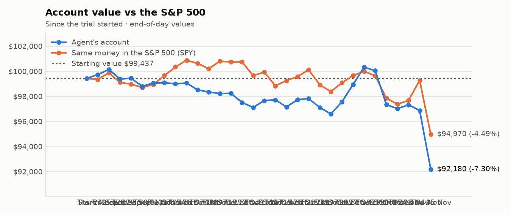
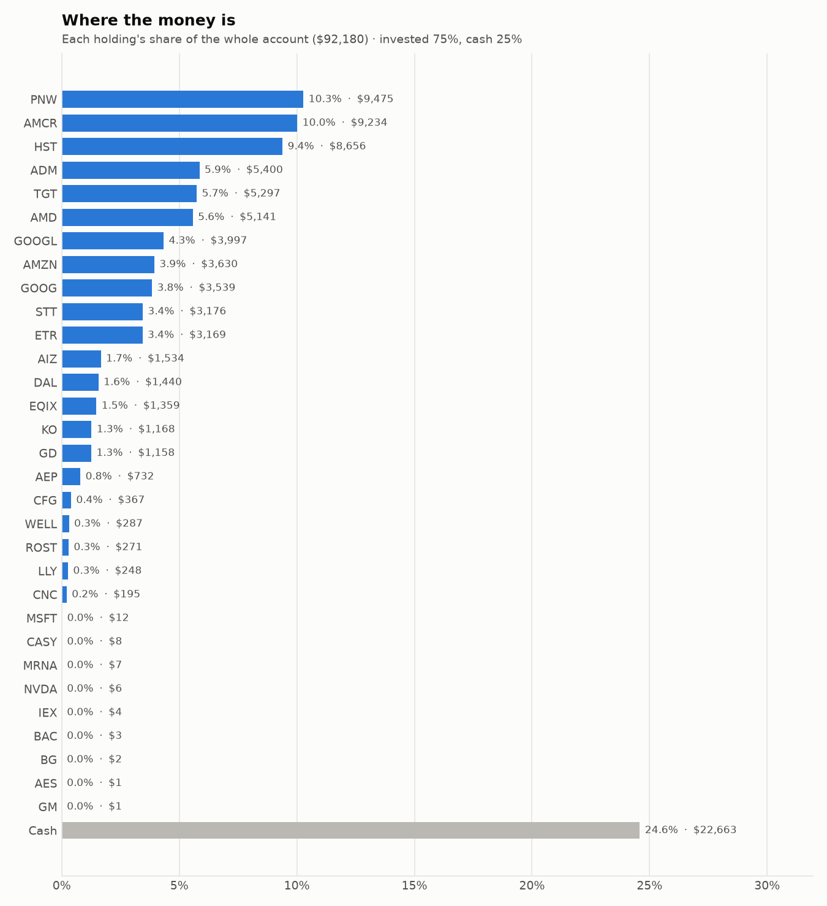
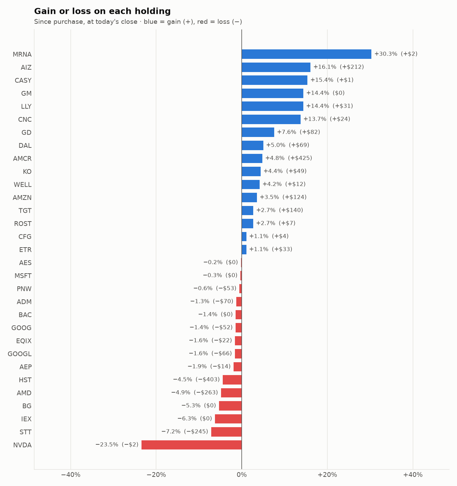

# Daily trading report — Thursday 05 November 2026

## Summary

- **Account value:** $92,180 (-$4,698, -4.8% today)
- **S&P 500 (SPY) today:** -4.3% — the agent was behind the index by 0.51%
- **Trades:** 6 buy(s) ($21,556), 9 sell(s) ($30,868)
- **2026-11-05 Morning rebalance:** traded — 11 order(s) placed
- **2026-11-05 Afternoon risk check:** traded — Sold 4 position(s) on the risk check (stop-loss: BE, FIX, MU, WDC)

## Charts

## Why I bought

### ADM — bought 76.628 shares at ~$71.39 ($5,470)

**Why:** combined score +0.87; ranked #8 of 503; driven mainly by price momentum +1.47, value (cheapness) +1.01; entering/adding to the top-ranked target portfolio; research detail: 23 recent headline(s), net positive tone (+22); analyst consensus +0.33/2 (1 strong buy, 4 buy, 9 hold, 1 sell, 0 strong sell)

**Research scores** (combined +0.87, ranked #8 in the S&P 500, sector: Consumer Staples):

| Factor | Score | Measures |
|---|---|---|
| Value | +1.01 | cheap vs. sector peers on P/E and P/B |
| Quality | -0.50 | profitability (ROE, margins) and balance-sheet strength |
| Momentum | +1.47 | 12-month price trend, excluding the last month |
| Low volatility | +0.30 | steadier price than sector peers |
| Research | +0.85 | recent news tone + analyst consensus |

**Company financials (Finnhub, trailing 12 months):** P/E 19.1, P/B 1.6, return on equity 7.7%, gross margin 6.9%, debt/equity 0.34

**Price trend (Alpaca):** 12-month return (excl. last month) +34.7%, last month -13.8%, volatility 28.6%/yr

**News (Finnhub): 23 headline(s) in the last 2 days, net tone +22.** Most influential:
- [ADM Raises 2026 Earnings Outlook as Q3 Profit Beats Forecasts Despite Revenue Miss](https://finnhub.io/api/news?id=d2c2b8b5a288cb448d6c00198c0e9d36c1e6dc9a8506b6dc53c8135b9a748652) — 03 Nov, Yahoo (tone +4)
- [ADM CEO Sees No Biofuel Margin Collapse, Expects Strength Into 2027](https://finnhub.io/api/news?id=424eb6c68843f3c1d1a3f4de8c0430e501673bf73ad85e3d5c3224b10cbf5fda) — 03 Nov, Benzinga (tone +3)
- [ADM Q3 Earnings Call Highlights Biofuels Strength and 2027 Outlook](https://finnhub.io/api/news?id=932ca30ee3152671d1130f6906709e9ff218ba0c895fcf7b372cb9d2aa49b8b5) — 04 Nov, Yahoo (tone +2)
- [Is Archer-Daniels-Midland (ADM) Undervalued Following Strong Q3 Earnings And Higher Guidance?](https://finnhub.io/api/news?id=689b05a7a24f8bde6b341312e92a83c7fa2c91e38e5c4bbfefd15ac5997022a2) — 04 Nov, Yahoo (tone +2)
- [Archer-Daniels-Midland Co (ADM) (Q3 2026) Earnings Call Highlights: Third EPS Guidance Raise ...](https://finnhub.io/api/news?id=768250a8c1634849bd984cd9a28f0a3306356db13a94fd1f1612fbd52fd66889) — 03 Nov, Yahoo (tone +2)

**Analysts (Finnhub, 2026-11-01):** 1 strong buy, 4 buy, 9 hold, 1 sell, 0 strong sell — consensus +0.33 on a -2 (strong sell) to +2 (strong buy) scale.

### AMD — bought 12.749 shares at ~$423.91 ($5,404)

**Why:** combined score +0.87; ranked #9 of 503; driven mainly by research (news + analyst consensus) +1.81, price momentum +1.57; entering/adding to the top-ranked target portfolio; research detail: 163 recent headline(s), net positive tone (+117); analyst consensus +1.12/2 (17 strong buy, 33 buy, 10 hold, 0 sell, 0 strong sell)

**Research scores** (combined +0.87, ranked #9 in the S&P 500, sector: Information Technology):

| Factor | Score | Measures |
|---|---|---|
| Value | -0.56 | cheap vs. sector peers on P/E and P/B |
| Quality | +0.06 | profitability (ROE, margins) and balance-sheet strength |
| Momentum | +1.57 | 12-month price trend, excluding the last month |
| Low volatility | -0.60 | steadier price than sector peers |
| Research | +1.81 | recent news tone + analyst consensus |

**Company financials (FMP, trailing 12 months):** P/E 92.6, P/B 10.3, return on equity 11.6%, gross margin 53.7%, debt/equity 0.13

**Price trend (Alpaca):** 12-month return (excl. last month) +294.5%, last month -24.8%, volatility 60.2%/yr

**News (Finnhub): 163 headline(s) in the last 2 days, net tone +117.** Most influential:
- [AMD Q3 Earnings Beat Estimates, Strong Data Center Aids Revenue Growth](https://finnhub.io/api/news?id=1a76559762b766f0cef60ab51211c85e318e863490833864434f83a7bc71e1a0) — 04 Nov, Yahoo (tone +4)
- [AMD: Expensive For A Reason](https://finnhub.io/api/news?id=ee87c106780cd533bb3ed40c5de18a5bf9b5b27d872c128f7ca8aa74aadda475) — 03 Nov, SeekingAlpha (tone +4)
- [Constellation Research CEO R ‘Ray’ Wang Talks Data Center Growth After AMD Reports Earnings](https://finnhub.io/api/news?id=8f8ed96ac3d3325e723fe3707c067e1cedaeed27fa49864e15f1f12b95b9bab1) — 04 Nov, Yahoo (tone +3)
- [AMD Shares Surge Nearly 8% as Q3 Earnings Beat Forecasts and Revenue Outlook Exceeds Expectations](https://finnhub.io/api/news?id=fb2c7d152fa5e3eff8b22620014db217b5a853c3ab5a1a4f486cdd704b622bf4) — 04 Nov, Yahoo (tone +3)
- [These Analysts Revise Their Forecasts On AMD After Q3 Results](https://finnhub.io/api/news?id=1f5f1c6d0e1965452e9511703b0ad67612ce6a4d6b27bfd6e4a164d0650d3a85) — 04 Nov, Benzinga (tone +3)

**Analysts (Finnhub, 2026-11-01):** 17 strong buy, 33 buy, 10 hold, 0 sell, 0 strong sell — consensus +1.12 on a -2 (strong sell) to +2 (strong buy) scale.

### GOOGL — bought 10.376 shares at ~$285.34 ($2,961)

**Why:** combined score +0.81; ranked #14 of 503; driven mainly by price momentum +1.67, research (news + analyst consensus) +1.36; entering/adding to the top-ranked target portfolio; research detail: 71 recent headline(s), net positive tone (+22); analyst consensus +1.19/2 (20 strong buy, 41 buy, 7 hold, 0 sell, 0 strong sell)

**Research scores** (combined +0.81, ranked #14 in the S&P 500, sector: Communication Services):

| Factor | Score | Measures |
|---|---|---|
| Value | -0.63 | cheap vs. sector peers on P/E and P/B |
| Quality | +0.09 | profitability (ROE, margins) and balance-sheet strength |
| Momentum | +1.67 | 12-month price trend, excluding the last month |
| Low volatility | +0.02 | steadier price than sector peers |
| Research | +1.36 | recent news tone + analyst consensus |

**Company financials (FMP, trailing 12 months):** P/E 14.8, P/B 5.2, return on equity 42.6%, gross margin 60.9%, debt/equity 0.21

**Price trend (Alpaca):** 12-month return (excl. last month) +41.7%, last month -16.9%, volatility 34.4%/yr

**News (Finnhub): 71 headline(s) in the last 2 days, net tone +22.** Most influential:
- [Zacks Earnings Trends Highlights: Nvidia, Micron and Alphabet](https://finnhub.io/api/news?id=aeb35773ee1f780102c295d93be35ca88096f02f5c9c0846c2a6727f33694c0f) — 05 Nov, Yahoo (tone +3)
- [Alphabet: Investors Are Making The Same Mistake They Did With Microsoft](https://finnhub.io/api/news?id=7f477922ce6519e3310ee63674016b06132eacb2488fab2aa699a2ee8fbf6449) — 05 Nov, SeekingAlpha (tone +2)
- [Alphabet: Cheapest Hyperscaler By A Margin](https://finnhub.io/api/news?id=997e6fa12cfbbb0893a7c3584b2626cc8407c7f24fd8d721fb79a9d8d9cfee8e) — 05 Nov, SeekingAlpha (tone +2)
- [Alphabet: Search Disruption Vs. The Rise Of Carbon](https://finnhub.io/api/news?id=b335a7867229acd254f9100bcca7fd75a62214c17d3ff83b9b88093c9daf0acf) — 05 Nov, SeekingAlpha (tone +2)
- [Alphabet Stock Jumps 5% as Midterm Election Rally Lifts Google Shares](https://finnhub.io/api/news?id=8f24e2e51ade9153e57fe62562186d0a851cf73e728d9e33bb6e70a68aba7d28) — 04 Nov, Yahoo (tone +2)

**Analysts (Finnhub, 2026-11-01):** 20 strong buy, 41 buy, 7 hold, 0 sell, 0 strong sell — consensus +1.19 on a -2 (strong sell) to +2 (strong buy) scale.

### GOOG — bought 10.088 shares at ~$283.69 ($2,862)

**Why:** combined score +0.79; ranked #15 of 503; driven mainly by price momentum +1.62, research (news + analyst consensus) +1.36; entering/adding to the top-ranked target portfolio; research detail: 73 recent headline(s), net positive tone (+22); analyst consensus +1.19/2 (20 strong buy, 41 buy, 7 hold, 0 sell, 0 strong sell)

**Research scores** (combined +0.79, ranked #15 in the S&P 500, sector: Communication Services):

| Factor | Score | Measures |
|---|---|---|
| Value | -0.68 | cheap vs. sector peers on P/E and P/B |
| Quality | +0.09 | profitability (ROE, margins) and balance-sheet strength |
| Momentum | +1.62 | 12-month price trend, excluding the last month |
| Low volatility | +0.10 | steadier price than sector peers |
| Research | +1.36 | recent news tone + analyst consensus |

**Company financials (Finnhub, trailing 12 months):** P/E 15.2, P/B 6.2, return on equity 42.6%, gross margin 60.9%, debt/equity 0.18

**Price trend (Alpaca):** 12-month return (excl. last month) +39.9%, last month -16.6%, volatility 33.1%/yr

**News (Finnhub): 73 headline(s) in the last 2 days, net tone +22.** Most influential:
- [Zacks Earnings Trends Highlights: Nvidia, Micron and Alphabet](https://finnhub.io/api/news?id=aeb35773ee1f780102c295d93be35ca88096f02f5c9c0846c2a6727f33694c0f) — 05 Nov, Yahoo (tone +3)
- [Alphabet: Investors Are Making The Same Mistake They Did With Microsoft](https://finnhub.io/api/news?id=7f477922ce6519e3310ee63674016b06132eacb2488fab2aa699a2ee8fbf6449) — 05 Nov, SeekingAlpha (tone +2)
- [Alphabet: Cheapest Hyperscaler By A Margin](https://finnhub.io/api/news?id=997e6fa12cfbbb0893a7c3584b2626cc8407c7f24fd8d721fb79a9d8d9cfee8e) — 05 Nov, SeekingAlpha (tone +2)
- [Alphabet: Search Disruption Vs. The Rise Of Carbon](https://finnhub.io/api/news?id=b335a7867229acd254f9100bcca7fd75a62214c17d3ff83b9b88093c9daf0acf) — 05 Nov, SeekingAlpha (tone +2)
- [Alphabet Stock Jumps 5% as Midterm Election Rally Lifts Google Shares](https://finnhub.io/api/news?id=8f24e2e51ade9153e57fe62562186d0a851cf73e728d9e33bb6e70a68aba7d28) — 04 Nov, Yahoo (tone +2)

**Analysts (Finnhub, 2026-11-01):** 20 strong buy, 41 buy, 7 hold, 0 sell, 0 strong sell — consensus +1.19 on a -2 (strong sell) to +2 (strong buy) scale.

### MU — bought 4.036 shares at ~$694.73 ($2,804)

**Why:** combined score +1.47; ranked #1 of 503; driven mainly by price momentum +2.71, low volatility -1.05; entering/adding to the top-ranked target portfolio; research detail: 64 recent headline(s), net positive tone (+33); analyst consensus +1.25/2 (18 strong buy, 35 buy, 4 hold, 0 sell, 0 strong sell)

**Research scores** (combined +1.47, ranked #1 in the S&P 500, sector: Information Technology):

| Factor | Score | Measures |
|---|---|---|
| Value | +0.95 | cheap vs. sector peers on P/E and P/B |
| Quality | +0.90 | profitability (ROE, margins) and balance-sheet strength |
| Momentum | +2.71 | 12-month price trend, excluding the last month |
| Low volatility | -1.05 | steadier price than sector peers |
| Research | +0.99 | recent news tone + analyst consensus |

**Company financials (Finnhub, trailing 12 months):** P/E 10.8, P/B 7.8, return on equity 91.8%, gross margin 80.7%, debt/equity 0.04

**Price trend (Alpaca):** 12-month return (excl. last month) +456.4%, last month -24.0%, volatility 57.1%/yr

**News (Finnhub): 64 headline(s) in the last 2 days, net tone +33.** Most influential:
- [Zacks Earnings Trends Highlights: Nvidia, Micron and Alphabet](https://finnhub.io/api/news?id=aeb35773ee1f780102c295d93be35ca88096f02f5c9c0846c2a6727f33694c0f) — 05 Nov, Yahoo (tone +3)
- [Bloom Energy (BE) Raises Full-Year Outlook Following 166% Revenue Surge](https://finnhub.io/api/news?id=25c3bdb40ede9007fdd269c5ba242cee3c1879325eb926871f0ed504e19b4a61) — 04 Nov, Yahoo (tone +3)
- [Micron Stock Jumps 36% in Six Months: Is There More Upside Ahead?](https://finnhub.io/api/news?id=1afb12c63ecb26d6672edd31db65b814fac3af22adaa685f63362ffdbc84fca1) — 04 Nov, Yahoo (tone +3)
- [Micron Just Closed Below $800 for the First Time Since July](https://finnhub.io/api/news?id=bcb67c8d45444d986579657c7844fdf3dda04fc64ac643a7de530472ac6c0fd6) — 05 Nov, Yahoo (tone +2)
- [Micron Stock Looks Cheap Despite 220% Rally. Is More Upside Coming?](https://finnhub.io/api/news?id=355222fca9e787f5959b64de1f252f8a98f4ded58dbebf9b9ff48f5091cf0bc3) — 05 Nov, Yahoo (tone +2)

**Analysts (Finnhub, 2026-11-01):** 18 strong buy, 35 buy, 4 hold, 0 sell, 0 strong sell — consensus +1.25 on a -2 (strong sell) to +2 (strong buy) scale.

### AMCR — bought 44.842 shares at ~$45.83 ($2,055)

**Why:** combined score +1.06; ranked #5 of 503; driven mainly by price momentum +3.00, quality (profitability/balance sheet) -0.47; entering/adding to the top-ranked target portfolio; research detail: 10 recent headline(s), net positive tone (+2); analyst consensus +0.95/2 (5 strong buy, 8 buy, 6 hold, 0 sell, 0 strong sell)

**Research scores** (combined +1.06, ranked #5 in the S&P 500, sector: Materials):

| Factor | Score | Measures |
|---|---|---|
| Value | +0.20 | cheap vs. sector peers on P/E and P/B |
| Quality | -0.47 | profitability (ROE, margins) and balance-sheet strength |
| Momentum | +3.00 | 12-month price trend, excluding the last month |
| Low volatility | +0.36 | steadier price than sector peers |
| Research | +0.10 | recent news tone + analyst consensus |

**Company financials (Finnhub, trailing 12 months):** P/E 19.6, P/B 1.7, return on equity 9.4%, gross margin 20.0%, debt/equity 1.19

**Price trend (Alpaca):** 12-month return (excl. last month) +411.2%, last month +16.1%, volatility 25.0%/yr

**News (Finnhub): 10 headline(s) in the last 2 days, net tone +2.** Most influential:
- [Amcor PLC (AMCCF) (Q1 2027) Earnings Call Highlights: Solid Volume Growth and Synergy Momentum ...](https://finnhub.io/api/news?id=0f23728e3614c5872c8053b20063bc88087dc2e8effe4086bbe5a37f0f613834) — 05 Nov, Yahoo (tone +1)
- [Amcor Q1 Earnings Call Highlights](https://finnhub.io/api/news?id=f56a4c1a3b615c9061f24b63c4c7d620b42c84fa2dee3fc12eb4df2e620550d6) — 05 Nov, Yahoo (tone +1)
- [Amcor (NYSE:AMCR) Posts Q1 Revenue Beat but EPS Miss, Shares Fall After Hours](https://finnhub.io/api/news?id=d473cf588c2158cf9dad88e393222abeafceb5757a2247f82643bfb862ba2a14) — 04 Nov, ChartMill (tone +1)
- [Amcor (AMCR) Q3 Earnings Miss Estimates](https://finnhub.io/api/news?id=4e6461578ed8f541c4a0672c68fe2aa81d822c40b4fdaee0e76b606829dda8ea) — 04 Nov, Yahoo (tone -1)
- [Amcor plc (AMCR) Q1 2027 Earnings Call Transcript](https://finnhub.io/api/news?id=f3852c7c842abf60a48f489f37edfc02aaab677d8c4a4f15182e5c0e879ecae2) — 04 Nov, SeekingAlpha (tone +0)

**Analysts (Finnhub, 2026-11-01):** 5 strong buy, 8 buy, 6 hold, 0 sell, 0 strong sell — consensus +0.95 on a -2 (strong sell) to +2 (strong buy) scale.

## Why I sold

### MU — sold 12.916 shares at ~$675.47 ($8,724)

**Why:** stop-loss: -19.5% below the average purchase price of $838.37 (limit -12%); sold the whole position and won't buy it back for 7 days

**What triggered it:** the afternoon risk check trims a holding only when BOTH its recent news turns clearly negative AND its price is down 3%+ since purchase (it was -19.5%).

**News (Finnhub): 77 headline(s) in the last 2 days, net tone +36.** Most influential:
- [Zacks Earnings Trends Highlights: Nvidia, Micron and Alphabet](https://finnhub.io/api/news?id=aeb35773ee1f780102c295d93be35ca88096f02f5c9c0846c2a6727f33694c0f) — 05 Nov, Yahoo (tone +3)
- [Bloom Energy (BE) Raises Full-Year Outlook Following 166% Revenue Surge](https://finnhub.io/api/news?id=25c3bdb40ede9007fdd269c5ba242cee3c1879325eb926871f0ed504e19b4a61) — 04 Nov, Yahoo (tone +3)
- [Micron Stock Jumps 36% in Six Months: Is There More Upside Ahead?](https://finnhub.io/api/news?id=1afb12c63ecb26d6672edd31db65b814fac3af22adaa685f63362ffdbc84fca1) — 04 Nov, Yahoo (tone +3)
- [Micron's Bold Memory Expansion Faces a Sudden Crisis](https://finnhub.io/api/news?id=3137ccebfc5710d5ccd3c35550caa3c2ee41cb6db132dd740d58819b71404c49) — 05 Nov, Yahoo (tone +2)
- [Micron: Is the Recent Selloff a Buying Opportunity?](https://finnhub.io/api/news?id=1eee49ee326eac1e2fbfa610986f6b4bc992abfac6f714fac8d300079f60d329) — 05 Nov, Yahoo (tone +2)

### FIX — sold 8.667 shares at ~$970.17 ($8,408)

**Why:** stop-loss: -14.6% below the average purchase price of $1,134.82 (limit -12%); sold the whole position and won't buy it back for 7 days

**What triggered it:** the afternoon risk check trims a holding only when BOTH its recent news turns clearly negative AND its price is down 3%+ since purchase (it was -14.6%).

**News (Finnhub): 12 headline(s) in the last 2 days, net tone +11.** Most influential:
- [Earnings Beat Could Strengthen The Case For Comfort Systems USA Stock](https://finnhub.io/api/news?id=bb65112c0898b654e725d38535248b10add1cf4d9041a5e4352e5c1e85dd4e5c) — 05 Nov, Yahoo (tone +3)
- [Should Comfort Systems USA (FIX) Investors Worry About AI Data Center Policy Risk?](https://finnhub.io/api/news?id=f37f39681ad6a3b55c51316ccb875aaf81ed1412b4182b77300693382404660b) — 05 Nov, Yahoo (tone +2)
- [Buy 3 AI-Led Construction Stocks Looks More Promising on Q3 Earnings](https://finnhub.io/api/news?id=cdacf0c190cea3b8fc46b9e8d7d4b4543e76e70750cbbca432c0e0565765586e) — 04 Nov, Yahoo (tone +2)
- [Is a 90% Backlog Jump Enough to Lift Comfort Systems' 2027 Growth?](https://finnhub.io/api/news?id=a2d64fecc13c10c42be83a50f605205a0e023a19b2f9c2ea0c1fa223ea6e481b) — 03 Nov, Yahoo (tone +2)
- [Oklo Sinks 6%, Comfort Systems USA Down 15% as Democratic Sweep Rattles AI Power Stocks: “A Negative Surprise”](https://finnhub.io/api/news?id=1a750f25b74107721ea4b3987788a0dad5dbb4f150b62cba7d780ff4239fe85e) — 04 Nov, Yahoo (tone +1)

### BG — sold 33.305 shares at ~$98.03 ($3,265)

**Why:** combined score +0.64; ranked #33 of 503; driven mainly by value (cheapness) +1.29, price momentum +1.17; trimmed toward target weight, or dropped out of the top-ranked names; research detail: analyst consensus +1.15/2 (5 strong buy, 13 buy, 2 hold, 0 sell, 0 strong sell)

**Research scores** (combined +0.64, ranked #33 in the S&P 500, sector: Consumer Staples):

| Factor | Score | Measures |
|---|---|---|
| Value | +1.29 | cheap vs. sector peers on P/E and P/B |
| Quality | -0.54 | profitability (ROE, margins) and balance-sheet strength |
| Momentum | +1.17 | 12-month price trend, excluding the last month |
| Low volatility | -0.29 | steadier price than sector peers |
| Research | +0.28 | recent news tone + analyst consensus |

**Company financials (Finnhub, trailing 12 months):** P/E 18.6, P/B 1.3, return on equity 6.3%, gross margin 4.9%, debt/equity 0.96

**Price trend (Alpaca):** 12-month return (excl. last month) +27.8%, last month -9.5%, volatility 30.9%/yr

**News (Finnhub):** no headlines in the last 2 days.

**Analysts (Finnhub, 2026-11-01):** 5 strong buy, 13 buy, 2 hold, 0 sell, 0 strong sell — consensus +1.15 on a -2 (strong sell) to +2 (strong buy) scale.

### DAL — sold 34.442 shares at ~$86.21 ($2,969)

**Why:** combined score +0.70; ranked #22 of 503; driven mainly by value (cheapness) +1.44, price momentum +0.98; trimmed toward target weight, or dropped out of the top-ranked names; research detail: 3 recent headline(s), net positive tone (+1); analyst consensus +1.13/2 (7 strong buy, 20 buy, 3 hold, 0 sell, 0 strong sell)

**Research scores** (combined +0.70, ranked #22 in the S&P 500, sector: Industrials):

| Factor | Score | Measures |
|---|---|---|
| Value | +1.44 | cheap vs. sector peers on P/E and P/B |
| Quality | +0.14 | profitability (ROE, margins) and balance-sheet strength |
| Momentum | +0.98 | 12-month price trend, excluding the last month |
| Low volatility | -0.46 | steadier price than sector peers |
| Research | +0.29 | recent news tone + analyst consensus |

**Company financials (Finnhub, trailing 12 months):** P/E 16.7, P/B 2.4, return on equity 15.4%, gross margin 45.9%, debt/equity 0.57

**Price trend (Alpaca):** 12-month return (excl. last month) +46.1%, last month +6.7%, volatility 34.0%/yr

**News (Finnhub): 3 headline(s) in the last 2 days, net tone +1.** Most influential:
- [Delta Air Lines Stock: Analyst Estimates & Ratings](https://finnhub.io/api/news?id=f763db6b934d73b91ea2aad07380b0bf856442c722eb2de3bb2e16309dd25e0d) — 03 Nov, Yahoo (tone +1)
- [Delta Air Lines Is Worth Buying Despite Near-Term Pressure](https://finnhub.io/api/news?id=79cac06cbf05b5acee74bfbccdb0e96ecf476b82e8fcbd3b858149b8354105a7) — 05 Nov, SeekingAlpha (tone +0)
- [Wall Street Analysts Think Delta (DAL) Is a Good Investment: Is It?](https://finnhub.io/api/news?id=8807c28a215cfabf18d679fa4c2a44f74149ac14595392eede617dec473b55d5) — 04 Nov, Yahoo (tone +0)

**Analysts (Finnhub, 2026-11-01):** 7 strong buy, 20 buy, 3 hold, 0 sell, 0 strong sell — consensus +1.13 on a -2 (strong sell) to +2 (strong buy) scale.

### ETR — sold 18.52 shares at ~$112.52 ($2,084)

**Why:** combined score +0.77; ranked #17 of 503; driven mainly by price momentum +1.57, research (news + analyst consensus) +1.20; trimmed toward target weight, or dropped out of the top-ranked names; research detail: 9 recent headline(s), net positive tone (+8); analyst consensus +1.00/2 (7 strong buy, 15 buy, 7 hold, 0 sell, 0 strong sell)

**Research scores** (combined +0.77, ranked #17 in the S&P 500, sector: Utilities):

| Factor | Score | Measures |
|---|---|---|
| Value | -0.44 | cheap vs. sector peers on P/E and P/B |
| Quality | +0.07 | profitability (ROE, margins) and balance-sheet strength |
| Momentum | +1.57 | 12-month price trend, excluding the last month |
| Low volatility | +0.02 | steadier price than sector peers |
| Research | +1.20 | recent news tone + analyst consensus |

**Company financials (Finnhub, trailing 12 months):** P/E 25.2, P/B 2.4, return on equity 11.2%, gross margin 42.0%, debt/equity 1.73

**Price trend (Alpaca):** 12-month return (excl. last month) +8.2%, last month +8.4%, volatility 17.1%/yr

**News (Finnhub): 9 headline(s) in the last 2 days, net tone +8.** Most influential:
- [Entergy Corp (ETR) Q3 2026 Earnings Call Highlights: Strong EPS, Google Expansion, and a ...](https://finnhub.io/api/news?id=41c1ccd0bdaf62a5fe272e30856c30b6bed30411fe53a5ec17d3afef131d9d66) — 03 Nov, Yahoo (tone +3)
- [Entergy: Meta's Hyperion Expansion Is The Next Test](https://finnhub.io/api/news?id=d8d908b65922c0bc5840d1320032f45a47fcd8882d656e5e518d836712bf4a54) — 04 Nov, SeekingAlpha (tone +1)
- [Zacks.com featured highlights include Entergy, Evergy, Diageo and Lamb Weston](https://finnhub.io/api/news?id=b7b9c0979b12266b566f3042d3cc9548dca1b22730bd94b1fcb74d5de1130ea7) — 04 Nov, Yahoo (tone +1)
- [4 Companies Just Raised Their Dividends. Which Payout Has the Most Room to Grow?](https://finnhub.io/api/news?id=6b17b8c2c393516f89fabe60fdeb56627bb05bba06aeb0bf47333a8a014abf47) — 03 Nov, Yahoo (tone +1)
- [Buy These 4 Low-Beta Defensive Stocks to Dodge Ongoing Market Volatility](https://finnhub.io/api/news?id=f3f10838ab8b8255f341469bd8f3e57536a742c1e7de782df32ced2e228ed270) — 03 Nov, Yahoo (tone +1)

**Analysts (Finnhub, 2026-11-01):** 7 strong buy, 15 buy, 7 hold, 0 sell, 0 strong sell — consensus +1.00 on a -2 (strong sell) to +2 (strong buy) scale.

### BE — sold 11.906 shares at ~$169.33 ($2,016)

**Why:** stop-loss: -17.3% below the average purchase price of $204.06 (limit -12%); sold the whole position and won't buy it back for 7 days

**What triggered it:** the afternoon risk check trims a holding only when BOTH its recent news turns clearly negative AND its price is down 3%+ since purchase (it was -17.3%).

**News (Finnhub): 35 headline(s) in the last 2 days, net tone +14.** Most influential:
- [Bloom Energy (BE) Raises Full-Year Outlook Following 166% Revenue Surge](https://finnhub.io/api/news?id=25c3bdb40ede9007fdd269c5ba242cee3c1879325eb926871f0ed504e19b4a61) — 04 Nov, Yahoo (tone +3)
- [AMD Sinks 13%, Bloom Energy Down 18% as Midterm “Seismic Shift” Deepens Chip Sell-Off](https://finnhub.io/api/news?id=120756e12002d492630689c0b247c6f5d1aaac8f85b0502a2e3f0cacee4ba0fe) — 05 Nov, Yahoo (tone +2)
- [Bloom Energy Is Up 146% in 2026: Take Profits, or Buy More?](https://finnhub.io/api/news?id=0becaaf23fda4498ed00d5178c2a0d6e777f0da5a3976cf589dea0e374a243f6) — 03 Nov, Yahoo (tone +2)
- [Barclays raises Bloom Energy to Overweight on stronger-than-expected demand](https://finnhub.io/api/news?id=d7460cfafba67273dd5c0e5c367cdfc967af004611342a91c214fca30f0ab243) — 03 Nov, Yahoo (tone +2)
- [California Resources Stock Earnings Beat Meets Bloom Energy Partnership](https://finnhub.io/api/news?id=08976a04da4cfd2ffcea44c589d75a371408bcbad9766eaa16748ddd8cd948b3) — 03 Nov, Yahoo (tone +2)

### TGT — sold 11.489 shares at ~$162.92 ($1,872)

**Why:** combined score +0.87; ranked #7 of 503; driven mainly by price momentum +2.64, value (cheapness) +0.34; trimmed toward target weight, or dropped out of the top-ranked names; research detail: 16 recent headline(s), net positive tone (+3); analyst consensus +0.47/2 (7 strong buy, 9 buy, 24 hold, 3 sell, 0 strong sell)

**Research scores** (combined +0.87, ranked #7 in the S&P 500, sector: Consumer Staples):

| Factor | Score | Measures |
|---|---|---|
| Value | +0.34 | cheap vs. sector peers on P/E and P/B |
| Quality | -0.13 | profitability (ROE, margins) and balance-sheet strength |
| Momentum | +2.64 | 12-month price trend, excluding the last month |
| Low volatility | -0.33 | steadier price than sector peers |
| Research | -0.33 | recent news tone + analyst consensus |

**Company financials (FMP, trailing 12 months):** P/E 16.8, P/B 4.2, return on equity 26.7%, gross margin 29.3%, debt/equity 1.05

**Price trend (Alpaca):** 12-month return (excl. last month) +73.4%, last month +5.6%, volatility 31.6%/yr

**News (Finnhub): 16 headline(s) in the last 2 days, net tone +3.** Most influential:
- [Target Yields Nearly 4 Times Walmart. Which Dividend Is Better for Retirement?](https://finnhub.io/api/news?id=fd568219dd76f94a65f59ce3093cb9a42ea4b418c92ac11082769aa0c7310ce6) — 04 Nov, Yahoo (tone +2)
- [Target raises price of annual grocery offer for holiday shoppers](https://finnhub.io/api/news?id=b999ac31bf288ce6a3bb79469e2ad17418ebb715bab631a88e1c184dcab257ff) — 03 Nov, Yahoo (tone +1)
- [Target May Take Cautious Fourth-Quarter View Amid Slowing Sales Trends, Truist Says](https://finnhub.io/api/news?id=71345cdb5a49b72c1a228c91985a758973b97d6a17f3991edcb2083a05975e7c) — 05 Nov, Yahoo (tone +0)
- [Target Looks More Attractive Than You'd Think](https://finnhub.io/api/news?id=356e42869b8e4a5ea40324e44abbab9b39b730b4313d078fee59fe67d291427b) — 05 Nov, SeekingAlpha (tone +0)
- [Target (TGT) Is Up 1.06% in One Week: What You Should Know](https://finnhub.io/api/news?id=ae95ce3b8dae7590ba6cd647ce5d4acdce166eee259a38a947dea568c1d62527) — 04 Nov, Yahoo (tone +0)

**Analysts (Finnhub, 2026-11-01):** 7 strong buy, 9 buy, 24 hold, 3 sell, 0 strong sell — consensus +0.47 on a -2 (strong sell) to +2 (strong buy) scale.

### PNC — sold 6 shares at ~$235.97 ($1,416)

**Why:** combined score +0.26; ranked #116 of 503; driven mainly by low volatility +1.23, price momentum +0.50; trimmed toward target weight, or dropped out of the top-ranked names; research detail: 1 recent headline(s), neutral/mixed tone; analyst consensus +0.96/2 (8 strong buy, 11 buy, 9 hold, 0 sell, 0 strong sell)

**Research scores** (combined +0.26, ranked #116 in the S&P 500, sector: Financials):

| Factor | Score | Measures |
|---|---|---|
| Value | +0.00 | cheap vs. sector peers on P/E and P/B |
| Quality | +0.00 | profitability (ROE, margins) and balance-sheet strength |
| Momentum | +0.50 | 12-month price trend, excluding the last month |
| Low volatility | +1.23 | steadier price than sector peers |
| Research | +0.08 | recent news tone + analyst consensus |

**Price trend (Alpaca):** 12-month return (excl. last month) +10.9%, last month +6.0%, volatility 18.7%/yr

**News (Finnhub): 1 headline(s) in the last 2 days, net tone +0.** Most influential:
- [Quality value is reasserting itself again, says PNC’s Amanda Agati](https://finnhub.io/api/news?id=11c12c1f3951609bdee31302ad92208f6d18a99e23adbde1c07955437bee09a9) — 03 Nov, CNBC (tone +0)

**Analysts (Finnhub, 2026-11-01):** 8 strong buy, 11 buy, 9 hold, 0 sell, 0 strong sell — consensus +0.96 on a -2 (strong sell) to +2 (strong buy) scale.

### WDC — sold 0.411 shares at ~$275.84 ($113)

**Why:** stop-loss: -22.5% below the average purchase price of $355.69 (limit -12%); sold the whole position and won't buy it back for 7 days

**What triggered it:** the afternoon risk check trims a holding only when BOTH its recent news turns clearly negative AND its price is down 3%+ since purchase (it was -22.5%).

**News (Finnhub): 17 headline(s) in the last 2 days, net tone +14.** Most influential:
- [Western Digital's Q1 Beat and Q2 Outlook Signal More Margin Upside](https://finnhub.io/api/news?id=6f5981288ab2b4ef987ea75764d5189b86eae8969d04f3112dd127435b630154) — 04 Nov, Yahoo (tone +3)
- [Is WDC a Buy as Earnings Surge but Valuation and Execution Risks Rise?](https://finnhub.io/api/news?id=5e791a28db932a5908a9bfaa7a52317180627e688e4ba69c9c52e2abd7fdf6bd) — 04 Nov, Yahoo (tone +3)
- [Western Digital's Gross Margin Momentum: How Long Can It Last?](https://finnhub.io/api/news?id=4577bcd0511d94123c4098a004228e7dcb16882e09849dd63ecd71dbe279c7cd) — 05 Nov, Yahoo (tone +2)
- [SanDisk Retreats 9%, Micron and Western Digital Fall 7% as Election and Memory Price Worries Weigh](https://finnhub.io/api/news?id=0798db871582f2b87c2531f4b4349325a01b67a27d87a262d9d0c83d6a464f70) — 04 Nov, Yahoo (tone +2)
- [SanDisk Slides 7%, Micron and Western Digital Fall 5% as Lawmaker’s Call for AI Pause Extends Memory Rout](https://finnhub.io/api/news?id=6ba02d89d6087546c241239d253c29ba5b1ba34f9b01be649d3a12fea94b0d6f) — 05 Nov, Yahoo (tone +1)

## Holdings at the close

| Stock | Shares | Avg cost | Price | Market value | % of account | Today | Gain/loss $ | Gain/loss % |
|---|---:|---:|---:|---:|---:|---:|---:|---:|
| PNW | 91.258 | $104.41 | $103.83 | $9,475 | 10.3% | -1.65% | −$53 | -0.56% |
| AMCR | 201.441 | $43.73 | $45.84 | $9,234 | 10.0% | -5.48% | +$425 | +4.83% |
| HST | 351.456 | $25.78 | $24.63 | $8,656 | 9.4% | -5.67% | −$403 | -4.45% |
| ADM | 76.628 | $71.39 | $70.47 | $5,400 | 5.9% | -0.52% | −$70 | -1.29% |
| TGT | 33.506 | $153.91 | $158.09 | $5,297 | 5.7% | -3.07% | +$140 | +2.72% |
| AMD | 12.749 | $423.91 | $403.25 | $5,141 | 5.6% | -17.50% | −$263 | -4.87% |
| GOOGL | 14.236 | $285.38 | $280.77 | $3,997 | 4.3% | -2.82% | −$66 | -1.62% |
| AMZN | 14.056 | $249.42 | $258.25 | $3,630 | 3.9% | -2.92% | +$124 | +3.54% |
| GOOG | 12.659 | $283.65 | $279.56 | $3,539 | 3.8% | -2.69% | −$52 | -1.44% |
| STT | 19.22 | $177.99 | $165.23 | $3,176 | 3.4% | -4.72% | −$245 | -7.17% |
| ETR | 28.727 | $109.14 | $110.30 | $3,169 | 3.4% | -1.43% | +$33 | +1.06% |
| AIZ | 5 | $264.38 | $306.87 | $1,534 | 1.7% | -0.53% | +$212 | +16.07% |
| DAL | 16.943 | $80.92 | $84.99 | $1,440 | 1.6% | -4.76% | +$69 | +5.03% |
| EQIX | 1.363 | $1,013.54 | $997.35 | $1,359 | 1.5% | -5.38% | −$22 | -1.60% |
| KO | 12.203 | $91.67 | $95.71 | $1,168 | 1.3% | -0.09% | +$49 | +4.40% |
| GD | 3.251 | $331.27 | $356.35 | $1,158 | 1.3% | -2.34% | +$82 | +7.57% |
| AEP | 5.798 | $128.70 | $126.25 | $732 | 0.8% | -2.31% | −$14 | -1.90% |
| CFG | 5.744 | $63.15 | $63.83 | $367 | 0.4% | -3.14% | +$4 | +1.08% |
| WELL | 1.171 | $235.52 | $245.36 | $287 | 0.3% | -1.06% | +$12 | +4.18% |
| ROST | 1.153 | $229.11 | $235.23 | $271 | 0.3% | -4.28% | +$7 | +2.67% |
| LLY | 0.182 | $1,189.78 | $1,361.00 | $248 | 0.3% | -4.02% | +$31 | +14.39% |
| CNC | 2.63 | $65.21 | $74.17 | $195 | 0.2% | -2.42% | +$24 | +13.74% |
| MSFT | 0.023 | $533.80 | $532.14 | $12 | 0.0% | -4.26% | −$0 | -0.31% |
| CASY | 0.011 | $597.62 | $689.53 | $8 | 0.0% | +2.18% | +$1 | +15.38% |
| MRNA | 0.028 | $181.06 | $235.99 | $7 | 0.0% | -8.67% | +$2 | +30.34% |
| NVDA | 0.032 | $236.88 | $181.31 | $6 | 0.0% | -9.40% | −$2 | -23.46% |
| IEX | 0.018 | $237.47 | $222.60 | $4 | 0.0% | -4.75% | −$0 | -6.26% |
| BAC | 0.054 | $50.53 | $49.82 | $3 | 0.0% | -3.51% | −$0 | -1.41% |
| BG | 0.019 | $104.09 | $98.54 | $2 | 0.0% | +1.58% | −$0 | -5.33% |
| AES | 0.096 | $14.92 | $14.89 | $1 | 0.0% | -0.07% | −$0 | -0.20% |
| GM | 0.015 | $78.08 | $89.33 | $1 | 0.0% | -3.35% | +$0 | +14.41% |
| **Invested** | | | | **$69,518** | **75.4%** | | **+$24** | |
| **Cash** | | | | $22,663 | 24.6% | | | |
| **Total account** | | | | **$92,180** | 100% | | | |

_Scores are sector-neutral z-scores: 0 is average for the stock's sector, +1 is one standard deviation better. News tone is a keyword count over recent headlines, not a deep read. None of this guarantees a stock will rise; a few days of results can't show whether the strategy has a real edge over the S&P 500._
