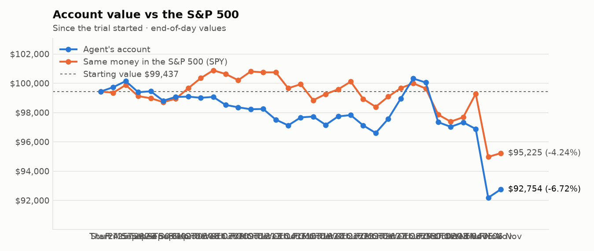
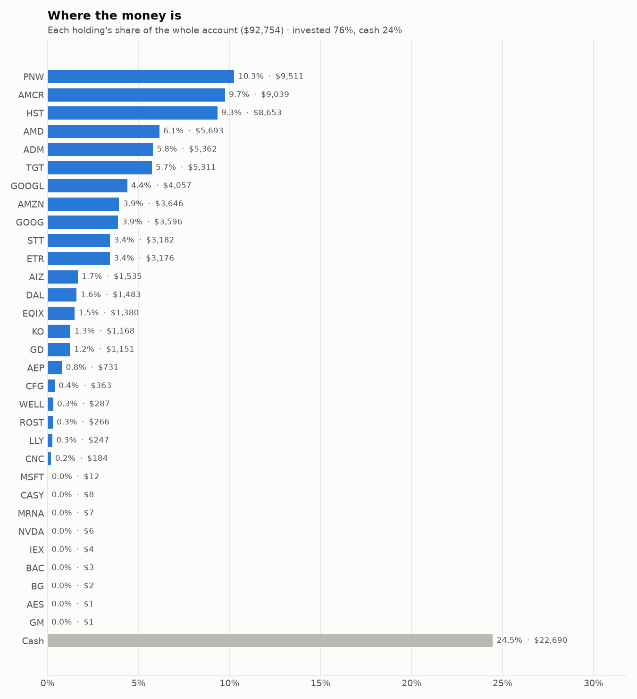
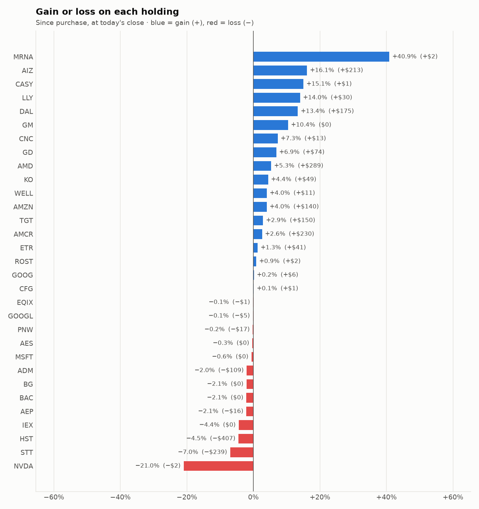

# Daily trading report — Friday 06 November 2026

## Summary

- **Account value:** $92,754 (+$574, +0.6% today)
- **S&P 500 (SPY) today:** +0.3% — the agent was ahead of the index by 0.35%
- **Trades:** 0 buy(s) ($0), 0 sell(s) ($0)
- **2026-11-06 Morning rebalance:** HALTED — Safety check stopped the session: drawdown_halt: drawdown -8.6% exceeds halt threshold
- **2026-11-06 Afternoon risk check:** HALTED — Safety check stopped the session: drawdown_halt: drawdown -8.6% exceeds halt threshold

## Charts

## Why I bought

No stocks were bought.

## Why I sold

No stocks were sold.

## Holdings at the close

| Stock | Shares | Avg cost | Price | Market value | % of account | Today | Gain/loss $ | Gain/loss % |
|---|---:|---:|---:|---:|---:|---:|---:|---:|
| PNW | 91.258 | $104.41 | $104.22 | $9,511 | 10.3% | +0.38% | −$17 | -0.18% |
| AMCR | 201.441 | $43.73 | $44.87 | $9,039 | 9.7% | -2.12% | +$230 | +2.61% |
| HST | 351.456 | $25.78 | $24.62 | $8,653 | 9.3% | -0.04% | −$407 | -4.49% |
| AMD | 12.749 | $423.91 | $446.55 | $5,693 | 6.1% | +10.42% | +$289 | +5.34% |
| ADM | 76.628 | $71.39 | $69.97 | $5,362 | 5.8% | -0.71% | −$109 | -1.99% |
| TGT | 33.506 | $154.01 | $158.50 | $5,311 | 5.7% | +0.35% | +$150 | +2.91% |
| GOOGL | 14.236 | $285.38 | $285.00 | $4,057 | 4.4% | +0.86% | −$5 | -0.13% |
| AMZN | 14.056 | $249.42 | $259.40 | $3,646 | 3.9% | -0.31% | +$140 | +4.00% |
| GOOG | 12.659 | $283.65 | $284.09 | $3,596 | 3.9% | +0.83% | +$6 | +0.16% |
| STT | 19.22 | $177.99 | $165.56 | $3,182 | 3.4% | +0.20% | −$239 | -6.98% |
| ETR | 28.727 | $109.14 | $110.55 | $3,176 | 3.4% | +0.23% | +$41 | +1.29% |
| AIZ | 5 | $264.38 | $307.00 | $1,535 | 1.7% | +0.04% | +$213 | +16.12% |
| DAL | 16.943 | $77.18 | $87.50 | $1,483 | 1.6% | +2.51% | +$175 | +13.37% |
| EQIX | 1.363 | $1,013.54 | $1,012.71 | $1,380 | 1.5% | +1.54% | −$1 | -0.08% |
| KO | 12.203 | $91.67 | $95.72 | $1,168 | 1.3% | -0.01% | +$49 | +4.42% |
| GD | 3.251 | $331.27 | $354.06 | $1,151 | 1.2% | -0.64% | +$74 | +6.88% |
| AEP | 5.798 | $128.70 | $126.00 | $731 | 0.8% | -0.61% | −$16 | -2.10% |
| CFG | 5.744 | $63.15 | $63.24 | $363 | 0.4% | -0.92% | +$1 | +0.14% |
| WELL | 1.171 | $235.52 | $245.01 | $287 | 0.3% | -0.17% | +$11 | +4.03% |
| ROST | 1.153 | $229.11 | $231.09 | $266 | 0.3% | -1.76% | +$2 | +0.86% |
| LLY | 0.182 | $1,189.78 | $1,356.76 | $247 | 0.3% | -0.58% | +$30 | +14.03% |
| CNC | 2.63 | $65.21 | $69.99 | $184 | 0.2% | -5.64% | +$13 | +7.33% |
| MSFT | 0.023 | $533.80 | $530.69 | $12 | 0.0% | -0.98% | −$0 | -0.58% |
| CASY | 0.011 | $597.62 | $687.64 | $8 | 0.0% | -0.27% | +$1 | +15.06% |
| MRNA | 0.028 | $181.06 | $255.10 | $7 | 0.0% | +5.65% | +$2 | +40.89% |
| NVDA | 0.032 | $236.88 | $187.20 | $6 | 0.0% | +3.08% | −$2 | -20.97% |
| IEX | 0.018 | $237.47 | $226.99 | $4 | 0.0% | +1.97% | −$0 | -4.41% |
| BAC | 0.054 | $50.53 | $49.47 | $3 | 0.0% | -0.58% | −$0 | -2.10% |
| BG | 0.019 | $101.20 | $99.10 | $2 | 0.0% | +0.57% | −$0 | -2.08% |
| AES | 0.096 | $14.92 | $14.87 | $1 | 0.0% | -0.13% | −$0 | -0.34% |
| GM | 0.015 | $78.08 | $86.22 | $1 | 0.0% | -3.48% | +$0 | +10.43% |
| **Invested** | | | | **$70,065** | **75.5%** | | **+$631** | |
| **Cash** | | | | $22,690 | 24.5% | | | |
| **Total account** | | | | **$92,754** | 100% | | | |

_Scores are sector-neutral z-scores: 0 is average for the stock's sector, +1 is one standard deviation better. News tone is a keyword count over recent headlines, not a deep read. None of this guarantees a stock will rise; a few days of results can't show whether the strategy has a real edge over the S&P 500._
