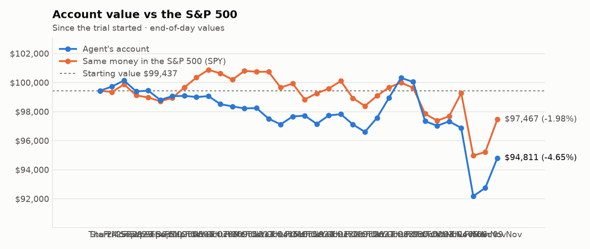
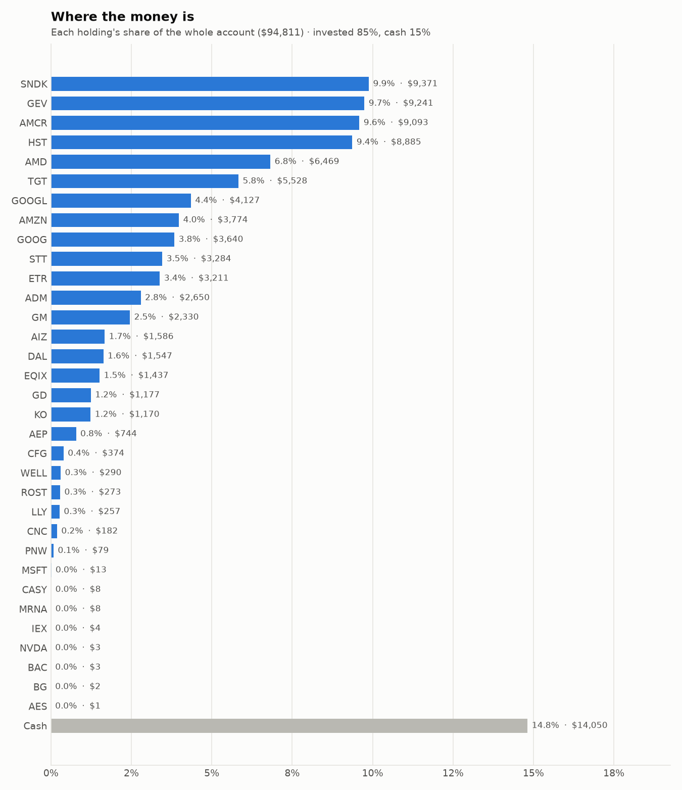
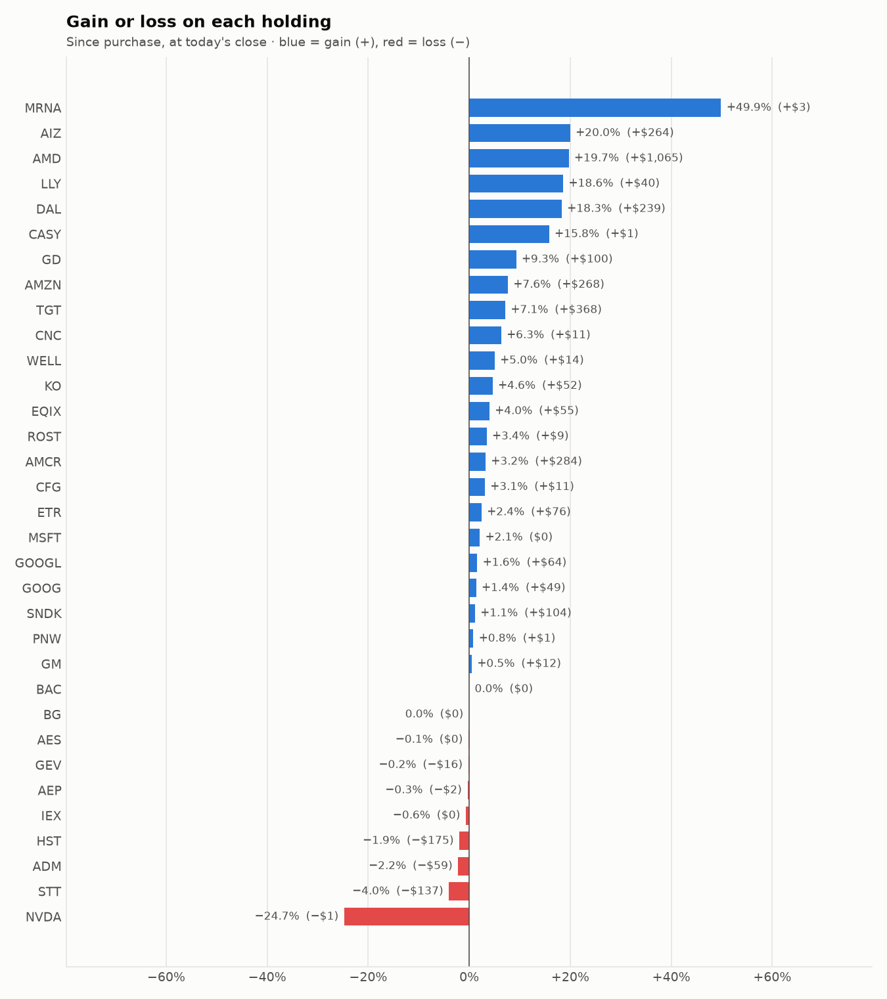

# Daily trading report — Monday 09 November 2026

## Summary

- **Account value:** $94,811 (+$2,057, +2.2% today)
- **S&P 500 (SPY) today:** +2.4% — the agent was behind the index by 0.14%
- **Trades:** 3 buy(s) ($20,842), 3 sell(s) ($12,202)
- **2026-11-09 Morning rebalance:** traded — 5 order(s) placed
- **2026-11-09 Afternoon risk check:** traded — Sold 1 position(s) on the risk check

## Charts

## Why I bought

### SNDK — bought 10.565 shares at ~$877.18 ($9,267)

**Why:** combined score +1.88; ranked #1 of 503; driven mainly by price momentum +3.00, research (news + analyst consensus) +1.92; entering/adding to the top-ranked target portfolio; research detail: 13 recent headline(s), net positive tone (+12); analyst consensus +1.20/2 (12 strong buy, 18 buy, 5 hold, 0 sell, 0 strong sell)

**Research scores** (combined +1.88, ranked #1 in the S&P 500, sector: Information Technology):

| Factor | Score | Measures |
|---|---|---|
| Value | +1.26 | cheap vs. sector peers on P/E and P/B |
| Quality | +1.10 | profitability (ROE, margins) and balance-sheet strength |
| Momentum | +3.00 | 12-month price trend, excluding the last month |
| Low volatility | -1.37 | steadier price than sector peers |
| Research | +1.92 | recent news tone + analyst consensus |

**Company financials (Finnhub, trailing 12 months):** P/E 6.1, P/B 13.8, return on equity 134.3%, gross margin 80.0%, debt/equity 0.00

**Price trend (Alpaca):** 12-month return (excl. last month) +1231.2%, last month -48.1%, volatility 90.5%/yr

**News (Finnhub): 13 headline(s) in the last 2 days, net tone +12.** Most influential:
- [Sandisk: This Is Not Over (Rating Upgrade)](https://finnhub.io/api/news?id=aed3f95630e83ed67502bef87a401e474c6b8023147957f41313c07226d8a1a0) — 09 Nov, SeekingAlpha (tone +3)
- [Sandisk: Generational Buying Opportunity - Bullish AI Tailwinds Through 2030](https://finnhub.io/api/news?id=9a4d068974fac512b1c9b57f3b8e927182691a1feea4a5c60b03d5a5a06c5ad9) — 07 Nov, SeekingAlpha (tone +3)
- [Sandisk Shares Are Oversold: Bargain or Value Trap?](https://finnhub.io/api/news?id=d47b15e5bfe65d7edb06886c162c5ea99bf0687d3e70a585c40e17d717c84897) — 07 Nov, Yahoo (tone +2)
- [Zacks Value Investor Highlights: MU, SNDK, SANM, STRL and FIX](https://finnhub.io/api/news?id=f6a005f98c65c87b27ae29e256541be5d44a838d4d095967c85b951ba727e561) — 09 Nov, Yahoo (tone +1)
- [Dow Jones Futures Loom With Market Damaged, Big Winners Broken; Apple, Amazon, Microsoft Strong](https://finnhub.io/api/news?id=1975ae0423862c182127b64aac2632039a64f7506c285b0d590ba5393378ea97) — 08 Nov, Yahoo (tone +1)

**Analysts (Finnhub, 2026-11-01):** 12 strong buy, 18 buy, 5 hold, 0 sell, 0 strong sell — consensus +1.20 on a -2 (strong sell) to +2 (strong buy) scale.

### GEV — bought 11.165 shares at ~$829.15 ($9,257)

**Why:** combined score +1.02; ranked #4 of 503; driven mainly by research (news + analyst consensus) +1.94, price momentum +1.64; entering/adding to the top-ranked target portfolio; research detail: 9 recent headline(s), net positive tone (+5); analyst consensus +1.07/2 (11 strong buy, 24 buy, 6 hold, 1 sell, 0 strong sell)

**Research scores** (combined +1.02, ranked #4 in the S&P 500, sector: Industrials):

| Factor | Score | Measures |
|---|---|---|
| Value | -0.12 | cheap vs. sector peers on P/E and P/B |
| Quality | +0.35 | profitability (ROE, margins) and balance-sheet strength |
| Momentum | +1.64 | 12-month price trend, excluding the last month |
| Low volatility | -1.36 | steadier price than sector peers |
| Research | +1.94 | recent news tone + analyst consensus |

**Company financials (Finnhub, trailing 12 months):** P/E 19.8, P/B 22.2, return on equity 85.6%, gross margin 21.8%, debt/equity 0.25

**Price trend (Alpaca):** 12-month return (excl. last month) +64.7%, last month -22.5%, volatility 54.8%/yr

**News (Finnhub): 9 headline(s) in the last 2 days, net tone +5.** Most influential:
- [Is GE Vernova (GEV) Trading At A Premium After Its $9b Deal?](https://finnhub.io/api/news?id=046efac791fef0677e0927fa0062a4966e919065508b7b3fc03756d651613e02) — 07 Nov, Yahoo (tone +2)
- [GE Vernova Lands Wind Turbine Order With 20-Year Service Deal](https://finnhub.io/api/news?id=34337646eb90e2fc3b21a6a5c4f9b8899abdfb4e5d9e21fa007c5b4746bd09dc) — 09 Nov, Yahoo (tone +1)
- [GE Vernova Continues Wind Energy Expansion in Germany With New Order From Stadtwerke Heidenheim AG](https://finnhub.io/api/news?id=770f5d5a5f2d25072958aab1a45055287c99dc92d6e6ee57134d71d7128eeab7) — 09 Nov, Yahoo (tone +1)
- [GE Vernova vs. Vistra: Which Industrials Stock Is a Better Buy for 2027?](https://finnhub.io/api/news?id=ccaead5d18f446532891dbf2345e2e8c603a0181c389aad86be78fc90b977966) — 06 Nov, Yahoo (tone +1)
- [GE Vernova Secures New German Wind Turbine Order — Adds 20-Year Service Agreement](https://finnhub.io/api/news?id=ba5aa2766c078a8e0d2451674c3ee908ea6ffcce326c5684508b8a1e804188e9) — 09 Nov, Yahoo (tone +0)

**Analysts (Finnhub, 2026-11-01):** 11 strong buy, 24 buy, 6 hold, 1 sell, 0 strong sell — consensus +1.07 on a -2 (strong sell) to +2 (strong buy) scale.

### GM — bought 25.97 shares at ~$89.21 ($2,317)

**Why:** combined score +0.90; ranked #7 of 503; driven mainly by price momentum +1.78, value (cheapness) +0.89; entering/adding to the top-ranked target portfolio; research detail: 8 recent headline(s), net positive tone (+3); analyst consensus +1.14/2 (11 strong buy, 18 buy, 6 hold, 0 sell, 0 strong sell)

**Research scores** (combined +0.90, ranked #7 in the S&P 500, sector: Consumer Discretionary):

| Factor | Score | Measures |
|---|---|---|
| Value | +0.89 | cheap vs. sector peers on P/E and P/B |
| Quality | -0.67 | profitability (ROE, margins) and balance-sheet strength |
| Momentum | +1.78 | 12-month price trend, excluding the last month |
| Low volatility | -0.14 | steadier price than sector peers |
| Research | +0.84 | recent news tone + analyst consensus |

**Company financials (FMP, trailing 12 months):** P/E 20.2, P/B 1.2, return on equity 6.3%, gross margin 9.0%, debt/equity 2.05

**Price trend (Alpaca):** 12-month return (excl. last month) +43.6%, last month +4.8%, volatility 38.1%/yr

**News (Finnhub): 8 headline(s) in the last 2 days, net tone +3.** Most influential:
- [Can GM's Next-Generation Pickups Support Growth in 2027?](https://finnhub.io/api/news?id=92ee929002f6b2c35bd187b5c03cc08fc6fa854737728fe7e4d3aca061e9f6a3) — 09 Nov, Yahoo (tone +2)
- [Can OnStar and Super Cruise Drive GM's Digital Revenue Growth?](https://finnhub.io/api/news?id=49fee895784f9f012eaf3c5bb69316b1e0a273b861e6036eebfe8da93cfd0556) — 09 Nov, Yahoo (tone +1)
- [Trump Gives Automakers a Fuel-Economy Break, and GM Is Siding With Him](https://finnhub.io/api/news?id=1f35c95bd0a291192575436b8a2e895a95cd6c4d9fccde5ce54c51f8e2dac475) — 08 Nov, Yahoo (tone -1)
- [What MP Materials (MP) Said on Its Q3 Earnings Call](https://finnhub.io/api/news?id=ea60fc3afa369ec1091275f42c50a5c364e7956b4846b56af29e6901f9393040) — 07 Nov, Yahoo (tone +1)
- [Ford Yields Nearly 5%. GM Is Buying Back $20 Billion in Stock. Which Is Better?](https://finnhub.io/api/news?id=82578ee1761296f0d7bacf66e1aeb9129f654e5b95941412ff62ff03eef1c8b9) — 09 Nov, Yahoo (tone +0)

**Analysts (Finnhub, 2026-11-01):** 11 strong buy, 18 buy, 6 hold, 0 sell, 0 strong sell — consensus +1.14 on a -2 (strong sell) to +2 (strong buy) scale.

## Why I sold

### PNW — sold 90.505 shares at ~$104.89 ($9,493)

**Why:** combined score +0.45; ranked #61 of 503; driven mainly by price momentum +1.52, research (news + analyst consensus) -0.34; trimmed toward target weight, or dropped out of the top-ranked names; research detail: analyst consensus +0.61/2 (5 strong buy, 4 buy, 14 hold, 0 sell, 0 strong sell)

**Research scores** (combined +0.45, ranked #61 in the S&P 500, sector: Utilities):

| Factor | Score | Measures |
|---|---|---|
| Value | +0.00 | cheap vs. sector peers on P/E and P/B |
| Quality | +0.00 | profitability (ROE, margins) and balance-sheet strength |
| Momentum | +1.52 | 12-month price trend, excluding the last month |
| Low volatility | +0.12 | steadier price than sector peers |
| Research | -0.34 | recent news tone + analyst consensus |

**Price trend (Alpaca):** 12-month return (excl. last month) +6.6%, last month +6.3%, volatility 17.5%/yr

**News (Finnhub):** no headlines in the last 2 days.

**Analysts (Finnhub, 2026-11-01):** 5 strong buy, 4 buy, 14 hold, 0 sell, 0 strong sell — consensus +0.61 on a -2 (strong sell) to +2 (strong buy) scale.

### ADM — sold 38.688 shares at ~$69.97 ($2,707)

**Why:** combined score +0.51; ranked #47 of 503; driven mainly by value (cheapness) +1.51, price momentum +1.20; trimmed toward target weight, or dropped out of the top-ranked names; research detail: analyst consensus +0.33/2 (1 strong buy, 4 buy, 9 hold, 1 sell, 0 strong sell)

**Research scores** (combined +0.51, ranked #47 in the S&P 500, sector: Consumer Staples):

| Factor | Score | Measures |
|---|---|---|
| Value | +1.51 | cheap vs. sector peers on P/E and P/B |
| Quality | -0.49 | profitability (ROE, margins) and balance-sheet strength |
| Momentum | +1.20 | 12-month price trend, excluding the last month |
| Low volatility | +0.34 | steadier price than sector peers |
| Research | -0.61 | recent news tone + analyst consensus |

**Company financials (Finnhub, trailing 12 months):** P/E 13.4, P/B 1.6, return on equity 10.7%, gross margin 7.4%, debt/equity 0.37

**Price trend (Alpaca):** 12-month return (excl. last month) +31.1%, last month -15.1%, volatility 28.6%/yr

**News (Finnhub):** no headlines in the last 2 days.

**Analysts (Finnhub, 2026-11-01):** 1 strong buy, 4 buy, 9 hold, 1 sell, 0 strong sell — consensus +0.33 on a -2 (strong sell) to +2 (strong buy) scale.

### NVDA — sold 0.016 shares at ~$177.52 ($3)

**Why:** intraday move -25.1% on the position since entry; 133 recent headline(s), net negative tone (-38); trimmed 50% as a risk circuit breaker, not a full exit

**What triggered it:** the afternoon risk check trims a holding only when BOTH its recent news turns clearly negative AND its price is down 3%+ since purchase (it was -25.1%).

**News (Finnhub): 133 headline(s) in the last 2 days, net tone -38.** Most influential:
- [Nvidia: Spies, Investigations, PR, Huang, And Much Ado About Nothing (Rating Upgrade)](https://finnhub.io/api/news?id=42c1863476c0725c7f6941336d406b85a2a2114c64a893ff64a10288cbde9f11) — 09 Nov, SeekingAlpha (tone +3)
- [Market Chatter: Nvidia's Contact With Commerce Officials Led to Transfer of Megaspeed Probe](https://finnhub.io/api/news?id=99b5955b1eef6b90ad2c2c60bfa7ab304cc29f2fac1695fe98d9feee6564708e) — 09 Nov, Yahoo (tone -2)
- [Nvidia: The Jensen Affair Saga Is Just Noise](https://finnhub.io/api/news?id=d0621d3eeb177150692c00e8c3b9de82a92d301bdb0b74996b28d59cebe0c4a0) — 09 Nov, SeekingAlpha (tone +2)
- [Nvidia Shares Plunge Over 5% as Jensen Huang's Affair With Suspected Chinese Spy Sparks Board Probe](https://finnhub.io/api/news?id=bfa2fe20ce075fc5b5ab4315f878b1c0966ae9557c091f47af7e43c3c19c7793) — 09 Nov, Yahoo (tone -2)
- [Nvidia: A CEO Scandal, A Selloff, And A $235 Billion Question](https://finnhub.io/api/news?id=685359687ebd5557b508d8e7fa529112fa4c8562e8a8871cbceb616fa3edaa6c) — 09 Nov, SeekingAlpha (tone +2)

## Holdings at the close

| Stock | Shares | Avg cost | Price | Market value | % of account | Today | Gain/loss $ | Gain/loss % |
|---|---:|---:|---:|---:|---:|---:|---:|---:|
| SNDK | 10.565 | $877.18 | $887.01 | $9,371 | 9.9% | +6.22% | +$104 | +1.12% |
| GEV | 11.165 | $829.15 | $827.68 | $9,241 | 9.7% | +6.92% | −$16 | -0.18% |
| AMCR | 201.441 | $43.73 | $45.14 | $9,093 | 9.6% | +0.60% | +$284 | +3.23% |
| HST | 351.456 | $25.78 | $25.28 | $8,885 | 9.4% | +2.68% | −$175 | -1.93% |
| AMD | 12.749 | $423.91 | $507.45 | $6,469 | 6.8% | +13.01% | +$1,065 | +19.71% |
| TGT | 33.506 | $154.01 | $165.00 | $5,528 | 5.8% | +4.16% | +$368 | +7.14% |
| GOOGL | 14.236 | $285.38 | $289.90 | $4,127 | 4.4% | +1.80% | +$64 | +1.58% |
| AMZN | 14.056 | $249.42 | $268.50 | $3,774 | 4.0% | +3.55% | +$268 | +7.65% |
| GOOG | 12.659 | $283.65 | $287.52 | $3,640 | 3.8% | +1.26% | +$49 | +1.36% |
| STT | 19.22 | $177.99 | $170.88 | $3,284 | 3.5% | +3.21% | −$137 | -4.00% |
| ETR | 28.727 | $109.14 | $111.79 | $3,211 | 3.4% | +1.12% | +$76 | +2.43% |
| ADM | 37.94 | $71.39 | $69.84 | $2,650 | 2.8% | -0.19% | −$59 | -2.17% |
| GM | 25.985 | $89.20 | $89.65 | $2,330 | 2.5% | +4.05% | +$12 | +0.50% |
| AIZ | 5 | $264.38 | $317.21 | $1,586 | 1.7% | +3.33% | +$264 | +19.98% |
| DAL | 16.943 | $77.18 | $91.30 | $1,547 | 1.6% | +4.71% | +$239 | +18.30% |
| EQIX | 1.363 | $1,013.54 | $1,054.00 | $1,437 | 1.5% | +4.08% | +$55 | +3.99% |
| GD | 3.251 | $331.27 | $362.07 | $1,177 | 1.2% | +2.26% | +$100 | +9.30% |
| KO | 12.203 | $91.67 | $95.91 | $1,170 | 1.2% | +0.25% | +$52 | +4.62% |
| AEP | 5.798 | $128.70 | $128.27 | $744 | 0.8% | +1.38% | −$2 | -0.33% |
| CFG | 5.744 | $63.15 | $65.10 | $374 | 0.4% | +2.94% | +$11 | +3.09% |
| WELL | 1.171 | $235.52 | $247.35 | $290 | 0.3% | +0.96% | +$14 | +5.02% |
| ROST | 1.153 | $229.11 | $237.00 | $273 | 0.3% | +2.56% | +$9 | +3.44% |
| LLY | 0.182 | $1,189.78 | $1,411.00 | $257 | 0.3% | +4.21% | +$40 | +18.59% |
| CNC | 2.63 | $65.21 | $69.33 | $182 | 0.2% | -0.58% | +$11 | +6.33% |
| PNW | 0.753 | $104.41 | $105.26 | $79 | 0.1% | +1.00% | +$1 | +0.81% |
| MSFT | 0.023 | $533.80 | $544.94 | $13 | 0.0% | +2.70% | +$0 | +2.09% |
| CASY | 0.011 | $597.62 | $692.13 | $8 | 0.0% | +0.65% | +$1 | +15.81% |
| MRNA | 0.028 | $181.06 | $271.35 | $8 | 0.0% | +6.75% | +$3 | +49.87% |
| IEX | 0.018 | $237.47 | $235.93 | $4 | 0.0% | +3.94% | −$0 | -0.65% |
| NVDA | 0.016 | $236.88 | $178.26 | $3 | 0.0% | -4.49% | −$1 | -24.75% |
| BAC | 0.054 | $50.53 | $50.53 | $3 | 0.0% | +2.25% | +$0 | +0.00% |
| BG | 0.019 | $101.20 | $101.18 | $2 | 0.0% | +2.10% | −$0 | -0.02% |
| AES | 0.096 | $14.92 | $14.90 | $1 | 0.0% | +0.20% | −$0 | -0.13% |
| **Invested** | | | | **$80,761** | **85.2%** | | **+$2,701** | |
| **Cash** | | | | $14,050 | 14.8% | | | |
| **Total account** | | | | **$94,811** | 100% | | | |

_Scores are sector-neutral z-scores: 0 is average for the stock's sector, +1 is one standard deviation better. News tone is a keyword count over recent headlines, not a deep read. None of this guarantees a stock will rise; a few days of results can't show whether the strategy has a real edge over the S&P 500._
