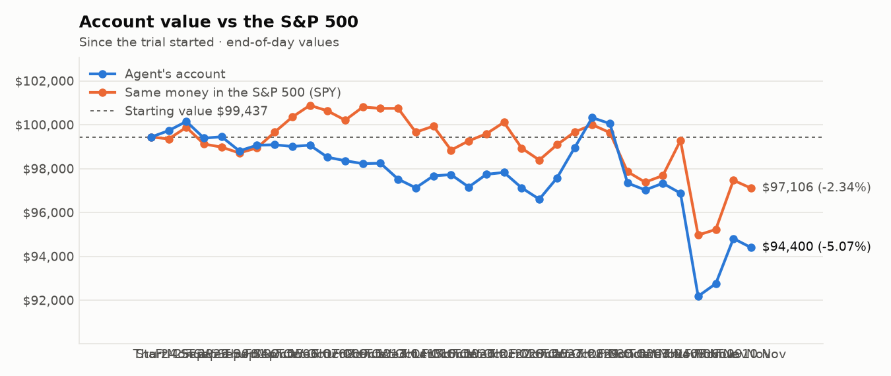
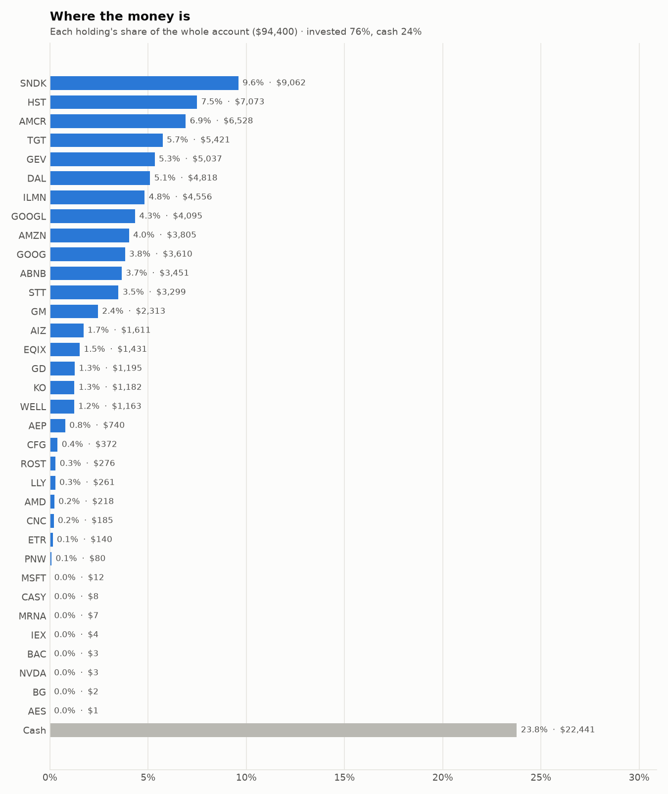
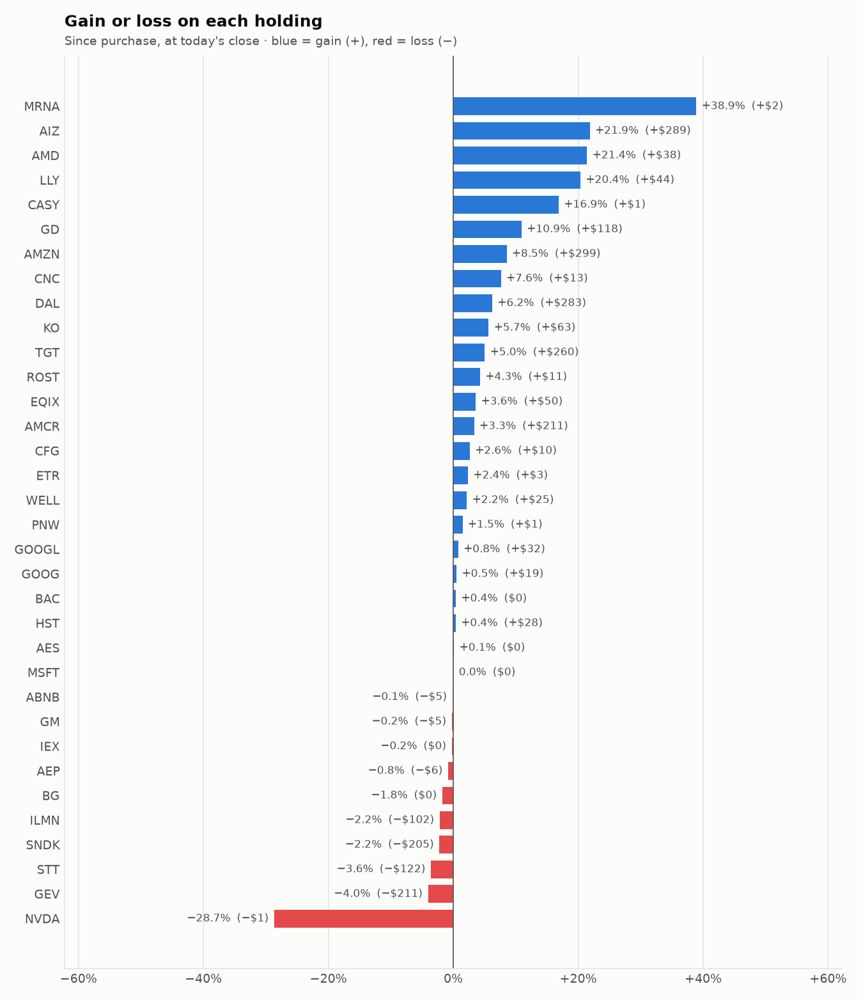

# Daily trading report — Tuesday 10 November 2026

## Summary

- **Account value:** $94,400 (-$412, -0.4% today)
- **S&P 500 (SPY) today:** -0.4% — the agent was behind the index by 0.06%
- **Trades:** 4 buy(s) ($12,203), 6 sell(s) ($20,593)
- **2026-11-10 Morning rebalance:** traded — 10 order(s) placed
- **2026-11-10 Afternoon risk check:** no trades needed — Risk-checked 34 holding(s): none was 12%+ below its purchase price, and none had both clearly negative news and a price drop of 3%+ since entry.

## Charts

## Why I bought

### ILMN — bought 21.198 shares at ~$219.70 ($4,657)

**Why:** combined score +0.88; ranked #10 of 503; driven mainly by price momentum +2.61, low volatility -1.89; entering/adding to the top-ranked target portfolio; research detail: 9 recent headline(s), net positive tone (+7); analyst consensus +0.61/2 (6 strong buy, 9 buy, 10 hold, 2 sell, 1 strong sell)

**Research scores** (combined +0.88, ranked #10 in the S&P 500, sector: Health Care):

| Factor | Score | Measures |
|---|---|---|
| Value | -0.77 | cheap vs. sector peers on P/E and P/B |
| Quality | +0.41 | profitability (ROE, margins) and balance-sheet strength |
| Momentum | +2.61 | 12-month price trend, excluding the last month |
| Low volatility | -1.89 | steadier price than sector peers |
| Research | +0.62 | recent news tone + analyst consensus |

**Company financials (Finnhub, trailing 12 months):** P/E 36.9, P/B 13.1, return on equity 31.4%, gross margin 67.9%, debt/equity 0.57

**Price trend (Alpaca):** 12-month return (excl. last month) +184.4%, last month -20.6%, volatility 69.7%/yr

**News (Finnhub): 9 headline(s) in the last 2 days, net tone +7.** Most influential:
- [Structural Biology and Molecular Modeling Techniques - Global Strategic Business Report 2026: Capitalize on the $18 Billion 2032 Market with Agilent, Bruker Daltonics, Dassault Systemes, and Illumina](https://finnhub.io/api/news?id=d7aaeb881014b8c196cba9c9ce4485e90e12ca0c17090acd06fe3f99187b8388) — 09 Nov, Yahoo (tone +1)
- [Global Genome Annotation Services Market Report 2026: Trends and Forecast to 2030 / Capitalize on AI and Precision Medicine with Roche, Thermo Fisher, Illumina, QIAGEN](https://finnhub.io/api/news?id=ba74337af57be0df82364244b0c708010ec510ef34318a81f0186e25b873b1c6) — 09 Nov, Yahoo (tone +1)
- [Global Clinical Genomics Software Market Report 2026 / Capitalize on 14.8% CAGR Through 2030 as Google, Microsoft, NVIDIA and Illumina Scale AI, Cloud and Precision Medicine](https://finnhub.io/api/news?id=fd0bda3f09edf4bb377ab13068ed41b551438e1a76b91a38a178b7c0fb42103e) — 09 Nov, Yahoo (tone +1)
- [Genomic Variant Prioritization Artificial Intelligence (AI) Global Market Report 2026 / Capitalize on 26.5% CAGR with Illumina, QIAGEN, Thermo Fisher Scientific and Tempus AI](https://finnhub.io/api/news?id=1c5fad7a31e9744a68c91c3273ce9948c3cee7a2706c84d122f71e2fae7dcab5) — 09 Nov, Yahoo (tone +1)
- [Illumina advances MRD research portfolio with ultrasensitive duplex sequencing technology](https://finnhub.io/api/news?id=3420c8518ead636eefca3a26ca2424057b0efc8cbc7e776c60d856bdce2dee64) — 09 Nov, Yahoo (tone +1)

**Analysts (Finnhub, 2026-11-01):** 6 strong buy, 9 buy, 10 hold, 2 sell, 1 strong sell — consensus +0.61 on a -2 (strong sell) to +2 (strong buy) scale.

### ABNB — bought 18.467 shares at ~$187.16 ($3,456)

**Why:** combined score +0.80; ranked #12 of 503; driven mainly by research (news + analyst consensus) +1.59, price momentum +1.58; entering/adding to the top-ranked target portfolio; research detail: 13 recent headline(s), net positive tone (+13); analyst consensus +0.82/2 (10 strong buy, 22 buy, 17 hold, 1 sell, 0 strong sell)

**Research scores** (combined +0.80, ranked #12 in the S&P 500, sector: Consumer Discretionary):

| Factor | Score | Measures |
|---|---|---|
| Value | -0.87 | cheap vs. sector peers on P/E and P/B |
| Quality | +0.49 | profitability (ROE, margins) and balance-sheet strength |
| Momentum | +1.58 | 12-month price trend, excluding the last month |
| Low volatility | -0.94 | steadier price than sector peers |
| Research | +1.59 | recent news tone + analyst consensus |

**Company financials (Finnhub, trailing 12 months):** P/E 41.8, P/B 10.9, return on equity 33.4%, gross margin 72.4%, debt/equity 0.32

**Price trend (Alpaca):** 12-month return (excl. last month) +38.3%, last month +14.8%, volatility 43.1%/yr

**News (Finnhub): 13 headline(s) in the last 2 days, net tone +13.** Most influential:
- [ABNB Q3 2026 deep dive: AI-driven product expansion accelerates growth and margin gains](https://finnhub.io/api/news?id=4075caffe34dfed829ba92822752c921b9b2b2ae884538b1e93d4b81c48def87) — 08 Nov, Yahoo (tone +4)
- [Why Did U, MRNA, ABNB Stocks Surge To 52-Week Highs Today?](https://finnhub.io/api/news?id=46f3c173fcf288b45eae4199bf11a3f0325c8bfcb89af3f5db04c8c015221f2c) — 09 Nov, Yahoo (tone +2)
- [This AMD Analyst Turns Bullish; Here Are Top 5 Upgrades For Monday](https://finnhub.io/api/news?id=4062594a2fff6ac4c399c3f0729db98986158f5f80264d12fd47a39ee6b04f0c) — 09 Nov, Benzinga (tone +2)
- [Mizuho Says This Top Pick Can Leverage AI to Expand its Dominance](https://finnhub.io/api/news?id=92f56b2c5aa9c5184c40028324fbd76911bf0da9a9a798453df0a1e72b3efc23) — 09 Nov, Yahoo (tone +1)
- [Jefferies Maintains Buy on Airbnb, Raises Price Target to $230](https://finnhub.io/api/news?id=e9c2585044f53887c488eb842b9f4c8ff261a2c16601c23d44ba3a7a80d30b0d) — 09 Nov, Benzinga (tone +1)

**Analysts (Finnhub, 2026-11-01):** 10 strong buy, 22 buy, 17 hold, 1 sell, 0 strong sell — consensus +0.82 on a -2 (strong sell) to +2 (strong buy) scale.

### DAL — bought 35.309 shares at ~$91.40 ($3,227)

**Why:** combined score +0.89; ranked #9 of 503; driven mainly by value (cheapness) +1.89, price momentum +1.06; entering/adding to the top-ranked target portfolio; research detail: 4 recent headline(s), net positive tone (+2); analyst consensus +1.13/2 (7 strong buy, 20 buy, 3 hold, 0 sell, 0 strong sell)

**Research scores** (combined +0.89, ranked #9 in the S&P 500, sector: Industrials):

| Factor | Score | Measures |
|---|---|---|
| Value | +1.89 | cheap vs. sector peers on P/E and P/B |
| Quality | +0.13 | profitability (ROE, margins) and balance-sheet strength |
| Momentum | +1.06 | 12-month price trend, excluding the last month |
| Low volatility | -0.46 | steadier price than sector peers |
| Research | +0.59 | recent news tone + analyst consensus |

**Company financials (Finnhub, trailing 12 months):** P/E 17.4, P/B 2.4, return on equity 15.4%, gross margin 45.9%, debt/equity 0.57

**Price trend (Alpaca):** 12-month return (excl. last month) +43.8%, last month +11.7%, volatility 36.7%/yr

**News (Finnhub): 4 headline(s) in the last 2 days, net tone +2.** Most influential:
- [Delta Air Lines (DAL) Stock May Be Undervalued After Falling Oil Prices](https://finnhub.io/api/news?id=d1397ed08cfdd7aa9a2d2f115211acad81040b97dcf68b863e1064aabb47f98d) — 09 Nov, Yahoo (tone +2)
- [Delta Air Lines Stocks Rise 4.68% as Oil Retreats Toward $87](https://finnhub.io/api/news?id=f68706e944ee51b95ea21cc0e5c1d780179cd57b69cb5fd943413de9325ef846) — 09 Nov, Yahoo (tone +0)
- [Why Is Delta Air Lines Stock Surging on Monday?](https://finnhub.io/api/news?id=4742640bc9a3c021a95ffcee7eda1863023f6a07b65d087292edb18f92c1d889) — 09 Nov, Benzinga (tone +0)
- [$1000 Invested In Delta Air Lines 5 Years Ago Would Be Worth This Much Today](https://finnhub.io/api/news?id=e3e652cf38da7cac757066f4b9781a7a18199796cb0b0463ba38fdeed6e55cf7) — 09 Nov, Benzinga (tone +0)

**Analysts (Finnhub, 2026-11-01):** 7 strong buy, 20 buy, 3 hold, 0 sell, 0 strong sell — consensus +1.13 on a -2 (strong sell) to +2 (strong buy) scale.

### WELL — bought 3.524 shares at ~$244.64 ($862)

**Why:** combined score +0.78; ranked #15 of 503; driven mainly by price momentum +1.82, research (news + analyst consensus) +1.34; entering/adding to the top-ranked target portfolio; research detail: 1 recent headline(s), net positive tone (+2); analyst consensus +1.11/2 (6 strong buy, 19 buy, 3 hold, 0 sell, 0 strong sell)

**Research scores** (combined +0.78, ranked #15 in the S&P 500, sector: Real Estate):

| Factor | Score | Measures |
|---|---|---|
| Value | -0.72 | cheap vs. sector peers on P/E and P/B |
| Quality | -0.31 | profitability (ROE, margins) and balance-sheet strength |
| Momentum | +1.82 | 12-month price trend, excluding the last month |
| Low volatility | -0.08 | steadier price than sector peers |
| Research | +1.34 | recent news tone + analyst consensus |

**Company financials (Finnhub, trailing 12 months):** P/E 108.4, P/B 3.4, return on equity 3.7%, gross margin 40.0%, debt/equity 0.40

**Price trend (Alpaca):** 12-month return (excl. last month) +33.3%, last month +9.7%, volatility 21.3%/yr

**News (Finnhub): 1 headline(s) in the last 2 days, net tone +2.** Most influential:
- [Welltower (NYSE:WELL): High Growth Momentum Meets a Breakout Setup](https://finnhub.io/api/news?id=ab5f93bee69b8aef62ba85895c58302aa34ee889da4387f642a847902b36788b) — 09 Nov, ChartMill (tone +2)

**Analysts (Finnhub, 2026-11-01):** 6 strong buy, 19 buy, 3 hold, 0 sell, 0 strong sell — consensus +1.11 on a -2 (strong sell) to +2 (strong buy) scale.

## Why I sold

### AMD — sold 12.325 shares at ~$535.36 ($6,598)

**Why:** combined score +0.54; ranked #40 of 503; driven mainly by research (news + analyst consensus) +1.81, low volatility -0.73; trimmed toward target weight, or dropped out of the top-ranked names; research detail: 72 recent headline(s), net positive tone (+30); analyst consensus +1.12/2 (17 strong buy, 33 buy, 10 hold, 0 sell, 0 strong sell)

**Research scores** (combined +0.54, ranked #40 in the S&P 500, sector: Information Technology):

| Factor | Score | Measures |
|---|---|---|
| Value | -0.66 | cheap vs. sector peers on P/E and P/B |
| Quality | +0.05 | profitability (ROE, margins) and balance-sheet strength |
| Momentum | +0.70 | 12-month price trend, excluding the last month |
| Low volatility | -0.73 | steadier price than sector peers |
| Research | +1.81 | recent news tone + analyst consensus |

**Company financials (FMP, trailing 12 months):** P/E 111.1, P/B 12.4, return on equity 11.6%, gross margin 53.7%, debt/equity 0.13

**Price trend (Alpaca):** 12-month return (excl. last month) +158.1%, last month -16.3%, volatility 77.7%/yr

**News (Finnhub): 72 headline(s) in the last 2 days, net tone +30.** Most influential:
- [AMD Stocks Jump 9.50% After Oppenheimer Upgrade Sets $600 Target](https://finnhub.io/api/news?id=f2a530433d23598f57b5fc9477d9847b5d95d92e02ff954e70e3a62af27c9ea1) — 09 Nov, Yahoo (tone +3)
- [AMD Soars 12% on “Undeniable” Data Center Success per Oppenheimer Upgrade](https://finnhub.io/api/news?id=a39d2fa79835d211aae427a0783f2bfa34475571415ebfb0fc8451cf1b1efad5) — 09 Nov, Yahoo (tone +3)
- [Oppenheimer lifts AMD to Outperform, sees data center sales more than doubling](https://finnhub.io/api/news?id=5b7f0915c80b49f64725f3422568638f7b6a370c3ae48dfe03617604113f4eab) — 09 Nov, Yahoo (tone +3)
- [AMD Stock Surges on Expanded Partnership With Google. What Comes Next.](https://finnhub.io/api/news?id=ffd91e9c3f2f3556128b350a9a150b65ff7e39cc3030ca216e7ef82f71eed18c) — 09 Nov, Yahoo (tone +2)
- [AMD: I'm Buying The Dip Again](https://finnhub.io/api/news?id=799b3abf77363ff9e587db9e52ea0ef309e307ed9e894066471c080353332fd4) — 09 Nov, SeekingAlpha (tone +2)

**Analysts (Finnhub, 2026-11-01):** 17 strong buy, 33 buy, 10 hold, 0 sell, 0 strong sell — consensus +1.12 on a -2 (strong sell) to +2 (strong buy) scale.

### GEV — sold 4.835 shares at ~$787.72 ($3,809)

**Why:** combined score +0.89; ranked #7 of 503; driven mainly by price momentum +1.57, research (news + analyst consensus) +1.45; trimmed toward target weight, or dropped out of the top-ranked names; research detail: 19 recent headline(s), net positive tone (+8); analyst consensus +1.07/2 (11 strong buy, 24 buy, 6 hold, 1 sell, 0 strong sell)

**Research scores** (combined +0.89, ranked #7 in the S&P 500, sector: Industrials):

| Factor | Score | Measures |
|---|---|---|
| Value | -0.05 | cheap vs. sector peers on P/E and P/B |
| Quality | +0.39 | profitability (ROE, margins) and balance-sheet strength |
| Momentum | +1.57 | 12-month price trend, excluding the last month |
| Low volatility | -1.37 | steadier price than sector peers |
| Research | +1.45 | recent news tone + analyst consensus |

**Company financials (Finnhub, trailing 12 months):** P/E 19.8, P/B 22.2, return on equity 85.6%, gross margin 21.8%, debt/equity 0.25

**Price trend (Alpaca):** 12-month return (excl. last month) +60.5%, last month -17.5%, volatility 56.9%/yr

**News (Finnhub): 19 headline(s) in the last 2 days, net tone +8.** Most influential:
- [AMD Soars 12% on “Undeniable” Data Center Success per Oppenheimer Upgrade](https://finnhub.io/api/news?id=a39d2fa79835d211aae427a0783f2bfa34475571415ebfb0fc8451cf1b1efad5) — 09 Nov, Yahoo (tone +3)
- [GE Vernova Soars 7% as Constellation Raises Guidance, Easing Data-Center Moratorium Fears](https://finnhub.io/api/news?id=5998360c3c0a5da0fcfc8a66b5cb538cac2425f2fa8377320e1aae51ad238198) — 09 Nov, Yahoo (tone +3)
- [Musk: “SoftBank Is Defaulting on Their Turbine Orders.” That’s a Warning for GE Vernova](https://finnhub.io/api/news?id=ac7d9b3c6073dbb2f6e28df4a3d1794aab1e040d109643d9510ed9c4766a5b15) — 09 Nov, Yahoo (tone -1)
- [Buy The Market’s Knee-Jerk Derisking of GE Vernova While You Can](https://finnhub.io/api/news?id=66c59aa796f67abe9ff53fcf6dc4829d4df40af3908bb7fd6994e587fd590ed5) — 09 Nov, Yahoo (tone +1)
- [GE Vernova Lands Wind Turbine Order With 20-Year Service Deal](https://finnhub.io/api/news?id=34337646eb90e2fc3b21a6a5c4f9b8899abdfb4e5d9e21fa007c5b4746bd09dc) — 09 Nov, Yahoo (tone +1)

**Analysts (Finnhub, 2026-11-01):** 11 strong buy, 24 buy, 6 hold, 1 sell, 0 strong sell — consensus +1.07 on a -2 (strong sell) to +2 (strong buy) scale.

### ETR — sold 27.477 shares at ~$110.72 ($3,042)

**Why:** combined score +0.58; ranked #33 of 503; driven mainly by price momentum +1.47, research (news + analyst consensus) +0.27; trimmed toward target weight, or dropped out of the top-ranked names; research detail: 6 recent headline(s), net positive tone (+1); analyst consensus +1.00/2 (7 strong buy, 15 buy, 7 hold, 0 sell, 0 strong sell)

**Research scores** (combined +0.58, ranked #33 in the S&P 500, sector: Utilities):

| Factor | Score | Measures |
|---|---|---|
| Value | +0.00 | cheap vs. sector peers on P/E and P/B |
| Quality | +0.00 | profitability (ROE, margins) and balance-sheet strength |
| Momentum | +1.47 | 12-month price trend, excluding the last month |
| Low volatility | +0.02 | steadier price than sector peers |
| Research | +0.27 | recent news tone + analyst consensus |

**Price trend (Alpaca):** 12-month return (excl. last month) +6.4%, last month +8.7%, volatility 17.1%/yr

**News (Finnhub): 6 headline(s) in the last 2 days, net tone +1.** Most influential:
- [Is Entergy (ETR) Priced Beyond What Its Dividend Can Support?](https://finnhub.io/api/news?id=33333fdbe3eb06dba575d80aa90488f3e3544b106ac769f781ac60b2fe811861) — 10 Nov, Yahoo (tone +1)
- [Entergy (ETR) Tests Valuation After Earnings And Dividend Raise](https://finnhub.io/api/news?id=a662d91b2a8cee24ced6ba08c85b7f6d2e3a0e5e86013a1465c36f57863b8707) — 10 Nov, Yahoo (tone +0)
- [Entergy Louisiana (ELC) Q3 2026 Earnings Call Transcript](https://finnhub.io/api/news?id=313a54abcf1440e38f2200a89f76731e86051431d69cad5543b4d2d31ccf5ee9) — 09 Nov, Yahoo (tone +0)
- [Entergy Mississippi (EMP) Q3 2026 Earnings Call Transcript](https://finnhub.io/api/news?id=b425d08131b664123601d0da3728d5a65b6bb700fabaa4eb03134a35e5c8ce50) — 09 Nov, Yahoo (tone +0)
- [Entergy New Orleans (ENO) Q3 2026 Earnings Call Transcript](https://finnhub.io/api/news?id=521cf0405bdfaaf3103b925b12807f92208041501504f00bcda4defd4e353c39) — 09 Nov, Yahoo (tone +0)

**Analysts (Finnhub, 2026-11-01):** 7 strong buy, 15 buy, 7 hold, 0 sell, 0 strong sell — consensus +1.00 on a -2 (strong sell) to +2 (strong buy) scale.

### ADM — sold 37.94 shares at ~$69.50 ($2,637)

**Why:** combined score +0.48; ranked #52 of 503; driven mainly by value (cheapness) +1.50, price momentum +1.10; trimmed toward target weight, or dropped out of the top-ranked names; research detail: analyst consensus +0.33/2 (1 strong buy, 4 buy, 9 hold, 1 sell, 0 strong sell)

**Research scores** (combined +0.48, ranked #52 in the S&P 500, sector: Consumer Staples):

| Factor | Score | Measures |
|---|---|---|
| Value | +1.50 | cheap vs. sector peers on P/E and P/B |
| Quality | -0.49 | profitability (ROE, margins) and balance-sheet strength |
| Momentum | +1.10 | 12-month price trend, excluding the last month |
| Low volatility | +0.35 | steadier price than sector peers |
| Research | -0.60 | recent news tone + analyst consensus |

**Company financials (Finnhub, trailing 12 months):** P/E 13.5, P/B 1.6, return on equity 10.7%, gross margin 7.4%, debt/equity 0.37

**Price trend (Alpaca):** 12-month return (excl. last month) +28.4%, last month -12.6%, volatility 28.5%/yr

**News (Finnhub):** no headlines in the last 2 days.

**Analysts (Finnhub, 2026-11-01):** 1 strong buy, 4 buy, 9 hold, 1 sell, 0 strong sell — consensus +0.33 on a -2 (strong sell) to +2 (strong buy) scale.

### AMCR — sold 56.975 shares at ~$44.65 ($2,544)

**Why:** combined score +1.00; ranked #6 of 503; driven mainly by price momentum +3.00, quality (profitability/balance sheet) -0.54; trimmed toward target weight, or dropped out of the top-ranked names; research detail: 1 recent headline(s), neutral/mixed tone; analyst consensus +0.95/2 (5 strong buy, 8 buy, 6 hold, 0 sell, 0 strong sell)

**Research scores** (combined +1.00, ranked #6 in the S&P 500, sector: Materials):

| Factor | Score | Measures |
|---|---|---|
| Value | +0.23 | cheap vs. sector peers on P/E and P/B |
| Quality | -0.54 | profitability (ROE, margins) and balance-sheet strength |
| Momentum | +3.00 | 12-month price trend, excluding the last month |
| Low volatility | +0.27 | steadier price than sector peers |
| Research | -0.10 | recent news tone + analyst consensus |

**Company financials (Finnhub, trailing 12 months):** P/E 19.1, P/B 1.6, return on equity 9.3%, gross margin 19.8%, debt/equity 1.27

**Price trend (Alpaca):** 12-month return (excl. last month) +423.2%, last month +8.2%, volatility 27.6%/yr

**News (Finnhub): 1 headline(s) in the last 2 days, net tone +0.** Most influential:
- [Should International Paper Stock Holders Look At Amcor Instead?](https://finnhub.io/api/news?id=65f6f5085025f651db86a5bd6c91465ff7f36265a1280ac8dfab97267f17ee2e) — 09 Nov, Yahoo (tone +0)

**Analysts (Finnhub, 2026-11-01):** 5 strong buy, 8 buy, 6 hold, 0 sell, 0 strong sell — consensus +0.95 on a -2 (strong sell) to +2 (strong buy) scale.

### HST — sold 78.161 shares at ~$25.12 ($1,963)

**Why:** combined score +1.00; ranked #5 of 503; driven mainly by price momentum +2.05, value (cheapness) +0.86; trimmed toward target weight, or dropped out of the top-ranked names; research detail: analyst consensus +0.92/2 (8 strong buy, 7 buy, 10 hold, 0 sell, 0 strong sell)

**Research scores** (combined +1.00, ranked #5 in the S&P 500, sector: Real Estate):

| Factor | Score | Measures |
|---|---|---|
| Value | +0.86 | cheap vs. sector peers on P/E and P/B |
| Quality | +0.72 | profitability (ROE, margins) and balance-sheet strength |
| Momentum | +2.05 | 12-month price trend, excluding the last month |
| Low volatility | -0.11 | steadier price than sector peers |
| Research | +0.05 | recent news tone + analyst consensus |

**Company financials (Finnhub, trailing 12 months):** P/E 16.9, P/B 2.5, return on equity 15.5%, gross margin 97.0%, debt/equity 0.80

**Price trend (Alpaca):** 12-month return (excl. last month) +39.4%, last month +11.6%, volatility 22.2%/yr

**News (Finnhub):** no headlines in the last 2 days.

**Analysts (Finnhub, 2026-11-01):** 8 strong buy, 7 buy, 10 hold, 0 sell, 0 strong sell — consensus +0.92 on a -2 (strong sell) to +2 (strong buy) scale.

## Holdings at the close

| Stock | Shares | Avg cost | Price | Market value | % of account | Today | Gain/loss $ | Gain/loss % |
|---|---:|---:|---:|---:|---:|---:|---:|---:|
| SNDK | 10.565 | $877.18 | $857.73 | $9,062 | 9.6% | -3.25% | −$205 | -2.22% |
| HST | 273.295 | $25.78 | $25.88 | $7,073 | 7.5% | +2.37% | +$28 | +0.40% |
| AMCR | 144.466 | $43.73 | $45.19 | $6,528 | 6.9% | +0.11% | +$211 | +3.34% |
| TGT | 33.506 | $154.01 | $161.78 | $5,421 | 5.7% | -2.48% | +$260 | +5.04% |
| GEV | 6.33 | $829.15 | $795.74 | $5,037 | 5.3% | -4.05% | −$211 | -4.03% |
| DAL | 52.252 | $86.79 | $92.20 | $4,818 | 5.1% | +0.44% | +$283 | +6.23% |
| ILMN | 21.198 | $219.70 | $214.91 | $4,556 | 4.8% | -2.66% | −$102 | -2.18% |
| GOOGL | 14.236 | $285.38 | $287.65 | $4,095 | 4.3% | -0.17% | +$32 | +0.79% |
| AMZN | 14.056 | $249.42 | $270.72 | $3,805 | 4.0% | +1.42% | +$299 | +8.54% |
| GOOG | 12.659 | $283.65 | $285.16 | $3,610 | 3.8% | -0.30% | +$19 | +0.53% |
| ABNB | 18.467 | $187.16 | $186.90 | $3,451 | 3.7% | -1.78% | −$5 | -0.14% |
| STT | 19.22 | $177.99 | $171.62 | $3,299 | 3.5% | +0.43% | −$122 | -3.58% |
| GM | 25.985 | $89.20 | $89.00 | $2,313 | 2.4% | -0.73% | −$5 | -0.23% |
| AIZ | 5 | $264.38 | $322.16 | $1,611 | 1.7% | +1.56% | +$289 | +21.85% |
| EQIX | 1.363 | $1,013.54 | $1,050.00 | $1,431 | 1.5% | -0.43% | +$50 | +3.60% |
| GD | 3.251 | $331.27 | $367.44 | $1,195 | 1.3% | +1.48% | +$118 | +10.92% |
| KO | 12.203 | $91.67 | $96.86 | $1,182 | 1.3% | +0.86% | +$63 | +5.66% |
| WELL | 4.695 | $242.37 | $247.66 | $1,163 | 1.2% | +0.13% | +$25 | +2.18% |
| AEP | 5.798 | $128.70 | $127.64 | $740 | 0.8% | -0.54% | −$6 | -0.82% |
| CFG | 5.744 | $63.15 | $64.82 | $372 | 0.4% | -0.43% | +$10 | +2.64% |
| ROST | 1.153 | $229.11 | $238.95 | $276 | 0.3% | +0.82% | +$11 | +4.29% |
| LLY | 0.182 | $1,189.78 | $1,432.01 | $261 | 0.3% | +1.42% | +$44 | +20.36% |
| AMD | 0.424 | $423.91 | $514.70 | $218 | 0.2% | +1.20% | +$38 | +21.42% |
| CNC | 2.63 | $65.21 | $70.19 | $185 | 0.2% | +2.41% | +$13 | +7.64% |
| ETR | 1.25 | $109.14 | $111.71 | $140 | 0.1% | -0.07% | +$3 | +2.35% |
| PNW | 0.753 | $104.41 | $105.96 | $80 | 0.1% | +0.67% | +$1 | +1.48% |
| MSFT | 0.023 | $533.80 | $533.99 | $12 | 0.0% | -2.05% | +$0 | +0.04% |
| CASY | 0.011 | $597.62 | $698.48 | $8 | 0.0% | +0.92% | +$1 | +16.88% |
| MRNA | 0.028 | $181.06 | $251.50 | $7 | 0.0% | -6.51% | +$2 | +38.90% |
| IEX | 0.018 | $237.47 | $236.90 | $4 | 0.0% | +0.41% | −$0 | -0.24% |
| BAC | 0.054 | $50.53 | $50.74 | $3 | 0.0% | +0.38% | +$0 | +0.42% |
| NVDA | 0.016 | $236.88 | $168.95 | $3 | 0.0% | -5.44% | −$1 | -28.68% |
| BG | 0.019 | $101.20 | $99.42 | $2 | 0.0% | -1.74% | −$0 | -1.76% |
| AES | 0.096 | $14.92 | $14.94 | $1 | 0.0% | +0.27% | +$0 | +0.13% |
| **Invested** | | | | **$71,959** | **76.2%** | | **+$1,143** | |
| **Cash** | | | | $22,441 | 23.8% | | | |
| **Total account** | | | | **$94,400** | 100% | | | |

_Scores are sector-neutral z-scores: 0 is average for the stock's sector, +1 is one standard deviation better. News tone is a keyword count over recent headlines, not a deep read. None of this guarantees a stock will rise; a few days of results can't show whether the strategy has a real edge over the S&P 500._
