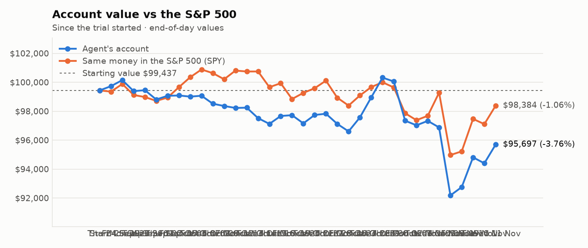
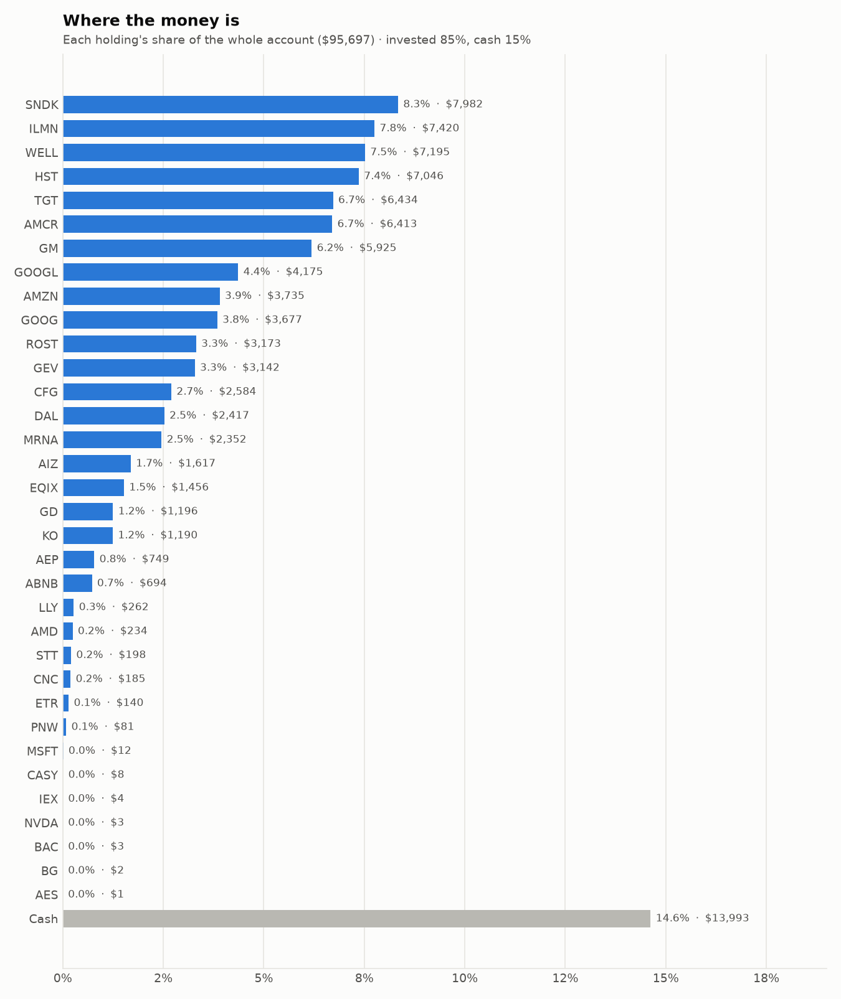
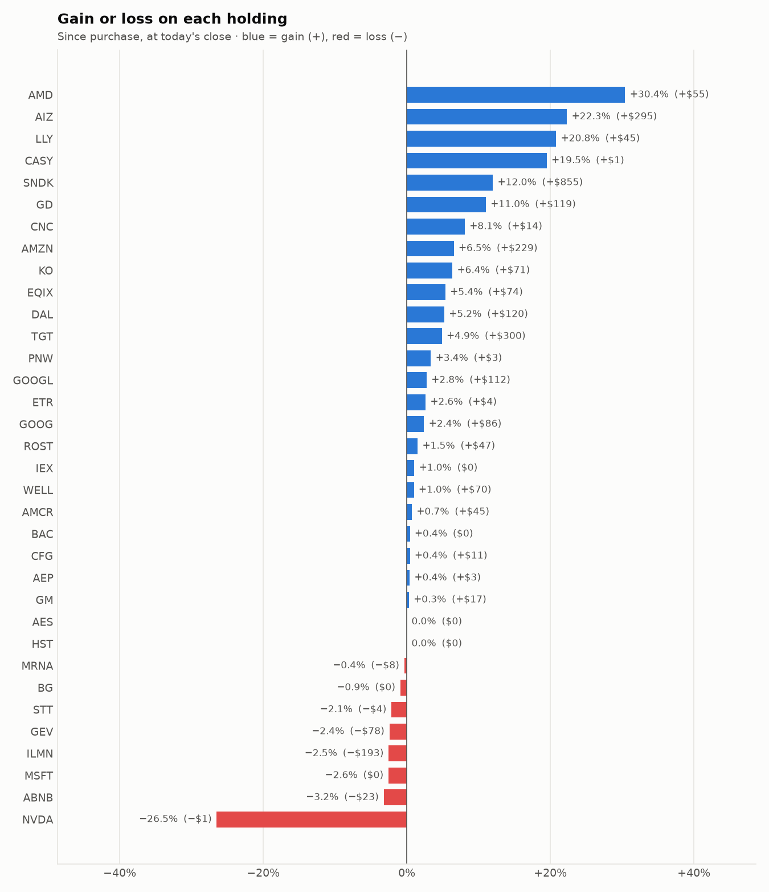

# Daily trading report — Wednesday 11 November 2026

## Summary

- **Account value:** $95,697 (+$1,297, +1.4% today)
- **S&P 500 (SPY) today:** +1.3% — the agent was ahead of the index by 0.06%
- **Trades:** 7 buy(s) ($20,933), 5 sell(s) ($12,486)
- **2026-11-11 Morning rebalance:** traded — 12 order(s) placed
- **2026-11-11 Afternoon risk check:** no trades needed — Risk-checked 34 holding(s): none was 12%+ below its purchase price, and none had both clearly negative news and a price drop of 3%+ since entry.

## Charts

## Why I bought

### WELL — bought 24.394 shares at ~$245.43 ($5,987)

**Why:** combined score +1.00; ranked #8 of 503; driven mainly by research (news + analyst consensus) +2.07, price momentum +1.93; entering/adding to the top-ranked target portfolio; research detail: 4 recent headline(s), net positive tone (+6); analyst consensus +1.11/2 (6 strong buy, 19 buy, 3 hold, 0 sell, 0 strong sell)

**Research scores** (combined +1.00, ranked #8 in the S&P 500, sector: Real Estate):

| Factor | Score | Measures |
|---|---|---|
| Value | -0.73 | cheap vs. sector peers on P/E and P/B |
| Quality | -0.31 | profitability (ROE, margins) and balance-sheet strength |
| Momentum | +1.93 | 12-month price trend, excluding the last month |
| Low volatility | -0.08 | steadier price than sector peers |
| Research | +2.07 | recent news tone + analyst consensus |

**Company financials (Finnhub, trailing 12 months):** P/E 107.9, P/B 3.4, return on equity 3.7%, gross margin 40.0%, debt/equity 0.40

**Price trend (Alpaca):** 12-month return (excl. last month) +37.7%, last month +7.6%, volatility 21.3%/yr

**News (Finnhub): 4 headline(s) in the last 2 days, net tone +6.** Most influential:
- [RBC Capital Maintains Outperform on Welltower, Raises Price Target to $266](https://finnhub.io/api/news?id=794ed73bf0f965f5081f8cd7c4e66efec0864b7e61f9674e972e4795aa34cc85) — 10 Nov, Benzinga (tone +2)
- [Welltower (NYSE:WELL): High Growth Momentum Meets a Breakout Setup](https://finnhub.io/api/news?id=ab5f93bee69b8aef62ba85895c58302aa34ee889da4387f642a847902b36788b) — 09 Nov, ChartMill (tone +2)
- [Welltower's Senior Housing Portfolio Should Help Deliver FFO Growth in 2027, 2028, RBC Says](https://finnhub.io/api/news?id=00067a18d1817c3fd454bfb92613c08d8efebc4c6438aa4bf2667c364cacd259) — 10 Nov, Yahoo (tone +1)
- [JP Morgan Maintains Overweight on Welltower, Raises Price Target to $273](https://finnhub.io/api/news?id=31b5cfc8997c350dbfb30c90b2a4ce2523fd580d91f75567d3a91cd2338903cc) — 10 Nov, Benzinga (tone +1)

**Analysts (Finnhub, 2026-11-01):** 6 strong buy, 19 buy, 3 hold, 0 sell, 0 strong sell — consensus +1.11 on a -2 (strong sell) to +2 (strong buy) scale.

### GM — bought 40.659 shares at ~$88.28 ($3,589)

**Why:** combined score +0.93; ranked #9 of 503; driven mainly by price momentum +1.82, research (news + analyst consensus) +0.88; entering/adding to the top-ranked target portfolio; research detail: 7 recent headline(s), net positive tone (+5); analyst consensus +1.14/2 (11 strong buy, 18 buy, 6 hold, 0 sell, 0 strong sell)

**Research scores** (combined +0.93, ranked #9 in the S&P 500, sector: Consumer Discretionary):

| Factor | Score | Measures |
|---|---|---|
| Value | +0.88 | cheap vs. sector peers on P/E and P/B |
| Quality | -0.63 | profitability (ROE, margins) and balance-sheet strength |
| Momentum | +1.82 | 12-month price trend, excluding the last month |
| Low volatility | -0.18 | steadier price than sector peers |
| Research | +0.88 | recent news tone + analyst consensus |

**Company financials (FMP, trailing 12 months):** P/E 20.0, P/B 1.2, return on equity 6.3%, gross margin 9.0%, debt/equity 2.05

**Price trend (Alpaca):** 12-month return (excl. last month) +47.3%, last month +7.7%, volatility 38.6%/yr

**News (Finnhub): 7 headline(s) in the last 2 days, net tone +5.** Most influential:
- [Can GM's Next-Generation Pickups Support Growth in 2027?](https://finnhub.io/api/news?id=92ee929002f6b2c35bd187b5c03cc08fc6fa854737728fe7e4d3aca061e9f6a3) — 09 Nov, Yahoo (tone +2)
- [S&P revises GM outlook to positive on widening margins and cash flow](https://finnhub.io/api/news?id=b48884f651d1ee63806c4802382009c4eac8acef154fa334192571666c762cb3) — 10 Nov, Yahoo (tone +1)
- [MP Q3 Earnings Call Highlights Measured Magnet Ramp-Up and 10X Demand](https://finnhub.io/api/news?id=13fb21797b30fb9b9ec290e0fec01eb8e682452a58974151a37cc33d1f1e3c3b) — 09 Nov, Yahoo (tone +1)
- [Can OnStar and Super Cruise Drive GM's Digital Revenue Growth?](https://finnhub.io/api/news?id=49fee895784f9f012eaf3c5bb69316b1e0a273b861e6036eebfe8da93cfd0556) — 09 Nov, Yahoo (tone +1)
- [Is Trending Stock General Motors Company (GM) a Buy Now?](https://finnhub.io/api/news?id=0ad2de984c0d955eb65d15f650401016c5ee31a901a9b05fbb8aae82f4da1723) — 10 Nov, Yahoo (tone +0)

**Analysts (Finnhub, 2026-11-01):** 11 strong buy, 18 buy, 6 hold, 0 sell, 0 strong sell — consensus +1.14 on a -2 (strong sell) to +2 (strong buy) scale.

### ILMN — bought 13.473 shares at ~$219.38 ($2,956)

**Why:** combined score +1.02; ranked #6 of 503; driven mainly by price momentum +2.69, low volatility -1.90; entering/adding to the top-ranked target portfolio; research detail: 18 recent headline(s), net positive tone (+16); analyst consensus +0.61/2 (6 strong buy, 9 buy, 10 hold, 2 sell, 1 strong sell)

**Research scores** (combined +1.02, ranked #6 in the S&P 500, sector: Health Care):

| Factor | Score | Measures |
|---|---|---|
| Value | -0.76 | cheap vs. sector peers on P/E and P/B |
| Quality | +0.41 | profitability (ROE, margins) and balance-sheet strength |
| Momentum | +2.69 | 12-month price trend, excluding the last month |
| Low volatility | -1.90 | steadier price than sector peers |
| Research | +1.07 | recent news tone + analyst consensus |

**Company financials (Finnhub, trailing 12 months):** P/E 36.4, P/B 13.1, return on equity 31.4%, gross margin 67.9%, debt/equity 0.57

**Price trend (Alpaca):** 12-month return (excl. last month) +187.1%, last month -22.4%, volatility 70.0%/yr

**News (Finnhub): 18 headline(s) in the last 2 days, net tone +16.** Most influential:
- [How Investors May Respond To Illumina (ILMN) Earnings Beat](https://finnhub.io/api/news?id=80269d6559e7b3ada9cd402b201286451a22055fcb62fcb1762330bd6782d959) — 11 Nov, Yahoo (tone +3)
- [Illumina (ILMN) Unveils Duplex Sequencing Workflow For MRD Research](https://finnhub.io/api/news?id=35af3129d7888ec6bfd8b7eaa9728e5170ec3f77af0321cb1ffd8e3e03342262) — 11 Nov, Yahoo (tone +1)
- [Illumina Bets on Clinical Demand for Growth as Research Funding Uncertainty Persists](https://finnhub.io/api/news?id=69a295be13dba1d6f177c369b02c705291a04a0aaec4289ab6c85e9371af3946) — 10 Nov, Yahoo (tone +1)
- [Nucleic Acid Isolation and Purification - Global Strategic Business Report: Capture the $3.9 Billion Revenue Surge by 2030 as Thermo Fisher, Qiagen, Danaher, Illumina, and Bio-Rad Battle for Share](https://finnhub.io/api/news?id=782ff2cfdac9121fa8044b00b04728e2382986ec0c5e740fc996c8a0e39294f0) — 10 Nov, Yahoo (tone +1)
- [Gene Panels - Global Strategic Business Report 2026: Capitalize on 17.9% CAGR as Market Triples to $12.6B by 2032 - Track Key Players Illumina, Roche, QIAGEN, Thermo Fisher, Agilent and More](https://finnhub.io/api/news?id=1b1fa753189bb9863ac671c598aa2910f37c810d20245c432e1319afb9671b8f) — 10 Nov, Yahoo (tone +1)

**Analysts (Finnhub, 2026-11-01):** 6 strong buy, 9 buy, 10 hold, 2 sell, 1 strong sell — consensus +0.61 on a -2 (strong sell) to +2 (strong buy) scale.

### ROST — bought 11.999 shares at ~$238.50 ($2,862)

**Why:** combined score +0.78; ranked #16 of 503; driven mainly by price momentum +1.88, research (news + analyst consensus) +0.95; entering/adding to the top-ranked target portfolio; research detail: 9 recent headline(s), net positive tone (+6); analyst consensus +1.07/2 (9 strong buy, 11 buy, 7 hold, 0 sell, 0 strong sell)

**Research scores** (combined +0.78, ranked #16 in the S&P 500, sector: Consumer Discretionary):

| Factor | Score | Measures |
|---|---|---|
| Value | -0.66 | cheap vs. sector peers on P/E and P/B |
| Quality | -0.09 | profitability (ROE, margins) and balance-sheet strength |
| Momentum | +1.88 | 12-month price trend, excluding the last month |
| Low volatility | +0.69 | steadier price than sector peers |
| Research | +0.95 | recent news tone + analyst consensus |

**Company financials (Finnhub, trailing 12 months):** P/E 28.4, P/B 12.0, return on equity 42.3%, gross margin 28.6%, debt/equity 0.15

**Price trend (Alpaca):** 12-month return (excl. last month) +50.6%, last month +5.8%, volatility 27.9%/yr

**News (Finnhub): 9 headline(s) in the last 2 days, net tone +6.** Most influential:
- [Ross Stores (ROST) Stock Could Be Overvalued On Its 119% Run](https://finnhub.io/api/news?id=0d75ebb1fb907faebdb9ff87a673def72e50d6ebeeadcd0eb360e827e807c3b0) — 10 Nov, Yahoo (tone +2)
- [Are Wall Street Analysts Bullish on Ross Stores Stock?](https://finnhub.io/api/news?id=ee5b0340eb3a819b841e2044614160a3157b91b663e7b2a55077b90067461aed) — 10 Nov, Yahoo (tone +2)
- [How Investors May Respond To Ross Stores Stock Ahead Of Earnings Growth Expectations](https://finnhub.io/api/news?id=2c305a0613daa8fa0bed237fe49f98cd7261693826dd8881dfa5c067b330ae7b) — 11 Nov, Yahoo (tone +1)
- [This MongoDB Analyst Begins Coverage On A Bullish Note; Here Are Top 5 Initiations For Tuesday](https://finnhub.io/api/news?id=cae6cddbeece383d86dce69b7e8f5a149e32429d608bd78642c46f935bb55898) — 10 Nov, Benzinga (tone +1)
- [Ross Stores (ROST), What Is Behind The Fresh Attention Now?](https://finnhub.io/api/news?id=d7da64ab3e109727787a22c37429ec5b6b5440dcb4deafe9917cda89fa0e9a1c) — 10 Nov, Yahoo (tone +0)

**Analysts (Finnhub, 2026-11-01):** 9 strong buy, 11 buy, 7 hold, 0 sell, 0 strong sell — consensus +1.07 on a -2 (strong sell) to +2 (strong buy) scale.

### MRNA — bought 9.435 shares at ~$249.60 ($2,355)

**Why:** combined score +0.74; ranked #21 of 503; driven mainly by price momentum +3.00, low volatility -2.77; entering/adding to the top-ranked target portfolio; research detail: 23 recent headline(s), net positive tone (+22); analyst consensus +0.26/2 (3 strong buy, 7 buy, 17 hold, 3 sell, 1 strong sell)

**Research scores** (combined +0.74, ranked #21 in the S&P 500, sector: Health Care):

| Factor | Score | Measures |
|---|---|---|
| Value | -1.05 | cheap vs. sector peers on P/E and P/B |
| Quality | -0.50 | profitability (ROE, margins) and balance-sheet strength |
| Momentum | +3.00 | 12-month price trend, excluding the last month |
| Low volatility | -2.77 | steadier price than sector peers |
| Research | +0.46 | recent news tone + analyst consensus |

**Company financials (FMP, trailing 12 months):** P/E -35.4, P/B 14.7, return on equity -37.6%, gross margin 28.0%, debt/equity 0.61

**Price trend (Alpaca):** 12-month return (excl. last month) +675.2%, last month +17.4%, volatility 376.3%/yr

**News (Finnhub): 23 headline(s) in the last 2 days, net tone +22.** Most influential:
- [Moderna Q3 Earnings Call Highlights Raised Outlook and Oncology](https://finnhub.io/api/news?id=51670f9c7c24c76d7fbaad2d555e49d0b8f77c474c05c905738ec169e32e2f53) — 09 Nov, Yahoo (tone +4)
- [Why is Moderna (MRNA) stock soaring today](https://finnhub.io/api/news?id=8888f94ed4007fdd842914feecdeca61893c4f7f92ad95e352276f0243a476b7) — 10 Nov, Yahoo (tone +2)
- [Why Did U, MRNA, ABNB Stocks Surge To 52-Week Highs Today?](https://finnhub.io/api/news?id=46f3c173fcf288b45eae4199bf11a3f0325c8bfcb89af3f5db04c8c015221f2c) — 09 Nov, Yahoo (tone +2)
- [Moderna Soars Another 9% as Piper Sandler Lifts Target to $305 on Raised Outlook](https://finnhub.io/api/news?id=053f4ce6a3696c43cf5b9d453b8fb4b1d2daba7aeebb489692cebaee54446f6a) — 09 Nov, Yahoo (tone +2)
- [Zacks Investment Ideas feature highlights: Moderna, AbbVie, Eli Lilly and Merck](https://finnhub.io/api/news?id=28919c93456b4edb347083c386db997daac2af200980c527d98eb84323420a41) — 09 Nov, Yahoo (tone +2)

**Analysts (Finnhub, 2026-11-01):** 3 strong buy, 7 buy, 17 hold, 3 sell, 1 strong sell — consensus +0.26 on a -2 (strong sell) to +2 (strong buy) scale.

### CFG — bought 33.782 shares at ~$65.43 ($2,210)

**Why:** combined score +0.75; ranked #19 of 503; driven mainly by value (cheapness) +1.08, price momentum +1.00; entering/adding to the top-ranked target portfolio; research detail: 5 recent headline(s), net positive tone (+3); analyst consensus +1.08/2 (6 strong buy, 15 buy, 4 hold, 0 sell, 0 strong sell)

**Research scores** (combined +0.75, ranked #19 in the S&P 500, sector: Financials):

| Factor | Score | Measures |
|---|---|---|
| Value | +1.08 | cheap vs. sector peers on P/E and P/B |
| Quality | -0.06 | profitability (ROE, margins) and balance-sheet strength |
| Momentum | +1.00 | 12-month price trend, excluding the last month |
| Low volatility | +0.42 | steadier price than sector peers |
| Research | +0.70 | recent news tone + analyst consensus |

**Company financials (Finnhub, trailing 12 months):** P/E 12.0, P/B 1.1, return on equity 8.7%, debt/equity 0.41

**Price trend (Alpaca):** 12-month return (excl. last month) +23.3%, last month +1.4%, volatility 23.3%/yr

**News (Finnhub): 5 headline(s) in the last 2 days, net tone +3.** Most influential:
- [Citizens Financial Group (CFG) Stock Could Be 43% Undervalued On Private Wealth Expansion](https://finnhub.io/api/news?id=c0e9fe1a47bc1d95a24d397a5c6609ab93baf0116051af4e0867ad05322f72de) — 11 Nov, Yahoo (tone +1)
- [How Investors May Respond To Citizens Financial Group Stock Launching Treasury Platform](https://finnhub.io/api/news?id=df2973e337babfd2e0354d2b470e9e6d78898f3b3579c7367973b9a0ace2ae33) — 11 Nov, Yahoo (tone +1)
- [Citizens Financial Group (CFG) Could Be 16% Undervalued After Record Q3 Revenue](https://finnhub.io/api/news?id=1223e9cacb2d96f50fed6a12f0bf83ffb0d0d6ca818a42424ba81b57ad626cfc) — 11 Nov, Yahoo (tone +1)
- [Citizens Financial Group to Participate at the J.P. Morgan European Financials Conference](https://finnhub.io/api/news?id=fb707a5a9e218a8b07416950983edd4aa1ea25460f839817e228d8734b74f838) — 10 Nov, Yahoo (tone +0)
- [Citizens Financial Stock: Analyst Estimates & Ratings](https://finnhub.io/api/news?id=4c37777883a8fad2fe2b3041bf71217e0be0ff5a18ebf79c23a4753e6a84396a) — 10 Nov, Yahoo (tone +0)

**Analysts (Finnhub, 2026-11-01):** 6 strong buy, 15 buy, 4 hold, 0 sell, 0 strong sell — consensus +1.08 on a -2 (strong sell) to +2 (strong buy) scale.

### TGT — bought 6.038 shares at ~$161.29 ($974)

**Why:** combined score +1.20; ranked #3 of 503; driven mainly by price momentum +2.46, research (news + analyst consensus) +1.26; entering/adding to the top-ranked target portfolio; research detail: 22 recent headline(s), net positive tone (+12); analyst consensus +0.47/2 (7 strong buy, 9 buy, 24 hold, 3 sell, 0 strong sell)

**Research scores** (combined +1.20, ranked #3 in the S&P 500, sector: Consumer Staples):

| Factor | Score | Measures |
|---|---|---|
| Value | +0.30 | cheap vs. sector peers on P/E and P/B |
| Quality | -0.13 | profitability (ROE, margins) and balance-sheet strength |
| Momentum | +2.46 | 12-month price trend, excluding the last month |
| Low volatility | -0.34 | steadier price than sector peers |
| Research | +1.26 | recent news tone + analyst consensus |

**Company financials (FMP, trailing 12 months):** P/E 16.6, P/B 4.1, return on equity 26.7%, gross margin 29.3%, debt/equity 1.05

**Price trend (Alpaca):** 12-month return (excl. last month) +72.4%, last month +5.4%, volatility 33.6%/yr

**News (Finnhub): 22 headline(s) in the last 2 days, net tone +12.** Most influential:
- [TH Q3 Earnings Call Highlights Contract Growth and 2027 Outlook](https://finnhub.io/api/news?id=20a2acf7540c2d4b70a94d980f002cdabfa281ae914deccf6eed316f4ee6b293) — 10 Nov, Yahoo (tone +3)
- [Is Target (TGT) Fully Valued Following BofA's Sales Growth Call?](https://finnhub.io/api/news?id=95d966d8a3f1d865b14946038f6fd9e3b1b49be9abca7274122e391ea1456e42) — 10 Nov, Yahoo (tone +2)
- [Target's Comparable Sales Strength May Not Be Sustainable Into 2027, BofA Says](https://finnhub.io/api/news?id=668e9ca3aaf20dd2e7d13357150ef5122a407b8d6c71067f066783fedf66a6f3) — 09 Nov, Yahoo (tone +2)
- [Walmart Unlikely to Deliver 'Significant' Upside Surprise; Target Set for Quarterly Beat, RBC Says](https://finnhub.io/api/news?id=459ebe77763fbac065876785ce92813cc8cc357616cdcd9dc1b5397f65e911da) — 10 Nov, Yahoo (tone +1)
- [Why This CEO Rebuilt His Best-Selling Product Before Taking It to Target](https://finnhub.io/api/news?id=21b208bd74667f8070653ee375607654cfd307ca4a67d3abaa266c872ebed8bc) — 10 Nov, Yahoo (tone +1)

**Analysts (Finnhub, 2026-11-01):** 7 strong buy, 9 buy, 24 hold, 3 sell, 0 strong sell — consensus +0.47 on a -2 (strong sell) to +2 (strong buy) scale.

## Why I sold

### STT — sold 18.086 shares at ~$174.18 ($3,150)

**Why:** combined score +0.63; ranked #32 of 503; driven mainly by price momentum +1.83, low volatility +0.43; trimmed toward target weight, or dropped out of the top-ranked names; research detail: 4 recent headline(s), neutral/mixed tone; analyst consensus +0.81/2 (3 strong buy, 11 buy, 7 hold, 0 sell, 0 strong sell)

**Research scores** (combined +0.63, ranked #32 in the S&P 500, sector: Financials):

| Factor | Score | Measures |
|---|---|---|
| Value | +0.00 | cheap vs. sector peers on P/E and P/B |
| Quality | +0.00 | profitability (ROE, margins) and balance-sheet strength |
| Momentum | +1.83 | 12-month price trend, excluding the last month |
| Low volatility | +0.43 | steadier price than sector peers |
| Research | -0.15 | recent news tone + analyst consensus |

**Price trend (Alpaca):** 12-month return (excl. last month) +49.2%, last month -1.9%, volatility 23.4%/yr

**News (Finnhub): 4 headline(s) in the last 2 days, net tone +0.** Most influential:
- [SLS Stock Rises After-Hours: State Street Reveals Over 5% Stake — And One Fund Manager Boosted Holdings By Nearly 1,000%](https://finnhub.io/api/news?id=dc4dbdf43889a8087bef224f3ac5aac46f331a86110b7bcb16b8833c7ca91483) — 10 Nov, Yahoo (tone +0)
- [Freeport-McMoRan, State Street, Deckers Outdoor And More On CNBC’s ‘Final Trades’](https://finnhub.io/api/news?id=20a86c271ae1b0f1ae2b1db7d2ee4e47c11d32f700291d2b28b0f1d0fbd31468) — 10 Nov, Benzinga (tone +0)
- [Final Trades: Freeport-McMoran, Deckers, State Street and the RSP](https://finnhub.io/api/news?id=e6ea2b896f47d5251a6c6b5cafd4443aef35883ab95b4bfca554315f8e336d20) — 09 Nov, CNBC (tone +0)
- [iShares U.S. Aerospace & Defense ETF vs. State Street SPDR S&P Aerospace & Defense ETF: These Defense ETFs Have a Surprising Difference Investors Should Know for 2027](https://finnhub.io/api/news?id=3cf592a73adf4871362e8bd18e6b0e44d57ca236cce0d9ceb1d9f3566d0c27a4) — 09 Nov, Yahoo (tone +0)

**Analysts (Finnhub, 2026-11-01):** 3 strong buy, 11 buy, 7 hold, 0 sell, 0 strong sell — consensus +0.81 on a -2 (strong sell) to +2 (strong buy) scale.

### ABNB — sold 14.633 shares at ~$180.84 ($2,646)

**Why:** combined score +0.65; ranked #27 of 503; driven mainly by price momentum +1.46, research (news + analyst consensus) +1.07; trimmed toward target weight, or dropped out of the top-ranked names; research detail: 17 recent headline(s), net positive tone (+9); analyst consensus +0.82/2 (10 strong buy, 22 buy, 17 hold, 1 sell, 0 strong sell)

**Research scores** (combined +0.65, ranked #27 in the S&P 500, sector: Consumer Discretionary):

| Factor | Score | Measures |
|---|---|---|
| Value | -0.77 | cheap vs. sector peers on P/E and P/B |
| Quality | +0.53 | profitability (ROE, margins) and balance-sheet strength |
| Momentum | +1.46 | 12-month price trend, excluding the last month |
| Low volatility | -0.95 | steadier price than sector peers |
| Research | +1.07 | recent news tone + analyst consensus |

**Company financials (Finnhub, trailing 12 months):** P/E 34.5, P/B 10.2, return on equity 38.9%, gross margin 73.0%, debt/equity 0.25

**Price trend (Alpaca):** 12-month return (excl. last month) +36.1%, last month +14.3%, volatility 42.9%/yr

**News (Finnhub): 17 headline(s) in the last 2 days, net tone +9.** Most influential:
- [Why Did U, MRNA, ABNB Stocks Surge To 52-Week Highs Today?](https://finnhub.io/api/news?id=46f3c173fcf288b45eae4199bf11a3f0325c8bfcb89af3f5db04c8c015221f2c) — 09 Nov, Yahoo (tone +2)
- [This AMD Analyst Turns Bullish; Here Are Top 5 Upgrades For Monday](https://finnhub.io/api/news?id=4062594a2fff6ac4c399c3f0729db98986158f5f80264d12fd47a39ee6b04f0c) — 09 Nov, Benzinga (tone +2)
- [Airbnb Is Building Its Own AI Travel Agent, Co-Founder Says](https://finnhub.io/api/news?id=84d48ffb730602747adad2af9b275ed74e33cac72019473c0c537e4871cc5f14) — 11 Nov, Yahoo (tone +1)
- [Redburn Says Its Cautious Airbnb (ABNB) Stance Was “Wrong Over The Past Year.” Here’s What Changed](https://finnhub.io/api/news?id=e2eea5e19a9d204d098ee39a59ddfe1ca8d0fcb534287a0eef8c1af9b932018c) — 10 Nov, Yahoo (tone +1)
- [Mizuho Says This Top Pick Can Leverage AI to Expand its Dominance](https://finnhub.io/api/news?id=92f56b2c5aa9c5184c40028324fbd76911bf0da9a9a798453df0a1e72b3efc23) — 09 Nov, Yahoo (tone +1)

**Analysts (Finnhub, 2026-11-01):** 10 strong buy, 22 buy, 17 hold, 1 sell, 0 strong sell — consensus +0.82 on a -2 (strong sell) to +2 (strong buy) scale.

### DAL — sold 25.782 shares at ~$91.56 ($2,361)

**Why:** combined score +0.75; ranked #20 of 503; driven mainly by value (cheapness) +1.83, price momentum +0.76; trimmed toward target weight, or dropped out of the top-ranked names; research detail: 5 recent headline(s), net positive tone (+2); analyst consensus +1.13/2 (7 strong buy, 20 buy, 3 hold, 0 sell, 0 strong sell)

**Research scores** (combined +0.75, ranked #20 in the S&P 500, sector: Industrials):

| Factor | Score | Measures |
|---|---|---|
| Value | +1.83 | cheap vs. sector peers on P/E and P/B |
| Quality | +0.13 | profitability (ROE, margins) and balance-sheet strength |
| Momentum | +0.76 | 12-month price trend, excluding the last month |
| Low volatility | -0.46 | steadier price than sector peers |
| Research | +0.48 | recent news tone + analyst consensus |

**Company financials (Finnhub, trailing 12 months):** P/E 18.4, P/B 2.4, return on equity 15.4%, gross margin 45.9%, debt/equity 0.57

**Price trend (Alpaca):** 12-month return (excl. last month) +34.6%, last month +15.1%, volatility 36.5%/yr

**News (Finnhub): 5 headline(s) in the last 2 days, net tone +2.** Most influential:
- [Delta Air Lines (DAL) Stock May Be Undervalued After Falling Oil Prices](https://finnhub.io/api/news?id=d1397ed08cfdd7aa9a2d2f115211acad81040b97dcf68b863e1064aabb47f98d) — 09 Nov, Yahoo (tone +2)
- [Market Chatter: Delta Air Lines, Virgin Atlantic to Challenge Heathrow Terminal Move](https://finnhub.io/api/news?id=4f7f866f11b76622d631f5f5a2b1c24c0e8eee801810f13adc8a021e9ff0a510) — 11 Nov, Yahoo (tone +0)
- [Delta Air Lines Stocks Rise 4.68% as Oil Retreats Toward $87](https://finnhub.io/api/news?id=f68706e944ee51b95ea21cc0e5c1d780179cd57b69cb5fd943413de9325ef846) — 09 Nov, Yahoo (tone +0)
- [Why Is Delta Air Lines Stock Surging on Monday?](https://finnhub.io/api/news?id=4742640bc9a3c021a95ffcee7eda1863023f6a07b65d087292edb18f92c1d889) — 09 Nov, Benzinga (tone +0)
- [$1000 Invested In Delta Air Lines 5 Years Ago Would Be Worth This Much Today](https://finnhub.io/api/news?id=e3e652cf38da7cac757066f4b9781a7a18199796cb0b0463ba38fdeed6e55cf7) — 09 Nov, Benzinga (tone +0)

**Analysts (Finnhub, 2026-11-01):** 7 strong buy, 20 buy, 3 hold, 0 sell, 0 strong sell — consensus +1.13 on a -2 (strong sell) to +2 (strong buy) scale.

### SNDK — sold 2.44 shares at ~$963.34 ($2,351)

**Why:** combined score +1.80; ranked #1 of 503; driven mainly by price momentum +3.00, research (news + analyst consensus) +1.60; trimmed toward target weight, or dropped out of the top-ranked names; research detail: 27 recent headline(s), net positive tone (+14); analyst consensus +1.20/2 (12 strong buy, 18 buy, 5 hold, 0 sell, 0 strong sell)

**Research scores** (combined +1.80, ranked #1 in the S&P 500, sector: Information Technology):

| Factor | Score | Measures |
|---|---|---|
| Value | +1.26 | cheap vs. sector peers on P/E and P/B |
| Quality | +1.10 | profitability (ROE, margins) and balance-sheet strength |
| Momentum | +3.00 | 12-month price trend, excluding the last month |
| Low volatility | -1.37 | steadier price than sector peers |
| Research | +1.60 | recent news tone + analyst consensus |

**Company financials (Finnhub, trailing 12 months):** P/E 6.5, P/B 13.8, return on equity 134.3%, gross margin 80.0%, debt/equity 0.00

**Price trend (Alpaca):** 12-month return (excl. last month) +1046.2%, last month -42.2%, volatility 87.8%/yr

**News (Finnhub): 27 headline(s) in the last 2 days, net tone +14.** Most influential:
- [Micron & 2 Profitable Stocks to Buy Now for Explosive Upside](https://finnhub.io/api/news?id=309f8800809943fdc5df9e2716fbea64402c777316ef8d73246a2cdd6e18bcd8) — 10 Nov, Yahoo (tone +3)
- [Sandisk: Following A 60% Decline It's Too Cheap To Ignore (Rating Upgrade)](https://finnhub.io/api/news?id=743e616531836db15a3ec1e1be5abd3e3abd12e2dfdc176ee6c199cc95eafe52) — 09 Nov, SeekingAlpha (tone +3)
- [Sandisk: This Is Not Over (Rating Upgrade)](https://finnhub.io/api/news?id=aed3f95630e83ed67502bef87a401e474c6b8023147957f41313c07226d8a1a0) — 09 Nov, SeekingAlpha (tone +3)
- [Sandisk Leads Memory Stock Rally. The AI Recovery Has Far to Go.](https://finnhub.io/api/news?id=ec1dacc8d5881f4038d90a2d78938793e6306154f9fa0a40d5d9198bd89f4165) — 11 Nov, Yahoo (tone +2)
- [Leopold Aschenbrenner and 10 Other Big Funds Bought Sandisk. It’s Down 54% Since. Time to Buy?](https://finnhub.io/api/news?id=7ca4c4c112ad3372dee04bd21e04be4646b678eb00b029a20c49da9385c1a628) — 10 Nov, Yahoo (tone +2)

**Analysts (Finnhub, 2026-11-01):** 12 strong buy, 18 buy, 5 hold, 0 sell, 0 strong sell — consensus +1.20 on a -2 (strong sell) to +2 (strong buy) scale.

### GEV — sold 2.446 shares at ~$808.83 ($1,978)

**Why:** combined score +0.78; ranked #15 of 503; driven mainly by price momentum +1.48, low volatility -1.38; trimmed toward target weight, or dropped out of the top-ranked names; research detail: 28 recent headline(s), net positive tone (+11); analyst consensus +1.07/2 (11 strong buy, 24 buy, 6 hold, 1 sell, 0 strong sell)

**Research scores** (combined +0.78, ranked #15 in the S&P 500, sector: Industrials):

| Factor | Score | Measures |
|---|---|---|
| Value | -0.14 | cheap vs. sector peers on P/E and P/B |
| Quality | +0.39 | profitability (ROE, margins) and balance-sheet strength |
| Momentum | +1.48 | 12-month price trend, excluding the last month |
| Low volatility | -1.38 | steadier price than sector peers |
| Research | +1.22 | recent news tone + analyst consensus |

**Company financials (Finnhub, trailing 12 months):** P/E 21.2, P/B 22.2, return on equity 85.6%, gross margin 21.8%, debt/equity 0.25

**Price trend (Alpaca):** 12-month return (excl. last month) +57.3%, last month -20.1%, volatility 57.2%/yr

**News (Finnhub): 28 headline(s) in the last 2 days, net tone +11.** Most influential:
- [AMD Soars 12% on “Undeniable” Data Center Success per Oppenheimer Upgrade](https://finnhub.io/api/news?id=a39d2fa79835d211aae427a0783f2bfa34475571415ebfb0fc8451cf1b1efad5) — 09 Nov, Yahoo (tone +3)
- [GE Vernova Soars 7% as Constellation Raises Guidance, Easing Data-Center Moratorium Fears](https://finnhub.io/api/news?id=5998360c3c0a5da0fcfc8a66b5cb538cac2425f2fa8377320e1aae51ad238198) — 09 Nov, Yahoo (tone +3)
- [GE Vernova's Orders Jumped 96%. The Number Hiding Underneath Is Electrification's 9% Decline.](https://finnhub.io/api/news?id=cf855bc3378d7db1b6e058e79316d9db7ef2daf0b3ad87c3f3f3a00525404003) — 11 Nov, Yahoo (tone +1)
- [GE Vernova, Vertiv, and Bloom Energy Just Lost 10% to 24% in a Week. Here's What Set Off the AI Power Sell-off.](https://finnhub.io/api/news?id=e6c6880e659ae317722f77e155f25c16cc47cf3d6c7bcec00ee2bd9b3d66f768) — 10 Nov, Yahoo (tone +1)
- [GE Vernova To Invest $34.5M In Shreveport Facility Expansion To Meet Growing Grid Infrastructure Demand](https://finnhub.io/api/news?id=5a0dc1878453e7bf70e3ff5ce4b015a3826b4268348c740ad4326a1f90d2654a) — 10 Nov, Benzinga (tone +1)

**Analysts (Finnhub, 2026-11-01):** 11 strong buy, 24 buy, 6 hold, 1 sell, 0 strong sell — consensus +1.07 on a -2 (strong sell) to +2 (strong buy) scale.

## Holdings at the close

| Stock | Shares | Avg cost | Price | Market value | % of account | Today | Gain/loss $ | Gain/loss % |
|---|---:|---:|---:|---:|---:|---:|---:|---:|
| SNDK | 8.125 | $877.18 | $982.37 | $7,982 | 8.3% | +14.23% | +$855 | +11.99% |
| ILMN | 34.671 | $219.58 | $214.00 | $7,420 | 7.8% | -0.42% | −$193 | -2.54% |
| WELL | 29.089 | $244.94 | $247.35 | $7,195 | 7.5% | -0.13% | +$70 | +0.99% |
| HST | 273.295 | $25.78 | $25.78 | $7,046 | 7.4% | -0.58% | +$0 | +0.00% |
| TGT | 39.544 | $155.12 | $162.70 | $6,434 | 6.7% | +0.57% | +$300 | +4.88% |
| AMCR | 144.466 | $44.08 | $44.39 | $6,413 | 6.7% | -1.77% | +$45 | +0.71% |
| GM | 66.644 | $88.64 | $88.90 | $5,925 | 6.2% | +0.24% | +$17 | +0.29% |
| GOOGL | 14.236 | $285.38 | $293.26 | $4,175 | 4.4% | +2.05% | +$112 | +2.76% |
| AMZN | 14.056 | $249.42 | $265.75 | $3,735 | 3.9% | -1.89% | +$229 | +6.55% |
| GOOG | 12.659 | $283.65 | $290.46 | $3,677 | 3.8% | +1.94% | +$86 | +2.40% |
| ROST | 13.152 | $237.68 | $241.27 | $3,173 | 3.3% | +0.97% | +$47 | +1.51% |
| GEV | 3.884 | $829.15 | $809.03 | $3,142 | 3.3% | +1.50% | −$78 | -2.43% |
| CFG | 39.526 | $65.10 | $65.38 | $2,584 | 2.7% | +0.86% | +$11 | +0.43% |
| DAL | 26.47 | $86.79 | $91.32 | $2,417 | 2.5% | -0.95% | +$120 | +5.22% |
| MRNA | 9.463 | $249.40 | $248.50 | $2,352 | 2.5% | -0.93% | −$8 | -0.36% |
| AIZ | 5 | $264.38 | $323.38 | $1,617 | 1.7% | +0.38% | +$295 | +22.32% |
| EQIX | 1.363 | $1,013.54 | $1,068.06 | $1,456 | 1.5% | +1.72% | +$74 | +5.38% |
| GD | 3.251 | $331.27 | $367.75 | $1,196 | 1.2% | +0.08% | +$119 | +11.01% |
| KO | 12.203 | $91.67 | $97.50 | $1,190 | 1.2% | +0.61% | +$71 | +6.36% |
| AEP | 5.798 | $128.70 | $129.21 | $749 | 0.8% | +1.07% | +$3 | +0.40% |
| ABNB | 3.834 | $187.16 | $181.13 | $694 | 0.7% | -3.09% | −$23 | -3.22% |
| LLY | 0.182 | $1,189.78 | $1,437.29 | $262 | 0.3% | +0.35% | +$45 | +20.80% |
| AMD | 0.424 | $423.91 | $552.87 | $234 | 0.2% | +7.31% | +$55 | +30.42% |
| STT | 1.134 | $177.99 | $174.17 | $198 | 0.2% | +1.49% | −$4 | -2.15% |
| CNC | 2.63 | $65.21 | $70.48 | $185 | 0.2% | +0.41% | +$14 | +8.08% |
| ETR | 1.25 | $109.14 | $111.99 | $140 | 0.1% | +0.25% | +$4 | +2.61% |
| PNW | 0.753 | $104.41 | $107.91 | $81 | 0.1% | +1.84% | +$3 | +3.35% |
| MSFT | 0.023 | $533.80 | $520.13 | $12 | 0.0% | -2.44% | −$0 | -2.56% |
| CASY | 0.011 | $597.62 | $714.11 | $8 | 0.0% | +2.24% | +$1 | +19.49% |
| IEX | 0.018 | $237.47 | $239.96 | $4 | 0.0% | +1.29% | +$0 | +1.05% |
| NVDA | 0.016 | $236.88 | $174.15 | $3 | 0.0% | +3.11% | −$1 | -26.48% |
| BAC | 0.054 | $50.53 | $50.75 | $3 | 0.0% | +0.14% | +$0 | +0.44% |
| BG | 0.019 | $101.20 | $100.28 | $2 | 0.0% | +0.87% | −$0 | -0.91% |
| AES | 0.096 | $14.92 | $14.92 | $1 | 0.0% | +0.00% | +$0 | +0.00% |
| **Invested** | | | | **$81,704** | **85.4%** | | **+$2,267** | |
| **Cash** | | | | $13,993 | 14.6% | | | |
| **Total account** | | | | **$95,697** | 100% | | | |

_Scores are sector-neutral z-scores: 0 is average for the stock's sector, +1 is one standard deviation better. News tone is a keyword count over recent headlines, not a deep read. None of this guarantees a stock will rise; a few days of results can't show whether the strategy has a real edge over the S&P 500._
