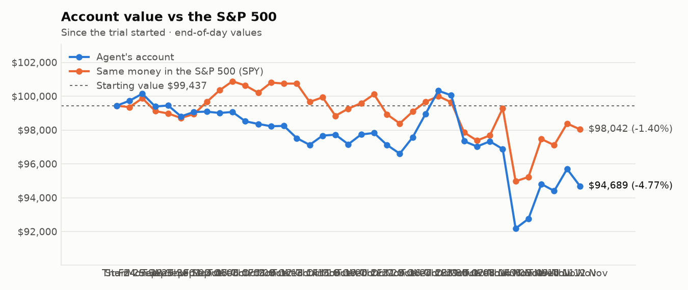
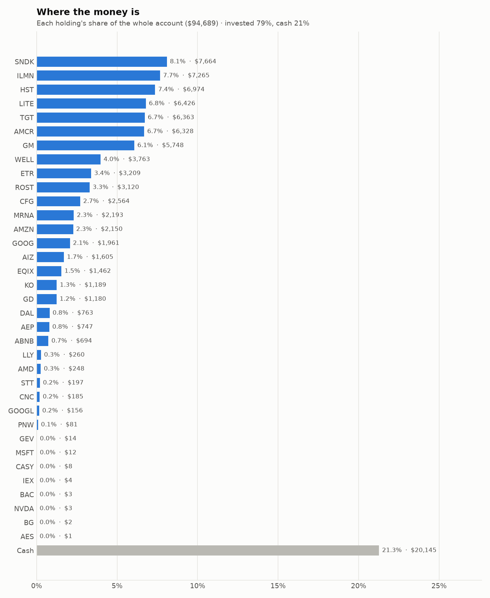
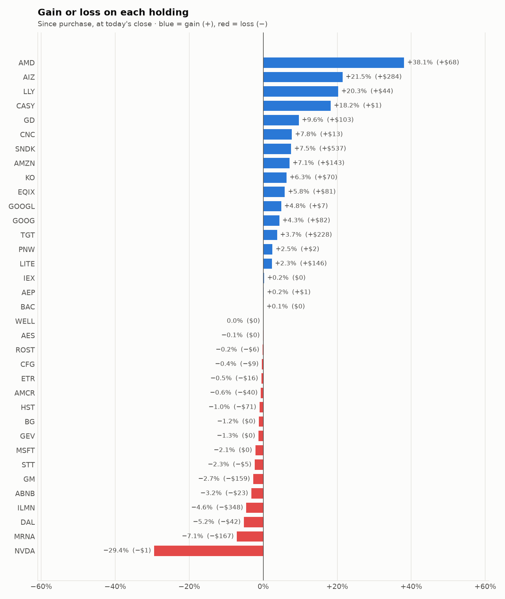

# Daily trading report — Thursday 12 November 2026

## Summary

- **Account value:** $94,689 (-$1,008, -1.1% today)
- **S&P 500 (SPY) today:** -0.3% — the agent was behind the index by 0.71%
- **Trades:** 2 buy(s) ($9,369), 6 sell(s) ($15,521)
- **2026-11-12 Morning rebalance:** traded — 8 order(s) placed
- **2026-11-12 Afternoon risk check:** no trades needed — Risk-checked 35 holding(s): none was 12%+ below its purchase price, and none had both clearly negative news and a price drop of 3%+ since entry.

## Charts

## Why I bought

### LITE — bought 10.241 shares at ~$613.21 ($6,280)

**Why:** combined score +0.99; ranked #8 of 503; driven mainly by price momentum +3.00, low volatility -1.18; entering/adding to the top-ranked target portfolio; research detail: 22 recent headline(s), net positive tone (+14); analyst consensus +1.11/2 (9 strong buy, 22 buy, 5 hold, 0 sell, 0 strong sell)

**Research scores** (combined +0.99, ranked #8 in the S&P 500, sector: Information Technology):

| Factor | Score | Measures |
|---|---|---|
| Value | -0.50 | cheap vs. sector peers on P/E and P/B |
| Quality | -1.11 | profitability (ROE, margins) and balance-sheet strength |
| Momentum | +3.00 | 12-month price trend, excluding the last month |
| Low volatility | -1.18 | steadier price than sector peers |
| Research | +1.06 | recent news tone + analyst consensus |

**Company financials (Finnhub, trailing 12 months):** P/B 14.3, return on equity -300.1%, gross margin 41.7%, debt/equity 0.35

**Price trend (Alpaca):** 12-month return (excl. last month) +560.4%, last month -34.4%, volatility 101.6%/yr

**News (Finnhub): 22 headline(s) in the last 2 days, net tone +14.** Most influential:
- [Lumentum Slips on Deal Reaction; Fossil Group Rallies on Outlook / Stock Movers](https://finnhub.io/api/news?id=2dbcdb3767be8c0926c2211474a712defa73f2a04c2dae976c8e552fe2e979d7) — 11 Nov, Yahoo (tone +3)
- [Applied Optoelectronics Surges 12%, Lumentum Jumps 11% as CoreWeave’s Results Revive AI Trade; Coherent Climbs 7%](https://finnhub.io/api/news?id=b165b48dafd8fe7598a6464d00f0bf87079f92866600bc0b21c227d811fbd3c5) — 11 Nov, Yahoo (tone +3)
- [Marvell Technology Stocks Surge 12.22% as AI Optics Rally Eases Lumentum Deal Doubts](https://finnhub.io/api/news?id=1dd7915d708f30f8720eb600d7f004cadc13cc0dea3d8ccacb29c50a0019d6f2) — 11 Nov, Yahoo (tone +2)
- [Coherent Rises 5% as CoreWeave’s Beat-and-Raise Revives the AI Trade: “A Breakout Quarter”](https://finnhub.io/api/news?id=dc49405b08b357a3c22a926b53111e39053444420629cdc9772d8da65435cd9a) — 11 Nov, Yahoo (tone +2)
- [Bernstein Maintains Outperform on Lumentum Holdings, Raises Price Target to $700](https://finnhub.io/api/news?id=c58421919e829d883f9ea6a1c228d51e9eae7198cf5f702128b29a5155ea2bf6) — 10 Nov, Benzinga (tone +2)

**Analysts (Finnhub, 2026-11-01):** 9 strong buy, 22 buy, 5 hold, 0 sell, 0 strong sell — consensus +1.11 on a -2 (strong sell) to +2 (strong buy) scale.

### ETR — bought 27.418 shares at ~$112.67 ($3,089)

**Why:** combined score +0.82; ranked #16 of 503; driven mainly by price momentum +1.66, research (news + analyst consensus) +1.54; entering/adding to the top-ranked target portfolio; research detail: 8 recent headline(s), net positive tone (+5); analyst consensus +1.00/2 (7 strong buy, 15 buy, 7 hold, 0 sell, 0 strong sell)

**Research scores** (combined +0.82, ranked #16 in the S&P 500, sector: Utilities):

| Factor | Score | Measures |
|---|---|---|
| Value | -0.77 | cheap vs. sector peers on P/E and P/B |
| Quality | +0.02 | profitability (ROE, margins) and balance-sheet strength |
| Momentum | +1.66 | 12-month price trend, excluding the last month |
| Low volatility | +0.02 | steadier price than sector peers |
| Research | +1.54 | recent news tone + analyst consensus |

**Company financials (Finnhub, trailing 12 months):** P/E 25.9, P/B 2.4, return on equity 11.2%, gross margin 42.0%, debt/equity 1.73

**Price trend (Alpaca):** 12-month return (excl. last month) +10.3%, last month +6.6%, volatility 17.1%/yr

**News (Finnhub): 8 headline(s) in the last 2 days, net tone +5.** Most influential:
- [Entergy CEO says election hasn’t changed power demand outlook as data center boom continues](https://finnhub.io/api/news?id=7f3617432a16c7fdf4bfe5f00bc54ba7d69e8d5859597c1d3284acb2d9d05d0a) — 10 Nov, CNBC (tone +2)
- [All You Need to Know About Entergy (ETR) Rating Upgrade to Buy](https://finnhub.io/api/news?id=7e13974671681ad35aba567af4e1433bd7c5253f1d1830104f79b192681a5be0) — 10 Nov, Yahoo (tone +1)
- [Learn Why The Bull Case For Entergy Stock Could Change Following Rate Plan Extension](https://finnhub.io/api/news?id=8fa049e857a3221c62a2dae963396794f29911eb41d2771cb197f83a47498612) — 10 Nov, Yahoo (tone +1)
- [Is Entergy (ETR) Priced Beyond What Its Dividend Can Support?](https://finnhub.io/api/news?id=33333fdbe3eb06dba575d80aa90488f3e3544b106ac769f781ac60b2fe811861) — 10 Nov, Yahoo (tone +1)
- [ETFs Are Net Sellers of Entergy (ETR) on Nov. 10](https://finnhub.io/api/news?id=e53ec3e4d900e60b850e0efd63dabd233dba0fd0709f5ee2a7f67e3a283dd0d4) — 12 Nov, Yahoo (tone +0)

**Analysts (Finnhub, 2026-11-01):** 7 strong buy, 15 buy, 7 hold, 0 sell, 0 strong sell — consensus +1.00 on a -2 (strong sell) to +2 (strong buy) scale.

## Why I sold

### GOOGL — sold 13.716 shares at ~$294.25 ($4,036)

**Why:** combined score +0.64; ranked #30 of 503; driven mainly by price momentum +1.70, value (cheapness) -0.63; trimmed toward target weight, or dropped out of the top-ranked names; research detail: 51 recent headline(s), net positive tone (+4); analyst consensus +1.19/2 (20 strong buy, 41 buy, 7 hold, 0 sell, 0 strong sell)

**Research scores** (combined +0.64, ranked #30 in the S&P 500, sector: Communication Services):

| Factor | Score | Measures |
|---|---|---|
| Value | -0.63 | cheap vs. sector peers on P/E and P/B |
| Quality | +0.09 | profitability (ROE, margins) and balance-sheet strength |
| Momentum | +1.70 | 12-month price trend, excluding the last month |
| Low volatility | +0.15 | steadier price than sector peers |
| Research | +0.61 | recent news tone + analyst consensus |

**Company financials (FMP, trailing 12 months):** P/E 15.1, P/B 5.3, return on equity 42.6%, gross margin 60.9%, debt/equity 0.21

**Price trend (Alpaca):** 12-month return (excl. last month) +49.5%, last month -17.0%, volatility 35.1%/yr

**News (Finnhub): 51 headline(s) in the last 2 days, net tone +4.** Most influential:
- [Marvell Acquires Lumentum in Blockbuster $80 Billion Deal](https://finnhub.io/api/news?id=d4bd92908d146b4356e44b56a87682db36c2216bbc72c1a5c246cb4cb799f9a3) — 11 Nov, Yahoo (tone +1)
- [Anthropic Says Its Revenue Run Rate Jumped to an $81 Billion Run Rate](https://finnhub.io/api/news?id=b4c63dc739a083bc5db8a04b42dc172d01e996581f1e674b9f176f7c5fcd6753) — 11 Nov, Yahoo (tone +1)
- [Nvidia and Broadcom Are Scaling AI Data Centers With This Growth Stock. Here's Why It Could Soar.](https://finnhub.io/api/news?id=313452b5346b9cfc7b46bf38c2b2721be25b8bd861212a8d1c86e57248755565) — 10 Nov, Yahoo (tone +1)
- [Alphabet and Amazon Custom Silicon: Full-Stack Vertical Integration Vs. Compute Cost-Arbitrage](https://finnhub.io/api/news?id=ac193d9b713f92a59f45bca117ef3942f0ad8b1648b332bf6a791e9a45e6bee7) — 10 Nov, Yahoo (tone +1)
- [Cathie Wood Bought Cerebras Before It Fell 54%. Is She Wrong, or Early?](https://finnhub.io/api/news?id=dc060e4130eb0e8c5e0ca3f322cf3314b95856db414fe2c8195fa576a45a9e34) — 12 Nov, Yahoo (tone +0)

**Analysts (Finnhub, 2026-11-01):** 20 strong buy, 41 buy, 7 hold, 0 sell, 0 strong sell — consensus +1.19 on a -2 (strong sell) to +2 (strong buy) scale.

### WELL — sold 13.725 shares at ~$246.33 ($3,381)

**Why:** combined score +0.85; ranked #12 of 503; driven mainly by price momentum +1.88, research (news + analyst consensus) +1.54; trimmed toward target weight, or dropped out of the top-ranked names; research detail: 4 recent headline(s), net positive tone (+5); analyst consensus +1.11/2 (6 strong buy, 19 buy, 3 hold, 0 sell, 0 strong sell)

**Research scores** (combined +0.85, ranked #12 in the S&P 500, sector: Real Estate):

| Factor | Score | Measures |
|---|---|---|
| Value | -0.72 | cheap vs. sector peers on P/E and P/B |
| Quality | -0.31 | profitability (ROE, margins) and balance-sheet strength |
| Momentum | +1.88 | 12-month price trend, excluding the last month |
| Low volatility | -0.07 | steadier price than sector peers |
| Research | +1.54 | recent news tone + analyst consensus |

**Company financials (Finnhub, trailing 12 months):** P/E 107.2, P/B 3.4, return on equity 3.7%, gross margin 40.0%, debt/equity 0.40

**Price trend (Alpaca):** 12-month return (excl. last month) +38.7%, last month +7.4%, volatility 21.3%/yr

**News (Finnhub): 4 headline(s) in the last 2 days, net tone +5.** Most influential:
- [RBC Capital Maintains Outperform on Welltower, Raises Price Target to $266](https://finnhub.io/api/news?id=794ed73bf0f965f5081f8cd7c4e66efec0864b7e61f9674e972e4795aa34cc85) — 10 Nov, Benzinga (tone +2)
- [UBS Maintains Buy on Welltower, Raises Price Target to $289](https://finnhub.io/api/news?id=712264b368393dc40856911083bc16694726796bf711241c1b3a9e0dd42ea0ff) — 11 Nov, Benzinga (tone +1)
- [Welltower's Senior Housing Portfolio Should Help Deliver FFO Growth in 2027, 2028, RBC Says](https://finnhub.io/api/news?id=00067a18d1817c3fd454bfb92613c08d8efebc4c6438aa4bf2667c364cacd259) — 10 Nov, Yahoo (tone +1)
- [JP Morgan Maintains Overweight on Welltower, Raises Price Target to $273](https://finnhub.io/api/news?id=31b5cfc8997c350dbfb30c90b2a4ce2523fd580d91f75567d3a91cd2338903cc) — 10 Nov, Benzinga (tone +1)

**Analysts (Finnhub, 2026-11-01):** 6 strong buy, 19 buy, 3 hold, 0 sell, 0 strong sell — consensus +1.11 on a -2 (strong sell) to +2 (strong buy) scale.

### GEV — sold 3.867 shares at ~$811.70 ($3,139)

**Why:** combined score +0.58; ranked #41 of 503; driven mainly by price momentum +1.60, low volatility -1.37; trimmed toward target weight, or dropped out of the top-ranked names; research detail: 21 recent headline(s), net positive tone (+2); analyst consensus +1.07/2 (11 strong buy, 24 buy, 6 hold, 1 sell, 0 strong sell)

**Research scores** (combined +0.58, ranked #41 in the S&P 500, sector: Industrials):

| Factor | Score | Measures |
|---|---|---|
| Value | +0.00 | cheap vs. sector peers on P/E and P/B |
| Quality | +0.00 | profitability (ROE, margins) and balance-sheet strength |
| Momentum | +1.60 | 12-month price trend, excluding the last month |
| Low volatility | -1.37 | steadier price than sector peers |
| Research | +0.36 | recent news tone + analyst consensus |

**Price trend (Alpaca):** 12-month return (excl. last month) +65.7%, last month -19.3%, volatility 55.7%/yr

**News (Finnhub): 21 headline(s) in the last 2 days, net tone +2.** Most influential:
- [GE Vernova's Orders Jumped 96%. The Number Hiding Underneath Is Electrification's 9% Decline.](https://finnhub.io/api/news?id=cf855bc3378d7db1b6e058e79316d9db7ef2daf0b3ad87c3f3f3a00525404003) — 11 Nov, Yahoo (tone +1)
- [GE Vernova Stock Rebounds as AI Optimism Counters SoftBank Concerns](https://finnhub.io/api/news?id=647573f4c955171a6e919e1928919f0f7e50e9fee74b79153354c026ec348373) — 11 Nov, Benzinga (tone -1)
- [GE Vernova, Vertiv, and Bloom Energy Just Lost 10% to 24% in a Week. Here's What Set Off the AI Power Sell-off.](https://finnhub.io/api/news?id=e6c6880e659ae317722f77e155f25c16cc47cf3d6c7bcec00ee2bd9b3d66f768) — 10 Nov, Yahoo (tone +1)
- [GE Vernova To Invest $34.5M In Shreveport Facility Expansion To Meet Growing Grid Infrastructure Demand](https://finnhub.io/api/news?id=5a0dc1878453e7bf70e3ff5ce4b015a3826b4268348c740ad4326a1f90d2654a) — 10 Nov, Benzinga (tone +1)
- [GE Vernova’s Ontario Nuclear Plant Is Facing Delays And Rising Costs](https://finnhub.io/api/news?id=c7e1f3d82109d908059d93c2c104efacc828deede20a0780a34866de7a63c92f) — 11 Nov, Yahoo (tone +0)

**Analysts (Finnhub, 2026-11-01):** 11 strong buy, 24 buy, 6 hold, 1 sell, 0 strong sell — consensus +1.07 on a -2 (strong sell) to +2 (strong buy) scale.

### GOOG — sold 6.034 shares at ~$291.38 ($1,758)

**Why:** combined score +0.74; ranked #20 of 503; driven mainly by price momentum +1.64, research (news + analyst consensus) +1.10; trimmed toward target weight, or dropped out of the top-ranked names; research detail: 53 recent headline(s), net positive tone (+7); analyst consensus +1.19/2 (20 strong buy, 41 buy, 7 hold, 0 sell, 0 strong sell)

**Research scores** (combined +0.74, ranked #20 in the S&P 500, sector: Communication Services):

| Factor | Score | Measures |
|---|---|---|
| Value | -0.67 | cheap vs. sector peers on P/E and P/B |
| Quality | +0.09 | profitability (ROE, margins) and balance-sheet strength |
| Momentum | +1.64 | 12-month price trend, excluding the last month |
| Low volatility | +0.24 | steadier price than sector peers |
| Research | +1.10 | recent news tone + analyst consensus |

**Company financials (Finnhub, trailing 12 months):** P/E 15.3, P/B 6.2, return on equity 42.6%, gross margin 60.9%, debt/equity 0.18

**Price trend (Alpaca):** 12-month return (excl. last month) +47.2%, last month -16.9%, volatility 33.7%/yr

**News (Finnhub): 53 headline(s) in the last 2 days, net tone +7.** Most influential:
- [Is Wall Street Turning on AI?](https://finnhub.io/api/news?id=823ba12888a38b1e7a551dbfc81ac687d11ea4e328049a7144f5e5bb3b1d80d2) — 09 Nov, Yahoo (tone +2)
- [Marvell Acquires Lumentum in Blockbuster $80 Billion Deal](https://finnhub.io/api/news?id=d4bd92908d146b4356e44b56a87682db36c2216bbc72c1a5c246cb4cb799f9a3) — 11 Nov, Yahoo (tone +1)
- [Anthropic Says Its Revenue Run Rate Jumped to an $81 Billion Run Rate](https://finnhub.io/api/news?id=b4c63dc739a083bc5db8a04b42dc172d01e996581f1e674b9f176f7c5fcd6753) — 11 Nov, Yahoo (tone +1)
- [Nvidia and Broadcom Are Scaling AI Data Centers With This Growth Stock. Here's Why It Could Soar.](https://finnhub.io/api/news?id=313452b5346b9cfc7b46bf38c2b2721be25b8bd861212a8d1c86e57248755565) — 10 Nov, Yahoo (tone +1)
- [Alphabet and Amazon Custom Silicon: Full-Stack Vertical Integration Vs. Compute Cost-Arbitrage](https://finnhub.io/api/news?id=ac193d9b713f92a59f45bca117ef3942f0ad8b1648b332bf6a791e9a45e6bee7) — 10 Nov, Yahoo (tone +1)

**Analysts (Finnhub, 2026-11-01):** 20 strong buy, 41 buy, 7 hold, 0 sell, 0 strong sell — consensus +1.19 on a -2 (strong sell) to +2 (strong buy) scale.

### AMZN — sold 6.006 shares at ~$271.15 ($1,629)

**Why:** combined score +0.76; ranked #18 of 503; driven mainly by research (news + analyst consensus) +2.10, price momentum +0.79; trimmed toward target weight, or dropped out of the top-ranked names; research detail: 69 recent headline(s), net positive tone (+17); analyst consensus +1.23/2 (19 strong buy, 48 buy, 3 hold, 0 sell, 0 strong sell)

**Research scores** (combined +0.76, ranked #18 in the S&P 500, sector: Consumer Discretionary):

| Factor | Score | Measures |
|---|---|---|
| Value | -0.21 | cheap vs. sector peers on P/E and P/B |
| Quality | +0.09 | profitability (ROE, margins) and balance-sheet strength |
| Momentum | +0.79 | 12-month price trend, excluding the last month |
| Low volatility | -0.40 | steadier price than sector peers |
| Research | +2.10 | recent news tone + analyst consensus |

**Company financials (FMP, trailing 12 months):** P/E 21.7, P/B 4.8, return on equity 26.7%, gross margin 51.4%, debt/equity 0.44

**Price trend (Alpaca):** 12-month return (excl. last month) +19.6%, last month +2.9%, volatility 32.2%/yr

**News (Finnhub): 69 headline(s) in the last 2 days, net tone +17.** Most influential:
- [Will Rising AI Capex Weigh on Amazon's Free Cash Flow Prospects?](https://finnhub.io/api/news?id=de65b108c8f0f3c249c6a33385c933509c744132e71a285d568f22fcf2d5db37) — 11 Nov, Yahoo (tone +2)
- [Amazon’s AWS Strength Outpowers Its Tailwainds So I Accumulate](https://finnhub.io/api/news?id=306577b41ad3d14417fd8d2a1e80321aeadc0d065be808c6727ec03ea376f164) — 10 Nov, Yahoo (tone +2)
- [Amazon: Still Priced Well Below The Promises](https://finnhub.io/api/news?id=6ed71467acdb11a8e57b6bbc4d937649b40c6f841d3e3ba7cedad808e083caec) — 10 Nov, SeekingAlpha (tone +2)
- [Amazon Stock At $266: How Much Of Its Profit Is Anthropic?](https://finnhub.io/api/news?id=a382b1040a79d2c34230ed64de0985d74e8a6b4a802fffd940f2ab987a0bc8eb) — 12 Nov, Yahoo (tone +1)
- [AWS Will Keep Amazon Profitable For Years To Come](https://finnhub.io/api/news?id=2402f879922d0170aa26f85098ceb0710cded516a48baeb3465e5326beef995f) — 12 Nov, SeekingAlpha (tone +1)

**Analysts (Finnhub, 2026-11-01):** 19 strong buy, 48 buy, 3 hold, 0 sell, 0 strong sell — consensus +1.23 on a -2 (strong sell) to +2 (strong buy) scale.

### DAL — sold 17.662 shares at ~$89.41 ($1,579)

**Why:** combined score +0.68; ranked #25 of 503; driven mainly by value (cheapness) +1.76, price momentum +0.76; trimmed toward target weight, or dropped out of the top-ranked names; research detail: 2 recent headline(s), neutral/mixed tone; analyst consensus +1.13/2 (7 strong buy, 20 buy, 3 hold, 0 sell, 0 strong sell)

**Research scores** (combined +0.68, ranked #25 in the S&P 500, sector: Industrials):

| Factor | Score | Measures |
|---|---|---|
| Value | +1.76 | cheap vs. sector peers on P/E and P/B |
| Quality | +0.15 | profitability (ROE, margins) and balance-sheet strength |
| Momentum | +0.76 | 12-month price trend, excluding the last month |
| Low volatility | -0.47 | steadier price than sector peers |
| Research | +0.24 | recent news tone + analyst consensus |

**Company financials (Finnhub, trailing 12 months):** P/E 18.4, P/B 2.4, return on equity 15.4%, gross margin 45.9%, debt/equity 0.57

**Price trend (Alpaca):** 12-month return (excl. last month) +38.4%, last month +14.8%, volatility 36.2%/yr

**News (Finnhub): 2 headline(s) in the last 2 days, net tone +0.** Most influential:
- [Market Chatter: Delta Air Lines, Virgin Atlantic to Challenge Heathrow Terminal Move](https://finnhub.io/api/news?id=4f7f866f11b76622d631f5f5a2b1c24c0e8eee801810f13adc8a021e9ff0a510) — 11 Nov, Yahoo (tone +0)
- [Calls of the day: Carlyle Group, Ross Stores, TJX Companies, Mastercard, Delta Air Lines and Walmart](https://finnhub.io/api/news?id=a367859125083b4e191371c92381afbac3bc1dedf627614fc419469bb20b926b) — 10 Nov, CNBC (tone +0)

**Analysts (Finnhub, 2026-11-01):** 7 strong buy, 20 buy, 3 hold, 0 sell, 0 strong sell — consensus +1.13 on a -2 (strong sell) to +2 (strong buy) scale.

## Holdings at the close

| Stock | Shares | Avg cost | Price | Market value | % of account | Today | Gain/loss $ | Gain/loss % |
|---|---:|---:|---:|---:|---:|---:|---:|---:|
| SNDK | 8.125 | $877.18 | $943.29 | $7,664 | 8.1% | -3.52% | +$537 | +7.54% |
| ILMN | 34.671 | $219.58 | $209.55 | $7,265 | 7.7% | -1.59% | −$348 | -4.57% |
| HST | 273.295 | $25.78 | $25.52 | $6,974 | 7.4% | -1.01% | −$71 | -1.01% |
| LITE | 10.241 | $613.21 | $627.50 | $6,426 | 6.8% | -3.17% | +$146 | +2.33% |
| TGT | 39.544 | $155.12 | $160.90 | $6,363 | 6.7% | -1.11% | +$228 | +3.72% |
| AMCR | 144.466 | $44.08 | $43.80 | $6,328 | 6.7% | -1.33% | −$40 | -0.63% |
| GM | 66.644 | $88.64 | $86.25 | $5,748 | 6.1% | -2.98% | −$159 | -2.70% |
| WELL | 15.364 | $244.94 | $244.93 | $3,763 | 4.0% | -0.98% | −$0 | -0.00% |
| ETR | 28.668 | $112.52 | $111.95 | $3,209 | 3.4% | -0.04% | −$16 | -0.50% |
| ROST | 13.152 | $237.68 | $237.24 | $3,120 | 3.3% | -1.67% | −$6 | -0.18% |
| CFG | 39.526 | $65.10 | $64.86 | $2,564 | 2.7% | -0.80% | −$9 | -0.37% |
| MRNA | 9.463 | $249.40 | $231.70 | $2,193 | 2.3% | -6.83% | −$167 | -7.10% |
| AMZN | 8.05 | $249.42 | $267.13 | $2,150 | 2.3% | +0.36% | +$143 | +7.10% |
| GOOG | 6.625 | $283.65 | $295.98 | $1,961 | 2.1% | +1.84% | +$82 | +4.35% |
| AIZ | 5 | $264.38 | $321.09 | $1,605 | 1.7% | -0.71% | +$284 | +21.45% |
| EQIX | 1.363 | $1,013.54 | $1,072.77 | $1,462 | 1.5% | +0.44% | +$81 | +5.84% |
| KO | 12.203 | $91.67 | $97.44 | $1,189 | 1.3% | -0.13% | +$70 | +6.29% |
| GD | 3.251 | $331.27 | $363.07 | $1,180 | 1.2% | -1.13% | +$103 | +9.60% |
| DAL | 8.808 | $91.40 | $86.62 | $763 | 0.8% | -5.15% | −$42 | -5.23% |
| AEP | 5.798 | $128.70 | $128.91 | $747 | 0.8% | -0.23% | +$1 | +0.16% |
| ABNB | 3.834 | $187.14 | $181.13 | $694 | 0.7% | +0.00% | −$23 | -3.21% |
| LLY | 0.182 | $1,189.78 | $1,430.83 | $260 | 0.3% | -0.45% | +$44 | +20.26% |
| AMD | 0.424 | $423.91 | $585.36 | $248 | 0.3% | +5.87% | +$68 | +38.09% |
| STT | 1.134 | $177.81 | $173.70 | $197 | 0.2% | -0.27% | −$5 | -2.31% |
| CNC | 2.63 | $65.21 | $70.27 | $185 | 0.2% | -0.30% | +$13 | +7.76% |
| GOOGL | 0.52 | $285.38 | $299.20 | $156 | 0.2% | +1.96% | +$7 | +4.84% |
| PNW | 0.753 | $104.41 | $107.03 | $81 | 0.1% | -0.82% | +$2 | +2.51% |
| GEV | 0.017 | $829.15 | $818.49 | $14 | 0.0% | +1.27% | −$0 | -1.29% |
| MSFT | 0.023 | $533.80 | $522.40 | $12 | 0.0% | +0.25% | −$0 | -2.13% |
| CASY | 0.011 | $597.62 | $706.63 | $8 | 0.0% | -1.05% | +$1 | +18.24% |
| IEX | 0.018 | $237.47 | $238.03 | $4 | 0.0% | -0.80% | +$0 | +0.24% |
| BAC | 0.054 | $50.53 | $50.56 | $3 | 0.0% | -0.22% | +$0 | +0.05% |
| NVDA | 0.016 | $236.88 | $167.13 | $3 | 0.0% | -3.80% | −$1 | -29.45% |
| BG | 0.019 | $101.20 | $99.98 | $2 | 0.0% | -0.30% | −$0 | -1.21% |
| AES | 0.096 | $14.92 | $14.91 | $1 | 0.0% | -0.07% | −$0 | -0.07% |
| **Invested** | | | | **$74,544** | **78.7%** | | **+$923** | |
| **Cash** | | | | $20,145 | 21.3% | | | |
| **Total account** | | | | **$94,689** | 100% | | | |

_Scores are sector-neutral z-scores: 0 is average for the stock's sector, +1 is one standard deviation better. News tone is a keyword count over recent headlines, not a deep read. None of this guarantees a stock will rise; a few days of results can't show whether the strategy has a real edge over the S&P 500._
