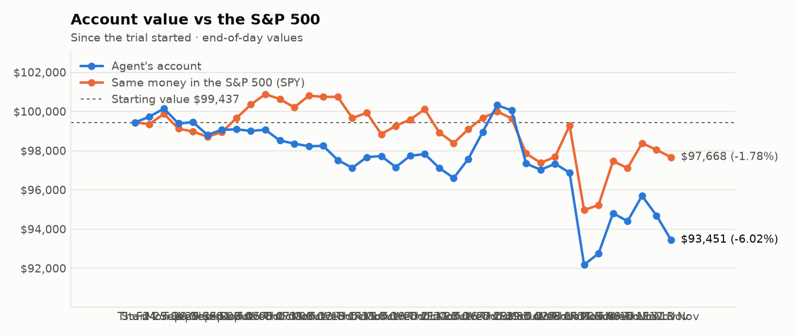
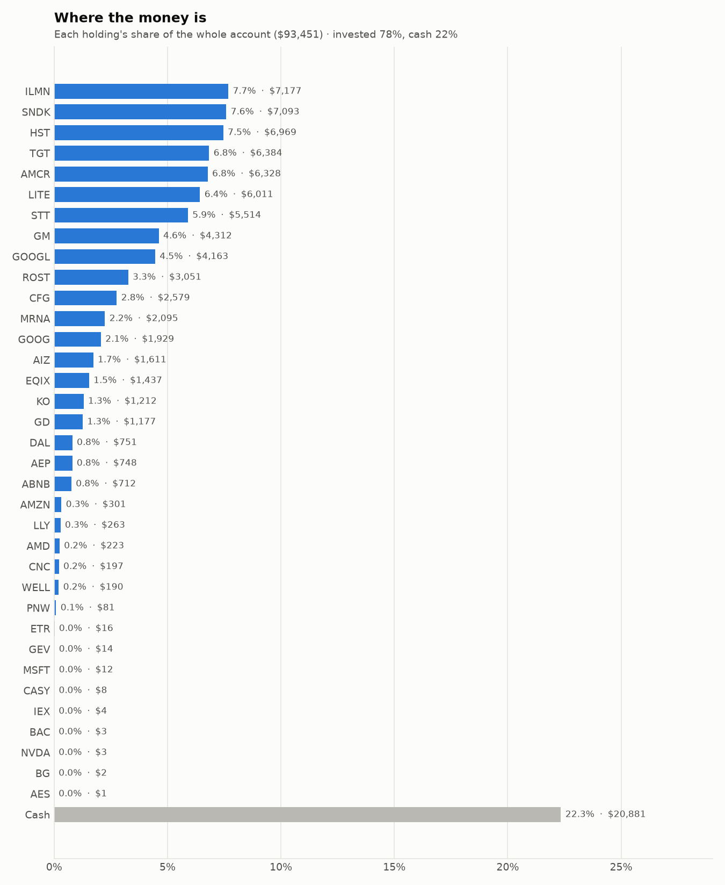
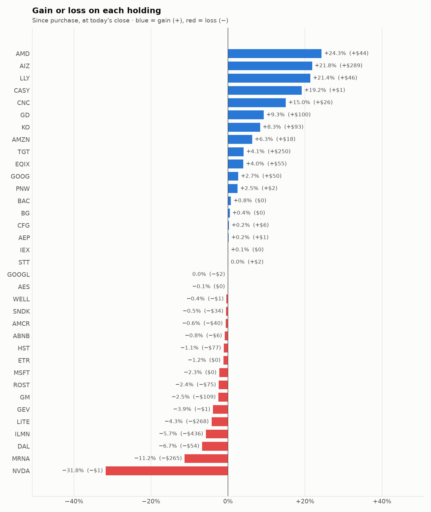

# Daily trading report — Friday 13 November 2026

## Summary

- **Account value:** $93,451 (-$1,238, -1.3% today)
- **S&P 500 (SPY) today:** -0.4% — the agent was behind the index by 0.93%
- **Trades:** 2 buy(s) ($9,327), 4 sell(s) ($10,063)
- **2026-11-13 Morning rebalance:** traded — 6 order(s) placed
- **2026-11-13 Afternoon risk check:** no trades needed — Risk-checked 35 holding(s): none was 12%+ below its purchase price, and none had both clearly negative news and a price drop of 3%+ since entry.

## Charts

## Why I bought

### STT — bought 30.656 shares at ~$173.22 ($5,310)

**Why:** combined score +0.93; ranked #7 of 503; driven mainly by price momentum +1.87, research (news + analyst consensus) +0.68; entering/adding to the top-ranked target portfolio; research detail: 8 recent headline(s), net positive tone (+4); analyst consensus +0.81/2 (3 strong buy, 11 buy, 7 hold, 0 sell, 0 strong sell)

**Research scores** (combined +0.93, ranked #7 in the S&P 500, sector: Financials):

| Factor | Score | Measures |
|---|---|---|
| Value | +0.42 | cheap vs. sector peers on P/E and P/B |
| Quality | -0.03 | profitability (ROE, margins) and balance-sheet strength |
| Momentum | +1.87 | 12-month price trend, excluding the last month |
| Low volatility | +0.43 | steadier price than sector peers |
| Research | +0.68 | recent news tone + analyst consensus |

**Company financials (Finnhub, trailing 12 months):** P/E 12.8, P/B 1.7, return on equity 13.1%, debt/equity 0.92

**Price trend (Alpaca):** 12-month return (excl. last month) +46.0%, last month +4.1%, volatility 22.7%/yr

**News (Finnhub): 8 headline(s) in the last 2 days, net tone +4.** Most influential:
- [Zacks Industry Outlook Highlights U.S. Bank, State Street and KeyCorp](https://finnhub.io/api/news?id=3f9a9e92d01356c17d98a8ae5cc20fb8b2dfa6867f60d69512702dc88c20f2b6) — 12 Nov, Yahoo (tone +2)
- [Is State Street SPDR S&P Homebuilders ETF (XHB) a Strong ETF Right Now?](https://finnhub.io/api/news?id=cbfe8a0da123ca696c2e8c2181644e191cafd05fb48be5810028728074dee4c4) — 13 Nov, Yahoo (tone +1)
- [Drug Makers or Biotech Bets: Which ETF Is the Better Buy, State Street’s XPH or First Trust’s FBT?](https://finnhub.io/api/news?id=b3739fbafc1918b1c24881c48e028caa850d73b2dbf8529e3d220c321418196f) — 11 Nov, Yahoo (tone +1)
- [How State Street and Savvy forged new paths to add to the custody competition](https://finnhub.io/api/news?id=356b2067f430deb6e24668eb301a56589bc9270d83646584bf26ec41ab014972) — 12 Nov, Yahoo (tone +0)
- [State Street Corporation Declares Dividends on Its Non-Cumulative Perpetual Preferred Stock Series "G," "I," "J," "K," and "L"](https://finnhub.io/api/news?id=7298ad7aa1aacaeb5cb431ca3a09a03e3d0c4e2d8088bb9137d9b19f42b041bd) — 12 Nov, Yahoo (tone +0)

**Analysts (Finnhub, 2026-11-01):** 3 strong buy, 11 buy, 7 hold, 0 sell, 0 strong sell — consensus +0.81 on a -2 (strong sell) to +2 (strong buy) scale.

### GOOGL — bought 13.609 shares at ~$295.13 ($4,016)

**Why:** combined score +0.85; ranked #13 of 503; driven mainly by research (news + analyst consensus) +1.62, price momentum +1.58; entering/adding to the top-ranked target portfolio; research detail: 53 recent headline(s), net positive tone (+11); analyst consensus +1.19/2 (20 strong buy, 41 buy, 7 hold, 0 sell, 0 strong sell)

**Research scores** (combined +0.85, ranked #13 in the S&P 500, sector: Communication Services):

| Factor | Score | Measures |
|---|---|---|
| Value | -0.63 | cheap vs. sector peers on P/E and P/B |
| Quality | +0.09 | profitability (ROE, margins) and balance-sheet strength |
| Momentum | +1.58 | 12-month price trend, excluding the last month |
| Low volatility | +0.15 | steadier price than sector peers |
| Research | +1.62 | recent news tone + analyst consensus |

**Company financials (FMP, trailing 12 months):** P/E 15.1, P/B 5.3, return on equity 42.6%, gross margin 60.9%, debt/equity 0.21

**Price trend (Alpaca):** 12-month return (excl. last month) +42.5%, last month -14.1%, volatility 35.3%/yr

**News (Finnhub): 53 headline(s) in the last 2 days, net tone +11.** Most influential:
- [AMD Swung 17% Down and Back in One Week: Take Profits, or Buy More?](https://finnhub.io/api/news?id=8e72e40331bede34ef0378976b0e9a4f605e8828ef2ec36192a008212770a275) — 12 Nov, Yahoo (tone +2)
- [Alphabet: Story Behind The Inevitable Cost Of Future Growth](https://finnhub.io/api/news?id=b899ddf5b2b0bd05547a0fffe161d9bd64b4d9a8d53e1002e89be2545d3b2b20) — 12 Nov, SeekingAlpha (tone +2)
- [Broadcom Just Gained 25% in a Week: Take Profits, or Buy More?](https://finnhub.io/api/news?id=0d3682859d665a72b8d6b77db44ce280e453e474a2f747c60505b44e78b8cbd7) — 13 Nov, Yahoo (tone +1)
- [Zacks Earnings Trends Highlights: Micron, Nvidia and Alphabet](https://finnhub.io/api/news?id=e131fde0e366f2887f087ee50bb84bf1ba10a2d173856d8f9e7552fde9bac136) — 13 Nov, Yahoo (tone +1)
- [Alphabet Draws $5 Billion in Orders as AI Frenzy Builds](https://finnhub.io/api/news?id=9065d293b3155149849b94771ecd903e2f64bab5f1f307bd32ecf4c084ce1640) — 12 Nov, Yahoo (tone +1)

**Analysts (Finnhub, 2026-11-01):** 20 strong buy, 41 buy, 7 hold, 0 sell, 0 strong sell — consensus +1.19 on a -2 (strong sell) to +2 (strong buy) scale.

## Why I sold

### WELL — sold 14.588 shares at ~$245.49 ($3,581)

**Why:** combined score +0.63; ranked #30 of 503; driven mainly by price momentum +2.01, value (cheapness) -0.72; trimmed toward target weight, or dropped out of the top-ranked names; research detail: 1 recent headline(s), net positive tone (+1); analyst consensus +1.11/2 (6 strong buy, 19 buy, 3 hold, 0 sell, 0 strong sell)

**Research scores** (combined +0.63, ranked #30 in the S&P 500, sector: Real Estate):

| Factor | Score | Measures |
|---|---|---|
| Value | -0.72 | cheap vs. sector peers on P/E and P/B |
| Quality | -0.31 | profitability (ROE, margins) and balance-sheet strength |
| Momentum | +2.01 | 12-month price trend, excluding the last month |
| Low volatility | -0.07 | steadier price than sector peers |
| Research | +0.49 | recent news tone + analyst consensus |

**Company financials (Finnhub, trailing 12 months):** P/E 106.8, P/B 3.4, return on equity 3.7%, gross margin 40.0%, debt/equity 0.40

**Price trend (Alpaca):** 12-month return (excl. last month) +39.2%, last month +5.5%, volatility 21.4%/yr

**News (Finnhub): 1 headline(s) in the last 2 days, net tone +1.** Most influential:
- [UBS Maintains Buy on Welltower, Raises Price Target to $289](https://finnhub.io/api/news?id=712264b368393dc40856911083bc16694726796bf711241c1b3a9e0dd42ea0ff) — 11 Nov, Benzinga (tone +1)

**Analysts (Finnhub, 2026-11-01):** 6 strong buy, 19 buy, 3 hold, 0 sell, 0 strong sell — consensus +1.11 on a -2 (strong sell) to +2 (strong buy) scale.

### ETR — sold 28.523 shares at ~$111.91 ($3,192)

**Why:** combined score +0.51; ranked #54 of 503; driven mainly by price momentum +1.35, research (news + analyst consensus) +0.14; trimmed toward target weight, or dropped out of the top-ranked names; research detail: 5 recent headline(s), neutral/mixed tone; analyst consensus +1.00/2 (7 strong buy, 15 buy, 7 hold, 0 sell, 0 strong sell)

**Research scores** (combined +0.51, ranked #54 in the S&P 500, sector: Utilities):

| Factor | Score | Measures |
|---|---|---|
| Value | +0.00 | cheap vs. sector peers on P/E and P/B |
| Quality | +0.00 | profitability (ROE, margins) and balance-sheet strength |
| Momentum | +1.35 | 12-month price trend, excluding the last month |
| Low volatility | +0.06 | steadier price than sector peers |
| Research | +0.14 | recent news tone + analyst consensus |

**Price trend (Alpaca):** 12-month return (excl. last month) +9.1%, last month +7.2%, volatility 17.0%/yr

**News (Finnhub): 5 headline(s) in the last 2 days, net tone +0.** Most influential:
- [ETFs Are Net Sellers of Entergy (ETR) on Nov. 11](https://finnhub.io/api/news?id=f5766eccd8877ea16b74030f7f62c66273b33c6a827ac5200905e10be874124b) — 13 Nov, Yahoo (tone +0)
- [Are Utilities Stocks Lagging  Entergy (ETR) This Year?](https://finnhub.io/api/news?id=b855044f0c08ab744f778a4ff3e9ec1ea8aea1634d57eb40034df055819dbd11) — 12 Nov, Yahoo (tone +0)
- [ETFs Are Net Sellers of Entergy (ETR) on Nov. 10](https://finnhub.io/api/news?id=e53ec3e4d900e60b850e0efd63dabd233dba0fd0709f5ee2a7f67e3a283dd0d4) — 12 Nov, Yahoo (tone +0)
- [Entergy Corporation (ETR) Presents at EEI Financial Conference - Slideshow](https://finnhub.io/api/news?id=b7a79ff8c9fafd1a2a89ed1c2ace3c15b95c5d6b7bc05d7076b047b74a2c42db) — 11 Nov, SeekingAlpha (tone +0)
- [Here's How Much $1000 Invested In Entergy 5 Years Ago Would Be Worth Today](https://finnhub.io/api/news?id=25ddc3ad6dcbf146cf0d17b473afbea3d66e751d2bf78266def14c3da9e36815) — 11 Nov, Benzinga (tone +0)

**Analysts (Finnhub, 2026-11-01):** 7 strong buy, 15 buy, 7 hold, 0 sell, 0 strong sell — consensus +1.00 on a -2 (strong sell) to +2 (strong buy) scale.

### AMZN — sold 6.915 shares at ~$265.61 ($1,837)

**Why:** combined score +0.64; ranked #26 of 503; driven mainly by research (news + analyst consensus) +1.70, price momentum +0.73; trimmed toward target weight, or dropped out of the top-ranked names; research detail: 51 recent headline(s), net positive tone (+10); analyst consensus +1.23/2 (19 strong buy, 48 buy, 3 hold, 0 sell, 0 strong sell)

**Research scores** (combined +0.64, ranked #26 in the S&P 500, sector: Consumer Discretionary):

| Factor | Score | Measures |
|---|---|---|
| Value | -0.18 | cheap vs. sector peers on P/E and P/B |
| Quality | +0.09 | profitability (ROE, margins) and balance-sheet strength |
| Momentum | +0.73 | 12-month price trend, excluding the last month |
| Low volatility | -0.40 | steadier price than sector peers |
| Research | +1.70 | recent news tone + analyst consensus |

**Company financials (FMP, trailing 12 months):** P/E 21.2, P/B 4.7, return on equity 26.7%, gross margin 51.4%, debt/equity 0.44

**Price trend (Alpaca):** 12-month return (excl. last month) +15.5%, last month +5.2%, volatility 31.8%/yr

**News (Finnhub): 51 headline(s) in the last 2 days, net tone +10.** Most influential:
- [Global Fifth Party Logistics (5PL) Market Report 2026 / Capitalize on AI-Led Growth to $21.99 Billion by 2030 as Amazon, UPS, DHL, Kuehne + Nagel and DSV Scale Orchestration](https://finnhub.io/api/news?id=1fac68a037f74a3bb786376be4521e010444f3e5122530670a1751b4bac00eb6) — 12 Nov, Yahoo (tone +2)
- [Will Rising AI Capex Weigh on Amazon's Free Cash Flow Prospects?](https://finnhub.io/api/news?id=de65b108c8f0f3c249c6a33385c933509c744132e71a285d568f22fcf2d5db37) — 11 Nov, Yahoo (tone +2)
- [Amazon Stock At $266: How Much Of Its Profit Is Anthropic?](https://finnhub.io/api/news?id=a382b1040a79d2c34230ed64de0985d74e8a6b4a802fffd940f2ab987a0bc8eb) — 12 Nov, Yahoo (tone +1)
- [AWS Will Keep Amazon Profitable For Years To Come](https://finnhub.io/api/news?id=2402f879922d0170aa26f85098ceb0710cded516a48baeb3465e5326beef995f) — 12 Nov, SeekingAlpha (tone +1)
- [Amazon (AMZN) Could Face Trial In Italy Over Unpaid Import VAT](https://finnhub.io/api/news?id=8f440b43105e84228904a23419f442ea9d949a24989ada2f979408c3ef329849) — 11 Nov, Yahoo (tone -1)

**Analysts (Finnhub, 2026-11-01):** 19 strong buy, 48 buy, 3 hold, 0 sell, 0 strong sell — consensus +1.23 on a -2 (strong sell) to +2 (strong buy) scale.

### GM — sold 16.77 shares at ~$86.62 ($1,453)

**Why:** combined score +0.86; ranked #12 of 503; driven mainly by price momentum +1.81, value (cheapness) +0.94; trimmed toward target weight, or dropped out of the top-ranked names; research detail: 7 recent headline(s), net positive tone (+3); analyst consensus +1.14/2 (11 strong buy, 18 buy, 6 hold, 0 sell, 0 strong sell)

**Research scores** (combined +0.86, ranked #12 in the S&P 500, sector: Consumer Discretionary):

| Factor | Score | Measures |
|---|---|---|
| Value | +0.94 | cheap vs. sector peers on P/E and P/B |
| Quality | -0.67 | profitability (ROE, margins) and balance-sheet strength |
| Momentum | +1.81 | 12-month price trend, excluding the last month |
| Low volatility | -0.15 | steadier price than sector peers |
| Research | +0.59 | recent news tone + analyst consensus |

**Company financials (FMP, trailing 12 months):** P/E 19.6, P/B 1.2, return on equity 6.3%, gross margin 9.0%, debt/equity 2.05

**Price trend (Alpaca):** 12-month return (excl. last month) +49.3%, last month +3.9%, volatility 39.0%/yr

**News (Finnhub): 7 headline(s) in the last 2 days, net tone +3.** Most influential:
- [MP Materials (MP) Q3 Beat Raises The Question Of Whether Its Story Is Already Priced In](https://finnhub.io/api/news?id=cf7791e820548949235c8944c880655815e3a92496273b21759334f16263a623) — 11 Nov, Yahoo (tone +2)
- [A $776 Car Payment Is a Warning for Ford and General Motors](https://finnhub.io/api/news?id=1f1bd47b26663994c13618ceaaa53b98e5b8ea0c01ca32898a320a5e9fff232f) — 12 Nov, Yahoo (tone -1)
- [MP Materials Clears GM Magnet Milestone, Targets Apple as Next Customer](https://finnhub.io/api/news?id=e56da536b8b6ef5c4f0cb62d80c145b5fa47ba5f366c42cc89d30303c28adc54) — 11 Nov, Yahoo (tone +1)
- [3 Stocks Wall Street Likes More Than the Market Does](https://finnhub.io/api/news?id=9083ba3ea39ae2122b629be3cb1d52d026d5506d0d7fbfa1f83089534343a65b) — 11 Nov, Yahoo (tone +1)
- [GM invests $550M into solar projects to offset factory emissions](https://finnhub.io/api/news?id=8e3e10ee7a2a57fa0d5efd14e0b9c730b3ac1df43fbee40694a9a61aad377c3a) — 12 Nov, Yahoo (tone +0)

**Analysts (Finnhub, 2026-11-01):** 11 strong buy, 18 buy, 6 hold, 0 sell, 0 strong sell — consensus +1.14 on a -2 (strong sell) to +2 (strong buy) scale.

## Holdings at the close

| Stock | Shares | Avg cost | Price | Market value | % of account | Today | Gain/loss $ | Gain/loss % |
|---|---:|---:|---:|---:|---:|---:|---:|---:|
| ILMN | 34.671 | $219.58 | $207.01 | $7,177 | 7.7% | -1.21% | −$436 | -5.72% |
| SNDK | 8.125 | $877.18 | $872.98 | $7,093 | 7.6% | -6.88% | −$34 | -0.48% |
| HST | 273.295 | $25.78 | $25.50 | $6,969 | 7.5% | -0.08% | −$77 | -1.09% |
| TGT | 39.544 | $155.12 | $161.45 | $6,384 | 6.8% | +0.34% | +$250 | +4.08% |
| AMCR | 144.466 | $44.08 | $43.80 | $6,328 | 6.8% | +0.00% | −$40 | -0.63% |
| LITE | 10.241 | $613.21 | $586.99 | $6,011 | 6.4% | -6.03% | −$268 | -4.28% |
| STT | 31.79 | $173.38 | $173.45 | $5,514 | 5.9% | -0.14% | +$2 | +0.04% |
| GM | 49.874 | $88.64 | $86.46 | $4,312 | 4.6% | +0.24% | −$109 | -2.46% |
| GOOGL | 14.129 | $294.77 | $294.66 | $4,163 | 4.5% | -1.35% | −$2 | -0.04% |
| ROST | 13.152 | $237.68 | $231.99 | $3,051 | 3.3% | -2.21% | −$75 | -2.39% |
| CFG | 39.526 | $65.10 | $65.26 | $2,579 | 2.8% | +0.62% | +$6 | +0.25% |
| MRNA | 9.463 | $249.40 | $221.35 | $2,095 | 2.2% | -4.32% | −$265 | -11.25% |
| GOOG | 6.625 | $283.69 | $291.24 | $1,929 | 2.1% | -1.39% | +$50 | +2.66% |
| AIZ | 5 | $264.38 | $322.11 | $1,611 | 1.7% | +0.32% | +$289 | +21.84% |
| EQIX | 1.363 | $1,013.54 | $1,053.98 | $1,437 | 1.5% | -1.75% | +$55 | +3.99% |
| KO | 12.203 | $91.67 | $99.32 | $1,212 | 1.3% | +1.93% | +$93 | +8.34% |
| GD | 3.251 | $331.27 | $362.07 | $1,177 | 1.3% | -0.28% | +$100 | +9.30% |
| DAL | 8.808 | $91.40 | $85.27 | $751 | 0.8% | -1.48% | −$54 | -6.71% |
| AEP | 5.798 | $128.70 | $128.94 | $748 | 0.8% | +0.02% | +$1 | +0.19% |
| ABNB | 3.834 | $187.14 | $185.60 | $712 | 0.8% | +2.47% | −$6 | -0.82% |
| AMZN | 1.135 | $249.35 | $264.98 | $301 | 0.3% | -0.92% | +$18 | +6.27% |
| LLY | 0.182 | $1,189.78 | $1,444.07 | $263 | 0.3% | +1.18% | +$46 | +21.37% |
| AMD | 0.424 | $423.91 | $527.00 | $223 | 0.2% | -9.96% | +$44 | +24.32% |
| CNC | 2.63 | $65.21 | $75.00 | $197 | 0.2% | +6.73% | +$26 | +15.01% |
| WELL | 0.776 | $245.43 | $244.46 | $190 | 0.2% | -0.19% | −$1 | -0.40% |
| PNW | 0.753 | $104.41 | $107.00 | $81 | 0.1% | -0.03% | +$2 | +2.48% |
| ETR | 0.145 | $112.52 | $111.15 | $16 | 0.0% | -0.71% | −$0 | -1.21% |
| GEV | 0.017 | $829.15 | $797.00 | $14 | 0.0% | -2.63% | −$1 | -3.88% |
| MSFT | 0.023 | $533.80 | $521.71 | $12 | 0.0% | -0.25% | −$0 | -2.26% |
| CASY | 0.011 | $597.62 | $712.08 | $8 | 0.0% | +0.77% | +$1 | +19.15% |
| IEX | 0.018 | $237.47 | $237.63 | $4 | 0.0% | -0.17% | +$0 | +0.07% |
| BAC | 0.054 | $50.53 | $50.92 | $3 | 0.0% | +0.80% | +$0 | +0.76% |
| NVDA | 0.016 | $236.88 | $161.60 | $3 | 0.0% | -2.76% | −$1 | -31.78% |
| BG | 0.019 | $101.20 | $101.65 | $2 | 0.0% | +1.67% | +$0 | +0.44% |
| AES | 0.096 | $14.92 | $14.91 | $1 | 0.0% | +0.00% | −$0 | -0.07% |
| **Invested** | | | | **$72,570** | **77.7%** | | **−$384** | |
| **Cash** | | | | $20,881 | 22.3% | | | |
| **Total account** | | | | **$93,451** | 100% | | | |

_Scores are sector-neutral z-scores: 0 is average for the stock's sector, +1 is one standard deviation better. News tone is a keyword count over recent headlines, not a deep read. None of this guarantees a stock will rise; a few days of results can't show whether the strategy has a real edge over the S&P 500._
