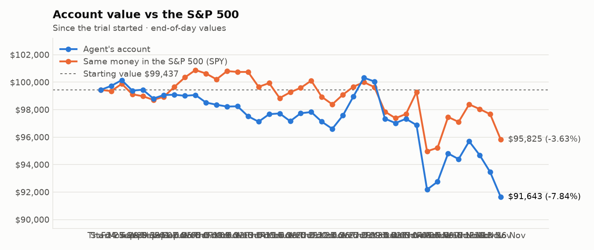
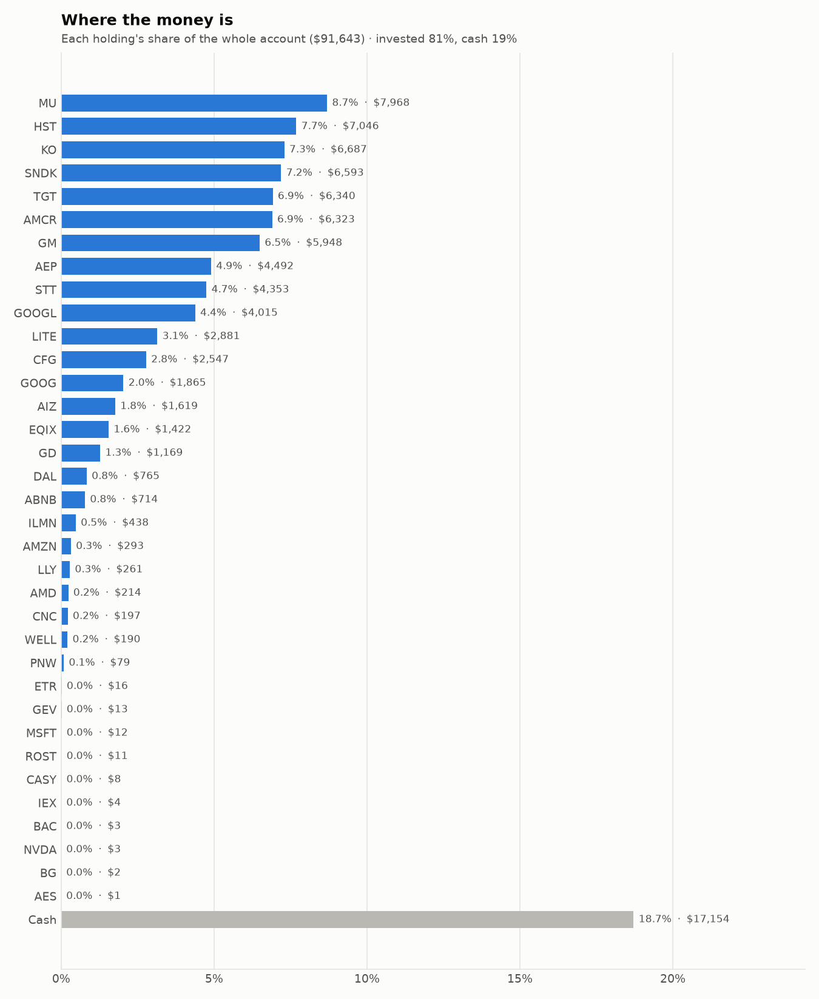
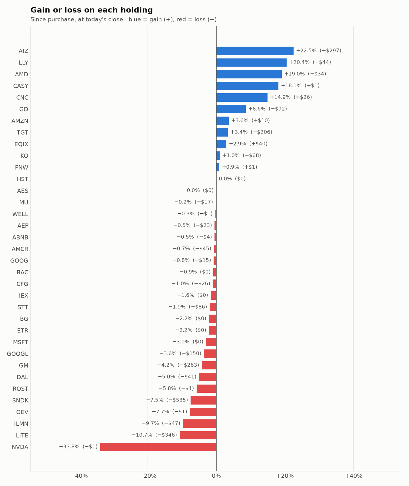

# Daily trading report — Monday 16 November 2026

## Summary

- **Account value:** $91,643 (-$1,808, -1.9% today)
- **S&P 500 (SPY) today:** -1.9% — the agent was behind the index by 0.05%
- **Trades:** 4 buy(s) ($19,053), 5 sell(s) ($15,318)
- **2026-11-16 Morning rebalance:** traded — 8 order(s) placed
- **2026-11-16 Afternoon risk check:** traded — Sold 1 position(s) on the risk check (stop-loss: MRNA)

## Charts

## Why I bought

### MU — bought 11.056 shares at ~$722.15 ($7,984)

**Why:** combined score +1.80; ranked #1 of 503; driven mainly by price momentum +3.00, research (news + analyst consensus) +1.99; entering/adding to the top-ranked target portfolio; research detail: 23 recent headline(s), net positive tone (+11); analyst consensus +1.25/2 (18 strong buy, 35 buy, 4 hold, 0 sell, 0 strong sell)

**Research scores** (combined +1.80, ranked #1 in the S&P 500, sector: Information Technology):

| Factor | Score | Measures |
|---|---|---|
| Value | +0.85 | cheap vs. sector peers on P/E and P/B |
| Quality | +0.89 | profitability (ROE, margins) and balance-sheet strength |
| Momentum | +3.00 | 12-month price trend, excluding the last month |
| Low volatility | -1.02 | steadier price than sector peers |
| Research | +1.99 | recent news tone + analyst consensus |

**Company financials (Finnhub, trailing 12 months):** P/E 10.4, P/B 7.8, return on equity 91.8%, gross margin 80.7%, debt/equity 0.04

**Price trend (Alpaca):** 12-month return (excl. last month) +398.0%, last month -16.5%, volatility 69.8%/yr

**News (Finnhub): 23 headline(s) in the last 2 days, net tone +11.** Most influential:
- [Why Micron Stock Is a Screaming Buy Before Year-End](https://finnhub.io/api/news?id=745f13ed89698fc738f3c0e3ae28f43184d12190de964ef58d6446ba4660d5cc) — 15 Nov, Yahoo (tone +2)
- [Samsung’s $34 Billion HBM Bet Raises Memory Glut Risks](https://finnhub.io/api/news?id=bd6677fb69eaf0e264bc28837cedbb9eaafaa13c70c548e6922edac2e9ef6d5f) — 14 Nov, Yahoo (tone +2)
- [Micron Technology (MU) Has More Than 75% Of 2027 Output Committed](https://finnhub.io/api/news?id=9d881a020efdf770f004a38464be1a3bfb26de1fb18c71ff4af1aabc45bc22b2) — 14 Nov, Yahoo (tone +2)
- [Micron Technology vs. Qualcomm: Which Tech Stock Is the Better Buy for 2027?](https://finnhub.io/api/news?id=f47f411a630062af4d2336f5e280ac06f3a4cbaf84e7e96dfdb2f5ab8223ffa4) — 13 Nov, Yahoo (tone +2)
- [Micron Stock: Why Strong Memory Prices May Count for Nothing](https://finnhub.io/api/news?id=c0a8e2176b760b0a7cdb5423bc6f2663d4b42c0217d2aa4649bade075fecb759) — 16 Nov, Yahoo (tone +1)

**Analysts (Finnhub, 2026-11-01):** 18 strong buy, 35 buy, 4 hold, 0 sell, 0 strong sell — consensus +1.25 on a -2 (strong sell) to +2 (strong buy) scale.

### KO — bought 54.88 shares at ~$100.23 ($5,501)

**Why:** combined score +0.95; ranked #7 of 503; driven mainly by research (news + analyst consensus) +1.94, low volatility +1.76; entering/adding to the top-ranked target portfolio; research detail: 5 recent headline(s), net positive tone (+6); analyst consensus +1.03/2 (8 strong buy, 20 buy, 7 hold, 0 sell, 0 strong sell)

**Research scores** (combined +0.95, ranked #7 in the S&P 500, sector: Consumer Staples):

| Factor | Score | Measures |
|---|---|---|
| Value | -0.70 | cheap vs. sector peers on P/E and P/B |
| Quality | +0.43 | profitability (ROE, margins) and balance-sheet strength |
| Momentum | +1.30 | 12-month price trend, excluding the last month |
| Low volatility | +1.76 | steadier price than sector peers |
| Research | +1.94 | recent news tone + analyst consensus |

**Company financials (Finnhub, trailing 12 months):** P/E 29.2, P/B 9.9, return on equity 42.0%, gross margin 62.3%, debt/equity 1.11

**Price trend (Alpaca):** 12-month return (excl. last month) +36.1%, last month +8.0%, volatility 17.5%/yr

**News (Finnhub): 5 headline(s) in the last 2 days, net tone +6.** Most influential:
- [Coca-Cola and J&J Just Hit Record Highs. A 62-Year-Old Put $300,000 Into Them and Procter & Gamble in 2016. Here’s How Much the Now 72-Year-Old Gets Paid Every Single Month](https://finnhub.io/api/news?id=4b8ed5d29d778006f2cbd96b52858148266ffbc68a13170c582cb878b62a0456) — 14 Nov, Yahoo (tone +2)
- [Got $1,000 to Invest? Skip Coca-Cola and PepsiCo. This 4%-Yielding Dividend Stock Could Deliver a 160% Return in 10 Years.](https://finnhub.io/api/news?id=4c29bbdff567231556af9b75329c0ec5038a9d0d203bcac43eca5814353f20a8) — 14 Nov, Yahoo (tone +2)
- [Forget Nvidia: One Investor Says “the Bubble Is in Consumer Staple Stocks” Like Coca-Cola](https://finnhub.io/api/news?id=1c0007a972e66bb6e5460d12837d7ae5b98fa0172ca87e67c3e77715990f5f40) — 16 Nov, Yahoo (tone +1)
- [Coca-Cola Has Paid a Growing Dividend for 64 Years. Here's the Income $5,000 Can Start You With.](https://finnhub.io/api/news?id=ed9ba8489e7b46a6ded930d95aae80ebce454a200aae8ee60b4d6e6f4a734a2b) — 14 Nov, Yahoo (tone +1)
- [3 Consumer Compounders That Fit Warren Buffett's Playbook. I'd Hold Them Forever.](https://finnhub.io/api/news?id=d771b5e388fa7f720c8571d4eac4e42b4e050ca493feb32ff9f87c7b788b250c) — 14 Nov, Yahoo (tone +0)

**Analysts (Finnhub, 2026-11-01):** 8 strong buy, 20 buy, 7 hold, 0 sell, 0 strong sell — consensus +1.03 on a -2 (strong sell) to +2 (strong buy) scale.

### AEP — bought 28.936 shares at ~$130.25 ($3,769)

**Why:** combined score +0.83; ranked #11 of 503; driven mainly by research (news + analyst consensus) +1.74, price momentum +1.11; entering/adding to the top-ranked target portfolio; research detail: 2 recent headline(s), net positive tone (+4); analyst consensus +0.93/2 (7 strong buy, 13 buy, 9 hold, 0 sell, 0 strong sell)

**Research scores** (combined +0.83, ranked #11 in the S&P 500, sector: Utilities):

| Factor | Score | Measures |
|---|---|---|
| Value | -0.01 | cheap vs. sector peers on P/E and P/B |
| Quality | +0.01 | profitability (ROE, margins) and balance-sheet strength |
| Momentum | +1.11 | 12-month price trend, excluding the last month |
| Low volatility | +0.06 | steadier price than sector peers |
| Research | +1.74 | recent news tone + analyst consensus |

**Company financials (Finnhub, trailing 12 months):** P/E 21.0, P/B 2.0, return on equity 10.5%, gross margin 41.9%, debt/equity 1.66

**Price trend (Alpaca):** 12-month return (excl. last month) +5.0%, last month +3.9%, volatility 17.2%/yr

**News (Finnhub): 2 headline(s) in the last 2 days, net tone +4.** Most influential:
- [Evercore ISI Group Maintains Outperform on American Electric Power, Raises Price Target to $154](https://finnhub.io/api/news?id=50ac035d12caa0c37c58f739f0f31c87697ed7693054a05af02ac5d0c18eaa70) — 16 Nov, Benzinga (tone +2)
- [What Are Wall Street Analysts' Target Price for American Electric Power Stock?](https://finnhub.io/api/news?id=e6bfb08e5e89d5445abfa3794189f290b36a287ea1a62811889a6a7854a028d5) — 15 Nov, Yahoo (tone +2)

**Analysts (Finnhub, 2026-11-01):** 7 strong buy, 13 buy, 9 hold, 0 sell, 0 strong sell — consensus +0.93 on a -2 (strong sell) to +2 (strong buy) scale.

### GM — bought 21.212 shares at ~$84.84 ($1,800)

**Why:** combined score +1.17; ranked #3 of 503; driven mainly by research (news + analyst consensus) +1.98, price momentum +1.65; entering/adding to the top-ranked target portfolio; research detail: 6 recent headline(s), net positive tone (+4); analyst consensus +1.14/2 (11 strong buy, 18 buy, 6 hold, 0 sell, 0 strong sell)

**Research scores** (combined +1.17, ranked #3 in the S&P 500, sector: Consumer Discretionary):

| Factor | Score | Measures |
|---|---|---|
| Value | +1.03 | cheap vs. sector peers on P/E and P/B |
| Quality | -0.69 | profitability (ROE, margins) and balance-sheet strength |
| Momentum | +1.65 | 12-month price trend, excluding the last month |
| Low volatility | -0.13 | steadier price than sector peers |
| Research | +1.98 | recent news tone + analyst consensus |

**Company financials (FMP, trailing 12 months):** P/E 19.2, P/B 1.2, return on equity 6.3%, gross margin 9.0%, debt/equity 2.05

**Price trend (Alpaca):** 12-month return (excl. last month) +46.4%, last month +2.9%, volatility 38.9%/yr

**News (Finnhub): 6 headline(s) in the last 2 days, net tone +4.** Most influential:
- [What Are Wall Street Analysts' Target Price for General Motors Stock?](https://finnhub.io/api/news?id=63c2489bcee27fb8da1fc791a32d7f2fb666442af34776aa001fa07a71016a01) — 16 Nov, Yahoo (tone +3)
- [General Motors (GM) Stock Could Be Cheap On Its 216% Three Year Run](https://finnhub.io/api/news?id=5c64ff94df7073e9a8d3a758864187372f576dbd0177431368314c6256731f34) — 14 Nov, Yahoo (tone +1)
- [What Does General Motors (GM) $550 Million Solar Push Signal For Investors?](https://finnhub.io/api/news?id=deffebe27e724a8d6c4a73d956257fd41bb42cfce6541fc4bab4c1e49dbba118) — 15 Nov, Yahoo (tone +0)
- [Ford and GM face a $5,000 SUV challenge from Volkswagen](https://finnhub.io/api/news?id=b308d0a4d815587f2d06d0beceac4baa76db80d844a51fa6cc9418fb7850c031) — 14 Nov, Yahoo (tone +0)
- [The Unexpected American Automaker More Profitable Than Ford Or GM](https://finnhub.io/api/news?id=f4cc134b716d4aade9fdb7d63bf8c00f5313bc826823d90bd5bad39c7c84f941) — 14 Nov, Yahoo (tone +0)

**Analysts (Finnhub, 2026-11-01):** 11 strong buy, 18 buy, 6 hold, 0 sell, 0 strong sell — consensus +1.14 on a -2 (strong sell) to +2 (strong buy) scale.

## Why I sold

### ILMN — sold 32.46 shares at ~$200.85 ($6,520)

**Why:** combined score +0.60; ranked #24 of 503; driven mainly by price momentum +2.46, low volatility -1.92; trimmed toward target weight, or dropped out of the top-ranked names; research detail: analyst consensus +0.61/2 (6 strong buy, 9 buy, 10 hold, 2 sell, 1 strong sell)

**Research scores** (combined +0.60, ranked #24 in the S&P 500, sector: Health Care):

| Factor | Score | Measures |
|---|---|---|
| Value | +0.00 | cheap vs. sector peers on P/E and P/B |
| Quality | +0.00 | profitability (ROE, margins) and balance-sheet strength |
| Momentum | +2.46 | 12-month price trend, excluding the last month |
| Low volatility | -1.92 | steadier price than sector peers |
| Research | -0.65 | recent news tone + analyst consensus |

**Price trend (Alpaca):** 12-month return (excl. last month) +194.2%, last month -22.7%, volatility 67.0%/yr

**News (Finnhub):** no headlines in the last 2 days.

**Analysts (Finnhub, 2026-11-01):** 6 strong buy, 9 buy, 10 hold, 2 sell, 1 strong sell — consensus +0.61 on a -2 (strong sell) to +2 (strong buy) scale.

### ROST — sold 13.103 shares at ~$227.04 ($2,975)

**Why:** combined score +0.55; ranked #39 of 503; driven mainly by price momentum +1.73, low volatility +0.64; trimmed toward target weight, or dropped out of the top-ranked names; research detail: analyst consensus +1.07/2 (9 strong buy, 11 buy, 7 hold, 0 sell, 0 strong sell)

**Research scores** (combined +0.55, ranked #39 in the S&P 500, sector: Consumer Discretionary):

| Factor | Score | Measures |
|---|---|---|
| Value | -0.64 | cheap vs. sector peers on P/E and P/B |
| Quality | -0.16 | profitability (ROE, margins) and balance-sheet strength |
| Momentum | +1.73 | 12-month price trend, excluding the last month |
| Low volatility | +0.64 | steadier price than sector peers |
| Research | +0.25 | recent news tone + analyst consensus |

**Company financials (Finnhub, trailing 12 months):** P/E 27.8, P/B 12.0, return on equity 42.3%, gross margin 28.6%, debt/equity 0.15

**Price trend (Alpaca):** 12-month return (excl. last month) +51.2%, last month -1.3%, volatility 28.1%/yr

**News (Finnhub):** no headlines in the last 2 days.

**Analysts (Finnhub, 2026-11-01):** 9 strong buy, 11 buy, 7 hold, 0 sell, 0 strong sell — consensus +1.07 on a -2 (strong sell) to +2 (strong buy) scale.

### LITE — sold 4.979 shares at ~$546.10 ($2,719)

**Why:** combined score +0.74; ranked #16 of 503; driven mainly by price momentum +3.00, low volatility -1.17; trimmed toward target weight, or dropped out of the top-ranked names; research detail: 5 recent headline(s), neutral/mixed tone; analyst consensus +1.11/2 (9 strong buy, 22 buy, 5 hold, 0 sell, 0 strong sell)

**Research scores** (combined +0.74, ranked #16 in the S&P 500, sector: Information Technology):

| Factor | Score | Measures |
|---|---|---|
| Value | -0.51 | cheap vs. sector peers on P/E and P/B |
| Quality | -1.11 | profitability (ROE, margins) and balance-sheet strength |
| Momentum | +3.00 | 12-month price trend, excluding the last month |
| Low volatility | -1.17 | steadier price than sector peers |
| Research | +0.09 | recent news tone + analyst consensus |

**Company financials (Finnhub, trailing 12 months):** P/B 14.3, return on equity -300.1%, gross margin 41.7%, debt/equity 0.35

**Price trend (Alpaca):** 12-month return (excl. last month) +454.8%, last month -31.4%, volatility 100.8%/yr

**News (Finnhub): 5 headline(s) in the last 2 days, net tone +0.** Most influential:
- [S&P 500 Premarket Losers on Nov. 16, 2026: COIN, LITE, COHR](https://finnhub.io/api/news?id=70a7b32f63e8bb471907f44b1e904e32673d99c6062ae570872b1c00b3712e26) — 16 Nov, ChartMill (tone +0)
- [Marvell’s Trillion-Dollar Target](https://finnhub.io/api/news?id=1e7b9d4be69140363f7f827ad1fcb1c798bf60be17ab934c4ec283261e6d3a7a) — 15 Nov, Yahoo (tone +0)
- [Lumentum Holdings (LITE) Heads Into An $82.1 Billion All Stock Takeover](https://finnhub.io/api/news?id=610abd569b8d235f9967d912808768b732cf7f996eb5540fb092a0d46debcf9f) — 15 Nov, Yahoo (tone +0)
- [Marvell CEO Defends $115 Billion Lumentum Deal: “Sometimes Being Unorthodox” Pays Off](https://finnhub.io/api/news?id=ea7b989306f9e5017e485a1e75682f5de954f4cfb0d298145bc468ddb16fcedd) — 14 Nov, Yahoo (tone +0)
- [Marvell’s 3 new directors hint at its biggest Lumentum risk](https://finnhub.io/api/news?id=526a02e80b37fabf8503303e58acf939c63e008005abf5aea2527af56c3a103a) — 14 Nov, Yahoo (tone +0)

**Analysts (Finnhub, 2026-11-01):** 9 strong buy, 22 buy, 5 hold, 0 sell, 0 strong sell — consensus +1.11 on a -2 (strong sell) to +2 (strong buy) scale.

### MRNA — sold 9.463 shares at ~$215.99 ($2,044)

**Why:** stop-loss: -13.1% below the average purchase price of $249.40 (limit -12%); sold the whole position and won't buy it back for 7 days

**What triggered it:** the afternoon risk check trims a holding only when BOTH its recent news turns clearly negative AND its price is down 3%+ since purchase (it was -13.1%).

**News (Finnhub): 9 headline(s) in the last 2 days, net tone +0.** Most influential:
- [Flagship Pioneering expands to UK with £100m AI-native lab](https://finnhub.io/api/news?id=ad15d7f747535e4209ac9b3a2fd3dd9d10fef4394f169b4b438e0593dfb6d6df) — 16 Nov, Yahoo (tone +0)
- [Moderna Is Up Over 600% This Year. Here’s What Jim Cramer Learned in His Exclusive](https://finnhub.io/api/news?id=8449ab859c2f3644ba4efb7a982d358ef073416abbffb1c7a6a07297cb5522c8) — 16 Nov, Yahoo (tone +0)
- [Dr. Robert Langer, Co-Founder of Moderna, Joins PolarityBio’s Board of Directors](https://finnhub.io/api/news?id=632f19c40dba0c1a0cdce406ab3098e8e4130232278f4fd683125a284a698756) — 16 Nov, Yahoo (tone +0)
- [Flagship's Afeyan Sees UK Bet Creating Next Moderna](https://finnhub.io/api/news?id=edfe663900058f39a87b01cd28ab2063e13840f03048d248e590fdfa9acd3712) — 16 Nov, Yahoo (tone +0)
- [Proshares Trust (TQQQ) Buys $72.9 Million More Moderna on Nov. 12](https://finnhub.io/api/news?id=3bf5846e13d0959f330730005428fd8412ac8e7dfc8b4f9d11de060149640c28) — 16 Nov, Yahoo (tone +0)

### STT — sold 6.189 shares at ~$171.35 ($1,060)

**Why:** combined score +0.75; ranked #14 of 503; driven mainly by price momentum +1.90, value (cheapness) +0.43; trimmed toward target weight, or dropped out of the top-ranked names; research detail: 3 recent headline(s), neutral/mixed tone; analyst consensus +0.81/2 (3 strong buy, 11 buy, 7 hold, 0 sell, 0 strong sell)

**Research scores** (combined +0.75, ranked #14 in the S&P 500, sector: Financials):

| Factor | Score | Measures |
|---|---|---|
| Value | +0.43 | cheap vs. sector peers on P/E and P/B |
| Quality | -0.03 | profitability (ROE, margins) and balance-sheet strength |
| Momentum | +1.90 | 12-month price trend, excluding the last month |
| Low volatility | +0.41 | steadier price than sector peers |
| Research | -0.08 | recent news tone + analyst consensus |

**Company financials (Finnhub, trailing 12 months):** P/E 12.8, P/B 1.7, return on equity 13.1%, debt/equity 0.92

**Price trend (Alpaca):** 12-month return (excl. last month) +45.2%, last month +3.4%, volatility 22.5%/yr

**News (Finnhub): 3 headline(s) in the last 2 days, net tone +0.** Most influential:
- [Which Global Real Estate ETF Is the Better Buy: State Street’s RWO or Vanguard’s International VNQI?](https://finnhub.io/api/news?id=ac4d2fcf5d5f9659ace1ae145d8c7d30067088c7c111b404b06b40959209cf91) — 15 Nov, Yahoo (tone +0)
- [Which Healthcare ETF Is Best for the Long Term: State Street’s XPH or Invesco’s PBE?](https://finnhub.io/api/news?id=8e3210b9758dc6db4724aa3e836e5cf2c89b9ed916f0ef1cf0a683428a0597b0) — 15 Nov, Yahoo (tone +0)
- [Which Real Estate ETF Is the Better Buy: State Street’s REIT Fund RWR or Global Fund RWO?](https://finnhub.io/api/news?id=f205302f183293abe2a9bbffb056f47fa5a5283f4fc97431beb83ed8dbafc0a5) — 15 Nov, Yahoo (tone +0)

**Analysts (Finnhub, 2026-11-01):** 3 strong buy, 11 buy, 7 hold, 0 sell, 0 strong sell — consensus +0.81 on a -2 (strong sell) to +2 (strong buy) scale.

## Holdings at the close

| Stock | Shares | Avg cost | Price | Market value | % of account | Today | Gain/loss $ | Gain/loss % |
|---|---:|---:|---:|---:|---:|---:|---:|---:|
| MU | 11.056 | $722.15 | $720.65 | $7,968 | 8.7% | -7.41% | −$17 | -0.21% |
| HST | 273.295 | $25.78 | $25.78 | $7,046 | 7.7% | +1.10% | +$0 | +0.00% |
| KO | 67.083 | $98.67 | $99.68 | $6,687 | 7.3% | +0.43% | +$68 | +1.02% |
| SNDK | 8.125 | $877.18 | $811.39 | $6,593 | 7.2% | -8.32% | −$535 | -7.50% |
| TGT | 39.544 | $155.12 | $160.32 | $6,340 | 6.9% | -0.70% | +$206 | +3.35% |
| AMCR | 144.466 | $44.08 | $43.77 | $6,323 | 6.9% | -0.07% | −$45 | -0.70% |
| GM | 71.086 | $87.37 | $83.67 | $5,948 | 6.5% | -2.71% | −$263 | -4.24% |
| AEP | 34.734 | $129.99 | $129.34 | $4,492 | 4.9% | +0.12% | −$23 | -0.50% |
| STT | 25.601 | $173.38 | $170.03 | $4,353 | 4.7% | -1.97% | −$86 | -1.93% |
| GOOGL | 14.129 | $294.77 | $284.15 | $4,015 | 4.4% | -3.93% | −$150 | -3.60% |
| LITE | 5.262 | $613.21 | $547.50 | $2,881 | 3.1% | -8.23% | −$346 | -10.72% |
| CFG | 39.526 | $65.10 | $64.44 | $2,547 | 2.8% | -1.26% | −$26 | -1.01% |
| GOOG | 6.625 | $283.69 | $281.50 | $1,865 | 2.0% | -3.77% | −$15 | -0.77% |
| AIZ | 5 | $264.38 | $323.80 | $1,619 | 1.8% | +0.52% | +$297 | +22.48% |
| EQIX | 1.363 | $1,013.54 | $1,043.06 | $1,422 | 1.6% | -1.02% | +$40 | +2.91% |
| GD | 3.251 | $331.27 | $359.69 | $1,169 | 1.3% | -1.04% | +$92 | +8.58% |
| DAL | 8.808 | $91.40 | $86.80 | $765 | 0.8% | +0.64% | −$41 | -5.03% |
| ABNB | 3.834 | $187.14 | $186.19 | $714 | 0.8% | -0.32% | −$4 | -0.51% |
| ILMN | 2.211 | $219.58 | $198.19 | $438 | 0.5% | -4.26% | −$47 | -9.74% |
| AMZN | 1.135 | $249.35 | $258.32 | $293 | 0.3% | -3.13% | +$10 | +3.60% |
| LLY | 0.182 | $1,189.78 | $1,433.06 | $261 | 0.3% | -0.72% | +$44 | +20.45% |
| AMD | 0.424 | $423.91 | $504.60 | $214 | 0.2% | -5.52% | +$34 | +19.03% |
| CNC | 2.63 | $65.21 | $74.92 | $197 | 0.2% | +5.12% | +$26 | +14.89% |
| WELL | 0.776 | $245.43 | $244.65 | $190 | 0.2% | +0.08% | −$1 | -0.32% |
| PNW | 0.753 | $104.41 | $105.33 | $79 | 0.1% | -1.56% | +$1 | +0.88% |
| ETR | 0.145 | $112.67 | $110.22 | $16 | 0.0% | -0.84% | −$0 | -2.17% |
| GEV | 0.017 | $829.15 | $765.00 | $13 | 0.0% | -4.75% | −$1 | -7.74% |
| MSFT | 0.023 | $533.80 | $517.75 | $12 | 0.0% | -1.17% | −$0 | -3.01% |
| ROST | 0.049 | $237.68 | $223.99 | $11 | 0.0% | -3.32% | −$1 | -5.76% |
| CASY | 0.011 | $597.62 | $705.72 | $8 | 0.0% | -0.89% | +$1 | +18.09% |
| IEX | 0.018 | $237.47 | $233.57 | $4 | 0.0% | -1.71% | −$0 | -1.64% |
| BAC | 0.054 | $50.53 | $50.08 | $3 | 0.0% | -1.84% | −$0 | -0.89% |
| NVDA | 0.016 | $236.88 | $156.73 | $3 | 0.0% | -3.76% | −$1 | -33.83% |
| BG | 0.019 | $101.20 | $99.02 | $2 | 0.0% | -2.59% | −$0 | -2.15% |
| AES | 0.096 | $14.92 | $14.92 | $1 | 0.0% | +0.04% | −$0 | -0.02% |
| **Invested** | | | | **$74,489** | **81.3%** | | **−$781** | |
| **Cash** | | | | $17,154 | 18.7% | | | |
| **Total account** | | | | **$91,643** | 100% | | | |

_Scores are sector-neutral z-scores: 0 is average for the stock's sector, +1 is one standard deviation better. News tone is a keyword count over recent headlines, not a deep read. None of this guarantees a stock will rise; a few days of results can't show whether the strategy has a real edge over the S&P 500._
