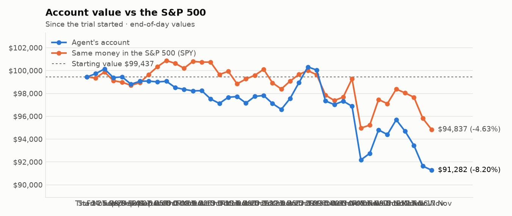
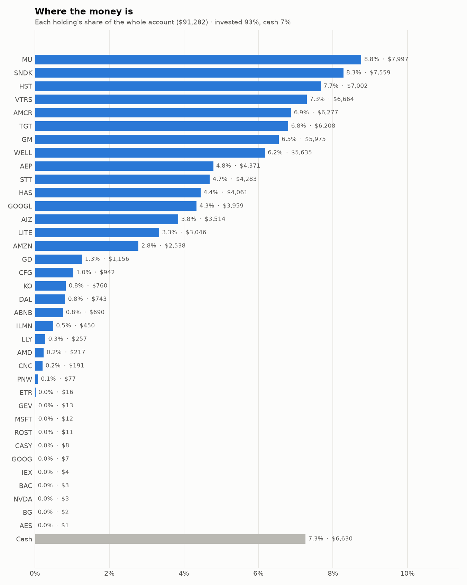
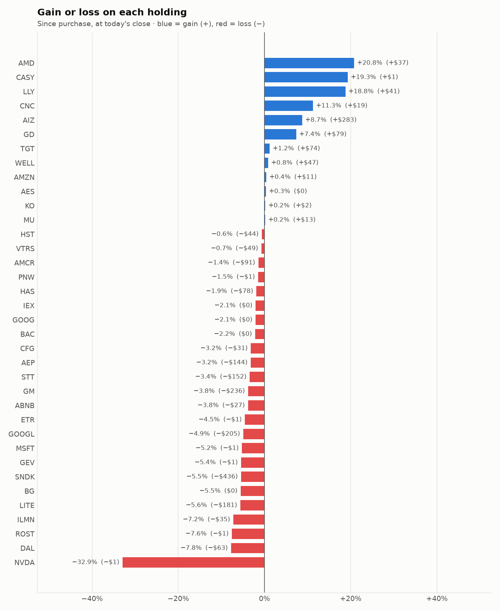

# Daily trading report — Tuesday 17 November 2026

## Summary

- **Account value:** $91,282 (-$361, -0.4% today)
- **S&P 500 (SPY) today:** -1.0% — the agent was ahead of the index by 0.64%
- **Trades:** 6 buy(s) ($21,271), 4 sell(s) ($10,748)
- **2026-11-17 Morning rebalance:** traded — 10 order(s) placed
- **2026-11-17 Afternoon risk check:** no trades needed — Risk-checked 36 holding(s): none was 12%+ below its purchase price, and none had both clearly negative news and a price drop of 3%+ since entry.

## Charts

## Why I bought

### VTRS — bought 325.867 shares at ~$20.60 ($6,713)

**Why:** combined score +1.01; ranked #6 of 503; driven mainly by research (news + analyst consensus) +1.55, value (cheapness) +1.37; entering/adding to the top-ranked target portfolio; research detail: 6 recent headline(s), net positive tone (+5); analyst consensus +0.94/2 (6 strong buy, 6 buy, 5 hold, 1 sell, 0 strong sell)

**Research scores** (combined +1.01, ranked #6 in the S&P 500, sector: Health Care):

| Factor | Score | Measures |
|---|---|---|
| Value | +1.37 | cheap vs. sector peers on P/E and P/B |
| Quality | -0.12 | profitability (ROE, margins) and balance-sheet strength |
| Momentum | +0.95 | 12-month price trend, excluding the last month |
| Low volatility | +0.66 | steadier price than sector peers |
| Research | +1.55 | recent news tone + analyst consensus |

**Company financials (Finnhub, trailing 12 months):** P/B 1.5, return on equity -4.2%, gross margin 41.1%, debt/equity 0.97

**Price trend (Alpaca):** 12-month return (excl. last month) +86.6%, last month +11.1%, volatility 26.4%/yr

**News (Finnhub): 6 headline(s) in the last 2 days, net tone +5.** Most influential:
- [United Natural Foods To Rally Around 24%? Here Are 10 Top Analyst Forecasts For Tuesday](https://finnhub.io/api/news?id=f63c863f0988cf46b0d36f646a713329f52abf49ef0593a23eac20157c833d86) — 17 Nov, Benzinga (tone +2)
- [Leerink Partners Maintains Outperform on Viatris, Raises Price Target to $24](https://finnhub.io/api/news?id=3ca9c12918f5a79cc8837cd586ad65e74dd5c62e7ba6f92880a143a2100f3dee) — 17 Nov, Benzinga (tone +2)
- [Barclays Maintains Overweight on Viatris, Raises Price Target to $25](https://finnhub.io/api/news?id=838c730079d8dc75b8aa33a8126e8c4bd9275a466a856be836bbb2ecdcfe036b) — 16 Nov, Benzinga (tone +1)
- [Viatris Completes Acquisition of Pacira BioSciences](https://finnhub.io/api/news?id=0d542b3c1347466b3d09a077fe12d07b62e8122216ff11575028b7ebc71137a8) — 17 Nov, Yahoo (tone +0)
- [Viatris Inc. (VTRS) Presents at UBS Global Biopharma Conference 2026 Transcript](https://finnhub.io/api/news?id=d56e002dfd50b0ce87774d5bf2c7b86f9a1d1407ab0b5502b9090a1b449a64bd) — 17 Nov, SeekingAlpha (tone +0)

**Analysts (Finnhub, 2026-11-01):** 6 strong buy, 6 buy, 5 hold, 1 sell, 0 strong sell — consensus +0.94 on a -2 (strong sell) to +2 (strong buy) scale.

### WELL — bought 22.153 shares at ~$243.64 ($5,397)

**Why:** combined score +0.94; ranked #8 of 503; driven mainly by price momentum +1.95, research (news + analyst consensus) +1.77; entering/adding to the top-ranked target portfolio; research detail: 3 recent headline(s), net positive tone (+3); analyst consensus +1.11/2 (6 strong buy, 19 buy, 3 hold, 0 sell, 0 strong sell)

**Research scores** (combined +0.94, ranked #8 in the S&P 500, sector: Real Estate):

| Factor | Score | Measures |
|---|---|---|
| Value | -0.71 | cheap vs. sector peers on P/E and P/B |
| Quality | -0.28 | profitability (ROE, margins) and balance-sheet strength |
| Momentum | +1.95 | 12-month price trend, excluding the last month |
| Low volatility | -0.06 | steadier price than sector peers |
| Research | +1.77 | recent news tone + analyst consensus |

**Company financials (Finnhub, trailing 12 months):** P/E 107.0, P/B 3.4, return on equity 3.7%, gross margin 40.0%, debt/equity 0.40

**Price trend (Alpaca):** 12-month return (excl. last month) +36.2%, last month +4.2%, volatility 21.3%/yr

**News (Finnhub): 3 headline(s) in the last 2 days, net tone +3.** Most influential:
- [Mizuho Maintains Outperform on Welltower, Raises Price Target to $270](https://finnhub.io/api/news?id=c4472ba48c35ad21a6358a609cfed350667ffa80dd3bbb19a98651305c249ce1) — 16 Nov, Benzinga (tone +2)
- [Wells Fargo Maintains Overweight on Welltower, Raises Price Target to $283](https://finnhub.io/api/news?id=a5c5f3142b59b2fd0d146332d778594b9396a9b3927ec0235c1d0e808df0357d) — 16 Nov, Benzinga (tone +1)
- [Welltower and Ventas Are Riding the Same Senior Housing Boom, but Their Valuations Tell Different Stories](https://finnhub.io/api/news?id=457003d424afd0bffed121e487c73063436816cb0edcb4f3b281d3f1b7f0c31f) — 17 Nov, Yahoo (tone +0)

**Analysts (Finnhub, 2026-11-01):** 6 strong buy, 19 buy, 3 hold, 0 sell, 0 strong sell — consensus +1.11 on a -2 (strong sell) to +2 (strong buy) scale.

### HAS — bought 34.317 shares at ~$120.62 ($4,139)

**Why:** combined score +0.85; ranked #10 of 503; driven mainly by research (news + analyst consensus) +1.33, price momentum +1.24; entering/adding to the top-ranked target portfolio; research detail: 3 recent headline(s), net positive tone (+4); analyst consensus +1.26/2 (8 strong buy, 8 buy, 3 hold, 0 sell, 0 strong sell)

**Research scores** (combined +0.85, ranked #10 in the S&P 500, sector: Consumer Discretionary):

| Factor | Score | Measures |
|---|---|---|
| Value | -0.18 | cheap vs. sector peers on P/E and P/B |
| Quality | +0.72 | profitability (ROE, margins) and balance-sheet strength |
| Momentum | +1.24 | 12-month price trend, excluding the last month |
| Low volatility | +0.10 | steadier price than sector peers |
| Research | +1.33 | recent news tone + analyst consensus |

**Company financials (Finnhub, trailing 12 months):** P/E 17.6, P/B 13.8, return on equity 136.2%, gross margin 67.5%, debt/equity 3.84

**Price trend (Alpaca):** 12-month return (excl. last month) +33.1%, last month +22.6%, volatility 31.9%/yr

**News (Finnhub): 3 headline(s) in the last 2 days, net tone +4.** Most influential:
- [Best Growth Stocks to Buy for November 16th](https://finnhub.io/api/news?id=65e0f354c0c802475536096f80e558ec77ce9044031fe49c13d5713a65c9f1f0) — 16 Nov, Yahoo (tone +2)
- [NVIDIA To $200? Here Are 10 Top Analyst Forecasts For Monday](https://finnhub.io/api/news?id=3158ede3c2c2bd45ba02dd66f54202cd3304753e34113af54c83898e90680367) — 16 Nov, Benzinga (tone +1)
- [Wells Fargo Maintains Equal-Weight on Hasbro, Raises Price Target to $115](https://finnhub.io/api/news?id=22509b6b134431cbaa433e2dda6e2f9b9bb6bdc2fbec343757b7c643cc6e208e) — 16 Nov, Benzinga (tone +1)

**Analysts (Finnhub, 2026-11-01):** 8 strong buy, 8 buy, 3 hold, 0 sell, 0 strong sell — consensus +1.26 on a -2 (strong sell) to +2 (strong buy) scale.

### AMZN — bought 8.673 shares at ~$258.76 ($2,244)

**Why:** combined score +0.75; ranked #15 of 503; driven mainly by research (news + analyst consensus) +2.10, price momentum +0.70; entering/adding to the top-ranked target portfolio; research detail: 72 recent headline(s), net positive tone (+10); analyst consensus +1.23/2 (19 strong buy, 48 buy, 3 hold, 0 sell, 0 strong sell)

**Research scores** (combined +0.75, ranked #15 in the S&P 500, sector: Consumer Discretionary):

| Factor | Score | Measures |
|---|---|---|
| Value | -0.10 | cheap vs. sector peers on P/E and P/B |
| Quality | +0.11 | profitability (ROE, margins) and balance-sheet strength |
| Momentum | +0.70 | 12-month price trend, excluding the last month |
| Low volatility | -0.42 | steadier price than sector peers |
| Research | +2.10 | recent news tone + analyst consensus |

**Company financials (FMP, trailing 12 months):** P/E 20.6, P/B 4.5, return on equity 26.7%, gross margin 51.4%, debt/equity 0.44

**Price trend (Alpaca):** 12-month return (excl. last month) +15.9%, last month +3.2%, volatility 32.2%/yr

**News (Finnhub): 72 headline(s) in the last 2 days, net tone +10.** Most influential:
- [EBay, Amazon, Caterpillar and More on CNBC’s ‘Final Trades’](https://finnhub.io/api/news?id=3d5aee8df397814dfb98da883f6572798aaa78fcf19e7ee941fa65ddcb7b54a3) — 16 Nov, Benzinga (tone +2)
- [Ken Griffin Dumps SpaceX, Amazon; Buys ARKK and Bets Big on Marvell](https://finnhub.io/api/news?id=e8e147d3b9f34ab801716761f85dc784539038aa03e5113eeb32711e2b6af640) — 17 Nov, Benzinga (tone +1)
- [Amazon Plans $7B Renewable Energy Investment In India By 2030, On Top Of $4B Already Contracted, Adds Four Wind And Solar Projects Totaling 934 MW](https://finnhub.io/api/news?id=ebf01e7ec5b4f7ba7f38361acb37403ee7900c4e3e786f9fe5c6f035db834ca2) — 16 Nov, Benzinga (tone -1)
- [Boeing (BA) ULA Rocket Failure Halts Deployment Of 40 Broadband Satellites](https://finnhub.io/api/news?id=511f78f5aef5c09b41b36834d23e9970cbd87e9d8826ebbc6c760a9169298966) — 16 Nov, Yahoo (tone +1)
- [Not Amazon, Not American Express: This Credit Card Has The Best Rewards For 2026](https://finnhub.io/api/news?id=8a929bfa9874d933ee0f8a06debc3c9809136c0b512e5be65df44a97972b7a20) — 16 Nov, Yahoo (tone +1)

**Analysts (Finnhub, 2026-11-01):** 19 strong buy, 48 buy, 3 hold, 0 sell, 0 strong sell — consensus +1.23 on a -2 (strong sell) to +2 (strong buy) scale.

### AIZ — bought 5.908 shares at ~$323.21 ($1,910)

**Why:** combined score +0.81; ranked #13 of 503; driven mainly by price momentum +1.34, research (news + analyst consensus) +1.00; entering/adding to the top-ranked target portfolio; research detail: 2 recent headline(s), net positive tone (+3); analyst consensus +1.00/2 (2 strong buy, 9 buy, 2 hold, 0 sell, 0 strong sell)

**Research scores** (combined +0.81, ranked #13 in the S&P 500, sector: Financials):

| Factor | Score | Measures |
|---|---|---|
| Value | +0.02 | cheap vs. sector peers on P/E and P/B |
| Quality | +0.29 | profitability (ROE, margins) and balance-sheet strength |
| Momentum | +1.34 | 12-month price trend, excluding the last month |
| Low volatility | +0.86 | steadier price than sector peers |
| Research | +1.00 | recent news tone + analyst consensus |

**Company financials (Finnhub, trailing 12 months):** P/E 14.7, P/B 2.2, return on equity 18.0%, debt/equity 0.37

**Price trend (Alpaca):** 12-month return (excl. last month) +31.7%, last month +14.5%, volatility 21.7%/yr

**News (Finnhub): 2 headline(s) in the last 2 days, net tone +3.** Most influential:
- [AIZ Stock Trading at a Discount to Industry at 2.64X: Time to Buy?](https://finnhub.io/api/news?id=042fbc675a7e3865e1abd0524d199d843e1688574c413681b1191d6a3cc0469e) — 16 Nov, Yahoo (tone +2)
- [Morgan Stanley Maintains Overweight on Assurant, Raises Price Target to $360](https://finnhub.io/api/news?id=73989d788b370ecd21e6c59fe43965595b36ef8c5c73c314297bc6382cfcb391) — 16 Nov, Benzinga (tone +1)

**Analysts (Finnhub, 2026-11-01):** 2 strong buy, 9 buy, 2 hold, 0 sell, 0 strong sell — consensus +1.00 on a -2 (strong sell) to +2 (strong buy) scale.

### SNDK — bought 1.106 shares at ~$784.69 ($868)

**Why:** combined score +1.50; ranked #2 of 503; driven mainly by price momentum +3.00, low volatility -1.37; entering/adding to the top-ranked target portfolio; research detail: 29 recent headline(s), net positive tone (+2); analyst consensus +1.20/2 (12 strong buy, 18 buy, 5 hold, 0 sell, 0 strong sell)

**Research scores** (combined +1.50, ranked #2 in the S&P 500, sector: Information Technology):

| Factor | Score | Measures |
|---|---|---|
| Value | +1.24 | cheap vs. sector peers on P/E and P/B |
| Quality | +1.09 | profitability (ROE, margins) and balance-sheet strength |
| Momentum | +3.00 | 12-month price trend, excluding the last month |
| Low volatility | -1.37 | steadier price than sector peers |
| Research | +0.43 | recent news tone + analyst consensus |

**Company financials (Finnhub, trailing 12 months):** P/E 6.5, P/B 13.8, return on equity 134.3%, gross margin 80.0%, debt/equity 0.00

**Price trend (Alpaca):** 12-month return (excl. last month) +800.2%, last month -37.7%, volatility 93.0%/yr

**News (Finnhub): 29 headline(s) in the last 2 days, net tone +2.** Most influential:
- [Own Sandisk? Your Five Years Hinge On Memory Prices](https://finnhub.io/api/news?id=19a7acc12d564f844ced56b5cfbdbe85610db893c5017aa32ba1bfc3d34e2501) — 17 Nov, Yahoo (tone +2)
- [Stanley Druckenmiller’s Duquesne Bets Big on Storage, Nearly Triples Seagate Stake As He Reverses Some Q2 Tech Bets, Slashes TSMC and Exits AMD, Google](https://finnhub.io/api/news?id=81c064af943a694e4c1cdc778ab62649b5c9dd0b9bbf835a4e1db549ee73c6b0) — 17 Nov, Benzinga (tone -1)
- [Sandisk Is Splitting Its Stock 8-for-1. Here’s the Number I’d Check Before Buying.](https://finnhub.io/api/news?id=678d0eac32e975779f5f6b735e8c4bbcc4122bb0ffb7ac2403428ba902456c9d) — 16 Nov, Yahoo (tone +1)
- [SanDisk Stock Could Have Another Big Year. Here’s My 2027 Price Prediction](https://finnhub.io/api/news?id=fdf718ff125cc77264c50120a2d9105d8c606b4d8454fd0a6d04bf05873806e3) — 16 Nov, Yahoo (tone -1)
- [Sandisk Next Big Move Could Be Bigger Than Its Upcoming Stock Split](https://finnhub.io/api/news?id=8195e2cc1e84226cc7da6f6f1d1d960e52fedb08365ab5699e44c65c43535654) — 16 Nov, Yahoo (tone +1)

**Analysts (Finnhub, 2026-11-01):** 12 strong buy, 18 buy, 5 hold, 0 sell, 0 strong sell — consensus +1.20 on a -2 (strong sell) to +2 (strong buy) scale.

## Why I sold

### KO — sold 59.401 shares at ~$99.34 ($5,901)

**Why:** combined score +0.64; ranked #22 of 503; driven mainly by low volatility +1.79, price momentum +1.51; trimmed toward target weight, or dropped out of the top-ranked names; research detail: 5 recent headline(s), net positive tone (+1); analyst consensus +1.03/2 (8 strong buy, 20 buy, 7 hold, 0 sell, 0 strong sell)

**Research scores** (combined +0.64, ranked #22 in the S&P 500, sector: Consumer Staples):

| Factor | Score | Measures |
|---|---|---|
| Value | -0.70 | cheap vs. sector peers on P/E and P/B |
| Quality | +0.43 | profitability (ROE, margins) and balance-sheet strength |
| Momentum | +1.51 | 12-month price trend, excluding the last month |
| Low volatility | +1.79 | steadier price than sector peers |
| Research | +0.38 | recent news tone + analyst consensus |

**Company financials (Finnhub, trailing 12 months):** P/E 29.2, P/B 9.9, return on equity 42.0%, gross margin 62.3%, debt/equity 1.11

**Price trend (Alpaca):** 12-month return (excl. last month) +39.9%, last month +6.1%, volatility 17.5%/yr

**News (Finnhub): 5 headline(s) in the last 2 days, net tone +1.** Most influential:
- [What Does Warren Buffett’s 90/10 Rule Say to a 74-Year-Old With $1 Million of Coca-Cola at a Record?](https://finnhub.io/api/news?id=9c8e482ba9e599f2113842a1abce646825a3e248a62eed5c4815fd50f3c6c4c4) — 16 Nov, Yahoo (tone +1)
- [Coca-Cola Has Crushed PepsiCo in 2026, but Retirement Investors Face a Different Dividend Decision](https://finnhub.io/api/news?id=b9fcde15dc257fa502fca140821a8d0b70efcc60f8974d83ea5ab6684f47d456) — 16 Nov, Yahoo (tone -1)
- [Forget Nvidia: One Investor Says “the Bubble Is in Consumer Staple Stocks” Like Coca-Cola](https://finnhub.io/api/news?id=1c0007a972e66bb6e5460d12837d7ae5b98fa0172ca87e67c3e77715990f5f40) — 16 Nov, Yahoo (tone +1)
- [Unusual Call Option Activity in Coca-Cola - Is KO Stock Undervalued or Overvalued?](https://finnhub.io/api/news?id=ac34f118ec5f172e7904286c0ba70336f6f4430626cd2a09ef6ccfdf96fc7476) — 16 Nov, Yahoo (tone +0)
- [QUICK SPARK: Wall Street Sold Chips, Bought Coca-Cola at the Strongest Pace Since September 2001](https://finnhub.io/api/news?id=127b9c8a33e3ada53993fb8c5e28302ba4d3bdeb5eae05cd0d66c10d83d964b8) — 16 Nov, Benzinga (tone +0)

**Analysts (Finnhub, 2026-11-01):** 8 strong buy, 20 buy, 7 hold, 0 sell, 0 strong sell — consensus +1.03 on a -2 (strong sell) to +2 (strong buy) scale.

### GOOG — sold 6.6 shares at ~$279.81 ($1,847)

**Why:** combined score +0.47; ranked #52 of 503; driven mainly by price momentum +1.39, value (cheapness) -0.66; trimmed toward target weight, or dropped out of the top-ranked names; research detail: 23 recent headline(s), net positive tone (+1); analyst consensus +1.19/2 (20 strong buy, 41 buy, 7 hold, 0 sell, 0 strong sell)

**Research scores** (combined +0.47, ranked #52 in the S&P 500, sector: Communication Services):

| Factor | Score | Measures |
|---|---|---|
| Value | -0.66 | cheap vs. sector peers on P/E and P/B |
| Quality | +0.09 | profitability (ROE, margins) and balance-sheet strength |
| Momentum | +1.39 | 12-month price trend, excluding the last month |
| Low volatility | +0.20 | steadier price than sector peers |
| Research | +0.35 | recent news tone + analyst consensus |

**Company financials (Finnhub, trailing 12 months):** P/E 15.0, P/B 6.2, return on equity 42.6%, gross margin 60.9%, debt/equity 0.18

**Price trend (Alpaca):** 12-month return (excl. last month) +33.9%, last month -16.5%, volatility 34.6%/yr

**News (Finnhub): 23 headline(s) in the last 2 days, net tone +1.** Most influential:
- [Robotaxis Need “20M AVs” for 3-4% of Global Rides, Says Jason Calacanis. Good News for Uber](https://finnhub.io/api/news?id=2718db27e3ce1d14fd79a19fc912d0ee96de301b4068c364608c935725c402bb) — 15 Nov, Yahoo (tone +1)
- [Market Chatter: Amazon, Google, Meta Lobbying Fails to Stop Trump From Pursuing China Data Center Curbs](https://finnhub.io/api/news?id=805bfbfb89abb88f537811f7bd405fedf702be639923b8ddb06d1b6e10c6749a) — 17 Nov, Yahoo (tone +0)
- [Billionaire Stanley Druckenmiller Dumped Google Parent Alphabet in Favor of Another Trillion-Dollar AI Giant](https://finnhub.io/api/news?id=4c5d864962c877ef1994492efd7b946fa82647e833678995632f2efbdbcddb8d) — 17 Nov, Yahoo (tone +0)
- [Isomorphic Labs announces $5 Billion Series C funding](https://finnhub.io/api/news?id=b45aff5ae25a82efaba4466a88dd244deffaae1e516fb3984485d1872714baed) — 17 Nov, Yahoo (tone +0)
- [Is Alphabet Stock a Buy After the Dip?](https://finnhub.io/api/news?id=a1199854963cb680b2dfd8b7e3a308aedf968a8e8f6646d6344d86db8d3add20) — 17 Nov, Yahoo (tone +0)

**Analysts (Finnhub, 2026-11-01):** 20 strong buy, 41 buy, 7 hold, 0 sell, 0 strong sell — consensus +1.19 on a -2 (strong sell) to +2 (strong buy) scale.

### CFG — sold 24.583 shares at ~$64.04 ($1,574)

**Why:** combined score +0.65; ranked #20 of 503; driven mainly by value (cheapness) +1.09, price momentum +0.89; trimmed toward target weight, or dropped out of the top-ranked names; research detail: 1 recent headline(s), net positive tone (+1); analyst consensus +1.08/2 (6 strong buy, 15 buy, 4 hold, 0 sell, 0 strong sell)

**Research scores** (combined +0.65, ranked #20 in the S&P 500, sector: Financials):

| Factor | Score | Measures |
|---|---|---|
| Value | +1.09 | cheap vs. sector peers on P/E and P/B |
| Quality | -0.06 | profitability (ROE, margins) and balance-sheet strength |
| Momentum | +0.89 | 12-month price trend, excluding the last month |
| Low volatility | +0.38 | steadier price than sector peers |
| Research | +0.44 | recent news tone + analyst consensus |

**Company financials (Finnhub, trailing 12 months):** P/E 12.1, P/B 1.1, return on equity 8.7%, debt/equity 0.41

**Price trend (Alpaca):** 12-month return (excl. last month) +22.5%, last month +1.7%, volatility 22.2%/yr

**News (Finnhub): 1 headline(s) in the last 2 days, net tone +1.** Most influential:
- [Cantor Fitzgerald Maintains Overweight on Citizens Financial Group, Raises Price Target to $80](https://finnhub.io/api/news?id=36707d3385ec932219c925c5cf13ebc372471e8aaa9547cbe8264ba0ab1ea85b) — 16 Nov, Benzinga (tone +1)

**Analysts (Finnhub, 2026-11-01):** 6 strong buy, 15 buy, 4 hold, 0 sell, 0 strong sell — consensus +1.08 on a -2 (strong sell) to +2 (strong buy) scale.

### EQIX — sold 1.363 shares at ~$1,046.55 ($1,426)

**Why:** combined score +0.57; ranked #31 of 503; driven mainly by price momentum +1.12, research (news + analyst consensus) +0.84; trimmed toward target weight, or dropped out of the top-ranked names; research detail: 3 recent headline(s), net positive tone (+1); analyst consensus +1.15/2 (12 strong buy, 23 buy, 6 hold, 0 sell, 0 strong sell)

**Research scores** (combined +0.57, ranked #31 in the S&P 500, sector: Real Estate):

| Factor | Score | Measures |
|---|---|---|
| Value | +0.00 | cheap vs. sector peers on P/E and P/B |
| Quality | +0.00 | profitability (ROE, margins) and balance-sheet strength |
| Momentum | +1.12 | 12-month price trend, excluding the last month |
| Low volatility | -0.58 | steadier price than sector peers |
| Research | +0.84 | recent news tone + analyst consensus |

**Price trend (Alpaca):** 12-month return (excl. last month) +19.9%, last month +5.8%, volatility 30.5%/yr

**News (Finnhub): 3 headline(s) in the last 2 days, net tone +1.** Most influential:
- [Why Equinix and Digital Realty Benefit From Data Center Zoning Battles](https://finnhub.io/api/news?id=9f40041d6a4b998a9fbf537f5b57cc4545777ad2059bb89e9b01e3d5666c7186) — 15 Nov, Yahoo (tone +1)
- [Amazon Sold $5 Billion of Data Centers at a “7% Cap Rate.” That’s a Big Problem for Digital Realty and Equinix](https://finnhub.io/api/news?id=016db3f6a94cf9e6ab4ef4d426b444ec813883c3e2780af592dbfabccf020879) — 17 Nov, Yahoo (tone +0)
- [Equinix doubles down on Dallas with $500M-plus data center near Love Field](https://finnhub.io/api/news?id=881755e4a670d150c27b0e9e73d4205d253873fef278cf75daded7ce9eb546b1) — 16 Nov, Yahoo (tone +0)

**Analysts (Finnhub, 2026-11-01):** 12 strong buy, 23 buy, 6 hold, 0 sell, 0 strong sell — consensus +1.15 on a -2 (strong sell) to +2 (strong buy) scale.

## Holdings at the close

| Stock | Shares | Avg cost | Price | Market value | % of account | Today | Gain/loss $ | Gain/loss % |
|---|---:|---:|---:|---:|---:|---:|---:|---:|
| MU | 11.056 | $722.15 | $723.36 | $7,997 | 8.8% | +0.60% | +$13 | +0.17% |
| SNDK | 9.231 | $866.10 | $818.88 | $7,559 | 8.3% | +1.21% | −$436 | -5.45% |
| HST | 273.295 | $25.78 | $25.62 | $7,002 | 7.7% | -0.39% | −$44 | -0.62% |
| VTRS | 325.867 | $20.60 | $20.45 | $6,664 | 7.3% | -1.40% | −$49 | -0.73% |
| AMCR | 144.466 | $44.08 | $43.45 | $6,277 | 6.9% | -0.73% | −$91 | -1.43% |
| TGT | 39.544 | $155.12 | $156.99 | $6,208 | 6.8% | -2.08% | +$74 | +1.20% |
| GM | 71.086 | $87.37 | $84.05 | $5,975 | 6.5% | +0.45% | −$236 | -3.81% |
| WELL | 22.929 | $243.70 | $245.76 | $5,635 | 6.2% | +0.45% | +$47 | +0.85% |
| AEP | 34.734 | $129.99 | $125.84 | $4,371 | 4.8% | -2.71% | −$144 | -3.19% |
| STT | 25.601 | $173.22 | $167.29 | $4,283 | 4.7% | -1.61% | −$152 | -3.42% |
| HAS | 34.317 | $120.62 | $118.35 | $4,061 | 4.4% | -2.21% | −$78 | -1.88% |
| GOOGL | 14.129 | $294.77 | $280.23 | $3,959 | 4.3% | -1.23% | −$205 | -4.93% |
| AIZ | 10.908 | $296.24 | $322.16 | $3,514 | 3.8% | -0.51% | +$283 | +8.75% |
| LITE | 5.262 | $613.19 | $578.88 | $3,046 | 3.3% | +6.02% | −$181 | -5.60% |
| AMZN | 9.808 | $257.67 | $258.78 | $2,538 | 2.8% | +0.40% | +$11 | +0.43% |
| GD | 3.251 | $331.27 | $355.63 | $1,156 | 1.3% | -1.13% | +$79 | +7.35% |
| CFG | 14.943 | $65.10 | $63.04 | $942 | 1.0% | -2.17% | −$31 | -3.16% |
| KO | 7.682 | $98.67 | $98.87 | $760 | 0.8% | -0.61% | +$2 | +0.20% |
| DAL | 8.808 | $91.40 | $84.30 | $743 | 0.8% | -2.66% | −$63 | -7.77% |
| ABNB | 3.834 | $187.14 | $180.00 | $690 | 0.8% | -3.32% | −$27 | -3.82% |
| ILMN | 2.211 | $219.38 | $203.51 | $450 | 0.5% | +2.78% | −$35 | -7.23% |
| LLY | 0.182 | $1,189.78 | $1,413.01 | $257 | 0.3% | -1.30% | +$41 | +18.76% |
| AMD | 0.424 | $423.91 | $512.00 | $217 | 0.2% | +1.53% | +$37 | +20.78% |
| CNC | 2.63 | $65.21 | $72.55 | $191 | 0.2% | -2.97% | +$19 | +11.26% |
| PNW | 0.753 | $104.41 | $102.87 | $77 | 0.1% | -2.34% | −$1 | -1.47% |
| ETR | 0.145 | $112.67 | $107.57 | $16 | 0.0% | -2.40% | −$1 | -4.53% |
| GEV | 0.017 | $829.15 | $783.98 | $13 | 0.0% | +2.67% | −$1 | -5.45% |
| MSFT | 0.023 | $533.80 | $505.87 | $12 | 0.0% | -2.34% | −$1 | -5.23% |
| ROST | 0.049 | $238.50 | $220.45 | $11 | 0.0% | -1.14% | −$1 | -7.57% |
| CASY | 0.011 | $597.62 | $713.03 | $8 | 0.0% | +1.04% | +$1 | +19.31% |
| GOOG | 0.025 | $283.69 | $277.85 | $7 | 0.0% | -1.21% | −$0 | -2.06% |
| IEX | 0.018 | $237.47 | $232.59 | $4 | 0.0% | -0.42% | −$0 | -2.05% |
| BAC | 0.054 | $50.53 | $49.44 | $3 | 0.0% | -1.28% | −$0 | -2.16% |
| NVDA | 0.016 | $236.88 | $158.85 | $3 | 0.0% | +1.74% | −$1 | -32.94% |
| BG | 0.019 | $101.20 | $95.60 | $2 | 0.0% | -3.45% | −$0 | -5.53% |
| AES | 0.096 | $14.92 | $14.97 | $1 | 0.0% | +0.20% | +$0 | +0.34% |
| **Invested** | | | | **$84,652** | **92.7%** | | **−$1,170** | |
| **Cash** | | | | $6,630 | 7.3% | | | |
| **Total account** | | | | **$91,282** | 100% | | | |

_Scores are sector-neutral z-scores: 0 is average for the stock's sector, +1 is one standard deviation better. News tone is a keyword count over recent headlines, not a deep read. None of this guarantees a stock will rise; a few days of results can't show whether the strategy has a real edge over the S&P 500._
