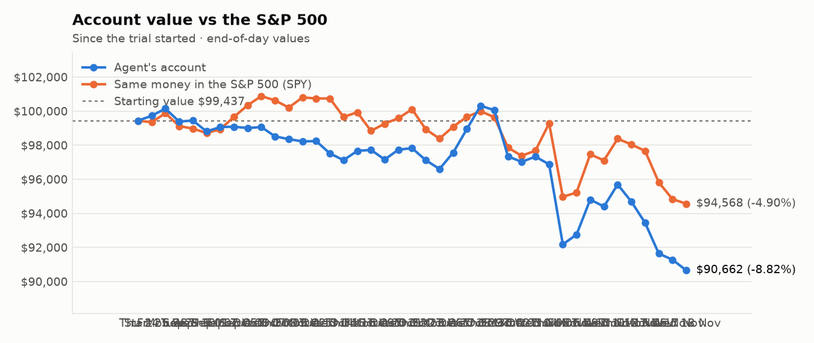
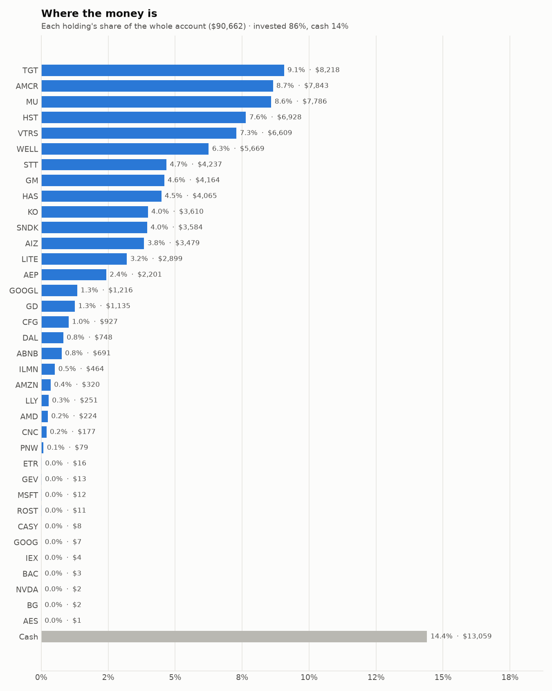
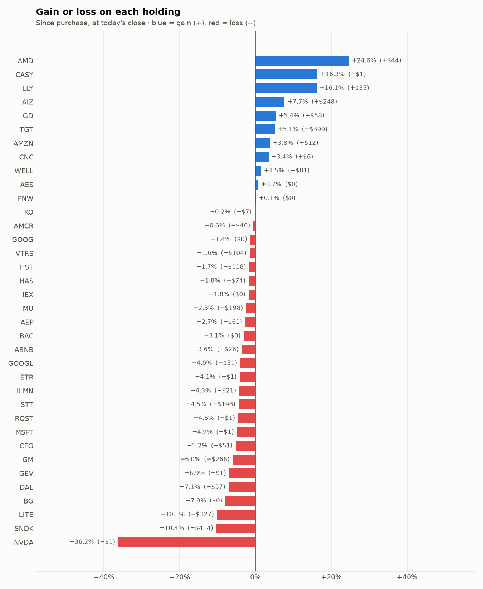

# Daily trading report — Wednesday 18 November 2026

## Summary

- **Account value:** $90,662 (-$620, -0.7% today)
- **S&P 500 (SPY) today:** -0.3% — the agent was behind the index by 0.39%
- **Trades:** 3 buy(s) ($6,053), 5 sell(s) ($12,484)
- **2026-11-18 Morning rebalance:** traded — 7 order(s) placed
- **2026-11-18 Afternoon risk check:** traded — Sold 1 position(s) on the risk check

## Charts

## Why I bought

### KO — bought 29.123 shares at ~$97.76 ($2,847)

**Why:** combined score +0.78; ranked #12 of 503; driven mainly by low volatility +1.81, price momentum +1.47; entering/adding to the top-ranked target portfolio; research detail: 15 recent headline(s), net positive tone (+10); analyst consensus +1.03/2 (8 strong buy, 20 buy, 7 hold, 0 sell, 0 strong sell)

**Research scores** (combined +0.78, ranked #12 in the S&P 500, sector: Consumer Staples):

| Factor | Score | Measures |
|---|---|---|
| Value | -0.71 | cheap vs. sector peers on P/E and P/B |
| Quality | +0.43 | profitability (ROE, margins) and balance-sheet strength |
| Momentum | +1.47 | 12-month price trend, excluding the last month |
| Low volatility | +1.81 | steadier price than sector peers |
| Research | +1.02 | recent news tone + analyst consensus |

**Company financials (Finnhub, trailing 12 months):** P/E 29.3, P/B 9.9, return on equity 42.0%, gross margin 62.3%, debt/equity 1.11

**Price trend (Alpaca):** 12-month return (excl. last month) +38.3%, last month +5.7%, volatility 17.5%/yr

**News (Finnhub): 15 headline(s) in the last 2 days, net tone +10.** Most influential:
- [This Coca-Cola Analyst Begins Coverage On A Bullish Note; Here Are Top 5 Initiations For Wednesday](https://finnhub.io/api/news?id=198a70bf2147c2b18427b119e4061bb122284535855fac76cca72e2f2ea70847) — 18 Nov, Benzinga (tone +2)
- [Coca-Cola Stock (KO) May Struggle to Repeat Its Strong 2026 Performance](https://finnhub.io/api/news?id=67642c7f53d3c4105f49a4e0c3d095a8e6df92faea51c68ff0249d618750c70d) — 17 Nov, Yahoo (tone +2)
- [Wolfe Research Initiates Coverage On Coca-Cola with Outperform Rating](https://finnhub.io/api/news?id=2ce47c34726934ba5f25438b5da8c4badda86d10b0d877dbd8f4f0c3dc340bc8) — 18 Nov, Benzinga (tone +1)
- [TD Cowen names its best stock pick for 2027](https://finnhub.io/api/news?id=6b067ce3024a971cd62cea67d38146e70f6f098c9c759f62348a4cbcdd88a747) — 18 Nov, Yahoo (tone +1)
- [How Is Coca-Cola's Packaging Strategy Supporting Growth?](https://finnhub.io/api/news?id=5110750355ab550b38d9347c6bfe56bee5d6bf9f7af90f65aabc13d578167916) — 17 Nov, Yahoo (tone +1)

**Analysts (Finnhub, 2026-11-01):** 8 strong buy, 20 buy, 7 hold, 0 sell, 0 strong sell — consensus +1.03 on a -2 (strong sell) to +2 (strong buy) scale.

### TGT — bought 9.983 shares at ~$168.74 ($1,685)

**Why:** combined score +1.25; ranked #3 of 503; driven mainly by price momentum +2.47, research (news + analyst consensus) +1.33; entering/adding to the top-ranked target portfolio; research detail: 61 recent headline(s), net positive tone (+26); analyst consensus +0.47/2 (7 strong buy, 9 buy, 24 hold, 3 sell, 0 strong sell)

**Research scores** (combined +1.25, ranked #3 in the S&P 500, sector: Consumer Staples):

| Factor | Score | Measures |
|---|---|---|
| Value | +0.40 | cheap vs. sector peers on P/E and P/B |
| Quality | -0.12 | profitability (ROE, margins) and balance-sheet strength |
| Momentum | +2.47 | 12-month price trend, excluding the last month |
| Low volatility | -0.23 | steadier price than sector peers |
| Research | +1.33 | recent news tone + analyst consensus |

**Company financials (FMP, trailing 12 months):** P/E 15.6, P/B 4.2, return on equity 28.6%, gross margin 29.9%, debt/equity 1.02

**Price trend (Alpaca):** 12-month return (excl. last month) +70.2%, last month +4.0%, volatility 30.6%/yr

**News (Finnhub): 61 headline(s) in the last 2 days, net tone +26.** Most influential:
- [Should Target Stock Be in Your Portfolio Ahead of Q3 Earnings Report?](https://finnhub.io/api/news?id=aefe6df79d782b5666c167be5736233a996ea61fe2fd0ee0eb6b8805d82ba203) — 17 Nov, Yahoo (tone +3)
- [Dow Jones Futures: Techs Jump On Nvidia Earnings; Target Beats, Anthropic IPO Ahead](https://finnhub.io/api/news?id=cf99ddd9b55d761e5a2f63cece33b62b87344a5f08fddd53b20acbf4a87a18cb) — 18 Nov, Yahoo (tone +2)
- [Nvidia, Target and 3 Stocks to Watch Heading Into Wednesday](https://finnhub.io/api/news?id=8d1cbee4337a77b97ab163ea8577ad1ac3516cdc1283e8a435d0097f44424400) — 18 Nov, Benzinga (tone +2)
- [Dow Jones Futures: Techs Rise As Nvidia Beats, Says This On Jensen Huang; Target, Anthropic IPO Ahead](https://finnhub.io/api/news?id=4fca2e56670f0ff0f0e303326fe61e80b2faf7bb352d7ffbaa7ae7a8016c3f3d) — 17 Nov, Yahoo (tone +2)
- [Dow Jones Futures Rise, Techs Jump As Nvidia Beats, Says This On Jensen Huang; Target, Anthropic IPO Ahead](https://finnhub.io/api/news?id=6ee07f3da168a8f2273002083f5e7b7f1e76865081dd1ce4495bad885afa3b7a) — 17 Nov, Yahoo (tone +2)

**Analysts (Finnhub, 2026-11-01):** 7 strong buy, 9 buy, 24 hold, 3 sell, 0 strong sell — consensus +0.47 on a -2 (strong sell) to +2 (strong buy) scale.

### AMCR — bought 35.013 shares at ~$43.45 ($1,521)

**Why:** combined score +1.02; ranked #6 of 503; driven mainly by price momentum +3.00, quality (profitability/balance sheet) -0.56; entering/adding to the top-ranked target portfolio; research detail: analyst consensus +0.95/2 (5 strong buy, 8 buy, 6 hold, 0 sell, 0 strong sell)

**Research scores** (combined +1.02, ranked #6 in the S&P 500, sector: Materials):

| Factor | Score | Measures |
|---|---|---|
| Value | +0.24 | cheap vs. sector peers on P/E and P/B |
| Quality | -0.56 | profitability (ROE, margins) and balance-sheet strength |
| Momentum | +3.00 | 12-month price trend, excluding the last month |
| Low volatility | +0.43 | steadier price than sector peers |
| Research | -0.06 | recent news tone + analyst consensus |

**Company financials (Finnhub, trailing 12 months):** P/E 18.6, P/B 1.6, return on equity 9.3%, gross margin 19.8%, debt/equity 1.27

**Price trend (Alpaca):** 12-month return (excl. last month) +439.6%, last month -1.2%, volatility 26.5%/yr

**News (Finnhub):** no headlines in the last 2 days.

**Analysts (Finnhub, 2026-11-01):** 5 strong buy, 8 buy, 6 hold, 0 sell, 0 strong sell — consensus +0.95 on a -2 (strong sell) to +2 (strong buy) scale.

## Why I sold

### SNDK — sold 4.615 shares at ~$769.63 ($3,552)

**Why:** intraday move -10.9% on the position since entry; 54 recent headline(s), net negative tone (-3); trimmed 50% as a risk circuit breaker, not a full exit

**What triggered it:** the afternoon risk check trims a holding only when BOTH its recent news turns clearly negative AND its price is down 3%+ since purchase (it was -10.9%).

**News (Finnhub): 54 headline(s) in the last 2 days, net tone -3.** Most influential:
- [SanDisk and Micron Fall 4% as GF Securities Cuts NAND Price Forecast and Warns of a Glut; SK Hynix Dips](https://finnhub.io/api/news?id=38286f2033adc286b86bb07cf90453b317ef17023db0c446d8e83ead4002ffdf) — 17 Nov, Yahoo (tone -2)
- [Own Sandisk? Your Five Years Hinge On Memory Prices](https://finnhub.io/api/news?id=19a7acc12d564f844ced56b5cfbdbe85610db893c5017aa32ba1bfc3d34e2501) — 17 Nov, Yahoo (tone +2)
- [Why Sandisk Stock Dropped Again](https://finnhub.io/api/news?id=203090c40e974e77f074ea028185f1c007339b7b53c249ae756fc68dd6e27819) — 18 Nov, Yahoo (tone -1)
- [SanDisk Slides 4% Ahead of 8-for-1 Stock Split as NAND Glut Worries Linger; Micron Drops 3%, Seagate Edges Lower](https://finnhub.io/api/news?id=26b4f1fec32f0c2613853db060625ad2428704dad9372348522c595ead63fa9e) — 18 Nov, Yahoo (tone -1)
- [Sandisk: The Rally Isn't Coming](https://finnhub.io/api/news?id=49ca749190a3a8b2f36ec31016195c07b23e409529d28b128a33edbabff7a927) — 18 Nov, SeekingAlpha (tone +1)

### GOOGL — sold 9.832 shares at ~$283.09 ($2,783)

**Why:** combined score +0.64; ranked #19 of 503; driven mainly by price momentum +1.41, research (news + analyst consensus) +0.92; trimmed toward target weight, or dropped out of the top-ranked names; research detail: 60 recent headline(s), net positive tone (+10); analyst consensus +1.19/2 (20 strong buy, 41 buy, 7 hold, 0 sell, 0 strong sell)

**Research scores** (combined +0.64, ranked #19 in the S&P 500, sector: Communication Services):

| Factor | Score | Measures |
|---|---|---|
| Value | -0.58 | cheap vs. sector peers on P/E and P/B |
| Quality | +0.20 | profitability (ROE, margins) and balance-sheet strength |
| Momentum | +1.41 | 12-month price trend, excluding the last month |
| Low volatility | +0.12 | steadier price than sector peers |
| Research | +0.92 | recent news tone + analyst consensus |

**Company financials (FMP, trailing 12 months):** P/E 14.4, P/B 5.1, return on equity 42.6%, gross margin 60.9%, debt/equity 0.21

**Price trend (Alpaca):** 12-month return (excl. last month) +36.9%, last month -18.6%, volatility 36.0%/yr

**News (Finnhub): 60 headline(s) in the last 2 days, net tone +10.** Most influential:
- [Isomorphic Labs raises $5 billion as AI drug developer targets clinical trials](https://finnhub.io/api/news?id=c12ea9759c0e67246935c3080ed2f153af739ec89777ea7e8288c55fd7cc6c99) — 17 Nov, Yahoo (tone +2)
- [Alphabet Inc-CL A (NASDAQ:GOOGL): A GARP Screen Standout](https://finnhub.io/api/news?id=588614a799defe6c22f3c303af72ae1ed8cf01f6a9c1c4d7af482a7ace3949c1) — 16 Nov, ChartMill (tone +2)
- [Chase Coleman’s Tiger Global Made Nvidia Its Biggest Bet With 12 Million Shares, Dethroning Taiwan Semiconductor. Then the Stock Fell 32%](https://finnhub.io/api/news?id=2ae3a8000ee432c38d08de65e0b8bd375ad3c3d54c848c6a4cd5d25da9f7da98) — 18 Nov, Yahoo (tone +1)
- [Alphabet (GOOGL) Spinout Raised $5 Billion For AI Drug Discovery](https://finnhub.io/api/news?id=7be6c0f5fa6f8022793e1d27eac1b4561005384254160a019b9fbfc49e25f5c9) — 18 Nov, Yahoo (tone +1)
- [Billionaire David Tepper Slashes Alphabet Stake by 46% and Initiates $172M Bet on Oracle](https://finnhub.io/api/news?id=81f587408b7ad8d3b0e056356ea1edaf11073b956e0abe9c6928e5f644da2d26) — 18 Nov, Yahoo (tone -1)

**Analysts (Finnhub, 2026-11-01):** 20 strong buy, 41 buy, 7 hold, 0 sell, 0 strong sell — consensus +1.19 on a -2 (strong sell) to +2 (strong buy) scale.

### AMZN — sold 8.613 shares at ~$263.44 ($2,269)

**Why:** combined score +0.59; ranked #25 of 503; driven mainly by research (news + analyst consensus) +1.28, price momentum +0.87; trimmed toward target weight, or dropped out of the top-ranked names; research detail: 101 recent headline(s), net positive tone (+11); analyst consensus +1.23/2 (19 strong buy, 48 buy, 3 hold, 0 sell, 0 strong sell)

**Research scores** (combined +0.59, ranked #25 in the S&P 500, sector: Consumer Discretionary):

| Factor | Score | Measures |
|---|---|---|
| Value | -0.13 | cheap vs. sector peers on P/E and P/B |
| Quality | +0.11 | profitability (ROE, margins) and balance-sheet strength |
| Momentum | +0.87 | 12-month price trend, excluding the last month |
| Low volatility | -0.43 | steadier price than sector peers |
| Research | +1.28 | recent news tone + analyst consensus |

**Company financials (FMP, trailing 12 months):** P/E 20.9, P/B 4.6, return on equity 26.7%, gross margin 51.4%, debt/equity 0.44

**Price trend (Alpaca):** 12-month return (excl. last month) +22.4%, last month -1.8%, volatility 32.1%/yr

**News (Finnhub): 101 headline(s) in the last 2 days, net tone +11.** Most influential:
- [Amazon, Marriott, Berkshire Hathaway And A Health Care Stock: CNBC’s ‘Final Trades’](https://finnhub.io/api/news?id=73d9b50baf7027f3f9b324d4c5b511d2a91db1ef7d6475ab4f16a69402f95080) — 18 Nov, Benzinga (tone +2)
- [Jeff Bezos Warns Outsider CEO Replacing Jensen Huang Faces ‘Vanishingly Small Chance of Succeeding’ at Nvidia: ‘Too Complicated’](https://finnhub.io/api/news?id=b5c7aad45718a27e672bfbc8f6e98a7f76ea88acb0b8debcc4376e3a99b4ae22) — 17 Nov, Yahoo (tone -1)
- [Amazon Is Up 11% in a Year. UBS Sees Another 32%, Even After Cutting Its AWS Estimates](https://finnhub.io/api/news?id=c63cd50aae0603e1f82c8e3dfdcc988ad1466f31de9104cb9d3420470db50ee7) — 17 Nov, Yahoo (tone +1)
- [TEAMSTERS RALLY FOR 200 E-BIKE DRIVERS TERMINATED BY AMAZON IN NEW YORK](https://finnhub.io/api/news?id=f538d06ceecbadbb4d7c6df164b18cb9521780aa420ca1c7b5970d79d1daf4c2) — 17 Nov, Yahoo (tone +1)
- [Amazon: Snatch Up This Growth Stock Bargain Now](https://finnhub.io/api/news?id=b48e0a5a3c1aa2016f19d3a73663192a62efff7eab03d219a20df55fc7d32f36) — 17 Nov, SeekingAlpha (tone +1)

**Analysts (Finnhub, 2026-11-01):** 19 strong buy, 48 buy, 3 hold, 0 sell, 0 strong sell — consensus +1.23 on a -2 (strong sell) to +2 (strong buy) scale.

### AEP — sold 17.332 shares at ~$126.10 ($2,186)

**Why:** combined score +0.70; ranked #17 of 503; driven mainly by research (news + analyst consensus) +1.22, price momentum +1.16; trimmed toward target weight, or dropped out of the top-ranked names; research detail: 4 recent headline(s), net positive tone (+4); analyst consensus +0.93/2 (7 strong buy, 13 buy, 9 hold, 0 sell, 0 strong sell)

**Research scores** (combined +0.70, ranked #17 in the S&P 500, sector: Utilities):

| Factor | Score | Measures |
|---|---|---|
| Value | -0.07 | cheap vs. sector peers on P/E and P/B |
| Quality | +0.02 | profitability (ROE, margins) and balance-sheet strength |
| Momentum | +1.16 | 12-month price trend, excluding the last month |
| Low volatility | +0.02 | steadier price than sector peers |
| Research | +1.22 | recent news tone + analyst consensus |

**Company financials (Finnhub, trailing 12 months):** P/E 20.5, P/B 2.0, return on equity 10.5%, gross margin 41.9%, debt/equity 1.66

**Price trend (Alpaca):** 12-month return (excl. last month) +6.2%, last month +1.0%, volatility 16.0%/yr

**News (Finnhub): 4 headline(s) in the last 2 days, net tone +4.** Most influential:
- [American Electric Power: A Safer Way To Profit From The AI Boom](https://finnhub.io/api/news?id=d10f535d9544e4f4a0749fd1a7c0dfa48be4cd44fff08259b2e789d56f53df18) — 17 Nov, SeekingAlpha (tone +2)
- [Evercore ISI Group Maintains Outperform on American Electric Power, Raises Price Target to $154](https://finnhub.io/api/news?id=50ac035d12caa0c37c58f739f0f31c87697ed7693054a05af02ac5d0c18eaa70) — 16 Nov, Benzinga (tone +2)
- [Peter Thiel Dumps These 3 Stocks](https://finnhub.io/api/news?id=a5e5d56fef23ac9fe3a8c97d2edec34a23b5e838cca2c91bcb4163822c605fea) — 17 Nov, Yahoo (tone +0)
- [Is AEP Stock Undervalued?](https://finnhub.io/api/news?id=bf9fd8c190970b87d043f1c5c434d44bc34e0ab15214d84225ba1af6b065a9e1) — 17 Nov, Yahoo (tone +0)

**Analysts (Finnhub, 2026-11-01):** 7 strong buy, 13 buy, 9 hold, 0 sell, 0 strong sell — consensus +0.93 on a -2 (strong sell) to +2 (strong buy) scale.

### GM — sold 20.39 shares at ~$83.08 ($1,694)

**Why:** combined score +0.82; ranked #9 of 503; driven mainly by price momentum +1.55, value (cheapness) +1.08; trimmed toward target weight, or dropped out of the top-ranked names; research detail: 16 recent headline(s), net positive tone (+5); analyst consensus +1.14/2 (11 strong buy, 18 buy, 6 hold, 0 sell, 0 strong sell)

**Research scores** (combined +0.82, ranked #9 in the S&P 500, sector: Consumer Discretionary):

| Factor | Score | Measures |
|---|---|---|
| Value | +1.08 | cheap vs. sector peers on P/E and P/B |
| Quality | -0.59 | profitability (ROE, margins) and balance-sheet strength |
| Momentum | +1.55 | 12-month price trend, excluding the last month |
| Low volatility | -0.11 | steadier price than sector peers |
| Research | +0.63 | recent news tone + analyst consensus |

**Company financials (FMP, trailing 12 months):** P/E 18.5, P/B 1.2, return on equity 6.4%, gross margin 9.0%, debt/equity 2.05

**Price trend (Alpaca):** 12-month return (excl. last month) +44.2%, last month +1.6%, volatility 39.0%/yr

**News (Finnhub): 16 headline(s) in the last 2 days, net tone +5.** Most influential:
- [What Are Wall Street Analysts' Target Price for General Motors Stock?](https://finnhub.io/api/news?id=63c2489bcee27fb8da1fc791a32d7f2fb666442af34776aa001fa07a71016a01) — 16 Nov, Yahoo (tone +3)
- [General Motors' Automation Push: Buy, Hold or Sell the Stock Now?](https://finnhub.io/api/news?id=d987e03f2bdebcafaeb17a26621e0f124cf3739052928642b6781634160baf06) — 18 Nov, Yahoo (tone +1)
- [GM CEO Mary Barra Might Be Leaving. Who Could Replace Her.](https://finnhub.io/api/news?id=1af041ea6a1498551ea545ba6c6fb1f358c52734d7a0c66dd62769d9e541dda0) — 17 Nov, Yahoo (tone +1)
- [SDVerse Named CES Innovation Awards® 2027 Honoree](https://finnhub.io/api/news?id=8584669e3e2db07f5d87738c9686ec8eb92acb64c5b23e15e477a37440ffa73d) — 18 Nov, Yahoo (tone +0)
- [GM reportedly targets 20% increase in factory automation](https://finnhub.io/api/news?id=11ebd6c09b89754c0540c64b439369faa673c468b002638f0d65d0647230f8c1) — 18 Nov, Yahoo (tone +0)

**Analysts (Finnhub, 2026-11-01):** 11 strong buy, 18 buy, 6 hold, 0 sell, 0 strong sell — consensus +1.14 on a -2 (strong sell) to +2 (strong buy) scale.

## Holdings at the close

| Stock | Shares | Avg cost | Price | Market value | % of account | Today | Gain/loss $ | Gain/loss % |
|---|---:|---:|---:|---:|---:|---:|---:|---:|
| TGT | 49.527 | $157.87 | $165.93 | $8,218 | 9.1% | +4.01% | +$399 | +5.11% |
| AMCR | 179.479 | $43.96 | $43.70 | $7,843 | 8.7% | +0.58% | −$46 | -0.58% |
| MU | 11.056 | $722.15 | $704.25 | $7,786 | 8.6% | -1.15% | −$198 | -2.48% |
| HST | 273.295 | $25.78 | $25.35 | $6,928 | 7.6% | -1.05% | −$118 | -1.67% |
| VTRS | 325.867 | $20.60 | $20.28 | $6,609 | 7.3% | -0.83% | −$104 | -1.55% |
| WELL | 22.929 | $243.70 | $247.25 | $5,669 | 6.3% | +0.61% | +$81 | +1.46% |
| STT | 25.601 | $173.22 | $165.49 | $4,237 | 4.7% | -1.08% | −$198 | -4.46% |
| GM | 50.696 | $87.37 | $82.13 | $4,164 | 4.6% | -2.28% | −$266 | -6.00% |
| HAS | 34.317 | $120.62 | $118.45 | $4,065 | 4.5% | +0.08% | −$74 | -1.80% |
| KO | 36.805 | $98.27 | $98.09 | $3,610 | 4.0% | -0.71% | −$7 | -0.19% |
| SNDK | 4.616 | $866.10 | $776.45 | $3,584 | 4.0% | -2.61% | −$414 | -10.35% |
| AIZ | 10.908 | $296.24 | $318.96 | $3,479 | 3.8% | -0.99% | +$248 | +7.67% |
| LITE | 5.262 | $613.19 | $551.00 | $2,899 | 3.2% | -1.60% | −$327 | -10.14% |
| AEP | 17.402 | $129.99 | $126.50 | $2,201 | 2.4% | +0.42% | −$61 | -2.69% |
| GOOGL | 4.297 | $294.77 | $282.98 | $1,216 | 1.3% | +0.99% | −$51 | -4.00% |
| GD | 3.251 | $331.27 | $349.04 | $1,135 | 1.3% | -1.85% | +$58 | +5.36% |
| CFG | 14.943 | $65.43 | $62.03 | $927 | 1.0% | -1.60% | −$51 | -5.20% |
| DAL | 8.808 | $91.40 | $84.88 | $748 | 0.8% | +0.69% | −$57 | -7.13% |
| ABNB | 3.834 | $187.14 | $180.35 | $691 | 0.8% | -0.33% | −$26 | -3.63% |
| ILMN | 2.211 | $219.38 | $210.01 | $464 | 0.5% | +3.65% | −$21 | -4.27% |
| AMZN | 1.195 | $257.67 | $267.38 | $320 | 0.4% | +3.68% | +$12 | +3.77% |
| LLY | 0.182 | $1,189.78 | $1,381.51 | $251 | 0.3% | -2.40% | +$35 | +16.11% |
| AMD | 0.424 | $423.91 | $528.20 | $224 | 0.2% | +4.92% | +$44 | +24.60% |
| CNC | 2.63 | $65.21 | $67.45 | $177 | 0.2% | -7.03% | +$6 | +3.44% |
| PNW | 0.753 | $104.41 | $104.52 | $79 | 0.1% | +1.60% | +$0 | +0.11% |
| ETR | 0.145 | $112.67 | $108.00 | $16 | 0.0% | +0.40% | −$1 | -4.14% |
| GEV | 0.017 | $829.15 | $771.57 | $13 | 0.0% | -1.07% | −$1 | -6.94% |
| MSFT | 0.023 | $533.80 | $507.75 | $12 | 0.0% | +0.30% | −$1 | -4.88% |
| ROST | 0.049 | $238.50 | $227.64 | $11 | 0.0% | +3.26% | −$1 | -4.55% |
| CASY | 0.011 | $597.62 | $695.00 | $8 | 0.0% | -2.53% | +$1 | +16.29% |
| GOOG | 0.025 | $283.69 | $279.80 | $7 | 0.0% | +0.79% | −$0 | -1.37% |
| IEX | 0.018 | $237.47 | $233.14 | $4 | 0.0% | +0.24% | −$0 | -1.82% |
| BAC | 0.054 | $50.53 | $48.96 | $3 | 0.0% | -0.97% | −$0 | -3.11% |
| NVDA | 0.016 | $236.88 | $151.20 | $2 | 0.0% | -2.74% | −$1 | -36.17% |
| BG | 0.019 | $101.20 | $93.19 | $2 | 0.0% | -2.52% | −$0 | -7.92% |
| AES | 0.096 | $14.92 | $15.02 | $1 | 0.0% | +0.33% | +$0 | +0.67% |
| **Invested** | | | | **$77,603** | **85.6%** | | **−$1,139** | |
| **Cash** | | | | $13,059 | 14.4% | | | |
| **Total account** | | | | **$90,662** | 100% | | | |

_Scores are sector-neutral z-scores: 0 is average for the stock's sector, +1 is one standard deviation better. News tone is a keyword count over recent headlines, not a deep read. None of this guarantees a stock will rise; a few days of results can't show whether the strategy has a real edge over the S&P 500._
