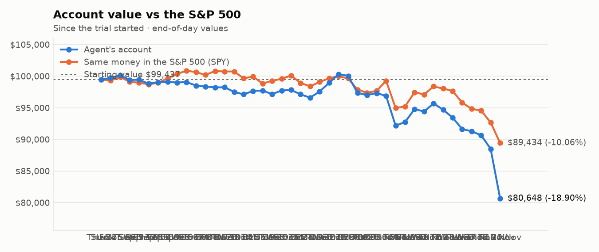
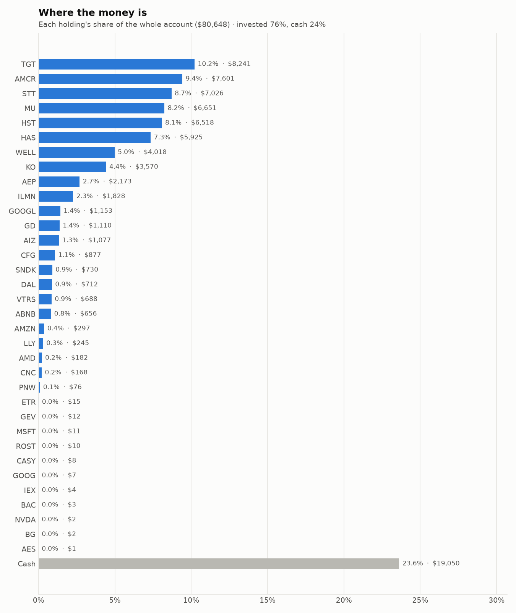
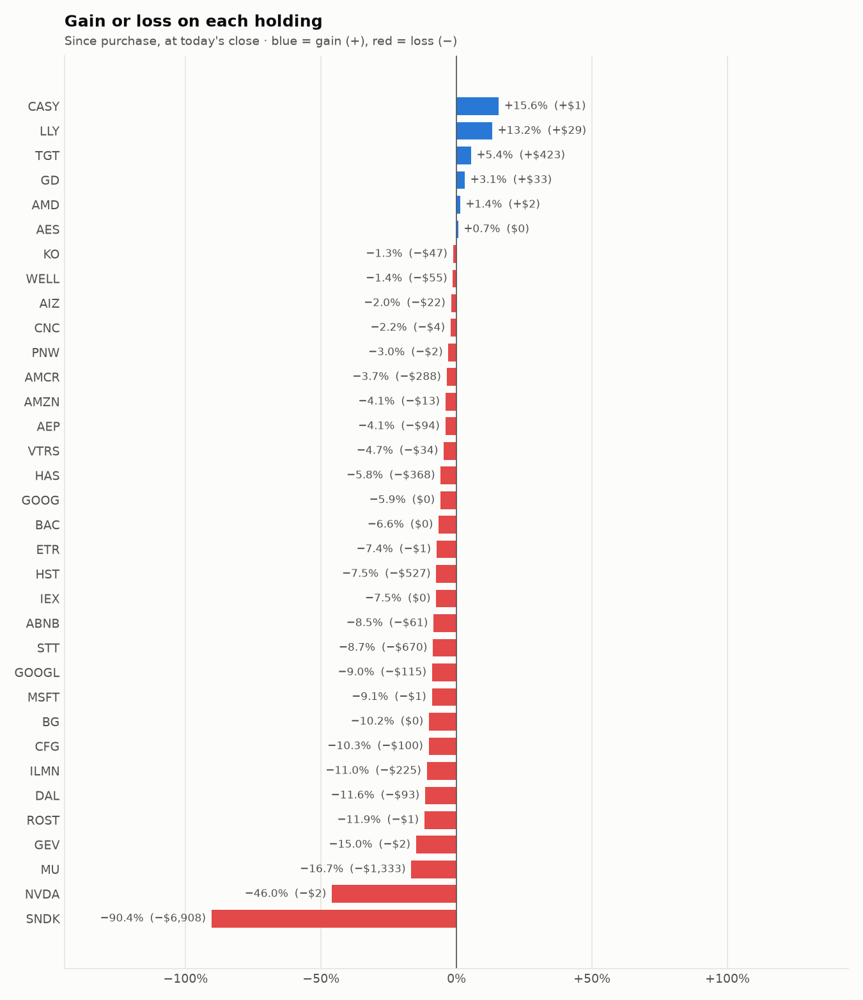

# Daily trading report — Friday 20 November 2026

## Summary

- **Account value:** $80,648 (-$7,871, -8.9% today)
- **S&P 500 (SPY) today:** -3.5% — the agent was behind the index by 5.38%
- **Trades:** 0 buy(s) ($0), 0 sell(s) ($0)
- **2026-11-20 Morning rebalance:** HALTED — Safety check stopped the session: drawdown_halt: drawdown -12.2% exceeds halt threshold
- **2026-11-20 Afternoon risk check:** HALTED — Safety check stopped the session: drawdown_halt: drawdown -12.2% exceeds halt threshold

## Charts

## Why I bought

No stocks were bought.

## Why I sold

No stocks were sold.

## Holdings at the close

| Stock | Shares | Avg cost | Price | Market value | % of account | Today | Gain/loss $ | Gain/loss % |
|---|---:|---:|---:|---:|---:|---:|---:|---:|
| TGT | 49.527 | $157.87 | $166.40 | $8,241 | 10.2% | -0.63% | +$423 | +5.40% |
| AMCR | 179.479 | $43.96 | $42.35 | $7,601 | 9.4% | -0.26% | −$288 | -3.65% |
| STT | 45.218 | $170.20 | $155.38 | $7,026 | 8.7% | -3.63% | −$670 | -8.71% |
| MU | 11.056 | $722.15 | $601.60 | $6,651 | 8.2% | -12.87% | −$1,333 | -16.69% |
| HST | 273.295 | $25.78 | $23.85 | $6,518 | 8.1% | -2.61% | −$527 | -7.49% |
| HAS | 52.75 | $119.30 | $112.32 | $5,925 | 7.3% | -2.08% | −$368 | -5.85% |
| WELL | 16.719 | $243.64 | $240.34 | $4,018 | 5.0% | -1.17% | −$55 | -1.35% |
| KO | 36.805 | $98.27 | $97.00 | $3,570 | 4.4% | +0.95% | −$47 | -1.30% |
| AEP | 17.402 | $130.26 | $124.86 | $2,173 | 2.7% | -0.08% | −$94 | -4.15% |
| ILMN | 9.491 | $216.32 | $192.58 | $1,828 | 2.3% | -4.02% | −$225 | -10.97% |
| GOOGL | 4.297 | $295.13 | $268.43 | $1,153 | 1.4% | -1.55% | −$115 | -9.05% |
| GD | 3.251 | $331.27 | $341.50 | $1,110 | 1.4% | -1.68% | +$33 | +3.09% |
| AIZ | 3.401 | $323.21 | $316.65 | $1,077 | 1.3% | +0.20% | −$22 | -2.03% |
| CFG | 14.943 | $65.43 | $58.71 | $877 | 1.1% | -2.97% | −$100 | -10.27% |
| SNDK | 9.083 | $840.83 | $80.32 | $730 | 0.9% | -14.92% | −$6,908 | -90.45% |
| DAL | 8.808 | $91.40 | $80.80 | $712 | 0.9% | -2.85% | −$93 | -11.60% |
| VTRS | 35.058 | $20.60 | $19.63 | $688 | 0.9% | -1.26% | −$34 | -4.71% |
| ABNB | 3.834 | $187.14 | $171.23 | $656 | 0.8% | -0.90% | −$61 | -8.50% |
| AMZN | 1.195 | $258.76 | $248.13 | $297 | 0.4% | -3.59% | −$13 | -4.11% |
| LLY | 0.182 | $1,189.78 | $1,347.00 | $245 | 0.3% | -0.30% | +$29 | +13.21% |
| AMD | 0.424 | $423.91 | $429.70 | $182 | 0.2% | -12.16% | +$2 | +1.37% |
| CNC | 2.63 | $65.21 | $63.78 | $168 | 0.2% | -2.74% | −$4 | -2.19% |
| PNW | 0.753 | $104.41 | $101.28 | $76 | 0.1% | -0.73% | −$2 | -3.00% |
| ETR | 0.145 | $112.67 | $104.38 | $15 | 0.0% | -1.70% | −$1 | -7.36% |
| GEV | 0.017 | $829.15 | $705.19 | $12 | 0.0% | -6.76% | −$2 | -14.95% |
| MSFT | 0.023 | $533.80 | $485.20 | $11 | 0.0% | -2.63% | −$1 | -9.10% |
| ROST | 0.049 | $238.50 | $210.20 | $10 | 0.0% | -4.40% | −$1 | -11.87% |
| CASY | 0.011 | $597.62 | $691.14 | $8 | 0.0% | +0.82% | +$1 | +15.65% |
| GOOG | 0.025 | $283.69 | $266.82 | $7 | 0.0% | -1.55% | −$0 | -5.95% |
| IEX | 0.018 | $237.47 | $219.64 | $4 | 0.0% | -3.25% | −$0 | -7.51% |
| BAC | 0.054 | $50.53 | $47.19 | $3 | 0.0% | -2.84% | −$0 | -6.61% |
| NVDA | 0.016 | $236.88 | $127.87 | $2 | 0.0% | -12.41% | −$2 | -46.02% |
| BG | 0.019 | $101.20 | $90.90 | $2 | 0.0% | -0.93% | −$0 | -10.18% |
| AES | 0.096 | $14.92 | $15.02 | $1 | 0.0% | +0.00% | +$0 | +0.67% |
| **Invested** | | | | **$61,598** | **76.4%** | | **−$10,481** | |
| **Cash** | | | | $19,050 | 23.6% | | | |
| **Total account** | | | | **$80,648** | 100% | | | |

_Scores are sector-neutral z-scores: 0 is average for the stock's sector, +1 is one standard deviation better. News tone is a keyword count over recent headlines, not a deep read. None of this guarantees a stock will rise; a few days of results can't show whether the strategy has a real edge over the S&P 500._
