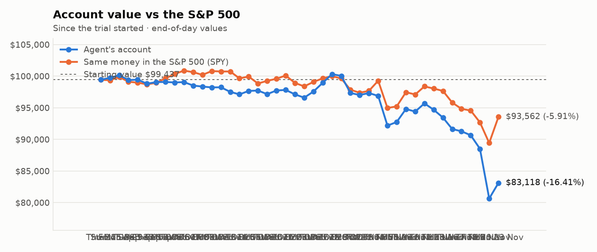
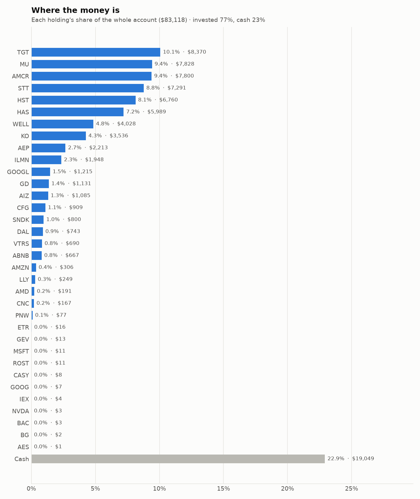
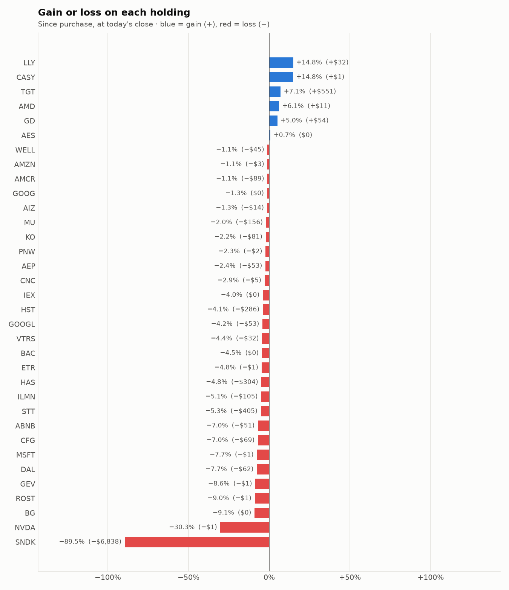

# Daily trading report — Monday 23 November 2026

## Summary

- **Account value:** $83,118 (+$2,470, +3.1% today)
- **S&P 500 (SPY) today:** +4.6% — the agent was behind the index by 1.55%
- **Trades:** 0 buy(s) ($0), 0 sell(s) ($0)
- **2026-11-23 Morning rebalance:** HALTED — Safety check stopped the session: drawdown_halt: drawdown -20.2% exceeds halt threshold
- **2026-11-23 Afternoon risk check:** HALTED — Safety check stopped the session: drawdown_halt: drawdown -20.2% exceeds halt threshold

## Charts

## Why I bought

No stocks were bought.

## Why I sold

No stocks were sold.

## Holdings at the close

| Stock | Shares | Avg cost | Price | Market value | % of account | Today | Gain/loss $ | Gain/loss % |
|---|---:|---:|---:|---:|---:|---:|---:|---:|
| TGT | 49.527 | $157.87 | $169.00 | $8,370 | 10.1% | +1.91% | +$551 | +7.05% |
| MU | 11.056 | $722.15 | $708.00 | $7,828 | 9.4% | +19.09% | −$156 | -1.96% |
| AMCR | 179.479 | $43.96 | $43.46 | $7,800 | 9.4% | +2.62% | −$89 | -1.13% |
| STT | 45.218 | $170.20 | $161.25 | $7,291 | 8.8% | +3.78% | −$405 | -5.26% |
| HST | 273.295 | $25.78 | $24.73 | $6,760 | 8.1% | +2.63% | −$286 | -4.05% |
| HAS | 52.75 | $119.30 | $113.53 | $5,989 | 7.2% | +1.00% | −$304 | -4.83% |
| WELL | 16.719 | $243.64 | $240.93 | $4,028 | 4.8% | +0.25% | −$45 | -1.11% |
| KO | 36.805 | $98.27 | $96.08 | $3,536 | 4.3% | -0.94% | −$81 | -2.24% |
| AEP | 17.402 | $130.26 | $127.19 | $2,213 | 2.7% | +1.64% | −$53 | -2.36% |
| ILMN | 9.491 | $216.32 | $205.21 | $1,948 | 2.3% | +6.43% | −$105 | -5.14% |
| GOOGL | 4.297 | $295.13 | $282.68 | $1,215 | 1.5% | +6.56% | −$53 | -4.22% |
| GD | 3.251 | $331.27 | $347.84 | $1,131 | 1.4% | +1.86% | +$54 | +5.00% |
| AIZ | 3.401 | $323.21 | $319.05 | $1,085 | 1.3% | +0.76% | −$14 | -1.29% |
| CFG | 14.943 | $65.43 | $60.82 | $909 | 1.1% | +3.59% | −$69 | -7.05% |
| SNDK | 9.083 | $840.83 | $88.05 | $800 | 1.0% | +11.12% | −$6,838 | -89.53% |
| DAL | 8.808 | $91.40 | $84.34 | $743 | 0.9% | +5.41% | −$62 | -7.72% |
| VTRS | 35.058 | $20.60 | $19.69 | $690 | 0.8% | +0.31% | −$32 | -4.42% |
| ABNB | 3.834 | $187.14 | $173.96 | $667 | 0.8% | +2.11% | −$51 | -7.04% |
| AMZN | 1.195 | $258.76 | $255.88 | $306 | 0.4% | +3.67% | −$3 | -1.11% |
| LLY | 0.182 | $1,189.78 | $1,366.00 | $249 | 0.3% | +1.40% | +$32 | +14.81% |
| AMD | 0.424 | $423.91 | $449.69 | $191 | 0.2% | +5.96% | +$11 | +6.08% |
| CNC | 2.63 | $65.21 | $63.32 | $167 | 0.2% | -0.72% | −$5 | -2.90% |
| PNW | 0.753 | $104.41 | $101.99 | $77 | 0.1% | +0.70% | −$2 | -2.32% |
| ETR | 0.145 | $112.67 | $107.28 | $16 | 0.0% | +2.78% | −$1 | -4.78% |
| GEV | 0.017 | $829.15 | $757.71 | $13 | 0.0% | +8.35% | −$1 | -8.62% |
| MSFT | 0.023 | $533.80 | $492.85 | $11 | 0.0% | +1.72% | −$1 | -7.67% |
| ROST | 0.049 | $238.50 | $217.04 | $11 | 0.0% | +1.68% | −$1 | -9.00% |
| CASY | 0.011 | $597.62 | $686.00 | $8 | 0.0% | -0.74% | +$1 | +14.79% |
| GOOG | 0.025 | $283.69 | $280.05 | $7 | 0.0% | +6.08% | −$0 | -1.28% |
| IEX | 0.018 | $237.47 | $227.92 | $4 | 0.0% | +3.77% | −$0 | -4.02% |
| NVDA | 0.016 | $236.88 | $165.13 | $3 | 0.0% | +31.55% | −$1 | -30.29% |
| BAC | 0.054 | $50.53 | $48.24 | $3 | 0.0% | +2.55% | −$0 | -4.53% |
| BG | 0.019 | $101.20 | $91.97 | $2 | 0.0% | +1.18% | −$0 | -9.12% |
| AES | 0.096 | $14.92 | $15.03 | $1 | 0.0% | +0.07% | +$0 | +0.74% |
| **Invested** | | | | **$64,068** | **77.1%** | | **−$8,010** | |
| **Cash** | | | | $19,049 | 22.9% | | | |
| **Total account** | | | | **$83,118** | 100% | | | |

_Scores are sector-neutral z-scores: 0 is average for the stock's sector, +1 is one standard deviation better. News tone is a keyword count over recent headlines, not a deep read. None of this guarantees a stock will rise; a few days of results can't show whether the strategy has a real edge over the S&P 500._
