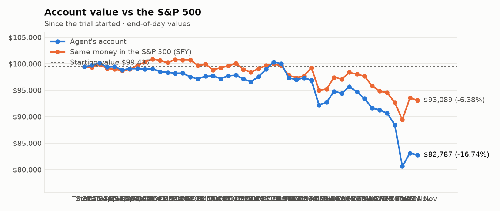
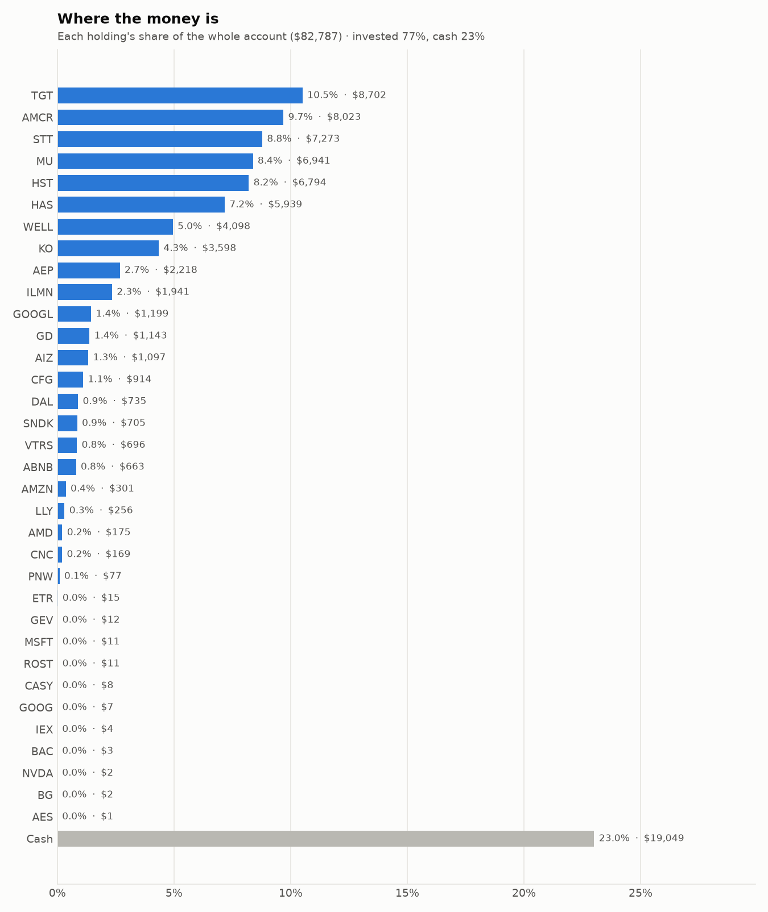
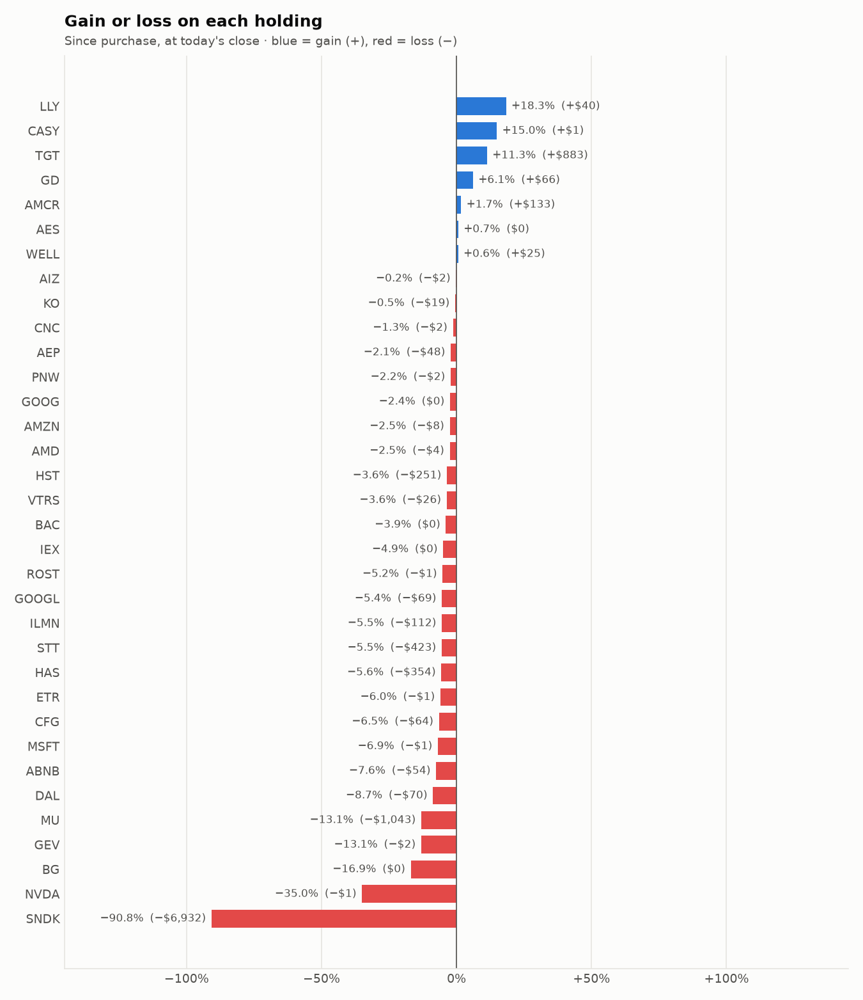

# Daily trading report — Tuesday 24 November 2026

## Summary

- **Account value:** $82,787 (-$331, -0.4% today)
- **S&P 500 (SPY) today:** -0.5% — the agent was ahead of the index by 0.11%
- **Trades:** 0 buy(s) ($0), 0 sell(s) ($0)
- **2026-11-24 Morning rebalance:** HALTED — Safety check stopped the session: drawdown_halt: drawdown -17.8% exceeds halt threshold
- **2026-11-24 Afternoon risk check:** HALTED — Safety check stopped the session: drawdown_halt: drawdown -17.8% exceeds halt threshold

## Charts

## Why I bought

No stocks were bought.

## Why I sold

No stocks were sold.

## Holdings at the close

| Stock | Shares | Avg cost | Price | Market value | % of account | Today | Gain/loss $ | Gain/loss % |
|---|---:|---:|---:|---:|---:|---:|---:|---:|
| TGT | 49.527 | $157.87 | $175.70 | $8,702 | 10.5% | +4.47% | +$883 | +11.30% |
| AMCR | 179.479 | $43.96 | $44.70 | $8,023 | 9.7% | +2.85% | +$133 | +1.69% |
| STT | 45.218 | $170.20 | $160.85 | $7,273 | 8.8% | -0.25% | −$423 | -5.49% |
| MU | 11.056 | $722.15 | $627.78 | $6,941 | 8.4% | -11.29% | −$1,043 | -13.07% |
| HST | 273.295 | $25.78 | $24.86 | $6,794 | 8.2% | +0.51% | −$251 | -3.57% |
| HAS | 52.75 | $119.30 | $112.59 | $5,939 | 7.2% | -0.83% | −$354 | -5.62% |
| WELL | 16.719 | $243.64 | $245.14 | $4,098 | 5.0% | +1.75% | +$25 | +0.62% |
| KO | 36.805 | $98.27 | $97.77 | $3,598 | 4.3% | +1.97% | −$19 | -0.51% |
| AEP | 17.402 | $130.26 | $127.48 | $2,218 | 2.7% | +0.23% | −$48 | -2.14% |
| ILMN | 9.491 | $216.32 | $204.52 | $1,941 | 2.3% | -0.37% | −$112 | -5.45% |
| GOOGL | 4.297 | $295.13 | $279.09 | $1,199 | 1.4% | -1.07% | −$69 | -5.43% |
| GD | 3.251 | $331.27 | $351.55 | $1,143 | 1.4% | +1.07% | +$66 | +6.12% |
| AIZ | 3.401 | $323.21 | $322.64 | $1,097 | 1.3% | +1.13% | −$2 | -0.18% |
| CFG | 14.943 | $65.43 | $61.17 | $914 | 1.1% | +0.58% | −$64 | -6.51% |
| DAL | 8.808 | $91.40 | $83.44 | $735 | 0.9% | -1.07% | −$70 | -8.71% |
| SNDK | 9.083 | $840.83 | $77.65 | $705 | 0.9% | -11.47% | −$6,932 | -90.76% |
| VTRS | 35.058 | $20.60 | $19.85 | $696 | 0.8% | +1.02% | −$26 | -3.64% |
| ABNB | 3.834 | $187.14 | $173.00 | $663 | 0.8% | -0.55% | −$54 | -7.56% |
| AMZN | 1.195 | $258.76 | $252.29 | $301 | 0.4% | -1.21% | −$8 | -2.50% |
| LLY | 0.182 | $1,189.78 | $1,408.00 | $256 | 0.3% | +3.18% | +$40 | +18.34% |
| AMD | 0.424 | $423.91 | $413.31 | $175 | 0.2% | -8.85% | −$4 | -2.50% |
| CNC | 2.63 | $65.21 | $64.35 | $169 | 0.2% | +1.63% | −$2 | -1.32% |
| PNW | 0.753 | $104.41 | $102.15 | $77 | 0.1% | +0.16% | −$2 | -2.16% |
| ETR | 0.145 | $112.67 | $105.95 | $15 | 0.0% | -1.24% | −$1 | -5.96% |
| GEV | 0.017 | $829.15 | $720.65 | $12 | 0.0% | -4.77% | −$2 | -13.09% |
| MSFT | 0.023 | $533.80 | $496.93 | $11 | 0.0% | +0.90% | −$1 | -6.91% |
| ROST | 0.049 | $238.50 | $226.18 | $11 | 0.0% | +4.21% | −$1 | -5.17% |
| CASY | 0.011 | $597.62 | $687.02 | $8 | 0.0% | +0.15% | +$1 | +14.96% |
| GOOG | 0.025 | $283.69 | $276.90 | $7 | 0.0% | -0.94% | −$0 | -2.39% |
| IEX | 0.018 | $237.47 | $225.77 | $4 | 0.0% | -0.94% | −$0 | -4.93% |
| BAC | 0.054 | $50.53 | $48.54 | $3 | 0.0% | +0.83% | −$0 | -3.94% |
| NVDA | 0.016 | $236.88 | $153.95 | $2 | 0.0% | -6.73% | −$1 | -35.01% |
| BG | 0.019 | $101.20 | $84.06 | $2 | 0.0% | -8.60% | −$0 | -16.94% |
| AES | 0.096 | $14.92 | $15.02 | $1 | 0.0% | -0.07% | +$0 | +0.67% |
| **Invested** | | | | **$63,737** | **77.0%** | | **−$8,342** | |
| **Cash** | | | | $19,049 | 23.0% | | | |
| **Total account** | | | | **$82,787** | 100% | | | |

_Scores are sector-neutral z-scores: 0 is average for the stock's sector, +1 is one standard deviation better. News tone is a keyword count over recent headlines, not a deep read. None of this guarantees a stock will rise; a few days of results can't show whether the strategy has a real edge over the S&P 500._
