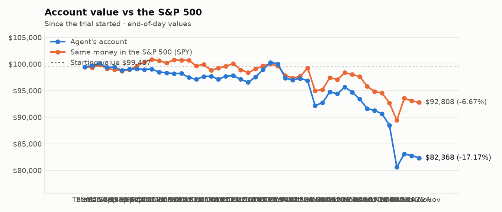
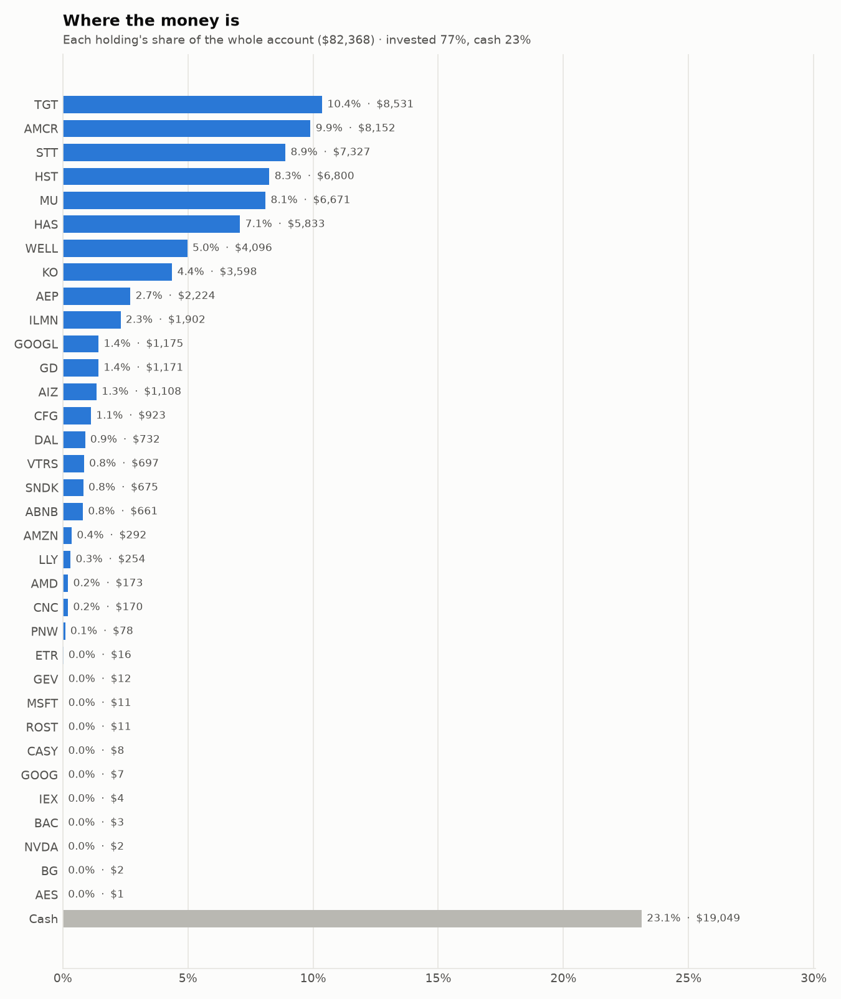
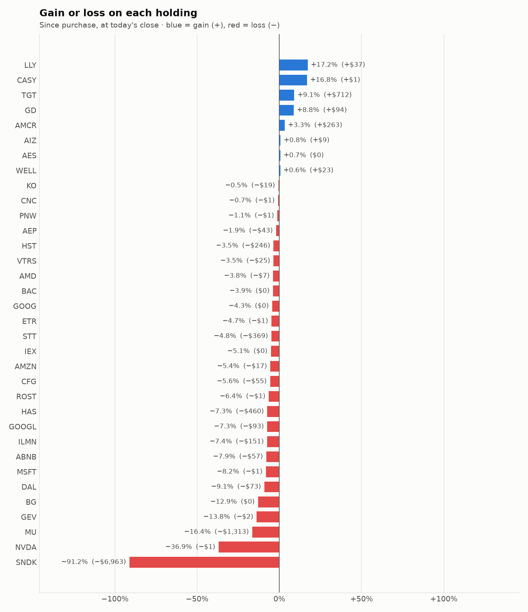

# Daily trading report — Wednesday 25 November 2026

## Summary

- **Account value:** $82,368 (-$419, -0.5% today)
- **S&P 500 (SPY) today:** -0.3% — the agent was behind the index by 0.20%
- **Trades:** 0 buy(s) ($0), 0 sell(s) ($0)
- **2026-11-25 Morning rebalance:** HALTED — Safety check stopped the session: drawdown_halt: drawdown -18.0% exceeds halt threshold
- **2026-11-25 Afternoon risk check:** HALTED — Safety check stopped the session: drawdown_halt: drawdown -18.0% exceeds halt threshold

## Charts

## Why I bought

No stocks were bought.

## Why I sold

No stocks were sold.

## Holdings at the close

| Stock | Shares | Avg cost | Price | Market value | % of account | Today | Gain/loss $ | Gain/loss % |
|---|---:|---:|---:|---:|---:|---:|---:|---:|
| TGT | 49.527 | $157.87 | $172.25 | $8,531 | 10.4% | -2.16% | +$712 | +9.11% |
| AMCR | 179.479 | $43.96 | $45.42 | $8,152 | 9.9% | +1.61% | +$263 | +3.33% |
| STT | 45.218 | $170.20 | $162.03 | $7,327 | 8.9% | +0.73% | −$369 | -4.80% |
| HST | 273.295 | $25.78 | $24.88 | $6,800 | 8.3% | +0.08% | −$246 | -3.49% |
| MU | 11.056 | $722.15 | $603.36 | $6,671 | 8.1% | -4.20% | −$1,313 | -16.45% |
| HAS | 52.75 | $119.30 | $110.58 | $5,833 | 7.1% | -1.48% | −$460 | -7.31% |
| WELL | 16.719 | $243.64 | $245.02 | $4,096 | 5.0% | -0.05% | +$23 | +0.57% |
| KO | 36.805 | $98.27 | $97.75 | $3,598 | 4.4% | +0.13% | −$19 | -0.54% |
| AEP | 17.402 | $130.26 | $127.79 | $2,224 | 2.7% | +0.38% | −$43 | -1.90% |
| ILMN | 9.491 | $216.32 | $200.42 | $1,902 | 2.3% | -2.00% | −$151 | -7.35% |
| GOOGL | 4.297 | $295.13 | $273.53 | $1,175 | 1.4% | -1.98% | −$93 | -7.32% |
| GD | 3.251 | $331.27 | $360.27 | $1,171 | 1.4% | +2.48% | +$94 | +8.75% |
| AIZ | 3.401 | $323.21 | $325.73 | $1,108 | 1.3% | +0.96% | +$9 | +0.78% |
| CFG | 14.943 | $65.43 | $61.76 | $923 | 1.1% | +0.96% | −$55 | -5.61% |
| DAL | 8.808 | $91.40 | $83.12 | $732 | 0.9% | -1.63% | −$73 | -9.06% |
| VTRS | 35.058 | $20.60 | $19.88 | $697 | 0.8% | +0.15% | −$25 | -3.50% |
| SNDK | 9.083 | $840.83 | $74.28 | $675 | 0.8% | -4.71% | −$6,963 | -91.17% |
| ABNB | 3.834 | $187.14 | $172.31 | $661 | 0.8% | -0.62% | −$57 | -7.92% |
| AMZN | 1.195 | $258.76 | $244.75 | $292 | 0.4% | -2.99% | −$17 | -5.41% |
| LLY | 0.182 | $1,189.78 | $1,395.00 | $254 | 0.3% | -0.89% | +$37 | +17.25% |
| AMD | 0.424 | $423.91 | $407.68 | $173 | 0.2% | -1.35% | −$7 | -3.83% |
| CNC | 2.63 | $65.21 | $64.74 | $170 | 0.2% | +0.61% | −$1 | -0.72% |
| PNW | 0.753 | $104.41 | $103.24 | $78 | 0.1% | +1.07% | −$1 | -1.12% |
| ETR | 0.145 | $112.67 | $107.32 | $16 | 0.0% | +1.29% | −$1 | -4.75% |
| GEV | 0.017 | $829.15 | $715.00 | $12 | 0.0% | -0.78% | −$2 | -13.77% |
| MSFT | 0.023 | $533.80 | $490.06 | $11 | 0.0% | -1.22% | −$1 | -8.19% |
| ROST | 0.049 | $238.50 | $223.29 | $11 | 0.0% | -1.28% | −$1 | -6.38% |
| CASY | 0.011 | $597.62 | $698.26 | $8 | 0.0% | +1.64% | +$1 | +16.84% |
| GOOG | 0.025 | $283.69 | $271.40 | $7 | 0.0% | -1.87% | −$0 | -4.33% |
| IEX | 0.018 | $237.47 | $225.25 | $4 | 0.0% | -0.23% | −$0 | -5.15% |
| BAC | 0.054 | $50.53 | $48.56 | $3 | 0.0% | +0.01% | −$0 | -3.89% |
| NVDA | 0.016 | $236.88 | $149.51 | $2 | 0.0% | -3.78% | −$1 | -36.88% |
| BG | 0.019 | $101.20 | $88.15 | $2 | 0.0% | +4.87% | −$0 | -12.90% |
| AES | 0.096 | $14.92 | $15.02 | $1 | 0.0% | +0.00% | +$0 | +0.67% |
| **Invested** | | | | **$63,319** | **76.9%** | | **−$8,760** | |
| **Cash** | | | | $19,049 | 23.1% | | | |
| **Total account** | | | | **$82,368** | 100% | | | |

_Scores are sector-neutral z-scores: 0 is average for the stock's sector, +1 is one standard deviation better. News tone is a keyword count over recent headlines, not a deep read. None of this guarantees a stock will rise; a few days of results can't show whether the strategy has a real edge over the S&P 500._
