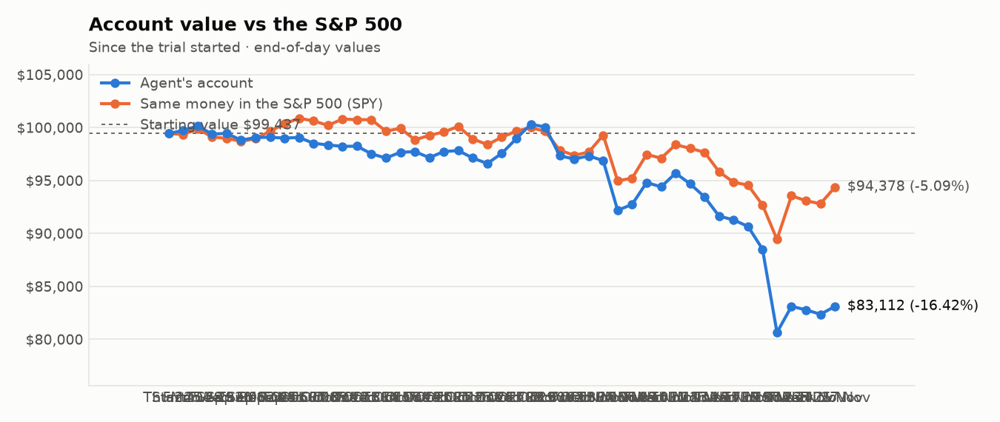
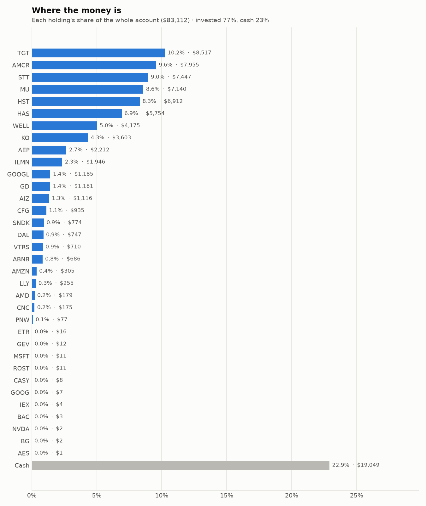
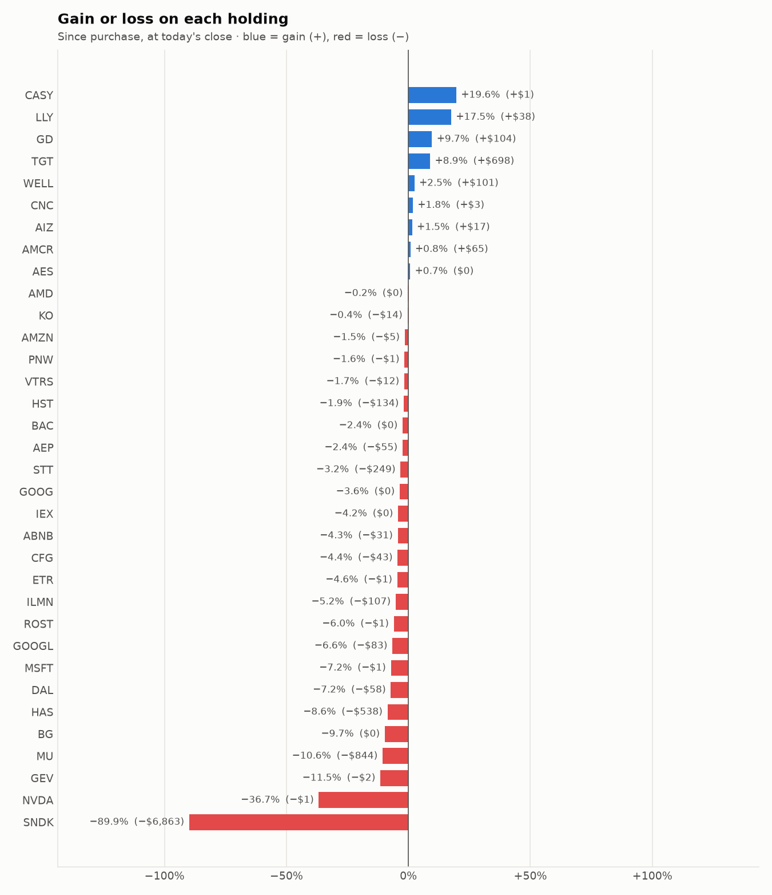

# Daily trading report — Friday 27 November 2026

## Summary

- **Account value:** $83,112 (+$744, +0.9% today)
- **S&P 500 (SPY) today:** +1.7% — the agent was behind the index by 0.79%
- **Trades:** 0 buy(s) ($0), 0 sell(s) ($0)
- **2026-11-27 Morning rebalance:** HALTED — Safety check stopped the session: drawdown_halt: drawdown -18.5% exceeds halt threshold
- **2026-11-27 Afternoon risk check:** DID NOT RUN — no runner started it (a technical fault, not a trading decision).

## Charts

## Why I bought

No stocks were bought.

## Why I sold

No stocks were sold.

## Holdings at the close

| Stock | Shares | Avg cost | Price | Market value | % of account | Today | Gain/loss $ | Gain/loss % |
|---|---:|---:|---:|---:|---:|---:|---:|---:|
| TGT | 49.527 | $157.87 | $171.97 | $8,517 | 10.2% | -0.15% | +$698 | +8.93% |
| AMCR | 179.479 | $43.96 | $44.32 | $7,955 | 9.6% | -2.42% | +$65 | +0.83% |
| STT | 45.218 | $170.20 | $164.69 | $7,447 | 9.0% | +1.64% | −$249 | -3.24% |
| MU | 11.056 | $722.15 | $645.78 | $7,140 | 8.6% | +7.41% | −$844 | -10.58% |
| HST | 273.295 | $25.78 | $25.29 | $6,912 | 8.3% | +1.65% | −$134 | -1.90% |
| HAS | 52.75 | $119.30 | $109.09 | $5,754 | 6.9% | -1.35% | −$538 | -8.56% |
| WELL | 16.719 | $243.64 | $249.69 | $4,175 | 5.0% | +1.43% | +$101 | +2.48% |
| KO | 36.805 | $98.27 | $97.90 | $3,603 | 4.3% | +0.32% | −$14 | -0.38% |
| AEP | 17.402 | $130.26 | $127.11 | $2,212 | 2.7% | -0.38% | −$55 | -2.42% |
| ILMN | 9.491 | $216.32 | $205.01 | $1,946 | 2.3% | +2.31% | −$107 | -5.23% |
| GOOGL | 4.297 | $295.13 | $275.79 | $1,185 | 1.4% | +0.98% | −$83 | -6.55% |
| GD | 3.251 | $331.27 | $363.36 | $1,181 | 1.4% | +0.86% | +$104 | +9.69% |
| AIZ | 3.401 | $323.21 | $328.18 | $1,116 | 1.3% | +0.75% | +$17 | +1.54% |
| CFG | 14.943 | $65.43 | $62.54 | $935 | 1.1% | +1.26% | −$43 | -4.42% |
| SNDK | 9.083 | $840.83 | $85.22 | $774 | 0.9% | +15.77% | −$6,863 | -89.86% |
| DAL | 8.808 | $91.40 | $84.82 | $747 | 0.9% | +2.25% | −$58 | -7.20% |
| VTRS | 35.058 | $20.60 | $20.25 | $710 | 0.9% | +2.12% | −$12 | -1.70% |
| ABNB | 3.834 | $187.14 | $179.00 | $686 | 0.8% | +3.98% | −$31 | -4.35% |
| AMZN | 1.195 | $258.76 | $254.82 | $305 | 0.4% | +4.25% | −$5 | -1.52% |
| LLY | 0.182 | $1,189.78 | $1,398.50 | $255 | 0.3% | +0.45% | +$38 | +17.54% |
| AMD | 0.424 | $423.91 | $422.88 | $179 | 0.2% | +4.15% | −$0 | -0.24% |
| CNC | 2.63 | $65.21 | $66.41 | $175 | 0.2% | +2.58% | +$3 | +1.84% |
| PNW | 0.753 | $104.41 | $102.72 | $77 | 0.1% | -0.50% | −$1 | -1.62% |
| ETR | 0.145 | $112.67 | $107.52 | $16 | 0.0% | +0.19% | −$1 | -4.57% |
| GEV | 0.017 | $829.15 | $733.78 | $12 | 0.0% | +2.63% | −$2 | -11.50% |
| MSFT | 0.023 | $533.80 | $495.49 | $11 | 0.0% | +1.13% | −$1 | -7.18% |
| ROST | 0.049 | $238.50 | $224.24 | $11 | 0.0% | +0.44% | −$1 | -5.98% |
| CASY | 0.011 | $597.62 | $715.02 | $8 | 0.0% | +2.40% | +$1 | +19.64% |
| GOOG | 0.025 | $283.69 | $273.59 | $7 | 0.0% | +0.96% | −$0 | -3.56% |
| IEX | 0.018 | $237.47 | $227.42 | $4 | 0.0% | +0.96% | −$0 | -4.23% |
| BAC | 0.054 | $50.53 | $49.33 | $3 | 0.0% | +1.63% | −$0 | -2.37% |
| NVDA | 0.016 | $236.88 | $149.89 | $2 | 0.0% | +0.40% | −$1 | -36.72% |
| BG | 0.019 | $101.20 | $91.40 | $2 | 0.0% | +3.69% | −$0 | -9.68% |
| AES | 0.096 | $14.92 | $15.03 | $1 | 0.0% | +0.07% | +$0 | +0.74% |
| **Invested** | | | | **$64,062** | **77.1%** | | **−$8,017** | |
| **Cash** | | | | $19,049 | 22.9% | | | |
| **Total account** | | | | **$83,112** | 100% | | | |

_Scores are sector-neutral z-scores: 0 is average for the stock's sector, +1 is one standard deviation better. News tone is a keyword count over recent headlines, not a deep read. None of this guarantees a stock will rise; a few days of results can't show whether the strategy has a real edge over the S&P 500._
