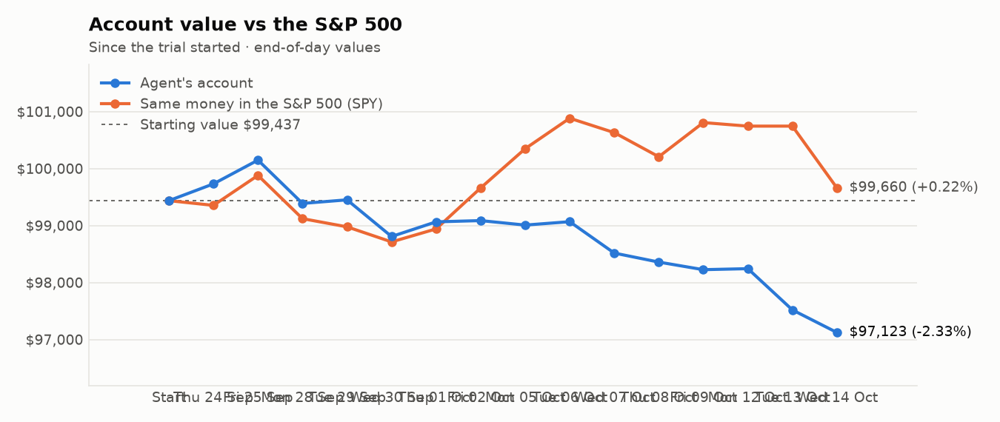
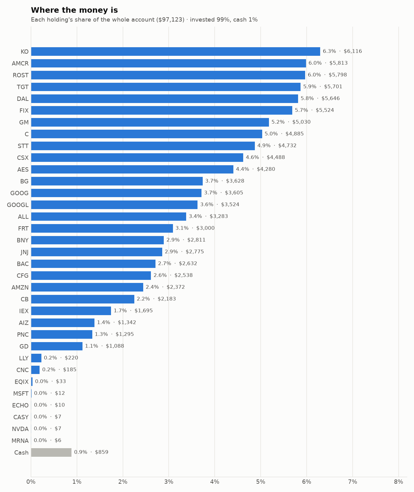
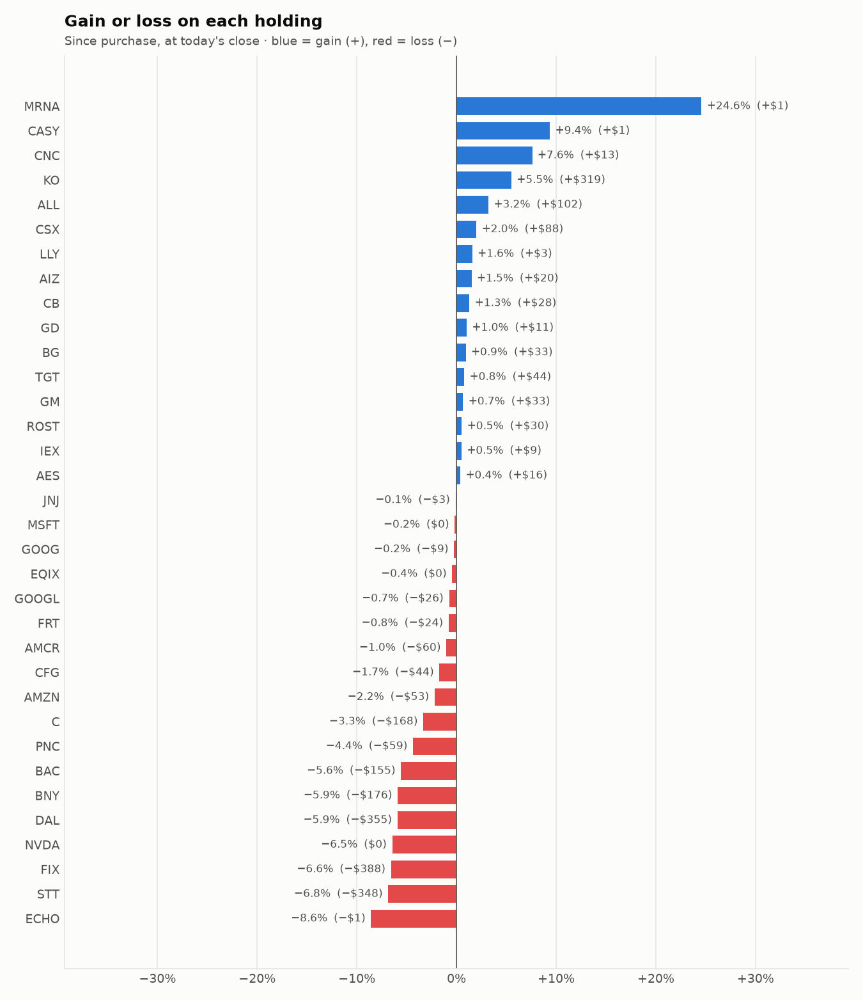

# 5-day trading report — 08 Oct to 14 Oct 2026
_Trading days 11–15 of the trial._

## Performance

- **Account value:** $98,517 → $97,123 (-1.4%)
- **S&P 500 (SPY) over the same days:** -1.0%
- **Agent vs S&P 500:** -0.45% (behind)

| Day | Account value | Day change | SPY | Buys | Sells |
|---|---|---|---|---|---|
| Thu 08 Oct | $98,359 | -0.2% | -0.4% | 4 | 5 |
| Fri 09 Oct | $98,225 | -0.1% | +0.6% | 6 | 6 |
| Mon 12 Oct | $98,243 | +0.0% | -0.1% | 4 | 8 |
| Tue 13 Oct | $97,519 | -0.7% | +0.0% | 7 | 5 |
| Wed 14 Oct | $97,123 | -0.4% | -1.1% | 6 | 3 |

## Risk scorecard (trial to date)

- **Return:** agent -2.33% vs S&P 500 +0.22% over 15 trading day(s)
- **Largest fall from a peak (max drawdown):** -3.02% — the worst the account has been below its own high
- **Volatility:** 6.1% a year — how much the account value swings day to day
- **Sharpe ratio:** -6.50 — return per unit of risk, yearly rate (above 1 is good, below 0 is losing)
- **Beta:** 0.39 — the account moves less than the S&P 500 (1.00 = exactly with it)
- **Alpha:** -2.41% — return lost beyond what the market's own move explains, given the beta above
- *Only 15 trading day(s) so far: these figures swing a lot and can't yet show whether the agent has a real edge. They become meaningful after about 20 days.*

## Charts

## What the research favoured

- **Main reason behind buys:** Momentum (12), Low volatility (6), Research (6), Value (3)
- **Sectors bought:** Financials (8), Industrials (5), Consumer Staples (4), Consumer Discretionary (4), Real Estate (3), Communication Services (2), Health Care (1)
- **Average analyst consensus (-2..+2):** buys +0.93, sells +0.95
- **Average news tone:** buys +6.1, sells +4.8
- **Average combined research score:** buys +0.69, sells +0.49

## Sessions

- **2026-10-08 Morning rebalance:** traded — 8 order(s) placed
- **2026-10-08 Afternoon risk check:** traded — Sold 1 position(s) on the risk check (stop-loss: SNDK)
- **2026-10-09 Morning rebalance:** traded — 12 order(s) placed
- **2026-10-09 Afternoon risk check:** no trades needed — Risk-checked 36 holding(s): none was 10%+ below its purchase price, and none had both clearly negative news and a price drop of 3%+ since entry.
- **2026-10-12 Morning rebalance:** traded — 12 order(s) placed
- **2026-10-12 Afternoon risk check:** no trades needed — Risk-checked 40 holding(s): none was 10%+ below its purchase price, and none had both clearly negative news and a price drop of 3%+ since entry.
- **2026-10-13 Morning rebalance:** traded — 11 order(s) placed
- **2026-10-13 Afternoon risk check:** traded — Sold 1 position(s) on the risk check (stop-loss: MU)
- **2026-10-14 Morning rebalance:** traded — 7 order(s) placed
- **2026-10-14 Afternoon risk check:** traded — Sold 2 position(s) on the risk check (stop-loss: BE, VRT)

# Key decisions and the research behind them

## Why I bought

### PLD — bought 44.165 shares at ~$130.85 ($5,779)

**Why:** combined score +0.73; ranked #6 of 503; driven mainly by research (news + analyst consensus) +1.50, price momentum +0.97; entering/adding to the top-ranked target portfolio; research detail: 4 recent headline(s), net positive tone (+2); analyst consensus +0.87/2 (5 strong buy, 10 buy, 8 hold, 0 sell, 0 strong sell)

**Research scores** (combined +0.73, ranked #6 in the S&P 500, sector: Real Estate):

| Factor | Score | Measures |
|---|---|---|
| Value | +0.35 | cheap vs. sector peers on P/E and P/B |
| Quality | +0.34 | profitability (ROE, margins) and balance-sheet strength |
| Momentum | +0.97 | 12-month price trend, excluding the last month |
| Low volatility | +0.36 | steadier price than sector peers |
| Research | +1.50 | recent news tone + analyst consensus |

**Company financials (Finnhub, trailing 12 months):** P/E 29.8, P/B 2.4, return on equity 7.9%, gross margin 74.3%, debt/equity 0.68

**Price trend (Alpaca):** 12-month return (excl. last month) +19.9%, last month -3.6%, volatility 17.9%/yr

**News (Finnhub): 4 headline(s) in the last 2 days, net tone +2.** Most influential:
- [Will Texas Power Limits on Hutto Data Center Rethink Prologis' (PLD) Development-Led Growth Narrative](https://finnhub.io/api/news?id=ac9e12ac7cfd3168d10888d87554b01da6d2289d4b023b28278b93705f9eadf2) — 10 Oct, Yahoo (tone +2)
- [Dimensional Fund Advisors Ltd. : Form 8.3 - PROLOGIS INC - Ordinary Shares](https://finnhub.io/api/news?id=d711a803dfef501d91dec420eb95c78e7a68587ec0b8795df6d88881ed0667b4) — 12 Oct, Yahoo (tone +0)
- [Prologis (PLD) Draws Fresh Ownership Focus, Is The Stock Still Undervalued?](https://finnhub.io/api/news?id=ceaf3adb52a3d333c1b88d867a10d22525d8207e4a7e449521dc2951d72bb212) — 10 Oct, Yahoo (tone +0)
- [Prologis (PLD) Stock Looks Near Fair Value As Its 30% Run Continues](https://finnhub.io/api/news?id=be698f96c0cd13f1e50396132c602e768235e3795daadb0bc91b3681517a59e5) — 10 Oct, Yahoo (tone +0)

**Analysts (Finnhub, 2026-09-01):** 5 strong buy, 10 buy, 8 hold, 0 sell, 0 strong sell — consensus +0.87 on a -2 (strong sell) to +2 (strong buy) scale.

### IVZ — bought 170.232 shares at ~$29.33 ($4,993)

**Why:** combined score +0.89; ranked #2 of 503; driven mainly by value (cheapness) +1.98, price momentum +1.57; entering/adding to the top-ranked target portfolio; research detail: 8 recent headline(s), net positive tone (+3); analyst consensus +0.50/2 (1 strong buy, 7 buy, 10 hold, 0 sell, 0 strong sell)

**Research scores** (combined +0.89, ranked #2 in the S&P 500, sector: Financials):

| Factor | Score | Measures |
|---|---|---|
| Value | +1.98 | cheap vs. sector peers on P/E and P/B |
| Quality | -0.27 | profitability (ROE, margins) and balance-sheet strength |
| Momentum | +1.57 | 12-month price trend, excluding the last month |
| Low volatility | -0.72 | steadier price than sector peers |
| Research | +1.31 | recent news tone + analyst consensus |

**Company financials (Finnhub, trailing 12 months):** P/B 0.9, return on equity -0.5%, gross margin 66.0%, debt/equity 0.85

**Price trend (Alpaca):** 12-month return (excl. last month) +43.7%, last month -7.6%, volatility 28.3%/yr

**News (Finnhub): 8 headline(s) in the last 2 days, net tone +3.** Most influential:
- [Which Healthcare ETF Is the Better Buy: Fidelity’s Broad FHLC or Invesco’s Biotech-Focused PBE?](https://finnhub.io/api/news?id=a2233f3ac8ac300e4b043ee5e18605976d7173c51718e741e1ea6a0adefcae9d) — 11 Oct, Yahoo (tone +1)
- [Better Invesco Healthcare ETF: PJP Targeting Pharmaceuticals vs. RSPH's Broader Sector Lens](https://finnhub.io/api/news?id=d3ab46fd22bbc21dc5d04a82a27bd3f492c72e8b6fdff45025d96774a52a2809) — 11 Oct, Yahoo (tone +1)
- [Invesco (IVZ) Stock Could Be 39% Undervalued On Excess Returns](https://finnhub.io/api/news?id=a30042d84794fbe982718d1d27bd26636564b187cd85dc25afdb302263e34b26) — 10 Oct, Yahoo (tone +1)
- [Should Invesco Russell 1000 Equal Weight ETF (EQAL) Be on Your Investing Radar?](https://finnhub.io/api/news?id=a735e21d7df3fdef73047ee637aacf1a23239ae77de0e67ad65fca423379871d) — 12 Oct, Yahoo (tone +0)
- [Should Invesco S&P MidCap 400 Pure Value ETF (RFV) Be on Your Investing Radar?](https://finnhub.io/api/news?id=94f96406dcf4f87212dfae831eee7995a3dd7589dff94c5c5da39b958b7f27a5) — 12 Oct, Yahoo (tone +0)

**Analysts (Finnhub, 2026-09-01):** 1 strong buy, 7 buy, 10 hold, 0 sell, 0 strong sell — consensus +0.50 on a -2 (strong sell) to +2 (strong buy) scale.

### FIX — bought 2.681 shares at ~$1,602.98 ($4,298)

**Why:** combined score +0.86; ranked #5 of 503; driven mainly by price momentum +2.99, research (news + analyst consensus) +2.26; entering/adding to the top-ranked target portfolio; research detail: 2 recent headline(s), net positive tone (+4); analyst consensus +1.31/2 (7 strong buy, 7 buy, 2 hold, 0 sell, 0 strong sell)

**Research scores** (combined +0.86, ranked #5 in the S&P 500, sector: Industrials):

| Factor | Score | Measures |
|---|---|---|
| Value | -0.83 | cheap vs. sector peers on P/E and P/B |
| Quality | +0.23 | profitability (ROE, margins) and balance-sheet strength |
| Momentum | +2.99 | 12-month price trend, excluding the last month |
| Low volatility | -1.45 | steadier price than sector peers |
| Research | +2.26 | recent news tone + analyst consensus |

**Company financials (Finnhub, trailing 12 months):** P/E 41.2, P/B 21.7, return on equity 53.5%, gross margin 25.7%, debt/equity 0.02

**Price trend (Alpaca):** 12-month return (excl. last month) +124.1%, last month -3.0%, volatility 54.8%/yr

**News (Finnhub): 2 headline(s) in the last 2 days, net tone +4.** Most influential:
- [Comfort Systems' Rich Valuation After 84% Rally: Is Caution Warranted?](https://finnhub.io/api/news?id=4b6e6b1c67f6dce3d886e1da456fb768a35624040411522b462098c00f737479) — 12 Oct, Yahoo (tone +4)
- [Comfort Systems USA: A Sneaky Winner In The AI Infrastructure Buildout](https://finnhub.io/api/news?id=41fc9353ca0f95ee9393a02afa9ccb4c1277bb7436c9a0af5cecfdf677a87618) — 11 Oct, SeekingAlpha (tone +0)

**Analysts (Finnhub, 2026-09-01):** 7 strong buy, 7 buy, 2 hold, 0 sell, 0 strong sell — consensus +1.31 on a -2 (strong sell) to +2 (strong buy) scale.

### FRT — bought 36.393 shares at ~$105.54 ($3,841)

**Why:** combined score +0.62; ranked #14 of 503; driven mainly by low volatility +1.79, value (cheapness) +0.63; entering/adding to the top-ranked target portfolio; research detail: analyst consensus +0.92/2 (6 strong buy, 11 buy, 8 hold, 0 sell, 0 strong sell)

**Research scores** (combined +0.62, ranked #14 in the S&P 500, sector: Real Estate):

| Factor | Score | Measures |
|---|---|---|
| Value | +0.63 | cheap vs. sector peers on P/E and P/B |
| Quality | +0.24 | profitability (ROE, margins) and balance-sheet strength |
| Momentum | +0.61 | 12-month price trend, excluding the last month |
| Low volatility | +1.79 | steadier price than sector peers |
| Research | +0.10 | recent news tone + analyst consensus |

**Company financials (Finnhub, trailing 12 months):** P/E 21.1, P/B 3.2, return on equity 13.3%, gross margin 67.5%, debt/equity 1.42

**Price trend (Alpaca):** 12-month return (excl. last month) +13.2%, last month -8.4%, volatility 12.9%/yr

**News (Finnhub):** no headlines in the last 2 days.

**Analysts (Finnhub, 2026-09-01):** 6 strong buy, 11 buy, 8 hold, 0 sell, 0 strong sell — consensus +0.92 on a -2 (strong sell) to +2 (strong buy) scale.

### GM — bought 43.188 shares at ~$82.40 ($3,559)

**Why:** combined score +0.69; ranked #10 of 503; driven mainly by price momentum +1.87, research (news + analyst consensus) +1.07; entering/adding to the top-ranked target portfolio; research detail: 12 recent headline(s), net positive tone (+6); analyst consensus +1.05/2 (11 strong buy, 19 buy, 7 hold, 1 sell, 0 strong sell)

**Research scores** (combined +0.69, ranked #10 in the S&P 500, sector: Consumer Discretionary):

| Factor | Score | Measures |
|---|---|---|
| Value | +0.66 | cheap vs. sector peers on P/E and P/B |
| Quality | -0.67 | profitability (ROE, margins) and balance-sheet strength |
| Momentum | +1.87 | 12-month price trend, excluding the last month |
| Low volatility | +0.05 | steadier price than sector peers |
| Research | +1.07 | recent news tone + analyst consensus |

**Company financials (FMP, trailing 12 months):** P/E 41.2, P/B 1.2, return on equity 3.0%, gross margin 5.7%, debt/equity 2.06

**Price trend (Alpaca):** 12-month return (excl. last month) +43.9%, last month -1.8%, volatility 34.6%/yr

**News (Finnhub): 12 headline(s) in the last 2 days, net tone +6.** Most influential:
- [EV Stocks’ Rally Is Narrow: Tesla and GM Lead While Pure Plays Lag](https://finnhub.io/api/news?id=1275d5f313c7a63eb1071322455d9c85040925ccc1f72cdbb1f5083d49055f02) — 09 Oct, ChartMill (tone +2)
- [Why Should General Motors Stock Holders Watch This Number?](https://finnhub.io/api/news?id=bedb23aa60c2fe19d2b61e8a17d173c16071b9be359c9a4d59be34e49eb5aade) — 08 Oct, Yahoo (tone +2)
- [General Motors vs. Tesla: What Revenue Growth Trends Tell Investors About These Automotive Giants](https://finnhub.io/api/news?id=b41945da21a43da6e3d6e225fd706919ccf4315de541bb31f96e589f747f3e69) — 08 Oct, Yahoo (tone +1)
- [Why Bank of America is bullish on GM's truck overhaul](https://finnhub.io/api/news?id=46bb5214d565cd5f4d3c8c942f97b5b64356c1c88b09635c1445555532947b8d) — 08 Oct, Yahoo (tone +1)
- [Why General Motors is dropping Blue Cross for salaried workers](https://finnhub.io/api/news?id=6bcb6b4661d2a1816853f52346a10eeb96489c4be6f232f58f75c3edbd8d85f5) — 08 Oct, Yahoo (tone +0)

**Analysts (Finnhub, 2026-09-01):** 11 strong buy, 19 buy, 7 hold, 1 sell, 0 strong sell — consensus +1.05 on a -2 (strong sell) to +2 (strong buy) scale.

### ROST — bought 15.146 shares at ~$226.55 ($3,431)

**Why:** combined score +0.74; ranked #7 of 503; driven mainly by price momentum +1.99, research (news + analyst consensus) +1.15; entering/adding to the top-ranked target portfolio; research detail: 9 recent headline(s), net positive tone (+13); analyst consensus +1.04/2 (9 strong buy, 10 buy, 8 hold, 0 sell, 0 strong sell)

**Research scores** (combined +0.74, ranked #7 in the S&P 500, sector: Consumer Discretionary):

| Factor | Score | Measures |
|---|---|---|
| Value | -0.41 | cheap vs. sector peers on P/E and P/B |
| Quality | -0.10 | profitability (ROE, margins) and balance-sheet strength |
| Momentum | +1.99 | 12-month price trend, excluding the last month |
| Low volatility | +0.80 | steadier price than sector peers |
| Research | +1.15 | recent news tone + analyst consensus |

**Company financials (Finnhub, trailing 12 months):** P/E 27.2, P/B 12.0, return on equity 42.3%, gross margin 28.6%, debt/equity 0.15

**Price trend (Alpaca):** 12-month return (excl. last month) +52.2%, last month -1.9%, volatility 23.6%/yr

**News (Finnhub): 9 headline(s) in the last 2 days, net tone +13.** Most influential:
- [Ross Stores (ROST) Stock May Look Stretched After 115 New Store Openings](https://finnhub.io/api/news?id=14e92694f9a75acf9f5b5ea7351dd843c79d0765277d0a4fb13bcba4132d6cc4) — 13 Oct, Yahoo (tone +3)
- [Ross Stores Expands Footprint With 51 New Store Openings](https://finnhub.io/api/news?id=a9e909c9015dd99ac6c54e1491bb3893f6da2fc971649aa0a25adb114f1163eb) — 13 Oct, Yahoo (tone +3)
- [Zacks.com featured highlights include Micron Technology, Banco Bilbao Vizcaya Argentaria, Ross Stores, VICI Properties and PACCAR](https://finnhub.io/api/news?id=0fe1b636a308bbeb03435a4e5d209f61afaf8598b79bdc09ed322e7b1cc92b8e) — 12 Oct, Yahoo (tone +2)
- [Ross Stores enters a new market as customers hunt for low prices](https://finnhub.io/api/news?id=c87e7e861b720db9d8911c79dba4130b3f1c6fd147b93cd06c548ef5408bebc3) — 13 Oct, Yahoo (tone +1)
- [Ross Stores (ROST) Completes Its Expansion Program, Is The Stock Fully Priced?](https://finnhub.io/api/news?id=fdfb392e907556eee9fc6048a54f0ac323fff3ff429fbacf1cc69a08b0309a08) — 13 Oct, Yahoo (tone +1)

**Analysts (Finnhub, 2026-09-01):** 9 strong buy, 10 buy, 8 hold, 0 sell, 0 strong sell — consensus +1.04 on a -2 (strong sell) to +2 (strong buy) scale.

### USB — bought 58.742 shares at ~$57.51 ($3,378)

**Why:** combined score +0.64; ranked #12 of 503; driven mainly by research (news + analyst consensus) +1.05, price momentum +0.84; entering/adding to the top-ranked target portfolio; research detail: 1 recent headline(s), net positive tone (+2); analyst consensus +0.78/2 (6 strong buy, 10 buy, 10 hold, 1 sell, 0 strong sell)

**Research scores** (combined +0.64, ranked #12 in the S&P 500, sector: Financials):

| Factor | Score | Measures |
|---|---|---|
| Value | +0.70 | cheap vs. sector peers on P/E and P/B |
| Quality | -0.19 | profitability (ROE, margins) and balance-sheet strength |
| Momentum | +0.84 | 12-month price trend, excluding the last month |
| Low volatility | +0.83 | steadier price than sector peers |
| Research | +1.05 | recent news tone + analyst consensus |

**Company financials (Finnhub, trailing 12 months):** P/E 10.9, P/B 1.4, return on equity 12.5%, debt/equity 1.42

**Price trend (Alpaca):** 12-month return (excl. last month) +26.5%, last month -8.6%, volatility 18.7%/yr

**News (Finnhub): 1 headline(s) in the last 2 days, net tone +2.** Most influential:
- [Cautious Optimism Heading Into Q3 Earnings For U.S. Bancorp](https://finnhub.io/api/news?id=e52361c1ac3f002afc5cac0daffd972585cee5c441a2c512275e00de13293f46) — 10 Oct, SeekingAlpha (tone +2)

**Analysts (Finnhub, 2026-09-01):** 6 strong buy, 10 buy, 10 hold, 1 sell, 0 strong sell — consensus +0.78 on a -2 (strong sell) to +2 (strong buy) scale.

### JNJ — bought 12.484 shares at ~$254.00 ($3,171)

**Why:** combined score +0.69; ranked #8 of 503; driven mainly by low volatility +2.02, research (news + analyst consensus) +1.39; entering/adding to the top-ranked target portfolio; research detail: 16 recent headline(s), net positive tone (+7); analyst consensus +0.94/2 (7 strong buy, 15 buy, 9 hold, 0 sell, 0 strong sell)

**Research scores** (combined +0.69, ranked #8 in the S&P 500, sector: Health Care):

| Factor | Score | Measures |
|---|---|---|
| Value | -0.54 | cheap vs. sector peers on P/E and P/B |
| Quality | +0.33 | profitability (ROE, margins) and balance-sheet strength |
| Momentum | +0.61 | 12-month price trend, excluding the last month |
| Low volatility | +2.02 | steadier price than sector peers |
| Research | +1.39 | recent news tone + analyst consensus |

**Company financials (FMP, trailing 12 months):** P/E 29.4, P/B 7.3, return on equity 25.7%, gross margin 67.9%, debt/equity 0.58

**Price trend (Alpaca):** 12-month return (excl. last month) +50.9%, last month -4.0%, volatility 20.3%/yr

**News (Finnhub): 16 headline(s) in the last 2 days, net tone +7.** Most influential:
- [Johnson & Johnson (JNJ) Is Becoming a Growth Stock. Does AbbVie (ABBV) Make JNJ Look Expensive?](https://finnhub.io/api/news?id=77193bfeaac80c353a6ddb698c75fbb72f6b84e78e74bbbfa5d41b7083d85a41) — 07 Oct, Yahoo (tone +2)
- [RBC Capital Maintains Outperform on Johnson & Johnson, Raises Price Target to $290](https://finnhub.io/api/news?id=efd1b6bf312f07f06327bd3942229843cb39220f7eaa7f7738c506c9ab3f3951) — 06 Oct, Benzinga (tone +2)
- [Pfizer (PFE) Trades Below 10x Earnings. Why Does Johnson & Johnson (JNJ) Command More Than Twice the Multiple?](https://finnhub.io/api/news?id=904768d4646b4c625a90536c16f161ffc15968ceead861754922be31faa62b51) — 07 Oct, Yahoo (tone +1)
- [Johnson & Johnson Has Dividend Royalty Status. Does That Make It a Buy?](https://finnhub.io/api/news?id=0cb0291528fabe296f8b55180027c24a21f169e5f2f4c1c38d3f4f06a13e3aea) — 07 Oct, Yahoo (tone +1)
- [Johnson & Johnson (JNJ) Earnings Expected to Grow: Should You Buy?](https://finnhub.io/api/news?id=a3f8a87f2247a10637941042e5271f6a24617c3f3a272b6c8b7b459dd7c40c30) — 06 Oct, Yahoo (tone +1)

**Analysts (Finnhub, 2026-09-01):** 7 strong buy, 15 buy, 9 hold, 0 sell, 0 strong sell — consensus +0.94 on a -2 (strong sell) to +2 (strong buy) scale.

### C — bought 23.12 shares at ~$129.73 ($2,999)

**Why:** combined score +0.66; ranked #15 of 503; driven mainly by price momentum +1.48, research (news + analyst consensus) +1.29; entering/adding to the top-ranked target portfolio; research detail: 10 recent headline(s), net positive tone (+5); analyst consensus +1.04/2 (7 strong buy, 15 buy, 6 hold, 0 sell, 0 strong sell)

**Research scores** (combined +0.66, ranked #15 in the S&P 500, sector: Financials):

| Factor | Score | Measures |
|---|---|---|
| Value | +0.99 | cheap vs. sector peers on P/E and P/B |
| Quality | -0.86 | profitability (ROE, margins) and balance-sheet strength |
| Momentum | +1.48 | 12-month price trend, excluding the last month |
| Low volatility | +0.06 | steadier price than sector peers |
| Research | +1.29 | recent news tone + analyst consensus |

**Company financials (Finnhub, trailing 12 months):** P/E 12.3, P/B 1.1, return on equity 8.4%, debt/equity 3.84

**Price trend (Alpaca):** 12-month return (excl. last month) +42.8%, last month -4.9%, volatility 24.2%/yr

**News (Finnhub): 10 headline(s) in the last 2 days, net tone +5.** Most influential:
- [Citigroup (NYSE:C) Q3 2026 Earnings Beat Profit as Revenue Lands Just Below Consensus](https://finnhub.io/api/news?id=7c7bc72b01c053471313f24830756ab25149f8fd4cfdc1ed23f5b4b791ef9920) — 13 Oct, ChartMill (tone +2)
- [The Zacks Analyst Blog Highlights JPMorgan Chase, Goldman Sachs, Citigroup, Wells Fargo Morgan Stanley and Bank of America](https://finnhub.io/api/news?id=ef943e1f93dd867834e337f21774e0904f4889a06bdced2675218aed4f1d6c03) — 13 Oct, Yahoo (tone +2)
- [JPMorgan, Citigroup, Pepsi, Micron and Nike are part of Zacks Earnings Preview](https://finnhub.io/api/news?id=90a8c1ac6c93e9f26cae87a2cdf1a81e3ad7b5a6b07d92e9b5fec3a5eca8621e) — 12 Oct, Yahoo (tone +1)
- [JPMorgan, Wells Fargo Kick Off Bank Earnings With Goldman, Citigroup Due](https://finnhub.io/api/news?id=02dcd6654121e3a4ce657f71f1812e39cabf990a6503f7ef8440c3148ab5a36e) — 13 Oct, Yahoo (tone +0)
- [Earnings from banks and  J&J and home sales data: What to Watch](https://finnhub.io/api/news?id=0ed83cae897d5328a440303c15e0d102a8864a028c818d7dfc195d227dedb301) — 12 Oct, Yahoo (tone +0)

**Analysts (Finnhub, 2026-09-01):** 7 strong buy, 15 buy, 6 hold, 0 sell, 0 strong sell — consensus +1.04 on a -2 (strong sell) to +2 (strong buy) scale.

### KO — bought 34.131 shares at ~$86.72 ($2,960)

**Why:** combined score +0.78; ranked #4 of 503; driven mainly by research (news + analyst consensus) +1.54, low volatility +1.46; entering/adding to the top-ranked target portfolio; research detail: 12 recent headline(s), net positive tone (+12); analyst consensus +1.00/2 (8 strong buy, 19 buy, 8 hold, 0 sell, 0 strong sell)

**Research scores** (combined +0.78, ranked #4 in the S&P 500, sector: Consumer Staples):

| Factor | Score | Measures |
|---|---|---|
| Value | -0.65 | cheap vs. sector peers on P/E and P/B |
| Quality | +0.43 | profitability (ROE, margins) and balance-sheet strength |
| Momentum | +1.20 | 12-month price trend, excluding the last month |
| Low volatility | +1.46 | steadier price than sector peers |
| Research | +1.54 | recent news tone + analyst consensus |

**Company financials (Finnhub, trailing 12 months):** P/E 26.1, P/B 10.0, return on equity 43.0%, gross margin 61.9%, debt/equity 1.20

**Price trend (Alpaca):** 12-month return (excl. last month) +30.1%, last month -3.0%, volatility 20.0%/yr

**News (Finnhub): 12 headline(s) in the last 2 days, net tone +12.** Most influential:
- [Is Coca-Cola’s Safety Premium Getting Too Expensive?](https://finnhub.io/api/news?id=b67b7a971284f5b87d8dbc89482ebb3c57770e18f38ac83eef4ce28ccc92ddb0) — 08 Oct, Yahoo (tone +4)
- [Coca-Cola (KO) Raises Its Outlook, Is The Stock Still Undervalued?](https://finnhub.io/api/news?id=622d05a3ecfd1dc4b8d583b8da47da60cf05a8beec9310a252ed84062d97143b) — 07 Oct, Yahoo (tone +4)
- [Coca-Cola vs. Monster Beverage: Which Consumer Goods Stock Is a Better Buy in 2026?](https://finnhub.io/api/news?id=df2becee913f29096dc09204588c8d55cdb178cbac142a91d0c4048ce00b054a) — 07 Oct, Yahoo (tone +2)
- [The Coca-Cola Company: Is the Premium Valuation Still Justified?](https://finnhub.io/api/news?id=aa375d76b5ace61fe9e736c453bc5bdf4b54a7abf15c27186e33cdfea5676cdd) — 08 Oct, Yahoo (tone +1)
- [Coca-Cola: Reiterating 'Sell' Amid Insider Selling And Steep Valuation (Q3 Earnings Preview)](https://finnhub.io/api/news?id=6cc0be9004f9e0988f10663245a1f1468c8ae3705bfc4b530eed4542cec1b8dd) — 08 Oct, SeekingAlpha (tone +1)

**Analysts (Finnhub, 2026-09-01):** 8 strong buy, 19 buy, 8 hold, 0 sell, 0 strong sell — consensus +1.00 on a -2 (strong sell) to +2 (strong buy) scale.

### GOOGL — bought 8.345 shares at ~$352.08 ($2,938)

**Why:** combined score +0.69; ranked #8 of 503; driven mainly by price momentum +1.85, research (news + analyst consensus) +1.73; entering/adding to the top-ranked target portfolio; research detail: 47 recent headline(s), net positive tone (+17); analyst consensus +1.19/2 (20 strong buy, 43 buy, 7 hold, 0 sell, 0 strong sell)

**Research scores** (combined +0.69, ranked #8 in the S&P 500, sector: Communication Services):

| Factor | Score | Measures |
|---|---|---|
| Value | -0.77 | cheap vs. sector peers on P/E and P/B |
| Quality | +0.11 | profitability (ROE, margins) and balance-sheet strength |
| Momentum | +1.85 | 12-month price trend, excluding the last month |
| Low volatility | +0.10 | steadier price than sector peers |
| Research | +1.73 | recent news tone + analyst consensus |

**Company financials (FMP, trailing 12 months):** P/E 17.3, P/B 6.6, return on equity 50.8%, gross margin 60.9%, debt/equity 0.18

**Price trend (Alpaca):** 12-month return (excl. last month) +41.2%, last month +5.3%, volatility 34.0%/yr

**News (Finnhub): 47 headline(s) in the last 2 days, net tone +17.** Most influential:
- [This Utility Merger Pair Surges on Alphabet AI Deal](https://finnhub.io/api/news?id=6e510e2133f1ea199dd29fadb50227393218e1be681ca696cb4550cb9284256c) — 08 Oct, Yahoo (tone +2)
- [What Is Going on With Alphabet Stock on Thursday?](https://finnhub.io/api/news?id=0b00817fb0e77a8c25f12b5ae5bd2b5d347ac97ee971c33a653a3f422fc20be1) — 08 Oct, Benzinga (tone +2)
- [Update: Google's $10 Million Purchase of Spirit Airlines Data Raises Concerns From US Lawmakers](https://finnhub.io/api/news?id=d81af34163f1b020766f78f020fea363690fbbc041a14fd9c3f3c19ca0165e12) — 09 Oct, Yahoo (tone +1)
- [Google’s New Gemini Agent Works Inside Microsoft 365. Can It Add to Google Cloud’s Growth?](https://finnhub.io/api/news?id=88d75c3b4b18fbb8e3b318aeb863d38aa5fe14877976c594f844455d8566c3a9) — 09 Oct, Yahoo (tone +1)
- [Google's $10 Million Purchase of Spirit Airlines Data Raises Concerns From US Lawmakers](https://finnhub.io/api/news?id=03856d4a3999577928415a6cf7a27a6c7dbd64b3bf87d772eb46a80ff9c2fe97) — 09 Oct, Yahoo (tone +1)

**Analysts (Finnhub, 2026-09-01):** 20 strong buy, 43 buy, 7 hold, 0 sell, 0 strong sell — consensus +1.19 on a -2 (strong sell) to +2 (strong buy) scale.

### FRT — bought 26.399 shares at ~$105.79 ($2,793)

**Why:** combined score +0.63; ranked #20 of 503; driven mainly by low volatility +1.76, value (cheapness) +0.68; entering/adding to the top-ranked target portfolio; research detail: analyst consensus +0.92/2 (6 strong buy, 11 buy, 8 hold, 0 sell, 0 strong sell)

**Research scores** (combined +0.63, ranked #20 in the S&P 500, sector: Real Estate):

| Factor | Score | Measures |
|---|---|---|
| Value | +0.68 | cheap vs. sector peers on P/E and P/B |
| Quality | +0.24 | profitability (ROE, margins) and balance-sheet strength |
| Momentum | +0.67 | 12-month price trend, excluding the last month |
| Low volatility | +1.76 | steadier price than sector peers |
| Research | +0.09 | recent news tone + analyst consensus |

**Company financials (Finnhub, trailing 12 months):** P/E 21.3, P/B 3.2, return on equity 13.3%, gross margin 67.5%, debt/equity 1.42

**Price trend (Alpaca):** 12-month return (excl. last month) +13.8%, last month -6.9%, volatility 11.8%/yr

**News (Finnhub):** no headlines in the last 2 days.

**Analysts (Finnhub, 2026-09-01):** 6 strong buy, 11 buy, 8 hold, 0 sell, 0 strong sell — consensus +0.92 on a -2 (strong sell) to +2 (strong buy) scale.

### USB — bought 49.023 shares at ~$56.22 ($2,756)

**Why:** combined score +0.61; ranked #17 of 503; driven mainly by price momentum +0.85, low volatility +0.82; entering/adding to the top-ranked target portfolio; research detail: 5 recent headline(s), net positive tone (+4); analyst consensus +0.78/2 (6 strong buy, 10 buy, 10 hold, 1 sell, 0 strong sell)

**Research scores** (combined +0.61, ranked #17 in the S&P 500, sector: Financials):

| Factor | Score | Measures |
|---|---|---|
| Value | +0.78 | cheap vs. sector peers on P/E and P/B |
| Quality | -0.12 | profitability (ROE, margins) and balance-sheet strength |
| Momentum | +0.85 | 12-month price trend, excluding the last month |
| Low volatility | +0.82 | steadier price than sector peers |
| Research | +0.70 | recent news tone + analyst consensus |

**Company financials (Finnhub, trailing 12 months):** P/E 10.7, P/B 1.4, return on equity 12.5%, debt/equity 1.42

**Price trend (Alpaca):** 12-month return (excl. last month) +28.0%, last month -10.2%, volatility 19.0%/yr

**News (Finnhub): 5 headline(s) in the last 2 days, net tone +4.** Most influential:
- [Why U.S. Bancorp (USB) is Poised to Beat Earnings Estimates Again](https://finnhub.io/api/news?id=0a0ec08a00bb2108472212f2d23beda8955f2d767074ec8d462ba038595b2d34) — 07 Oct, Yahoo (tone +1)
- [Better Dividend Stock: U.S. Bancorp vs. Truist](https://finnhub.io/api/news?id=d196cd039f9b14a505596ff4e29cbe0afb05669e09ab47d9e9e537c64768a0aa) — 06 Oct, Yahoo (tone +1)
- [Truist Financial Has One Big Question Hanging Over Its Dividend](https://finnhub.io/api/news?id=5b675e74d85fc38e3eed3e986766058679da07da8c2c5b99dcf6af9cf97843ee) — 06 Oct, Yahoo (tone +1)
- [Raymond James Maintains Strong Buy on U.S. Bancorp, Lowers Price Target to $72](https://finnhub.io/api/news?id=ae3b1239832634a302ca3e290d750c150df7080f6d55c9c987fb04620925fb2c) — 06 Oct, Benzinga (tone +1)
- [U.S. Bancorp Likely To Report Higher Q3 Earnings; These Most Accurate Analysts Revise Forecasts Ahead Of Earnings Call](https://finnhub.io/api/news?id=8676b6d0f1ad67b594f0414517784f94611ee95edfed571d9bd1497212940c47) — 06 Oct, Benzinga (tone +0)

**Analysts (Finnhub, 2026-09-01):** 6 strong buy, 10 buy, 10 hold, 1 sell, 0 strong sell — consensus +0.78 on a -2 (strong sell) to +2 (strong buy) scale.

### DOV — bought 12.707 shares at ~$191.74 ($2,436)

**Why:** combined score +0.56; ranked #22 of 503; driven mainly by research (news + analyst consensus) +1.61, value (cheapness) +0.83; entering/adding to the top-ranked target portfolio; research detail: 1 recent headline(s), net positive tone (+2); analyst consensus +1.00/2 (6 strong buy, 11 buy, 6 hold, 0 sell, 0 strong sell)

**Research scores** (combined +0.56, ranked #22 in the S&P 500, sector: Industrials):

| Factor | Score | Measures |
|---|---|---|
| Value | +0.83 | cheap vs. sector peers on P/E and P/B |
| Quality | +0.00 | profitability (ROE, margins) and balance-sheet strength |
| Momentum | -0.18 | 12-month price trend, excluding the last month |
| Low volatility | +0.78 | steadier price than sector peers |
| Research | +1.61 | recent news tone + analyst consensus |

**Company financials (Finnhub, trailing 12 months):** P/E 22.4, P/B 3.9, return on equity 15.0%, gross margin 40.1%, debt/equity 0.42

**Price trend (Alpaca):** 12-month return (excl. last month) +7.2%, last month +0.7%, volatility 25.6%/yr

**News (Finnhub): 1 headline(s) in the last 2 days, net tone +2.** Most influential:
- [Dover: Quality Is Unfortunately Not Cheap](https://finnhub.io/api/news?id=69ce02c0156af98d3def80eaf6c3e1bdba0aec7fcf561b5032327b48dae90685) — 11 Oct, SeekingAlpha (tone +2)

**Analysts (Finnhub, 2026-09-01):** 6 strong buy, 11 buy, 6 hold, 0 sell, 0 strong sell — consensus +1.00 on a -2 (strong sell) to +2 (strong buy) scale.

### TGT — bought 14.319 shares at ~$153.33 ($2,196)

**Why:** combined score +0.81; ranked #6 of 503; driven mainly by price momentum +2.83, research (news + analyst consensus) +0.53; entering/adding to the top-ranked target portfolio; research detail: 8 recent headline(s), net positive tone (+4); analyst consensus +0.44/2 (7 strong buy, 8 buy, 25 hold, 3 sell, 0 strong sell)

**Research scores** (combined +0.81, ranked #6 in the S&P 500, sector: Consumer Staples):

| Factor | Score | Measures |
|---|---|---|
| Value | +0.35 | cheap vs. sector peers on P/E and P/B |
| Quality | -0.13 | profitability (ROE, margins) and balance-sheet strength |
| Momentum | +2.83 | 12-month price trend, excluding the last month |
| Low volatility | -0.29 | steadier price than sector peers |
| Research | +0.53 | recent news tone + analyst consensus |

**Company financials (FMP, trailing 12 months):** P/E 15.8, P/B 3.9, return on equity 26.7%, gross margin 29.3%, debt/equity 1.05

**Price trend (Alpaca):** 12-month return (excl. last month) +71.7%, last month -1.4%, volatility 27.7%/yr

**News (Finnhub): 8 headline(s) in the last 2 days, net tone +4.** Most influential:
- [Can Target's Non-Merchandise Growth Become a Bigger Earnings Driver?](https://finnhub.io/api/news?id=5450acf3e9d70c1f67e241c79de7a31a97d7b349c6927790a5d1036cec3c5723) — 12 Oct, Yahoo (tone +2)
- [Best Momentum Stocks to Buy for October 13th](https://finnhub.io/api/news?id=3bbb205bd9f2bd9ca87f29e6fbaf4b026bd08aabb98d3113815ee35b321d4e91) — 13 Oct, Yahoo (tone +1)
- [Target’s Intern-to-CEO Story Isn't Alone](https://finnhub.io/api/news?id=b2d9ec1c55e98c1cf9abfdd8bfd6a25edc5b36688ad1bc66b4c736a912bd9e23) — 12 Oct, Yahoo (tone +1)
- [If I Could Invest $1,000 in Just 1 Dividend Stock for the Next 5 Years, I'd Pick This Clear Standout Over the Vanguard S&P 500 ETF (VOO)](https://finnhub.io/api/news?id=c064f8d4582f40722916d9eb44649743d8d732fe62c4ac1431832bec9456eab6) — 13 Oct, Yahoo (tone +0)
- [Should You Buy Target Stock At This Price?](https://finnhub.io/api/news?id=f0ed77ab805a7c8e1eab98efece0d8cb00ca29f19ee6a87a9f5ddc5374d7aa8e) — 12 Oct, Yahoo (tone +0)

**Analysts (Finnhub, 2026-09-01):** 7 strong buy, 8 buy, 25 hold, 3 sell, 0 strong sell — consensus +0.44 on a -2 (strong sell) to +2 (strong buy) scale.

### CB — bought 6.238 shares at ~$345.47 ($2,155)

**Why:** combined score +0.59; ranked #23 of 503; driven mainly by low volatility +0.94, research (news + analyst consensus) +0.90; entering/adding to the top-ranked target portfolio; research detail: 5 recent headline(s), net positive tone (+5); analyst consensus +0.66/2 (8 strong buy, 10 buy, 15 hold, 1 sell, 1 strong sell)

**Research scores** (combined +0.59, ranked #23 in the S&P 500, sector: Financials):

| Factor | Score | Measures |
|---|---|---|
| Value | +0.43 | cheap vs. sector peers on P/E and P/B |
| Quality | +0.18 | profitability (ROE, margins) and balance-sheet strength |
| Momentum | +0.60 | 12-month price trend, excluding the last month |
| Low volatility | +0.94 | steadier price than sector peers |
| Research | +0.90 | recent news tone + analyst consensus |

**Company financials (Finnhub, trailing 12 months):** P/E 11.9, P/B 1.8, return on equity 15.2%, debt/equity 0.24

**Price trend (Alpaca):** 12-month return (excl. last month) +22.0%, last month +2.0%, volatility 19.0%/yr

**News (Finnhub): 5 headline(s) in the last 2 days, net tone +5.** Most influential:
- [CB Stock Rises 22% in a Year: What Should Investors Know?](https://finnhub.io/api/news?id=f36d24a9452570c0bf498c3a04ad4704ffaa4b52f5d2113630355efbc6f75713) — 12 Oct, Yahoo (tone +3)
- [Keefe, Bruyette & Woods Maintains Outperform on Chubb, Lowers Price Target to $387](https://finnhub.io/api/news?id=b0ead37e2331a2c5da3242f9d48e9449423cb31f6a9ec2771c16d57d3fa31538) — 12 Oct, Benzinga (tone +1)
- [Chubb Wealth and Hamilton Lane Form Partnership to Expand Access to Private Markets in Hong Kong](https://finnhub.io/api/news?id=6bc718b346e2b2c72fcb4896402f1a4f3384d3d17bc15d4f54e67434c61bd1f0) — 11 Oct, Yahoo (tone +1)
- [Chubb (CB) Increases Despite Market Slip: Here's What You Need to Know](https://finnhub.io/api/news?id=ccfa54a70b23f887665f3a90c85946871f612af9665f4dda46a128702d871060) — 12 Oct, Yahoo (tone +0)
- [Chubb (CB) vs. Travelers (TRV): Which P&C Insurance Giant Is the Better Buy?](https://finnhub.io/api/news?id=384e412596fadafb56d4430ef08fc7cc752d7a139ef49890d845fa746ca33ada) — 11 Oct, Yahoo (tone +0)

**Analysts (Finnhub, 2026-09-01):** 8 strong buy, 10 buy, 15 hold, 1 sell, 1 strong sell — consensus +0.66 on a -2 (strong sell) to +2 (strong buy) scale.

### GOOG — bought 5.995 shares at ~$348.62 ($2,090)

**Why:** combined score +0.69; ranked #9 of 503; driven mainly by price momentum +1.82, research (news + analyst consensus) +1.73; entering/adding to the top-ranked target portfolio; research detail: 50 recent headline(s), net positive tone (+17); analyst consensus +1.19/2 (20 strong buy, 43 buy, 7 hold, 0 sell, 0 strong sell)

**Research scores** (combined +0.69, ranked #9 in the S&P 500, sector: Communication Services):

| Factor | Score | Measures |
|---|---|---|
| Value | -0.77 | cheap vs. sector peers on P/E and P/B |
| Quality | +0.11 | profitability (ROE, margins) and balance-sheet strength |
| Momentum | +1.82 | 12-month price trend, excluding the last month |
| Low volatility | +0.14 | steadier price than sector peers |
| Research | +1.73 | recent news tone + analyst consensus |

**Company financials (Finnhub, trailing 12 months):** P/E 17.4, P/B 6.8, return on equity 50.8%, gross margin 60.9%, debt/equity 0.15

**Price trend (Alpaca):** 12-month return (excl. last month) +40.2%, last month +5.0%, volatility 33.0%/yr

**News (Finnhub): 50 headline(s) in the last 2 days, net tone +17.** Most influential:
- [This Utility Merger Pair Surges on Alphabet AI Deal](https://finnhub.io/api/news?id=6e510e2133f1ea199dd29fadb50227393218e1be681ca696cb4550cb9284256c) — 08 Oct, Yahoo (tone +2)
- [What Is Going on With Alphabet Stock on Thursday?](https://finnhub.io/api/news?id=0b00817fb0e77a8c25f12b5ae5bd2b5d347ac97ee971c33a653a3f422fc20be1) — 08 Oct, Benzinga (tone +2)
- [Update: Google's $10 Million Purchase of Spirit Airlines Data Raises Concerns From US Lawmakers](https://finnhub.io/api/news?id=d81af34163f1b020766f78f020fea363690fbbc041a14fd9c3f3c19ca0165e12) — 09 Oct, Yahoo (tone +1)
- [Google’s New Gemini Agent Works Inside Microsoft 365. Can It Add to Google Cloud’s Growth?](https://finnhub.io/api/news?id=88d75c3b4b18fbb8e3b318aeb863d38aa5fe14877976c594f844455d8566c3a9) — 09 Oct, Yahoo (tone +1)
- [Google's $10 Million Purchase of Spirit Airlines Data Raises Concerns From US Lawmakers](https://finnhub.io/api/news?id=03856d4a3999577928415a6cf7a27a6c7dbd64b3bf87d772eb46a80ff9c2fe97) — 09 Oct, Yahoo (tone +1)

**Analysts (Finnhub, 2026-09-01):** 20 strong buy, 43 buy, 7 hold, 0 sell, 0 strong sell — consensus +1.19 on a -2 (strong sell) to +2 (strong buy) scale.

### AMZN — bought 7.896 shares at ~$260.87 ($2,060)

**Why:** combined score +0.59; ranked #24 of 503; driven mainly by research (news + analyst consensus) +2.13, price momentum +0.68; entering/adding to the top-ranked target portfolio; research detail: 47 recent headline(s), net positive tone (+17); analyst consensus +1.20/2 (20 strong buy, 49 buy, 5 hold, 0 sell, 0 strong sell)

**Research scores** (combined +0.59, ranked #24 in the S&P 500, sector: Consumer Discretionary):

| Factor | Score | Measures |
|---|---|---|
| Value | -0.06 | cheap vs. sector peers on P/E and P/B |
| Quality | +0.19 | profitability (ROE, margins) and balance-sheet strength |
| Momentum | +0.68 | 12-month price trend, excluding the last month |
| Low volatility | -0.20 | steadier price than sector peers |
| Research | +2.13 | recent news tone + analyst consensus |

**Company financials (FMP, trailing 12 months):** P/E 20.8, P/B 5.1, return on equity 30.5%, gross margin 50.8%, debt/equity 0.40

**Price trend (Alpaca):** 12-month return (excl. last month) +11.5%, last month +1.1%, volatility 42.1%/yr

**News (Finnhub): 47 headline(s) in the last 2 days, net tone +17.** Most influential:
- [T-Mobile Rises on Upgrade; IonQ to Buy Elisity / Stock Movers](https://finnhub.io/api/news?id=89c3d822f205bdeb54b62e1e5383e5999f3d6655f1182baed48635a5d0deded8) — 12 Oct, Yahoo (tone +3)
- [Zacks Investment Ideas feature highlights: Qualcomm, Alphabet, Tesla, AMD, Amazon, Taiwan Semiconductor, NVIDIA, Intel, Apple, Broadcom and SpaceX](https://finnhub.io/api/news?id=2b32edb09e61822e1df182f7d813ab3b9a0b6ff19bb137bb5cda166ece4db10d) — 12 Oct, Yahoo (tone +3)
- [S&P 500 Profits Set to Surge More Than 30% in Q3 With AI Giants Dominating Growth](https://finnhub.io/api/news?id=1917345743a23d58722801b3085bdf94a02612adcf39a7db5434c73f042e6ab6) — 12 Oct, Yahoo (tone +3)
- [Amazon Analysts Slash Price Targets Ahead Of Q3 – Wells Fargo Sees AWS Acceleration To Continue In Q4](https://finnhub.io/api/news?id=96c8d5485d0852edd2bda6231d52eb125ba5b795a7f2e93592dd82f71497b485) — 12 Oct, Yahoo (tone +2)
- [Amazon To $310? Here Are 10 Top Analyst Forecasts For Monday](https://finnhub.io/api/news?id=f389101aa4c1f3ce5a1e056dd6abe2c42740272aa5c798e83d3cd32e7df70d89) — 12 Oct, Benzinga (tone +2)

**Analysts (Finnhub, 2026-09-01):** 20 strong buy, 49 buy, 5 hold, 0 sell, 0 strong sell — consensus +1.20 on a -2 (strong sell) to +2 (strong buy) scale.

### C — bought 16.749 shares at ~$122.35 ($2,049)

**Why:** combined score +0.75; ranked #6 of 503; driven mainly by research (news + analyst consensus) +1.91, price momentum +1.42; entering/adding to the top-ranked target portfolio; research detail: 45 recent headline(s), net positive tone (+24); analyst consensus +1.04/2 (7 strong buy, 15 buy, 6 hold, 0 sell, 0 strong sell)

**Research scores** (combined +0.75, ranked #6 in the S&P 500, sector: Financials):

| Factor | Score | Measures |
|---|---|---|
| Value | +1.01 | cheap vs. sector peers on P/E and P/B |
| Quality | -0.85 | profitability (ROE, margins) and balance-sheet strength |
| Momentum | +1.42 | 12-month price trend, excluding the last month |
| Low volatility | -0.11 | steadier price than sector peers |
| Research | +1.91 | recent news tone + analyst consensus |

**Company financials (Finnhub, trailing 12 months):** P/E 11.8, P/B 1.1, return on equity 8.4%, debt/equity 3.84

**Price trend (Alpaca):** 12-month return (excl. last month) +37.8%, last month -8.6%, volatility 26.8%/yr

**News (Finnhub): 45 headline(s) in the last 2 days, net tone +24.** Most influential:
- [Citigroup beats estimates as third-quarter profit jumps](https://finnhub.io/api/news?id=b3bbd31b1dd08eb2c43135a143b5132dee3433dc6c6b644fd6f07df3926b0c8d) — 13 Oct, Yahoo (tone +3)
- [C Q3 Deep Dive: Services and Wealth Drive Growth Amid Market Caution](https://finnhub.io/api/news?id=3252771fa131858b76785ff248cf687e205dc9740047b368a444a2669fdc7c2b) — 14 Oct, Yahoo (tone +2)
- [Citigroup (C) Q3 Beat Puts Its Valuation Back In Focus](https://finnhub.io/api/news?id=b26a070ccd6604dba5a70ec4c8610e749395fa91a431f5101ef671340af9d906) — 13 Oct, Yahoo (tone +2)
- [Citigroup Beats Third-Quarter Earnings Estimates as Revenue Reaches Highest Q3 Level in a Decade](https://finnhub.io/api/news?id=817265a69a11802362267fb860bfdaed6b99c93a61c4277c8039000591339372) — 13 Oct, Yahoo (tone +2)
- [Citigroup (NYSE:C) Q3 2026 Earnings Beat Profit as Revenue Lands Just Below Consensus](https://finnhub.io/api/news?id=7c7bc72b01c053471313f24830756ab25149f8fd4cfdc1ed23f5b4b791ef9920) — 13 Oct, ChartMill (tone +2)

**Analysts (Finnhub, 2026-09-01):** 7 strong buy, 15 buy, 6 hold, 0 sell, 0 strong sell — consensus +1.04 on a -2 (strong sell) to +2 (strong buy) scale.

### TGT — bought 13.109 shares at ~$154.01 ($2,019)

**Why:** combined score +0.60; ranked #16 of 503; driven mainly by price momentum +2.85, research (news + analyst consensus) -0.54; entering/adding to the top-ranked target portfolio; research detail: 9 recent headline(s), net negative tone (-2); analyst consensus +0.44/2 (7 strong buy, 8 buy, 25 hold, 3 sell, 0 strong sell)

**Research scores** (combined +0.60, ranked #16 in the S&P 500, sector: Consumer Staples):

| Factor | Score | Measures |
|---|---|---|
| Value | +0.34 | cheap vs. sector peers on P/E and P/B |
| Quality | -0.13 | profitability (ROE, margins) and balance-sheet strength |
| Momentum | +2.85 | 12-month price trend, excluding the last month |
| Low volatility | -0.32 | steadier price than sector peers |
| Research | -0.54 | recent news tone + analyst consensus |

**Company financials (FMP, trailing 12 months):** P/E 15.9, P/B 3.9, return on equity 26.7%, gross margin 29.3%, debt/equity 1.05

**Price trend (Alpaca):** 12-month return (excl. last month) +72.2%, last month -1.8%, volatility 27.8%/yr

**News (Finnhub): 9 headline(s) in the last 2 days, net tone -2.** Most influential:
- [Target (TGT) Just Put A Marketplace Leader In Charge Of Its Delivery Unit](https://finnhub.io/api/news?id=2160c61b57ae25d28c9cf73933c49f9309988e3a512d42516045d31bae7d1205) — 08 Oct, Yahoo (tone -1)
- [Target’s Sales Are Recovering After 10,000+ Price Cuts. Is the Turnaround Already Priced In?](https://finnhub.io/api/news?id=f1856cdeb33a6465729d98ecf16cf77cc195ed580c6a253f690724f8c75b9244) — 06 Oct, Yahoo (tone -1)
- [Zacks Industry Outlook Ross Stores, Target, Dollar General  and  Dollar Tree](https://finnhub.io/api/news?id=e0d51d7d0a6c06d5c2d2cdb4e90cea34101b1402e1776f355db570072c370289) — 09 Oct, Yahoo (tone +0)
- [Target (TGT) On Its Merchandising Reset And The Case For More Upside](https://finnhub.io/api/news?id=ae399ba7f8b98d64134720b0d693f7a23068c7759e5d776af0d02f68bb007c88) — 08 Oct, Yahoo (tone +0)
- [Jim Cramer Said It Was “Suddenly” A Market For Walmart (WMT) But Made A Big Prediction For Target (TGT)](https://finnhub.io/api/news?id=e89d9f997bf89cd045d00ee9a981dccf4fc6414d4c971b424c9845181e36df61) — 08 Oct, Yahoo (tone +0)

**Analysts (Finnhub, 2026-09-01):** 7 strong buy, 8 buy, 25 hold, 3 sell, 0 strong sell — consensus +0.44 on a -2 (strong sell) to +2 (strong buy) scale.

### ALL — bought 8.554 shares at ~$231.50 ($1,980)

**Why:** combined score +0.73; ranked #5 of 503; driven mainly by value (cheapness) +1.66, quality (profitability/balance sheet) +1.28; entering/adding to the top-ranked target portfolio; research detail: 5 recent headline(s), net positive tone (+2); analyst consensus +0.47/2 (5 strong buy, 9 buy, 12 hold, 3 sell, 1 strong sell)

**Research scores** (combined +0.73, ranked #5 in the S&P 500, sector: Financials):

| Factor | Score | Measures |
|---|---|---|
| Value | +1.66 | cheap vs. sector peers on P/E and P/B |
| Quality | +1.28 | profitability (ROE, margins) and balance-sheet strength |
| Momentum | +0.82 | 12-month price trend, excluding the last month |
| Low volatility | -0.24 | steadier price than sector peers |
| Research | -0.14 | recent news tone + analyst consensus |

**Company financials (Finnhub, trailing 12 months):** P/E 4.3, P/B 1.8, return on equity 43.1%, debt/equity 0.22

**Price trend (Alpaca):** 12-month return (excl. last month) +26.6%, last month -9.0%, volatility 28.7%/yr

**News (Finnhub): 5 headline(s) in the last 2 days, net tone +2.** Most influential:
- [Earnings Upgrades and Digital Efficiency Gains Could Be A Game Changer For Allstate (ALL)](https://finnhub.io/api/news?id=10b6008d5de2438cf7afd1888500dab3c70b75e67fed36a651115074f2d1ee5a) — 08 Oct, Yahoo (tone +1)
- [Mizuho Maintains Outperform on Allstate, Lowers Price Target to $295](https://finnhub.io/api/news?id=94b24f18bd7f38358e2239a488c350f37f8c8c7f5199182a5a194ea7e2a29b1c) — 07 Oct, Benzinga (tone +1)
- [The Allstate Corporation (ALL) Is a Trending Stock: Facts to Know Before Betting on It](https://finnhub.io/api/news?id=2d95c28d346cec98be37aed5d41ae6bfe2e9dfdfce7dd3ecbd6b559a2b702425) — 08 Oct, Yahoo (tone +0)
- [Carriers Add Mobile Value for Policyholders with Personalized Savings Offers, Streamlined Coverage Tools and Enhanced Login Security](https://finnhub.io/api/news?id=b2ec9a102d86081240148012770403bb96e3d0e7db6a723acdbf69bdc4825350) — 07 Oct, Yahoo (tone +0)
- [Barclays Maintains Underweight on Allstate, Lowers Price Target to $221](https://finnhub.io/api/news?id=c738b4dc203e119d90d03b04d3afdbed9a86836a472e41c925916f2d56c9c511) — 07 Oct, Benzinga (tone +0)

**Analysts (Finnhub, 2026-09-01):** 5 strong buy, 9 buy, 12 hold, 3 sell, 1 strong sell — consensus +0.47 on a -2 (strong sell) to +2 (strong buy) scale.

### BG — bought 16.966 shares at ~$107.54 ($1,825)

**Why:** combined score +0.63; ranked #13 of 503; driven mainly by price momentum +1.93, value (cheapness) +1.08; entering/adding to the top-ranked target portfolio; research detail: analyst consensus +1.15/2 (5 strong buy, 13 buy, 2 hold, 0 sell, 0 strong sell)

**Research scores** (combined +0.63, ranked #13 in the S&P 500, sector: Consumer Staples):

| Factor | Score | Measures |
|---|---|---|
| Value | +1.08 | cheap vs. sector peers on P/E and P/B |
| Quality | -0.57 | profitability (ROE, margins) and balance-sheet strength |
| Momentum | +1.93 | 12-month price trend, excluding the last month |
| Low volatility | -0.35 | steadier price than sector peers |
| Research | +0.48 | recent news tone + analyst consensus |

**Company financials (Finnhub, trailing 12 months):** P/E 20.1, P/B 1.3, return on equity 6.3%, gross margin 4.9%, debt/equity 0.96

**Price trend (Alpaca):** 12-month return (excl. last month) +46.9%, last month -14.8%, volatility 33.5%/yr

**News (Finnhub):** no headlines in the last 2 days.

**Analysts (Finnhub, 2026-09-01):** 5 strong buy, 13 buy, 2 hold, 0 sell, 0 strong sell — consensus +1.15 on a -2 (strong sell) to +2 (strong buy) scale.

### IEX — bought 7.103 shares at ~$237.42 ($1,686)

**Why:** combined score +0.52; ranked #24 of 503; driven mainly by low volatility +1.92, price momentum +0.70; entering/adding to the top-ranked target portfolio; research detail: analyst consensus +0.95/2 (6 strong buy, 7 buy, 7 hold, 0 sell, 0 strong sell)

**Research scores** (combined +0.52, ranked #24 in the S&P 500, sector: Industrials):

| Factor | Score | Measures |
|---|---|---|
| Value | +0.30 | cheap vs. sector peers on P/E and P/B |
| Quality | +0.08 | profitability (ROE, margins) and balance-sheet strength |
| Momentum | +0.70 | 12-month price trend, excluding the last month |
| Low volatility | +1.92 | steadier price than sector peers |
| Research | -0.12 | recent news tone + analyst consensus |

**Company financials (Finnhub, trailing 12 months):** P/E 33.0, P/B 4.2, return on equity 12.9%, gross margin 44.7%, debt/equity 0.46

**Price trend (Alpaca):** 12-month return (excl. last month) +35.0%, last month +6.8%, volatility 17.4%/yr

**News (Finnhub):** no headlines in the last 2 days.

**Analysts (Finnhub, 2026-09-01):** 6 strong buy, 7 buy, 7 hold, 0 sell, 0 strong sell — consensus +0.95 on a -2 (strong sell) to +2 (strong buy) scale.

### DAL — bought 20.491 shares at ~$77.18 ($1,581)

**Why:** combined score +0.96; ranked #2 of 503; driven mainly by value (cheapness) +2.10, research (news + analyst consensus) +1.98; entering/adding to the top-ranked target portfolio; research detail: 13 recent headline(s), net positive tone (+7); analyst consensus +1.16/2 (8 strong buy, 21 buy, 3 hold, 0 sell, 0 strong sell)

**Research scores** (combined +0.96, ranked #2 in the S&P 500, sector: Industrials):

| Factor | Score | Measures |
|---|---|---|
| Value | +2.10 | cheap vs. sector peers on P/E and P/B |
| Quality | +0.20 | profitability (ROE, margins) and balance-sheet strength |
| Momentum | +0.62 | 12-month price trend, excluding the last month |
| Low volatility | -0.32 | steadier price than sector peers |
| Research | +1.98 | recent news tone + analyst consensus |

**Company financials (Finnhub, trailing 12 months):** P/E 13.3, P/B 2.8, return on equity 19.3%, gross margin 47.8%, debt/equity 0.64

**Price trend (Alpaca):** 12-month return (excl. last month) +32.1%, last month -0.3%, volatility 30.0%/yr

**News (Finnhub): 13 headline(s) in the last 2 days, net tone +7.** Most influential:
- [How Much Risk Is Hiding Behind Delta Air Lines’ (DAL) Recent Rally?](https://finnhub.io/api/news?id=414735fa0714f6eac982457e9de9e137452d0ce87e8c5bdfc192e339e1a98126) — 12 Oct, Yahoo (tone +2)
- [BMO Capital Maintains Outperform on Delta Air Lines, Raises Price Target to $105](https://finnhub.io/api/news?id=d8310e31a9cf4adffc72ae8448f565260a0fc213824d456b734e341a6eb216b3) — 12 Oct, Benzinga (tone +2)
- [DAL Q3 Earnings Call Highlights Pricing Power Amid Fuel Pressure](https://finnhub.io/api/news?id=9df74af2812a5cadf2d917ef236a5ea2c460118b801d21eefef81eee0218f34a) — 12 Oct, Yahoo (tone +2)
- [Delta Stock Has One Thing Left To Prove](https://finnhub.io/api/news?id=abc3e8543bf180071d64ebb95fe7c6ef59f640ecf9f9eb9bcd2fca12989ebd10) — 13 Oct, Yahoo (tone +1)
- [Delta Air Lines (DAL) Reports Record Revenue but Cuts Earnings Guidance. Can Profits Recover?](https://finnhub.io/api/news?id=d8bd16f58053a560f23bc0e621a3d0cf0ea23ce35d08a00cac4fb60942b58cb8) — 12 Oct, Yahoo (tone +1)

**Analysts (Finnhub, 2026-09-01):** 8 strong buy, 21 buy, 3 hold, 0 sell, 0 strong sell — consensus +1.16 on a -2 (strong sell) to +2 (strong buy) scale.

### CSX — bought 30.672 shares at ~$47.81 ($1,466)

**Why:** combined score +0.67; ranked #13 of 503; driven mainly by low volatility +1.26, price momentum +1.13; entering/adding to the top-ranked target portfolio; research detail: 4 recent headline(s), net positive tone (+2); analyst consensus +0.90/2 (7 strong buy, 14 buy, 8 hold, 1 sell, 0 strong sell)

**Research scores** (combined +0.67, ranked #13 in the S&P 500, sector: Industrials):

| Factor | Score | Measures |
|---|---|---|
| Value | +0.08 | cheap vs. sector peers on P/E and P/B |
| Quality | +0.60 | profitability (ROE, margins) and balance-sheet strength |
| Momentum | +1.13 | 12-month price trend, excluding the last month |
| Low volatility | +1.26 | steadier price than sector peers |
| Research | +0.30 | recent news tone + analyst consensus |

**Company financials (Finnhub, trailing 12 months):** P/E 27.4, P/B 6.3, return on equity 24.1%, gross margin 71.5%, debt/equity 1.34

**Price trend (Alpaca):** 12-month return (excl. last month) +49.0%, last month -2.4%, volatility 21.1%/yr

**News (Finnhub): 4 headline(s) in the last 2 days, net tone +2.** Most influential:
- [CSX Announces Retirement of Chief Operating Officer Mike Cory](https://finnhub.io/api/news?id=f7e276299c60ca3ce116f1c67778b97d8c4dc14450d30fe8d3fccd2cc1b33b19) — 12 Oct, Yahoo (tone +2)
- [CSX operations chief to retire](https://finnhub.io/api/news?id=108ae1ebe9d28b97cd65d4ad485d0e460dc5084c614b8b430ba978bb825adddb) — 13 Oct, Yahoo (tone +0)
- [Is the Options Market Predicting a Spike in CSX Stock?](https://finnhub.io/api/news?id=cafb5bc47b05312d308a24594f4a7a36f105881c9553d75906ddbc5665a8949d) — 13 Oct, Yahoo (tone +0)
- [CSX COO Mike Cory Plans To Retire](https://finnhub.io/api/news?id=3e59a19f0100f8d499727ca23be1f5ea551ab7dbd5a9b2a26cb9975c63c79d7d) — 12 Oct, Benzinga (tone +0)

**Analysts (Finnhub, 2026-09-01):** 7 strong buy, 14 buy, 8 hold, 1 sell, 0 strong sell — consensus +0.90 on a -2 (strong sell) to +2 (strong buy) scale.

### GM — bought 17.6 shares at ~$82.76 ($1,457)

**Why:** combined score +0.70; ranked #11 of 503; driven mainly by price momentum +1.92, research (news + analyst consensus) +0.85; entering/adding to the top-ranked target portfolio; research detail: 21 recent headline(s), net positive tone (+9); analyst consensus +1.05/2 (11 strong buy, 19 buy, 7 hold, 1 sell, 0 strong sell)

**Research scores** (combined +0.70, ranked #11 in the S&P 500, sector: Consumer Discretionary):

| Factor | Score | Measures |
|---|---|---|
| Value | +0.77 | cheap vs. sector peers on P/E and P/B |
| Quality | -0.59 | profitability (ROE, margins) and balance-sheet strength |
| Momentum | +1.92 | 12-month price trend, excluding the last month |
| Low volatility | +0.09 | steadier price than sector peers |
| Research | +0.85 | recent news tone + analyst consensus |

**Company financials (FMP, trailing 12 months):** P/E 41.3, P/B 1.2, return on equity 3.0%, gross margin 5.7%, debt/equity 2.06

**Price trend (Alpaca):** 12-month return (excl. last month) +48.5%, last month -3.6%, volatility 34.5%/yr

**News (Finnhub): 21 headline(s) in the last 2 days, net tone +9.** Most influential:
- [General Motors (GM) Reports Next Week: Wall Street Expects Earnings Growth](https://finnhub.io/api/news?id=bb17dbd4ee021950bffb617fa6d5055f87f30eba45432e3247cc16667362b41e) — 13 Oct, Yahoo (tone +2)
- [RBC Capital Maintains Outperform on General Motors, Raises Price Target to $102](https://finnhub.io/api/news?id=e3460f26142fa2ee9130f05f0fef4628f2266ae45b3b6cfab2ef7f39d2877fb9) — 12 Oct, Benzinga (tone +2)
- [General Motors Likely To Report Higher Q3 Earnings; These Most Accurate Analysts Revise Forecasts Ahead Of Earnings Call](https://finnhub.io/api/news?id=dcdcbc9d1d92622a924fb099c445e275be9894fcf9d4ad29757dcec55745cd8b) — 13 Oct, Benzinga (tone +1)
- [Will General Motors (GM) Beat Estimates Again in Its Next Earnings Report?](https://finnhub.io/api/news?id=364a8134789aa61d966ea68c6dd663721fb6e3a72a984fc0ed07f9713f01581b) — 12 Oct, Yahoo (tone +1)
- [General Motors Stock Has a Low Valuation. Can it Sustain Earnings Growth?](https://finnhub.io/api/news?id=dc10b04584a5215e9cd23be361c2e44c8403ea3d4bbe000bab697193ab579939) — 12 Oct, Yahoo (tone +1)

**Analysts (Finnhub, 2026-09-01):** 11 strong buy, 19 buy, 7 hold, 1 sell, 0 strong sell — consensus +1.05 on a -2 (strong sell) to +2 (strong buy) scale.

### CFG — bought 20.243 shares at ~$63.04 ($1,276)

**Why:** combined score +0.69; ranked #13 of 503; driven mainly by price momentum +1.19, value (cheapness) +0.96; entering/adding to the top-ranked target portfolio; research detail: 1 recent headline(s), net positive tone (+3); analyst consensus +1.04/2 (5 strong buy, 14 buy, 4 hold, 0 sell, 0 strong sell)

**Research scores** (combined +0.69, ranked #13 in the S&P 500, sector: Financials):

| Factor | Score | Measures |
|---|---|---|
| Value | +0.96 | cheap vs. sector peers on P/E and P/B |
| Quality | -0.08 | profitability (ROE, margins) and balance-sheet strength |
| Momentum | +1.19 | 12-month price trend, excluding the last month |
| Low volatility | +0.37 | steadier price than sector peers |
| Research | +0.81 | recent news tone + analyst consensus |

**Company financials (Finnhub, trailing 12 months):** P/E 12.6, P/B 1.1, return on equity 8.1%, debt/equity 0.40

**Price trend (Alpaca):** 12-month return (excl. last month) +36.0%, last month -9.3%, volatility 21.0%/yr

**News (Finnhub): 1 headline(s) in the last 2 days, net tone +3.** Most influential:
- [Citizens Financial: Increasing Profit Makes 7.3% Preferred Dividend Yield Safer](https://finnhub.io/api/news?id=0c2182029c116f23a37d18140f65e1348b75c1996096542f89fb07718e78cb1c) — 12 Oct, SeekingAlpha (tone +3)

**Analysts (Finnhub, 2026-09-01):** 5 strong buy, 14 buy, 4 hold, 0 sell, 0 strong sell — consensus +1.04 on a -2 (strong sell) to +2 (strong buy) scale.

## Why I sold

### PLD — sold 44.165 shares at ~$132.98 ($5,873)

**Why:** combined score +0.32; ranked #69 of 503; driven mainly by price momentum +1.08, low volatility +0.30; trimmed toward target weight, or dropped out of the top-ranked names; research detail: 2 recent headline(s), neutral/mixed tone; analyst consensus +0.87/2 (5 strong buy, 10 buy, 8 hold, 0 sell, 0 strong sell)

**Research scores** (combined +0.32, ranked #69 in the S&P 500, sector: Real Estate):

| Factor | Score | Measures |
|---|---|---|
| Value | +0.00 | cheap vs. sector peers on P/E and P/B |
| Quality | +0.00 | profitability (ROE, margins) and balance-sheet strength |
| Momentum | +1.08 | 12-month price trend, excluding the last month |
| Low volatility | +0.30 | steadier price than sector peers |
| Research | +0.00 | recent news tone + analyst consensus |

**Price trend (Alpaca):** 12-month return (excl. last month) +22.3%, last month -2.4%, volatility 18.6%/yr

**News (Finnhub): 2 headline(s) in the last 2 days, net tone +0.** Most influential:
- [Dimensional Fund Advisors Ltd. : Form 8.3 - PROLOGIS INC - Ordinary Shares](https://finnhub.io/api/news?id=396a071a2bfd24a5d2f815eeb70bcd9ab0c431ccea415fd277c6e925ff5eae01) — 13 Oct, Yahoo (tone +0)
- [Form 8.3 Prologis, Inc](https://finnhub.io/api/news?id=a1a6b1b62ba43ffd27daca5e9e7d5083bb2c132b16883087265cb6c6e0a5a239) — 12 Oct, Yahoo (tone +0)

**Analysts (Finnhub, 2026-09-01):** 5 strong buy, 10 buy, 8 hold, 0 sell, 0 strong sell — consensus +0.87 on a -2 (strong sell) to +2 (strong buy) scale.

### SNDK — sold 3.38 shares at ~$1,600.51 ($5,410)

**Why:** stop-loss: -10.4% below the average purchase price of $1,787.39 (limit -10%); sold the whole position and won't buy it back for 7 days

**What triggered it:** the afternoon risk check trims a holding only when BOTH its recent news turns clearly negative AND its price is down 3%+ since purchase (it was -10.4%).

**News (Finnhub): 25 headline(s) in the last 2 days, net tone +11.** Most influential:
- [INTC, AMD, MU, SNDK, SOXX: Chips, Memory Stocks Slip Premarket After Sharp October Rally](https://finnhub.io/api/news?id=aa475f9363e423a2f98742f7531b2d0eb385a9a9efddf15069bd64880d0c5bd8) — 06 Oct, Yahoo (tone +2)
- [Mizuho Maintains Outperform on SanDisk, Raises Price Target to $2050](https://finnhub.io/api/news?id=6c9b662d29ffd6d29e90438a0ecc4cadfb425896c5e77ea53a953f5724d4f6ca) — 06 Oct, Benzinga (tone +2)
- [Lynx sees AI semiconductor rally extending into year-end](https://finnhub.io/api/news?id=7d8a647244720a3db0e9a18cb56cfd03494f98387b41e2784a6893b75aa4c0cd) — 08 Oct, Yahoo (tone +1)
- [Sandisk (SNDK) Is Up 1,322% in a Year: Is There Still Room to Run?](https://finnhub.io/api/news?id=8fa50b510a069b3615823b6069c97b7eec9bf3a77b11d5fde2c33ab2cd46c49b) — 08 Oct, Yahoo (tone +1)
- [Samsung’s Profit Just Rose Nearly Ninefold on Memory Chips](https://finnhub.io/api/news?id=367d40328fa35f847977b5526d799a4014ed2bf45573c7545ecd5eefc017a74c) — 08 Oct, Yahoo (tone +1)

### MU — sold 5.491 shares at ~$937.67 ($5,149)

**Why:** stop-loss: -12.4% below the average purchase price of $1,070.99 (limit -10%); sold the whole position and won't buy it back for 7 days

**What triggered it:** the afternoon risk check trims a holding only when BOTH its recent news turns clearly negative AND its price is down 3%+ since purchase (it was -12.4%).

**News (Finnhub): 84 headline(s) in the last 2 days, net tone +35.** Most influential:
- [Zacks Investment Ideas feature highlights: Micron, NVIDIA and Hewlett Packard Enterprise](https://finnhub.io/api/news?id=f0206f64aba7dd869887b655e31fd861eb44dd2756e48af7eb9b375e71df0fcc) — 12 Oct, Yahoo (tone +4)
- [Prediction: 2 Stocks That Will Be Worth More Than Micron 5 Years From Now](https://finnhub.io/api/news?id=98895c41c1081169862f9b3d8bd6c12f1ec0238cd52c6ec7f1a9b4ca434fc7d6) — 13 Oct, Yahoo (tone +3)
- [Micron: More For Longer](https://finnhub.io/api/news?id=12948d248f42facb18710cfdce95e1c6c869d0cc3aa38c5af16238c36871f161) — 12 Oct, SeekingAlpha (tone +3)
- [Micron Q4 FY2026 Review: The Earnings Did The Work, The Multiple Did Not](https://finnhub.io/api/news?id=efce40a60cebb252604fb6401e59b757c07c329ce3580f8895010dd9902836a6) — 12 Oct, SeekingAlpha (tone +3)
- [Micron: The HBM Pricing Reset Makes Me A Buyer (Rating Upgrade)](https://finnhub.io/api/news?id=a8ea04b85b5768c8aebe782244822752bd52957e81ab2306c9dbc26450ef8548) — 13 Oct, SeekingAlpha (tone +2)

### IVZ — sold 170.232 shares at ~$28.85 ($4,911)

**Why:** combined score +0.34; ranked #63 of 503; driven mainly by price momentum +1.60, low volatility -0.73; trimmed toward target weight, or dropped out of the top-ranked names; research detail: 12 recent headline(s), net positive tone (+3); analyst consensus +0.50/2 (1 strong buy, 7 buy, 10 hold, 0 sell, 0 strong sell)

**Research scores** (combined +0.34, ranked #63 in the S&P 500, sector: Financials):

| Factor | Score | Measures |
|---|---|---|
| Value | +0.00 | cheap vs. sector peers on P/E and P/B |
| Quality | +0.00 | profitability (ROE, margins) and balance-sheet strength |
| Momentum | +1.60 | 12-month price trend, excluding the last month |
| Low volatility | -0.73 | steadier price than sector peers |
| Research | +0.25 | recent news tone + analyst consensus |

**Price trend (Alpaca):** 12-month return (excl. last month) +45.7%, last month -9.4%, volatility 28.0%/yr

**News (Finnhub): 12 headline(s) in the last 2 days, net tone +3.** Most influential:
- [Invesco's AUM Falls in September: Will Growth Momentum Rebound?](https://finnhub.io/api/news?id=e3e3037fec9680c3424e0029635f485a6e64f7d9870de708adfd5d648d4f29af) — 12 Oct, Yahoo (tone +1)
- [Which Healthcare ETF Is the Better Buy: Fidelity’s Broad FHLC or Invesco’s Biotech-Focused PBE?](https://finnhub.io/api/news?id=a2233f3ac8ac300e4b043ee5e18605976d7173c51718e741e1ea6a0adefcae9d) — 11 Oct, Yahoo (tone +1)
- [Better Invesco Healthcare ETF: PJP Targeting Pharmaceuticals vs. RSPH's Broader Sector Lens](https://finnhub.io/api/news?id=d3ab46fd22bbc21dc5d04a82a27bd3f492c72e8b6fdff45025d96774a52a2809) — 11 Oct, Yahoo (tone +1)
- [Should Invesco S&P MidCap Quality ETF (XMHQ) Be on Your Investing Radar?](https://finnhub.io/api/news?id=d06a265c2be47a665e2ea5fb9f4eea705a27903ca25facdc8f2be9bce459919f) — 13 Oct, Yahoo (tone +0)
- [Should You Invest in the Invesco Biotechnology & Genome ETF (PBE)?](https://finnhub.io/api/news?id=d94a266b2fd6dd514d0e125c620b7fcc162e94f2d5e5f6377a8651bdd6ecd16e) — 13 Oct, Yahoo (tone +0)

**Analysts (Finnhub, 2026-09-01):** 1 strong buy, 7 buy, 10 hold, 0 sell, 0 strong sell — consensus +0.50 on a -2 (strong sell) to +2 (strong buy) scale.

### FIX — sold 2.403 shares at ~$1,698.80 ($4,082)

**Why:** combined score +0.52; ranked #24 of 503; driven mainly by price momentum +2.96, low volatility -1.43; trimmed toward target weight, or dropped out of the top-ranked names; research detail: 1 recent headline(s), neutral/mixed tone; analyst consensus +1.31/2 (7 strong buy, 7 buy, 2 hold, 0 sell, 0 strong sell)

**Research scores** (combined +0.52, ranked #24 in the S&P 500, sector: Industrials):

| Factor | Score | Measures |
|---|---|---|
| Value | -0.82 | cheap vs. sector peers on P/E and P/B |
| Quality | +0.21 | profitability (ROE, margins) and balance-sheet strength |
| Momentum | +2.96 | 12-month price trend, excluding the last month |
| Low volatility | -1.43 | steadier price than sector peers |
| Research | +0.58 | recent news tone + analyst consensus |

**Company financials (Finnhub, trailing 12 months):** P/E 42.1, P/B 21.7, return on equity 53.5%, gross margin 25.7%, debt/equity 0.02

**Price trend (Alpaca):** 12-month return (excl. last month) +123.6%, last month +7.9%, volatility 53.9%/yr

**News (Finnhub): 1 headline(s) in the last 2 days, net tone +0.** Most influential:
- [Comfort Systems USA: A Sneaky Winner In The AI Infrastructure Buildout](https://finnhub.io/api/news?id=41fc9353ca0f95ee9393a02afa9ccb4c1277bb7436c9a0af5cecfdf677a87618) — 11 Oct, SeekingAlpha (tone +0)

**Analysts (Finnhub, 2026-09-01):** 7 strong buy, 7 buy, 2 hold, 0 sell, 0 strong sell — consensus +1.31 on a -2 (strong sell) to +2 (strong buy) scale.

### PLD — sold 30.618 shares at ~$128.64 ($3,939)

**Why:** combined score +0.39; ranked #49 of 503; driven mainly by price momentum +0.90, research (news + analyst consensus) +0.58; trimmed toward target weight, or dropped out of the top-ranked names; research detail: 8 recent headline(s), net positive tone (+1); analyst consensus +0.87/2 (5 strong buy, 10 buy, 8 hold, 0 sell, 0 strong sell)

**Research scores** (combined +0.39, ranked #49 in the S&P 500, sector: Real Estate):

| Factor | Score | Measures |
|---|---|---|
| Value | +0.00 | cheap vs. sector peers on P/E and P/B |
| Quality | +0.00 | profitability (ROE, margins) and balance-sheet strength |
| Momentum | +0.90 | 12-month price trend, excluding the last month |
| Low volatility | +0.33 | steadier price than sector peers |
| Research | +0.58 | recent news tone + analyst consensus |

**Price trend (Alpaca):** 12-month return (excl. last month) +19.4%, last month -4.7%, volatility 20.3%/yr

**News (Finnhub): 8 headline(s) in the last 2 days, net tone +1.** Most influential:
- [What is Prologis’s (PLD) Economic Moat, and is it Widening or Narrowing?](https://finnhub.io/api/news?id=850bbab5e7ff1ea3bb47c36222d503107395176c2df698b7749991418a58e3e2) — 06 Oct, Yahoo (tone +1)
- [Clarion Hires Prologis Executive To Lead Power Strategy](https://finnhub.io/api/news?id=bc281d9f9963907663a56b252b104db23acb9d606256785a279f8af8ca8f4ffc) — 08 Oct, Yahoo (tone +0)
- [Form 8.3 Prologis, Inc](https://finnhub.io/api/news?id=9198fad661d0cc9311534c2b1b6cd1d8993d354c01449e76f9dd29c169acc9a5) — 08 Oct, Yahoo (tone +0)
- [Dimensional Fund Advisors Ltd. : Form 8.3 - PROLOGIS INC - Ordinary Shares](https://finnhub.io/api/news?id=9805df63793f85ca7e65bb2dc9eb38792a0e358397a0f661c133261dec4b11c1) — 08 Oct, Yahoo (tone +0)
- [What Does Prologis (PLD) Risk From Texas Data Center Power Limits?](https://finnhub.io/api/news?id=8e133702d7e23c6400892cda82563c089788c72bda3b3b169b5496dcc0da0586) — 08 Oct, Yahoo (tone +0)

**Analysts (Finnhub, 2026-09-01):** 5 strong buy, 10 buy, 8 hold, 0 sell, 0 strong sell — consensus +0.87 on a -2 (strong sell) to +2 (strong buy) scale.

### FRT — sold 34.28 shares at ~$105.92 ($3,631)

**Why:** combined score +0.46; ranked #31 of 503; driven mainly by low volatility +1.76, price momentum +0.72; trimmed toward target weight, or dropped out of the top-ranked names; research detail: analyst consensus +0.92/2 (6 strong buy, 11 buy, 8 hold, 0 sell, 0 strong sell)

**Research scores** (combined +0.46, ranked #31 in the S&P 500, sector: Real Estate):

| Factor | Score | Measures |
|---|---|---|
| Value | +0.00 | cheap vs. sector peers on P/E and P/B |
| Quality | +0.00 | profitability (ROE, margins) and balance-sheet strength |
| Momentum | +0.72 | 12-month price trend, excluding the last month |
| Low volatility | +1.76 | steadier price than sector peers |
| Research | +0.08 | recent news tone + analyst consensus |

**Price trend (Alpaca):** 12-month return (excl. last month) +14.5%, last month -7.5%, volatility 11.9%/yr

**News (Finnhub):** no headlines in the last 2 days.

**Analysts (Finnhub, 2026-09-01):** 6 strong buy, 11 buy, 8 hold, 0 sell, 0 strong sell — consensus +0.92 on a -2 (strong sell) to +2 (strong buy) scale.

### USB — sold 58.742 shares at ~$56.75 ($3,334)

**Why:** combined score +0.39; ranked #44 of 503; driven mainly by price momentum +0.84, low volatility +0.82; trimmed toward target weight, or dropped out of the top-ranked names; research detail: 2 recent headline(s), net positive tone (+2); analyst consensus +0.78/2 (6 strong buy, 10 buy, 10 hold, 1 sell, 0 strong sell)

**Research scores** (combined +0.39, ranked #44 in the S&P 500, sector: Financials):

| Factor | Score | Measures |
|---|---|---|
| Value | +0.00 | cheap vs. sector peers on P/E and P/B |
| Quality | +0.00 | profitability (ROE, margins) and balance-sheet strength |
| Momentum | +0.84 | 12-month price trend, excluding the last month |
| Low volatility | +0.82 | steadier price than sector peers |
| Research | +0.29 | recent news tone + analyst consensus |

**Price trend (Alpaca):** 12-month return (excl. last month) +27.7%, last month -8.6%, volatility 18.6%/yr

**News (Finnhub): 2 headline(s) in the last 2 days, net tone +2.** Most influential:
- [NII Growth to Aid U.S. Bancorp's Q3 Earnings, High Costs to Ail](https://finnhub.io/api/news?id=4a1e3d66d3d86b45ffa50341f4a61ad1a0be559e720c4dd8a2783777bb3df8be) — 12 Oct, Yahoo (tone +2)
- [Insights Into U.S. Bancorp (USB) Q3: Wall Street Projections for Key Metrics](https://finnhub.io/api/news?id=2f726610ea32f9e0f213f0602a554c608ac77b212abd8e86235aaa83b14cb454) — 12 Oct, Yahoo (tone +0)

**Analysts (Finnhub, 2026-09-01):** 6 strong buy, 10 buy, 10 hold, 1 sell, 0 strong sell — consensus +0.78 on a -2 (strong sell) to +2 (strong buy) scale.

### VRT — sold 12.671 shares at ~$249.10 ($3,156)

**Why:** combined score +0.54; ranked #24 of 503; driven mainly by price momentum +3.00, low volatility -1.75; trimmed toward target weight, or dropped out of the top-ranked names; research detail: 11 recent headline(s), net positive tone (+3); analyst consensus +1.17/2 (10 strong buy, 22 buy, 4 hold, 0 sell, 0 strong sell)

**Research scores** (combined +0.54, ranked #24 in the S&P 500, sector: Industrials):

| Factor | Score | Measures |
|---|---|---|
| Value | -0.94 | cheap vs. sector peers on P/E and P/B |
| Quality | +0.26 | profitability (ROE, margins) and balance-sheet strength |
| Momentum | +3.00 | 12-month price trend, excluding the last month |
| Low volatility | -1.75 | steadier price than sector peers |
| Research | +0.97 | recent news tone + analyst consensus |

**Company financials (Finnhub, trailing 12 months):** P/E 54.4, P/B 27.0, return on equity 42.1%, gross margin 38.0%, debt/equity 0.62

**Price trend (Alpaca):** 12-month return (excl. last month) +134.4%, last month -15.2%, volatility 65.2%/yr

**News (Finnhub): 11 headline(s) in the last 2 days, net tone +3.** Most influential:
- [Vertiv Is Compounding Exactly As Expected, And That's The Problem](https://finnhub.io/api/news?id=2c3a470c1fd6192d507be5759f69ba31b13db466ea71f1066d7d795ac15dd47e) — 07 Oct, SeekingAlpha (tone -1)
- [Vertiv: A Major AI Infrastructure Winner, But The Valuation Leaves Little Room For Error](https://finnhub.io/api/news?id=5846c94f1b634d2929e2708d30a8cc2f46ab873b620251a3110137a9e91cd4ee) — 07 Oct, SeekingAlpha (tone +1)
- [Vertiv: How Much Longer Can Hyperscaler CapEx Support This Growth?](https://finnhub.io/api/news?id=9bab225438abb0669be81d0b5ae431fab170f6dfa6145bfc2ca314e542f3a0f0) — 06 Oct, SeekingAlpha (tone +1)
- [The Overlooked AI Stock Poised to Outperform Nvidia and Palantir](https://finnhub.io/api/news?id=6d391a88a99329ad4bbdb966d4e2921aabe0c88baae31f89d2ccb7824c434058) — 06 Oct, Yahoo (tone +1)
- [Vertiv's Q3 Earnings Setup Unlocks Solid Upside (Preview)](https://finnhub.io/api/news?id=9cc8e34bf8f8c838481b59ec6acb7bee13cca0a48f452d6f0236db22a87871d3) — 06 Oct, SeekingAlpha (tone +1)

**Analysts (Finnhub, 2026-09-01):** 10 strong buy, 22 buy, 4 hold, 0 sell, 0 strong sell — consensus +1.17 on a -2 (strong sell) to +2 (strong buy) scale.

### USB — sold 49.039 shares at ~$56.59 ($2,775)

**Why:** combined score +0.38; ranked #58 of 503; driven mainly by price momentum +0.87, low volatility +0.82; trimmed toward target weight, or dropped out of the top-ranked names; research detail: 3 recent headline(s), net positive tone (+2); analyst consensus +0.78/2 (6 strong buy, 10 buy, 10 hold, 1 sell, 0 strong sell)

**Research scores** (combined +0.38, ranked #58 in the S&P 500, sector: Financials):

| Factor | Score | Measures |
|---|---|---|
| Value | +0.00 | cheap vs. sector peers on P/E and P/B |
| Quality | +0.00 | profitability (ROE, margins) and balance-sheet strength |
| Momentum | +0.87 | 12-month price trend, excluding the last month |
| Low volatility | +0.82 | steadier price than sector peers |
| Research | +0.18 | recent news tone + analyst consensus |

**Price trend (Alpaca):** 12-month return (excl. last month) +27.7%, last month -8.2%, volatility 19.0%/yr

**News (Finnhub): 3 headline(s) in the last 2 days, net tone +2.** Most influential:
- [U.S. Bancorp (USB) Earnings Expected to Grow: What to Know Ahead of Next Week's Release](https://finnhub.io/api/news?id=440ad8c4683cf42e6cd7ce25041179128c3295e68c76119abb5e00313adcfa09) — 08 Oct, Yahoo (tone +1)
- [Why U.S. Bancorp (USB) is Poised to Beat Earnings Estimates Again](https://finnhub.io/api/news?id=0a0ec08a00bb2108472212f2d23beda8955f2d767074ec8d462ba038595b2d34) — 07 Oct, Yahoo (tone +1)
- [TD Cowen Reinstates Buy on U.S. Bancorp, Announces $70 Price Target](https://finnhub.io/api/news?id=575bdbf2b522dd49bc3312135733a2e463e431326e6d75d4e39001908b329db7) — 08 Oct, Benzinga (tone +0)

**Analysts (Finnhub, 2026-09-01):** 6 strong buy, 10 buy, 10 hold, 1 sell, 0 strong sell — consensus +0.78 on a -2 (strong sell) to +2 (strong buy) scale.

### MSFT — sold 5.101 shares at ~$529.79 ($2,702)

**Why:** combined score +0.35; ranked #62 of 503; driven mainly by research (news + analyst consensus) +1.35, low volatility +1.25; trimmed toward target weight, or dropped out of the top-ranked names; research detail: 94 recent headline(s), net positive tone (+23); analyst consensus +1.26/2 (23 strong buy, 41 buy, 5 hold, 0 sell, 0 strong sell)

**Research scores** (combined +0.35, ranked #62 in the S&P 500, sector: Information Technology):

| Factor | Score | Measures |
|---|---|---|
| Value | +0.00 | cheap vs. sector peers on P/E and P/B |
| Quality | +0.00 | profitability (ROE, margins) and balance-sheet strength |
| Momentum | -0.43 | 12-month price trend, excluding the last month |
| Low volatility | +1.25 | steadier price than sector peers |
| Research | +1.35 | recent news tone + analyst consensus |

**Price trend (Alpaca):** 12-month return (excl. last month) -1.3%, last month +6.3%, volatility 39.9%/yr

**News (Finnhub): 94 headline(s) in the last 2 days, net tone +23.** Most influential:
- [PepsiCo Lowers Guidance; Levi Strauss Sales Growth Disappoints / Stock Movers](https://finnhub.io/api/news?id=0306fa774b1f99d173ff7b2c979e077dd95cc905063b937cbaf2f62c2318130f) — 08 Oct, Yahoo (tone +2)
- [Can Microsoft's Big AI Capex Translate Into Sustainable Returns Ahead?](https://finnhub.io/api/news?id=b0457d93c776841644fcd3ad84453ec43e333c53a0e658582351f491bd90b19b) — 08 Oct, Yahoo (tone +2)
- [Evercore ISI Group Maintains Outperform on Microsoft, Raises Price Target to $635](https://finnhub.io/api/news?id=9c0e58b48481afb74baf8cbdfc1b05a64b48ade83dcf313ab72edf593c8b3ff3) — 07 Oct, Benzinga (tone +2)
- [Google’s New Gemini Agent Works Inside Microsoft 365. Can It Add to Google Cloud’s Growth?](https://finnhub.io/api/news?id=88d75c3b4b18fbb8e3b318aeb863d38aa5fe14877976c594f844455d8566c3a9) — 09 Oct, Yahoo (tone +1)
- [Is Microsoft Stock a Buy After Expanding Its Nvidia Partnership?](https://finnhub.io/api/news?id=854cab280bc456d04d967204248b1413e559512ff7f2036152072aa03118caa8) — 08 Oct, Yahoo (tone +1)

**Analysts (Finnhub, 2026-09-01):** 23 strong buy, 41 buy, 5 hold, 0 sell, 0 strong sell — consensus +1.26 on a -2 (strong sell) to +2 (strong buy) scale.

### BAC — sold 45.634 shares at ~$53.54 ($2,443)

**Why:** combined score +0.58; ranked #18 of 503; driven mainly by low volatility +1.10, value (cheapness) +0.84; trimmed toward target weight, or dropped out of the top-ranked names; research detail: 17 recent headline(s), net positive tone (+3); analyst consensus +1.00/2 (6 strong buy, 17 buy, 6 hold, 0 sell, 0 strong sell)

**Research scores** (combined +0.58, ranked #18 in the S&P 500, sector: Financials):

| Factor | Score | Measures |
|---|---|---|
| Value | +0.84 | cheap vs. sector peers on P/E and P/B |
| Quality | -0.40 | profitability (ROE, margins) and balance-sheet strength |
| Momentum | +0.83 | 12-month price trend, excluding the last month |
| Low volatility | +1.10 | steadier price than sector peers |
| Research | +0.62 | recent news tone + analyst consensus |

**Company financials (Finnhub, trailing 12 months):** P/E 10.9, P/B 1.3, return on equity 11.1%, debt/equity 2.43

**Price trend (Alpaca):** 12-month return (excl. last month) +26.7%, last month -14.5%, volatility 19.6%/yr

**News (Finnhub): 17 headline(s) in the last 2 days, net tone +3.** Most influential:
- [Investors need sustained Fed cuts to move cash off sidelines: BofA’s Hartnett](https://finnhub.io/api/news?id=02b8d29654f34affc7fca31fb663f854c04b1db16382dc4b3a1bf36ca7f839d6) — 09 Oct, Yahoo (tone -1)
- [DraftKings Is Down 19% in a Month: Did Bank of America Just Call the Bottom?](https://finnhub.io/api/news?id=a3acb0e5fba42f3a38fd3d7f640bf7ae806819ebd85d79231f70f1866db237e5) — 08 Oct, Yahoo (tone +1)
- [BofA Just Sent a Warning Shot for Apple Investors](https://finnhub.io/api/news?id=9b7f9f8aaa98dd426e923f034e710a9883145efbf61fc878e08c740fb95835ad) — 08 Oct, Yahoo (tone -1)
- [Bank of America’s EPS Growth Is Expected to Slow From 36% to Single Digits. Here’s What October 14 Needs to Show](https://finnhub.io/api/news?id=855d1b81b67dd2d482fc0e778ef28b22d5f7b4074ce6f122379103c152e773f6) — 08 Oct, Yahoo (tone +1)
- [BofA Sees Strong Demand for OpenAI, Anthropic IPOs](https://finnhub.io/api/news?id=592a2cd1d08714e546f202c56e90aa694eb67d52fcb45ea5e8c4553e55e22e67) — 07 Oct, Yahoo (tone +1)

**Analysts (Finnhub, 2026-09-01):** 6 strong buy, 17 buy, 6 hold, 0 sell, 0 strong sell — consensus +1.00 on a -2 (strong sell) to +2 (strong buy) scale.

### DOV — sold 12.707 shares at ~$190.80 ($2,424)

**Why:** combined score +0.43; ranked #33 of 503; driven mainly by research (news + analyst consensus) +0.98, value (cheapness) +0.80; trimmed toward target weight, or dropped out of the top-ranked names; research detail: 1 recent headline(s), net positive tone (+2); analyst consensus +1.00/2 (6 strong buy, 11 buy, 6 hold, 0 sell, 0 strong sell)

**Research scores** (combined +0.43, ranked #33 in the S&P 500, sector: Industrials):

| Factor | Score | Measures |
|---|---|---|
| Value | +0.80 | cheap vs. sector peers on P/E and P/B |
| Quality | +0.01 | profitability (ROE, margins) and balance-sheet strength |
| Momentum | -0.18 | 12-month price trend, excluding the last month |
| Low volatility | +0.77 | steadier price than sector peers |
| Research | +0.98 | recent news tone + analyst consensus |

**Company financials (Finnhub, trailing 12 months):** P/E 22.9, P/B 3.9, return on equity 15.0%, gross margin 40.1%, debt/equity 0.42

**Price trend (Alpaca):** 12-month return (excl. last month) +7.6%, last month +1.0%, volatility 25.6%/yr

**News (Finnhub): 1 headline(s) in the last 2 days, net tone +2.** Most influential:
- [Dover: Quality Is Unfortunately Not Cheap](https://finnhub.io/api/news?id=69ce02c0156af98d3def80eaf6c3e1bdba0aec7fcf561b5032327b48dae90685) — 11 Oct, SeekingAlpha (tone +2)

**Analysts (Finnhub, 2026-09-01):** 6 strong buy, 11 buy, 6 hold, 0 sell, 0 strong sell — consensus +1.00 on a -2 (strong sell) to +2 (strong buy) scale.

### C — sold 16.93 shares at ~$130.49 ($2,209)

**Why:** combined score +0.41; ranked #45 of 503; driven mainly by price momentum +1.51, quality (profitability/balance sheet) -0.99; trimmed toward target weight, or dropped out of the top-ranked names; research detail: 3 recent headline(s), neutral/mixed tone; analyst consensus +1.04/2 (7 strong buy, 15 buy, 6 hold, 0 sell, 0 strong sell)

**Research scores** (combined +0.41, ranked #45 in the S&P 500, sector: Financials):

| Factor | Score | Measures |
|---|---|---|
| Value | +0.88 | cheap vs. sector peers on P/E and P/B |
| Quality | -0.99 | profitability (ROE, margins) and balance-sheet strength |
| Momentum | +1.51 | 12-month price trend, excluding the last month |
| Low volatility | +0.04 | steadier price than sector peers |
| Research | +0.24 | recent news tone + analyst consensus |

**Company financials (Finnhub, trailing 12 months):** P/E 12.2, P/B 1.1, return on equity 8.4%, debt/equity 3.84

**Price trend (Alpaca):** 12-month return (excl. last month) +42.3%, last month -6.4%, volatility 24.2%/yr

**News (Finnhub): 3 headline(s) in the last 2 days, net tone +0.** Most influential:
- [Market Chatter: Citigroup Seeks to Speed Up Efforts to Resolve Regulatory Orders](https://finnhub.io/api/news?id=ef27e2b3c2b52ee48921e0679b7e784f451bb5562cd1f9510caa644769513fef) — 12 Oct, Yahoo (tone +0)
- [Citigroup (C) Q3 Earnings Report Preview: What To Look For](https://finnhub.io/api/news?id=3ca6c8538056e181fa47a324dc7aab0ad6dd2d1058507143221c6a3178bf6690) — 12 Oct, Yahoo (tone +0)
- [Visible Alpha Breakdown Of U.S. Banks' Q3 2026 Earnings Expectations](https://finnhub.io/api/news?id=e0a1bf7e6e65ee6abe78b73033df69d4da08fb13b65265f5f19838dc282f2505) — 09 Oct, SeekingAlpha (tone +0)

**Analysts (Finnhub, 2026-09-01):** 7 strong buy, 15 buy, 6 hold, 0 sell, 0 strong sell — consensus +1.04 on a -2 (strong sell) to +2 (strong buy) scale.

### ALL — sold 9.335 shares at ~$232.72 ($2,172)

**Why:** combined score +0.64; ranked #13 of 503; driven mainly by value (cheapness) +1.60, quality (profitability/balance sheet) +1.10; trimmed toward target weight, or dropped out of the top-ranked names; research detail: analyst consensus +0.47/2 (5 strong buy, 9 buy, 12 hold, 3 sell, 1 strong sell)

**Research scores** (combined +0.64, ranked #13 in the S&P 500, sector: Financials):

| Factor | Score | Measures |
|---|---|---|
| Value | +1.60 | cheap vs. sector peers on P/E and P/B |
| Quality | +1.10 | profitability (ROE, margins) and balance-sheet strength |
| Momentum | +0.81 | 12-month price trend, excluding the last month |
| Low volatility | -0.25 | steadier price than sector peers |
| Research | -0.35 | recent news tone + analyst consensus |

**Company financials (Finnhub, trailing 12 months):** P/E 4.4, P/B 1.8, return on equity 43.1%, debt/equity 0.22

**Price trend (Alpaca):** 12-month return (excl. last month) +25.9%, last month -8.9%, volatility 28.7%/yr

**News (Finnhub):** no headlines in the last 2 days.

**Analysts (Finnhub, 2026-09-01):** 5 strong buy, 9 buy, 12 hold, 3 sell, 1 strong sell — consensus +0.47 on a -2 (strong sell) to +2 (strong buy) scale.

### JNJ — sold 8.211 shares at ~$259.40 ($2,130)

**Why:** combined score +0.56; ranked #21 of 503; driven mainly by low volatility +2.00, research (news + analyst consensus) +0.81; trimmed toward target weight, or dropped out of the top-ranked names; research detail: 15 recent headline(s), net positive tone (+5); analyst consensus +0.94/2 (7 strong buy, 15 buy, 9 hold, 0 sell, 0 strong sell)

**Research scores** (combined +0.56, ranked #21 in the S&P 500, sector: Health Care):

| Factor | Score | Measures |
|---|---|---|
| Value | -0.57 | cheap vs. sector peers on P/E and P/B |
| Quality | +0.33 | profitability (ROE, margins) and balance-sheet strength |
| Momentum | +0.60 | 12-month price trend, excluding the last month |
| Low volatility | +2.00 | steadier price than sector peers |
| Research | +0.81 | recent news tone + analyst consensus |

**Company financials (FMP, trailing 12 months):** P/E 30.0, P/B 7.5, return on equity 25.7%, gross margin 67.9%, debt/equity 0.58

**Price trend (Alpaca):** 12-month return (excl. last month) +49.9%, last month -4.0%, volatility 19.6%/yr

**News (Finnhub): 15 headline(s) in the last 2 days, net tone +5.** Most influential:
- [Johnson & Johnson (JNJ) Is Becoming a Growth Stock. Does AbbVie (ABBV) Make JNJ Look Expensive?](https://finnhub.io/api/news?id=77193bfeaac80c353a6ddb698c75fbb72f6b84e78e74bbbfa5d41b7083d85a41) — 07 Oct, Yahoo (tone +2)
- [Will Johnson & Johnson (JNJ) Beat Estimates Again in Its Next Earnings Report?](https://finnhub.io/api/news?id=eeda12d4353a9e6cecc79a96719db44023b120900ae3c2e9b36334d98ffd9f36) — 08 Oct, Yahoo (tone +1)
- [Pfizer (PFE) Trades Below 10x Earnings. Why Does Johnson & Johnson (JNJ) Command More Than Twice the Multiple?](https://finnhub.io/api/news?id=904768d4646b4c625a90536c16f161ffc15968ceead861754922be31faa62b51) — 07 Oct, Yahoo (tone +1)
- [Johnson & Johnson Has Dividend Royalty Status. Does That Make It a Buy?](https://finnhub.io/api/news?id=0cb0291528fabe296f8b55180027c24a21f169e5f2f4c1c38d3f4f06a13e3aea) — 07 Oct, Yahoo (tone +1)
- [New Johnson & Johnson ICOTYDE® (icotrokinra) long-term data demonstrate robust 2-year results in the treatment of adults and adolescents with plaque psoriasis](https://finnhub.io/api/news?id=1d9fdf1b275991a36a5a060bd9ccc4d73c9e3a6e5a653fdc64ee18c35955c90a) — 09 Oct, Yahoo (tone +0)

**Analysts (Finnhub, 2026-09-01):** 7 strong buy, 15 buy, 9 hold, 0 sell, 0 strong sell — consensus +0.94 on a -2 (strong sell) to +2 (strong buy) scale.

### CNC — sold 33.165 shares at ~$64.06 ($2,125)

**Why:** combined score +0.46; ranked #30 of 503; driven mainly by price momentum +2.15, value (cheapness) +1.64; trimmed toward target weight, or dropped out of the top-ranked names; research detail: 4 recent headline(s), net positive tone (+2); analyst consensus +0.59/2 (5 strong buy, 7 buy, 14 hold, 1 sell, 0 strong sell)

**Research scores** (combined +0.46, ranked #30 in the S&P 500, sector: Health Care):

| Factor | Score | Measures |
|---|---|---|
| Value | +1.64 | cheap vs. sector peers on P/E and P/B |
| Quality | -0.76 | profitability (ROE, margins) and balance-sheet strength |
| Momentum | +2.15 | 12-month price trend, excluding the last month |
| Low volatility | -1.01 | steadier price than sector peers |
| Research | -0.51 | recent news tone + analyst consensus |

**Company financials (Finnhub, trailing 12 months):** P/B 1.4, return on equity -24.0%, gross margin 7.2%, debt/equity 0.71

**Price trend (Alpaca):** 12-month return (excl. last month) +123.0%, last month +0.7%, volatility 36.3%/yr

**News (Finnhub): 4 headline(s) in the last 2 days, net tone +2.** Most influential:
- [Buy 5 Growth Stocks to Boost Your Portfolio in Q4 After a Mixed Q3](https://finnhub.io/api/news?id=c1005da31cd0f3c602c9af0cac58248e16d7fe24bbaa0515d210cc9c6c61c56e) — 06 Oct, Yahoo (tone +2)
- [Centene's Operations Improve: Does the 12.34X P/E Make it a Buy?](https://finnhub.io/api/news?id=d4d414e535c113d69cbf41853320347bc3550104d16aff4dab6d82f4251177f4) — 07 Oct, Yahoo (tone +0)
- [Ambetter Health Solutions and Marathon Health Expand Access to Primary Care for Members in Indiana and Missouri](https://finnhub.io/api/news?id=9758ff544c747c0479fc8c6b037f69bdd04040060d3b7a672ae04acd250c44bb) — 07 Oct, Yahoo (tone +0)
- [Centene Narrows Medicare Advantage Footprint as Costs Remain Elevated](https://finnhub.io/api/news?id=250795b088b35ed1b82bfdb6b49d9d54ec1117504f6d0546c96de0ab5b934acd) — 06 Oct, Yahoo (tone +0)

**Analysts (Finnhub, 2026-09-01):** 5 strong buy, 7 buy, 14 hold, 1 sell, 0 strong sell — consensus +0.59 on a -2 (strong sell) to +2 (strong buy) scale.

### AMZN — sold 7.676 shares at ~$258.80 ($1,987)

**Why:** combined score +0.47; ranked #29 of 503; driven mainly by research (news + analyst consensus) +1.59, price momentum +0.66; trimmed toward target weight, or dropped out of the top-ranked names; research detail: 70 recent headline(s), net positive tone (+7); analyst consensus +1.20/2 (20 strong buy, 49 buy, 5 hold, 0 sell, 0 strong sell)

**Research scores** (combined +0.47, ranked #29 in the S&P 500, sector: Consumer Discretionary):

| Factor | Score | Measures |
|---|---|---|
| Value | -0.08 | cheap vs. sector peers on P/E and P/B |
| Quality | +0.16 | profitability (ROE, margins) and balance-sheet strength |
| Momentum | +0.66 | 12-month price trend, excluding the last month |
| Low volatility | -0.21 | steadier price than sector peers |
| Research | +1.59 | recent news tone + analyst consensus |

**Company financials (FMP, trailing 12 months):** P/E 20.5, P/B 5.0, return on equity 30.5%, gross margin 50.8%, debt/equity 0.40

**Price trend (Alpaca):** 12-month return (excl. last month) +10.6%, last month +1.1%, volatility 42.0%/yr

**News (Finnhub): 70 headline(s) in the last 2 days, net tone +7.** Most influential:
- [Is Amazon Stock Poised to Rally on AI Services Revenue Expansion?](https://finnhub.io/api/news?id=c8971006b464ad82bc9fff6e3b416902cfbacd8ea1c7daffa2bcdb562ef5e19a) — 07 Oct, Yahoo (tone +3)
- [Not Microsoft. Not Google. Analysts Call This $2.7 Trillion Tech Titan the Most Undervalued AI Play.](https://finnhub.io/api/news?id=6ace78cffa55a1f59fc8f1d51337c8297fff889c1283b8b9c28203ebe2428365) — 06 Oct, Yahoo (tone +3)
- [Amazon layoffs hit nearly 1,000 retail jobs](https://finnhub.io/api/news?id=946c2e0dc19582605bfdc0859ba94c94f3775dcd54cd807ac2cf00ec9282c640) — 08 Oct, Yahoo (tone -2)
- [Amazon Trims Its Stores Unit Again After 30,000 Corporate Cuts](https://finnhub.io/api/news?id=1dfda64a4a494e0f2254b39c42506d50b4448e1a5340e2c0da164406f476df08) — 08 Oct, Yahoo (tone -2)
- [Amazon to cut nearly 1,000 white-collar jobs across stores division and other units: report](https://finnhub.io/api/news?id=bcbe4479d78c15e5c65c13fe7a68f78e62c3d463accf7c212487ef010ff3a1e0) — 08 Oct, Yahoo (tone -2)

**Analysts (Finnhub, 2026-09-01):** 20 strong buy, 49 buy, 5 hold, 0 sell, 0 strong sell — consensus +1.20 on a -2 (strong sell) to +2 (strong buy) scale.

### VRT — sold 8.022 shares at ~$242.06 ($1,942)

**Why:** combined score +0.33; ranked #65 of 503; driven mainly by price momentum +2.67, low volatility -1.74; trimmed toward target weight, or dropped out of the top-ranked names; research detail: 9 recent headline(s), neutral/mixed tone; analyst consensus +1.17/2 (10 strong buy, 22 buy, 4 hold, 0 sell, 0 strong sell)

**Research scores** (combined +0.33, ranked #65 in the S&P 500, sector: Industrials):

| Factor | Score | Measures |
|---|---|---|
| Value | -0.89 | cheap vs. sector peers on P/E and P/B |
| Quality | +0.26 | profitability (ROE, margins) and balance-sheet strength |
| Momentum | +2.67 | 12-month price trend, excluding the last month |
| Low volatility | -1.74 | steadier price than sector peers |
| Research | +0.28 | recent news tone + analyst consensus |

**Company financials (Finnhub, trailing 12 months):** P/E 53.9, P/B 27.0, return on equity 42.1%, gross margin 38.0%, debt/equity 0.62

**Price trend (Alpaca):** 12-month return (excl. last month) +115.8%, last month -7.3%, volatility 65.2%/yr

**News (Finnhub): 9 headline(s) in the last 2 days, net tone +0.** Most influential:
- [Vertiv Is Compounding Exactly As Expected, And That's The Problem](https://finnhub.io/api/news?id=2c3a470c1fd6192d507be5759f69ba31b13db466ea71f1066d7d795ac15dd47e) — 07 Oct, SeekingAlpha (tone -1)
- [Vertiv: A Major AI Infrastructure Winner, But The Valuation Leaves Little Room For Error](https://finnhub.io/api/news?id=5846c94f1b634d2929e2708d30a8cc2f46ab873b620251a3110137a9e91cd4ee) — 07 Oct, SeekingAlpha (tone +1)
- [3 Stocks Already Winning the OpenAI vs. Anthropic Race](https://finnhub.io/api/news?id=0748b40b7e1c2ea6db8fcb8441c5fc56fb89b66cfcc7cee8d2d55ea8b57b860c) — 08 Oct, Yahoo (tone +0)
- [Jim Cramer On GE Vernova (GEV) & Vertiv (VRT): Two Stocks To Buy Due To The Jobs](https://finnhub.io/api/news?id=ceab0525b47d0122cc58f70d3da4522dfd967560149f96a7ea8a76a82c22dd4f) — 08 Oct, Yahoo (tone +0)
- [Here’s How Much You Would Have Made Owning Vertiv Holdings Stock In The Last 5 Years](https://finnhub.io/api/news?id=5d1925d7eb33f53542aa0d8856ae309cd058cc36b1e804ffc4f7b9cbad076a05) — 08 Oct, Benzinga (tone +0)

**Analysts (Finnhub, 2026-09-01):** 10 strong buy, 22 buy, 4 hold, 0 sell, 0 strong sell — consensus +1.17 on a -2 (strong sell) to +2 (strong buy) scale.

### GM — sold 22.437 shares at ~$82.49 ($1,851)

**Why:** combined score +0.61; ranked #18 of 503; driven mainly by price momentum +1.97, quality (profitability/balance sheet) -0.68; trimmed toward target weight, or dropped out of the top-ranked names; research detail: 2 recent headline(s), net positive tone (+1); analyst consensus +1.05/2 (11 strong buy, 19 buy, 7 hold, 1 sell, 0 strong sell)

**Research scores** (combined +0.61, ranked #18 in the S&P 500, sector: Consumer Discretionary):

| Factor | Score | Measures |
|---|---|---|
| Value | +0.62 | cheap vs. sector peers on P/E and P/B |
| Quality | -0.68 | profitability (ROE, margins) and balance-sheet strength |
| Momentum | +1.97 | 12-month price trend, excluding the last month |
| Low volatility | +0.05 | steadier price than sector peers |
| Research | +0.60 | recent news tone + analyst consensus |

**Company financials (FMP, trailing 12 months):** P/E 41.3, P/B 1.2, return on equity 3.0%, gross margin 5.7%, debt/equity 2.06

**Price trend (Alpaca):** 12-month return (excl. last month) +48.5%, last month -3.9%, volatility 34.6%/yr

**News (Finnhub): 2 headline(s) in the last 2 days, net tone +1.** Most influential:
- [How GM is Secretly Winning the US EV Race](https://finnhub.io/api/news?id=6445d6b5f05936a95ad823fe638841b683dd196226a2631cdd0087b411b589a2) — 11 Oct, Yahoo (tone +1)
- [General Motors Stock Is Up 7% in October While Ending Silverado 1500 Production in Canada. Here’s Where the Stock Could Go by 2030](https://finnhub.io/api/news?id=eef613a938e7fda29bb58d45b8b8e72aa4616a45ea1ad9970bfe4dcee58542ff) — 10 Oct, Yahoo (tone +0)

**Analysts (Finnhub, 2026-09-01):** 11 strong buy, 19 buy, 7 hold, 1 sell, 0 strong sell — consensus +1.05 on a -2 (strong sell) to +2 (strong buy) scale.

### GOOGL — sold 5.189 shares at ~$353.13 ($1,832)

**Why:** combined score +0.61; ranked #17 of 503; driven mainly by price momentum +1.73, research (news + analyst consensus) +1.41; trimmed toward target weight, or dropped out of the top-ranked names; research detail: 14 recent headline(s), net positive tone (+6); analyst consensus +1.19/2 (20 strong buy, 43 buy, 7 hold, 0 sell, 0 strong sell)

**Research scores** (combined +0.61, ranked #17 in the S&P 500, sector: Communication Services):

| Factor | Score | Measures |
|---|---|---|
| Value | -0.76 | cheap vs. sector peers on P/E and P/B |
| Quality | +0.11 | profitability (ROE, margins) and balance-sheet strength |
| Momentum | +1.73 | 12-month price trend, excluding the last month |
| Low volatility | +0.18 | steadier price than sector peers |
| Research | +1.41 | recent news tone + analyst consensus |

**Company financials (FMP, trailing 12 months):** P/E 17.4, P/B 6.6, return on equity 50.8%, gross margin 60.9%, debt/equity 0.18

**Price trend (Alpaca):** 12-month return (excl. last month) +38.8%, last month +5.7%, volatility 32.7%/yr

**News (Finnhub): 14 headline(s) in the last 2 days, net tone +6.** Most influential:
- [S&P 500 Profits Set to Surge More Than 30% in Q3 With AI Giants Dominating Growth](https://finnhub.io/api/news?id=1917345743a23d58722801b3085bdf94a02612adcf39a7db5434c73f042e6ab6) — 12 Oct, Yahoo (tone +3)
- [Amazon and Alphabet Just Committed $420 Billion to Data Centers. 1 Stock Is the Better Buy.](https://finnhub.io/api/news?id=01a786a0f135b8e34ae002f5c662d8c407607d5e071fa680ed969b0df4cb99ef) — 11 Oct, Yahoo (tone +1)
- [Alphabet (GOOGL) Has A $5 Billion Waymo Loan And A $50 Billion AI Bet](https://finnhub.io/api/news?id=15d4e383c6f8cfe12e94b3325cd165a34cb68ad14194efdb76c2fb917500a520) — 10 Oct, Yahoo (tone +1)
- [Sundar Pichai Reported Alphabet's Cloud Revenue Grew 82% to $24.8 Billion Last Quarter, With the Gemini App Reaching 950 Million Monthly Users. Is Google Cloud Becoming a Bigger Growth Driver Than Search?](https://finnhub.io/api/news?id=6bea1f0ad582883844af27c929239d63c4e89a68d209c266ac30b10264e83fe7) — 10 Oct, Yahoo (tone +1)
- [Waymo Just Borrowed $5 Billion for the First Time](https://finnhub.io/api/news?id=bba5134703ce67f02fb19e61b262f7eb8288cd3b5a8dc64d28d5854c9af70ea9) — 12 Oct, Yahoo (tone +0)

**Analysts (Finnhub, 2026-09-01):** 20 strong buy, 43 buy, 7 hold, 0 sell, 0 strong sell — consensus +1.19 on a -2 (strong sell) to +2 (strong buy) scale.

### BNY — sold 12.23 shares at ~$143.56 ($1,756)

**Why:** combined score +0.62; ranked #15 of 503; driven mainly by price momentum +2.05, low volatility +1.01; trimmed toward target weight, or dropped out of the top-ranked names; research detail: analyst consensus +0.81/2 (3 strong buy, 11 buy, 7 hold, 0 sell, 0 strong sell)

**Research scores** (combined +0.62, ranked #15 in the S&P 500, sector: Financials):

| Factor | Score | Measures |
|---|---|---|
| Value | -0.10 | cheap vs. sector peers on P/E and P/B |
| Quality | -0.13 | profitability (ROE, margins) and balance-sheet strength |
| Momentum | +2.05 | 12-month price trend, excluding the last month |
| Low volatility | +1.01 | steadier price than sector peers |
| Research | +0.00 | recent news tone + analyst consensus |

**Company financials (Finnhub, trailing 12 months):** P/E 15.4, P/B 2.2, return on equity 14.2%, debt/equity 1.38

**Price trend (Alpaca):** 12-month return (excl. last month) +55.2%, last month -12.3%, volatility 18.2%/yr

**News (Finnhub):** no headlines in the last 2 days.

**Analysts (Finnhub, 2026-09-01):** 3 strong buy, 11 buy, 7 hold, 0 sell, 0 strong sell — consensus +0.81 on a -2 (strong sell) to +2 (strong buy) scale.

### GOOG — sold 4.96 shares at ~$349.92 ($1,736)

**Why:** combined score +0.63; ranked #17 of 503; driven mainly by price momentum +1.70, research (news + analyst consensus) +1.50; trimmed toward target weight, or dropped out of the top-ranked names; research detail: 27 recent headline(s), net positive tone (+14); analyst consensus +1.19/2 (20 strong buy, 43 buy, 7 hold, 0 sell, 0 strong sell)

**Research scores** (combined +0.63, ranked #17 in the S&P 500, sector: Communication Services):

| Factor | Score | Measures |
|---|---|---|
| Value | -0.77 | cheap vs. sector peers on P/E and P/B |
| Quality | +0.11 | profitability (ROE, margins) and balance-sheet strength |
| Momentum | +1.70 | 12-month price trend, excluding the last month |
| Low volatility | +0.25 | steadier price than sector peers |
| Research | +1.50 | recent news tone + analyst consensus |

**Company financials (Finnhub, trailing 12 months):** P/E 17.8, P/B 6.8, return on equity 50.8%, gross margin 60.9%, debt/equity 0.15

**Price trend (Alpaca):** 12-month return (excl. last month) +43.6%, last month +1.1%, volatility 31.3%/yr

**News (Finnhub): 27 headline(s) in the last 2 days, net tone +14.** Most influential:
- [Zacks Investment Ideas feature highlights: Qualcomm, Alphabet, Tesla, AMD, Amazon, Taiwan Semiconductor, NVIDIA, Intel, Apple, Broadcom and SpaceX](https://finnhub.io/api/news?id=2b32edb09e61822e1df182f7d813ab3b9a0b6ff19bb137bb5cda166ece4db10d) — 12 Oct, Yahoo (tone +3)
- [S&P 500 Profits Set to Surge More Than 30% in Q3 With AI Giants Dominating Growth](https://finnhub.io/api/news?id=1917345743a23d58722801b3085bdf94a02612adcf39a7db5434c73f042e6ab6) — 12 Oct, Yahoo (tone +3)
- [Alphabet Inc-CL C (NASDAQ:GOOG): A Quality Investing Case in Durable Growth and High ROIC](https://finnhub.io/api/news?id=d0646a07eddecceb0ac87e9be0c193b0e1f171a1f2904365f783b3136561e80e) — 12 Oct, ChartMill (tone +3)
- [Alphabet’s Rapid Cloud Expansion AI Wins Matter But I Keep Buying For Something Else](https://finnhub.io/api/news?id=ed7d1d4433ef46ac183174342bdaf2f34bbe3209858c92d7c6ab027fe0ae6052) — 13 Oct, Yahoo (tone +2)
- [Premarket Movers: DELL Slides After Barclays Downgrade, NOW And GOOGL Rise On Analyst Updates](https://finnhub.io/api/news?id=552ab324eaf85b366bf607e4a7a3a4b7f43a92baeca8400c1005e627e929445c) — 14 Oct, Yahoo (tone -1)

**Analysts (Finnhub, 2026-09-01):** 20 strong buy, 43 buy, 7 hold, 0 sell, 0 strong sell — consensus +1.19 on a -2 (strong sell) to +2 (strong buy) scale.

### C — sold 13.472 shares at ~$126.79 ($1,708)

**Why:** combined score +0.57; ranked #22 of 503; driven mainly by price momentum +1.50, value (cheapness) +0.99; trimmed toward target weight, or dropped out of the top-ranked names; research detail: 6 recent headline(s), net positive tone (+3); analyst consensus +1.04/2 (7 strong buy, 15 buy, 6 hold, 0 sell, 0 strong sell)

**Research scores** (combined +0.57, ranked #22 in the S&P 500, sector: Financials):

| Factor | Score | Measures |
|---|---|---|
| Value | +0.99 | cheap vs. sector peers on P/E and P/B |
| Quality | -0.78 | profitability (ROE, margins) and balance-sheet strength |
| Momentum | +1.50 | 12-month price trend, excluding the last month |
| Low volatility | +0.06 | steadier price than sector peers |
| Research | +0.73 | recent news tone + analyst consensus |

**Company financials (Finnhub, trailing 12 months):** P/E 11.9, P/B 1.1, return on equity 8.4%, debt/equity 3.84

**Price trend (Alpaca):** 12-month return (excl. last month) +43.3%, last month -6.9%, volatility 24.6%/yr

**News (Finnhub): 6 headline(s) in the last 2 days, net tone +3.** Most influential:
- [Citigroup (C) Reports Next Week: Wall Street Expects Earnings Growth](https://finnhub.io/api/news?id=4c61c101db4de9340d38a8e0070de4f665e0142e670bdd362c223ed5716df787) — 06 Oct, Yahoo (tone +2)
- [Meta's Muse Could Generate $27 Billion a Year, Citi Says as AI Agent Usage Surges](https://finnhub.io/api/news?id=af942650a143bdc6f11c795c56d1c8a975deb5590c17d5ea0944164595af64ba) — 07 Oct, Yahoo (tone +1)
- [Zacks Earnings Trends Highlights: Micron, Nvidia, Alphabet, JPMorgan, Citigroup and Wells Fargo](https://finnhub.io/api/news?id=9434218a5d688b4ab85aed3f3a58f8f5f60736a984be662f54c09a851347df37) — 08 Oct, Yahoo (tone +0)
- [Once 'Nearly Impossible,' Now Reality: Brian Armstrong Cheers Citi Partnership, Says Coinbase 'Has Come a Long Way'](https://finnhub.io/api/news?id=daccf15a84f7426d15f938a7b1de70bdcfa182ae5e2bccc9e550fef081236f42) — 06 Oct, Yahoo (tone +0)
- [Citi Tops Global IPO Underwriting, Overtakes Goldman Sachs After SpaceX, SK Hynix, NSE Listings](https://finnhub.io/api/news?id=620bf45cb7acf339f18b4417ee17ec0326559d3f7a88d84e8ca4a0242cb7ce6c) — 06 Oct, Yahoo (tone +0)

**Analysts (Finnhub, 2026-09-01):** 7 strong buy, 15 buy, 6 hold, 0 sell, 0 strong sell — consensus +1.04 on a -2 (strong sell) to +2 (strong buy) scale.

### STT — sold 1.458 shares at ~$175.41 ($256)

**Why:** combined score +0.66; ranked #11 of 503; driven mainly by price momentum +2.22, low volatility +0.52; trimmed toward target weight, or dropped out of the top-ranked names; research detail: 6 recent headline(s), neutral/mixed tone; analyst consensus +0.81/2 (3 strong buy, 11 buy, 7 hold, 0 sell, 0 strong sell)

**Research scores** (combined +0.66, ranked #11 in the S&P 500, sector: Financials):

| Factor | Score | Measures |
|---|---|---|
| Value | +0.25 | cheap vs. sector peers on P/E and P/B |
| Quality | -0.10 | profitability (ROE, margins) and balance-sheet strength |
| Momentum | +2.22 | 12-month price trend, excluding the last month |
| Low volatility | +0.52 | steadier price than sector peers |
| Research | +0.00 | recent news tone + analyst consensus |

**Company financials (Finnhub, trailing 12 months):** P/E 13.9, P/B 1.7, return on equity 12.4%, debt/equity 1.08

**Price trend (Alpaca):** 12-month return (excl. last month) +70.7%, last month -8.6%, volatility 21.1%/yr

**News (Finnhub): 6 headline(s) in the last 2 days, net tone +0.** Most influential:
- [70 Million Kids Just Got Trump Accounts. The Bigger Winner Could Be State Street](https://finnhub.io/api/news?id=27117fbf8b9aaff8146d8f4a72ed078f2465f6c5bf7b7b04df8252f512a53318) — 12 Oct, Yahoo (tone +0)
- [Which Global Real Estate ETF Is the Better Buy: State Street’s RWO or Xtrackers’ HAUZ?](https://finnhub.io/api/news?id=96fea1ce73e733c2debf88160a49611b30822626823432595810bc5add326d3d) — 11 Oct, Yahoo (tone +0)
- [Which Corporate Bond ETF Is the Better Buy: iShares’ LQD or State Street’s SPLB?](https://finnhub.io/api/news?id=006f7fcb0a1178c036f6134ec3e4d74e82f88ac00990d5dbb22f72e57b2afc50) — 11 Oct, Yahoo (tone +0)
- [Better Healthcare ETF: VanEck's Biotech-Focused BBH vs. State Street's XPH Targeting Pharma](https://finnhub.io/api/news?id=4160b4f1b99445faad76dd0a6898dcc053dd2ff9b22ada1f8a0250d02f92ac50) — 10 Oct, Yahoo (tone +0)
- [A Battle of REIT ETFs: Which REIT ETF Offers Better Value for Income-Oriented Investors?](https://finnhub.io/api/news?id=90885ece06d6c6d054d9201c7f0f6c7d791bdfc5434746b3870a02c7734b92bc) — 10 Oct, Yahoo (tone +0)

**Analysts (Finnhub, 2026-09-01):** 3 strong buy, 11 buy, 7 hold, 0 sell, 0 strong sell — consensus +0.81 on a -2 (strong sell) to +2 (strong buy) scale.

### BE — sold 0.166 shares at ~$237.15 ($39)

**Why:** stop-loss: -15.3% below the average purchase price of $279.83 (limit -10%); sold the whole position and won't buy it back for 7 days

**What triggered it:** the afternoon risk check trims a holding only when BOTH its recent news turns clearly negative AND its price is down 3%+ since purchase (it was -15.3%).

**News (Finnhub): 16 headline(s) in the last 2 days, net tone +4.** Most influential:
- [Bloom Energy (BE) Stock May Be 34% Undervalued After Jersey Patch Deal](https://finnhub.io/api/news?id=ef44e9e2b51193b28cda88b7d1660447f30291e0826d1b379397a9525db3ae8b) — 14 Oct, Yahoo (tone +1)
- [What Is Driving The Move In Bloom Energy Stock?](https://finnhub.io/api/news?id=a31433b89432f2ee336ca0ae4a9f25bcf332b8c901ec204d36d99668ab9ff8fd) — 13 Oct, Yahoo (tone +1)
- [Bloom Energy vs. NextEra Energy: Which Industrials Stock Is a Better Buy in 2026?](https://finnhub.io/api/news?id=f11d5104249a44531735a7dbc4774f70938d7842aed2cd72334ea800b212df7c) — 12 Oct, Yahoo (tone +1)
- [I'm Not Selling Bloom Energy Before Earnings. Here's the 1 Number I'm Watching.](https://finnhub.io/api/news?id=ace53a14b5f1ecf293a25cdffbaf9c185affbf64393a7306e9c45243defd10a4) — 12 Oct, Yahoo (tone +1)
- [Is Bloom Energy Stock a Millionaire Maker?](https://finnhub.io/api/news?id=200d9585260c062f48c94d8d2be8ee7e8ae8491814dd7275a5d28b6069692dc6) — 14 Oct, Yahoo (tone +0)

### VRT — sold 0.067 shares at ~$220.95 ($15)

**Why:** stop-loss: -13.2% below the average purchase price of $254.61 (limit -10%); sold the whole position and won't buy it back for 7 days

**What triggered it:** the afternoon risk check trims a holding only when BOTH its recent news turns clearly negative AND its price is down 3%+ since purchase (it was -13.2%).

**News (Finnhub): 11 headline(s) in the last 2 days, net tone +3.** Most influential:
- [RBC Capital Maintains Outperform on Vertiv Holdings, Lowers Price Target to $323](https://finnhub.io/api/news?id=d69bc87df7ab62be933a3c3b30011c320ba15921401624b5efdfa70545d5abc1) — 14 Oct, Benzinga (tone +1)
- [What to Expect From Vertiv's Q3 2026 Earnings Report](https://finnhub.io/api/news?id=4759378589ba59128ce8fb7abd066a2ad968def88d3452cc3a0756c241b0e0d1) — 12 Oct, Yahoo (tone +1)
- [Evercore ISI Group Maintains Outperform on Vertiv Holdings, Lowers Price Target to $325](https://finnhub.io/api/news?id=88ec0b0fe6667ebcbdd780c757a355935557a722ae06b045b7614959421ef5a2) — 12 Oct, Benzinga (tone +1)
- [Vertiv vs. Amphenol: Which AI Infrastructure Stock Has an Edge Now?](https://finnhub.io/api/news?id=a5b50234dd68958eaa00f6f4af2d620dbcd083c374a6ad27c061b86cbe2aa240) — 14 Oct, Yahoo (tone +0)
- [Vertiv Helps Enterprises Move from AI Pilots to Production](https://finnhub.io/api/news?id=b74f5c680c30705053d9fb4d231c369301508afe3993fe788887b2ad67e54ab5) — 14 Oct, Yahoo (tone +0)

## Holdings at the end of the period

| Stock | Shares | Avg cost | Price | Market value | % of account | Today | Gain/loss $ | Gain/loss % |
|---|---:|---:|---:|---:|---:|---:|---:|---:|
| KO | 66.736 | $86.86 | $91.64 | $6,116 | 6.3% | +1.70% | +$319 | +5.50% |
| AMCR | 137.493 | $42.71 | $42.28 | $5,813 | 6.0% | +1.22% | −$60 | -1.02% |
| ROST | 25.146 | $229.36 | $230.57 | $5,798 | 6.0% | +2.17% | +$30 | +0.53% |
| TGT | 36.706 | $154.12 | $155.31 | $5,701 | 5.9% | +2.18% | +$44 | +0.77% |
| DAL | 73.491 | $81.67 | $76.83 | $5,646 | 5.8% | -3.44% | −$355 | -5.92% |
| FIX | 3.585 | $1,649.37 | $1,541.00 | $5,524 | 5.7% | -5.26% | −$388 | -6.57% |
| GM | 60.562 | $82.50 | $83.05 | $5,030 | 5.2% | -1.13% | +$33 | +0.66% |
| C | 39.905 | $126.64 | $122.42 | $4,885 | 5.0% | -1.69% | −$168 | -3.33% |
| STT | 28.507 | $178.20 | $166.00 | $4,732 | 4.9% | -4.65% | −$348 | -6.85% |
| CSX | 92.965 | $47.33 | $48.28 | $4,488 | 4.6% | +1.09% | +$88 | +2.00% |
| AES | 286.093 | $14.90 | $14.96 | $4,280 | 4.4% | -0.20% | +$16 | +0.38% |
| BG | 33.312 | $107.91 | $108.91 | $3,628 | 3.7% | +1.26% | +$33 | +0.93% |
| GOOG | 10.507 | $343.95 | $343.10 | $3,605 | 3.7% | -1.84% | −$9 | -0.25% |
| GOOGL | 10.156 | $349.57 | $346.96 | $3,524 | 3.6% | -1.93% | −$26 | -0.75% |
| ALL | 13.899 | $228.84 | $236.17 | $3,283 | 3.4% | -0.10% | +$102 | +3.20% |
| FRT | 28.59 | $105.77 | $104.94 | $3,000 | 3.1% | -0.77% | −$24 | -0.79% |
| BNY | 20.366 | $146.64 | $138.00 | $2,811 | 2.9% | -2.15% | −$176 | -5.89% |
| JNJ | 10.937 | $254.00 | $253.75 | $2,775 | 2.9% | +2.07% | −$3 | -0.10% |
| BAC | 51.217 | $54.42 | $51.39 | $2,632 | 2.7% | -4.76% | −$155 | -5.57% |
| CFG | 40.563 | $63.66 | $62.57 | $2,538 | 2.6% | -1.15% | −$44 | -1.71% |
| AMZN | 9.344 | $259.59 | $253.90 | $2,372 | 2.4% | -1.81% | −$53 | -2.19% |
| CB | 6.238 | $345.47 | $349.95 | $2,183 | 2.2% | +1.09% | +$28 | +1.30% |
| IEX | 7.103 | $237.42 | $238.62 | $1,695 | 1.7% | +0.60% | +$9 | +0.51% |
| AIZ | 5 | $264.38 | $268.36 | $1,342 | 1.4% | -0.97% | +$20 | +1.51% |
| PNC | 6 | $225.64 | $215.80 | $1,295 | 1.3% | -1.68% | −$59 | -4.36% |
| GD | 3.251 | $331.27 | $334.66 | $1,088 | 1.1% | +0.67% | +$11 | +1.02% |
| LLY | 0.182 | $1,189.78 | $1,208.52 | $220 | 0.2% | +3.60% | +$3 | +1.58% |
| CNC | 2.63 | $65.21 | $70.16 | $185 | 0.2% | +1.89% | +$13 | +7.59% |
| EQIX | 0.033 | $1,000.20 | $995.90 | $33 | 0.0% | -2.31% | −$0 | -0.43% |
| MSFT | 0.023 | $533.80 | $532.83 | $12 | 0.0% | -1.95% | −$0 | -0.18% |
| ECHO | 0.116 | $95.87 | $87.65 | $10 | 0.0% | -4.27% | −$1 | -8.57% |
| CASY | 0.011 | $597.62 | $653.61 | $7 | 0.0% | +1.85% | +$1 | +9.37% |
| NVDA | 0.032 | $236.88 | $221.60 | $7 | 0.0% | -3.03% | −$0 | -6.45% |
| MRNA | 0.028 | $181.06 | $225.58 | $6 | 0.0% | +4.31% | +$1 | +24.59% |
| **Invested** | | | | **$96,264** | **99.1%** | | **−$1,119** | |
| **Cash** | | | | $859 | 0.9% | | | |
| **Total account** | | | | **$97,123** | 100% | | | |

_Scores are sector-neutral z-scores: 0 is average for the stock's sector, +1 is one standard deviation better. News tone is a keyword count over recent headlines, not a deep read. None of this guarantees a stock will rise; a few days of results can't show whether the strategy has a real edge over the S&P 500._
