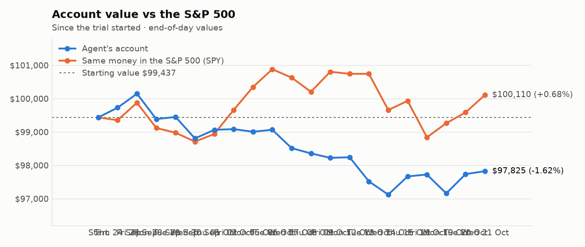
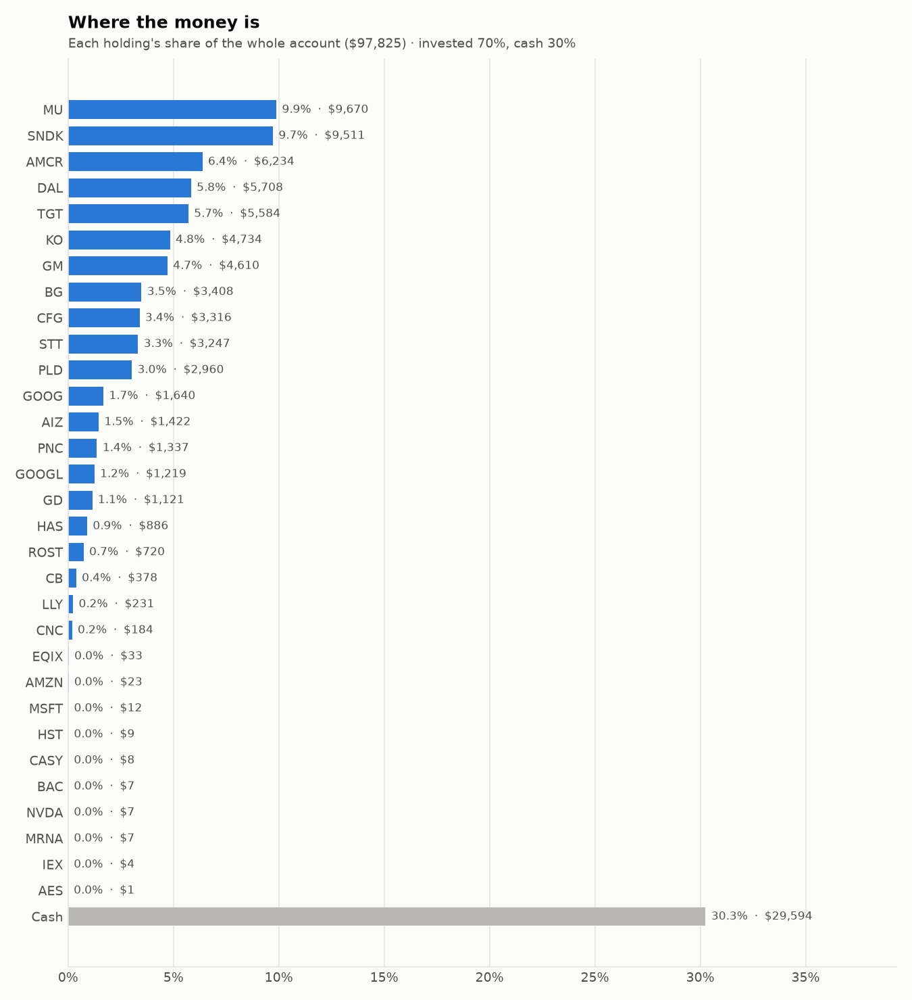
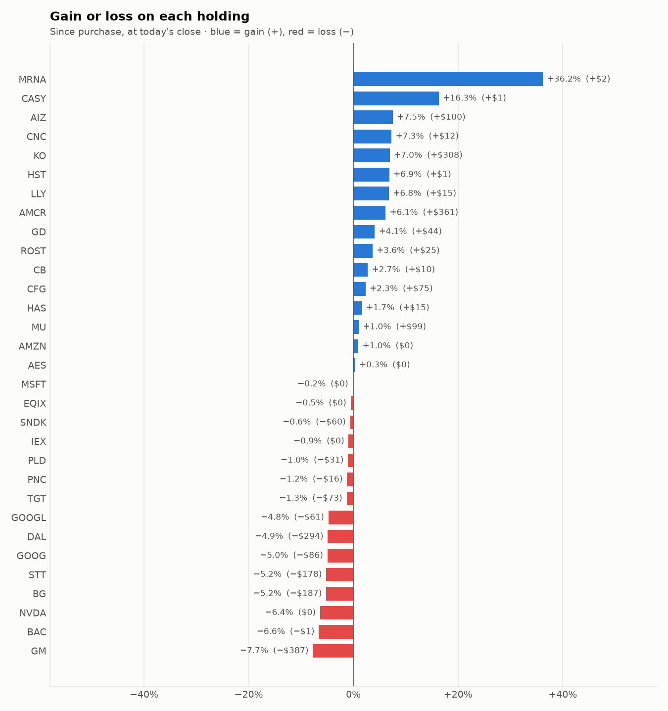

# 5-day trading report — 15 Oct to 21 Oct 2026
_Trading days 16–20 of the trial._

## Performance

- **Account value:** $97,123 → $97,825 (+0.7%)
- **S&P 500 (SPY) over the same days:** +0.5%
- **Agent vs S&P 500:** +0.27% (ahead)

| Day | Account value | Day change | SPY | Buys | Sells |
|---|---|---|---|---|---|
| Thu 15 Oct | $97,669 | +0.6% | +0.3% | 5 | 8 |
| Fri 16 Oct | $97,725 | +0.1% | -1.1% | 0 | 1 |
| Mon 19 Oct | $97,160 | -0.6% | +0.4% | 4 | 1 |
| Tue 20 Oct | $97,739 | +0.6% | +0.3% | 0 | 6 |
| Wed 21 Oct | $97,825 | +0.1% | +0.5% | 2 | 8 |

## Risk scorecard (trial to date)

- **Return:** agent -1.62% vs S&P 500 +0.68% over 20 trading day(s)
- **Largest fall from a peak (max drawdown):** -3.02% — the worst the account has been below its own high
- **Volatility:** 6.6% a year — how much the account value swings day to day
- **Sharpe ratio:** -3.08 — return per unit of risk, yearly rate (above 1 is good, below 0 is losing)
- **Beta:** 0.29 — the account moves less than the S&P 500 (1.00 = exactly with it)
- **Alpha:** -1.82% — return lost beyond what the market's own move explains, given the beta above

## Charts

## What the research favoured

- **Main reason behind buys:** Momentum (5), Research (4), Low volatility (1), Value (1)
- **Sectors bought:** Real Estate (4), Financials (3), Information Technology (2), Industrials (1), Consumer Discretionary (1)
- **Average analyst consensus (-2..+2):** buys +0.92, sells +0.88
- **Average news tone:** buys +8.5, sells +3.2
- **Average combined research score:** buys +0.94, sells +0.56

## Sessions

- **2026-10-15 Morning rebalance:** traded — 12 order(s) placed
- **2026-10-15 Afternoon risk check:** traded — Sold 1 position(s) on the risk check (stop-loss: FIX)
- **2026-10-16 Afternoon risk check:** traded — Sold 1 position(s) on the risk check (stop-loss: ECHO)
- **2026-10-19 Morning rebalance:** traded — 5 order(s) placed
- **2026-10-19 Afternoon risk check:** no trades needed — Risk-checked 37 holding(s): none was 12%+ below its purchase price, and none had both clearly negative news and a price drop of 3%+ since entry.
- **2026-10-20 Morning rebalance:** traded — 6 order(s) placed
- **2026-10-20 Afternoon risk check:** no trades needed — Risk-checked 33 holding(s): none was 12%+ below its purchase price, and none had both clearly negative news and a price drop of 3%+ since entry.
- **2026-10-21 Morning rebalance:** traded — 10 order(s) placed
- **2026-10-21 Afternoon risk check:** HALTED — Safety check stopped the session: price_sanity: 1 symbol(s) moved >35%: ['MRNA']

# Key decisions and the research behind them

## Why I bought

### SNDK — bought 6.938 shares at ~$1,379.50 ($9,571)

**Why:** combined score +1.43; ranked #2 of 503; driven mainly by price momentum +3.00, low volatility -1.36; entering/adding to the top-ranked target portfolio; research detail: 14 recent headline(s), net positive tone (+4); analyst consensus +1.18/2 (11 strong buy, 17 buy, 5 hold, 0 sell, 0 strong sell)

**Research scores** (combined +1.43, ranked #2 in the S&P 500, sector: Information Technology):

| Factor | Score | Measures |
|---|---|---|
| Value | +0.34 | cheap vs. sector peers on P/E and P/B |
| Quality | +0.83 | profitability (ROE, margins) and balance-sheet strength |
| Momentum | +3.00 | 12-month price trend, excluding the last month |
| Low volatility | -1.36 | steadier price than sector peers |
| Research | +1.03 | recent news tone + analyst consensus |

**Company financials (Finnhub, trailing 12 months):** P/E 16.4, P/B 16.4, return on equity 93.1%, gross margin 71.5%, debt/equity 0.00

**Price trend (Alpaca):** 12-month return (excl. last month) +1663.3%, last month -19.5%, volatility 105.7%/yr

**News (Finnhub): 14 headline(s) in the last 2 days, net tone +4.** Most influential:
- [Micron Technology vs. Sandisk: Which AI Memory Stock Is the Better Investment?](https://finnhub.io/api/news?id=309bcc166c8163e50d52451d0535d90e773c546669687709a1c6091bd979ca19) — 17 Oct, Yahoo (tone +2)
- [Dear Sandisk Stock Fans, Mark Your Calendar for October 29](https://finnhub.io/api/news?id=eba3ddae28d63bc0135784d06b0a0078b50f07be3977906f7007abfdb13fa875) — 18 Oct, Yahoo (tone +1)
- [The Best Growth Stock to Invest $10,000 in Right Now](https://finnhub.io/api/news?id=b7fcc2b45f4052e82a401295febec0036b949bf21668ec4ca201cb45bf953ccb) — 18 Oct, Yahoo (tone +1)
- [Sandisk Stock Is Still Up 488% This Year Despite a 40% Drop. Is It a Buy Now?](https://finnhub.io/api/news?id=cc6bd8240dfd1fca17ab1be851e2b0d2652ca80a46cccbcd3af2c74f2f8f5ec9) — 17 Oct, Yahoo (tone +1)
- [Missed Out On Micron and Sandisk? Make Sure You Don't Miss Out On This Memory Stock.](https://finnhub.io/api/news?id=910d4a121a7ae0884eef5028d8b66ce2bfc3980ce3e450190fc50363e729dad0) — 17 Oct, Yahoo (tone -1)

**Analysts (Finnhub, 2026-09-01):** 11 strong buy, 17 buy, 5 hold, 0 sell, 0 strong sell — consensus +1.18 on a -2 (strong sell) to +2 (strong buy) scale.

### MU — bought 10.591 shares at ~$903.65 ($9,571)

**Why:** combined score +1.66; ranked #1 of 503; driven mainly by price momentum +2.96, research (news + analyst consensus) +1.28; entering/adding to the top-ranked target portfolio; research detail: 55 recent headline(s), net positive tone (+15); analyst consensus +1.25/2 (18 strong buy, 35 buy, 4 hold, 0 sell, 0 strong sell)

**Research scores** (combined +1.66, ranked #1 in the S&P 500, sector: Information Technology):

| Factor | Score | Measures |
|---|---|---|
| Value | +1.08 | cheap vs. sector peers on P/E and P/B |
| Quality | +0.92 | profitability (ROE, margins) and balance-sheet strength |
| Momentum | +2.96 | 12-month price trend, excluding the last month |
| Low volatility | -1.03 | steadier price than sector peers |
| Research | +1.28 | recent news tone + analyst consensus |

**Company financials (Finnhub, trailing 12 months):** P/E 12.1, P/B 7.8, return on equity 91.8%, gross margin 80.7%, debt/equity 0.04

**Price trend (Alpaca):** 12-month return (excl. last month) +517.9%, last month -14.1%, volatility 69.7%/yr

**News (Finnhub): 55 headline(s) in the last 2 days, net tone +15.** Most influential:
- [Micron (MU) Looks Cheap at 5 Times Forward Earnings. Can Its Profit Boom Last?](https://finnhub.io/api/news?id=35d68254e0e9f3822c7b7d929e4b7cb8871c1f3582808352e3a8609fb0077db2) — 19 Oct, Yahoo (tone +3)
- [Meta, Tesla, Nvidia, Micron and Alphabet  are part of Zacks Earnings Preview](https://finnhub.io/api/news?id=a175441205bb723b75708a0d220fd82f9d98946eff641271df99ad1c8f28e0ce) — 19 Oct, Yahoo (tone +3)
- [Micron: CXMT Sparks Fear, HBM Fuels Higher Margins](https://finnhub.io/api/news?id=4d479ac5f3ff04d79a79b94c534f4377b44b1be2b52b66b4a9058ca605e4377a) — 19 Oct, SeekingAlpha (tone +2)
- [Micron and Nvidia Are the 2 Biggest Drivers of S&P 500 Earnings Growth. Are Their Stocks Buys?](https://finnhub.io/api/news?id=cf8968c993b182d59962150d7520476827cd6985884ee35f74d3751a08f46175) — 21 Oct, Yahoo (tone +1)
- [History Says Micron Stock Gains 28% During the Fourth Quarter. Here's Why I Think Shares Will Surge Even More Before 2026 Is Over.](https://finnhub.io/api/news?id=a0a73d63a64417e7c025004c987346301ce93dc5520413a22bc3bb3b2c68ba4f) — 20 Oct, Yahoo (tone +1)

**Analysts (Finnhub, 2026-10-01):** 18 strong buy, 35 buy, 4 hold, 0 sell, 0 strong sell — consensus +1.25 on a -2 (strong sell) to +2 (strong buy) scale.

### TRV — bought 21.44 shares at ~$384.46 ($8,243)

**Why:** combined score +0.99; ranked #7 of 503; driven mainly by price momentum +1.53, research (news + analyst consensus) +0.99; entering/adding to the top-ranked target portfolio; research detail: 8 recent headline(s), net positive tone (+6); analyst consensus +0.20/2 (3 strong buy, 6 buy, 21 hold, 5 sell, 0 strong sell)

**Research scores** (combined +0.99, ranked #7 in the S&P 500, sector: Financials):

| Factor | Score | Measures |
|---|---|---|
| Value | +0.49 | cheap vs. sector peers on P/E and P/B |
| Quality | +0.58 | profitability (ROE, margins) and balance-sheet strength |
| Momentum | +1.53 | 12-month price trend, excluding the last month |
| Low volatility | +0.39 | steadier price than sector peers |
| Research | +0.99 | recent news tone + analyst consensus |

**Company financials (Finnhub, trailing 12 months):** P/E 9.8, P/B 2.1, return on equity 25.6%, debt/equity 0.27

**Price trend (Alpaca):** 12-month return (excl. last month) +39.6%, last month +2.5%, volatility 19.9%/yr

**News (Finnhub): 8 headline(s) in the last 2 days, net tone +6.** Most influential:
- [Earnings Beat Could Be A Big Moment For Travelers Stock (TRV)](https://finnhub.io/api/news?id=586f9c47ee6f605721650fc7005cad86b283b327bf347d83aea58502356b0482) — 17 Oct, Yahoo (tone +3)
- [TRV Q3 Deep Dive: Underwriting and Investment Strength Drive Stable Results](https://finnhub.io/api/news?id=fec114343190a544b09dd58ca11411fad50bf236ecf3ddff73f41a51d22fc781) — 19 Oct, Yahoo (tone +1)
- [Travelers (TRV) Q3 Results Reinforce Underwriting Strength As Pricing Softens](https://finnhub.io/api/news?id=2876c246cea22413881842ebda269ce3984cf74fe8aac936e9ba34de1fd8160c) — 17 Oct, Yahoo (tone +1)
- [Travelers: Strong Q3 Results, But Rising Interest Rates Pressure The Bond Portfolio](https://finnhub.io/api/news?id=00420bb91ffb242bdf6648cac31d91e29c22fbb9f269c75e6e3ab037bf36b68b) — 17 Oct, SeekingAlpha (tone +1)
- [Travelers’s Q3 Earnings Call: Our Top 5 Analyst Questions](https://finnhub.io/api/news?id=cbbaef7f8d06a5960a1f7590910d20f5f39dcf0a402fb939a8903fea972c337b) — 19 Oct, Yahoo (tone +0)

**Analysts (Finnhub, 2026-09-01):** 3 strong buy, 6 buy, 21 hold, 5 sell, 0 strong sell — consensus +0.20 on a -2 (strong sell) to +2 (strong buy) scale.

### WELL — bought 34.379 shares at ~$234.41 ($8,059)

**Why:** combined score +1.01; ranked #6 of 503; driven mainly by research (news + analyst consensus) +2.00, price momentum +1.95; entering/adding to the top-ranked target portfolio; research detail: 2 recent headline(s), net positive tone (+4); analyst consensus +1.04/2 (6 strong buy, 17 buy, 5 hold, 0 sell, 0 strong sell)

**Research scores** (combined +1.01, ranked #6 in the S&P 500, sector: Real Estate):

| Factor | Score | Measures |
|---|---|---|
| Value | -0.64 | cheap vs. sector peers on P/E and P/B |
| Quality | -0.23 | profitability (ROE, margins) and balance-sheet strength |
| Momentum | +1.95 | 12-month price trend, excluding the last month |
| Low volatility | -0.16 | steadier price than sector peers |
| Research | +2.00 | recent news tone + analyst consensus |

**Company financials (Finnhub, trailing 12 months):** P/E 111.4, P/B 3.5, return on equity 3.6%, gross margin 40.3%, debt/equity 0.38

**Price trend (Alpaca):** 12-month return (excl. last month) +40.5%, last month +1.2%, volatility 19.7%/yr

**News (Finnhub): 2 headline(s) in the last 2 days, net tone +4.** Most influential:
- [Ventas vs. Welltower: Which Senior Housing REIT Pays Retirees Better?](https://finnhub.io/api/news?id=e9adcba806ba8736db5ef0241c898861d60f95e47690c69d8148ee35dd807657) — 17 Oct, Yahoo (tone +2)
- [Welltower (NYSE:WELL): High Growth Momentum Meets a Breakout Setup](https://finnhub.io/api/news?id=592918d0fb9d1d9258dc0dfceb053652bcc84e5669eff361b641f66ada99aac2) — 17 Oct, ChartMill (tone +2)

**Analysts (Finnhub, 2026-09-01):** 6 strong buy, 17 buy, 5 hold, 0 sell, 0 strong sell — consensus +1.04 on a -2 (strong sell) to +2 (strong buy) scale.

### HST — bought 243.436 shares at ~$23.44 ($5,706)

**Why:** combined score +0.80; ranked #4 of 503; driven mainly by price momentum +1.39, value (cheapness) +0.94; entering/adding to the top-ranked target portfolio; research detail: 1 recent headline(s), net positive tone (+1); analyst consensus +0.92/2 (8 strong buy, 7 buy, 10 hold, 0 sell, 0 strong sell)

**Research scores** (combined +0.80, ranked #4 in the S&P 500, sector: Real Estate):

| Factor | Score | Measures |
|---|---|---|
| Value | +0.94 | cheap vs. sector peers on P/E and P/B |
| Quality | +0.74 | profitability (ROE, margins) and balance-sheet strength |
| Momentum | +1.39 | 12-month price trend, excluding the last month |
| Low volatility | +0.03 | steadier price than sector peers |
| Research | +0.55 | recent news tone + analyst consensus |

**Company financials (Finnhub, trailing 12 months):** P/E 15.3, P/B 2.5, return on equity 15.5%, gross margin 97.0%, debt/equity 0.80

**Price trend (Alpaca):** 12-month return (excl. last month) +25.7%, last month +3.7%, volatility 23.3%/yr

**News (Finnhub): 1 headline(s) in the last 2 days, net tone +1.** Most influential:
- [Barclays Maintains Equal-Weight on Host Hotels & Resorts, Raises Price Target to $25](https://finnhub.io/api/news?id=3850ca680496d40a4802e368a5af428867616a4726995a2334d04052de7ec5e1) — 13 Oct, Benzinga (tone +1)

**Analysts (Finnhub, 2026-09-01):** 8 strong buy, 7 buy, 10 hold, 0 sell, 0 strong sell — consensus +0.92 on a -2 (strong sell) to +2 (strong buy) scale.

### PLD — bought 23.22 shares at ~$128.79 ($2,990)

**Why:** combined score +0.58; ranked #20 of 503; driven mainly by research (news + analyst consensus) +1.04, price momentum +0.99; entering/adding to the top-ranked target portfolio; research detail: 7 recent headline(s), net positive tone (+2); analyst consensus +0.87/2 (5 strong buy, 10 buy, 8 hold, 0 sell, 0 strong sell)

**Research scores** (combined +0.58, ranked #20 in the S&P 500, sector: Real Estate):

| Factor | Score | Measures |
|---|---|---|
| Value | +0.12 | cheap vs. sector peers on P/E and P/B |
| Quality | +0.28 | profitability (ROE, margins) and balance-sheet strength |
| Momentum | +0.99 | 12-month price trend, excluding the last month |
| Low volatility | +0.29 | steadier price than sector peers |
| Research | +1.04 | recent news tone + analyst consensus |

**Company financials (Finnhub, trailing 12 months):** P/E 30.7, P/B 2.4, return on equity 7.9%, gross margin 74.3%, debt/equity 0.68

**Price trend (Alpaca):** 12-month return (excl. last month) +17.7%, last month -3.9%, volatility 18.6%/yr

**News (Finnhub): 7 headline(s) in the last 2 days, net tone +2.** Most influential:
- [Prologis Stock Before Q3 Earnings: Is It a Smart Buy or a Risky Move?](https://finnhub.io/api/news?id=09b3c9d8e6d40889f29ffc61c3581168bab64a6974df872f118974bbc485adb7) — 14 Oct, Yahoo (tone +1)
- [Prologis (PLD) Raises Offer for UK Warehouse Giant Segro: What Investors Should Know](https://finnhub.io/api/news?id=d9d904f3dd0cd27312c1a7b0974a6703fe14459ed2d88bd2f67d48d9bf9c1815) — 13 Oct, Yahoo (tone +1)
- [Prologis: Q3 Earnings Snapshot](https://finnhub.io/api/news?id=2c5e798e720a8e1de99a9b8caec14b24cd905f1301688a953f2d96f459d67063) — 15 Oct, Yahoo (tone +0)
- [Prologis Reports Third Quarter 2026 Results](https://finnhub.io/api/news?id=829be807d1107d2ca7039afd91d55497eddc4928f53b6af89667eead6619105d) — 15 Oct, Yahoo (tone +0)
- [Form 8.3 Prologis, Inc](https://finnhub.io/api/news?id=faae9e8df80c60076cbb0d60fede7a7e4e268bbadc3d544301772c3e1d820c87) — 15 Oct, Yahoo (tone +0)

**Analysts (Finnhub, 2026-09-01):** 5 strong buy, 10 buy, 8 hold, 0 sell, 0 strong sell — consensus +0.87 on a -2 (strong sell) to +2 (strong buy) scale.

### CFG — bought 38.221 shares at ~$63.14 ($2,413)

**Why:** combined score +1.09; ranked #4 of 503; driven mainly by research (news + analyst consensus) +1.92, price momentum +1.19; entering/adding to the top-ranked target portfolio; research detail: 9 recent headline(s), net positive tone (+12); analyst consensus +1.04/2 (5 strong buy, 14 buy, 4 hold, 0 sell, 0 strong sell)

**Research scores** (combined +1.09, ranked #4 in the S&P 500, sector: Financials):

| Factor | Score | Measures |
|---|---|---|
| Value | +0.94 | cheap vs. sector peers on P/E and P/B |
| Quality | -0.11 | profitability (ROE, margins) and balance-sheet strength |
| Momentum | +1.19 | 12-month price trend, excluding the last month |
| Low volatility | +0.41 | steadier price than sector peers |
| Research | +1.92 | recent news tone + analyst consensus |

**Company financials (Finnhub, trailing 12 months):** P/E 12.6, P/B 1.1, return on equity 8.1%, debt/equity 0.40

**Price trend (Alpaca):** 12-month return (excl. last month) +31.9%, last month -6.0%, volatility 21.1%/yr

**News (Finnhub): 9 headline(s) in the last 2 days, net tone +12.** Most influential:
- [5 Insightful Analyst Questions From Citizens Financial Group’s Q3 Earnings Call](https://finnhub.io/api/news?id=1c9faeaaa528fb9e7724731183503e3fd5e45ebc23069052fb15a6f46b17be65) — 19 Oct, Yahoo (tone +3)
- [CFG Q3 Deep Dive: Private Bank Growth and Deposit Discipline Offset Mixed Fee Trends](https://finnhub.io/api/news?id=c0f443bea3d056c2473a12822d841ebd722421c07840ab1e87a63b8a601c06e7) — 19 Oct, Yahoo (tone +2)
- [Citizens Financial Group (CFG) Stock Ignores Record Q3 Earnings Momentum](https://finnhub.io/api/news?id=858f2481db2362586fae1251fd3fea9c50deaf7c319bbd9f0522e8dd6f74c395) — 18 Oct, Yahoo (tone +2)
- [Citizens Financial Group (CFG) Lifts Dividend 13% After Strong Q3 And Bigger Buyback](https://finnhub.io/api/news?id=8ba53d9e7585a738bd59f8b9340637c7ff0221a574a7f66a0cbb8908419695c8) — 17 Oct, Yahoo (tone +2)
- [Citizens Financial Group: Reassessing Preferred Securities In A Dynamic Market Environment](https://finnhub.io/api/news?id=771fc66fcee8b9d018ccd4ec2c7849acd9d20ae3a5376f26f879d0639aef3920) — 18 Oct, SeekingAlpha (tone +1)

**Analysts (Finnhub, 2026-09-01):** 5 strong buy, 14 buy, 4 hold, 0 sell, 0 strong sell — consensus +1.04 on a -2 (strong sell) to +2 (strong buy) scale.

### IEX — bought 8.771 shares at ~$237.75 ($2,085)

**Why:** combined score +0.62; ranked #16 of 503; driven mainly by low volatility +1.92, price momentum +0.78; entering/adding to the top-ranked target portfolio; research detail: 1 recent headline(s), net positive tone (+2); analyst consensus +0.95/2 (6 strong buy, 7 buy, 7 hold, 0 sell, 0 strong sell)

**Research scores** (combined +0.62, ranked #16 in the S&P 500, sector: Industrials):

| Factor | Score | Measures |
|---|---|---|
| Value | +0.33 | cheap vs. sector peers on P/E and P/B |
| Quality | +0.12 | profitability (ROE, margins) and balance-sheet strength |
| Momentum | +0.78 | 12-month price trend, excluding the last month |
| Low volatility | +1.92 | steadier price than sector peers |
| Research | +0.24 | recent news tone + analyst consensus |

**Company financials (Finnhub, trailing 12 months):** P/E 33.7, P/B 4.2, return on equity 12.9%, gross margin 44.7%, debt/equity 0.46

**Price trend (Alpaca):** 12-month return (excl. last month) +38.8%, last month +7.1%, volatility 17.5%/yr

**News (Finnhub): 1 headline(s) in the last 2 days, net tone +2.** Most influential:
- [RBC Capital Maintains Outperform on IDEX, Raises Price Target to $285](https://finnhub.io/api/news?id=9d4161fc7acfad2c196e05f40166e4619f9802fe2318e74cebd6e445aeb7a680) — 14 Oct, Benzinga (tone +2)

**Analysts (Finnhub, 2026-09-01):** 6 strong buy, 7 buy, 7 hold, 0 sell, 0 strong sell — consensus +0.95 on a -2 (strong sell) to +2 (strong buy) scale.

### ALL — bought 7.399 shares at ~$242.66 ($1,795)

**Why:** combined score +0.72; ranked #6 of 503; driven mainly by value (cheapness) +1.65, quality (profitability/balance sheet) +1.24; entering/adding to the top-ranked target portfolio; research detail: 3 recent headline(s), net positive tone (+1); analyst consensus +0.47/2 (5 strong buy, 9 buy, 12 hold, 3 sell, 1 strong sell)

**Research scores** (combined +0.72, ranked #6 in the S&P 500, sector: Financials):

| Factor | Score | Measures |
|---|---|---|
| Value | +1.65 | cheap vs. sector peers on P/E and P/B |
| Quality | +1.24 | profitability (ROE, margins) and balance-sheet strength |
| Momentum | +1.02 | 12-month price trend, excluding the last month |
| Low volatility | -0.24 | steadier price than sector peers |
| Research | -0.37 | recent news tone + analyst consensus |

**Company financials (Finnhub, trailing 12 months):** P/E 4.4, P/B 1.8, return on equity 43.1%, debt/equity 0.22

**Price trend (Alpaca):** 12-month return (excl. last month) +28.3%, last month -8.2%, volatility 27.9%/yr

**News (Finnhub): 3 headline(s) in the last 2 days, net tone +1.** Most influential:
- [Berkshire Hathaway vs. Allstate: Which Insurance Stock Has an Edge?](https://finnhub.io/api/news?id=ca4165ee396d415fec3948a178a241631db8b0d5845ba562bba5de74ac736669) — 14 Oct, Yahoo (tone +1)
- [September 2026 Monthly Release](https://finnhub.io/api/news?id=8894eff1cf0d2a18dd089e89cb6bb7f05460808cd70e970573e77dbf526350fb) — 15 Oct, Yahoo (tone +0)
- [Allstate Reports Q3 Estimated Total Catastrophe Losses Of $1.65B Or $1.3B After-Tax](https://finnhub.io/api/news?id=7588280f872a72ad6b03284ad8e27857c83a89f203c9ed3a42d66727896cf78e) — 15 Oct, Benzinga (tone +0)

**Analysts (Finnhub, 2026-09-01):** 5 strong buy, 9 buy, 12 hold, 3 sell, 1 strong sell — consensus +0.47 on a -2 (strong sell) to +2 (strong buy) scale.

### WELL — bought 6.395 shares at ~$233.96 ($1,496)

**Why:** combined score +0.49; ranked #24 of 503; driven mainly by price momentum +1.85, research (news + analyst consensus) +1.32; entering/adding to the top-ranked target portfolio; research detail: 5 recent headline(s), net positive tone (+2); analyst consensus +1.04/2 (6 strong buy, 17 buy, 5 hold, 0 sell, 0 strong sell)

**Research scores** (combined +0.49, ranked #24 in the S&P 500, sector: Real Estate):

| Factor | Score | Measures |
|---|---|---|
| Value | -0.72 | cheap vs. sector peers on P/E and P/B |
| Quality | -0.33 | profitability (ROE, margins) and balance-sheet strength |
| Momentum | +1.85 | 12-month price trend, excluding the last month |
| Low volatility | -0.15 | steadier price than sector peers |
| Research | +1.32 | recent news tone + analyst consensus |

**Company financials (Finnhub, trailing 12 months):** P/E 110.2, P/B 3.5, return on equity 3.6%, gross margin 40.3%, debt/equity 0.38

**Price trend (Alpaca):** 12-month return (excl. last month) +37.6%, last month -0.2%, volatility 19.6%/yr

**News (Finnhub): 5 headline(s) in the last 2 days, net tone +2.** Most influential:
- [Welltower (WELL) Raises 2026 Outlook as Senior Housing NOI Growth Nears 19%](https://finnhub.io/api/news?id=9e60f522046af6fa8d2f2b625a63ecd75e87f90bf59be0edf6feb50dcebdab45) — 13 Oct, Yahoo (tone +2)
- [Brookdale Senior Living To Buy 30 Communities It Operates From Welltower For $290M](https://finnhub.io/api/news?id=406f0117345f15a5842344afebed78c1489fa37b4cf4f7f8bcaf48890ef9f556) — 14 Oct, Yahoo (tone +0)
- [$1000 Invested In Welltower 10 Years Ago Would Be Worth This Much Today](https://finnhub.io/api/news?id=0a6e5b0b581a453ebc3201c9517df9fb80bc64ef3773b71febafb0673d694794) — 14 Oct, Benzinga (tone +0)
- [Brookdale Completes Acquisition of 17 Communities and Announces Mutually Beneficial Agreement to Acquire 30 Additional Leased Communities from Welltower](https://finnhub.io/api/news?id=2684f0089117dfa88f40e047a47047b2ec2034891c78f26a53f1642c09e34830) — 13 Oct, Yahoo (tone +0)
- [Barclays Maintains Equal-Weight on Welltower, Lowers Price Target to $246](https://finnhub.io/api/news?id=4a22a138a6e2af4b0c2bf381e71a6529262b8bca56969ea1a953c4d5d3ce62fb) — 13 Oct, Benzinga (tone +0)

**Analysts (Finnhub, 2026-09-01):** 6 strong buy, 17 buy, 5 hold, 0 sell, 0 strong sell — consensus +1.04 on a -2 (strong sell) to +2 (strong buy) scale.

### HAS — bought 7.773 shares at ~$112.13 ($872)

**Why:** combined score +0.91; ranked #8 of 503; driven mainly by research (news + analyst consensus) +2.11, price momentum +0.92; entering/adding to the top-ranked target portfolio; research detail: 41 recent headline(s), net positive tone (+44); analyst consensus +1.20/2 (8 strong buy, 8 buy, 4 hold, 0 sell, 0 strong sell)

**Research scores** (combined +0.91, ranked #8 in the S&P 500, sector: Consumer Discretionary):

| Factor | Score | Measures |
|---|---|---|
| Value | -0.23 | cheap vs. sector peers on P/E and P/B |
| Quality | +0.74 | profitability (ROE, margins) and balance-sheet strength |
| Momentum | +0.92 | 12-month price trend, excluding the last month |
| Low volatility | -0.18 | steadier price than sector peers |
| Research | +2.11 | recent news tone + analyst consensus |

**Company financials (Finnhub, trailing 12 months):** P/E 18.6, P/B 16.9, return on equity 138.2%, gross margin 64.8%, debt/equity 5.02

**Price trend (Alpaca):** 12-month return (excl. last month) +17.1%, last month +24.8%, volatility 33.9%/yr

**News (Finnhub): 41 headline(s) in the last 2 days, net tone +44.** Most influential:
- [Hasbro Stock Gains Focus After Earnings Beat](https://finnhub.io/api/news?id=ddb355bd20959e4d080724ae6837c3297880ebcaecee671931149aa61a1b1634) — 20 Oct, Yahoo (tone +5)
- [Hasbro raises 2026 outlook as Magic: The Gathering revenue tops $600 million](https://finnhub.io/api/news?id=8e13463ffa3349e1a2cc22bbae093fd4a8d494dcbd8a367c5a6c628034881158) — 20 Oct, Yahoo (tone +4)
- [HAS Q3 Earnings Beat Estimates on Magic Growth, Outlook Raised](https://finnhub.io/api/news?id=8f3a7722b847c6cc280f6fdcdd96d1759455cfdf950a72eb850b15e9eb42173a) — 20 Oct, Yahoo (tone +4)
- [Hasbro Raises 2026 Outlook, Doubles Stock Buyback Target As Magic: the Gathering Sales Hit Record High](https://finnhub.io/api/news?id=e744980ec6db3c5a48687fb45eb0a4f4d2fe1b2e72ecd0177013afca72061f90) — 20 Oct, Benzinga (tone +4)
- [HAS Q3 Deep Dive: Magic Momentum, Licensing Expansion, and Cost Discipline Drive Upside](https://finnhub.io/api/news?id=782815a4c83ff2d0c1b28066a488c35e7a30f63f62546fd81bbd03cef2db0a32) — 21 Oct, Yahoo (tone +2)

**Analysts (Finnhub, 2026-10-01):** 8 strong buy, 8 buy, 4 hold, 0 sell, 0 strong sell — consensus +1.20 on a -2 (strong sell) to +2 (strong buy) scale.

## Why I sold

### WELL — sold 40.774 shares at ~$236.65 ($9,649)

**Why:** combined score +0.55; ranked #40 of 503; driven mainly by price momentum +1.85, value (cheapness) -0.72; trimmed toward target weight, or dropped out of the top-ranked names; research detail: analyst consensus +1.07/2 (6 strong buy, 18 buy, 4 hold, 0 sell, 0 strong sell)

**Research scores** (combined +0.55, ranked #40 in the S&P 500, sector: Real Estate):

| Factor | Score | Measures |
|---|---|---|
| Value | -0.72 | cheap vs. sector peers on P/E and P/B |
| Quality | -0.30 | profitability (ROE, margins) and balance-sheet strength |
| Momentum | +1.85 | 12-month price trend, excluding the last month |
| Low volatility | -0.16 | steadier price than sector peers |
| Research | +0.39 | recent news tone + analyst consensus |

**Company financials (Finnhub, trailing 12 months):** P/E 111.1, P/B 3.5, return on equity 3.6%, gross margin 40.3%, debt/equity 0.38

**Price trend (Alpaca):** 12-month return (excl. last month) +37.9%, last month +2.1%, volatility 19.1%/yr

**News (Finnhub):** no headlines in the last 2 days.

**Analysts (Finnhub, 2026-10-01):** 6 strong buy, 18 buy, 4 hold, 0 sell, 0 strong sell — consensus +1.07 on a -2 (strong sell) to +2 (strong buy) scale.

### TRV — sold 21.44 shares at ~$392.20 ($8,409)

**Why:** combined score +0.53; ranked #45 of 503; driven mainly by price momentum +1.44, low volatility +0.37; trimmed toward target weight, or dropped out of the top-ranked names; research detail: 9 recent headline(s), net positive tone (+5); analyst consensus +0.20/2 (3 strong buy, 6 buy, 21 hold, 5 sell, 0 strong sell)

**Research scores** (combined +0.53, ranked #45 in the S&P 500, sector: Financials):

| Factor | Score | Measures |
|---|---|---|
| Value | +0.00 | cheap vs. sector peers on P/E and P/B |
| Quality | +0.00 | profitability (ROE, margins) and balance-sheet strength |
| Momentum | +1.44 | 12-month price trend, excluding the last month |
| Low volatility | +0.37 | steadier price than sector peers |
| Research | +0.03 | recent news tone + analyst consensus |

**Price trend (Alpaca):** 12-month return (excl. last month) +36.2%, last month +2.9%, volatility 19.1%/yr

**News (Finnhub): 9 headline(s) in the last 2 days, net tone +5.** Most influential:
- [TRV Q3 Earnings Call Highlights Underwriting Strength and 2027 Outlook](https://finnhub.io/api/news?id=facd5b261ddc0b2f1ccf2e658a803456601094e165a7ad64e1f171ddade55512) — 19 Oct, Yahoo (tone +1)
- [Evercore ISI Group Maintains In-Line on Travelers Companies, Raises Price Target to $372](https://finnhub.io/api/news?id=7ab38139029607e70abd0f5953a6e5b596c9595d904c095cd5011a1aae81b243) — 19 Oct, Benzinga (tone +1)
- [Truist Securities Maintains Buy on Travelers Companies, Raises Price Target to $435](https://finnhub.io/api/news?id=1b37082255cd66bf0a1bbb862738eac60a801d1a1b535de1d6721f14b16e3146) — 19 Oct, Benzinga (tone +1)
- [TRV Q3 Deep Dive: Underwriting and Investment Strength Drive Stable Results](https://finnhub.io/api/news?id=fec114343190a544b09dd58ca11411fad50bf236ecf3ddff73f41a51d22fc781) — 19 Oct, Yahoo (tone +1)
- [Travelers (TRV) Q3 Results Reinforce Underwriting Strength As Pricing Softens](https://finnhub.io/api/news?id=2876c246cea22413881842ebda269ce3984cf74fe8aac936e9ba34de1fd8160c) — 17 Oct, Yahoo (tone +1)

**Analysts (Finnhub, 2026-10-01):** 3 strong buy, 6 buy, 21 hold, 5 sell, 0 strong sell — consensus +0.20 on a -2 (strong sell) to +2 (strong buy) scale.

### HST — sold 243.081 shares at ~$24.06 ($5,849)

**Why:** combined score +0.47; ranked #59 of 503; driven mainly by price momentum +1.25, research (news + analyst consensus) +0.12; trimmed toward target weight, or dropped out of the top-ranked names; research detail: analyst consensus +0.92/2 (8 strong buy, 7 buy, 10 hold, 0 sell, 0 strong sell)

**Research scores** (combined +0.47, ranked #59 in the S&P 500, sector: Real Estate):

| Factor | Score | Measures |
|---|---|---|
| Value | +0.00 | cheap vs. sector peers on P/E and P/B |
| Quality | +0.00 | profitability (ROE, margins) and balance-sheet strength |
| Momentum | +1.25 | 12-month price trend, excluding the last month |
| Low volatility | -0.05 | steadier price than sector peers |
| Research | +0.12 | recent news tone + analyst consensus |

**Price trend (Alpaca):** 12-month return (excl. last month) +24.0%, last month +9.4%, volatility 24.4%/yr

**News (Finnhub):** no headlines in the last 2 days.

**Analysts (Finnhub, 2026-09-01):** 8 strong buy, 7 buy, 10 hold, 0 sell, 0 strong sell — consensus +0.92 on a -2 (strong sell) to +2 (strong buy) scale.

### ALL — sold 21.298 shares at ~$248.72 ($5,297)

**Why:** combined score +0.63; ranked #30 of 503; driven mainly by value (cheapness) +1.66, quality (profitability/balance sheet) +1.27; trimmed toward target weight, or dropped out of the top-ranked names; research detail: 3 recent headline(s), net positive tone (+1); analyst consensus +0.45/2 (5 strong buy, 9 buy, 13 hold, 3 sell, 1 strong sell)

**Research scores** (combined +0.63, ranked #30 in the S&P 500, sector: Financials):

| Factor | Score | Measures |
|---|---|---|
| Value | +1.66 | cheap vs. sector peers on P/E and P/B |
| Quality | +1.27 | profitability (ROE, margins) and balance-sheet strength |
| Momentum | +0.65 | 12-month price trend, excluding the last month |
| Low volatility | -0.28 | steadier price than sector peers |
| Research | -0.44 | recent news tone + analyst consensus |

**Company financials (Finnhub, trailing 12 months):** P/E 4.7, P/B 1.8, return on equity 43.1%, debt/equity 0.22

**Price trend (Alpaca):** 12-month return (excl. last month) +18.1%, last month +2.9%, volatility 28.6%/yr

**News (Finnhub): 3 headline(s) in the last 2 days, net tone +1.** Most influential:
- [Will Allstate (ALL) Beat Estimates Again in Its Next Earnings Report?](https://finnhub.io/api/news?id=78b1f7ba1dd3f0f362ecb834916da75758fde14067b007df9aa328e753f39be9) — 19 Oct, Yahoo (tone +1)
- [Allstate (ALL) Outpaces Stock Market Gains: What You Should Know](https://finnhub.io/api/news?id=aed7916b7a44b3b23bc0415cf01710d749e43f76a087a9669b836481dbc9fbbc) — 20 Oct, Yahoo (tone +0)
- [Here's How Much $100 Invested In Allstate 15 Years Ago Would Be Worth Today](https://finnhub.io/api/news?id=0f14392188e29802f58385e12802acaaacd5ce430206a67232d2b58ff1d50252) — 19 Oct, Benzinga (tone +0)

**Analysts (Finnhub, 2026-10-01):** 5 strong buy, 9 buy, 13 hold, 3 sell, 1 strong sell — consensus +0.45 on a -2 (strong sell) to +2 (strong buy) scale.

### C — sold 39.905 shares at ~$122.01 ($4,869)

**Why:** combined score +0.67; ranked #27 of 503; driven mainly by value (cheapness) +1.28, price momentum +1.13; trimmed toward target weight, or dropped out of the top-ranked names; research detail: 5 recent headline(s), net positive tone (+3); analyst consensus +1.04/2 (7 strong buy, 15 buy, 6 hold, 0 sell, 0 strong sell)

**Research scores** (combined +0.67, ranked #27 in the S&P 500, sector: Financials):

| Factor | Score | Measures |
|---|---|---|
| Value | +1.28 | cheap vs. sector peers on P/E and P/B |
| Quality | -0.81 | profitability (ROE, margins) and balance-sheet strength |
| Momentum | +1.13 | 12-month price trend, excluding the last month |
| Low volatility | -0.10 | steadier price than sector peers |
| Research | +0.58 | recent news tone + analyst consensus |

**Company financials (Finnhub, trailing 12 months):** P/E 10.6, P/B 1.0, return on equity 9.2%, debt/equity 3.90

**Price trend (Alpaca):** 12-month return (excl. last month) +29.4%, last month -7.6%, volatility 26.6%/yr

**News (Finnhub): 5 headline(s) in the last 2 days, net tone +3.** Most influential:
- [Citigroup Declares Common Stock Dividend](https://finnhub.io/api/news?id=dba4c5af7f5c96535554e3176196ea9c2dd429b3454b29bb0afe2e61cd160560) — 19 Oct, Yahoo (tone +1)
- [Citigroup Stock Is Up 29% in the Past Year. Buy Now or Wait for the Capital Rules?](https://finnhub.io/api/news?id=18beee3d9facf96fe4cddb91835ee199502fc3e37029f3f9c6eaa6b7cb299a75) — 18 Oct, Yahoo (tone +1)
- [Big Banks Outperform Sector, But Risks Shine Bright](https://finnhub.io/api/news?id=055f3ee9597222a62dc95d2323f1bb5c5ed39a2c73dcca30af18abc700b7ba1f) — 18 Oct, SeekingAlpha (tone +1)
- [Citi’s Manthey Sees French Equities Volatile Beyond April Vote](https://finnhub.io/api/news?id=61e2ce992b5fd287ad6a93477530a75bc9753b18e033bd5898f903c8ef523c0d) — 19 Oct, Yahoo (tone +0)
- [Is Citigroup Stock a Buy 13% Below Its 52-Week High?](https://finnhub.io/api/news?id=b9a28514298cff306eb328292b2a8a7f2ef3d556bc44dfc067b4df650acdb712) — 18 Oct, Yahoo (tone +0)

**Analysts (Finnhub, 2026-10-01):** 7 strong buy, 15 buy, 6 hold, 0 sell, 0 strong sell — consensus +1.04 on a -2 (strong sell) to +2 (strong buy) scale.

### CSX — sold 92.965 shares at ~$48.01 ($4,463)

**Why:** combined score +0.48; ranked #54 of 503; driven mainly by low volatility +1.25, price momentum +0.92; trimmed toward target weight, or dropped out of the top-ranked names; research detail: 2 recent headline(s), neutral/mixed tone; analyst consensus +0.90/2 (7 strong buy, 14 buy, 8 hold, 1 sell, 0 strong sell)

**Research scores** (combined +0.48, ranked #54 in the S&P 500, sector: Industrials):

| Factor | Score | Measures |
|---|---|---|
| Value | +0.12 | cheap vs. sector peers on P/E and P/B |
| Quality | +0.60 | profitability (ROE, margins) and balance-sheet strength |
| Momentum | +0.92 | 12-month price trend, excluding the last month |
| Low volatility | +1.25 | steadier price than sector peers |
| Research | -0.06 | recent news tone + analyst consensus |

**Company financials (Finnhub, trailing 12 months):** P/E 27.7, P/B 6.3, return on equity 24.1%, gross margin 71.5%, debt/equity 1.34

**Price trend (Alpaca):** 12-month return (excl. last month) +43.7%, last month +1.7%, volatility 17.7%/yr

**News (Finnhub): 2 headline(s) in the last 2 days, net tone +0.** Most influential:
- [CSX (CSX) Q3 Earnings Report Preview: What To Look For](https://finnhub.io/api/news?id=968f4dffcbb7ab85d74f0849ebce81c8528217692eb19d34ca8a6be1249d4b97) — 20 Oct, Yahoo (tone +0)
- [CSX Stock And North American Rail Shares Facing A Diesel Margin Test](https://finnhub.io/api/news?id=d6ff2ad9a051c032059e2ff17c88d1bd1d2fb059dcf40253e06d230d1d5da2f1) — 18 Oct, Yahoo (tone +0)

**Analysts (Finnhub, 2026-10-01):** 7 strong buy, 14 buy, 8 hold, 1 sell, 0 strong sell — consensus +0.90 on a -2 (strong sell) to +2 (strong buy) scale.

### AES — sold 285.997 shares at ~$14.96 ($4,279)

**Why:** combined score +0.55; ranked #39 of 503; driven mainly by low volatility +3.00, value (cheapness) +1.73; trimmed toward target weight, or dropped out of the top-ranked names; research detail: analyst consensus -0.35/2 (0 strong buy, 0 buy, 12 hold, 4 sell, 1 strong sell)

**Research scores** (combined +0.55, ranked #39 in the S&P 500, sector: Utilities):

| Factor | Score | Measures |
|---|---|---|
| Value | +1.73 | cheap vs. sector peers on P/E and P/B |
| Quality | -0.74 | profitability (ROE, margins) and balance-sheet strength |
| Momentum | +1.53 | 12-month price trend, excluding the last month |
| Low volatility | +3.00 | steadier price than sector peers |
| Research | -1.48 | recent news tone + analyst consensus |

**Company financials (Finnhub, trailing 12 months):** P/E 5.7, P/B 2.1, return on equity 43.3%, gross margin 20.3%, debt/equity 6.50

**Price trend (Alpaca):** 12-month return (excl. last month) +18.5%, last month +0.9%, volatility 3.4%/yr

**News (Finnhub):** no headlines in the last 2 days.

**Analysts (Finnhub, 2026-10-01):** 0 strong buy, 0 buy, 12 hold, 4 sell, 1 strong sell — consensus -0.35 on a -2 (strong sell) to +2 (strong buy) scale.

### FIX — sold 2.822 shares at ~$1,425.98 ($4,024)

**Why:** combined score +0.47; ranked #26 of 503; driven mainly by price momentum +2.84, low volatility -1.47; trimmed toward target weight, or dropped out of the top-ranked names; research detail: 1 recent headline(s), neutral/mixed tone; analyst consensus +1.31/2 (7 strong buy, 7 buy, 2 hold, 0 sell, 0 strong sell)

**Research scores** (combined +0.47, ranked #26 in the S&P 500, sector: Industrials):

| Factor | Score | Measures |
|---|---|---|
| Value | -0.80 | cheap vs. sector peers on P/E and P/B |
| Quality | +0.29 | profitability (ROE, margins) and balance-sheet strength |
| Momentum | +2.84 | 12-month price trend, excluding the last month |
| Low volatility | -1.47 | steadier price than sector peers |
| Research | +0.41 | recent news tone + analyst consensus |

**Company financials (Finnhub, trailing 12 months):** P/E 38.1, P/B 21.7, return on equity 53.5%, gross margin 25.7%, debt/equity 0.02

**Price trend (Alpaca):** 12-month return (excl. last month) +108.9%, last month -2.3%, volatility 55.0%/yr

**News (Finnhub): 1 headline(s) in the last 2 days, net tone +0.** Most influential:
- [Comfort Systems (FIX) Falls More Steeply Than Broader Market: What Investors Need to Know](https://finnhub.io/api/news?id=b1bc7b23a1ca00653054bdb19ae38301b365b5a63b5e508f56d1f3e6c3dc9248) — 14 Oct, Yahoo (tone +0)

**Analysts (Finnhub, 2026-09-01):** 7 strong buy, 7 buy, 2 hold, 0 sell, 0 strong sell — consensus +1.31 on a -2 (strong sell) to +2 (strong buy) scale.

### IEX — sold 15.856 shares at ~$233.56 ($3,703)

**Why:** combined score +0.43; ranked #71 of 503; driven mainly by low volatility +1.97, price momentum +0.79; trimmed toward target weight, or dropped out of the top-ranked names; research detail: 1 recent headline(s), net positive tone (+1); analyst consensus +1.00/2 (6 strong buy, 8 buy, 6 hold, 0 sell, 0 strong sell)

**Research scores** (combined +0.43, ranked #71 in the S&P 500, sector: Industrials):

| Factor | Score | Measures |
|---|---|---|
| Value | +0.00 | cheap vs. sector peers on P/E and P/B |
| Quality | +0.00 | profitability (ROE, margins) and balance-sheet strength |
| Momentum | +0.79 | 12-month price trend, excluding the last month |
| Low volatility | +1.97 | steadier price than sector peers |
| Research | +0.20 | recent news tone + analyst consensus |

**Price trend (Alpaca):** 12-month return (excl. last month) +37.2%, last month +4.7%, volatility 17.6%/yr

**News (Finnhub): 1 headline(s) in the last 2 days, net tone +1.** Most influential:
- [Here's What to Expect From IDEX Corporation's Next Earnings Report](https://finnhub.io/api/news?id=b39dbabd7a5e1207a7665476f52078a21bbe9ed22038296f4f35eacebb5645c5) — 20 Oct, Yahoo (tone +1)

**Analysts (Finnhub, 2026-10-01):** 6 strong buy, 8 buy, 6 hold, 0 sell, 0 strong sell — consensus +1.00 on a -2 (strong sell) to +2 (strong buy) scale.

### FRT — sold 28.59 shares at ~$105.57 ($3,018)

**Why:** combined score +0.29; ranked #104 of 503; driven mainly by low volatility +1.69, price momentum +0.56; trimmed toward target weight, or dropped out of the top-ranked names; research detail: analyst consensus +0.91/2 (5 strong buy, 10 buy, 7 hold, 0 sell, 0 strong sell)

**Research scores** (combined +0.29, ranked #104 in the S&P 500, sector: Real Estate):

| Factor | Score | Measures |
|---|---|---|
| Value | +0.00 | cheap vs. sector peers on P/E and P/B |
| Quality | +0.00 | profitability (ROE, margins) and balance-sheet strength |
| Momentum | +0.56 | 12-month price trend, excluding the last month |
| Low volatility | +1.69 | steadier price than sector peers |
| Research | +0.05 | recent news tone + analyst consensus |

**Price trend (Alpaca):** 12-month return (excl. last month) +10.2%, last month -3.6%, volatility 12.6%/yr

**News (Finnhub):** no headlines in the last 2 days.

**Analysts (Finnhub, 2026-10-01):** 5 strong buy, 10 buy, 7 hold, 0 sell, 0 strong sell — consensus +0.91 on a -2 (strong sell) to +2 (strong buy) scale.

### BNY — sold 20.366 shares at ~$145.28 ($2,959)

**Why:** combined score +0.60; ranked #37 of 503; driven mainly by price momentum +1.75, low volatility +0.92; trimmed toward target weight, or dropped out of the top-ranked names; research detail: 2 recent headline(s), neutral/mixed tone; analyst consensus +0.81/2 (3 strong buy, 11 buy, 7 hold, 0 sell, 0 strong sell)

**Research scores** (combined +0.60, ranked #37 in the S&P 500, sector: Financials):

| Factor | Score | Measures |
|---|---|---|
| Value | -0.01 | cheap vs. sector peers on P/E and P/B |
| Quality | -0.08 | profitability (ROE, margins) and balance-sheet strength |
| Momentum | +1.75 | 12-month price trend, excluding the last month |
| Low volatility | +0.92 | steadier price than sector peers |
| Research | -0.18 | recent news tone + analyst consensus |

**Company financials (Finnhub, trailing 12 months):** P/E 14.9, P/B 2.3, return on equity 14.8%, debt/equity 1.52

**Price trend (Alpaca):** 12-month return (excl. last month) +41.8%, last month -6.3%, volatility 19.7%/yr

**News (Finnhub): 2 headline(s) in the last 2 days, net tone +0.** Most influential:
- [BNY Announces Pricing of Public Offering of $1,250,000,000 of Depositary Shares Representing Interests in Preferred Stock](https://finnhub.io/api/news?id=47d25c8e29174a209390b324c511a12de7f7a0b481a2399e04e9fc26a1186ddd) — 19 Oct, Yahoo (tone +0)
- [Citigroup Maintains Neutral on Bank of New York Mellon, Lowers Price Target to $157](https://finnhub.io/api/news?id=511009a091e7d30ddc56878ac6c4a4382d2a5b7e4cd2ab66d9e2a1cd1d5ceeef) — 19 Oct, Benzinga (tone +0)

**Analysts (Finnhub, 2026-10-01):** 3 strong buy, 11 buy, 7 hold, 0 sell, 0 strong sell — consensus +0.81 on a -2 (strong sell) to +2 (strong buy) scale.

### JNJ — sold 10.937 shares at ~$255.48 ($2,794)

**Why:** combined score +0.57; ranked #44 of 503; driven mainly by low volatility +1.63, research (news + analyst consensus) +1.19; trimmed toward target weight, or dropped out of the top-ranked names; research detail: 16 recent headline(s), net positive tone (+10); analyst consensus +0.97/2 (7 strong buy, 15 buy, 8 hold, 0 sell, 0 strong sell)

**Research scores** (combined +0.57, ranked #44 in the S&P 500, sector: Health Care):

| Factor | Score | Measures |
|---|---|---|
| Value | +0.00 | cheap vs. sector peers on P/E and P/B |
| Quality | +0.00 | profitability (ROE, margins) and balance-sheet strength |
| Momentum | +0.56 | 12-month price trend, excluding the last month |
| Low volatility | +1.63 | steadier price than sector peers |
| Research | +1.19 | recent news tone + analyst consensus |

**Price trend (Alpaca):** 12-month return (excl. last month) +54.7%, last month -3.8%, volatility 23.0%/yr

**News (Finnhub): 16 headline(s) in the last 2 days, net tone +10.** Most influential:
- [Johnson & Johnson’s Profit Fell 96% Year-Over-Year. But the Dividend Has Risen for 64 Years in a Row](https://finnhub.io/api/news?id=fd016f3b6ba6c124f3281acaef8fb917556c7ae5c4332b4518ed516d807ef3b2) — 21 Oct, Yahoo (tone +2)
- [Global Life Science Market Report 2026: Size, Trends and Forecast to 2030 / Secure $200.6B AI and Precision Medicine Upside with Johnson & Johnson, Roche, Pfizer, and AstraZeneca](https://finnhub.io/api/news?id=9c7d43a1e17fcc810631ec1ce8d7b370a37dc1954b135d3fcb999bf5daee505e) — 21 Oct, Yahoo (tone +2)
- [Healthcare ETFs to Buy as JNJ Slips 6% Despite Q3 Earnings Beat](https://finnhub.io/api/news?id=081911c80a918d604776b8654fe14e8392cc7b5be205cf5d53e05dd64f63ae50) — 20 Oct, Yahoo (tone +2)
- [Global Medical Devices Market Size, Share, and Growth Forecast to 2031 / Aging Populations Push the Global Medical Devices Market Toward $818 Billion](https://finnhub.io/api/news?id=971c8a71f5c3e041b1244361a33a797655e35f20e0a5d3ecba2726e89f699079) — 21 Oct, Yahoo (tone +1)
- [Johnson & Johnson’s Dividend Machine Is Running. Can Earnings Keep Up?](https://finnhub.io/api/news?id=8b5afed948d5232e05286adee6a0e873ad7d7b85f7c41fb5aaa215844bda614f) — 19 Oct, Yahoo (tone +1)

**Analysts (Finnhub, 2026-10-01):** 7 strong buy, 15 buy, 8 hold, 0 sell, 0 strong sell — consensus +0.97 on a -2 (strong sell) to +2 (strong buy) scale.

### BAC — sold 51.077 shares at ~$51.42 ($2,626)

**Why:** combined score +0.41; ranked #37 of 503; driven mainly by low volatility +0.89, value (cheapness) +0.86; trimmed toward target weight, or dropped out of the top-ranked names; research detail: 118 recent headline(s), net positive tone (+3); analyst consensus +1.00/2 (6 strong buy, 17 buy, 6 hold, 0 sell, 0 strong sell)

**Research scores** (combined +0.41, ranked #37 in the S&P 500, sector: Financials):

| Factor | Score | Measures |
|---|---|---|
| Value | +0.86 | cheap vs. sector peers on P/E and P/B |
| Quality | -0.43 | profitability (ROE, margins) and balance-sheet strength |
| Momentum | +0.54 | 12-month price trend, excluding the last month |
| Low volatility | +0.89 | steadier price than sector peers |
| Research | +0.28 | recent news tone + analyst consensus |

**Company financials (Finnhub, trailing 12 months):** P/E 10.5, P/B 1.3, return on equity 11.1%, debt/equity 2.43

**Price trend (Alpaca):** 12-month return (excl. last month) +17.6%, last month -13.6%, volatility 21.7%/yr

**News (Finnhub): 118 headline(s) in the last 2 days, net tone +3.** Most influential:
- [Merrill Lynch’s Fee-Based Advisory Assets Just Hit a Record $1.9 Trillion](https://finnhub.io/api/news?id=4bb0e6499c23e69c4751a508e643f9bba252c44eb2f8e6799aaa71e5db4d5513) — 14 Oct, Yahoo (tone +2)
- [BAC Q3 Earnings Miss, Stock Dips on Regulatory Fine, Trading & IB Woes](https://finnhub.io/api/news?id=82967ce8066d015c0c87798fcd1a2de89625bfc4c06576f4fbbcae6210edcd33) — 14 Oct, Yahoo (tone -2)
- [Albertsons dips as BofA downgrades stock on near term earnings outlook uncertainty](https://finnhub.io/api/news?id=3a7fad87185decdcc6ad9e75ebd7346a67ccc4526cfc26b259412bd51eacef8b) — 14 Oct, Yahoo (tone -2)
- [Bank of America Corp (NYSE:BAC) Slides After Q3 2026 Revenue Miss and $1.2 Billion AML Charge](https://finnhub.io/api/news?id=abe8eb7fd9130c8efedb20f92fed48862bc11797d1e1fee174bc6d70e82439a1) — 14 Oct, ChartMill (tone -2)
- [Bank of America Q3 Adj. EPS $1.08 Misses $1.11 Estimate, Sales $29.958B Miss $30.685B Estimate](https://finnhub.io/api/news?id=8e198b5931b1d26b178036f08e6a72b22ac7a9c48d412f18239e671a41965dbc) — 14 Oct, Benzinga (tone -2)

**Analysts (Finnhub, 2026-09-01):** 6 strong buy, 17 buy, 6 hold, 0 sell, 0 strong sell — consensus +1.00 on a -2 (strong sell) to +2 (strong buy) scale.

### ROST — sold 11.18 shares at ~$234.67 ($2,624)

**Why:** combined score +0.70; ranked #20 of 503; driven mainly by price momentum +2.03, low volatility +0.83; trimmed toward target weight, or dropped out of the top-ranked names; research detail: 4 recent headline(s), net positive tone (+5); analyst consensus +1.04/2 (9 strong buy, 10 buy, 8 hold, 0 sell, 0 strong sell)

**Research scores** (combined +0.70, ranked #20 in the S&P 500, sector: Consumer Discretionary):

| Factor | Score | Measures |
|---|---|---|
| Value | -0.61 | cheap vs. sector peers on P/E and P/B |
| Quality | -0.13 | profitability (ROE, margins) and balance-sheet strength |
| Momentum | +2.03 | 12-month price trend, excluding the last month |
| Low volatility | +0.83 | steadier price than sector peers |
| Research | +0.36 | recent news tone + analyst consensus |

**Company financials (Finnhub, trailing 12 months):** P/E 28.6, P/B 12.0, return on equity 42.3%, gross margin 28.6%, debt/equity 0.15

**Price trend (Alpaca):** 12-month return (excl. last month) +58.4%, last month +2.6%, volatility 22.8%/yr

**News (Finnhub): 4 headline(s) in the last 2 days, net tone +5.** Most influential:
- [Buy 5 Top-Ranked High-Flying Non-Tech, Non-AI Stocks for a Strong Q4](https://finnhub.io/api/news?id=1abace20564cc92e002e3e06649663a35486bb3e0c1f6d29f2ad68d16f94a1e9) — 20 Oct, Yahoo (tone +3)
- [Can ROST Sustain Double-Digit Comps Amid Tougher Comparisons?](https://finnhub.io/api/news?id=cc49f011149fab9dd53285e1121ab2475f2400b21d34d289b8664bfcf06b9f8e) — 20 Oct, Yahoo (tone +1)
- [The Zacks Analyst Blog Highlights Ross Stores, Roku, APA, Corcept Therapeutics and Halozyme Therapeutics](https://finnhub.io/api/news?id=c0584ac4dc400289cb4bbcf4f0604a50724f59376fabb3b013c5a60889b15c77) — 19 Oct, Yahoo (tone +1)
- [Is Ross Stores (ROST) Stock Outpacing Its Retail-Wholesale Peers This Year?](https://finnhub.io/api/news?id=e350b873c28dba291f07d7225b485df996278697f2b70c5a3c15da55cb4ab083) — 19 Oct, Yahoo (tone +0)

**Analysts (Finnhub, 2026-10-01):** 9 strong buy, 10 buy, 8 hold, 0 sell, 0 strong sell — consensus +1.04 on a -2 (strong sell) to +2 (strong buy) scale.

### ROST — sold 10.899 shares at ~$238.62 ($2,601)

**Why:** combined score +0.77; ranked #18 of 503; driven mainly by price momentum +1.96, low volatility +0.81; trimmed toward target weight, or dropped out of the top-ranked names; research detail: 4 recent headline(s), net positive tone (+5); analyst consensus +1.04/2 (9 strong buy, 10 buy, 8 hold, 0 sell, 0 strong sell)

**Research scores** (combined +0.77, ranked #18 in the S&P 500, sector: Consumer Discretionary):

| Factor | Score | Measures |
|---|---|---|
| Value | -0.54 | cheap vs. sector peers on P/E and P/B |
| Quality | -0.09 | profitability (ROE, margins) and balance-sheet strength |
| Momentum | +1.96 | 12-month price trend, excluding the last month |
| Low volatility | +0.81 | steadier price than sector peers |
| Research | +0.64 | recent news tone + analyst consensus |

**Company financials (Finnhub, trailing 12 months):** P/E 28.8, P/B 12.0, return on equity 42.3%, gross margin 28.6%, debt/equity 0.15

**Price trend (Alpaca):** 12-month return (excl. last month) +54.5%, last month +5.4%, volatility 23.1%/yr

**News (Finnhub): 4 headline(s) in the last 2 days, net tone +5.** Most influential:
- [Buy 5 Top-Ranked High-Flying Non-Tech, Non-AI Stocks for a Strong Q4](https://finnhub.io/api/news?id=1abace20564cc92e002e3e06649663a35486bb3e0c1f6d29f2ad68d16f94a1e9) — 20 Oct, Yahoo (tone +3)
- [Can ROST Sustain Double-Digit Comps Amid Tougher Comparisons?](https://finnhub.io/api/news?id=cc49f011149fab9dd53285e1121ab2475f2400b21d34d289b8664bfcf06b9f8e) — 20 Oct, Yahoo (tone +1)
- [The Zacks Analyst Blog Highlights Ross Stores, Roku, APA, Corcept Therapeutics and Halozyme Therapeutics](https://finnhub.io/api/news?id=c0584ac4dc400289cb4bbcf4f0604a50724f59376fabb3b013c5a60889b15c77) — 19 Oct, Yahoo (tone +1)
- [Is Ross Stores (ROST) Stock Outpacing Its Retail-Wholesale Peers This Year?](https://finnhub.io/api/news?id=e350b873c28dba291f07d7225b485df996278697f2b70c5a3c15da55cb4ab083) — 19 Oct, Yahoo (tone +0)

**Analysts (Finnhub, 2026-10-01):** 9 strong buy, 10 buy, 8 hold, 0 sell, 0 strong sell — consensus +1.04 on a -2 (strong sell) to +2 (strong buy) scale.

### AMZN — sold 9.255 shares at ~$251.88 ($2,331)

**Why:** combined score +0.40; ranked #40 of 503; driven mainly by research (news + analyst consensus) +1.12, price momentum +0.64; trimmed toward target weight, or dropped out of the top-ranked names; research detail: 47 recent headline(s), net positive tone (+8); analyst consensus +1.20/2 (20 strong buy, 49 buy, 5 hold, 0 sell, 0 strong sell)

**Research scores** (combined +0.40, ranked #40 in the S&P 500, sector: Consumer Discretionary):

| Factor | Score | Measures |
|---|---|---|
| Value | +0.07 | cheap vs. sector peers on P/E and P/B |
| Quality | +0.17 | profitability (ROE, margins) and balance-sheet strength |
| Momentum | +0.64 | 12-month price trend, excluding the last month |
| Low volatility | -0.21 | steadier price than sector peers |
| Research | +1.12 | recent news tone + analyst consensus |

**Company financials (FMP, trailing 12 months):** P/E 19.8, P/B 4.9, return on equity 30.5%, gross margin 50.8%, debt/equity 0.40

**Price trend (Alpaca):** 12-month return (excl. last month) +8.9%, last month +2.3%, volatility 42.2%/yr

**News (Finnhub): 47 headline(s) in the last 2 days, net tone +8.** Most influential:
- [Is Amazon Stock Poised to Gain on Strong Free Cash Flow Growth?](https://finnhub.io/api/news?id=498e09e3a2bfe2136f42be3bda067aa9991f8cc7d9369630dc591e16105131cf) — 13 Oct, Yahoo (tone +3)
- [Is Corning (GLW) Quietly Redefining Its AI and Life Sciences Edge With New Long-Term Deals?](https://finnhub.io/api/news?id=609b1aa0f8472cbc8d8256dd457dd16099653d9331003d4114813c5f789d2c3d) — 15 Oct, Yahoo (tone +2)
- [Not Microsoft. Not Alphabet. Here's the Cloud Giant I'm Most Bullish About.](https://finnhub.io/api/news?id=925af316340840495a8eb45fd24a81b58061cf5584a484c271e9548c763df585) — 14 Oct, Yahoo (tone +2)
- [AWS Backlog Hits $496 Billion While Cloud Margins Surge to 39% Making Amazon a Must-Own Growth Stock](https://finnhub.io/api/news?id=fb4a20a6636f12c4e8e604d555b5b303ea09c9b85a2eab570c4ac366f5441249) — 14 Oct, Yahoo (tone +2)
- [SafeSpace Global Appoints former Amazon, Google and YouTube Executive as Chief Operating Officer to Accelerate Next Phase of AI-Powered Growth](https://finnhub.io/api/news?id=f603dda740bea33c609e57d998e859d518888e751fcdf63591ad99461257ba67) — 13 Oct, Yahoo (tone +2)

**Analysts (Finnhub, 2026-09-01):** 20 strong buy, 49 buy, 5 hold, 0 sell, 0 strong sell — consensus +1.20 on a -2 (strong sell) to +2 (strong buy) scale.

### GOOGL — sold 6.521 shares at ~$351.62 ($2,293)

**Why:** combined score +0.48; ranked #25 of 503; driven mainly by price momentum +1.70, research (news + analyst consensus) +0.77; trimmed toward target weight, or dropped out of the top-ranked names; research detail: 31 recent headline(s), net positive tone (+7); analyst consensus +1.19/2 (20 strong buy, 43 buy, 7 hold, 0 sell, 0 strong sell)

**Research scores** (combined +0.48, ranked #25 in the S&P 500, sector: Communication Services):

| Factor | Score | Measures |
|---|---|---|
| Value | -0.75 | cheap vs. sector peers on P/E and P/B |
| Quality | +0.11 | profitability (ROE, margins) and balance-sheet strength |
| Momentum | +1.70 | 12-month price trend, excluding the last month |
| Low volatility | +0.20 | steadier price than sector peers |
| Research | +0.77 | recent news tone + analyst consensus |

**Company financials (FMP, trailing 12 months):** P/E 17.1, P/B 6.5, return on equity 50.8%, gross margin 60.9%, debt/equity 0.18

**Price trend (Alpaca):** 12-month return (excl. last month) +43.3%, last month +0.8%, volatility 32.3%/yr

**News (Finnhub): 31 headline(s) in the last 2 days, net tone +7.** Most influential:
- [Google DeepMind Chair Warns Rogue AI Agent Hacks Are Early Warning Shots](https://finnhub.io/api/news?id=347d5850dfe2cca57cc69076967f9283c81f5edfe2d8a3086e5e980f273c4337) — 15 Oct, Yahoo (tone -2)
- [Not Microsoft. Not Alphabet. Here's the Cloud Giant I'm Most Bullish About.](https://finnhub.io/api/news?id=925af316340840495a8eb45fd24a81b58061cf5584a484c271e9548c763df585) — 14 Oct, Yahoo (tone +2)
- [Alphabet’s Rapid Cloud Expansion AI Wins Matter But I Keep Buying For Something Else](https://finnhub.io/api/news?id=ed7d1d4433ef46ac183174342bdaf2f34bbe3209858c92d7c6ab027fe0ae6052) — 13 Oct, Yahoo (tone +2)
- [If I Can Only Own Alphabet or Amazon for The Next 5 Years, I’m Choosing This One](https://finnhub.io/api/news?id=4dfacc9a1a506a908aae17a4433aeb1d4969727f6160af5c188fb0f3e9ce571e) — 15 Oct, Yahoo (tone +1)
- [Prediction: Alphabet Will Soar After Oct. 28](https://finnhub.io/api/news?id=b3eb19d4eeb34a352d8267b2bc3fa668969b6c1e79736d463a3187c304f67ddd) — 14 Oct, Yahoo (tone +1)

**Analysts (Finnhub, 2026-09-01):** 20 strong buy, 43 buy, 7 hold, 0 sell, 0 strong sell — consensus +1.19 on a -2 (strong sell) to +2 (strong buy) scale.

### GOOG — sold 5.557 shares at ~$347.83 ($1,933)

**Why:** combined score +0.50; ranked #23 of 503; driven mainly by price momentum +1.65, research (news + analyst consensus) +0.93; trimmed toward target weight, or dropped out of the top-ranked names; research detail: 30 recent headline(s), net positive tone (+9); analyst consensus +1.19/2 (20 strong buy, 43 buy, 7 hold, 0 sell, 0 strong sell)

**Research scores** (combined +0.50, ranked #23 in the S&P 500, sector: Communication Services):

| Factor | Score | Measures |
|---|---|---|
| Value | -0.76 | cheap vs. sector peers on P/E and P/B |
| Quality | +0.11 | profitability (ROE, margins) and balance-sheet strength |
| Momentum | +1.65 | 12-month price trend, excluding the last month |
| Low volatility | +0.24 | steadier price than sector peers |
| Research | +0.93 | recent news tone + analyst consensus |

**Company financials (Finnhub, trailing 12 months):** P/E 17.4, P/B 6.8, return on equity 50.8%, gross margin 60.9%, debt/equity 0.15

**Price trend (Alpaca):** 12-month return (excl. last month) +41.5%, last month +0.7%, volatility 31.3%/yr

**News (Finnhub): 30 headline(s) in the last 2 days, net tone +9.** Most influential:
- [Not Microsoft. Not Alphabet. Here's the Cloud Giant I'm Most Bullish About.](https://finnhub.io/api/news?id=925af316340840495a8eb45fd24a81b58061cf5584a484c271e9548c763df585) — 14 Oct, Yahoo (tone +2)
- [Alphabet’s Rapid Cloud Expansion AI Wins Matter But I Keep Buying For Something Else](https://finnhub.io/api/news?id=ed7d1d4433ef46ac183174342bdaf2f34bbe3209858c92d7c6ab027fe0ae6052) — 13 Oct, Yahoo (tone +2)
- [If I Can Only Own Alphabet or Amazon for The Next 5 Years, I’m Choosing This One](https://finnhub.io/api/news?id=4dfacc9a1a506a908aae17a4433aeb1d4969727f6160af5c188fb0f3e9ce571e) — 15 Oct, Yahoo (tone +1)
- [Prediction: Alphabet Will Soar After Oct. 28](https://finnhub.io/api/news?id=b3eb19d4eeb34a352d8267b2bc3fa668969b6c1e79736d463a3187c304f67ddd) — 14 Oct, Yahoo (tone +1)
- [META, TTD, SNAP, GOOGL, BMBL, WDAY Stocks Get New UBS Targets Amid AI And Ad Shifts](https://finnhub.io/api/news?id=4d4a1aa15690fcdc9a961ca8e8f0eb2253fcffa8bbb2163c8a7be4bcc6d13442) — 14 Oct, Yahoo (tone +1)

**Analysts (Finnhub, 2026-09-01):** 20 strong buy, 43 buy, 7 hold, 0 sell, 0 strong sell — consensus +1.19 on a -2 (strong sell) to +2 (strong buy) scale.

### CB — sold 5.172 shares at ~$356.49 ($1,844)

**Why:** combined score +0.43; ranked #29 of 503; driven mainly by low volatility +0.94, price momentum +0.78; trimmed toward target weight, or dropped out of the top-ranked names; research detail: 2 recent headline(s), net positive tone (+3); analyst consensus +0.66/2 (8 strong buy, 10 buy, 15 hold, 1 sell, 1 strong sell)

**Research scores** (combined +0.43, ranked #29 in the S&P 500, sector: Financials):

| Factor | Score | Measures |
|---|---|---|
| Value | +0.35 | cheap vs. sector peers on P/E and P/B |
| Quality | +0.21 | profitability (ROE, margins) and balance-sheet strength |
| Momentum | +0.78 | 12-month price trend, excluding the last month |
| Low volatility | +0.94 | steadier price than sector peers |
| Research | -0.07 | recent news tone + analyst consensus |

**Company financials (Finnhub, trailing 12 months):** P/E 12.1, P/B 1.8, return on equity 15.2%, debt/equity 0.24

**Price trend (Alpaca):** 12-month return (excl. last month) +22.9%, last month +2.5%, volatility 19.1%/yr

**News (Finnhub): 2 headline(s) in the last 2 days, net tone +3.** Most influential:
- [Does Softer EPS Guidance and New Fee Push Change The Bull Case For Chubb (CB)?](https://finnhub.io/api/news?id=2227f38aa81cd061000815a103411d564bcd5aecb0ece1e0574f7e7e66eb6f37) — 14 Oct, Yahoo (tone +2)
- [Earnings Preview: Chubb (CB) Q3 Earnings Expected to Decline](https://finnhub.io/api/news?id=2ddabd5b9d9bcaf4d3ef7176cbaa7b80081a9b6eda1773822d08eef52c36030c) — 13 Oct, Yahoo (tone +1)

**Analysts (Finnhub, 2026-09-01):** 8 strong buy, 10 buy, 15 hold, 1 sell, 1 strong sell — consensus +0.66 on a -2 (strong sell) to +2 (strong buy) scale.

### CFG — sold 27.675 shares at ~$64.37 ($1,781)

**Why:** combined score +0.81; ranked #15 of 503; driven mainly by value (cheapness) +1.12, price momentum +0.99; trimmed toward target weight, or dropped out of the top-ranked names; research detail: 6 recent headline(s), net positive tone (+8); analyst consensus +1.04/2 (5 strong buy, 14 buy, 4 hold, 0 sell, 0 strong sell)

**Research scores** (combined +0.81, ranked #15 in the S&P 500, sector: Financials):

| Factor | Score | Measures |
|---|---|---|
| Value | +1.12 | cheap vs. sector peers on P/E and P/B |
| Quality | -0.06 | profitability (ROE, margins) and balance-sheet strength |
| Momentum | +0.99 | 12-month price trend, excluding the last month |
| Low volatility | +0.36 | steadier price than sector peers |
| Research | +0.93 | recent news tone + analyst consensus |

**Company financials (Finnhub, trailing 12 months):** P/E 11.7, P/B 1.1, return on equity 8.7%, debt/equity 0.41

**Price trend (Alpaca):** 12-month return (excl. last month) +25.6%, last month -4.6%, volatility 21.7%/yr

**News (Finnhub): 6 headline(s) in the last 2 days, net tone +8.** Most influential:
- [5 Insightful Analyst Questions From Citizens Financial Group’s Q3 Earnings Call](https://finnhub.io/api/news?id=1c9faeaaa528fb9e7724731183503e3fd5e45ebc23069052fb15a6f46b17be65) — 19 Oct, Yahoo (tone +3)
- [CFG Q3 Deep Dive: Private Bank Growth and Deposit Discipline Offset Mixed Fee Trends](https://finnhub.io/api/news?id=c0f443bea3d056c2473a12822d841ebd722421c07840ab1e87a63b8a601c06e7) — 19 Oct, Yahoo (tone +2)
- [This Bank Stock Just Raised Its Dividend by 13%](https://finnhub.io/api/news?id=d12358f8841f8fa4a9a901f13215a084e80c8f09eae67c97a2cc558b5af6a2b2) — 20 Oct, Yahoo (tone +1)
- [Citizens Financial Analysts Slash Their Forecasts Following Q3 Results](https://finnhub.io/api/news?id=d6ab5f3318b7d31674686adfc8b1272bd4d8f1b5279ca6c6a367bb09f348cb22) — 19 Oct, Benzinga (tone +1)
- [RBC Capital Maintains Outperform on Citizens Financial Group, Lowers Price Target to $74](https://finnhub.io/api/news?id=e1e23ce77551a4f0b02315942a63fa9370df485c6348a4e5eee1cf12130464fe) — 19 Oct, Benzinga (tone +1)

**Analysts (Finnhub, 2026-10-01):** 5 strong buy, 14 buy, 4 hold, 0 sell, 0 strong sell — consensus +1.04 on a -2 (strong sell) to +2 (strong buy) scale.

### STT — sold 9.287 shares at ~$167.84 ($1,559)

**Why:** combined score +0.81; ranked #16 of 503; driven mainly by price momentum +2.05, low volatility +0.54; trimmed toward target weight, or dropped out of the top-ranked names; research detail: 1 recent headline(s), net positive tone (+1); analyst consensus +0.80/2 (3 strong buy, 10 buy, 7 hold, 0 sell, 0 strong sell)

**Research scores** (combined +0.81, ranked #16 in the S&P 500, sector: Financials):

| Factor | Score | Measures |
|---|---|---|
| Value | +0.44 | cheap vs. sector peers on P/E and P/B |
| Quality | -0.01 | profitability (ROE, margins) and balance-sheet strength |
| Momentum | +2.05 | 12-month price trend, excluding the last month |
| Low volatility | +0.54 | steadier price than sector peers |
| Research | -0.08 | recent news tone + analyst consensus |

**Company financials (Finnhub, trailing 12 months):** P/E 12.4, P/B 1.7, return on equity 13.1%, debt/equity 0.92

**Price trend (Alpaca):** 12-month return (excl. last month) +62.9%, last month -9.6%, volatility 22.4%/yr

**News (Finnhub): 1 headline(s) in the last 2 days, net tone +1.** Most influential:
- [BMO Capital Maintains Outperform on State Street, Lowers Price Target to $185](https://finnhub.io/api/news?id=e96f1a109b6679b5b766e47b264e470bdff7c8d50b99eca6cb3402c19a67f35f) — 19 Oct, Benzinga (tone +1)

**Analysts (Finnhub, 2026-10-01):** 3 strong buy, 10 buy, 7 hold, 0 sell, 0 strong sell — consensus +0.80 on a -2 (strong sell) to +2 (strong buy) scale.

### KO — sold 15.754 shares at ~$93.61 ($1,475)

**Why:** combined score +0.68; ranked #13 of 503; driven mainly by low volatility +1.47, price momentum +1.37; trimmed toward target weight, or dropped out of the top-ranked names; research detail: 15 recent headline(s), net positive tone (+4); analyst consensus +1.00/2 (8 strong buy, 19 buy, 8 hold, 0 sell, 0 strong sell)

**Research scores** (combined +0.68, ranked #13 in the S&P 500, sector: Consumer Staples):

| Factor | Score | Measures |
|---|---|---|
| Value | -0.67 | cheap vs. sector peers on P/E and P/B |
| Quality | +0.43 | profitability (ROE, margins) and balance-sheet strength |
| Momentum | +1.37 | 12-month price trend, excluding the last month |
| Low volatility | +1.47 | steadier price than sector peers |
| Research | +0.83 | recent news tone + analyst consensus |

**Company financials (Finnhub, trailing 12 months):** P/E 27.3, P/B 10.0, return on equity 43.0%, gross margin 61.9%, debt/equity 1.20

**Price trend (Alpaca):** 12-month return (excl. last month) +32.4%, last month +3.5%, volatility 18.3%/yr

**News (Finnhub): 15 headline(s) in the last 2 days, net tone +4.** Most influential:
- [Coca-Cola Has Raised Dividends for 63 Years. Can It Make It Another Decade?](https://finnhub.io/api/news?id=cf9032210ab709e373aee8eb3349c74442c158043016578e611627a7909aaa17) — 13 Oct, Yahoo (tone +2)
- [Eight major brands renew CazéTV sponsorships for FIFA Women's World Cup Brazil 2027 following record 2026 audiences](https://finnhub.io/api/news?id=ca7ed7f5eebe536e9fda8b6a10f5b74c7fd7197a8612e73064ffc4880fee6b47) — 14 Oct, Yahoo (tone +1)
- [What Coca Cola Holders Bought Into](https://finnhub.io/api/news?id=517f5d98288e617ed3f488207d310172d471ac3e1bd2d2afccd50f6b4477890a) — 14 Oct, Yahoo (tone +1)
- [Justin Timberlake co-founds PRODA brand taking on Coca-Cola and Pepsi](https://finnhub.io/api/news?id=12a9c03d67aedbb6456facc5fb6ee8f659e5e5000a9329d5db2a7dd255c7fa43) — 14 Oct, Yahoo (tone +0)
- [Coca-Cola (KO) Gains As Market Dips: What You Should Know](https://finnhub.io/api/news?id=16e8b5d3f1eec00a40c3e8268568f7fe1334868f9e9200f87c53a20784351e4f) — 14 Oct, Yahoo (tone +0)

**Analysts (Finnhub, 2026-09-01):** 8 strong buy, 19 buy, 8 hold, 0 sell, 0 strong sell — consensus +1.00 on a -2 (strong sell) to +2 (strong buy) scale.

### FIX — sold 0.763 shares at ~$1,472.80 ($1,124)

**Why:** stop-loss: -10.7% below the average purchase price of $1,649.37 (limit -10%); sold the whole position and won't buy it back for 7 days

**What triggered it:** the afternoon risk check trims a holding only when BOTH its recent news turns clearly negative AND its price is down 3%+ since purchase (it was -10.7%).

**News (Finnhub): 2 headline(s) in the last 2 days, net tone +1.** Most influential:
- [Keybanc Maintains Overweight on Comfort Systems USA, Raises Price Target to $2125](https://finnhub.io/api/news?id=f63bddc83adbaec089a44f45df65f8329d6ab565ebc66ffd19c42e82f63059c3) — 15 Oct, Benzinga (tone +1)
- [Comfort Systems (FIX) Falls More Steeply Than Broader Market: What Investors Need to Know](https://finnhub.io/api/news?id=b1bc7b23a1ca00653054bdb19ae38301b365b5a63b5e508f56d1f3e6c3dc9248) — 14 Oct, Yahoo (tone +0)

### ECHO — sold 0.116 shares at ~$84.79 ($10)

**Why:** stop-loss: -11.5% below the average purchase price of $95.87 (limit -10%); sold the whole position and won't buy it back for 7 days

**What triggered it:** the afternoon risk check trims a holding only when BOTH its recent news turns clearly negative AND its price is down 3%+ since purchase (it was -11.5%).

**News (Finnhub): 3 headline(s) in the last 2 days, net tone +2.** Most influential:
- [This Semtech Analyst Turns Bullish; Here Are Top 5 Upgrades For Friday](https://finnhub.io/api/news?id=4dc74f10e0cb44a00533b3c02338502f7beb0dab585c48cd1ad6a5cc2c3a863c) — 16 Oct, Benzinga (tone +2)
- [Why Are SPCX, ECHO, KO Stocks Moving Premarket Today?](https://finnhub.io/api/news?id=9e72571ca0e9473cc5705b9fb290241be875169f5668ea075c904f937e865217) — 16 Oct, Yahoo (tone +0)
- [JP Morgan Upgrades EchoStar to Overweight, Announces $144 Price Target](https://finnhub.io/api/news?id=a76809b2564e0dbe1b1ddaf44c3717e1eba52e178190f995f9caed968e9f60ba) — 16 Oct, Benzinga (tone +0)

## Holdings at the end of the period

| Stock | Shares | Avg cost | Price | Market value | % of account | Today | Gain/loss $ | Gain/loss % |
|---|---:|---:|---:|---:|---:|---:|---:|---:|
| MU | 10.591 | $903.65 | $913.00 | $9,670 | 9.9% | +1.89% | +$99 | +1.03% |
| SNDK | 6.938 | $1,379.50 | $1,370.86 | $9,511 | 9.7% | +0.40% | −$60 | -0.63% |
| AMCR | 137.493 | $42.71 | $45.34 | $6,234 | 6.4% | +1.36% | +$361 | +6.15% |
| DAL | 73.491 | $81.67 | $77.67 | $5,708 | 5.8% | +1.32% | −$294 | -4.89% |
| TGT | 36.706 | $154.12 | $152.13 | $5,584 | 5.7% | -1.21% | −$73 | -1.29% |
| KO | 50.982 | $86.82 | $92.86 | $4,734 | 4.8% | -0.67% | +$308 | +6.96% |
| GM | 60.562 | $82.50 | $76.12 | $4,610 | 4.7% | -1.26% | −$387 | -7.74% |
| BG | 33.312 | $107.91 | $102.30 | $3,408 | 3.5% | -0.68% | −$187 | -5.20% |
| CFG | 51.109 | $63.41 | $64.88 | $3,316 | 3.4% | +1.03% | +$75 | +2.32% |
| STT | 19.22 | $178.20 | $168.95 | $3,247 | 3.3% | +1.42% | −$178 | -5.19% |
| PLD | 23.22 | $128.79 | $127.47 | $2,960 | 3.0% | +0.00% | −$31 | -1.02% |
| GOOG | 4.95 | $348.62 | $331.32 | $1,640 | 1.7% | -1.51% | −$86 | -4.96% |
| AIZ | 5 | $264.38 | $284.30 | $1,422 | 1.5% | +0.24% | +$100 | +7.53% |
| PNC | 6 | $225.64 | $222.89 | $1,337 | 1.4% | +0.86% | −$16 | -1.22% |
| GOOGL | 3.635 | $352.08 | $335.24 | $1,219 | 1.2% | -1.48% | −$61 | -4.78% |
| GD | 3.251 | $331.27 | $344.71 | $1,121 | 1.1% | +0.08% | +$44 | +4.06% |
| HAS | 7.773 | $112.13 | $114.00 | $886 | 0.9% | +4.09% | +$15 | +1.67% |
| ROST | 3.067 | $226.55 | $234.81 | $720 | 0.7% | -1.02% | +$25 | +3.65% |
| CB | 1.066 | $345.47 | $354.95 | $378 | 0.4% | -0.78% | +$10 | +2.74% |
| LLY | 0.182 | $1,189.78 | $1,270.75 | $231 | 0.2% | -1.01% | +$15 | +6.81% |
| CNC | 2.63 | $65.21 | $69.96 | $184 | 0.2% | -1.20% | +$12 | +7.28% |
| EQIX | 0.033 | $1,000.20 | $995.00 | $33 | 0.0% | +0.77% | −$0 | -0.52% |
| AMZN | 0.089 | $260.90 | $263.38 | $23 | 0.0% | +0.29% | +$0 | +0.95% |
| MSFT | 0.023 | $533.80 | $532.98 | $12 | 0.0% | +0.21% | −$0 | -0.15% |
| HST | 0.355 | $23.44 | $25.05 | $9 | 0.0% | +1.01% | +$1 | +6.87% |
| CASY | 0.011 | $597.62 | $695.19 | $8 | 0.0% | +1.56% | +$1 | +16.33% |
| BAC | 0.14 | $54.42 | $50.82 | $7 | 0.0% | +0.36% | −$1 | -6.61% |
| NVDA | 0.032 | $236.88 | $221.82 | $7 | 0.0% | +2.47% | −$0 | -6.36% |
| MRNA | 0.028 | $181.06 | $246.67 | $7 | 0.0% | +1.90% | +$2 | +36.24% |
| IEX | 0.018 | $237.60 | $235.43 | $4 | 0.0% | +0.97% | −$0 | -0.91% |
| AES | 0.096 | $14.92 | $14.97 | $1 | 0.0% | +0.00% | +$0 | +0.34% |
| **Invested** | | | | **$68,232** | **69.7%** | | **−$305** | |
| **Cash** | | | | $29,594 | 30.3% | | | |
| **Total account** | | | | **$97,825** | 100% | | | |

_Scores are sector-neutral z-scores: 0 is average for the stock's sector, +1 is one standard deviation better. News tone is a keyword count over recent headlines, not a deep read. None of this guarantees a stock will rise; a few days of results can't show whether the strategy has a real edge over the S&P 500._
