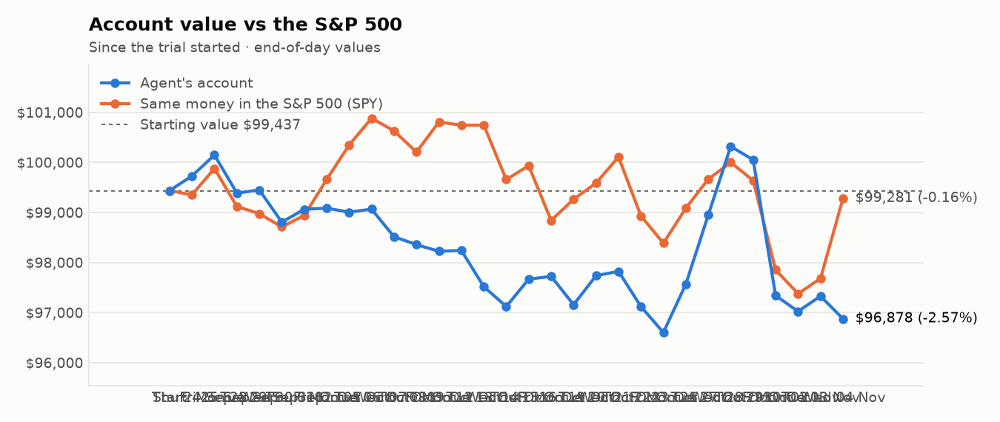
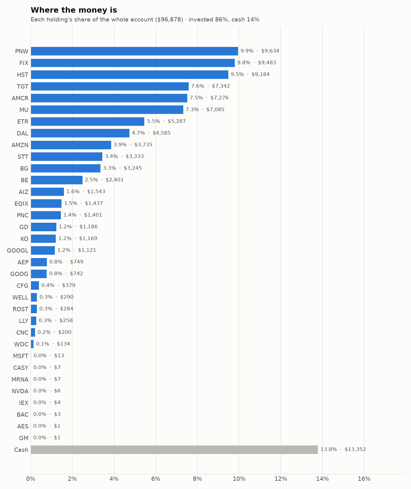
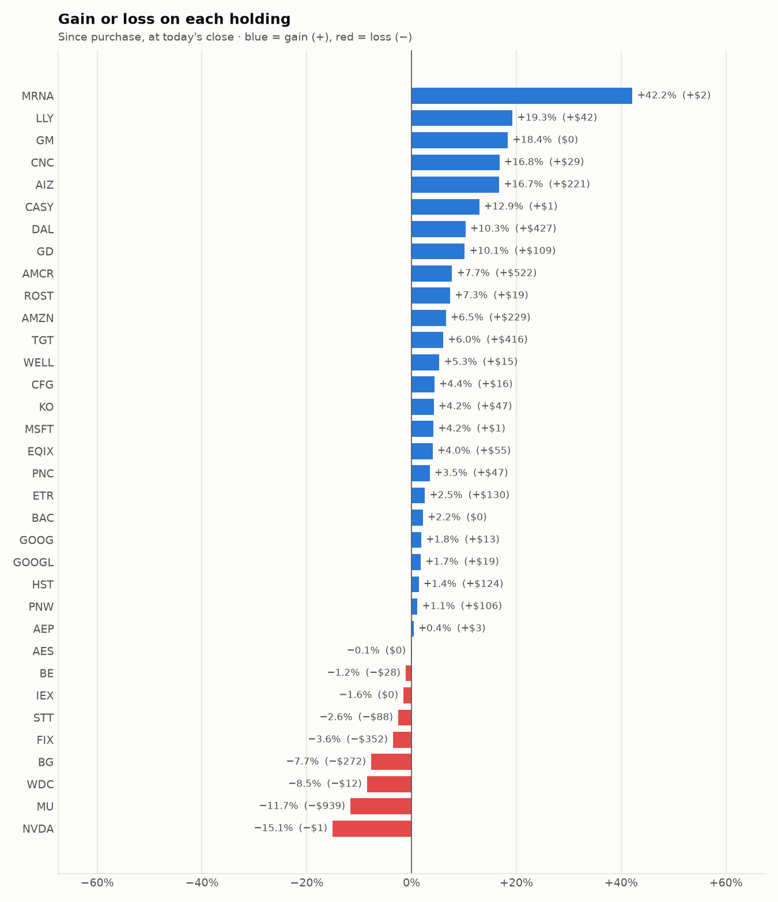

# 5-day trading report — 29 Oct to 04 Nov 2026
_Trading days 26–30 of the trial._

## Performance

- **Account value:** $100,322 → $96,878 (-3.4%)
- **S&P 500 (SPY) over the same days:** -0.7%
- **Agent vs S&P 500:** -2.71% (behind)

| Day | Account value | Day change | SPY | Buys | Sells |
|---|---|---|---|---|---|
| Thu 29 Oct | $100,051 | -0.3% | -0.4% | 3 | 3 |
| Fri 30 Oct | $97,342 | -2.7% | -1.8% | 2 | 5 |
| Mon 02 Nov | $97,026 | -0.3% | -0.5% | 3 | 5 |
| Tue 03 Nov | $97,330 | +0.3% | +0.3% | 2 | 5 |
| Wed 04 Nov | $96,878 | -0.5% | +1.6% | 4 | 6 |

## Risk scorecard (trial to date)

- **Return:** agent -2.57% vs S&P 500 -0.16% over 30 trading day(s)
- **Largest fall from a peak (max drawdown):** -3.54% — the worst the account has been below its own high
- **Volatility:** 12.1% a year — how much the account value swings day to day
- **Sharpe ratio:** -1.76 — return per unit of risk, yearly rate (above 1 is good, below 0 is losing)
- **Beta:** 0.62 — the account moves less than the S&P 500 (1.00 = exactly with it)
- **Alpha:** -2.48% — return lost beyond what the market's own move explains, given the beta above

## Charts

## What the research favoured

- **Main reason behind buys:** Momentum (8), Research (5), Low volatility (1)
- **Sectors bought:** Real Estate (4), Industrials (3), Information Technology (2), Communication Services (2), Utilities (2), Financials (1)
- **Average analyst consensus (-2..+2):** buys +1.00, sells +1.03
- **Average news tone:** buys +17.5, sells +8.8
- **Average combined research score:** buys +0.90, sells +0.68

## Sessions

- **2026-10-29 Morning rebalance:** traded — 6 order(s) placed
- **2026-10-29 Afternoon risk check:** no trades needed — Risk-checked 34 holding(s): none was 12%+ below its purchase price, and none had both clearly negative news and a price drop of 3%+ since entry.
- **2026-10-30 Morning rebalance:** traded — 6 order(s) placed
- **2026-10-30 Afternoon risk check:** traded — Sold 1 position(s) on the risk check (stop-loss: SNDK)
- **2026-11-02 Morning rebalance:** traded — 8 order(s) placed
- **2026-11-02 Afternoon risk check:** no trades needed — Risk-checked 33 holding(s): none was 12%+ below its purchase price, and none had both clearly negative news and a price drop of 3%+ since entry.
- **2026-11-03 Morning rebalance:** traded — 7 order(s) placed
- **2026-11-03 Afternoon risk check:** no trades needed — Risk-checked 34 holding(s): none was 12%+ below its purchase price, and none had both clearly negative news and a price drop of 3%+ since entry.
- **2026-11-04 Morning rebalance:** traded — 9 order(s) placed
- **2026-11-04 Afternoon risk check:** traded — Sold 1 position(s) on the risk check (stop-loss: LITE)

# Key decisions and the research behind them

## Why I bought

### PNW — bought 91.258 shares at ~$104.41 ($9,528)

**Why:** combined score +0.99; ranked #5 of 503; driven mainly by price momentum +1.52, research (news + analyst consensus) +1.39; entering/adding to the top-ranked target portfolio; research detail: 17 recent headline(s), net positive tone (+16); analyst consensus +0.61/2 (5 strong buy, 4 buy, 14 hold, 0 sell, 0 strong sell)

**Research scores** (combined +0.99, ranked #5 in the S&P 500, sector: Utilities):

| Factor | Score | Measures |
|---|---|---|
| Value | +0.59 | cheap vs. sector peers on P/E and P/B |
| Quality | -0.11 | profitability (ROE, margins) and balance-sheet strength |
| Momentum | +1.52 | 12-month price trend, excluding the last month |
| Low volatility | +0.13 | steadier price than sector peers |
| Research | +1.39 | recent news tone + analyst consensus |

**Company financials (Finnhub, trailing 12 months):** P/E 20.1, P/B 1.8, return on equity 9.0%, debt/equity 1.62

**Price trend (Alpaca):** 12-month return (excl. last month) +9.2%, last month +12.3%, volatility 16.6%/yr

**News (Finnhub): 17 headline(s) in the last 2 days, net tone +16.** Most influential:
- [Pinnacle West Q3 Earnings Beat Estimates on Strong Sales Growth](https://finnhub.io/api/news?id=243622899120a60a1186530e124dbd3fa4bd0c92b9afc858e9b2276b3d7208c8) — 03 Nov, Yahoo (tone +4)
- [What Pinnacle West Capital (PNW) Said on Its Q3 Earnings Call](https://finnhub.io/api/news?id=444b9934862e747f5e63fd2a8d6bb7af3d4ad93faf34612d8291c879d2d220d2) — 04 Nov, Yahoo (tone +2)
- [Pinnacle West Capital Corp (PNW) (Q3 2026) Earnings Call Highlights: Raised Guidance and 9. ...](https://finnhub.io/api/news?id=1d81705fbcfdd14ce93e2e465af1dbd663d141df081d1d65bed7b555c7cea4c4) — 04 Nov, Yahoo (tone +2)
- [Pinnacle West (PNW) Stock Could Be 21% Overvalued After Record Demand](https://finnhub.io/api/news?id=4fd3fabf97efba35d650abcab6ca253adc6921023ba414175be6278067b7ab76) — 03 Nov, Yahoo (tone +2)
- [Pinnacle West Capital Q3 EPS $3.49 Beats $3.23 Estimate, Sales $1.973B Beat $1.900B Estimate](https://finnhub.io/api/news?id=6d18ace5a8b7ecc9d8ae9e5fb90a5b6814af1a89c6914dd5fc501c13b75b5caf) — 03 Nov, Benzinga (tone +2)

**Analysts (Finnhub, 2026-11-01):** 5 strong buy, 4 buy, 14 hold, 0 sell, 0 strong sell — consensus +0.61 on a -2 (strong sell) to +2 (strong buy) scale.

### HST — bought 317.774 shares at ~$25.78 ($8,192)

**Why:** combined score +0.94; ranked #6 of 503; driven mainly by price momentum +1.78, value (cheapness) +0.80; entering/adding to the top-ranked target portfolio; research detail: 2 recent headline(s), net positive tone (+2); analyst consensus +0.92/2 (8 strong buy, 7 buy, 10 hold, 0 sell, 0 strong sell)

**Research scores** (combined +0.94, ranked #6 in the S&P 500, sector: Real Estate):

| Factor | Score | Measures |
|---|---|---|
| Value | +0.80 | cheap vs. sector peers on P/E and P/B |
| Quality | +0.72 | profitability (ROE, margins) and balance-sheet strength |
| Momentum | +1.78 | 12-month price trend, excluding the last month |
| Low volatility | -0.05 | steadier price than sector peers |
| Research | +0.20 | recent news tone + analyst consensus |

**Company financials (Finnhub, trailing 12 months):** P/E 17.2, P/B 2.5, return on equity 15.5%, gross margin 97.0%, debt/equity 0.80

**Price trend (Alpaca):** 12-month return (excl. last month) +31.2%, last month +14.7%, volatility 18.7%/yr

**News (Finnhub): 2 headline(s) in the last 2 days, net tone +2.** Most influential:
- [3 Hotel REITs to Watch for Potential Upside This Earnings Season](https://finnhub.io/api/news?id=0697a3e9a9f8b81e204f3b4708704bc014633c290511f0f347505b6e526399b4) — 03 Nov, Yahoo (tone +2)
- [Host Hotels Gears Up to Report Q3 Earnings: Key Factors to Consider](https://finnhub.io/api/news?id=0dadfa0ca29834043c8d6a6d524f5cf3618fdf519431b51b7339948717f560fb) — 02 Nov, Yahoo (tone +0)

**Analysts (Finnhub, 2026-11-01):** 8 strong buy, 7 buy, 10 hold, 0 sell, 0 strong sell — consensus +0.92 on a -2 (strong sell) to +2 (strong buy) scale.

### IVZ — bought 269.576 shares at ~$28.55 ($7,696)

**Why:** combined score +0.96; ranked #6 of 503; driven mainly by price momentum +1.62, value (cheapness) +1.57; entering/adding to the top-ranked target portfolio; research detail: 2 recent headline(s), net positive tone (+3); analyst consensus +0.55/2 (1 strong buy, 9 buy, 10 hold, 0 sell, 0 strong sell)

**Research scores** (combined +0.96, ranked #6 in the S&P 500, sector: Financials):

| Factor | Score | Measures |
|---|---|---|
| Value | +1.57 | cheap vs. sector peers on P/E and P/B |
| Quality | -0.31 | profitability (ROE, margins) and balance-sheet strength |
| Momentum | +1.62 | 12-month price trend, excluding the last month |
| Low volatility | -0.77 | steadier price than sector peers |
| Research | +0.68 | recent news tone + analyst consensus |

**Company financials (Finnhub, trailing 12 months):** P/B 1.1, return on equity -0.6%, gross margin 65.9%, debt/equity 0.82

**Price trend (Alpaca):** 12-month return (excl. last month) +32.7%, last month -8.7%, volatility 25.8%/yr

**News (Finnhub): 2 headline(s) in the last 2 days, net tone +3.** Most influential:
- [IVZ Q3 deep dive: margin expansion driven by global inflows and expense discipline](https://finnhub.io/api/news?id=25ea30226d726bdd89d579015c8412e5a064a67f8b6e6658a1c8793433d18b0c) — 30 Oct, Yahoo (tone +2)
- [Is Invesco Equally-Weighted S&P 500 A (VADAX) a Strong Mutual Fund Pick Right Now?](https://finnhub.io/api/news?id=835e2f6716e87167028918854eca7ae87ac5754e3c1623bb7837090bba265c8c) — 02 Nov, Yahoo (tone +1)

**Analysts (Finnhub, 2026-11-01):** 1 strong buy, 9 buy, 10 hold, 0 sell, 0 strong sell — consensus +0.55 on a -2 (strong sell) to +2 (strong buy) scale.

### STX — bought 9.456 shares at ~$702.90 ($6,647)

**Why:** combined score +0.98; ranked #6 of 503; driven mainly by research (news + analyst consensus) +1.78, price momentum +1.59; entering/adding to the top-ranked target portfolio; research detail: 60 recent headline(s), net positive tone (+48); analyst consensus +1.10/2 (7 strong buy, 19 buy, 4 hold, 0 sell, 0 strong sell)

**Research scores** (combined +0.98, ranked #6 in the S&P 500, sector: Information Technology):

| Factor | Score | Measures |
|---|---|---|
| Value | -0.47 | cheap vs. sector peers on P/E and P/B |
| Quality | +0.73 | profitability (ROE, margins) and balance-sheet strength |
| Momentum | +1.59 | 12-month price trend, excluding the last month |
| Low volatility | -0.72 | steadier price than sector peers |
| Research | +1.78 | recent news tone + analyst consensus |

**Company financials (Finnhub, trailing 12 months):** P/E 36.1, P/B 56.3, return on equity 245.1%, gross margin 50.4%, debt/equity 0.68

**Price trend (Alpaca):** 12-month return (excl. last month) +320.0%, last month -23.6%, volatility 67.1%/yr

**News (Finnhub): 60 headline(s) in the last 2 days, net tone +48.** Most influential:
- [STX Q1 Earnings & Revenues Beat, Record Cash Flow Boosts Profitability](https://finnhub.io/api/news?id=0b274dfa9dcecd44e6690cb2dda83538f9121df82233a6d1a513314d05a733ab) — 28 Oct, Yahoo (tone +4)
- [Seagate Technology shares fall 6% despite Q1 earnings beat and raised guidance](https://finnhub.io/api/news?id=f0875c92cedc83bccd8fa5e0b87dc7a331b788d00bba4cc16c5f492f1db41269) — 27 Oct, Yahoo (tone +4)
- [SK Hynix Jumps 7%, Micron Rises 3% on Memory Shortage Call Through 2030 While Seagate Slips Despite Upbeat Guidance](https://finnhub.io/api/news?id=8878a5a00ff7ca93ba6103a1bed0a256049f4137f6bd1a266e7ea88c8b08515e) — 28 Oct, Yahoo (tone +3)
- [Seagate Q1 Earnings Call Highlights Strong Demand and HAMR Expansion](https://finnhub.io/api/news?id=8efcafa71088e98ce660b5af1878f7e0b463bd89188e37b9414316e262625cd3) — 28 Oct, Yahoo (tone +3)
- [Seagate revenue jumps 61% as storage demand drives record profits](https://finnhub.io/api/news?id=35ae1de830e9b557d97483e7dd3ffc42a4481a0022ebaa12741f842236f2cc4c) — 28 Oct, Yahoo (tone +3)

**Analysts (Finnhub, 2026-10-01):** 7 strong buy, 19 buy, 4 hold, 0 sell, 0 strong sell — consensus +1.10 on a -2 (strong sell) to +2 (strong buy) scale.

### HST — bought 257.747 shares at ~$25.75 ($6,637)

**Why:** combined score +0.98; ranked #4 of 503; driven mainly by price momentum +1.83, value (cheapness) +0.72; entering/adding to the top-ranked target portfolio; research detail: 1 recent headline(s), net positive tone (+1); analyst consensus +0.92/2 (8 strong buy, 7 buy, 10 hold, 0 sell, 0 strong sell)

**Research scores** (combined +0.98, ranked #4 in the S&P 500, sector: Real Estate):

| Factor | Score | Measures |
|---|---|---|
| Value | +0.72 | cheap vs. sector peers on P/E and P/B |
| Quality | +0.68 | profitability (ROE, margins) and balance-sheet strength |
| Momentum | +1.83 | 12-month price trend, excluding the last month |
| Low volatility | -0.06 | steadier price than sector peers |
| Research | +0.39 | recent news tone + analyst consensus |

**Company financials (Finnhub, trailing 12 months):** P/E 16.9, P/B 2.5, return on equity 15.5%, gross margin 97.0%, debt/equity 0.80

**Price trend (Alpaca):** 12-month return (excl. last month) +32.3%, last month +12.4%, volatility 19.5%/yr

**News (Finnhub): 1 headline(s) in the last 2 days, net tone +1.** Most influential:
- [Host Hotels & Resorts: With A 9% Return Is A Hold](https://finnhub.io/api/news?id=3d154371486effc090126bee719135e150eaa3959bc6adbdf2ff42899f19996d) — 31 Oct, SeekingAlpha (tone +1)

**Analysts (Finnhub, 2026-11-01):** 8 strong buy, 7 buy, 10 hold, 0 sell, 0 strong sell — consensus +0.92 on a -2 (strong sell) to +2 (strong buy) scale.

### ETR — bought 60.76 shares at ~$109.14 ($6,631)

**Why:** combined score +0.82; ranked #8 of 503; driven mainly by research (news + analyst consensus) +1.88, price momentum +1.51; entering/adding to the top-ranked target portfolio; research detail: 22 recent headline(s), net positive tone (+22); analyst consensus +1.00/2 (7 strong buy, 15 buy, 7 hold, 0 sell, 0 strong sell)

**Research scores** (combined +0.82, ranked #8 in the S&P 500, sector: Utilities):

| Factor | Score | Measures |
|---|---|---|
| Value | -0.89 | cheap vs. sector peers on P/E and P/B |
| Quality | -0.01 | profitability (ROE, margins) and balance-sheet strength |
| Momentum | +1.51 | 12-month price trend, excluding the last month |
| Low volatility | -0.02 | steadier price than sector peers |
| Research | +1.88 | recent news tone + analyst consensus |

**Company financials (Finnhub, trailing 12 months):** P/E 28.9, P/B 2.8, return on equity 10.3%, gross margin 42.0%, debt/equity 1.87

**Price trend (Alpaca):** 12-month return (excl. last month) +8.1%, last month +8.9%, volatility 16.4%/yr

**News (Finnhub): 22 headline(s) in the last 2 days, net tone +22.** Most influential:
- [Entergy Corp (ETR) Q3 2026 Earnings Call Highlights: Strong EPS, Google Expansion, and a ...](https://finnhub.io/api/news?id=41c1ccd0bdaf62a5fe272e30856c30b6bed30411fe53a5ec17d3afef131d9d66) — 03 Nov, Yahoo (tone +3)
- [Entergy Q3 Earnings Top Estimates, Revenues Increase Year Over Year](https://finnhub.io/api/news?id=02e397ed46b023e05263f64593eacb91782bf6b928e089d646ab42dc12b4b9c4) — 02 Nov, Yahoo (tone +3)
- [Entergy (ETR) Q3 2026 Earnings Call Transcript](https://finnhub.io/api/news?id=e54196d11e8617e766cf9324b52c7ae5072d59bd29060ad9f7f7524c8b1faf7a) — 02 Nov, Yahoo (tone +2)
- [Entergy Q3 Adj. EPS $1.98 Beats $1.71 Estimate, Sales $4.365B Beat $4.116B Estimate](https://finnhub.io/api/news?id=fbadcfd3686b992156246aab83bf8845f787ad219c046f3c9777a93c3a8c1e52) — 02 Nov, Benzinga (tone +2)
- [Entergy Q3 Adj. EPS $1.98 Beats $1.71 Estimate](https://finnhub.io/api/news?id=771dad082abd2d7bced1565970c027b01aaf49db2e1fdd63fff572b7f04454c5) — 02 Nov, Benzinga (tone +2)

**Analysts (Finnhub, 2026-11-01):** 7 strong buy, 15 buy, 7 hold, 0 sell, 0 strong sell — consensus +1.00 on a -2 (strong sell) to +2 (strong buy) scale.

### EQIX — bought 6.102 shares at ~$1,013.54 ($6,185)

**Why:** combined score +0.97; ranked #6 of 503; driven mainly by research (news + analyst consensus) +2.17, price momentum +1.67; entering/adding to the top-ranked target portfolio; research detail: 25 recent headline(s), net positive tone (+27); analyst consensus +1.15/2 (12 strong buy, 22 buy, 6 hold, 0 sell, 0 strong sell)

**Research scores** (combined +0.97, ranked #6 in the S&P 500, sector: Real Estate):

| Factor | Score | Measures |
|---|---|---|
| Value | -0.64 | cheap vs. sector peers on P/E and P/B |
| Quality | -0.11 | profitability (ROE, margins) and balance-sheet strength |
| Momentum | +1.67 | 12-month price trend, excluding the last month |
| Low volatility | -0.29 | steadier price than sector peers |
| Research | +2.17 | recent news tone + analyst consensus |

**Company financials (Finnhub, trailing 12 months):** P/E 62.0, P/B 6.9, return on equity 11.5%, gross margin 51.6%, debt/equity 1.72

**Price trend (Alpaca):** 12-month return (excl. last month) +29.5%, last month +2.4%, volatility 26.1%/yr

**News (Finnhub): 25 headline(s) in the last 2 days, net tone +27.** Most influential:
- [Equinix Inc (NASDAQ:EQIX) Posts Inline Q3 Revenue, Strong EPS Beat, and Raises 2026 Guidance](https://finnhub.io/api/news?id=09a4232e92ad31687fbbb7c583d69d4ebc779ae761f1296811bddde75bb2a766) — 28 Oct, ChartMill (tone +6)
- [Equinix Q3 AFFO Beat Estimates on Record Bookings, Strong Pricing](https://finnhub.io/api/news?id=be7568b381f51484a1dfe359b38f2434234ed148f9dceb52b91f11540ec04091) — 29 Oct, Yahoo (tone +4)
- [Is Equinix (EQIX) Fully Priced for Its Cash Flow Growth?](https://finnhub.io/api/news?id=ccbe7837dcc4c31402678e48751bbc15b30b27d953d41e4998ad1e457e71e768) — 29 Oct, Yahoo (tone +2)
- [Is Earnings Beat Altering The Investment Case For Equinix (EQIX)?](https://finnhub.io/api/news?id=b25610ae852e2fa11e199a4d9761ea1e74d825bd2a3debb22c5b10a67ebed898) — 29 Oct, Yahoo (tone +2)
- [Equinix (EQIX) Q3 2026 Earnings Call Transcript](https://finnhub.io/api/news?id=b897469f3ea2c4b8d7d14de4096a424654d84c25402d31a506b34e4ae6a4cb4d) — 29 Oct, Yahoo (tone +2)

**Analysts (Finnhub, 2026-10-01):** 12 strong buy, 22 buy, 6 hold, 0 sell, 0 strong sell — consensus +1.15 on a -2 (strong sell) to +2 (strong buy) scale.

### GOOGL — bought 19.677 shares at ~$285.50 ($5,618)

**Why:** combined score +0.94; ranked #8 of 503; driven mainly by research (news + analyst consensus) +1.75, price momentum +1.70; entering/adding to the top-ranked target portfolio; research detail: 96 recent headline(s), net positive tone (+36); analyst consensus +1.21/2 (20 strong buy, 41 buy, 6 hold, 0 sell, 0 strong sell)

**Research scores** (combined +0.94, ranked #8 in the S&P 500, sector: Communication Services):

| Factor | Score | Measures |
|---|---|---|
| Value | -0.64 | cheap vs. sector peers on P/E and P/B |
| Quality | +0.08 | profitability (ROE, margins) and balance-sheet strength |
| Momentum | +1.70 | 12-month price trend, excluding the last month |
| Low volatility | +0.49 | steadier price than sector peers |
| Research | +1.75 | recent news tone + analyst consensus |

**Company financials (FMP, trailing 12 months):** P/E 14.7, P/B 5.1, return on equity 42.6%, gross margin 60.9%, debt/equity 0.21

**Price trend (Alpaca):** 12-month return (excl. last month) +38.3%, last month -4.6%, volatility 24.0%/yr

**News (Finnhub): 96 headline(s) in the last 2 days, net tone +36.** Most influential:
- [Alphabet Q3: The Market Is Selling The Wrong Line Items And I Think This Is An Opportunity](https://finnhub.io/api/news?id=36d63b4fea75137d24a7f466c031f6519833f9307399b509794484ba7a7e75fa) — 29 Oct, SeekingAlpha (tone +3)
- [GOOGL Stock Slumps 11% After-Hours: Alphabet’s Surge in AI Spending Pressures Third-Quarter Profits And Cash Flows](https://finnhub.io/api/news?id=ddbc66ec15558900a7b83d2162cad4ba6b2edb321a31a43b966c83016b1ed82a) — 28 Oct, Yahoo (tone +3)
- [Amazon (AMZN) vs. MSFT and GOOGL: Can Higher-Margin Businesses Turn Amazon Into an AI-Driven Compounder?](https://finnhub.io/api/news?id=2680439668c60c19bd89911c4f0b7789c839db2e0311d9f0014262f71fc5db48) — 28 Oct, Yahoo (tone +3)
- [Robinhood, Microsoft And 3 Stocks To Watch Heading Into Wednesday](https://finnhub.io/api/news?id=43b799b1e39a37a78b3a0faa57c77fe9f211cc7d5f1c92ec5c8aafbb1f33b5f8) — 27 Oct, Benzinga (tone +3)
- [Alphabet Stock Finally Got What It Deserved (Rating Upgrade)](https://finnhub.io/api/news?id=c5552c41cf3429cb3171a54d06322d002cb23fd352ae3bd1a1cfc3c192511a23) — 29 Oct, SeekingAlpha (tone +2)

**Analysts (Finnhub, 2026-10-01):** 20 strong buy, 41 buy, 6 hold, 0 sell, 0 strong sell — consensus +1.21 on a -2 (strong sell) to +2 (strong buy) scale.

### LITE — bought 7.419 shares at ~$692.02 ($5,134)

**Why:** combined score +0.80; ranked #9 of 503; driven mainly by price momentum +3.00, low volatility -1.14; entering/adding to the top-ranked target portfolio; research detail: 82 recent headline(s), net positive tone (+5); analyst consensus +1.11/2 (9 strong buy, 22 buy, 5 hold, 0 sell, 0 strong sell)

**Research scores** (combined +0.80, ranked #9 in the S&P 500, sector: Information Technology):

| Factor | Score | Measures |
|---|---|---|
| Value | -0.48 | cheap vs. sector peers on P/E and P/B |
| Quality | -1.12 | profitability (ROE, margins) and balance-sheet strength |
| Momentum | +3.00 | 12-month price trend, excluding the last month |
| Low volatility | -1.14 | steadier price than sector peers |
| Research | +0.28 | recent news tone + analyst consensus |

**Company financials (Finnhub, trailing 12 months):** P/B 14.3, return on equity -300.1%, gross margin 41.7%, debt/equity 0.35

**Price trend (Alpaca):** 12-month return (excl. last month) +532.9%, last month -37.0%, volatility 96.7%/yr

**News (Finnhub): 82 headline(s) in the last 2 days, net tone +5.** Most influential:
- [COHR Stock Draws Upgrade As Marvell’s $115B Lumentum Deal Highlights ‘Value Of Scarce AI Optics’](https://finnhub.io/api/news?id=719c8dbbdf4f4e3bc3986ec3982fbc8d91732dcbdbd2ddc969d142cf328be7f2) — 02 Nov, Yahoo (tone +3)
- [Analysts downgrade Marvell and slash price targets over Lumentum deal](https://finnhub.io/api/news?id=0b755e10bac1e8daf5d2df51a80046a9e240460b981502b0db1f35123a973593) — 03 Nov, Yahoo (tone -2)
- [MRVL Stock Price Target Slashed In Half: ‘Material Headwinds’ After Lumentum Deal, TD Cowen Says In Downgrade](https://finnhub.io/api/news?id=5fdabbf162942e4ba5a81129757e283adbc18f9b6bab02f01de72eb39280912e) — 03 Nov, Yahoo (tone -2)
- [3 Penny Stocks With Revenue Growth Up To 72% To Watch](https://finnhub.io/api/news?id=883d132d68010062222923d842b17370cc112b83a6f0e825d02ca20760ec21d3) — 02 Nov, Yahoo (tone +2)
- [Lumentum Holdings Q1 Adj. EPS $4.57 Beats $4.19 Estimate, Sales $1.263B Beat $1.249B Estimate](https://finnhub.io/api/news?id=e6b0e63f4d4b748eb1b0e67c52f9d8f33d89791e17dd7dd69ec668a07e18d964) — 02 Nov, Benzinga (tone +2)

**Analysts (Finnhub, 2026-11-01):** 9 strong buy, 22 buy, 5 hold, 0 sell, 0 strong sell — consensus +1.11 on a -2 (strong sell) to +2 (strong buy) scale.

### FIX — bought 3.819 shares at ~$1,108.85 ($4,235)

**Why:** combined score +1.02; ranked #4 of 503; driven mainly by price momentum +2.79, low volatility -1.57; entering/adding to the top-ranked target portfolio; research detail: 3 recent headline(s), net positive tone (+3); analyst consensus +1.31/2 (7 strong buy, 7 buy, 2 hold, 0 sell, 0 strong sell)

**Research scores** (combined +1.02, ranked #4 in the S&P 500, sector: Industrials):

| Factor | Score | Measures |
|---|---|---|
| Value | -0.34 | cheap vs. sector peers on P/E and P/B |
| Quality | +0.17 | profitability (ROE, margins) and balance-sheet strength |
| Momentum | +2.79 | 12-month price trend, excluding the last month |
| Low volatility | -1.57 | steadier price than sector peers |
| Research | +0.67 | recent news tone + analyst consensus |

**Company financials (Finnhub, trailing 12 months):** P/E 27.3, P/B 17.5, return on equity 55.2%, gross margin 25.6%, debt/equity 0.01

**Price trend (Alpaca):** 12-month return (excl. last month) +105.0%, last month -24.9%, volatility 59.9%/yr

**News (Finnhub): 3 headline(s) in the last 2 days, net tone +3.** Most influential:
- [Is a 90% Backlog Jump Enough to Lift Comfort Systems' 2027 Growth?](https://finnhub.io/api/news?id=a2d64fecc13c10c42be83a50f605205a0e023a19b2f9c2ea0c1fa223ea6e481b) — 03 Nov, Yahoo (tone +2)
- [Comfort Systems and PulteGroup have been highlighted as Zacks Bull and Bear of the Day](https://finnhub.io/api/news?id=0037256e9a479688a1c25b4a68dbc06b69ca61ab715ee18c5ecb4fb16a3a7eb1) — 03 Nov, Yahoo (tone +1)
- [Bull of the Day: Comfort Systems USA (FIX)](https://finnhub.io/api/news?id=7cb45d23b6937d0a8faf196a0f777432c94204ae4324bcac84959fcc6f2d9070) — 03 Nov, Yahoo (tone +0)

**Analysts (Finnhub, 2026-11-01):** 7 strong buy, 7 buy, 2 hold, 0 sell, 0 strong sell — consensus +1.31 on a -2 (strong sell) to +2 (strong buy) scale.

### GOOG — bought 14.62 shares at ~$283.53 ($4,145)

**Why:** combined score +0.92; ranked #10 of 503; driven mainly by research (news + analyst consensus) +1.75, price momentum +1.65; entering/adding to the top-ranked target portfolio; research detail: 98 recent headline(s), net positive tone (+36); analyst consensus +1.21/2 (20 strong buy, 41 buy, 6 hold, 0 sell, 0 strong sell)

**Research scores** (combined +0.92, ranked #10 in the S&P 500, sector: Communication Services):

| Factor | Score | Measures |
|---|---|---|
| Value | -0.73 | cheap vs. sector peers on P/E and P/B |
| Quality | +0.13 | profitability (ROE, margins) and balance-sheet strength |
| Momentum | +1.65 | 12-month price trend, excluding the last month |
| Low volatility | +0.57 | steadier price than sector peers |
| Research | +1.75 | recent news tone + analyst consensus |

**Company financials (Finnhub, trailing 12 months):** P/E 16.3, P/B 6.8, return on equity 50.8%, gross margin 60.9%, debt/equity 0.15

**Price trend (Alpaca):** 12-month return (excl. last month) +36.5%, last month -4.5%, volatility 22.9%/yr

**News (Finnhub): 98 headline(s) in the last 2 days, net tone +36.** Most influential:
- [Alphabet Q3: The Market Is Selling The Wrong Line Items And I Think This Is An Opportunity](https://finnhub.io/api/news?id=36d63b4fea75137d24a7f466c031f6519833f9307399b509794484ba7a7e75fa) — 29 Oct, SeekingAlpha (tone +3)
- [GOOGL Stock Slumps 11% After-Hours: Alphabet’s Surge in AI Spending Pressures Third-Quarter Profits And Cash Flows](https://finnhub.io/api/news?id=ddbc66ec15558900a7b83d2162cad4ba6b2edb321a31a43b966c83016b1ed82a) — 28 Oct, Yahoo (tone +3)
- [Amazon (AMZN) vs. MSFT and GOOGL: Can Higher-Margin Businesses Turn Amazon Into an AI-Driven Compounder?](https://finnhub.io/api/news?id=2680439668c60c19bd89911c4f0b7789c839db2e0311d9f0014262f71fc5db48) — 28 Oct, Yahoo (tone +3)
- [Robinhood, Microsoft And 3 Stocks To Watch Heading Into Wednesday](https://finnhub.io/api/news?id=43b799b1e39a37a78b3a0faa57c77fe9f211cc7d5f1c92ec5c8aafbb1f33b5f8) — 27 Oct, Benzinga (tone +3)
- [Alphabet Stock Finally Got What It Deserved (Rating Upgrade)](https://finnhub.io/api/news?id=c5552c41cf3429cb3171a54d06322d002cb23fd352ae3bd1a1cfc3c192511a23) — 29 Oct, SeekingAlpha (tone +2)

**Analysts (Finnhub, 2026-10-01):** 20 strong buy, 41 buy, 6 hold, 0 sell, 0 strong sell — consensus +1.21 on a -2 (strong sell) to +2 (strong buy) scale.

### BE — bought 10.774 shares at ~$204.68 ($2,205)

**Why:** combined score +0.76; ranked #15 of 503; driven mainly by price momentum +3.00, low volatility -2.32; entering/adding to the top-ranked target portfolio; research detail: 29 recent headline(s), net positive tone (+12); analyst consensus +0.75/2 (7 strong buy, 17 buy, 15 hold, 1 sell, 0 strong sell)

**Research scores** (combined +0.76, ranked #15 in the S&P 500, sector: Industrials):

| Factor | Score | Measures |
|---|---|---|
| Value | -1.33 | cheap vs. sector peers on P/E and P/B |
| Quality | -0.14 | profitability (ROE, margins) and balance-sheet strength |
| Momentum | +3.00 | 12-month price trend, excluding the last month |
| Low volatility | -2.32 | steadier price than sector peers |
| Research | +0.45 | recent news tone + analyst consensus |

**Company financials (Finnhub, trailing 12 months):** P/E 122.0, P/B 42.2, return on equity 39.6%, gross margin 32.3%, debt/equity 1.38

**Price trend (Alpaca):** 12-month return (excl. last month) +225.6%, last month -25.3%, volatility 88.2%/yr

**News (Finnhub): 29 headline(s) in the last 2 days, net tone +12.** Most influential:
- [Bloom Energy Is Up 146% in 2026: Take Profits, or Buy More?](https://finnhub.io/api/news?id=0becaaf23fda4498ed00d5178c2a0d6e777f0da5a3976cf589dea0e374a243f6) — 03 Nov, Yahoo (tone +2)
- [Barclays raises Bloom Energy to Overweight on stronger-than-expected demand](https://finnhub.io/api/news?id=d7460cfafba67273dd5c0e5c367cdfc967af004611342a91c214fca30f0ab243) — 03 Nov, Yahoo (tone +2)
- [California Resources Stock Earnings Beat Meets Bloom Energy Partnership](https://finnhub.io/api/news?id=08976a04da4cfd2ffcea44c589d75a371408bcbad9766eaa16748ddd8cd948b3) — 03 Nov, Yahoo (tone +2)
- [Bloom Energy's New Guidance Implies Up to $1.55 Billion in Q4 Revenue. Can It Deliver?](https://finnhub.io/api/news?id=4acbc6169755e39c1ac9e8e7435b4cdb205b4d45299b4a2e23a75b636bc2836d) — 04 Nov, Yahoo (tone +1)
- [BE Stock Heads For Best Week In Over A Month: This Analyst Says Bloom’s Demand Trends Are Getting ‘Harder To Ignore’](https://finnhub.io/api/news?id=886ccc692493ed6f9fc490d79f822b59d574f71afb47bf6921d850dbbdf53a22) — 03 Nov, Yahoo (tone +1)

**Analysts (Finnhub, 2026-11-01):** 7 strong buy, 17 buy, 15 hold, 1 sell, 0 strong sell — consensus +0.75 on a -2 (strong sell) to +2 (strong buy) scale.

### IEX — bought 7.957 shares at ~$237.47 ($1,890)

**Why:** combined score +0.81; ranked #16 of 503; driven mainly by low volatility +2.21, research (news + analyst consensus) +1.27; entering/adding to the top-ranked target portfolio; research detail: 20 recent headline(s), net positive tone (+31); analyst consensus +1.00/2 (6 strong buy, 8 buy, 6 hold, 0 sell, 0 strong sell)

**Research scores** (combined +0.81, ranked #16 in the S&P 500, sector: Industrials):

| Factor | Score | Measures |
|---|---|---|
| Value | +0.26 | cheap vs. sector peers on P/E and P/B |
| Quality | +0.08 | profitability (ROE, margins) and balance-sheet strength |
| Momentum | +0.91 | 12-month price trend, excluding the last month |
| Low volatility | +2.21 | steadier price than sector peers |
| Research | +1.27 | recent news tone + analyst consensus |

**Company financials (Finnhub, trailing 12 months):** P/E 33.6, P/B 4.2, return on equity 12.9%, gross margin 44.7%, debt/equity 0.46

**Price trend (Alpaca):** 12-month return (excl. last month) +40.6%, last month +4.9%, volatility 18.4%/yr

**News (Finnhub): 20 headline(s) in the last 2 days, net tone +31.** Most influential:
- [IDEX Corp (NYSE:IEX) Q3 Earnings Beat, Raised Guidance and Strong Orders Fuel Premarket Rally](https://finnhub.io/api/news?id=b50542eb4a03958be27edbf2811af0d3aac417df6de82bd7a54aaf69e36844b8) — 28 Oct, ChartMill (tone +7)
- [IDEX Q3 Earnings Beat Estimates on HST Strength, View Raised](https://finnhub.io/api/news?id=30135a8a0ddee876135ba740c6ac4f4fc0666521cb49cfa10657f7b141ec259e) — 28 Oct, Yahoo (tone +5)
- [Learn Why The Bull Case For IDEX (IEX) Could Change Following Earnings Beat](https://finnhub.io/api/news?id=58d3480cbaf585a8090b0bc0fbb73425e6ebc00b6d64b63524345517b3a54876) — 29 Oct, Yahoo (tone +4)
- [Oppenheimer Maintains Outperform on IDEX, Raises Price Target to $280](https://finnhub.io/api/news?id=7c645fcb2a1325b042b2df3f6b2f0ce1dcdb3222160f7d2d1ee98d75cb0dac6d) — 29 Oct, Benzinga (tone +2)
- [IDEX (IEX) Q3 2026 Earnings Call Transcript](https://finnhub.io/api/news?id=81f01cc0815740ae8b4bb3d5a4c19cce4d05d05f2ae979d6fc656a09e6e580c2) — 28 Oct, Yahoo (tone +2)

**Analysts (Finnhub, 2026-10-01):** 6 strong buy, 8 buy, 6 hold, 0 sell, 0 strong sell — consensus +1.00 on a -2 (strong sell) to +2 (strong buy) scale.

### WELL — bought 5.796 shares at ~$235.52 ($1,365)

**Why:** combined score +0.77; ranked #16 of 503; driven mainly by price momentum +1.64, research (news + analyst consensus) +1.62; entering/adding to the top-ranked target portfolio; research detail: 2 recent headline(s), net positive tone (+3); analyst consensus +1.11/2 (6 strong buy, 19 buy, 3 hold, 0 sell, 0 strong sell)

**Research scores** (combined +0.77, ranked #16 in the S&P 500, sector: Real Estate):

| Factor | Score | Measures |
|---|---|---|
| Value | -0.75 | cheap vs. sector peers on P/E and P/B |
| Quality | -0.32 | profitability (ROE, margins) and balance-sheet strength |
| Momentum | +1.64 | 12-month price trend, excluding the last month |
| Low volatility | -0.13 | steadier price than sector peers |
| Research | +1.62 | recent news tone + analyst consensus |

**Company financials (Finnhub, trailing 12 months):** P/E 101.3, P/B 3.4, return on equity 3.7%, gross margin 40.0%, debt/equity 0.40

**Price trend (Alpaca):** 12-month return (excl. last month) +27.5%, last month +3.4%, volatility 22.2%/yr

**News (Finnhub): 2 headline(s) in the last 2 days, net tone +3.** Most influential:
- [Evercore ISI Group Maintains Outperform on Welltower, Raises Price Target to $265](https://finnhub.io/api/news?id=629856de829ecd279e75c045f1d8b8acf931f536fdfe712894caa7fe47edb93c) — 02 Nov, Benzinga (tone +2)
- [The Zacks Analyst Blog Highlights Welltower, T-Mobile US and Starbucks](https://finnhub.io/api/news?id=1ece9f5b6aee84f562c3cd964c05c0242fca63f947999fa90a6376f66e7a9e97) — 02 Nov, Yahoo (tone +1)

**Analysts (Finnhub, 2026-11-01):** 6 strong buy, 19 buy, 3 hold, 0 sell, 0 strong sell — consensus +1.11 on a -2 (strong sell) to +2 (strong buy) scale.

## Why I sold

### SNDK — sold 6.938 shares at ~$1,129.23 ($7,835)

**Why:** stop-loss: -17.9% below the average purchase price of $1,379.50 (limit -12%); sold the whole position and won't buy it back for 7 days

**What triggered it:** the afternoon risk check trims a holding only when BOTH its recent news turns clearly negative AND its price is down 3%+ since purchase (it was -17.9%).

**News (Finnhub): 65 headline(s) in the last 2 days, net tone +45.** Most influential:
- [Sandisk Sinks 12% Despite Earnings Beat and 8-for-1 Split as Memory Stocks Slide: “It’s Absurd”](https://finnhub.io/api/news?id=f557c8141d70e993cfa78d31247772badb3e41a8f73099a7430a4b32b41a6585) — 30 Oct, Yahoo (tone +3)
- [Sandisk shares slide 8% despite earnings beat as investors weigh valuation](https://finnhub.io/api/news?id=abbef4e175da06554bde61bbe96faeb6a3efe497b4f8abeb2bce7bb962cf6b01) — 30 Oct, Yahoo (tone +3)
- [Sandisk Sinks 9% Despite Earnings Beat, Raised Guidance and 8-for-1 Split; Western Digital Tumbles 8%, Seagate Slides 7%, Micron Falls 6%](https://finnhub.io/api/news?id=f69bafad3da32bf7459890c8e19694ff814943466021c9678fb2954cc7dabe33) — 30 Oct, Yahoo (tone +3)
- [SNDK Q1 Earnings Call Highlights AI Demand and Supply Discipline](https://finnhub.io/api/news?id=36a9cafe809e833b1150d3ce1d60c19f551cb0ce0ceaaf85d0aa4621e313417f) — 30 Oct, Yahoo (tone +3)
- [SANDISK CORP (NASDAQ:SNDK) EPS Beat With In-Line Revenue as Datacenter Surges](https://finnhub.io/api/news?id=fb1832808e988af291ce4d292507c8071b3f8937176857bd53f308e8bb765ee5) — 29 Oct, ChartMill (tone +3)

### IVZ — sold 269.576 shares at ~$27.88 ($7,516)

**Why:** combined score +0.46; ranked #59 of 503; driven mainly by price momentum +1.51, low volatility -0.75; trimmed toward target weight, or dropped out of the top-ranked names; research detail: 5 recent headline(s), net positive tone (+1); analyst consensus +0.55/2 (1 strong buy, 9 buy, 10 hold, 0 sell, 0 strong sell)

**Research scores** (combined +0.46, ranked #59 in the S&P 500, sector: Financials):

| Factor | Score | Measures |
|---|---|---|
| Value | +0.00 | cheap vs. sector peers on P/E and P/B |
| Quality | +0.00 | profitability (ROE, margins) and balance-sheet strength |
| Momentum | +1.51 | 12-month price trend, excluding the last month |
| Low volatility | -0.75 | steadier price than sector peers |
| Research | -0.15 | recent news tone + analyst consensus |

**Price trend (Alpaca):** 12-month return (excl. last month) +32.8%, last month -9.4%, volatility 25.8%/yr

**News (Finnhub): 5 headline(s) in the last 2 days, net tone +1.** Most influential:
- [Is Invesco Equally-Weighted S&P 500 A (VADAX) a Strong Mutual Fund Pick Right Now?](https://finnhub.io/api/news?id=835e2f6716e87167028918854eca7ae87ac5754e3c1623bb7837090bba265c8c) — 02 Nov, Yahoo (tone +1)
- [Should You Invest in the Invesco S&P SmallCap Information Technology ETF (PSCT)?](https://finnhub.io/api/news?id=2b0459a225f5d46ccf5487c566ac5b4df09d1de81ab7c0eeb7e06fbbf08451e9) — 03 Nov, Yahoo (tone +0)
- [Should You Invest in the Invesco Pharmaceuticals ETF (PJP)?](https://finnhub.io/api/news?id=f2bf8e1013fd58e53c7d64016c00b9e1e5bab65225b274693372c66030dab151) — 03 Nov, Yahoo (tone +0)
- [Should Invesco S&P 500 Revenue ETF (RWL) Be on Your Investing Radar?](https://finnhub.io/api/news?id=1e1dca594a290e083c1e73193a9661bf53fcfa324e271419b47f794cee6124f7) — 03 Nov, Yahoo (tone +0)
- [Invesco Closed-End Funds Declare Dividends](https://finnhub.io/api/news?id=5b24f9c1301a031f93366e76bd3d24169bfd628bc750fae2c52aa12cf2d7e477) — 02 Nov, Yahoo (tone +0)

**Analysts (Finnhub, 2026-11-01):** 1 strong buy, 9 buy, 10 hold, 0 sell, 0 strong sell — consensus +0.55 on a -2 (strong sell) to +2 (strong buy) scale.

### HST — sold 277.992 shares at ~$25.80 ($7,172)

**Why:** combined score +0.61; ranked #26 of 503; driven mainly by price momentum +1.83, research (news + analyst consensus) -0.13; trimmed toward target weight, or dropped out of the top-ranked names; research detail: 1 recent headline(s), neutral/mixed tone; analyst consensus +0.92/2 (8 strong buy, 7 buy, 10 hold, 0 sell, 0 strong sell)

**Research scores** (combined +0.61, ranked #26 in the S&P 500, sector: Real Estate):

| Factor | Score | Measures |
|---|---|---|
| Value | +0.00 | cheap vs. sector peers on P/E and P/B |
| Quality | +0.00 | profitability (ROE, margins) and balance-sheet strength |
| Momentum | +1.83 | 12-month price trend, excluding the last month |
| Low volatility | -0.02 | steadier price than sector peers |
| Research | -0.13 | recent news tone + analyst consensus |

**Price trend (Alpaca):** 12-month return (excl. last month) +32.4%, last month +13.4%, volatility 19.5%/yr

**News (Finnhub): 1 headline(s) in the last 2 days, net tone +0.** Most influential:
- [Host Hotels Gears Up to Report Q3 Earnings: Key Factors to Consider](https://finnhub.io/api/news?id=0dadfa0ca29834043c8d6a6d524f5cf3618fdf519431b51b7339948717f560fb) — 02 Nov, Yahoo (tone +0)

**Analysts (Finnhub, 2026-11-01):** 8 strong buy, 7 buy, 10 hold, 0 sell, 0 strong sell — consensus +0.92 on a -2 (strong sell) to +2 (strong buy) scale.

### STX — sold 9.456 shares at ~$614.48 ($5,811)

**Why:** combined score +0.56; ranked #32 of 503; driven mainly by price momentum +1.51, low volatility -0.68; trimmed toward target weight, or dropped out of the top-ranked names; research detail: 3 recent headline(s), net positive tone (+2); analyst consensus +1.10/2 (7 strong buy, 20 buy, 4 hold, 0 sell, 0 strong sell)

**Research scores** (combined +0.56, ranked #32 in the S&P 500, sector: Information Technology):

| Factor | Score | Measures |
|---|---|---|
| Value | +0.00 | cheap vs. sector peers on P/E and P/B |
| Quality | +0.00 | profitability (ROE, margins) and balance-sheet strength |
| Momentum | +1.51 | 12-month price trend, excluding the last month |
| Low volatility | -0.68 | steadier price than sector peers |
| Research | +0.28 | recent news tone + analyst consensus |

**Price trend (Alpaca):** 12-month return (excl. last month) +300.4%, last month -31.8%, volatility 68.8%/yr

**News (Finnhub): 3 headline(s) in the last 2 days, net tone +2.** Most influential:
- [Seagate: The Real Risk Isn't Toshiba, It's The 2028 Supply Wave (Downgrade)](https://finnhub.io/api/news?id=d2c790ea13489ecf284713cf69cf1c23568e47798e28c3451632f3a9a083dcf5) — 31 Oct, SeekingAlpha (tone +1)
- [STX Q3 deep dive: data center strength and technology transition drive outperformance](https://finnhub.io/api/news?id=19f9e959768e9a11f787531ea519337e60f17c8403ece2cecf6c599289490604) — 31 Oct, Yahoo (tone +1)
- [Is Seagate Still The Business You Bought?](https://finnhub.io/api/news?id=0754beb2c6a959972783e9ee6e21e1a5349d2efaecd4258be01185a16feea01d) — 02 Nov, Yahoo (tone +0)

**Analysts (Finnhub, 2026-11-01):** 7 strong buy, 20 buy, 4 hold, 0 sell, 0 strong sell — consensus +1.10 on a -2 (strong sell) to +2 (strong buy) scale.

### EQIX — sold 5.021 shares at ~$1,005.52 ($5,049)

**Why:** combined score +0.66; ranked #21 of 503; driven mainly by price momentum +1.73, low volatility -0.31; trimmed toward target weight, or dropped out of the top-ranked names; research detail: analyst consensus +1.15/2 (12 strong buy, 23 buy, 6 hold, 0 sell, 0 strong sell)

**Research scores** (combined +0.66, ranked #21 in the S&P 500, sector: Real Estate):

| Factor | Score | Measures |
|---|---|---|
| Value | +0.00 | cheap vs. sector peers on P/E and P/B |
| Quality | +0.00 | profitability (ROE, margins) and balance-sheet strength |
| Momentum | +1.73 | 12-month price trend, excluding the last month |
| Low volatility | -0.31 | steadier price than sector peers |
| Research | +0.28 | recent news tone + analyst consensus |

**Price trend (Alpaca):** 12-month return (excl. last month) +29.3%, last month +0.1%, volatility 26.5%/yr

**News (Finnhub):** no headlines in the last 2 days.

**Analysts (Finnhub, 2026-11-01):** 12 strong buy, 23 buy, 6 hold, 0 sell, 0 strong sell — consensus +1.15 on a -2 (strong sell) to +2 (strong buy) scale.

### LITE — sold 7.419 shares at ~$607.81 ($4,509)

**Why:** stop-loss: -12.1% below the average purchase price of $692.02 (limit -12%); sold the whole position and won't buy it back for 7 days

**What triggered it:** the afternoon risk check trims a holding only when BOTH its recent news turns clearly negative AND its price is down 3%+ since purchase (it was -12.1%).

**News (Finnhub): 115 headline(s) in the last 2 days, net tone +9.** Most influential:
- [AI Stocks Surge on Tuesday: AEHR, Fabrinet, and Lattice Semiconductor All Jump More than 10%](https://finnhub.io/api/news?id=a07c96379b20aa350507d34e3ea9cba4f741f054b32cb1615ac7736ef40d1e9f) — 03 Nov, Yahoo (tone +3)
- [COHR Stock Draws Upgrade As Marvell’s $115B Lumentum Deal Highlights ‘Value Of Scarce AI Optics’](https://finnhub.io/api/news?id=719c8dbbdf4f4e3bc3986ec3982fbc8d91732dcbdbd2ddc969d142cf328be7f2) — 02 Nov, Yahoo (tone +3)
- [Applied Optoelectronics Lost 17% in a Week. Northland Sees 88% Upside From Here](https://finnhub.io/api/news?id=84dbee9a51d531dda69dfda9e1f4ef7761e4cfe3c971a97a2227445136897987) — 04 Nov, Yahoo (tone +2)
- [Marvell cut to "neutral" by BofA as UBS backs Lumentum deal](https://finnhub.io/api/news?id=47b8ce77c6bdc219815a4d182b01777df27355a45ea8c11a67ee1a54082eb766) — 03 Nov, Yahoo (tone -2)
- [Analysts downgrade Marvell and slash price targets over Lumentum deal](https://finnhub.io/api/news?id=0b755e10bac1e8daf5d2df51a80046a9e240460b981502b0db1f35123a973593) — 03 Nov, Yahoo (tone -2)

### KO — sold 45.765 shares at ~$95.02 ($4,349)

**Why:** combined score +0.73; ranked #18 of 503; driven mainly by low volatility +1.55, price momentum +1.38; trimmed toward target weight, or dropped out of the top-ranked names; research detail: 5 recent headline(s), net positive tone (+5); analyst consensus +1.03/2 (8 strong buy, 20 buy, 7 hold, 0 sell, 0 strong sell)

**Research scores** (combined +0.73, ranked #18 in the S&P 500, sector: Consumer Staples):

| Factor | Score | Measures |
|---|---|---|
| Value | -0.67 | cheap vs. sector peers on P/E and P/B |
| Quality | +0.43 | profitability (ROE, margins) and balance-sheet strength |
| Momentum | +1.38 | 12-month price trend, excluding the last month |
| Low volatility | +1.55 | steadier price than sector peers |
| Research | +0.95 | recent news tone + analyst consensus |

**Company financials (Finnhub, trailing 12 months):** P/E 27.7, P/B 9.9, return on equity 42.0%, gross margin 62.3%, debt/equity 1.11

**Price trend (Alpaca):** 12-month return (excl. last month) +29.8%, last month +9.3%, volatility 17.3%/yr

**News (Finnhub): 5 headline(s) in the last 2 days, net tone +5.** Most influential:
- [Coca-Cola Delivers Strong Growth - But is KO Stock Undervalued?](https://finnhub.io/api/news?id=d0d0961e36bc92768ae36ca268c6523082b4776537207c2d90fd8417831370e9) — 01 Nov, Yahoo (tone +2)
- [KO Q3 deep dive: broad-based volume gains and disciplined margin expansion amid cost pressures](https://finnhub.io/api/news?id=5a6f0822f4b8d6268fec9871e18318867cee3ef0e5294781e10dee1ecd5fb39b) — 31 Oct, Yahoo (tone +2)
- [What Coca-Cola Holders Saw Early](https://finnhub.io/api/news?id=ece276a4ad807351c9e6260374b7fcbbb834e88aaf6198b62cf2890c5e7e8392) — 01 Nov, Yahoo (tone +1)
- [Coca-Cola vs. UPS: Which Dividend Stock Could Make You Richer Over the Next 10 Years?](https://finnhub.io/api/news?id=399227059ca90e6013d243c629a3e0118ca0abb27ea6ccf7588c507453792dbb) — 01 Nov, Yahoo (tone +0)
- [Coca-Cola and Procter & Gamble Are Up This Month. Which Dow Dividend Stock Is the Better Buy Now?](https://finnhub.io/api/news?id=6ca4bc61dbf090fede4e9c14491f6e8424b23711d7363e09d22783a300a2b019) — 31 Oct, Yahoo (tone +0)

**Analysts (Finnhub, 2026-11-01):** 8 strong buy, 20 buy, 7 hold, 0 sell, 0 strong sell — consensus +1.03 on a -2 (strong sell) to +2 (strong buy) scale.

### WELL — sold 15.246 shares at ~$233.45 ($3,559)

**Why:** combined score +0.78; ranked #16 of 503; driven mainly by price momentum +1.74, research (news + analyst consensus) +1.39; trimmed toward target weight, or dropped out of the top-ranked names; research detail: 17 recent headline(s), net positive tone (+15); analyst consensus +1.07/2 (6 strong buy, 18 buy, 4 hold, 0 sell, 0 strong sell)

**Research scores** (combined +0.78, ranked #16 in the S&P 500, sector: Real Estate):

| Factor | Score | Measures |
|---|---|---|
| Value | -0.64 | cheap vs. sector peers on P/E and P/B |
| Quality | -0.24 | profitability (ROE, margins) and balance-sheet strength |
| Momentum | +1.74 | 12-month price trend, excluding the last month |
| Low volatility | -0.12 | steadier price than sector peers |
| Research | +1.39 | recent news tone + analyst consensus |

**Company financials (Finnhub, trailing 12 months):** P/E 96.7, P/B 3.4, return on equity 3.7%, gross margin 40.0%, debt/equity 0.40

**Price trend (Alpaca):** 12-month return (excl. last month) +33.2%, last month -2.5%, volatility 21.9%/yr

**News (Finnhub): 17 headline(s) in the last 2 days, net tone +15.** Most influential:
- [WELL's Q3 FFO Beat Estimates on Strong SHO Portfolio Growth](https://finnhub.io/api/news?id=9f2fbadbc1d1b7e64eeb2ddceeb1842efe2cca18fe5bc24770b796ae88f8323b) — 27 Oct, Yahoo (tone +4)
- [Welltower Upgraded After Q3 Results Solidify Its Role As Investment-Grade Senior REIT](https://finnhub.io/api/news?id=f675eb326ffa54dd18c64e336db2d56ee418a4fe446ab8ed432010a5c9599a68) — 28 Oct, SeekingAlpha (tone +3)
- [Welltower (WELL) Stock Looks Reasonable On Its 212% Five Year Run](https://finnhub.io/api/news?id=8226254e4a1b707338d5d070f17a039cdf708b29f1eb720ef843571ff402e463) — 27 Oct, Yahoo (tone +2)
- [Welltower shares drop as earnings miss offsets strong FFO growth](https://finnhub.io/api/news?id=7f788d2873d60128091a03b4910382d8514c5395a1035769e980bb4de7f284a6) — 27 Oct, Yahoo (tone +2)
- [Welltower (WELL) Q3 Earnings Lift FFO Outlook As Stock Slips](https://finnhub.io/api/news?id=931c4f471b95b03fa333de70f4a835ad6ef4576a271e9a80f9a0bde5fe77a4bc) — 28 Oct, Yahoo (tone +1)

**Analysts (Finnhub, 2026-10-01):** 6 strong buy, 18 buy, 4 hold, 0 sell, 0 strong sell — consensus +1.07 on a -2 (strong sell) to +2 (strong buy) scale.

### GOOG — sold 11.013 shares at ~$277.33 ($3,054)

**Why:** combined score +0.68; ranked #18 of 503; driven mainly by price momentum +1.67, research (news + analyst consensus) +0.85; trimmed toward target weight, or dropped out of the top-ranked names; research detail: 68 recent headline(s), net positive tone (+12); analyst consensus +1.19/2 (20 strong buy, 41 buy, 7 hold, 0 sell, 0 strong sell)

**Research scores** (combined +0.68, ranked #18 in the S&P 500, sector: Communication Services):

| Factor | Score | Measures |
|---|---|---|
| Value | -0.70 | cheap vs. sector peers on P/E and P/B |
| Quality | +0.09 | profitability (ROE, margins) and balance-sheet strength |
| Momentum | +1.67 | 12-month price trend, excluding the last month |
| Low volatility | +0.11 | steadier price than sector peers |
| Research | +0.85 | recent news tone + analyst consensus |

**Company financials (Finnhub, trailing 12 months):** P/E 14.7, P/B 6.2, return on equity 42.6%, gross margin 60.9%, debt/equity 0.18

**Price trend (Alpaca):** 12-month return (excl. last month) +38.6%, last month -18.3%, volatility 33.0%/yr

**News (Finnhub): 68 headline(s) in the last 2 days, net tone +12.** Most influential:
- [Zacks Investment Ideas feature highlights: Amazon, Alphabet, Meta Platforms and Nvidia](https://finnhub.io/api/news?id=9c668c5c8a6e2bd5fc33e43e9d2d19466b65c20d940e24a51bdab6ed620cecc7) — 02 Nov, Yahoo (tone +3)
- [Reddit Sinks 34% in a Week on a Weak Outlook: “AI Mode Does Not Drive Traffic”](https://finnhub.io/api/news?id=6d3504f63f0ed09ed8b226a96d53b24be14d8fc668e04bb75beaafe874bfad2c) — 03 Nov, Yahoo (tone -2)
- [GOOGL Q3 deep dive: AI investment drives revenue growth but profit falls short of expectations](https://finnhub.io/api/news?id=1d275b182fabb5d961c47402220b945d98910d263c580dffd511e5a26b95af21) — 02 Nov, Yahoo (tone +2)
- [Amazon Climbs 5% as Upgrade Fuels Post-Earnings Rebound on AWS Strength; Walmart Rises 2%, Alphabet Edges Higher](https://finnhub.io/api/news?id=e24da536dde8260b35c1a98f2569eae56b86968b888e365c3ce2e7cd9a12ef14) — 02 Nov, Yahoo (tone +2)
- [Snap Sinks 14% in a Week on Social Ad Fears, Then Settles Its Teen Addiction Trial](https://finnhub.io/api/news?id=b3a4f23829b6d4c6cf77f59ce81d3d78f9b60f272c4d203036166e59740cef4a) — 03 Nov, Yahoo (tone -1)

**Analysts (Finnhub, 2026-11-01):** 20 strong buy, 41 buy, 7 hold, 0 sell, 0 strong sell — consensus +1.19 on a -2 (strong sell) to +2 (strong buy) scale.

### WELL — sold 12.526 shares at ~$238.10 ($2,982)

**Why:** combined score +0.63; ranked #28 of 503; driven mainly by price momentum +1.72, research (news + analyst consensus) +0.87; trimmed toward target weight, or dropped out of the top-ranked names; research detail: 8 recent headline(s), net positive tone (+8); analyst consensus +1.07/2 (6 strong buy, 18 buy, 4 hold, 0 sell, 0 strong sell)

**Research scores** (combined +0.63, ranked #28 in the S&P 500, sector: Real Estate):

| Factor | Score | Measures |
|---|---|---|
| Value | -0.69 | cheap vs. sector peers on P/E and P/B |
| Quality | -0.28 | profitability (ROE, margins) and balance-sheet strength |
| Momentum | +1.72 | 12-month price trend, excluding the last month |
| Low volatility | -0.13 | steadier price than sector peers |
| Research | +0.87 | recent news tone + analyst consensus |

**Company financials (Finnhub, trailing 12 months):** P/E 99.1, P/B 3.4, return on equity 3.7%, gross margin 40.0%, debt/equity 0.40

**Price trend (Alpaca):** 12-month return (excl. last month) +30.8%, last month +1.2%, volatility 22.2%/yr

**News (Finnhub): 8 headline(s) in the last 2 days, net tone +8.** Most influential:
- [Welltower Upgraded After Q3 Results Solidify Its Role As Investment-Grade Senior REIT](https://finnhub.io/api/news?id=f675eb326ffa54dd18c64e336db2d56ee418a4fe446ab8ed432010a5c9599a68) — 28 Oct, SeekingAlpha (tone +3)
- [Welltower (WELL) Stock Looks Reasonable On Its 212% Five Year Run](https://finnhub.io/api/news?id=8226254e4a1b707338d5d070f17a039cdf708b29f1eb720ef843571ff402e463) — 27 Oct, Yahoo (tone +2)
- [Welltower (WELL) Q3 Earnings Lift FFO Outlook As Stock Slips](https://finnhub.io/api/news?id=931c4f471b95b03fa333de70f4a835ad6ef4576a271e9a80f9a0bde5fe77a4bc) — 28 Oct, Yahoo (tone +1)
- [What Welltower Doubters Got Wrong](https://finnhub.io/api/news?id=1f0496f6236dda0f161fb5d98a95ea5cc610094b266db2256cd650af747f7f82) — 28 Oct, Yahoo (tone +1)
- [Welltower Stock Slumps Despite $21B Buying Spree, Soaring Income](https://finnhub.io/api/news?id=3d90c01134a2de40ab61a88a28740a07284d79976e7615f28a318246354358ac) — 27 Oct, Yahoo (tone +1)

**Analysts (Finnhub, 2026-10-01):** 6 strong buy, 18 buy, 4 hold, 0 sell, 0 strong sell — consensus +1.07 on a -2 (strong sell) to +2 (strong buy) scale.

### FIX — sold 2.098 shares at ~$1,374.62 ($2,884)

**Why:** combined score +0.94; ranked #9 of 503; driven mainly by price momentum +2.71, low volatility -1.53; trimmed toward target weight, or dropped out of the top-ranked names; research detail: 3 recent headline(s), net positive tone (+1); analyst consensus +1.31/2 (7 strong buy, 7 buy, 2 hold, 0 sell, 0 strong sell)

**Research scores** (combined +0.94, ranked #9 in the S&P 500, sector: Industrials):

| Factor | Score | Measures |
|---|---|---|
| Value | -0.42 | cheap vs. sector peers on P/E and P/B |
| Quality | +0.16 | profitability (ROE, margins) and balance-sheet strength |
| Momentum | +2.71 | 12-month price trend, excluding the last month |
| Low volatility | -1.53 | steadier price than sector peers |
| Research | +0.50 | recent news tone + analyst consensus |

**Company financials (Finnhub, trailing 12 months):** P/E 28.6, P/B 17.5, return on equity 55.2%, gross margin 25.6%, debt/equity 0.01

**Price trend (Alpaca):** 12-month return (excl. last month) +106.6%, last month -18.9%, volatility 55.9%/yr

**News (Finnhub): 3 headline(s) in the last 2 days, net tone +1.** Most influential:
- [3 HVAC Stocks to Watch as Heating & Cooling Demand Accelerates](https://finnhub.io/api/news?id=d44c97c27be892fd3300612c47f7795b05931f65000f32eebb52474dec16fa39) — 28 Oct, Yahoo (tone +1)
- [Comfort Systems USA, Inc. Reports Q3 2026 Financial Results and Backlog of $17,815 Million](https://finnhub.io/api/news?id=16efc564cc9765ffa0d27448e1babd510145620c5a7e7ba688336f930a16f7e8) — 28 Oct, Fintel (tone +0)
- [Why Comfort Systems USA Stock Is Tied To The AI Data Center Buildout](https://finnhub.io/api/news?id=b8ca11d38965be4b398dfd9769c43bfa2b9d31fa148ef23e5e3a6c4b228bd0f6) — 27 Oct, Yahoo (tone +0)

**Analysts (Finnhub, 2026-10-01):** 7 strong buy, 7 buy, 2 hold, 0 sell, 0 strong sell — consensus +1.31 on a -2 (strong sell) to +2 (strong buy) scale.

### GOOGL — sold 9.488 shares at ~$294.14 ($2,791)

**Why:** combined score +0.64; ranked #25 of 503; driven mainly by price momentum +1.68, research (news + analyst consensus) +0.67; trimmed toward target weight, or dropped out of the top-ranked names; research detail: 64 recent headline(s), net positive tone (+10); analyst consensus +1.19/2 (20 strong buy, 41 buy, 7 hold, 0 sell, 0 strong sell)

**Research scores** (combined +0.64, ranked #25 in the S&P 500, sector: Communication Services):

| Factor | Score | Measures |
|---|---|---|
| Value | -0.65 | cheap vs. sector peers on P/E and P/B |
| Quality | +0.09 | profitability (ROE, margins) and balance-sheet strength |
| Momentum | +1.68 | 12-month price trend, excluding the last month |
| Low volatility | +0.01 | steadier price than sector peers |
| Research | +0.67 | recent news tone + analyst consensus |

**Company financials (FMP, trailing 12 months):** P/E 14.8, P/B 5.2, return on equity 42.6%, gross margin 60.9%, debt/equity 0.21

**Price trend (Alpaca):** 12-month return (excl. last month) +41.1%, last month -19.2%, volatility 34.4%/yr

**News (Finnhub): 64 headline(s) in the last 2 days, net tone +10.** Most influential:
- [Apple’s ‘Free-Rider’ Status Isn’t Changing Anytime Soon](https://finnhub.io/api/news?id=03af6a6e66a8da3750239125e7ca6ec784a6de1a9c759c7bc45a39a6e2b4037d) — 04 Nov, Yahoo (tone +2)
- [Alphabet: Q3 Selloff Overlooks Its Growing AI Payoff](https://finnhub.io/api/news?id=217f6876e332dd3ea28539e2c66e9fb446b0eddd47fa22f8dafedfde3eab61b5) — 03 Nov, SeekingAlpha (tone +2)
- [Alphabet's P/E Distortion Masks 2027 Upside](https://finnhub.io/api/news?id=2830b277da5d5778db8fa5d6c357bd9ecf4a1e96a5f6f3f438f187489bc77377) — 03 Nov, SeekingAlpha (tone +2)
- [Reddit Sinks 34% in a Week on a Weak Outlook: “AI Mode Does Not Drive Traffic”](https://finnhub.io/api/news?id=6d3504f63f0ed09ed8b226a96d53b24be14d8fc668e04bb75beaafe874bfad2c) — 03 Nov, Yahoo (tone -2)
- [GOOGL Q3 deep dive: AI investment drives revenue growth but profit falls short of expectations](https://finnhub.io/api/news?id=1d275b182fabb5d961c47402220b945d98910d263c580dffd511e5a26b95af21) — 02 Nov, Yahoo (tone +2)

**Analysts (Finnhub, 2026-11-01):** 20 strong buy, 41 buy, 7 hold, 0 sell, 0 strong sell — consensus +1.19 on a -2 (strong sell) to +2 (strong buy) scale.

### GOOGL — sold 9.964 shares at ~$278.23 ($2,772)

**Why:** combined score +0.71; ranked #16 of 503; driven mainly by price momentum +1.71, research (news + analyst consensus) +0.92; trimmed toward target weight, or dropped out of the top-ranked names; research detail: 72 recent headline(s), net positive tone (+13); analyst consensus +1.19/2 (20 strong buy, 41 buy, 7 hold, 0 sell, 0 strong sell)

**Research scores** (combined +0.71, ranked #16 in the S&P 500, sector: Communication Services):

| Factor | Score | Measures |
|---|---|---|
| Value | -0.65 | cheap vs. sector peers on P/E and P/B |
| Quality | +0.09 | profitability (ROE, margins) and balance-sheet strength |
| Momentum | +1.71 | 12-month price trend, excluding the last month |
| Low volatility | +0.03 | steadier price than sector peers |
| Research | +0.92 | recent news tone + analyst consensus |

**Company financials (FMP, trailing 12 months):** P/E 14.3, P/B 5.0, return on equity 42.6%, gross margin 60.9%, debt/equity 0.21

**Price trend (Alpaca):** 12-month return (excl. last month) +40.3%, last month -18.8%, volatility 34.4%/yr

**News (Finnhub): 72 headline(s) in the last 2 days, net tone +13.** Most influential:
- [Zacks Investment Ideas feature highlights: Amazon, Alphabet, Meta Platforms and Nvidia](https://finnhub.io/api/news?id=9c668c5c8a6e2bd5fc33e43e9d2d19466b65c20d940e24a51bdab6ed620cecc7) — 02 Nov, Yahoo (tone +3)
- [Reddit Sinks 34% in a Week on a Weak Outlook: “AI Mode Does Not Drive Traffic”](https://finnhub.io/api/news?id=6d3504f63f0ed09ed8b226a96d53b24be14d8fc668e04bb75beaafe874bfad2c) — 03 Nov, Yahoo (tone -2)
- [GOOGL Q3 deep dive: AI investment drives revenue growth but profit falls short of expectations](https://finnhub.io/api/news?id=1d275b182fabb5d961c47402220b945d98910d263c580dffd511e5a26b95af21) — 02 Nov, Yahoo (tone +2)
- [Amazon Climbs 5% as Upgrade Fuels Post-Earnings Rebound on AWS Strength; Walmart Rises 2%, Alphabet Edges Higher](https://finnhub.io/api/news?id=e24da536dde8260b35c1a98f2569eae56b86968b888e365c3ce2e7cd9a12ef14) — 02 Nov, Yahoo (tone +2)
- [Snap Sinks 14% in a Week on Social Ad Fears, Then Settles Its Teen Addiction Trial](https://finnhub.io/api/news?id=b3a4f23829b6d4c6cf77f59ce81d3d78f9b60f272c4d203036166e59740cef4a) — 03 Nov, Yahoo (tone -1)

**Analysts (Finnhub, 2026-11-01):** 20 strong buy, 41 buy, 7 hold, 0 sell, 0 strong sell — consensus +1.19 on a -2 (strong sell) to +2 (strong buy) scale.

### ROST — sold 11.929 shares at ~$230.46 ($2,749)

**Why:** combined score +0.61; ranked #29 of 503; driven mainly by price momentum +1.98, low volatility +0.67; trimmed toward target weight, or dropped out of the top-ranked names; research detail: 3 recent headline(s), net positive tone (+1); analyst consensus +1.04/2 (9 strong buy, 10 buy, 8 hold, 0 sell, 0 strong sell)

**Research scores** (combined +0.61, ranked #29 in the S&P 500, sector: Consumer Discretionary):

| Factor | Score | Measures |
|---|---|---|
| Value | -0.57 | cheap vs. sector peers on P/E and P/B |
| Quality | -0.14 | profitability (ROE, margins) and balance-sheet strength |
| Momentum | +1.98 | 12-month price trend, excluding the last month |
| Low volatility | +0.67 | steadier price than sector peers |
| Research | +0.09 | recent news tone + analyst consensus |

**Company financials (Finnhub, trailing 12 months):** P/E 27.9, P/B 12.0, return on equity 42.3%, gross margin 28.6%, debt/equity 0.15

**Price trend (Alpaca):** 12-month return (excl. last month) +53.7%, last month -0.5%, volatility 23.8%/yr

**News (Finnhub): 3 headline(s) in the last 2 days, net tone +1.** Most influential:
- [Here's What to Expect From Ross Stores' Next Earnings Report](https://finnhub.io/api/news?id=32d097eb82d22b6dfcd7f6050fa566294481d974b93c325b70e38a8d5b2300ff) — 28 Oct, Yahoo (tone +1)
- [Ross Stores has a plan to win over TJ Maxx shoppers](https://finnhub.io/api/news?id=c4f6dbf5cfcee24b2a14c14e582e44b964f49c463d69baf2fbf2e48cde055e6d) — 29 Oct, Yahoo (tone +0)
- [Freight Costs Force Bank of America to Cut Target Price on Off-Price](https://finnhub.io/api/news?id=7ecb89a7f613fff3ce48127bad0be20354fe8f487c44b7c0bd267705e8319397) — 29 Oct, Yahoo (tone +0)

**Analysts (Finnhub, 2026-10-01):** 9 strong buy, 10 buy, 8 hold, 0 sell, 0 strong sell — consensus +1.04 on a -2 (strong sell) to +2 (strong buy) scale.

### TGT — sold 17.355 shares at ~$152.86 ($2,653)

**Why:** combined score +0.99; ranked #5 of 503; driven mainly by price momentum +2.86, value (cheapness) +0.41; trimmed toward target weight, or dropped out of the top-ranked names; research detail: 10 recent headline(s), net positive tone (+3); analyst consensus +0.47/2 (7 strong buy, 9 buy, 24 hold, 3 sell, 0 strong sell)

**Research scores** (combined +0.99, ranked #5 in the S&P 500, sector: Consumer Staples):

| Factor | Score | Measures |
|---|---|---|
| Value | +0.41 | cheap vs. sector peers on P/E and P/B |
| Quality | -0.14 | profitability (ROE, margins) and balance-sheet strength |
| Momentum | +2.86 | 12-month price trend, excluding the last month |
| Low volatility | -0.34 | steadier price than sector peers |
| Research | -0.21 | recent news tone + analyst consensus |

**Company financials (FMP, trailing 12 months):** P/E 15.8, P/B 3.9, return on equity 26.7%, gross margin 29.3%, debt/equity 1.05

**Price trend (Alpaca):** 12-month return (excl. last month) +76.3%, last month -3.1%, volatility 28.7%/yr

**News (Finnhub): 10 headline(s) in the last 2 days, net tone +3.** Most influential:
- [Home Depot vs. Target: Which Consumer Stock Is a Better Buy in 2026?](https://finnhub.io/api/news?id=a1dc71105b615e6f9f23cd578bffc82f6ba73c8c86c544840665bef3e05db6d6) — 28 Oct, Yahoo (tone +1)
- [Costco vs. Target: Which Discount Retailer Should You Bet On?](https://finnhub.io/api/news?id=f9d6748994ecf40a988829fa5ce89538195ab991065ad392a035c58b0dd76bde) — 28 Oct, Yahoo (tone +1)
- [Target Earnings Preview: What to Expect](https://finnhub.io/api/news?id=2820de3ab5b3960914ed66e490ede51af85d14e0fec601323792b43e106b4d0e) — 28 Oct, Yahoo (tone +1)
- [Walmart and Target face FTC inquiry over dynamic pricing and worker pay](https://finnhub.io/api/news?id=c26546e773ae2e664482ab6d5a797ac94878d8f2ed34beb81f25de7ea6e0bc72) — 30 Oct, Yahoo (tone +0)
- [Target (TGT) Ascends While Market Falls: Some Facts to Note](https://finnhub.io/api/news?id=159b50ef3b1e631b8c81123bfb43daf7af28af4f74b11e21e680c288eebd41e0) — 29 Oct, Yahoo (tone +0)

**Analysts (Finnhub, 2026-10-01):** 7 strong buy, 9 buy, 24 hold, 3 sell, 0 strong sell — consensus +0.47 on a -2 (strong sell) to +2 (strong buy) scale.

### AEP — sold 17.786 shares at ~$129.14 ($2,297)

**Why:** combined score +0.65; ranked #26 of 503; driven mainly by price momentum +1.46, research (news + analyst consensus) +0.88; trimmed toward target weight, or dropped out of the top-ranked names; research detail: 15 recent headline(s), net positive tone (+9); analyst consensus +0.79/2 (6 strong buy, 10 buy, 12 hold, 0 sell, 0 strong sell)

**Research scores** (combined +0.65, ranked #26 in the S&P 500, sector: Utilities):

| Factor | Score | Measures |
|---|---|---|
| Value | -0.38 | cheap vs. sector peers on P/E and P/B |
| Quality | +0.02 | profitability (ROE, margins) and balance-sheet strength |
| Momentum | +1.46 | 12-month price trend, excluding the last month |
| Low volatility | -0.08 | steadier price than sector peers |
| Research | +0.88 | recent news tone + analyst consensus |

**Company financials (Finnhub, trailing 12 months):** P/E 22.2, P/B 2.4, return on equity 10.0%, gross margin 41.9%, debt/equity 1.64

**Price trend (Alpaca):** 12-month return (excl. last month) +9.3%, last month +7.5%, volatility 17.5%/yr

**News (Finnhub): 15 headline(s) in the last 2 days, net tone +9.** Most influential:
- [AEP Q3 2026 Earnings Call Transcript](https://finnhub.io/api/news?id=630ce5e13af266978bdf444be237b6405012d0e1cf886317c5dab32e79c7fd1d) — 28 Oct, Yahoo (tone +2)
- [American Electric Power (NASDAQ:AEP) Surges on Q3 Earnings Beat and Above-Guidance Outlook](https://finnhub.io/api/news?id=2beb1623e03fb31534be7773475b757768b59245e43b884f9fa69cf8a7d3c567) — 28 Oct, ChartMill (tone +2)
- [American Electric Power Q3 Adj. EPS $2.23 Beats $2.05 Estimate, Sales $6.832B Beat $6.546B Estimate](https://finnhub.io/api/news?id=8d48671a5dd3accd4ee96bee2dbcda05e55a17f4165258001466e57850658285) — 28 Oct, Benzinga (tone +2)
- [What American Electric Power (AEP) Said on Its Q3 Earnings Call](https://finnhub.io/api/news?id=5e68eb9b5b1147387879af9d80668f87c482bd1e801dadd3dae3200955de9af1) — 28 Oct, Yahoo (tone +1)
- [AEP: Q3 Earnings Snapshot](https://finnhub.io/api/news?id=6ef787e8dabcf35dedc522055d95fb200211afee69aa1b40c29a64f508aa959e) — 28 Oct, Yahoo (tone +1)

**Analysts (Finnhub, 2026-10-01):** 6 strong buy, 10 buy, 12 hold, 0 sell, 0 strong sell — consensus +0.79 on a -2 (strong sell) to +2 (strong buy) scale.

### GOOG — sold 7.248 shares at ~$292.37 ($2,119)

**Why:** combined score +0.62; ranked #27 of 503; driven mainly by price momentum +1.64, value (cheapness) -0.68; trimmed toward target weight, or dropped out of the top-ranked names; research detail: 67 recent headline(s), net positive tone (+10); analyst consensus +1.19/2 (20 strong buy, 41 buy, 7 hold, 0 sell, 0 strong sell)

**Research scores** (combined +0.62, ranked #27 in the S&P 500, sector: Communication Services):

| Factor | Score | Measures |
|---|---|---|
| Value | -0.68 | cheap vs. sector peers on P/E and P/B |
| Quality | +0.09 | profitability (ROE, margins) and balance-sheet strength |
| Momentum | +1.64 | 12-month price trend, excluding the last month |
| Low volatility | +0.09 | steadier price than sector peers |
| Research | +0.67 | recent news tone + analyst consensus |

**Company financials (Finnhub, trailing 12 months):** P/E 14.6, P/B 6.2, return on equity 42.6%, gross margin 60.9%, debt/equity 0.18

**Price trend (Alpaca):** 12-month return (excl. last month) +39.5%, last month -19.1%, volatility 33.0%/yr

**News (Finnhub): 67 headline(s) in the last 2 days, net tone +10.** Most influential:
- [Apple’s ‘Free-Rider’ Status Isn’t Changing Anytime Soon](https://finnhub.io/api/news?id=03af6a6e66a8da3750239125e7ca6ec784a6de1a9c759c7bc45a39a6e2b4037d) — 04 Nov, Yahoo (tone +2)
- [Alphabet: Q3 Selloff Overlooks Its Growing AI Payoff](https://finnhub.io/api/news?id=217f6876e332dd3ea28539e2c66e9fb446b0eddd47fa22f8dafedfde3eab61b5) — 03 Nov, SeekingAlpha (tone +2)
- [Alphabet's P/E Distortion Masks 2027 Upside](https://finnhub.io/api/news?id=2830b277da5d5778db8fa5d6c357bd9ecf4a1e96a5f6f3f438f187489bc77377) — 03 Nov, SeekingAlpha (tone +2)
- [Reddit Sinks 34% in a Week on a Weak Outlook: “AI Mode Does Not Drive Traffic”](https://finnhub.io/api/news?id=6d3504f63f0ed09ed8b226a96d53b24be14d8fc668e04bb75beaafe874bfad2c) — 03 Nov, Yahoo (tone -2)
- [GOOGL Q3 deep dive: AI investment drives revenue growth but profit falls short of expectations](https://finnhub.io/api/news?id=1d275b182fabb5d961c47402220b945d98910d263c580dffd511e5a26b95af21) — 02 Nov, Yahoo (tone +2)

**Analysts (Finnhub, 2026-11-01):** 20 strong buy, 41 buy, 7 hold, 0 sell, 0 strong sell — consensus +1.19 on a -2 (strong sell) to +2 (strong buy) scale.

### IEX — sold 8.011 shares at ~$239.45 ($1,918)

**Why:** combined score +0.43; ranked #62 of 503; driven mainly by low volatility +2.15, price momentum +0.92; trimmed toward target weight, or dropped out of the top-ranked names; research detail: 1 recent headline(s), neutral/mixed tone; analyst consensus +1.00/2 (6 strong buy, 8 buy, 6 hold, 0 sell, 0 strong sell)

**Research scores** (combined +0.43, ranked #62 in the S&P 500, sector: Industrials):

| Factor | Score | Measures |
|---|---|---|
| Value | +0.00 | cheap vs. sector peers on P/E and P/B |
| Quality | +0.00 | profitability (ROE, margins) and balance-sheet strength |
| Momentum | +0.92 | 12-month price trend, excluding the last month |
| Low volatility | +2.15 | steadier price than sector peers |
| Research | -0.01 | recent news tone + analyst consensus |

**Price trend (Alpaca):** 12-month return (excl. last month) +41.2%, last month +1.8%, volatility 18.8%/yr

**News (Finnhub): 1 headline(s) in the last 2 days, net tone +0.** Most influential:
- [5 must-read analyst questions from IDEX’s Q3 earnings call](https://finnhub.io/api/news?id=0c608f6cd1e17d62bd84ced1752bbdae30f46ab413a0ca9a2335b7a27ed0d252) — 31 Oct, Yahoo (tone +0)

**Analysts (Finnhub, 2026-11-01):** 6 strong buy, 8 buy, 6 hold, 0 sell, 0 strong sell — consensus +1.00 on a -2 (strong sell) to +2 (strong buy) scale.

### BG — sold 18.118 shares at ~$97.98 ($1,775)

**Why:** combined score +0.72; ranked #17 of 503; driven mainly by value (cheapness) +1.32, price momentum +1.27; trimmed toward target weight, or dropped out of the top-ranked names; research detail: 3 recent headline(s), net positive tone (+3); analyst consensus +1.15/2 (5 strong buy, 13 buy, 2 hold, 0 sell, 0 strong sell)

**Research scores** (combined +0.72, ranked #17 in the S&P 500, sector: Consumer Staples):

| Factor | Score | Measures |
|---|---|---|
| Value | +1.32 | cheap vs. sector peers on P/E and P/B |
| Quality | -0.54 | profitability (ROE, margins) and balance-sheet strength |
| Momentum | +1.27 | 12-month price trend, excluding the last month |
| Low volatility | -0.38 | steadier price than sector peers |
| Research | +0.44 | recent news tone + analyst consensus |

**Company financials (Finnhub, trailing 12 months):** P/E 18.1, P/B 1.3, return on equity 6.3%, gross margin 4.9%, debt/equity 0.96

**Price trend (Alpaca):** 12-month return (excl. last month) +29.2%, last month -11.7%, volatility 30.5%/yr

**News (Finnhub): 3 headline(s) in the last 2 days, net tone +3.** Most influential:
- [BG Q3 deep dive: network flexibility and project ramp-up shape outlook amid volatile environment](https://finnhub.io/api/news?id=0bf8ba021bbbb7d08f20a61c949b189dfdfdacd2e9a7cc62b3860c50d44d8b3f) — 02 Nov, Yahoo (tone +2)
- [The 5 most interesting analyst questions from Bunge Global’s Q3 earnings call](https://finnhub.io/api/news?id=09ede864bf5f0b2ccd817a88730ba12d57cd03043f721077cca77bf62d32018d) — 02 Nov, Yahoo (tone +1)
- [Top 3 Defensive Stocks That May Explode In November](https://finnhub.io/api/news?id=28247d644d0ba15fd7194db1fce67112fb845ed36c0cc5db9421066cce27722f) — 02 Nov, Benzinga (tone +0)

**Analysts (Finnhub, 2026-11-01):** 5 strong buy, 13 buy, 2 hold, 0 sell, 0 strong sell — consensus +1.15 on a -2 (strong sell) to +2 (strong buy) scale.

### WELL — sold 7.079 shares at ~$240.02 ($1,699)

**Why:** combined score +0.59; ranked #29 of 503; driven mainly by price momentum +1.57, research (news + analyst consensus) +0.90; trimmed toward target weight, or dropped out of the top-ranked names; research detail: 2 recent headline(s), net positive tone (+3); analyst consensus +1.11/2 (6 strong buy, 19 buy, 3 hold, 0 sell, 0 strong sell)

**Research scores** (combined +0.59, ranked #29 in the S&P 500, sector: Real Estate):

| Factor | Score | Measures |
|---|---|---|
| Value | -0.71 | cheap vs. sector peers on P/E and P/B |
| Quality | -0.28 | profitability (ROE, margins) and balance-sheet strength |
| Momentum | +1.57 | 12-month price trend, excluding the last month |
| Low volatility | -0.12 | steadier price than sector peers |
| Research | +0.90 | recent news tone + analyst consensus |

**Company financials (Finnhub, trailing 12 months):** P/E 101.8, P/B 3.4, return on equity 3.7%, gross margin 40.0%, debt/equity 0.40

**Price trend (Alpaca):** 12-month return (excl. last month) +27.1%, last month +4.9%, volatility 22.5%/yr

**News (Finnhub): 2 headline(s) in the last 2 days, net tone +3.** Most influential:
- [Evercore ISI Group Maintains Outperform on Welltower, Raises Price Target to $265](https://finnhub.io/api/news?id=629856de829ecd279e75c045f1d8b8acf931f536fdfe712894caa7fe47edb93c) — 02 Nov, Benzinga (tone +2)
- [The Zacks Analyst Blog Highlights Welltower, T-Mobile US and Starbucks](https://finnhub.io/api/news?id=1ece9f5b6aee84f562c3cd964c05c0242fca63f947999fa90a6376f66e7a9e97) — 02 Nov, Yahoo (tone +1)

**Analysts (Finnhub, 2026-11-01):** 6 strong buy, 19 buy, 3 hold, 0 sell, 0 strong sell — consensus +1.11 on a -2 (strong sell) to +2 (strong buy) scale.

### KO — sold 17.688 shares at ~$94.74 ($1,676)

**Why:** combined score +0.64; ranked #24 of 503; driven mainly by low volatility +1.65, price momentum +1.34; trimmed toward target weight, or dropped out of the top-ranked names; research detail: 15 recent headline(s), net positive tone (+9); analyst consensus +1.03/2 (8 strong buy, 20 buy, 7 hold, 0 sell, 0 strong sell)

**Research scores** (combined +0.64, ranked #24 in the S&P 500, sector: Consumer Staples):

| Factor | Score | Measures |
|---|---|---|
| Value | -0.69 | cheap vs. sector peers on P/E and P/B |
| Quality | +0.43 | profitability (ROE, margins) and balance-sheet strength |
| Momentum | +1.34 | 12-month price trend, excluding the last month |
| Low volatility | +1.65 | steadier price than sector peers |
| Research | +0.65 | recent news tone + analyst consensus |

**Company financials (Finnhub, trailing 12 months):** P/E 28.2, P/B 9.9, return on equity 42.0%, gross margin 62.3%, debt/equity 1.11

**Price trend (Alpaca):** 12-month return (excl. last month) +30.9%, last month +9.5%, volatility 17.8%/yr

**News (Finnhub): 15 headline(s) in the last 2 days, net tone +9.** Most influential:
- [Coca-Cola: Investors Are Buying Shelter, Not Growth](https://finnhub.io/api/news?id=f38fc8df7cbae1a7e696680322df41c27b10480ef8e29cad768bc251e9659acf) — 03 Nov, SeekingAlpha (tone +2)
- [Are Wall Street Analysts Bullish on Coca-Cola Stock?](https://finnhub.io/api/news?id=46187ab710a701567b9f96b939a32d319314044bcf272323a8fd9c1c8012be11) — 02 Nov, Yahoo (tone +2)
- [Coca-Cola Stock Is Up 36% This Year. Bernstein’s New $95 Target Says the Quarter Is Priced In](https://finnhub.io/api/news?id=522c2d1052d10049b3608ddd8a5d2e3309879971a432307a4b1628ab30ca2846) — 04 Nov, Yahoo (tone +1)
- [Berkshire Hathaway (BRK.A) Gets Bigger Annual Dividends From A 64th Straight Raise](https://finnhub.io/api/news?id=4f8a0af5a36bd756bf7e3c49e6ee5422b365b5e559580a02edbdbc67edc8e1d5) — 03 Nov, Yahoo (tone +1)
- [Assessment of the China Non-Alcoholic Beverage Market 2026 Report Now Available — Reveals Why Growth Is Selective, as Ready-to-Drink Tea, Zero-Sugar Drinks and Functional Hydration Stand Out](https://finnhub.io/api/news?id=662caa39bcc34550b0fb18ca9667eabba02707ed66eb507d0ec99c7b5c14249e) — 03 Nov, Yahoo (tone +1)

**Analysts (Finnhub, 2026-11-01):** 8 strong buy, 20 buy, 7 hold, 0 sell, 0 strong sell — consensus +1.03 on a -2 (strong sell) to +2 (strong buy) scale.

### KO — sold 17.541 shares at ~$94.31 ($1,654)

**Why:** combined score +1.01; ranked #4 of 503; driven mainly by research (news + analyst consensus) +2.05, low volatility +1.58; trimmed toward target weight, or dropped out of the top-ranked names; research detail: 37 recent headline(s), net positive tone (+29); analyst consensus +1.03/2 (8 strong buy, 19 buy, 7 hold, 0 sell, 0 strong sell)

**Research scores** (combined +1.01, ranked #4 in the S&P 500, sector: Consumer Staples):

| Factor | Score | Measures |
|---|---|---|
| Value | -0.66 | cheap vs. sector peers on P/E and P/B |
| Quality | +0.43 | profitability (ROE, margins) and balance-sheet strength |
| Momentum | +1.39 | 12-month price trend, excluding the last month |
| Low volatility | +1.58 | steadier price than sector peers |
| Research | +2.05 | recent news tone + analyst consensus |

**Company financials (Finnhub, trailing 12 months):** P/E 27.2, P/B 9.9, return on equity 42.0%, gross margin 62.3%, debt/equity 1.11

**Price trend (Alpaca):** 12-month return (excl. last month) +30.3%, last month +7.9%, volatility 17.1%/yr

**News (Finnhub): 37 headline(s) in the last 2 days, net tone +29.** Most influential:
- [KO Q3 Earnings Call Highlights Raised Outlook and Volume Growth](https://finnhub.io/api/news?id=ad6b7829198eeece5bfc65c7e4ca52fbe63e34e34d09e6a35195ff7aa35799d4) — 28 Oct, Yahoo (tone +3)
- [Why Coca-Cola ETFs Are Good Bets After Q3 Earnings Beat](https://finnhub.io/api/news?id=d2e2fb33ff1c8d129b2870b74c424a1067df77883e2233686a617fd01f4c7407) — 28 Oct, Yahoo (tone +3)
- [Jim Cramer Says Buy Coca-Cola. Is Its Dividend Still Worth It After a 35% Rally?](https://finnhub.io/api/news?id=85203110da0a0eebbef970ae1e16deb5126b56dc05fc8281d5f1dbeecc917c2b) — 29 Oct, Yahoo (tone +2)
- [Coca-Cola Raised Its 2026 Outlook. I'd Still Wait for a Lower Price to Buy the Stock.](https://finnhub.io/api/news?id=3ea2abe077f457ecf440ac791170d618f42c890a26e85e0a1dbb665430754d41) — 29 Oct, Yahoo (tone +2)
- [Is Coca-Cola a Buy After Its Latest Earnings Report?](https://finnhub.io/api/news?id=df1214611d99da94a8c34368c60844d2ecf519a77f39a65a93b83dcf7cc37e61) — 28 Oct, Yahoo (tone +2)

**Analysts (Finnhub, 2026-10-01):** 8 strong buy, 19 buy, 7 hold, 0 sell, 0 strong sell — consensus +1.03 on a -2 (strong sell) to +2 (strong buy) scale.

### GM — sold 16.986 shares at ~$89.60 ($1,522)

**Why:** combined score +0.55; ranked #34 of 503; driven mainly by price momentum +1.43, research (news + analyst consensus) +0.22; trimmed toward target weight, or dropped out of the top-ranked names; research detail: 5 recent headline(s), neutral/mixed tone; analyst consensus +1.14/2 (11 strong buy, 18 buy, 6 hold, 0 sell, 0 strong sell)

**Research scores** (combined +0.55, ranked #34 in the S&P 500, sector: Consumer Discretionary):

| Factor | Score | Measures |
|---|---|---|
| Value | +0.00 | cheap vs. sector peers on P/E and P/B |
| Quality | +0.00 | profitability (ROE, margins) and balance-sheet strength |
| Momentum | +1.43 | 12-month price trend, excluding the last month |
| Low volatility | -0.17 | steadier price than sector peers |
| Research | +0.22 | recent news tone + analyst consensus |

**Price trend (Alpaca):** 12-month return (excl. last month) +30.1%, last month +10.2%, volatility 35.6%/yr

**News (Finnhub): 5 headline(s) in the last 2 days, net tone +0.** Most influential:
- [Can General Motors and Ford Survive the Flood of Cheap Chinese EVs?](https://finnhub.io/api/news?id=9b93f47dbcebc2234a81890056957674508c6a78aa93cbbc5accdb16883dd452) — 01 Nov, Yahoo (tone +0)
- [GE & GM Earnings, Plus Deals, Deals, Deals](https://finnhub.io/api/news?id=e45c71a7c1dfd8d468bebb2ff1e53065f986c0f93b62ecdd8b04b47755f44d99) — 01 Nov, Yahoo (tone +0)
- [“A Natural Home”: General Motors Soars 15% in a Week on Its Nasdaq Switch and Hybrid Pivot](https://finnhub.io/api/news?id=770969ee4e4ce156f22b132ebb8e2996b6ca404bb038d0af17bde5b1acbd6fd4) — 31 Oct, Yahoo (tone +0)
- [Ford, General Motors stocks had this in common for week ending Oct. 30](https://finnhub.io/api/news?id=7c4264d7fc03b2c9a90e8867ba5c309d9a8f162c4ead88da00c7f7e94de5116d) — 31 Oct, Yahoo (tone +0)
- [Automakers like Rivian and Ford are ‘democratizing 3D printing’ to reduce costs and increase speed](https://finnhub.io/api/news?id=fa13c61bde5b0672be34b38bcd34d1cfc3ba744ca9692e532ea84f243063e550) — 31 Oct, CNBC (tone +0)

**Analysts (Finnhub, 2026-11-01):** 11 strong buy, 18 buy, 6 hold, 0 sell, 0 strong sell — consensus +1.14 on a -2 (strong sell) to +2 (strong buy) scale.

### ETR — sold 13.513 shares at ~$108.68 ($1,469)

**Why:** combined score +0.79; ranked #13 of 503; driven mainly by research (news + analyst consensus) +1.88, price momentum +1.42; trimmed toward target weight, or dropped out of the top-ranked names; research detail: 24 recent headline(s), net positive tone (+24); analyst consensus +1.00/2 (7 strong buy, 15 buy, 7 hold, 0 sell, 0 strong sell)

**Research scores** (combined +0.79, ranked #13 in the S&P 500, sector: Utilities):

| Factor | Score | Measures |
|---|---|---|
| Value | -0.88 | cheap vs. sector peers on P/E and P/B |
| Quality | -0.01 | profitability (ROE, margins) and balance-sheet strength |
| Momentum | +1.42 | 12-month price trend, excluding the last month |
| Low volatility | +0.04 | steadier price than sector peers |
| Research | +1.88 | recent news tone + analyst consensus |

**Company financials (Finnhub, trailing 12 months):** P/E 28.9, P/B 2.8, return on equity 10.3%, gross margin 42.0%, debt/equity 1.87

**Price trend (Alpaca):** 12-month return (excl. last month) +7.8%, last month +8.0%, volatility 16.2%/yr

**News (Finnhub): 24 headline(s) in the last 2 days, net tone +24.** Most influential:
- [Entergy Corp (ETR) Q3 2026 Earnings Call Highlights: Strong EPS, Google Expansion, and a ...](https://finnhub.io/api/news?id=41c1ccd0bdaf62a5fe272e30856c30b6bed30411fe53a5ec17d3afef131d9d66) — 03 Nov, Yahoo (tone +3)
- [Entergy Q3 Earnings Top Estimates, Revenues Increase Year Over Year](https://finnhub.io/api/news?id=02e397ed46b023e05263f64593eacb91782bf6b928e089d646ab42dc12b4b9c4) — 02 Nov, Yahoo (tone +3)
- [Entergy (ETR) Q3 2026 Earnings Call Transcript](https://finnhub.io/api/news?id=e54196d11e8617e766cf9324b52c7ae5072d59bd29060ad9f7f7524c8b1faf7a) — 02 Nov, Yahoo (tone +2)
- [Entergy Q3 Adj. EPS $1.98 Beats $1.71 Estimate, Sales $4.365B Beat $4.116B Estimate](https://finnhub.io/api/news?id=fbadcfd3686b992156246aab83bf8845f787ad219c046f3c9777a93c3a8c1e52) — 02 Nov, Benzinga (tone +2)
- [Entergy Q3 Adj. EPS $1.98 Beats $1.71 Estimate](https://finnhub.io/api/news?id=771dad082abd2d7bced1565970c027b01aaf49db2e1fdd63fff572b7f04454c5) — 02 Nov, Benzinga (tone +2)

**Analysts (Finnhub, 2026-11-01):** 7 strong buy, 15 buy, 7 hold, 0 sell, 0 strong sell — consensus +1.00 on a -2 (strong sell) to +2 (strong buy) scale.

## Holdings at the end of the period

| Stock | Shares | Avg cost | Price | Market value | % of account | Today | Gain/loss $ | Gain/loss % |
|---|---:|---:|---:|---:|---:|---:|---:|---:|
| PNW | 91.258 | $104.41 | $105.57 | $9,634 | 9.9% | -2.01% | +$106 | +1.11% |
| FIX | 8.667 | $1,134.82 | $1,094.20 | $9,483 | 9.8% | -14.86% | −$352 | -3.58% |
| HST | 351.456 | $25.78 | $26.13 | $9,184 | 9.5% | +1.36% | +$124 | +1.37% |
| TGT | 44.995 | $153.91 | $163.17 | $7,342 | 7.6% | +5.68% | +$416 | +6.01% |
| AMCR | 156.599 | $43.13 | $46.46 | $7,276 | 7.5% | -1.06% | +$522 | +7.73% |
| MU | 8.88 | $903.65 | $797.88 | $7,085 | 7.3% | -6.69% | −$939 | -11.71% |
| ETR | 47.247 | $109.14 | $111.90 | $5,287 | 5.5% | +2.74% | +$130 | +2.53% |
| DAL | 51.385 | $80.92 | $89.23 | $4,585 | 4.7% | +7.14% | +$427 | +10.27% |
| AMZN | 14.056 | $249.42 | $265.74 | $3,735 | 3.9% | +6.00% | +$229 | +6.54% |
| STT | 19.22 | $177.99 | $173.41 | $3,333 | 3.4% | +2.18% | −$88 | -2.57% |
| BG | 33.324 | $105.54 | $97.37 | $3,245 | 3.3% | +2.80% | −$272 | -7.74% |
| BE | 11.906 | $204.06 | $201.70 | $2,401 | 2.5% | -5.75% | −$28 | -1.16% |
| AIZ | 5 | $264.38 | $308.52 | $1,543 | 1.6% | +4.18% | +$221 | +16.70% |
| EQIX | 1.363 | $1,013.54 | $1,054.09 | $1,437 | 1.5% | +3.91% | +$55 | +4.00% |
| PNC | 6 | $225.64 | $233.45 | $1,401 | 1.4% | +1.76% | +$47 | +3.46% |
| GD | 3.251 | $331.27 | $364.87 | $1,186 | 1.2% | -2.57% | +$109 | +10.14% |
| KO | 12.203 | $91.95 | $95.83 | $1,169 | 1.2% | +1.09% | +$47 | +4.22% |
| GOOGL | 3.86 | $285.50 | $290.46 | $1,121 | 1.2% | +3.72% | +$19 | +1.74% |
| AEP | 5.798 | $128.70 | $129.20 | $749 | 0.8% | -0.51% | +$3 | +0.39% |
| GOOG | 2.571 | $283.53 | $288.76 | $742 | 0.8% | +3.77% | +$13 | +1.84% |
| CFG | 5.744 | $63.15 | $65.90 | $379 | 0.4% | +2.38% | +$16 | +4.35% |
| WELL | 1.171 | $235.52 | $247.99 | $290 | 0.3% | +2.83% | +$15 | +5.29% |
| ROST | 1.153 | $229.11 | $245.91 | $284 | 0.3% | +6.18% | +$19 | +7.33% |
| LLY | 0.182 | $1,189.78 | $1,418.97 | $258 | 0.3% | +0.68% | +$42 | +19.26% |
| CNC | 2.63 | $65.21 | $76.14 | $200 | 0.2% | +12.83% | +$29 | +16.76% |
| WDC | 0.411 | $355.69 | $325.32 | $134 | 0.1% | -6.34% | −$12 | -8.54% |
| MSFT | 0.023 | $533.80 | $556.00 | $13 | 0.0% | +6.72% | +$1 | +4.16% |
| CASY | 0.011 | $597.62 | $674.84 | $7 | 0.0% | +1.42% | +$1 | +12.92% |
| MRNA | 0.028 | $181.06 | $257.40 | $7 | 0.0% | +12.68% | +$2 | +42.16% |
| NVDA | 0.032 | $236.88 | $201.08 | $6 | 0.0% | -2.71% | −$1 | -15.11% |
| IEX | 0.018 | $237.47 | $233.69 | $4 | 0.0% | -1.55% | −$0 | -1.59% |
| BAC | 0.054 | $50.53 | $51.63 | $3 | 0.0% | +3.96% | +$0 | +2.17% |
| AES | 0.096 | $14.92 | $14.90 | $1 | 0.0% | -0.13% | −$0 | -0.13% |
| GM | 0.015 | $78.08 | $92.43 | $1 | 0.0% | +4.63% | +$0 | +18.38% |
| **Invested** | | | | **$83,527** | **86.2%** | | **+$900** | |
| **Cash** | | | | $13,352 | 13.8% | | | |
| **Total account** | | | | **$96,878** | 100% | | | |

_Scores are sector-neutral z-scores: 0 is average for the stock's sector, +1 is one standard deviation better. News tone is a keyword count over recent headlines, not a deep read. None of this guarantees a stock will rise; a few days of results can't show whether the strategy has a real edge over the S&P 500._
