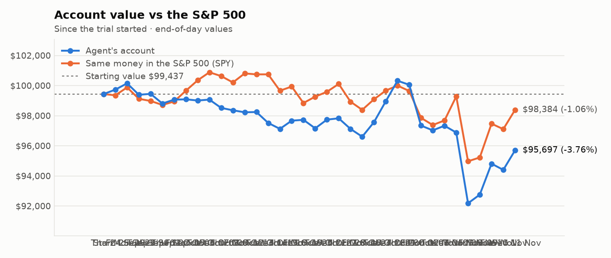
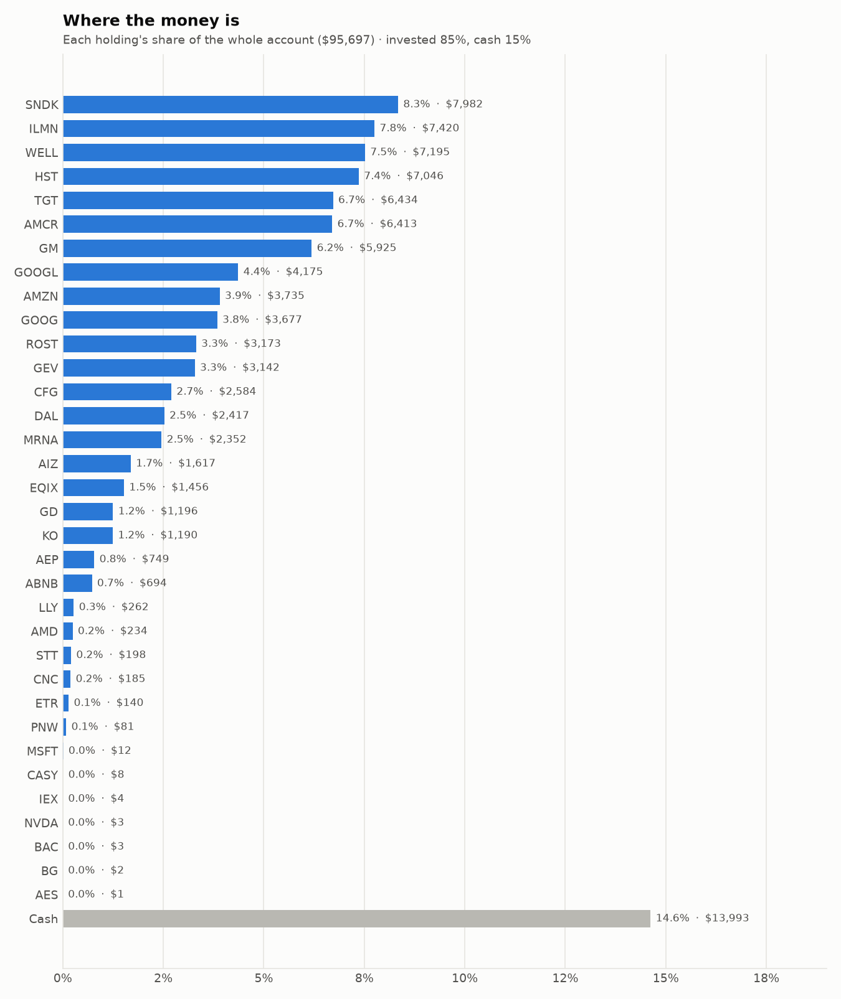
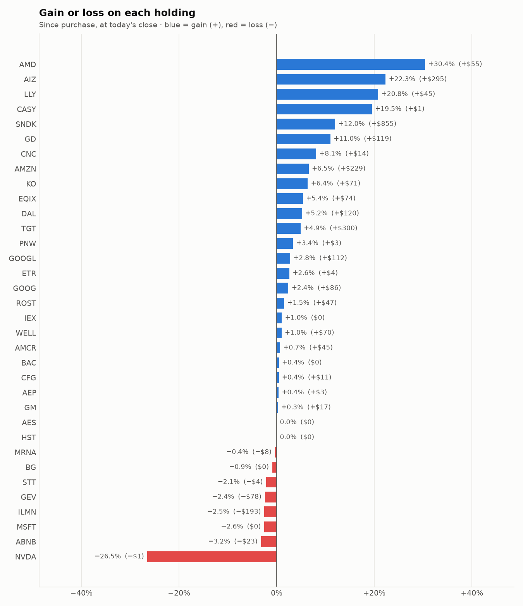

# 5-day trading report — 05 Nov to 11 Nov 2026
_Trading days 31–35 of the trial._

## Performance

- **Account value:** $96,878 → $95,697 (-1.2%)
- **S&P 500 (SPY) over the same days:** -0.9%
- **Agent vs S&P 500:** -0.32% (behind)

| Day | Account value | Day change | SPY | Buys | Sells |
|---|---|---|---|---|---|
| Thu 05 Nov | $92,180 | -4.8% | -4.3% | 6 | 9 |
| Fri 06 Nov | $92,754 | +0.6% | +0.3% | 0 | 0 |
| Mon 09 Nov | $94,811 | +2.2% | +2.4% | 3 | 3 |
| Tue 10 Nov | $94,400 | -0.4% | -0.4% | 4 | 6 |
| Wed 11 Nov | $95,697 | +1.4% | +1.3% | 7 | 5 |

## Risk scorecard (trial to date)

- **Return:** agent -3.76% vs S&P 500 -1.06% over 35 trading day(s)
- **Largest fall from a peak (max drawdown):** -8.11% — the worst the account has been below its own high
- **Volatility:** 18.8% a year — how much the account value swings day to day
- **Sharpe ratio:** -1.38 — return per unit of risk, yearly rate (above 1 is good, below 0 is losing)
- **Beta:** 0.91 — the account moves about in line with the S&P 500 (1.00 = exactly with it)
- **Alpha:** -2.80% — return lost beyond what the market's own move explains, given the beta above

## Charts

## What the research favoured

- **Main reason behind buys:** Momentum (14), Research (4), Value (2)
- **Sectors bought:** Consumer Discretionary (4), Information Technology (3), Health Care (3), Consumer Staples (2), Communication Services (2), Industrials (2), Real Estate (2), Materials (1), Financials (1)
- **Average analyst consensus (-2..+2):** buys +0.94, sells +0.89
- **Average news tone:** buys +16.6, sells +5.4
- **Average combined research score:** buys +0.97, sells +0.74

## Sessions

- **2026-11-05 Morning rebalance:** traded — 11 order(s) placed
- **2026-11-05 Afternoon risk check:** traded — Sold 4 position(s) on the risk check (stop-loss: BE, FIX, MU, WDC)
- **2026-11-06 Morning rebalance:** HALTED — Safety check stopped the session: drawdown_halt: drawdown -8.6% exceeds halt threshold
- **2026-11-06 Afternoon risk check:** HALTED — Safety check stopped the session: drawdown_halt: drawdown -8.6% exceeds halt threshold
- **2026-11-09 Morning rebalance:** traded — 5 order(s) placed
- **2026-11-09 Afternoon risk check:** traded — Sold 1 position(s) on the risk check
- **2026-11-10 Morning rebalance:** traded — 10 order(s) placed
- **2026-11-10 Afternoon risk check:** no trades needed — Risk-checked 34 holding(s): none was 12%+ below its purchase price, and none had both clearly negative news and a price drop of 3%+ since entry.
- **2026-11-11 Morning rebalance:** traded — 12 order(s) placed
- **2026-11-11 Afternoon risk check:** no trades needed — Risk-checked 34 holding(s): none was 12%+ below its purchase price, and none had both clearly negative news and a price drop of 3%+ since entry.

# Key decisions and the research behind them

## Why I bought

### SNDK — bought 10.565 shares at ~$877.18 ($9,267)

**Why:** combined score +1.88; ranked #1 of 503; driven mainly by price momentum +3.00, research (news + analyst consensus) +1.92; entering/adding to the top-ranked target portfolio; research detail: 13 recent headline(s), net positive tone (+12); analyst consensus +1.20/2 (12 strong buy, 18 buy, 5 hold, 0 sell, 0 strong sell)

**Research scores** (combined +1.88, ranked #1 in the S&P 500, sector: Information Technology):

| Factor | Score | Measures |
|---|---|---|
| Value | +1.26 | cheap vs. sector peers on P/E and P/B |
| Quality | +1.10 | profitability (ROE, margins) and balance-sheet strength |
| Momentum | +3.00 | 12-month price trend, excluding the last month |
| Low volatility | -1.37 | steadier price than sector peers |
| Research | +1.92 | recent news tone + analyst consensus |

**Company financials (Finnhub, trailing 12 months):** P/E 6.1, P/B 13.8, return on equity 134.3%, gross margin 80.0%, debt/equity 0.00

**Price trend (Alpaca):** 12-month return (excl. last month) +1231.2%, last month -48.1%, volatility 90.5%/yr

**News (Finnhub): 13 headline(s) in the last 2 days, net tone +12.** Most influential:
- [Sandisk: This Is Not Over (Rating Upgrade)](https://finnhub.io/api/news?id=aed3f95630e83ed67502bef87a401e474c6b8023147957f41313c07226d8a1a0) — 09 Nov, SeekingAlpha (tone +3)
- [Sandisk: Generational Buying Opportunity - Bullish AI Tailwinds Through 2030](https://finnhub.io/api/news?id=9a4d068974fac512b1c9b57f3b8e927182691a1feea4a5c60b03d5a5a06c5ad9) — 07 Nov, SeekingAlpha (tone +3)
- [Sandisk Shares Are Oversold: Bargain or Value Trap?](https://finnhub.io/api/news?id=d47b15e5bfe65d7edb06886c162c5ea99bf0687d3e70a585c40e17d717c84897) — 07 Nov, Yahoo (tone +2)
- [Zacks Value Investor Highlights: MU, SNDK, SANM, STRL and FIX](https://finnhub.io/api/news?id=f6a005f98c65c87b27ae29e256541be5d44a838d4d095967c85b951ba727e561) — 09 Nov, Yahoo (tone +1)
- [Dow Jones Futures Loom With Market Damaged, Big Winners Broken; Apple, Amazon, Microsoft Strong](https://finnhub.io/api/news?id=1975ae0423862c182127b64aac2632039a64f7506c285b0d590ba5393378ea97) — 08 Nov, Yahoo (tone +1)

**Analysts (Finnhub, 2026-11-01):** 12 strong buy, 18 buy, 5 hold, 0 sell, 0 strong sell — consensus +1.20 on a -2 (strong sell) to +2 (strong buy) scale.

### GEV — bought 11.165 shares at ~$829.15 ($9,257)

**Why:** combined score +1.02; ranked #4 of 503; driven mainly by research (news + analyst consensus) +1.94, price momentum +1.64; entering/adding to the top-ranked target portfolio; research detail: 9 recent headline(s), net positive tone (+5); analyst consensus +1.07/2 (11 strong buy, 24 buy, 6 hold, 1 sell, 0 strong sell)

**Research scores** (combined +1.02, ranked #4 in the S&P 500, sector: Industrials):

| Factor | Score | Measures |
|---|---|---|
| Value | -0.12 | cheap vs. sector peers on P/E and P/B |
| Quality | +0.35 | profitability (ROE, margins) and balance-sheet strength |
| Momentum | +1.64 | 12-month price trend, excluding the last month |
| Low volatility | -1.36 | steadier price than sector peers |
| Research | +1.94 | recent news tone + analyst consensus |

**Company financials (Finnhub, trailing 12 months):** P/E 19.8, P/B 22.2, return on equity 85.6%, gross margin 21.8%, debt/equity 0.25

**Price trend (Alpaca):** 12-month return (excl. last month) +64.7%, last month -22.5%, volatility 54.8%/yr

**News (Finnhub): 9 headline(s) in the last 2 days, net tone +5.** Most influential:
- [Is GE Vernova (GEV) Trading At A Premium After Its $9b Deal?](https://finnhub.io/api/news?id=046efac791fef0677e0927fa0062a4966e919065508b7b3fc03756d651613e02) — 07 Nov, Yahoo (tone +2)
- [GE Vernova Lands Wind Turbine Order With 20-Year Service Deal](https://finnhub.io/api/news?id=34337646eb90e2fc3b21a6a5c4f9b8899abdfb4e5d9e21fa007c5b4746bd09dc) — 09 Nov, Yahoo (tone +1)
- [GE Vernova Continues Wind Energy Expansion in Germany With New Order From Stadtwerke Heidenheim AG](https://finnhub.io/api/news?id=770f5d5a5f2d25072958aab1a45055287c99dc92d6e6ee57134d71d7128eeab7) — 09 Nov, Yahoo (tone +1)
- [GE Vernova vs. Vistra: Which Industrials Stock Is a Better Buy for 2027?](https://finnhub.io/api/news?id=ccaead5d18f446532891dbf2345e2e8c603a0181c389aad86be78fc90b977966) — 06 Nov, Yahoo (tone +1)
- [GE Vernova Secures New German Wind Turbine Order — Adds 20-Year Service Agreement](https://finnhub.io/api/news?id=ba5aa2766c078a8e0d2451674c3ee908ea6ffcce326c5684508b8a1e804188e9) — 09 Nov, Yahoo (tone +0)

**Analysts (Finnhub, 2026-11-01):** 11 strong buy, 24 buy, 6 hold, 1 sell, 0 strong sell — consensus +1.07 on a -2 (strong sell) to +2 (strong buy) scale.

### WELL — bought 24.394 shares at ~$245.43 ($5,987)

**Why:** combined score +1.00; ranked #8 of 503; driven mainly by research (news + analyst consensus) +2.07, price momentum +1.93; entering/adding to the top-ranked target portfolio; research detail: 4 recent headline(s), net positive tone (+6); analyst consensus +1.11/2 (6 strong buy, 19 buy, 3 hold, 0 sell, 0 strong sell)

**Research scores** (combined +1.00, ranked #8 in the S&P 500, sector: Real Estate):

| Factor | Score | Measures |
|---|---|---|
| Value | -0.73 | cheap vs. sector peers on P/E and P/B |
| Quality | -0.31 | profitability (ROE, margins) and balance-sheet strength |
| Momentum | +1.93 | 12-month price trend, excluding the last month |
| Low volatility | -0.08 | steadier price than sector peers |
| Research | +2.07 | recent news tone + analyst consensus |

**Company financials (Finnhub, trailing 12 months):** P/E 107.9, P/B 3.4, return on equity 3.7%, gross margin 40.0%, debt/equity 0.40

**Price trend (Alpaca):** 12-month return (excl. last month) +37.7%, last month +7.6%, volatility 21.3%/yr

**News (Finnhub): 4 headline(s) in the last 2 days, net tone +6.** Most influential:
- [RBC Capital Maintains Outperform on Welltower, Raises Price Target to $266](https://finnhub.io/api/news?id=794ed73bf0f965f5081f8cd7c4e66efec0864b7e61f9674e972e4795aa34cc85) — 10 Nov, Benzinga (tone +2)
- [Welltower (NYSE:WELL): High Growth Momentum Meets a Breakout Setup](https://finnhub.io/api/news?id=ab5f93bee69b8aef62ba85895c58302aa34ee889da4387f642a847902b36788b) — 09 Nov, ChartMill (tone +2)
- [Welltower's Senior Housing Portfolio Should Help Deliver FFO Growth in 2027, 2028, RBC Says](https://finnhub.io/api/news?id=00067a18d1817c3fd454bfb92613c08d8efebc4c6438aa4bf2667c364cacd259) — 10 Nov, Yahoo (tone +1)
- [JP Morgan Maintains Overweight on Welltower, Raises Price Target to $273](https://finnhub.io/api/news?id=31b5cfc8997c350dbfb30c90b2a4ce2523fd580d91f75567d3a91cd2338903cc) — 10 Nov, Benzinga (tone +1)

**Analysts (Finnhub, 2026-11-01):** 6 strong buy, 19 buy, 3 hold, 0 sell, 0 strong sell — consensus +1.11 on a -2 (strong sell) to +2 (strong buy) scale.

### ADM — bought 76.628 shares at ~$71.39 ($5,470)

**Why:** combined score +0.87; ranked #8 of 503; driven mainly by price momentum +1.47, value (cheapness) +1.01; entering/adding to the top-ranked target portfolio; research detail: 23 recent headline(s), net positive tone (+22); analyst consensus +0.33/2 (1 strong buy, 4 buy, 9 hold, 1 sell, 0 strong sell)

**Research scores** (combined +0.87, ranked #8 in the S&P 500, sector: Consumer Staples):

| Factor | Score | Measures |
|---|---|---|
| Value | +1.01 | cheap vs. sector peers on P/E and P/B |
| Quality | -0.50 | profitability (ROE, margins) and balance-sheet strength |
| Momentum | +1.47 | 12-month price trend, excluding the last month |
| Low volatility | +0.30 | steadier price than sector peers |
| Research | +0.85 | recent news tone + analyst consensus |

**Company financials (Finnhub, trailing 12 months):** P/E 19.1, P/B 1.6, return on equity 7.7%, gross margin 6.9%, debt/equity 0.34

**Price trend (Alpaca):** 12-month return (excl. last month) +34.7%, last month -13.8%, volatility 28.6%/yr

**News (Finnhub): 23 headline(s) in the last 2 days, net tone +22.** Most influential:
- [ADM Raises 2026 Earnings Outlook as Q3 Profit Beats Forecasts Despite Revenue Miss](https://finnhub.io/api/news?id=d2c2b8b5a288cb448d6c00198c0e9d36c1e6dc9a8506b6dc53c8135b9a748652) — 03 Nov, Yahoo (tone +4)
- [ADM CEO Sees No Biofuel Margin Collapse, Expects Strength Into 2027](https://finnhub.io/api/news?id=424eb6c68843f3c1d1a3f4de8c0430e501673bf73ad85e3d5c3224b10cbf5fda) — 03 Nov, Benzinga (tone +3)
- [ADM Q3 Earnings Call Highlights Biofuels Strength and 2027 Outlook](https://finnhub.io/api/news?id=932ca30ee3152671d1130f6906709e9ff218ba0c895fcf7b372cb9d2aa49b8b5) — 04 Nov, Yahoo (tone +2)
- [Is Archer-Daniels-Midland (ADM) Undervalued Following Strong Q3 Earnings And Higher Guidance?](https://finnhub.io/api/news?id=689b05a7a24f8bde6b341312e92a83c7fa2c91e38e5c4bbfefd15ac5997022a2) — 04 Nov, Yahoo (tone +2)
- [Archer-Daniels-Midland Co (ADM) (Q3 2026) Earnings Call Highlights: Third EPS Guidance Raise ...](https://finnhub.io/api/news?id=768250a8c1634849bd984cd9a28f0a3306356db13a94fd1f1612fbd52fd66889) — 03 Nov, Yahoo (tone +2)

**Analysts (Finnhub, 2026-11-01):** 1 strong buy, 4 buy, 9 hold, 1 sell, 0 strong sell — consensus +0.33 on a -2 (strong sell) to +2 (strong buy) scale.

### AMD — bought 12.749 shares at ~$423.91 ($5,404)

**Why:** combined score +0.87; ranked #9 of 503; driven mainly by research (news + analyst consensus) +1.81, price momentum +1.57; entering/adding to the top-ranked target portfolio; research detail: 163 recent headline(s), net positive tone (+117); analyst consensus +1.12/2 (17 strong buy, 33 buy, 10 hold, 0 sell, 0 strong sell)

**Research scores** (combined +0.87, ranked #9 in the S&P 500, sector: Information Technology):

| Factor | Score | Measures |
|---|---|---|
| Value | -0.56 | cheap vs. sector peers on P/E and P/B |
| Quality | +0.06 | profitability (ROE, margins) and balance-sheet strength |
| Momentum | +1.57 | 12-month price trend, excluding the last month |
| Low volatility | -0.60 | steadier price than sector peers |
| Research | +1.81 | recent news tone + analyst consensus |

**Company financials (FMP, trailing 12 months):** P/E 92.6, P/B 10.3, return on equity 11.6%, gross margin 53.7%, debt/equity 0.13

**Price trend (Alpaca):** 12-month return (excl. last month) +294.5%, last month -24.8%, volatility 60.2%/yr

**News (Finnhub): 163 headline(s) in the last 2 days, net tone +117.** Most influential:
- [AMD Q3 Earnings Beat Estimates, Strong Data Center Aids Revenue Growth](https://finnhub.io/api/news?id=1a76559762b766f0cef60ab51211c85e318e863490833864434f83a7bc71e1a0) — 04 Nov, Yahoo (tone +4)
- [AMD: Expensive For A Reason](https://finnhub.io/api/news?id=ee87c106780cd533bb3ed40c5de18a5bf9b5b27d872c128f7ca8aa74aadda475) — 03 Nov, SeekingAlpha (tone +4)
- [Constellation Research CEO R ‘Ray’ Wang Talks Data Center Growth After AMD Reports Earnings](https://finnhub.io/api/news?id=8f8ed96ac3d3325e723fe3707c067e1cedaeed27fa49864e15f1f12b95b9bab1) — 04 Nov, Yahoo (tone +3)
- [AMD Shares Surge Nearly 8% as Q3 Earnings Beat Forecasts and Revenue Outlook Exceeds Expectations](https://finnhub.io/api/news?id=fb2c7d152fa5e3eff8b22620014db217b5a853c3ab5a1a4f486cdd704b622bf4) — 04 Nov, Yahoo (tone +3)
- [These Analysts Revise Their Forecasts On AMD After Q3 Results](https://finnhub.io/api/news?id=1f5f1c6d0e1965452e9511703b0ad67612ce6a4d6b27bfd6e4a164d0650d3a85) — 04 Nov, Benzinga (tone +3)

**Analysts (Finnhub, 2026-11-01):** 17 strong buy, 33 buy, 10 hold, 0 sell, 0 strong sell — consensus +1.12 on a -2 (strong sell) to +2 (strong buy) scale.

### ILMN — bought 21.198 shares at ~$219.70 ($4,657)

**Why:** combined score +0.88; ranked #10 of 503; driven mainly by price momentum +2.61, low volatility -1.89; entering/adding to the top-ranked target portfolio; research detail: 9 recent headline(s), net positive tone (+7); analyst consensus +0.61/2 (6 strong buy, 9 buy, 10 hold, 2 sell, 1 strong sell)

**Research scores** (combined +0.88, ranked #10 in the S&P 500, sector: Health Care):

| Factor | Score | Measures |
|---|---|---|
| Value | -0.77 | cheap vs. sector peers on P/E and P/B |
| Quality | +0.41 | profitability (ROE, margins) and balance-sheet strength |
| Momentum | +2.61 | 12-month price trend, excluding the last month |
| Low volatility | -1.89 | steadier price than sector peers |
| Research | +0.62 | recent news tone + analyst consensus |

**Company financials (Finnhub, trailing 12 months):** P/E 36.9, P/B 13.1, return on equity 31.4%, gross margin 67.9%, debt/equity 0.57

**Price trend (Alpaca):** 12-month return (excl. last month) +184.4%, last month -20.6%, volatility 69.7%/yr

**News (Finnhub): 9 headline(s) in the last 2 days, net tone +7.** Most influential:
- [Structural Biology and Molecular Modeling Techniques - Global Strategic Business Report 2026: Capitalize on the $18 Billion 2032 Market with Agilent, Bruker Daltonics, Dassault Systemes, and Illumina](https://finnhub.io/api/news?id=d7aaeb881014b8c196cba9c9ce4485e90e12ca0c17090acd06fe3f99187b8388) — 09 Nov, Yahoo (tone +1)
- [Global Genome Annotation Services Market Report 2026: Trends and Forecast to 2030 / Capitalize on AI and Precision Medicine with Roche, Thermo Fisher, Illumina, QIAGEN](https://finnhub.io/api/news?id=ba74337af57be0df82364244b0c708010ec510ef34318a81f0186e25b873b1c6) — 09 Nov, Yahoo (tone +1)
- [Global Clinical Genomics Software Market Report 2026 / Capitalize on 14.8% CAGR Through 2030 as Google, Microsoft, NVIDIA and Illumina Scale AI, Cloud and Precision Medicine](https://finnhub.io/api/news?id=fd0bda3f09edf4bb377ab13068ed41b551438e1a76b91a38a178b7c0fb42103e) — 09 Nov, Yahoo (tone +1)
- [Genomic Variant Prioritization Artificial Intelligence (AI) Global Market Report 2026 / Capitalize on 26.5% CAGR with Illumina, QIAGEN, Thermo Fisher Scientific and Tempus AI](https://finnhub.io/api/news?id=1c5fad7a31e9744a68c91c3273ce9948c3cee7a2706c84d122f71e2fae7dcab5) — 09 Nov, Yahoo (tone +1)
- [Illumina advances MRD research portfolio with ultrasensitive duplex sequencing technology](https://finnhub.io/api/news?id=3420c8518ead636eefca3a26ca2424057b0efc8cbc7e776c60d856bdce2dee64) — 09 Nov, Yahoo (tone +1)

**Analysts (Finnhub, 2026-11-01):** 6 strong buy, 9 buy, 10 hold, 2 sell, 1 strong sell — consensus +0.61 on a -2 (strong sell) to +2 (strong buy) scale.

### GM — bought 40.659 shares at ~$88.28 ($3,589)

**Why:** combined score +0.93; ranked #9 of 503; driven mainly by price momentum +1.82, research (news + analyst consensus) +0.88; entering/adding to the top-ranked target portfolio; research detail: 7 recent headline(s), net positive tone (+5); analyst consensus +1.14/2 (11 strong buy, 18 buy, 6 hold, 0 sell, 0 strong sell)

**Research scores** (combined +0.93, ranked #9 in the S&P 500, sector: Consumer Discretionary):

| Factor | Score | Measures |
|---|---|---|
| Value | +0.88 | cheap vs. sector peers on P/E and P/B |
| Quality | -0.63 | profitability (ROE, margins) and balance-sheet strength |
| Momentum | +1.82 | 12-month price trend, excluding the last month |
| Low volatility | -0.18 | steadier price than sector peers |
| Research | +0.88 | recent news tone + analyst consensus |

**Company financials (FMP, trailing 12 months):** P/E 20.0, P/B 1.2, return on equity 6.3%, gross margin 9.0%, debt/equity 2.05

**Price trend (Alpaca):** 12-month return (excl. last month) +47.3%, last month +7.7%, volatility 38.6%/yr

**News (Finnhub): 7 headline(s) in the last 2 days, net tone +5.** Most influential:
- [Can GM's Next-Generation Pickups Support Growth in 2027?](https://finnhub.io/api/news?id=92ee929002f6b2c35bd187b5c03cc08fc6fa854737728fe7e4d3aca061e9f6a3) — 09 Nov, Yahoo (tone +2)
- [S&P revises GM outlook to positive on widening margins and cash flow](https://finnhub.io/api/news?id=b48884f651d1ee63806c4802382009c4eac8acef154fa334192571666c762cb3) — 10 Nov, Yahoo (tone +1)
- [MP Q3 Earnings Call Highlights Measured Magnet Ramp-Up and 10X Demand](https://finnhub.io/api/news?id=13fb21797b30fb9b9ec290e0fec01eb8e682452a58974151a37cc33d1f1e3c3b) — 09 Nov, Yahoo (tone +1)
- [Can OnStar and Super Cruise Drive GM's Digital Revenue Growth?](https://finnhub.io/api/news?id=49fee895784f9f012eaf3c5bb69316b1e0a273b861e6036eebfe8da93cfd0556) — 09 Nov, Yahoo (tone +1)
- [Is Trending Stock General Motors Company (GM) a Buy Now?](https://finnhub.io/api/news?id=0ad2de984c0d955eb65d15f650401016c5ee31a901a9b05fbb8aae82f4da1723) — 10 Nov, Yahoo (tone +0)

**Analysts (Finnhub, 2026-11-01):** 11 strong buy, 18 buy, 6 hold, 0 sell, 0 strong sell — consensus +1.14 on a -2 (strong sell) to +2 (strong buy) scale.

### ABNB — bought 18.467 shares at ~$187.16 ($3,456)

**Why:** combined score +0.80; ranked #12 of 503; driven mainly by research (news + analyst consensus) +1.59, price momentum +1.58; entering/adding to the top-ranked target portfolio; research detail: 13 recent headline(s), net positive tone (+13); analyst consensus +0.82/2 (10 strong buy, 22 buy, 17 hold, 1 sell, 0 strong sell)

**Research scores** (combined +0.80, ranked #12 in the S&P 500, sector: Consumer Discretionary):

| Factor | Score | Measures |
|---|---|---|
| Value | -0.87 | cheap vs. sector peers on P/E and P/B |
| Quality | +0.49 | profitability (ROE, margins) and balance-sheet strength |
| Momentum | +1.58 | 12-month price trend, excluding the last month |
| Low volatility | -0.94 | steadier price than sector peers |
| Research | +1.59 | recent news tone + analyst consensus |

**Company financials (Finnhub, trailing 12 months):** P/E 41.8, P/B 10.9, return on equity 33.4%, gross margin 72.4%, debt/equity 0.32

**Price trend (Alpaca):** 12-month return (excl. last month) +38.3%, last month +14.8%, volatility 43.1%/yr

**News (Finnhub): 13 headline(s) in the last 2 days, net tone +13.** Most influential:
- [ABNB Q3 2026 deep dive: AI-driven product expansion accelerates growth and margin gains](https://finnhub.io/api/news?id=4075caffe34dfed829ba92822752c921b9b2b2ae884538b1e93d4b81c48def87) — 08 Nov, Yahoo (tone +4)
- [Why Did U, MRNA, ABNB Stocks Surge To 52-Week Highs Today?](https://finnhub.io/api/news?id=46f3c173fcf288b45eae4199bf11a3f0325c8bfcb89af3f5db04c8c015221f2c) — 09 Nov, Yahoo (tone +2)
- [This AMD Analyst Turns Bullish; Here Are Top 5 Upgrades For Monday](https://finnhub.io/api/news?id=4062594a2fff6ac4c399c3f0729db98986158f5f80264d12fd47a39ee6b04f0c) — 09 Nov, Benzinga (tone +2)
- [Mizuho Says This Top Pick Can Leverage AI to Expand its Dominance](https://finnhub.io/api/news?id=92f56b2c5aa9c5184c40028324fbd76911bf0da9a9a798453df0a1e72b3efc23) — 09 Nov, Yahoo (tone +1)
- [Jefferies Maintains Buy on Airbnb, Raises Price Target to $230](https://finnhub.io/api/news?id=e9c2585044f53887c488eb842b9f4c8ff261a2c16601c23d44ba3a7a80d30b0d) — 09 Nov, Benzinga (tone +1)

**Analysts (Finnhub, 2026-11-01):** 10 strong buy, 22 buy, 17 hold, 1 sell, 0 strong sell — consensus +0.82 on a -2 (strong sell) to +2 (strong buy) scale.

### DAL — bought 35.309 shares at ~$91.40 ($3,227)

**Why:** combined score +0.89; ranked #9 of 503; driven mainly by value (cheapness) +1.89, price momentum +1.06; entering/adding to the top-ranked target portfolio; research detail: 4 recent headline(s), net positive tone (+2); analyst consensus +1.13/2 (7 strong buy, 20 buy, 3 hold, 0 sell, 0 strong sell)

**Research scores** (combined +0.89, ranked #9 in the S&P 500, sector: Industrials):

| Factor | Score | Measures |
|---|---|---|
| Value | +1.89 | cheap vs. sector peers on P/E and P/B |
| Quality | +0.13 | profitability (ROE, margins) and balance-sheet strength |
| Momentum | +1.06 | 12-month price trend, excluding the last month |
| Low volatility | -0.46 | steadier price than sector peers |
| Research | +0.59 | recent news tone + analyst consensus |

**Company financials (Finnhub, trailing 12 months):** P/E 17.4, P/B 2.4, return on equity 15.4%, gross margin 45.9%, debt/equity 0.57

**Price trend (Alpaca):** 12-month return (excl. last month) +43.8%, last month +11.7%, volatility 36.7%/yr

**News (Finnhub): 4 headline(s) in the last 2 days, net tone +2.** Most influential:
- [Delta Air Lines (DAL) Stock May Be Undervalued After Falling Oil Prices](https://finnhub.io/api/news?id=d1397ed08cfdd7aa9a2d2f115211acad81040b97dcf68b863e1064aabb47f98d) — 09 Nov, Yahoo (tone +2)
- [Delta Air Lines Stocks Rise 4.68% as Oil Retreats Toward $87](https://finnhub.io/api/news?id=f68706e944ee51b95ea21cc0e5c1d780179cd57b69cb5fd943413de9325ef846) — 09 Nov, Yahoo (tone +0)
- [Why Is Delta Air Lines Stock Surging on Monday?](https://finnhub.io/api/news?id=4742640bc9a3c021a95ffcee7eda1863023f6a07b65d087292edb18f92c1d889) — 09 Nov, Benzinga (tone +0)
- [$1000 Invested In Delta Air Lines 5 Years Ago Would Be Worth This Much Today](https://finnhub.io/api/news?id=e3e652cf38da7cac757066f4b9781a7a18199796cb0b0463ba38fdeed6e55cf7) — 09 Nov, Benzinga (tone +0)

**Analysts (Finnhub, 2026-11-01):** 7 strong buy, 20 buy, 3 hold, 0 sell, 0 strong sell — consensus +1.13 on a -2 (strong sell) to +2 (strong buy) scale.

### GOOGL — bought 10.376 shares at ~$285.34 ($2,961)

**Why:** combined score +0.81; ranked #14 of 503; driven mainly by price momentum +1.67, research (news + analyst consensus) +1.36; entering/adding to the top-ranked target portfolio; research detail: 71 recent headline(s), net positive tone (+22); analyst consensus +1.19/2 (20 strong buy, 41 buy, 7 hold, 0 sell, 0 strong sell)

**Research scores** (combined +0.81, ranked #14 in the S&P 500, sector: Communication Services):

| Factor | Score | Measures |
|---|---|---|
| Value | -0.63 | cheap vs. sector peers on P/E and P/B |
| Quality | +0.09 | profitability (ROE, margins) and balance-sheet strength |
| Momentum | +1.67 | 12-month price trend, excluding the last month |
| Low volatility | +0.02 | steadier price than sector peers |
| Research | +1.36 | recent news tone + analyst consensus |

**Company financials (FMP, trailing 12 months):** P/E 14.8, P/B 5.2, return on equity 42.6%, gross margin 60.9%, debt/equity 0.21

**Price trend (Alpaca):** 12-month return (excl. last month) +41.7%, last month -16.9%, volatility 34.4%/yr

**News (Finnhub): 71 headline(s) in the last 2 days, net tone +22.** Most influential:
- [Zacks Earnings Trends Highlights: Nvidia, Micron and Alphabet](https://finnhub.io/api/news?id=aeb35773ee1f780102c295d93be35ca88096f02f5c9c0846c2a6727f33694c0f) — 05 Nov, Yahoo (tone +3)
- [Alphabet: Investors Are Making The Same Mistake They Did With Microsoft](https://finnhub.io/api/news?id=7f477922ce6519e3310ee63674016b06132eacb2488fab2aa699a2ee8fbf6449) — 05 Nov, SeekingAlpha (tone +2)
- [Alphabet: Cheapest Hyperscaler By A Margin](https://finnhub.io/api/news?id=997e6fa12cfbbb0893a7c3584b2626cc8407c7f24fd8d721fb79a9d8d9cfee8e) — 05 Nov, SeekingAlpha (tone +2)
- [Alphabet: Search Disruption Vs. The Rise Of Carbon](https://finnhub.io/api/news?id=b335a7867229acd254f9100bcca7fd75a62214c17d3ff83b9b88093c9daf0acf) — 05 Nov, SeekingAlpha (tone +2)
- [Alphabet Stock Jumps 5% as Midterm Election Rally Lifts Google Shares](https://finnhub.io/api/news?id=8f24e2e51ade9153e57fe62562186d0a851cf73e728d9e33bb6e70a68aba7d28) — 04 Nov, Yahoo (tone +2)

**Analysts (Finnhub, 2026-11-01):** 20 strong buy, 41 buy, 7 hold, 0 sell, 0 strong sell — consensus +1.19 on a -2 (strong sell) to +2 (strong buy) scale.

### ILMN — bought 13.473 shares at ~$219.38 ($2,956)

**Why:** combined score +1.02; ranked #6 of 503; driven mainly by price momentum +2.69, low volatility -1.90; entering/adding to the top-ranked target portfolio; research detail: 18 recent headline(s), net positive tone (+16); analyst consensus +0.61/2 (6 strong buy, 9 buy, 10 hold, 2 sell, 1 strong sell)

**Research scores** (combined +1.02, ranked #6 in the S&P 500, sector: Health Care):

| Factor | Score | Measures |
|---|---|---|
| Value | -0.76 | cheap vs. sector peers on P/E and P/B |
| Quality | +0.41 | profitability (ROE, margins) and balance-sheet strength |
| Momentum | +2.69 | 12-month price trend, excluding the last month |
| Low volatility | -1.90 | steadier price than sector peers |
| Research | +1.07 | recent news tone + analyst consensus |

**Company financials (Finnhub, trailing 12 months):** P/E 36.4, P/B 13.1, return on equity 31.4%, gross margin 67.9%, debt/equity 0.57

**Price trend (Alpaca):** 12-month return (excl. last month) +187.1%, last month -22.4%, volatility 70.0%/yr

**News (Finnhub): 18 headline(s) in the last 2 days, net tone +16.** Most influential:
- [How Investors May Respond To Illumina (ILMN) Earnings Beat](https://finnhub.io/api/news?id=80269d6559e7b3ada9cd402b201286451a22055fcb62fcb1762330bd6782d959) — 11 Nov, Yahoo (tone +3)
- [Illumina (ILMN) Unveils Duplex Sequencing Workflow For MRD Research](https://finnhub.io/api/news?id=35af3129d7888ec6bfd8b7eaa9728e5170ec3f77af0321cb1ffd8e3e03342262) — 11 Nov, Yahoo (tone +1)
- [Illumina Bets on Clinical Demand for Growth as Research Funding Uncertainty Persists](https://finnhub.io/api/news?id=69a295be13dba1d6f177c369b02c705291a04a0aaec4289ab6c85e9371af3946) — 10 Nov, Yahoo (tone +1)
- [Nucleic Acid Isolation and Purification - Global Strategic Business Report: Capture the $3.9 Billion Revenue Surge by 2030 as Thermo Fisher, Qiagen, Danaher, Illumina, and Bio-Rad Battle for Share](https://finnhub.io/api/news?id=782ff2cfdac9121fa8044b00b04728e2382986ec0c5e740fc996c8a0e39294f0) — 10 Nov, Yahoo (tone +1)
- [Gene Panels - Global Strategic Business Report 2026: Capitalize on 17.9% CAGR as Market Triples to $12.6B by 2032 - Track Key Players Illumina, Roche, QIAGEN, Thermo Fisher, Agilent and More](https://finnhub.io/api/news?id=1b1fa753189bb9863ac671c598aa2910f37c810d20245c432e1319afb9671b8f) — 10 Nov, Yahoo (tone +1)

**Analysts (Finnhub, 2026-11-01):** 6 strong buy, 9 buy, 10 hold, 2 sell, 1 strong sell — consensus +0.61 on a -2 (strong sell) to +2 (strong buy) scale.

### GOOG — bought 10.088 shares at ~$283.69 ($2,862)

**Why:** combined score +0.79; ranked #15 of 503; driven mainly by price momentum +1.62, research (news + analyst consensus) +1.36; entering/adding to the top-ranked target portfolio; research detail: 73 recent headline(s), net positive tone (+22); analyst consensus +1.19/2 (20 strong buy, 41 buy, 7 hold, 0 sell, 0 strong sell)

**Research scores** (combined +0.79, ranked #15 in the S&P 500, sector: Communication Services):

| Factor | Score | Measures |
|---|---|---|
| Value | -0.68 | cheap vs. sector peers on P/E and P/B |
| Quality | +0.09 | profitability (ROE, margins) and balance-sheet strength |
| Momentum | +1.62 | 12-month price trend, excluding the last month |
| Low volatility | +0.10 | steadier price than sector peers |
| Research | +1.36 | recent news tone + analyst consensus |

**Company financials (Finnhub, trailing 12 months):** P/E 15.2, P/B 6.2, return on equity 42.6%, gross margin 60.9%, debt/equity 0.18

**Price trend (Alpaca):** 12-month return (excl. last month) +39.9%, last month -16.6%, volatility 33.1%/yr

**News (Finnhub): 73 headline(s) in the last 2 days, net tone +22.** Most influential:
- [Zacks Earnings Trends Highlights: Nvidia, Micron and Alphabet](https://finnhub.io/api/news?id=aeb35773ee1f780102c295d93be35ca88096f02f5c9c0846c2a6727f33694c0f) — 05 Nov, Yahoo (tone +3)
- [Alphabet: Investors Are Making The Same Mistake They Did With Microsoft](https://finnhub.io/api/news?id=7f477922ce6519e3310ee63674016b06132eacb2488fab2aa699a2ee8fbf6449) — 05 Nov, SeekingAlpha (tone +2)
- [Alphabet: Cheapest Hyperscaler By A Margin](https://finnhub.io/api/news?id=997e6fa12cfbbb0893a7c3584b2626cc8407c7f24fd8d721fb79a9d8d9cfee8e) — 05 Nov, SeekingAlpha (tone +2)
- [Alphabet: Search Disruption Vs. The Rise Of Carbon](https://finnhub.io/api/news?id=b335a7867229acd254f9100bcca7fd75a62214c17d3ff83b9b88093c9daf0acf) — 05 Nov, SeekingAlpha (tone +2)
- [Alphabet Stock Jumps 5% as Midterm Election Rally Lifts Google Shares](https://finnhub.io/api/news?id=8f24e2e51ade9153e57fe62562186d0a851cf73e728d9e33bb6e70a68aba7d28) — 04 Nov, Yahoo (tone +2)

**Analysts (Finnhub, 2026-11-01):** 20 strong buy, 41 buy, 7 hold, 0 sell, 0 strong sell — consensus +1.19 on a -2 (strong sell) to +2 (strong buy) scale.

### ROST — bought 11.999 shares at ~$238.50 ($2,862)

**Why:** combined score +0.78; ranked #16 of 503; driven mainly by price momentum +1.88, research (news + analyst consensus) +0.95; entering/adding to the top-ranked target portfolio; research detail: 9 recent headline(s), net positive tone (+6); analyst consensus +1.07/2 (9 strong buy, 11 buy, 7 hold, 0 sell, 0 strong sell)

**Research scores** (combined +0.78, ranked #16 in the S&P 500, sector: Consumer Discretionary):

| Factor | Score | Measures |
|---|---|---|
| Value | -0.66 | cheap vs. sector peers on P/E and P/B |
| Quality | -0.09 | profitability (ROE, margins) and balance-sheet strength |
| Momentum | +1.88 | 12-month price trend, excluding the last month |
| Low volatility | +0.69 | steadier price than sector peers |
| Research | +0.95 | recent news tone + analyst consensus |

**Company financials (Finnhub, trailing 12 months):** P/E 28.4, P/B 12.0, return on equity 42.3%, gross margin 28.6%, debt/equity 0.15

**Price trend (Alpaca):** 12-month return (excl. last month) +50.6%, last month +5.8%, volatility 27.9%/yr

**News (Finnhub): 9 headline(s) in the last 2 days, net tone +6.** Most influential:
- [Ross Stores (ROST) Stock Could Be Overvalued On Its 119% Run](https://finnhub.io/api/news?id=0d75ebb1fb907faebdb9ff87a673def72e50d6ebeeadcd0eb360e827e807c3b0) — 10 Nov, Yahoo (tone +2)
- [Are Wall Street Analysts Bullish on Ross Stores Stock?](https://finnhub.io/api/news?id=ee5b0340eb3a819b841e2044614160a3157b91b663e7b2a55077b90067461aed) — 10 Nov, Yahoo (tone +2)
- [How Investors May Respond To Ross Stores Stock Ahead Of Earnings Growth Expectations](https://finnhub.io/api/news?id=2c305a0613daa8fa0bed237fe49f98cd7261693826dd8881dfa5c067b330ae7b) — 11 Nov, Yahoo (tone +1)
- [This MongoDB Analyst Begins Coverage On A Bullish Note; Here Are Top 5 Initiations For Tuesday](https://finnhub.io/api/news?id=cae6cddbeece383d86dce69b7e8f5a149e32429d608bd78642c46f935bb55898) — 10 Nov, Benzinga (tone +1)
- [Ross Stores (ROST), What Is Behind The Fresh Attention Now?](https://finnhub.io/api/news?id=d7da64ab3e109727787a22c37429ec5b6b5440dcb4deafe9917cda89fa0e9a1c) — 10 Nov, Yahoo (tone +0)

**Analysts (Finnhub, 2026-11-01):** 9 strong buy, 11 buy, 7 hold, 0 sell, 0 strong sell — consensus +1.07 on a -2 (strong sell) to +2 (strong buy) scale.

### MU — bought 4.036 shares at ~$694.73 ($2,804)

**Why:** combined score +1.47; ranked #1 of 503; driven mainly by price momentum +2.71, low volatility -1.05; entering/adding to the top-ranked target portfolio; research detail: 64 recent headline(s), net positive tone (+33); analyst consensus +1.25/2 (18 strong buy, 35 buy, 4 hold, 0 sell, 0 strong sell)

**Research scores** (combined +1.47, ranked #1 in the S&P 500, sector: Information Technology):

| Factor | Score | Measures |
|---|---|---|
| Value | +0.95 | cheap vs. sector peers on P/E and P/B |
| Quality | +0.90 | profitability (ROE, margins) and balance-sheet strength |
| Momentum | +2.71 | 12-month price trend, excluding the last month |
| Low volatility | -1.05 | steadier price than sector peers |
| Research | +0.99 | recent news tone + analyst consensus |

**Company financials (Finnhub, trailing 12 months):** P/E 10.8, P/B 7.8, return on equity 91.8%, gross margin 80.7%, debt/equity 0.04

**Price trend (Alpaca):** 12-month return (excl. last month) +456.4%, last month -24.0%, volatility 57.1%/yr

**News (Finnhub): 64 headline(s) in the last 2 days, net tone +33.** Most influential:
- [Zacks Earnings Trends Highlights: Nvidia, Micron and Alphabet](https://finnhub.io/api/news?id=aeb35773ee1f780102c295d93be35ca88096f02f5c9c0846c2a6727f33694c0f) — 05 Nov, Yahoo (tone +3)
- [Bloom Energy (BE) Raises Full-Year Outlook Following 166% Revenue Surge](https://finnhub.io/api/news?id=25c3bdb40ede9007fdd269c5ba242cee3c1879325eb926871f0ed504e19b4a61) — 04 Nov, Yahoo (tone +3)
- [Micron Stock Jumps 36% in Six Months: Is There More Upside Ahead?](https://finnhub.io/api/news?id=1afb12c63ecb26d6672edd31db65b814fac3af22adaa685f63362ffdbc84fca1) — 04 Nov, Yahoo (tone +3)
- [Micron Just Closed Below $800 for the First Time Since July](https://finnhub.io/api/news?id=bcb67c8d45444d986579657c7844fdf3dda04fc64ac643a7de530472ac6c0fd6) — 05 Nov, Yahoo (tone +2)
- [Micron Stock Looks Cheap Despite 220% Rally. Is More Upside Coming?](https://finnhub.io/api/news?id=355222fca9e787f5959b64de1f252f8a98f4ded58dbebf9b9ff48f5091cf0bc3) — 05 Nov, Yahoo (tone +2)

**Analysts (Finnhub, 2026-11-01):** 18 strong buy, 35 buy, 4 hold, 0 sell, 0 strong sell — consensus +1.25 on a -2 (strong sell) to +2 (strong buy) scale.

### MRNA — bought 9.435 shares at ~$249.60 ($2,355)

**Why:** combined score +0.74; ranked #21 of 503; driven mainly by price momentum +3.00, low volatility -2.77; entering/adding to the top-ranked target portfolio; research detail: 23 recent headline(s), net positive tone (+22); analyst consensus +0.26/2 (3 strong buy, 7 buy, 17 hold, 3 sell, 1 strong sell)

**Research scores** (combined +0.74, ranked #21 in the S&P 500, sector: Health Care):

| Factor | Score | Measures |
|---|---|---|
| Value | -1.05 | cheap vs. sector peers on P/E and P/B |
| Quality | -0.50 | profitability (ROE, margins) and balance-sheet strength |
| Momentum | +3.00 | 12-month price trend, excluding the last month |
| Low volatility | -2.77 | steadier price than sector peers |
| Research | +0.46 | recent news tone + analyst consensus |

**Company financials (FMP, trailing 12 months):** P/E -35.4, P/B 14.7, return on equity -37.6%, gross margin 28.0%, debt/equity 0.61

**Price trend (Alpaca):** 12-month return (excl. last month) +675.2%, last month +17.4%, volatility 376.3%/yr

**News (Finnhub): 23 headline(s) in the last 2 days, net tone +22.** Most influential:
- [Moderna Q3 Earnings Call Highlights Raised Outlook and Oncology](https://finnhub.io/api/news?id=51670f9c7c24c76d7fbaad2d555e49d0b8f77c474c05c905738ec169e32e2f53) — 09 Nov, Yahoo (tone +4)
- [Why is Moderna (MRNA) stock soaring today](https://finnhub.io/api/news?id=8888f94ed4007fdd842914feecdeca61893c4f7f92ad95e352276f0243a476b7) — 10 Nov, Yahoo (tone +2)
- [Why Did U, MRNA, ABNB Stocks Surge To 52-Week Highs Today?](https://finnhub.io/api/news?id=46f3c173fcf288b45eae4199bf11a3f0325c8bfcb89af3f5db04c8c015221f2c) — 09 Nov, Yahoo (tone +2)
- [Moderna Soars Another 9% as Piper Sandler Lifts Target to $305 on Raised Outlook](https://finnhub.io/api/news?id=053f4ce6a3696c43cf5b9d453b8fb4b1d2daba7aeebb489692cebaee54446f6a) — 09 Nov, Yahoo (tone +2)
- [Zacks Investment Ideas feature highlights: Moderna, AbbVie, Eli Lilly and Merck](https://finnhub.io/api/news?id=28919c93456b4edb347083c386db997daac2af200980c527d98eb84323420a41) — 09 Nov, Yahoo (tone +2)

**Analysts (Finnhub, 2026-11-01):** 3 strong buy, 7 buy, 17 hold, 3 sell, 1 strong sell — consensus +0.26 on a -2 (strong sell) to +2 (strong buy) scale.

### GM — bought 25.97 shares at ~$89.21 ($2,317)

**Why:** combined score +0.90; ranked #7 of 503; driven mainly by price momentum +1.78, value (cheapness) +0.89; entering/adding to the top-ranked target portfolio; research detail: 8 recent headline(s), net positive tone (+3); analyst consensus +1.14/2 (11 strong buy, 18 buy, 6 hold, 0 sell, 0 strong sell)

**Research scores** (combined +0.90, ranked #7 in the S&P 500, sector: Consumer Discretionary):

| Factor | Score | Measures |
|---|---|---|
| Value | +0.89 | cheap vs. sector peers on P/E and P/B |
| Quality | -0.67 | profitability (ROE, margins) and balance-sheet strength |
| Momentum | +1.78 | 12-month price trend, excluding the last month |
| Low volatility | -0.14 | steadier price than sector peers |
| Research | +0.84 | recent news tone + analyst consensus |

**Company financials (FMP, trailing 12 months):** P/E 20.2, P/B 1.2, return on equity 6.3%, gross margin 9.0%, debt/equity 2.05

**Price trend (Alpaca):** 12-month return (excl. last month) +43.6%, last month +4.8%, volatility 38.1%/yr

**News (Finnhub): 8 headline(s) in the last 2 days, net tone +3.** Most influential:
- [Can GM's Next-Generation Pickups Support Growth in 2027?](https://finnhub.io/api/news?id=92ee929002f6b2c35bd187b5c03cc08fc6fa854737728fe7e4d3aca061e9f6a3) — 09 Nov, Yahoo (tone +2)
- [Can OnStar and Super Cruise Drive GM's Digital Revenue Growth?](https://finnhub.io/api/news?id=49fee895784f9f012eaf3c5bb69316b1e0a273b861e6036eebfe8da93cfd0556) — 09 Nov, Yahoo (tone +1)
- [Trump Gives Automakers a Fuel-Economy Break, and GM Is Siding With Him](https://finnhub.io/api/news?id=1f35c95bd0a291192575436b8a2e895a95cd6c4d9fccde5ce54c51f8e2dac475) — 08 Nov, Yahoo (tone -1)
- [What MP Materials (MP) Said on Its Q3 Earnings Call](https://finnhub.io/api/news?id=ea60fc3afa369ec1091275f42c50a5c364e7956b4846b56af29e6901f9393040) — 07 Nov, Yahoo (tone +1)
- [Ford Yields Nearly 5%. GM Is Buying Back $20 Billion in Stock. Which Is Better?](https://finnhub.io/api/news?id=82578ee1761296f0d7bacf66e1aeb9129f654e5b95941412ff62ff03eef1c8b9) — 09 Nov, Yahoo (tone +0)

**Analysts (Finnhub, 2026-11-01):** 11 strong buy, 18 buy, 6 hold, 0 sell, 0 strong sell — consensus +1.14 on a -2 (strong sell) to +2 (strong buy) scale.

### CFG — bought 33.782 shares at ~$65.43 ($2,210)

**Why:** combined score +0.75; ranked #19 of 503; driven mainly by value (cheapness) +1.08, price momentum +1.00; entering/adding to the top-ranked target portfolio; research detail: 5 recent headline(s), net positive tone (+3); analyst consensus +1.08/2 (6 strong buy, 15 buy, 4 hold, 0 sell, 0 strong sell)

**Research scores** (combined +0.75, ranked #19 in the S&P 500, sector: Financials):

| Factor | Score | Measures |
|---|---|---|
| Value | +1.08 | cheap vs. sector peers on P/E and P/B |
| Quality | -0.06 | profitability (ROE, margins) and balance-sheet strength |
| Momentum | +1.00 | 12-month price trend, excluding the last month |
| Low volatility | +0.42 | steadier price than sector peers |
| Research | +0.70 | recent news tone + analyst consensus |

**Company financials (Finnhub, trailing 12 months):** P/E 12.0, P/B 1.1, return on equity 8.7%, debt/equity 0.41

**Price trend (Alpaca):** 12-month return (excl. last month) +23.3%, last month +1.4%, volatility 23.3%/yr

**News (Finnhub): 5 headline(s) in the last 2 days, net tone +3.** Most influential:
- [Citizens Financial Group (CFG) Stock Could Be 43% Undervalued On Private Wealth Expansion](https://finnhub.io/api/news?id=c0e9fe1a47bc1d95a24d397a5c6609ab93baf0116051af4e0867ad05322f72de) — 11 Nov, Yahoo (tone +1)
- [How Investors May Respond To Citizens Financial Group Stock Launching Treasury Platform](https://finnhub.io/api/news?id=df2973e337babfd2e0354d2b470e9e6d78898f3b3579c7367973b9a0ace2ae33) — 11 Nov, Yahoo (tone +1)
- [Citizens Financial Group (CFG) Could Be 16% Undervalued After Record Q3 Revenue](https://finnhub.io/api/news?id=1223e9cacb2d96f50fed6a12f0bf83ffb0d0d6ca818a42424ba81b57ad626cfc) — 11 Nov, Yahoo (tone +1)
- [Citizens Financial Group to Participate at the J.P. Morgan European Financials Conference](https://finnhub.io/api/news?id=fb707a5a9e218a8b07416950983edd4aa1ea25460f839817e228d8734b74f838) — 10 Nov, Yahoo (tone +0)
- [Citizens Financial Stock: Analyst Estimates & Ratings](https://finnhub.io/api/news?id=4c37777883a8fad2fe2b3041bf71217e0be0ff5a18ebf79c23a4753e6a84396a) — 10 Nov, Yahoo (tone +0)

**Analysts (Finnhub, 2026-11-01):** 6 strong buy, 15 buy, 4 hold, 0 sell, 0 strong sell — consensus +1.08 on a -2 (strong sell) to +2 (strong buy) scale.

### AMCR — bought 44.842 shares at ~$45.83 ($2,055)

**Why:** combined score +1.06; ranked #5 of 503; driven mainly by price momentum +3.00, quality (profitability/balance sheet) -0.47; entering/adding to the top-ranked target portfolio; research detail: 10 recent headline(s), net positive tone (+2); analyst consensus +0.95/2 (5 strong buy, 8 buy, 6 hold, 0 sell, 0 strong sell)

**Research scores** (combined +1.06, ranked #5 in the S&P 500, sector: Materials):

| Factor | Score | Measures |
|---|---|---|
| Value | +0.20 | cheap vs. sector peers on P/E and P/B |
| Quality | -0.47 | profitability (ROE, margins) and balance-sheet strength |
| Momentum | +3.00 | 12-month price trend, excluding the last month |
| Low volatility | +0.36 | steadier price than sector peers |
| Research | +0.10 | recent news tone + analyst consensus |

**Company financials (Finnhub, trailing 12 months):** P/E 19.6, P/B 1.7, return on equity 9.4%, gross margin 20.0%, debt/equity 1.19

**Price trend (Alpaca):** 12-month return (excl. last month) +411.2%, last month +16.1%, volatility 25.0%/yr

**News (Finnhub): 10 headline(s) in the last 2 days, net tone +2.** Most influential:
- [Amcor PLC (AMCCF) (Q1 2027) Earnings Call Highlights: Solid Volume Growth and Synergy Momentum ...](https://finnhub.io/api/news?id=0f23728e3614c5872c8053b20063bc88087dc2e8effe4086bbe5a37f0f613834) — 05 Nov, Yahoo (tone +1)
- [Amcor Q1 Earnings Call Highlights](https://finnhub.io/api/news?id=f56a4c1a3b615c9061f24b63c4c7d620b42c84fa2dee3fc12eb4df2e620550d6) — 05 Nov, Yahoo (tone +1)
- [Amcor (NYSE:AMCR) Posts Q1 Revenue Beat but EPS Miss, Shares Fall After Hours](https://finnhub.io/api/news?id=d473cf588c2158cf9dad88e393222abeafceb5757a2247f82643bfb862ba2a14) — 04 Nov, ChartMill (tone +1)
- [Amcor (AMCR) Q3 Earnings Miss Estimates](https://finnhub.io/api/news?id=4e6461578ed8f541c4a0672c68fe2aa81d822c40b4fdaee0e76b606829dda8ea) — 04 Nov, Yahoo (tone -1)
- [Amcor plc (AMCR) Q1 2027 Earnings Call Transcript](https://finnhub.io/api/news?id=f3852c7c842abf60a48f489f37edfc02aaab677d8c4a4f15182e5c0e879ecae2) — 04 Nov, SeekingAlpha (tone +0)

**Analysts (Finnhub, 2026-11-01):** 5 strong buy, 8 buy, 6 hold, 0 sell, 0 strong sell — consensus +0.95 on a -2 (strong sell) to +2 (strong buy) scale.

### TGT — bought 6.038 shares at ~$161.29 ($974)

**Why:** combined score +1.20; ranked #3 of 503; driven mainly by price momentum +2.46, research (news + analyst consensus) +1.26; entering/adding to the top-ranked target portfolio; research detail: 22 recent headline(s), net positive tone (+12); analyst consensus +0.47/2 (7 strong buy, 9 buy, 24 hold, 3 sell, 0 strong sell)

**Research scores** (combined +1.20, ranked #3 in the S&P 500, sector: Consumer Staples):

| Factor | Score | Measures |
|---|---|---|
| Value | +0.30 | cheap vs. sector peers on P/E and P/B |
| Quality | -0.13 | profitability (ROE, margins) and balance-sheet strength |
| Momentum | +2.46 | 12-month price trend, excluding the last month |
| Low volatility | -0.34 | steadier price than sector peers |
| Research | +1.26 | recent news tone + analyst consensus |

**Company financials (FMP, trailing 12 months):** P/E 16.6, P/B 4.1, return on equity 26.7%, gross margin 29.3%, debt/equity 1.05

**Price trend (Alpaca):** 12-month return (excl. last month) +72.4%, last month +5.4%, volatility 33.6%/yr

**News (Finnhub): 22 headline(s) in the last 2 days, net tone +12.** Most influential:
- [TH Q3 Earnings Call Highlights Contract Growth and 2027 Outlook](https://finnhub.io/api/news?id=20a2acf7540c2d4b70a94d980f002cdabfa281ae914deccf6eed316f4ee6b293) — 10 Nov, Yahoo (tone +3)
- [Is Target (TGT) Fully Valued Following BofA's Sales Growth Call?](https://finnhub.io/api/news?id=95d966d8a3f1d865b14946038f6fd9e3b1b49be9abca7274122e391ea1456e42) — 10 Nov, Yahoo (tone +2)
- [Target's Comparable Sales Strength May Not Be Sustainable Into 2027, BofA Says](https://finnhub.io/api/news?id=668e9ca3aaf20dd2e7d13357150ef5122a407b8d6c71067f066783fedf66a6f3) — 09 Nov, Yahoo (tone +2)
- [Walmart Unlikely to Deliver 'Significant' Upside Surprise; Target Set for Quarterly Beat, RBC Says](https://finnhub.io/api/news?id=459ebe77763fbac065876785ce92813cc8cc357616cdcd9dc1b5397f65e911da) — 10 Nov, Yahoo (tone +1)
- [Why This CEO Rebuilt His Best-Selling Product Before Taking It to Target](https://finnhub.io/api/news?id=21b208bd74667f8070653ee375607654cfd307ca4a67d3abaa266c872ebed8bc) — 10 Nov, Yahoo (tone +1)

**Analysts (Finnhub, 2026-11-01):** 7 strong buy, 9 buy, 24 hold, 3 sell, 0 strong sell — consensus +0.47 on a -2 (strong sell) to +2 (strong buy) scale.

### WELL — bought 3.524 shares at ~$244.64 ($862)

**Why:** combined score +0.78; ranked #15 of 503; driven mainly by price momentum +1.82, research (news + analyst consensus) +1.34; entering/adding to the top-ranked target portfolio; research detail: 1 recent headline(s), net positive tone (+2); analyst consensus +1.11/2 (6 strong buy, 19 buy, 3 hold, 0 sell, 0 strong sell)

**Research scores** (combined +0.78, ranked #15 in the S&P 500, sector: Real Estate):

| Factor | Score | Measures |
|---|---|---|
| Value | -0.72 | cheap vs. sector peers on P/E and P/B |
| Quality | -0.31 | profitability (ROE, margins) and balance-sheet strength |
| Momentum | +1.82 | 12-month price trend, excluding the last month |
| Low volatility | -0.08 | steadier price than sector peers |
| Research | +1.34 | recent news tone + analyst consensus |

**Company financials (Finnhub, trailing 12 months):** P/E 108.4, P/B 3.4, return on equity 3.7%, gross margin 40.0%, debt/equity 0.40

**Price trend (Alpaca):** 12-month return (excl. last month) +33.3%, last month +9.7%, volatility 21.3%/yr

**News (Finnhub): 1 headline(s) in the last 2 days, net tone +2.** Most influential:
- [Welltower (NYSE:WELL): High Growth Momentum Meets a Breakout Setup](https://finnhub.io/api/news?id=ab5f93bee69b8aef62ba85895c58302aa34ee889da4387f642a847902b36788b) — 09 Nov, ChartMill (tone +2)

**Analysts (Finnhub, 2026-11-01):** 6 strong buy, 19 buy, 3 hold, 0 sell, 0 strong sell — consensus +1.11 on a -2 (strong sell) to +2 (strong buy) scale.

## Why I sold

### PNW — sold 90.505 shares at ~$104.89 ($9,493)

**Why:** combined score +0.45; ranked #61 of 503; driven mainly by price momentum +1.52, research (news + analyst consensus) -0.34; trimmed toward target weight, or dropped out of the top-ranked names; research detail: analyst consensus +0.61/2 (5 strong buy, 4 buy, 14 hold, 0 sell, 0 strong sell)

**Research scores** (combined +0.45, ranked #61 in the S&P 500, sector: Utilities):

| Factor | Score | Measures |
|---|---|---|
| Value | +0.00 | cheap vs. sector peers on P/E and P/B |
| Quality | +0.00 | profitability (ROE, margins) and balance-sheet strength |
| Momentum | +1.52 | 12-month price trend, excluding the last month |
| Low volatility | +0.12 | steadier price than sector peers |
| Research | -0.34 | recent news tone + analyst consensus |

**Price trend (Alpaca):** 12-month return (excl. last month) +6.6%, last month +6.3%, volatility 17.5%/yr

**News (Finnhub):** no headlines in the last 2 days.

**Analysts (Finnhub, 2026-11-01):** 5 strong buy, 4 buy, 14 hold, 0 sell, 0 strong sell — consensus +0.61 on a -2 (strong sell) to +2 (strong buy) scale.

### MU — sold 12.916 shares at ~$675.47 ($8,724)

**Why:** stop-loss: -19.5% below the average purchase price of $838.37 (limit -12%); sold the whole position and won't buy it back for 7 days

**What triggered it:** the afternoon risk check trims a holding only when BOTH its recent news turns clearly negative AND its price is down 3%+ since purchase (it was -19.5%).

**News (Finnhub): 77 headline(s) in the last 2 days, net tone +36.** Most influential:
- [Zacks Earnings Trends Highlights: Nvidia, Micron and Alphabet](https://finnhub.io/api/news?id=aeb35773ee1f780102c295d93be35ca88096f02f5c9c0846c2a6727f33694c0f) — 05 Nov, Yahoo (tone +3)
- [Bloom Energy (BE) Raises Full-Year Outlook Following 166% Revenue Surge](https://finnhub.io/api/news?id=25c3bdb40ede9007fdd269c5ba242cee3c1879325eb926871f0ed504e19b4a61) — 04 Nov, Yahoo (tone +3)
- [Micron Stock Jumps 36% in Six Months: Is There More Upside Ahead?](https://finnhub.io/api/news?id=1afb12c63ecb26d6672edd31db65b814fac3af22adaa685f63362ffdbc84fca1) — 04 Nov, Yahoo (tone +3)
- [Micron's Bold Memory Expansion Faces a Sudden Crisis](https://finnhub.io/api/news?id=3137ccebfc5710d5ccd3c35550caa3c2ee41cb6db132dd740d58819b71404c49) — 05 Nov, Yahoo (tone +2)
- [Micron: Is the Recent Selloff a Buying Opportunity?](https://finnhub.io/api/news?id=1eee49ee326eac1e2fbfa610986f6b4bc992abfac6f714fac8d300079f60d329) — 05 Nov, Yahoo (tone +2)

### FIX — sold 8.667 shares at ~$970.17 ($8,408)

**Why:** stop-loss: -14.6% below the average purchase price of $1,134.82 (limit -12%); sold the whole position and won't buy it back for 7 days

**What triggered it:** the afternoon risk check trims a holding only when BOTH its recent news turns clearly negative AND its price is down 3%+ since purchase (it was -14.6%).

**News (Finnhub): 12 headline(s) in the last 2 days, net tone +11.** Most influential:
- [Earnings Beat Could Strengthen The Case For Comfort Systems USA Stock](https://finnhub.io/api/news?id=bb65112c0898b654e725d38535248b10add1cf4d9041a5e4352e5c1e85dd4e5c) — 05 Nov, Yahoo (tone +3)
- [Should Comfort Systems USA (FIX) Investors Worry About AI Data Center Policy Risk?](https://finnhub.io/api/news?id=f37f39681ad6a3b55c51316ccb875aaf81ed1412b4182b77300693382404660b) — 05 Nov, Yahoo (tone +2)
- [Buy 3 AI-Led Construction Stocks Looks More Promising on Q3 Earnings](https://finnhub.io/api/news?id=cdacf0c190cea3b8fc46b9e8d7d4b4543e76e70750cbbca432c0e0565765586e) — 04 Nov, Yahoo (tone +2)
- [Is a 90% Backlog Jump Enough to Lift Comfort Systems' 2027 Growth?](https://finnhub.io/api/news?id=a2d64fecc13c10c42be83a50f605205a0e023a19b2f9c2ea0c1fa223ea6e481b) — 03 Nov, Yahoo (tone +2)
- [Oklo Sinks 6%, Comfort Systems USA Down 15% as Democratic Sweep Rattles AI Power Stocks: “A Negative Surprise”](https://finnhub.io/api/news?id=1a750f25b74107721ea4b3987788a0dad5dbb4f150b62cba7d780ff4239fe85e) — 04 Nov, Yahoo (tone +1)

### AMD — sold 12.325 shares at ~$535.36 ($6,598)

**Why:** combined score +0.54; ranked #40 of 503; driven mainly by research (news + analyst consensus) +1.81, low volatility -0.73; trimmed toward target weight, or dropped out of the top-ranked names; research detail: 72 recent headline(s), net positive tone (+30); analyst consensus +1.12/2 (17 strong buy, 33 buy, 10 hold, 0 sell, 0 strong sell)

**Research scores** (combined +0.54, ranked #40 in the S&P 500, sector: Information Technology):

| Factor | Score | Measures |
|---|---|---|
| Value | -0.66 | cheap vs. sector peers on P/E and P/B |
| Quality | +0.05 | profitability (ROE, margins) and balance-sheet strength |
| Momentum | +0.70 | 12-month price trend, excluding the last month |
| Low volatility | -0.73 | steadier price than sector peers |
| Research | +1.81 | recent news tone + analyst consensus |

**Company financials (FMP, trailing 12 months):** P/E 111.1, P/B 12.4, return on equity 11.6%, gross margin 53.7%, debt/equity 0.13

**Price trend (Alpaca):** 12-month return (excl. last month) +158.1%, last month -16.3%, volatility 77.7%/yr

**News (Finnhub): 72 headline(s) in the last 2 days, net tone +30.** Most influential:
- [AMD Stocks Jump 9.50% After Oppenheimer Upgrade Sets $600 Target](https://finnhub.io/api/news?id=f2a530433d23598f57b5fc9477d9847b5d95d92e02ff954e70e3a62af27c9ea1) — 09 Nov, Yahoo (tone +3)
- [AMD Soars 12% on “Undeniable” Data Center Success per Oppenheimer Upgrade](https://finnhub.io/api/news?id=a39d2fa79835d211aae427a0783f2bfa34475571415ebfb0fc8451cf1b1efad5) — 09 Nov, Yahoo (tone +3)
- [Oppenheimer lifts AMD to Outperform, sees data center sales more than doubling](https://finnhub.io/api/news?id=5b7f0915c80b49f64725f3422568638f7b6a370c3ae48dfe03617604113f4eab) — 09 Nov, Yahoo (tone +3)
- [AMD Stock Surges on Expanded Partnership With Google. What Comes Next.](https://finnhub.io/api/news?id=ffd91e9c3f2f3556128b350a9a150b65ff7e39cc3030ca216e7ef82f71eed18c) — 09 Nov, Yahoo (tone +2)
- [AMD: I'm Buying The Dip Again](https://finnhub.io/api/news?id=799b3abf77363ff9e587db9e52ea0ef309e307ed9e894066471c080353332fd4) — 09 Nov, SeekingAlpha (tone +2)

**Analysts (Finnhub, 2026-11-01):** 17 strong buy, 33 buy, 10 hold, 0 sell, 0 strong sell — consensus +1.12 on a -2 (strong sell) to +2 (strong buy) scale.

### GEV — sold 4.835 shares at ~$787.72 ($3,809)

**Why:** combined score +0.89; ranked #7 of 503; driven mainly by price momentum +1.57, research (news + analyst consensus) +1.45; trimmed toward target weight, or dropped out of the top-ranked names; research detail: 19 recent headline(s), net positive tone (+8); analyst consensus +1.07/2 (11 strong buy, 24 buy, 6 hold, 1 sell, 0 strong sell)

**Research scores** (combined +0.89, ranked #7 in the S&P 500, sector: Industrials):

| Factor | Score | Measures |
|---|---|---|
| Value | -0.05 | cheap vs. sector peers on P/E and P/B |
| Quality | +0.39 | profitability (ROE, margins) and balance-sheet strength |
| Momentum | +1.57 | 12-month price trend, excluding the last month |
| Low volatility | -1.37 | steadier price than sector peers |
| Research | +1.45 | recent news tone + analyst consensus |

**Company financials (Finnhub, trailing 12 months):** P/E 19.8, P/B 22.2, return on equity 85.6%, gross margin 21.8%, debt/equity 0.25

**Price trend (Alpaca):** 12-month return (excl. last month) +60.5%, last month -17.5%, volatility 56.9%/yr

**News (Finnhub): 19 headline(s) in the last 2 days, net tone +8.** Most influential:
- [AMD Soars 12% on “Undeniable” Data Center Success per Oppenheimer Upgrade](https://finnhub.io/api/news?id=a39d2fa79835d211aae427a0783f2bfa34475571415ebfb0fc8451cf1b1efad5) — 09 Nov, Yahoo (tone +3)
- [GE Vernova Soars 7% as Constellation Raises Guidance, Easing Data-Center Moratorium Fears](https://finnhub.io/api/news?id=5998360c3c0a5da0fcfc8a66b5cb538cac2425f2fa8377320e1aae51ad238198) — 09 Nov, Yahoo (tone +3)
- [Musk: “SoftBank Is Defaulting on Their Turbine Orders.” That’s a Warning for GE Vernova](https://finnhub.io/api/news?id=ac7d9b3c6073dbb2f6e28df4a3d1794aab1e040d109643d9510ed9c4766a5b15) — 09 Nov, Yahoo (tone -1)
- [Buy The Market’s Knee-Jerk Derisking of GE Vernova While You Can](https://finnhub.io/api/news?id=66c59aa796f67abe9ff53fcf6dc4829d4df40af3908bb7fd6994e587fd590ed5) — 09 Nov, Yahoo (tone +1)
- [GE Vernova Lands Wind Turbine Order With 20-Year Service Deal](https://finnhub.io/api/news?id=34337646eb90e2fc3b21a6a5c4f9b8899abdfb4e5d9e21fa007c5b4746bd09dc) — 09 Nov, Yahoo (tone +1)

**Analysts (Finnhub, 2026-11-01):** 11 strong buy, 24 buy, 6 hold, 1 sell, 0 strong sell — consensus +1.07 on a -2 (strong sell) to +2 (strong buy) scale.

### BG — sold 33.305 shares at ~$98.03 ($3,265)

**Why:** combined score +0.64; ranked #33 of 503; driven mainly by value (cheapness) +1.29, price momentum +1.17; trimmed toward target weight, or dropped out of the top-ranked names; research detail: analyst consensus +1.15/2 (5 strong buy, 13 buy, 2 hold, 0 sell, 0 strong sell)

**Research scores** (combined +0.64, ranked #33 in the S&P 500, sector: Consumer Staples):

| Factor | Score | Measures |
|---|---|---|
| Value | +1.29 | cheap vs. sector peers on P/E and P/B |
| Quality | -0.54 | profitability (ROE, margins) and balance-sheet strength |
| Momentum | +1.17 | 12-month price trend, excluding the last month |
| Low volatility | -0.29 | steadier price than sector peers |
| Research | +0.28 | recent news tone + analyst consensus |

**Company financials (Finnhub, trailing 12 months):** P/E 18.6, P/B 1.3, return on equity 6.3%, gross margin 4.9%, debt/equity 0.96

**Price trend (Alpaca):** 12-month return (excl. last month) +27.8%, last month -9.5%, volatility 30.9%/yr

**News (Finnhub):** no headlines in the last 2 days.

**Analysts (Finnhub, 2026-11-01):** 5 strong buy, 13 buy, 2 hold, 0 sell, 0 strong sell — consensus +1.15 on a -2 (strong sell) to +2 (strong buy) scale.

### STT — sold 18.086 shares at ~$174.18 ($3,150)

**Why:** combined score +0.63; ranked #32 of 503; driven mainly by price momentum +1.83, low volatility +0.43; trimmed toward target weight, or dropped out of the top-ranked names; research detail: 4 recent headline(s), neutral/mixed tone; analyst consensus +0.81/2 (3 strong buy, 11 buy, 7 hold, 0 sell, 0 strong sell)

**Research scores** (combined +0.63, ranked #32 in the S&P 500, sector: Financials):

| Factor | Score | Measures |
|---|---|---|
| Value | +0.00 | cheap vs. sector peers on P/E and P/B |
| Quality | +0.00 | profitability (ROE, margins) and balance-sheet strength |
| Momentum | +1.83 | 12-month price trend, excluding the last month |
| Low volatility | +0.43 | steadier price than sector peers |
| Research | -0.15 | recent news tone + analyst consensus |

**Price trend (Alpaca):** 12-month return (excl. last month) +49.2%, last month -1.9%, volatility 23.4%/yr

**News (Finnhub): 4 headline(s) in the last 2 days, net tone +0.** Most influential:
- [SLS Stock Rises After-Hours: State Street Reveals Over 5% Stake — And One Fund Manager Boosted Holdings By Nearly 1,000%](https://finnhub.io/api/news?id=dc4dbdf43889a8087bef224f3ac5aac46f331a86110b7bcb16b8833c7ca91483) — 10 Nov, Yahoo (tone +0)
- [Freeport-McMoRan, State Street, Deckers Outdoor And More On CNBC’s ‘Final Trades’](https://finnhub.io/api/news?id=20a86c271ae1b0f1ae2b1db7d2ee4e47c11d32f700291d2b28b0f1d0fbd31468) — 10 Nov, Benzinga (tone +0)
- [Final Trades: Freeport-McMoran, Deckers, State Street and the RSP](https://finnhub.io/api/news?id=e6ea2b896f47d5251a6c6b5cafd4443aef35883ab95b4bfca554315f8e336d20) — 09 Nov, CNBC (tone +0)
- [iShares U.S. Aerospace & Defense ETF vs. State Street SPDR S&P Aerospace & Defense ETF: These Defense ETFs Have a Surprising Difference Investors Should Know for 2027](https://finnhub.io/api/news?id=3cf592a73adf4871362e8bd18e6b0e44d57ca236cce0d9ceb1d9f3566d0c27a4) — 09 Nov, Yahoo (tone +0)

**Analysts (Finnhub, 2026-11-01):** 3 strong buy, 11 buy, 7 hold, 0 sell, 0 strong sell — consensus +0.81 on a -2 (strong sell) to +2 (strong buy) scale.

### ETR — sold 27.477 shares at ~$110.72 ($3,042)

**Why:** combined score +0.58; ranked #33 of 503; driven mainly by price momentum +1.47, research (news + analyst consensus) +0.27; trimmed toward target weight, or dropped out of the top-ranked names; research detail: 6 recent headline(s), net positive tone (+1); analyst consensus +1.00/2 (7 strong buy, 15 buy, 7 hold, 0 sell, 0 strong sell)

**Research scores** (combined +0.58, ranked #33 in the S&P 500, sector: Utilities):

| Factor | Score | Measures |
|---|---|---|
| Value | +0.00 | cheap vs. sector peers on P/E and P/B |
| Quality | +0.00 | profitability (ROE, margins) and balance-sheet strength |
| Momentum | +1.47 | 12-month price trend, excluding the last month |
| Low volatility | +0.02 | steadier price than sector peers |
| Research | +0.27 | recent news tone + analyst consensus |

**Price trend (Alpaca):** 12-month return (excl. last month) +6.4%, last month +8.7%, volatility 17.1%/yr

**News (Finnhub): 6 headline(s) in the last 2 days, net tone +1.** Most influential:
- [Is Entergy (ETR) Priced Beyond What Its Dividend Can Support?](https://finnhub.io/api/news?id=33333fdbe3eb06dba575d80aa90488f3e3544b106ac769f781ac60b2fe811861) — 10 Nov, Yahoo (tone +1)
- [Entergy (ETR) Tests Valuation After Earnings And Dividend Raise](https://finnhub.io/api/news?id=a662d91b2a8cee24ced6ba08c85b7f6d2e3a0e5e86013a1465c36f57863b8707) — 10 Nov, Yahoo (tone +0)
- [Entergy Louisiana (ELC) Q3 2026 Earnings Call Transcript](https://finnhub.io/api/news?id=313a54abcf1440e38f2200a89f76731e86051431d69cad5543b4d2d31ccf5ee9) — 09 Nov, Yahoo (tone +0)
- [Entergy Mississippi (EMP) Q3 2026 Earnings Call Transcript](https://finnhub.io/api/news?id=b425d08131b664123601d0da3728d5a65b6bb700fabaa4eb03134a35e5c8ce50) — 09 Nov, Yahoo (tone +0)
- [Entergy New Orleans (ENO) Q3 2026 Earnings Call Transcript](https://finnhub.io/api/news?id=521cf0405bdfaaf3103b925b12807f92208041501504f00bcda4defd4e353c39) — 09 Nov, Yahoo (tone +0)

**Analysts (Finnhub, 2026-11-01):** 7 strong buy, 15 buy, 7 hold, 0 sell, 0 strong sell — consensus +1.00 on a -2 (strong sell) to +2 (strong buy) scale.

### DAL — sold 34.442 shares at ~$86.21 ($2,969)

**Why:** combined score +0.70; ranked #22 of 503; driven mainly by value (cheapness) +1.44, price momentum +0.98; trimmed toward target weight, or dropped out of the top-ranked names; research detail: 3 recent headline(s), net positive tone (+1); analyst consensus +1.13/2 (7 strong buy, 20 buy, 3 hold, 0 sell, 0 strong sell)

**Research scores** (combined +0.70, ranked #22 in the S&P 500, sector: Industrials):

| Factor | Score | Measures |
|---|---|---|
| Value | +1.44 | cheap vs. sector peers on P/E and P/B |
| Quality | +0.14 | profitability (ROE, margins) and balance-sheet strength |
| Momentum | +0.98 | 12-month price trend, excluding the last month |
| Low volatility | -0.46 | steadier price than sector peers |
| Research | +0.29 | recent news tone + analyst consensus |

**Company financials (Finnhub, trailing 12 months):** P/E 16.7, P/B 2.4, return on equity 15.4%, gross margin 45.9%, debt/equity 0.57

**Price trend (Alpaca):** 12-month return (excl. last month) +46.1%, last month +6.7%, volatility 34.0%/yr

**News (Finnhub): 3 headline(s) in the last 2 days, net tone +1.** Most influential:
- [Delta Air Lines Stock: Analyst Estimates & Ratings](https://finnhub.io/api/news?id=f763db6b934d73b91ea2aad07380b0bf856442c722eb2de3bb2e16309dd25e0d) — 03 Nov, Yahoo (tone +1)
- [Delta Air Lines Is Worth Buying Despite Near-Term Pressure](https://finnhub.io/api/news?id=79cac06cbf05b5acee74bfbccdb0e96ecf476b82e8fcbd3b858149b8354105a7) — 05 Nov, SeekingAlpha (tone +0)
- [Wall Street Analysts Think Delta (DAL) Is a Good Investment: Is It?](https://finnhub.io/api/news?id=8807c28a215cfabf18d679fa4c2a44f74149ac14595392eede617dec473b55d5) — 04 Nov, Yahoo (tone +0)

**Analysts (Finnhub, 2026-11-01):** 7 strong buy, 20 buy, 3 hold, 0 sell, 0 strong sell — consensus +1.13 on a -2 (strong sell) to +2 (strong buy) scale.

### ADM — sold 38.688 shares at ~$69.97 ($2,707)

**Why:** combined score +0.51; ranked #47 of 503; driven mainly by value (cheapness) +1.51, price momentum +1.20; trimmed toward target weight, or dropped out of the top-ranked names; research detail: analyst consensus +0.33/2 (1 strong buy, 4 buy, 9 hold, 1 sell, 0 strong sell)

**Research scores** (combined +0.51, ranked #47 in the S&P 500, sector: Consumer Staples):

| Factor | Score | Measures |
|---|---|---|
| Value | +1.51 | cheap vs. sector peers on P/E and P/B |
| Quality | -0.49 | profitability (ROE, margins) and balance-sheet strength |
| Momentum | +1.20 | 12-month price trend, excluding the last month |
| Low volatility | +0.34 | steadier price than sector peers |
| Research | -0.61 | recent news tone + analyst consensus |

**Company financials (Finnhub, trailing 12 months):** P/E 13.4, P/B 1.6, return on equity 10.7%, gross margin 7.4%, debt/equity 0.37

**Price trend (Alpaca):** 12-month return (excl. last month) +31.1%, last month -15.1%, volatility 28.6%/yr

**News (Finnhub):** no headlines in the last 2 days.

**Analysts (Finnhub, 2026-11-01):** 1 strong buy, 4 buy, 9 hold, 1 sell, 0 strong sell — consensus +0.33 on a -2 (strong sell) to +2 (strong buy) scale.

### ABNB — sold 14.633 shares at ~$180.84 ($2,646)

**Why:** combined score +0.65; ranked #27 of 503; driven mainly by price momentum +1.46, research (news + analyst consensus) +1.07; trimmed toward target weight, or dropped out of the top-ranked names; research detail: 17 recent headline(s), net positive tone (+9); analyst consensus +0.82/2 (10 strong buy, 22 buy, 17 hold, 1 sell, 0 strong sell)

**Research scores** (combined +0.65, ranked #27 in the S&P 500, sector: Consumer Discretionary):

| Factor | Score | Measures |
|---|---|---|
| Value | -0.77 | cheap vs. sector peers on P/E and P/B |
| Quality | +0.53 | profitability (ROE, margins) and balance-sheet strength |
| Momentum | +1.46 | 12-month price trend, excluding the last month |
| Low volatility | -0.95 | steadier price than sector peers |
| Research | +1.07 | recent news tone + analyst consensus |

**Company financials (Finnhub, trailing 12 months):** P/E 34.5, P/B 10.2, return on equity 38.9%, gross margin 73.0%, debt/equity 0.25

**Price trend (Alpaca):** 12-month return (excl. last month) +36.1%, last month +14.3%, volatility 42.9%/yr

**News (Finnhub): 17 headline(s) in the last 2 days, net tone +9.** Most influential:
- [Why Did U, MRNA, ABNB Stocks Surge To 52-Week Highs Today?](https://finnhub.io/api/news?id=46f3c173fcf288b45eae4199bf11a3f0325c8bfcb89af3f5db04c8c015221f2c) — 09 Nov, Yahoo (tone +2)
- [This AMD Analyst Turns Bullish; Here Are Top 5 Upgrades For Monday](https://finnhub.io/api/news?id=4062594a2fff6ac4c399c3f0729db98986158f5f80264d12fd47a39ee6b04f0c) — 09 Nov, Benzinga (tone +2)
- [Airbnb Is Building Its Own AI Travel Agent, Co-Founder Says](https://finnhub.io/api/news?id=84d48ffb730602747adad2af9b275ed74e33cac72019473c0c537e4871cc5f14) — 11 Nov, Yahoo (tone +1)
- [Redburn Says Its Cautious Airbnb (ABNB) Stance Was “Wrong Over The Past Year.” Here’s What Changed](https://finnhub.io/api/news?id=e2eea5e19a9d204d098ee39a59ddfe1ca8d0fcb534287a0eef8c1af9b932018c) — 10 Nov, Yahoo (tone +1)
- [Mizuho Says This Top Pick Can Leverage AI to Expand its Dominance](https://finnhub.io/api/news?id=92f56b2c5aa9c5184c40028324fbd76911bf0da9a9a798453df0a1e72b3efc23) — 09 Nov, Yahoo (tone +1)

**Analysts (Finnhub, 2026-11-01):** 10 strong buy, 22 buy, 17 hold, 1 sell, 0 strong sell — consensus +0.82 on a -2 (strong sell) to +2 (strong buy) scale.

### ADM — sold 37.94 shares at ~$69.50 ($2,637)

**Why:** combined score +0.48; ranked #52 of 503; driven mainly by value (cheapness) +1.50, price momentum +1.10; trimmed toward target weight, or dropped out of the top-ranked names; research detail: analyst consensus +0.33/2 (1 strong buy, 4 buy, 9 hold, 1 sell, 0 strong sell)

**Research scores** (combined +0.48, ranked #52 in the S&P 500, sector: Consumer Staples):

| Factor | Score | Measures |
|---|---|---|
| Value | +1.50 | cheap vs. sector peers on P/E and P/B |
| Quality | -0.49 | profitability (ROE, margins) and balance-sheet strength |
| Momentum | +1.10 | 12-month price trend, excluding the last month |
| Low volatility | +0.35 | steadier price than sector peers |
| Research | -0.60 | recent news tone + analyst consensus |

**Company financials (Finnhub, trailing 12 months):** P/E 13.5, P/B 1.6, return on equity 10.7%, gross margin 7.4%, debt/equity 0.37

**Price trend (Alpaca):** 12-month return (excl. last month) +28.4%, last month -12.6%, volatility 28.5%/yr

**News (Finnhub):** no headlines in the last 2 days.

**Analysts (Finnhub, 2026-11-01):** 1 strong buy, 4 buy, 9 hold, 1 sell, 0 strong sell — consensus +0.33 on a -2 (strong sell) to +2 (strong buy) scale.

### AMCR — sold 56.975 shares at ~$44.65 ($2,544)

**Why:** combined score +1.00; ranked #6 of 503; driven mainly by price momentum +3.00, quality (profitability/balance sheet) -0.54; trimmed toward target weight, or dropped out of the top-ranked names; research detail: 1 recent headline(s), neutral/mixed tone; analyst consensus +0.95/2 (5 strong buy, 8 buy, 6 hold, 0 sell, 0 strong sell)

**Research scores** (combined +1.00, ranked #6 in the S&P 500, sector: Materials):

| Factor | Score | Measures |
|---|---|---|
| Value | +0.23 | cheap vs. sector peers on P/E and P/B |
| Quality | -0.54 | profitability (ROE, margins) and balance-sheet strength |
| Momentum | +3.00 | 12-month price trend, excluding the last month |
| Low volatility | +0.27 | steadier price than sector peers |
| Research | -0.10 | recent news tone + analyst consensus |

**Company financials (Finnhub, trailing 12 months):** P/E 19.1, P/B 1.6, return on equity 9.3%, gross margin 19.8%, debt/equity 1.27

**Price trend (Alpaca):** 12-month return (excl. last month) +423.2%, last month +8.2%, volatility 27.6%/yr

**News (Finnhub): 1 headline(s) in the last 2 days, net tone +0.** Most influential:
- [Should International Paper Stock Holders Look At Amcor Instead?](https://finnhub.io/api/news?id=65f6f5085025f651db86a5bd6c91465ff7f36265a1280ac8dfab97267f17ee2e) — 09 Nov, Yahoo (tone +0)

**Analysts (Finnhub, 2026-11-01):** 5 strong buy, 8 buy, 6 hold, 0 sell, 0 strong sell — consensus +0.95 on a -2 (strong sell) to +2 (strong buy) scale.

### DAL — sold 25.782 shares at ~$91.56 ($2,361)

**Why:** combined score +0.75; ranked #20 of 503; driven mainly by value (cheapness) +1.83, price momentum +0.76; trimmed toward target weight, or dropped out of the top-ranked names; research detail: 5 recent headline(s), net positive tone (+2); analyst consensus +1.13/2 (7 strong buy, 20 buy, 3 hold, 0 sell, 0 strong sell)

**Research scores** (combined +0.75, ranked #20 in the S&P 500, sector: Industrials):

| Factor | Score | Measures |
|---|---|---|
| Value | +1.83 | cheap vs. sector peers on P/E and P/B |
| Quality | +0.13 | profitability (ROE, margins) and balance-sheet strength |
| Momentum | +0.76 | 12-month price trend, excluding the last month |
| Low volatility | -0.46 | steadier price than sector peers |
| Research | +0.48 | recent news tone + analyst consensus |

**Company financials (Finnhub, trailing 12 months):** P/E 18.4, P/B 2.4, return on equity 15.4%, gross margin 45.9%, debt/equity 0.57

**Price trend (Alpaca):** 12-month return (excl. last month) +34.6%, last month +15.1%, volatility 36.5%/yr

**News (Finnhub): 5 headline(s) in the last 2 days, net tone +2.** Most influential:
- [Delta Air Lines (DAL) Stock May Be Undervalued After Falling Oil Prices](https://finnhub.io/api/news?id=d1397ed08cfdd7aa9a2d2f115211acad81040b97dcf68b863e1064aabb47f98d) — 09 Nov, Yahoo (tone +2)
- [Market Chatter: Delta Air Lines, Virgin Atlantic to Challenge Heathrow Terminal Move](https://finnhub.io/api/news?id=4f7f866f11b76622d631f5f5a2b1c24c0e8eee801810f13adc8a021e9ff0a510) — 11 Nov, Yahoo (tone +0)
- [Delta Air Lines Stocks Rise 4.68% as Oil Retreats Toward $87](https://finnhub.io/api/news?id=f68706e944ee51b95ea21cc0e5c1d780179cd57b69cb5fd943413de9325ef846) — 09 Nov, Yahoo (tone +0)
- [Why Is Delta Air Lines Stock Surging on Monday?](https://finnhub.io/api/news?id=4742640bc9a3c021a95ffcee7eda1863023f6a07b65d087292edb18f92c1d889) — 09 Nov, Benzinga (tone +0)
- [$1000 Invested In Delta Air Lines 5 Years Ago Would Be Worth This Much Today](https://finnhub.io/api/news?id=e3e652cf38da7cac757066f4b9781a7a18199796cb0b0463ba38fdeed6e55cf7) — 09 Nov, Benzinga (tone +0)

**Analysts (Finnhub, 2026-11-01):** 7 strong buy, 20 buy, 3 hold, 0 sell, 0 strong sell — consensus +1.13 on a -2 (strong sell) to +2 (strong buy) scale.

### SNDK — sold 2.44 shares at ~$963.34 ($2,351)

**Why:** combined score +1.80; ranked #1 of 503; driven mainly by price momentum +3.00, research (news + analyst consensus) +1.60; trimmed toward target weight, or dropped out of the top-ranked names; research detail: 27 recent headline(s), net positive tone (+14); analyst consensus +1.20/2 (12 strong buy, 18 buy, 5 hold, 0 sell, 0 strong sell)

**Research scores** (combined +1.80, ranked #1 in the S&P 500, sector: Information Technology):

| Factor | Score | Measures |
|---|---|---|
| Value | +1.26 | cheap vs. sector peers on P/E and P/B |
| Quality | +1.10 | profitability (ROE, margins) and balance-sheet strength |
| Momentum | +3.00 | 12-month price trend, excluding the last month |
| Low volatility | -1.37 | steadier price than sector peers |
| Research | +1.60 | recent news tone + analyst consensus |

**Company financials (Finnhub, trailing 12 months):** P/E 6.5, P/B 13.8, return on equity 134.3%, gross margin 80.0%, debt/equity 0.00

**Price trend (Alpaca):** 12-month return (excl. last month) +1046.2%, last month -42.2%, volatility 87.8%/yr

**News (Finnhub): 27 headline(s) in the last 2 days, net tone +14.** Most influential:
- [Micron & 2 Profitable Stocks to Buy Now for Explosive Upside](https://finnhub.io/api/news?id=309f8800809943fdc5df9e2716fbea64402c777316ef8d73246a2cdd6e18bcd8) — 10 Nov, Yahoo (tone +3)
- [Sandisk: Following A 60% Decline It's Too Cheap To Ignore (Rating Upgrade)](https://finnhub.io/api/news?id=743e616531836db15a3ec1e1be5abd3e3abd12e2dfdc176ee6c199cc95eafe52) — 09 Nov, SeekingAlpha (tone +3)
- [Sandisk: This Is Not Over (Rating Upgrade)](https://finnhub.io/api/news?id=aed3f95630e83ed67502bef87a401e474c6b8023147957f41313c07226d8a1a0) — 09 Nov, SeekingAlpha (tone +3)
- [Sandisk Leads Memory Stock Rally. The AI Recovery Has Far to Go.](https://finnhub.io/api/news?id=ec1dacc8d5881f4038d90a2d78938793e6306154f9fa0a40d5d9198bd89f4165) — 11 Nov, Yahoo (tone +2)
- [Leopold Aschenbrenner and 10 Other Big Funds Bought Sandisk. It’s Down 54% Since. Time to Buy?](https://finnhub.io/api/news?id=7ca4c4c112ad3372dee04bd21e04be4646b678eb00b029a20c49da9385c1a628) — 10 Nov, Yahoo (tone +2)

**Analysts (Finnhub, 2026-11-01):** 12 strong buy, 18 buy, 5 hold, 0 sell, 0 strong sell — consensus +1.20 on a -2 (strong sell) to +2 (strong buy) scale.

### ETR — sold 18.52 shares at ~$112.52 ($2,084)

**Why:** combined score +0.77; ranked #17 of 503; driven mainly by price momentum +1.57, research (news + analyst consensus) +1.20; trimmed toward target weight, or dropped out of the top-ranked names; research detail: 9 recent headline(s), net positive tone (+8); analyst consensus +1.00/2 (7 strong buy, 15 buy, 7 hold, 0 sell, 0 strong sell)

**Research scores** (combined +0.77, ranked #17 in the S&P 500, sector: Utilities):

| Factor | Score | Measures |
|---|---|---|
| Value | -0.44 | cheap vs. sector peers on P/E and P/B |
| Quality | +0.07 | profitability (ROE, margins) and balance-sheet strength |
| Momentum | +1.57 | 12-month price trend, excluding the last month |
| Low volatility | +0.02 | steadier price than sector peers |
| Research | +1.20 | recent news tone + analyst consensus |

**Company financials (Finnhub, trailing 12 months):** P/E 25.2, P/B 2.4, return on equity 11.2%, gross margin 42.0%, debt/equity 1.73

**Price trend (Alpaca):** 12-month return (excl. last month) +8.2%, last month +8.4%, volatility 17.1%/yr

**News (Finnhub): 9 headline(s) in the last 2 days, net tone +8.** Most influential:
- [Entergy Corp (ETR) Q3 2026 Earnings Call Highlights: Strong EPS, Google Expansion, and a ...](https://finnhub.io/api/news?id=41c1ccd0bdaf62a5fe272e30856c30b6bed30411fe53a5ec17d3afef131d9d66) — 03 Nov, Yahoo (tone +3)
- [Entergy: Meta's Hyperion Expansion Is The Next Test](https://finnhub.io/api/news?id=d8d908b65922c0bc5840d1320032f45a47fcd8882d656e5e518d836712bf4a54) — 04 Nov, SeekingAlpha (tone +1)
- [Zacks.com featured highlights include Entergy, Evergy, Diageo and Lamb Weston](https://finnhub.io/api/news?id=b7b9c0979b12266b566f3042d3cc9548dca1b22730bd94b1fcb74d5de1130ea7) — 04 Nov, Yahoo (tone +1)
- [4 Companies Just Raised Their Dividends. Which Payout Has the Most Room to Grow?](https://finnhub.io/api/news?id=6b17b8c2c393516f89fabe60fdeb56627bb05bba06aeb0bf47333a8a014abf47) — 03 Nov, Yahoo (tone +1)
- [Buy These 4 Low-Beta Defensive Stocks to Dodge Ongoing Market Volatility](https://finnhub.io/api/news?id=f3f10838ab8b8255f341469bd8f3e57536a742c1e7de782df32ced2e228ed270) — 03 Nov, Yahoo (tone +1)

**Analysts (Finnhub, 2026-11-01):** 7 strong buy, 15 buy, 7 hold, 0 sell, 0 strong sell — consensus +1.00 on a -2 (strong sell) to +2 (strong buy) scale.

### BE — sold 11.906 shares at ~$169.33 ($2,016)

**Why:** stop-loss: -17.3% below the average purchase price of $204.06 (limit -12%); sold the whole position and won't buy it back for 7 days

**What triggered it:** the afternoon risk check trims a holding only when BOTH its recent news turns clearly negative AND its price is down 3%+ since purchase (it was -17.3%).

**News (Finnhub): 35 headline(s) in the last 2 days, net tone +14.** Most influential:
- [Bloom Energy (BE) Raises Full-Year Outlook Following 166% Revenue Surge](https://finnhub.io/api/news?id=25c3bdb40ede9007fdd269c5ba242cee3c1879325eb926871f0ed504e19b4a61) — 04 Nov, Yahoo (tone +3)
- [AMD Sinks 13%, Bloom Energy Down 18% as Midterm “Seismic Shift” Deepens Chip Sell-Off](https://finnhub.io/api/news?id=120756e12002d492630689c0b247c6f5d1aaac8f85b0502a2e3f0cacee4ba0fe) — 05 Nov, Yahoo (tone +2)
- [Bloom Energy Is Up 146% in 2026: Take Profits, or Buy More?](https://finnhub.io/api/news?id=0becaaf23fda4498ed00d5178c2a0d6e777f0da5a3976cf589dea0e374a243f6) — 03 Nov, Yahoo (tone +2)
- [Barclays raises Bloom Energy to Overweight on stronger-than-expected demand](https://finnhub.io/api/news?id=d7460cfafba67273dd5c0e5c367cdfc967af004611342a91c214fca30f0ab243) — 03 Nov, Yahoo (tone +2)
- [California Resources Stock Earnings Beat Meets Bloom Energy Partnership](https://finnhub.io/api/news?id=08976a04da4cfd2ffcea44c589d75a371408bcbad9766eaa16748ddd8cd948b3) — 03 Nov, Yahoo (tone +2)

### GEV — sold 2.446 shares at ~$808.83 ($1,978)

**Why:** combined score +0.78; ranked #15 of 503; driven mainly by price momentum +1.48, low volatility -1.38; trimmed toward target weight, or dropped out of the top-ranked names; research detail: 28 recent headline(s), net positive tone (+11); analyst consensus +1.07/2 (11 strong buy, 24 buy, 6 hold, 1 sell, 0 strong sell)

**Research scores** (combined +0.78, ranked #15 in the S&P 500, sector: Industrials):

| Factor | Score | Measures |
|---|---|---|
| Value | -0.14 | cheap vs. sector peers on P/E and P/B |
| Quality | +0.39 | profitability (ROE, margins) and balance-sheet strength |
| Momentum | +1.48 | 12-month price trend, excluding the last month |
| Low volatility | -1.38 | steadier price than sector peers |
| Research | +1.22 | recent news tone + analyst consensus |

**Company financials (Finnhub, trailing 12 months):** P/E 21.2, P/B 22.2, return on equity 85.6%, gross margin 21.8%, debt/equity 0.25

**Price trend (Alpaca):** 12-month return (excl. last month) +57.3%, last month -20.1%, volatility 57.2%/yr

**News (Finnhub): 28 headline(s) in the last 2 days, net tone +11.** Most influential:
- [AMD Soars 12% on “Undeniable” Data Center Success per Oppenheimer Upgrade](https://finnhub.io/api/news?id=a39d2fa79835d211aae427a0783f2bfa34475571415ebfb0fc8451cf1b1efad5) — 09 Nov, Yahoo (tone +3)
- [GE Vernova Soars 7% as Constellation Raises Guidance, Easing Data-Center Moratorium Fears](https://finnhub.io/api/news?id=5998360c3c0a5da0fcfc8a66b5cb538cac2425f2fa8377320e1aae51ad238198) — 09 Nov, Yahoo (tone +3)
- [GE Vernova's Orders Jumped 96%. The Number Hiding Underneath Is Electrification's 9% Decline.](https://finnhub.io/api/news?id=cf855bc3378d7db1b6e058e79316d9db7ef2daf0b3ad87c3f3f3a00525404003) — 11 Nov, Yahoo (tone +1)
- [GE Vernova, Vertiv, and Bloom Energy Just Lost 10% to 24% in a Week. Here's What Set Off the AI Power Sell-off.](https://finnhub.io/api/news?id=e6c6880e659ae317722f77e155f25c16cc47cf3d6c7bcec00ee2bd9b3d66f768) — 10 Nov, Yahoo (tone +1)
- [GE Vernova To Invest $34.5M In Shreveport Facility Expansion To Meet Growing Grid Infrastructure Demand](https://finnhub.io/api/news?id=5a0dc1878453e7bf70e3ff5ce4b015a3826b4268348c740ad4326a1f90d2654a) — 10 Nov, Benzinga (tone +1)

**Analysts (Finnhub, 2026-11-01):** 11 strong buy, 24 buy, 6 hold, 1 sell, 0 strong sell — consensus +1.07 on a -2 (strong sell) to +2 (strong buy) scale.

### HST — sold 78.161 shares at ~$25.12 ($1,963)

**Why:** combined score +1.00; ranked #5 of 503; driven mainly by price momentum +2.05, value (cheapness) +0.86; trimmed toward target weight, or dropped out of the top-ranked names; research detail: analyst consensus +0.92/2 (8 strong buy, 7 buy, 10 hold, 0 sell, 0 strong sell)

**Research scores** (combined +1.00, ranked #5 in the S&P 500, sector: Real Estate):

| Factor | Score | Measures |
|---|---|---|
| Value | +0.86 | cheap vs. sector peers on P/E and P/B |
| Quality | +0.72 | profitability (ROE, margins) and balance-sheet strength |
| Momentum | +2.05 | 12-month price trend, excluding the last month |
| Low volatility | -0.11 | steadier price than sector peers |
| Research | +0.05 | recent news tone + analyst consensus |

**Company financials (Finnhub, trailing 12 months):** P/E 16.9, P/B 2.5, return on equity 15.5%, gross margin 97.0%, debt/equity 0.80

**Price trend (Alpaca):** 12-month return (excl. last month) +39.4%, last month +11.6%, volatility 22.2%/yr

**News (Finnhub):** no headlines in the last 2 days.

**Analysts (Finnhub, 2026-11-01):** 8 strong buy, 7 buy, 10 hold, 0 sell, 0 strong sell — consensus +0.92 on a -2 (strong sell) to +2 (strong buy) scale.

### TGT — sold 11.489 shares at ~$162.92 ($1,872)

**Why:** combined score +0.87; ranked #7 of 503; driven mainly by price momentum +2.64, value (cheapness) +0.34; trimmed toward target weight, or dropped out of the top-ranked names; research detail: 16 recent headline(s), net positive tone (+3); analyst consensus +0.47/2 (7 strong buy, 9 buy, 24 hold, 3 sell, 0 strong sell)

**Research scores** (combined +0.87, ranked #7 in the S&P 500, sector: Consumer Staples):

| Factor | Score | Measures |
|---|---|---|
| Value | +0.34 | cheap vs. sector peers on P/E and P/B |
| Quality | -0.13 | profitability (ROE, margins) and balance-sheet strength |
| Momentum | +2.64 | 12-month price trend, excluding the last month |
| Low volatility | -0.33 | steadier price than sector peers |
| Research | -0.33 | recent news tone + analyst consensus |

**Company financials (FMP, trailing 12 months):** P/E 16.8, P/B 4.2, return on equity 26.7%, gross margin 29.3%, debt/equity 1.05

**Price trend (Alpaca):** 12-month return (excl. last month) +73.4%, last month +5.6%, volatility 31.6%/yr

**News (Finnhub): 16 headline(s) in the last 2 days, net tone +3.** Most influential:
- [Target Yields Nearly 4 Times Walmart. Which Dividend Is Better for Retirement?](https://finnhub.io/api/news?id=fd568219dd76f94a65f59ce3093cb9a42ea4b418c92ac11082769aa0c7310ce6) — 04 Nov, Yahoo (tone +2)
- [Target raises price of annual grocery offer for holiday shoppers](https://finnhub.io/api/news?id=b999ac31bf288ce6a3bb79469e2ad17418ebb715bab631a88e1c184dcab257ff) — 03 Nov, Yahoo (tone +1)
- [Target May Take Cautious Fourth-Quarter View Amid Slowing Sales Trends, Truist Says](https://finnhub.io/api/news?id=71345cdb5a49b72c1a228c91985a758973b97d6a17f3991edcb2083a05975e7c) — 05 Nov, Yahoo (tone +0)
- [Target Looks More Attractive Than You'd Think](https://finnhub.io/api/news?id=356e42869b8e4a5ea40324e44abbab9b39b730b4313d078fee59fe67d291427b) — 05 Nov, SeekingAlpha (tone +0)
- [Target (TGT) Is Up 1.06% in One Week: What You Should Know](https://finnhub.io/api/news?id=ae95ce3b8dae7590ba6cd647ce5d4acdce166eee259a38a947dea568c1d62527) — 04 Nov, Yahoo (tone +0)

**Analysts (Finnhub, 2026-11-01):** 7 strong buy, 9 buy, 24 hold, 3 sell, 0 strong sell — consensus +0.47 on a -2 (strong sell) to +2 (strong buy) scale.

### PNC — sold 6 shares at ~$235.97 ($1,416)

**Why:** combined score +0.26; ranked #116 of 503; driven mainly by low volatility +1.23, price momentum +0.50; trimmed toward target weight, or dropped out of the top-ranked names; research detail: 1 recent headline(s), neutral/mixed tone; analyst consensus +0.96/2 (8 strong buy, 11 buy, 9 hold, 0 sell, 0 strong sell)

**Research scores** (combined +0.26, ranked #116 in the S&P 500, sector: Financials):

| Factor | Score | Measures |
|---|---|---|
| Value | +0.00 | cheap vs. sector peers on P/E and P/B |
| Quality | +0.00 | profitability (ROE, margins) and balance-sheet strength |
| Momentum | +0.50 | 12-month price trend, excluding the last month |
| Low volatility | +1.23 | steadier price than sector peers |
| Research | +0.08 | recent news tone + analyst consensus |

**Price trend (Alpaca):** 12-month return (excl. last month) +10.9%, last month +6.0%, volatility 18.7%/yr

**News (Finnhub): 1 headline(s) in the last 2 days, net tone +0.** Most influential:
- [Quality value is reasserting itself again, says PNC’s Amanda Agati](https://finnhub.io/api/news?id=11c12c1f3951609bdee31302ad92208f6d18a99e23adbde1c07955437bee09a9) — 03 Nov, CNBC (tone +0)

**Analysts (Finnhub, 2026-11-01):** 8 strong buy, 11 buy, 9 hold, 0 sell, 0 strong sell — consensus +0.96 on a -2 (strong sell) to +2 (strong buy) scale.

### WDC — sold 0.411 shares at ~$275.84 ($113)

**Why:** stop-loss: -22.5% below the average purchase price of $355.69 (limit -12%); sold the whole position and won't buy it back for 7 days

**What triggered it:** the afternoon risk check trims a holding only when BOTH its recent news turns clearly negative AND its price is down 3%+ since purchase (it was -22.5%).

**News (Finnhub): 17 headline(s) in the last 2 days, net tone +14.** Most influential:
- [Western Digital's Q1 Beat and Q2 Outlook Signal More Margin Upside](https://finnhub.io/api/news?id=6f5981288ab2b4ef987ea75764d5189b86eae8969d04f3112dd127435b630154) — 04 Nov, Yahoo (tone +3)
- [Is WDC a Buy as Earnings Surge but Valuation and Execution Risks Rise?](https://finnhub.io/api/news?id=5e791a28db932a5908a9bfaa7a52317180627e688e4ba69c9c52e2abd7fdf6bd) — 04 Nov, Yahoo (tone +3)
- [Western Digital's Gross Margin Momentum: How Long Can It Last?](https://finnhub.io/api/news?id=4577bcd0511d94123c4098a004228e7dcb16882e09849dd63ecd71dbe279c7cd) — 05 Nov, Yahoo (tone +2)
- [SanDisk Retreats 9%, Micron and Western Digital Fall 7% as Election and Memory Price Worries Weigh](https://finnhub.io/api/news?id=0798db871582f2b87c2531f4b4349325a01b67a27d87a262d9d0c83d6a464f70) — 04 Nov, Yahoo (tone +2)
- [SanDisk Slides 7%, Micron and Western Digital Fall 5% as Lawmaker’s Call for AI Pause Extends Memory Rout](https://finnhub.io/api/news?id=6ba02d89d6087546c241239d253c29ba5b1ba34f9b01be649d3a12fea94b0d6f) — 05 Nov, Yahoo (tone +1)

### NVDA — sold 0.016 shares at ~$177.52 ($3)

**Why:** intraday move -25.1% on the position since entry; 133 recent headline(s), net negative tone (-38); trimmed 50% as a risk circuit breaker, not a full exit

**What triggered it:** the afternoon risk check trims a holding only when BOTH its recent news turns clearly negative AND its price is down 3%+ since purchase (it was -25.1%).

**News (Finnhub): 133 headline(s) in the last 2 days, net tone -38.** Most influential:
- [Nvidia: Spies, Investigations, PR, Huang, And Much Ado About Nothing (Rating Upgrade)](https://finnhub.io/api/news?id=42c1863476c0725c7f6941336d406b85a2a2114c64a893ff64a10288cbde9f11) — 09 Nov, SeekingAlpha (tone +3)
- [Market Chatter: Nvidia's Contact With Commerce Officials Led to Transfer of Megaspeed Probe](https://finnhub.io/api/news?id=99b5955b1eef6b90ad2c2c60bfa7ab304cc29f2fac1695fe98d9feee6564708e) — 09 Nov, Yahoo (tone -2)
- [Nvidia: The Jensen Affair Saga Is Just Noise](https://finnhub.io/api/news?id=d0621d3eeb177150692c00e8c3b9de82a92d301bdb0b74996b28d59cebe0c4a0) — 09 Nov, SeekingAlpha (tone +2)
- [Nvidia Shares Plunge Over 5% as Jensen Huang's Affair With Suspected Chinese Spy Sparks Board Probe](https://finnhub.io/api/news?id=bfa2fe20ce075fc5b5ab4315f878b1c0966ae9557c091f47af7e43c3c19c7793) — 09 Nov, Yahoo (tone -2)
- [Nvidia: A CEO Scandal, A Selloff, And A $235 Billion Question](https://finnhub.io/api/news?id=685359687ebd5557b508d8e7fa529112fa4c8562e8a8871cbceb616fa3edaa6c) — 09 Nov, SeekingAlpha (tone +2)

## Holdings at the end of the period

| Stock | Shares | Avg cost | Price | Market value | % of account | Today | Gain/loss $ | Gain/loss % |
|---|---:|---:|---:|---:|---:|---:|---:|---:|
| SNDK | 8.125 | $877.18 | $982.37 | $7,982 | 8.3% | +14.23% | +$855 | +11.99% |
| ILMN | 34.671 | $219.58 | $214.00 | $7,420 | 7.8% | -0.42% | −$193 | -2.54% |
| WELL | 29.089 | $244.94 | $247.35 | $7,195 | 7.5% | -0.13% | +$70 | +0.99% |
| HST | 273.295 | $25.78 | $25.78 | $7,046 | 7.4% | -0.58% | +$0 | +0.00% |
| TGT | 39.544 | $155.12 | $162.70 | $6,434 | 6.7% | +0.57% | +$300 | +4.88% |
| AMCR | 144.466 | $44.08 | $44.39 | $6,413 | 6.7% | -1.77% | +$45 | +0.71% |
| GM | 66.644 | $88.64 | $88.90 | $5,925 | 6.2% | +0.24% | +$17 | +0.29% |
| GOOGL | 14.236 | $285.38 | $293.26 | $4,175 | 4.4% | +2.05% | +$112 | +2.76% |
| AMZN | 14.056 | $249.42 | $265.75 | $3,735 | 3.9% | -1.89% | +$229 | +6.55% |
| GOOG | 12.659 | $283.65 | $290.46 | $3,677 | 3.8% | +1.94% | +$86 | +2.40% |
| ROST | 13.152 | $237.68 | $241.27 | $3,173 | 3.3% | +0.97% | +$47 | +1.51% |
| GEV | 3.884 | $829.15 | $809.03 | $3,142 | 3.3% | +1.50% | −$78 | -2.43% |
| CFG | 39.526 | $65.10 | $65.38 | $2,584 | 2.7% | +0.86% | +$11 | +0.43% |
| DAL | 26.47 | $86.79 | $91.32 | $2,417 | 2.5% | -0.95% | +$120 | +5.22% |
| MRNA | 9.463 | $249.40 | $248.50 | $2,352 | 2.5% | -0.93% | −$8 | -0.36% |
| AIZ | 5 | $264.38 | $323.38 | $1,617 | 1.7% | +0.38% | +$295 | +22.32% |
| EQIX | 1.363 | $1,013.54 | $1,068.06 | $1,456 | 1.5% | +1.72% | +$74 | +5.38% |
| GD | 3.251 | $331.27 | $367.75 | $1,196 | 1.2% | +0.08% | +$119 | +11.01% |
| KO | 12.203 | $91.67 | $97.50 | $1,190 | 1.2% | +0.61% | +$71 | +6.36% |
| AEP | 5.798 | $128.70 | $129.21 | $749 | 0.8% | +1.07% | +$3 | +0.40% |
| ABNB | 3.834 | $187.16 | $181.13 | $694 | 0.7% | -3.09% | −$23 | -3.22% |
| LLY | 0.182 | $1,189.78 | $1,437.29 | $262 | 0.3% | +0.35% | +$45 | +20.80% |
| AMD | 0.424 | $423.91 | $552.87 | $234 | 0.2% | +7.31% | +$55 | +30.42% |
| STT | 1.134 | $177.99 | $174.17 | $198 | 0.2% | +1.49% | −$4 | -2.15% |
| CNC | 2.63 | $65.21 | $70.48 | $185 | 0.2% | +0.41% | +$14 | +8.08% |
| ETR | 1.25 | $109.14 | $111.99 | $140 | 0.1% | +0.25% | +$4 | +2.61% |
| PNW | 0.753 | $104.41 | $107.91 | $81 | 0.1% | +1.84% | +$3 | +3.35% |
| MSFT | 0.023 | $533.80 | $520.13 | $12 | 0.0% | -2.44% | −$0 | -2.56% |
| CASY | 0.011 | $597.62 | $714.11 | $8 | 0.0% | +2.24% | +$1 | +19.49% |
| IEX | 0.018 | $237.47 | $239.96 | $4 | 0.0% | +1.29% | +$0 | +1.05% |
| NVDA | 0.016 | $236.88 | $174.15 | $3 | 0.0% | +3.11% | −$1 | -26.48% |
| BAC | 0.054 | $50.53 | $50.75 | $3 | 0.0% | +0.14% | +$0 | +0.44% |
| BG | 0.019 | $101.20 | $100.28 | $2 | 0.0% | +0.87% | −$0 | -0.91% |
| AES | 0.096 | $14.92 | $14.92 | $1 | 0.0% | +0.00% | +$0 | +0.00% |
| **Invested** | | | | **$81,704** | **85.4%** | | **+$2,267** | |
| **Cash** | | | | $13,993 | 14.6% | | | |
| **Total account** | | | | **$95,697** | 100% | | | |

_Scores are sector-neutral z-scores: 0 is average for the stock's sector, +1 is one standard deviation better. News tone is a keyword count over recent headlines, not a deep read. None of this guarantees a stock will rise; a few days of results can't show whether the strategy has a real edge over the S&P 500._
