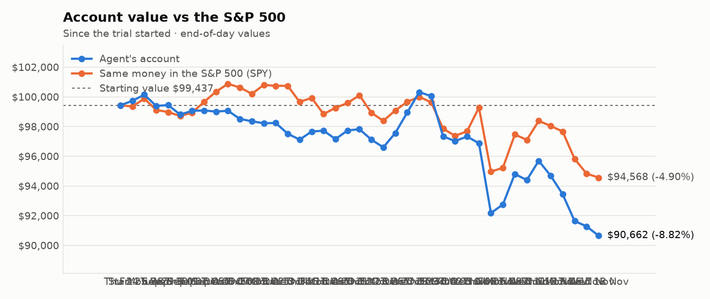
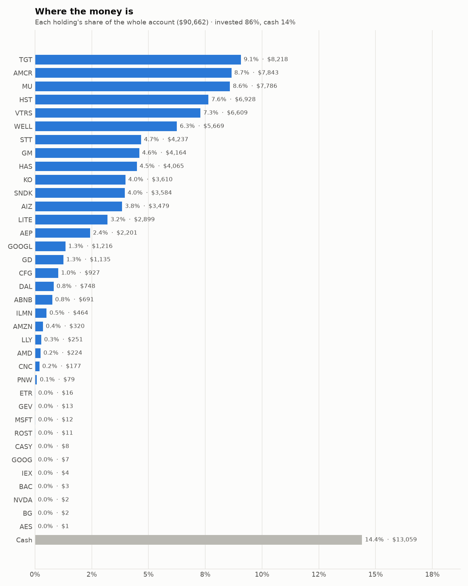
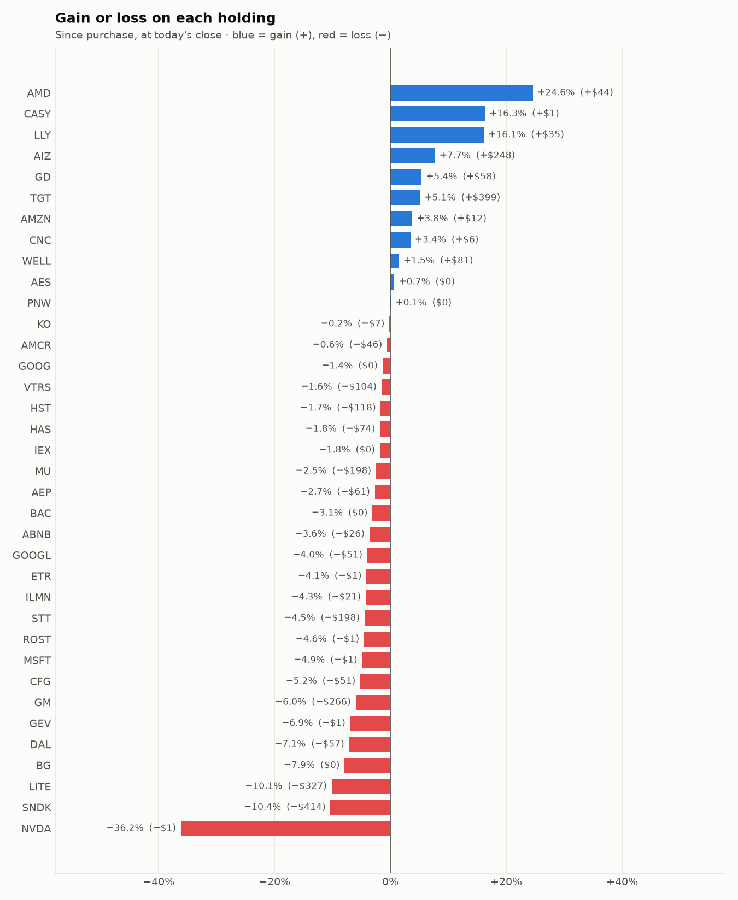

# 5-day trading report — 12 Nov to 18 Nov 2026
_Trading days 36–40 of the trial._

## Performance

- **Account value:** $95,697 → $90,662 (-5.3%)
- **S&P 500 (SPY) over the same days:** -3.9%
- **Agent vs S&P 500:** -1.38% (behind)

| Day | Account value | Day change | SPY | Buys | Sells |
|---|---|---|---|---|---|
| Thu 12 Nov | $94,689 | -1.1% | -0.3% | 2 | 6 |
| Fri 13 Nov | $93,451 | -1.3% | -0.4% | 2 | 4 |
| Mon 16 Nov | $91,643 | -1.9% | -1.9% | 4 | 5 |
| Tue 17 Nov | $91,282 | -0.4% | -1.0% | 6 | 4 |
| Wed 18 Nov | $90,662 | -0.7% | -0.3% | 3 | 5 |

## Risk scorecard (trial to date)

- **Return:** agent -8.82% vs S&P 500 -4.90% over 40 trading day(s)
- **Largest fall from a peak (max drawdown):** -9.63% — the worst the account has been below its own high
- **Volatility:** 18.5% a year — how much the account value swings day to day
- **Sharpe ratio:** -3.05 — return per unit of risk, yearly rate (above 1 is good, below 0 is losing)
- **Beta:** 0.91 — the account moves about in line with the S&P 500 (1.00 = exactly with it)
- **Alpha:** -4.35% — return lost beyond what the market's own move explains, given the beta above

## Charts

## What the research favoured

- **Main reason behind buys:** Momentum (9), Research (7), Low volatility (1)
- **Sectors bought:** Information Technology (3), Consumer Staples (3), Consumer Discretionary (3), Utilities (2), Financials (2), Communication Services (1), Health Care (1), Real Estate (1), Materials (1)
- **Average analyst consensus (-2..+2):** buys +1.04, sells +1.09
- **Average news tone:** buys +7.2, sells +3.3
- **Average combined research score:** buys +1.01, sells +0.66

## Sessions

- **2026-11-12 Morning rebalance:** traded — 8 order(s) placed
- **2026-11-12 Afternoon risk check:** no trades needed — Risk-checked 35 holding(s): none was 12%+ below its purchase price, and none had both clearly negative news and a price drop of 3%+ since entry.
- **2026-11-13 Morning rebalance:** traded — 6 order(s) placed
- **2026-11-13 Afternoon risk check:** no trades needed — Risk-checked 35 holding(s): none was 12%+ below its purchase price, and none had both clearly negative news and a price drop of 3%+ since entry.
- **2026-11-16 Morning rebalance:** traded — 8 order(s) placed
- **2026-11-16 Afternoon risk check:** traded — Sold 1 position(s) on the risk check (stop-loss: MRNA)
- **2026-11-17 Morning rebalance:** traded — 10 order(s) placed
- **2026-11-17 Afternoon risk check:** no trades needed — Risk-checked 36 holding(s): none was 12%+ below its purchase price, and none had both clearly negative news and a price drop of 3%+ since entry.
- **2026-11-18 Morning rebalance:** traded — 7 order(s) placed
- **2026-11-18 Afternoon risk check:** traded — Sold 1 position(s) on the risk check

# Key decisions and the research behind them

## Why I bought

### MU — bought 11.056 shares at ~$722.15 ($7,984)

**Why:** combined score +1.80; ranked #1 of 503; driven mainly by price momentum +3.00, research (news + analyst consensus) +1.99; entering/adding to the top-ranked target portfolio; research detail: 23 recent headline(s), net positive tone (+11); analyst consensus +1.25/2 (18 strong buy, 35 buy, 4 hold, 0 sell, 0 strong sell)

**Research scores** (combined +1.80, ranked #1 in the S&P 500, sector: Information Technology):

| Factor | Score | Measures |
|---|---|---|
| Value | +0.85 | cheap vs. sector peers on P/E and P/B |
| Quality | +0.89 | profitability (ROE, margins) and balance-sheet strength |
| Momentum | +3.00 | 12-month price trend, excluding the last month |
| Low volatility | -1.02 | steadier price than sector peers |
| Research | +1.99 | recent news tone + analyst consensus |

**Company financials (Finnhub, trailing 12 months):** P/E 10.4, P/B 7.8, return on equity 91.8%, gross margin 80.7%, debt/equity 0.04

**Price trend (Alpaca):** 12-month return (excl. last month) +398.0%, last month -16.5%, volatility 69.8%/yr

**News (Finnhub): 23 headline(s) in the last 2 days, net tone +11.** Most influential:
- [Why Micron Stock Is a Screaming Buy Before Year-End](https://finnhub.io/api/news?id=745f13ed89698fc738f3c0e3ae28f43184d12190de964ef58d6446ba4660d5cc) — 15 Nov, Yahoo (tone +2)
- [Samsung’s $34 Billion HBM Bet Raises Memory Glut Risks](https://finnhub.io/api/news?id=bd6677fb69eaf0e264bc28837cedbb9eaafaa13c70c548e6922edac2e9ef6d5f) — 14 Nov, Yahoo (tone +2)
- [Micron Technology (MU) Has More Than 75% Of 2027 Output Committed](https://finnhub.io/api/news?id=9d881a020efdf770f004a38464be1a3bfb26de1fb18c71ff4af1aabc45bc22b2) — 14 Nov, Yahoo (tone +2)
- [Micron Technology vs. Qualcomm: Which Tech Stock Is the Better Buy for 2027?](https://finnhub.io/api/news?id=f47f411a630062af4d2336f5e280ac06f3a4cbaf84e7e96dfdb2f5ab8223ffa4) — 13 Nov, Yahoo (tone +2)
- [Micron Stock: Why Strong Memory Prices May Count for Nothing](https://finnhub.io/api/news?id=c0a8e2176b760b0a7cdb5423bc6f2663d4b42c0217d2aa4649bade075fecb759) — 16 Nov, Yahoo (tone +1)

**Analysts (Finnhub, 2026-11-01):** 18 strong buy, 35 buy, 4 hold, 0 sell, 0 strong sell — consensus +1.25 on a -2 (strong sell) to +2 (strong buy) scale.

### VTRS — bought 325.867 shares at ~$20.60 ($6,713)

**Why:** combined score +1.01; ranked #6 of 503; driven mainly by research (news + analyst consensus) +1.55, value (cheapness) +1.37; entering/adding to the top-ranked target portfolio; research detail: 6 recent headline(s), net positive tone (+5); analyst consensus +0.94/2 (6 strong buy, 6 buy, 5 hold, 1 sell, 0 strong sell)

**Research scores** (combined +1.01, ranked #6 in the S&P 500, sector: Health Care):

| Factor | Score | Measures |
|---|---|---|
| Value | +1.37 | cheap vs. sector peers on P/E and P/B |
| Quality | -0.12 | profitability (ROE, margins) and balance-sheet strength |
| Momentum | +0.95 | 12-month price trend, excluding the last month |
| Low volatility | +0.66 | steadier price than sector peers |
| Research | +1.55 | recent news tone + analyst consensus |

**Company financials (Finnhub, trailing 12 months):** P/B 1.5, return on equity -4.2%, gross margin 41.1%, debt/equity 0.97

**Price trend (Alpaca):** 12-month return (excl. last month) +86.6%, last month +11.1%, volatility 26.4%/yr

**News (Finnhub): 6 headline(s) in the last 2 days, net tone +5.** Most influential:
- [United Natural Foods To Rally Around 24%? Here Are 10 Top Analyst Forecasts For Tuesday](https://finnhub.io/api/news?id=f63c863f0988cf46b0d36f646a713329f52abf49ef0593a23eac20157c833d86) — 17 Nov, Benzinga (tone +2)
- [Leerink Partners Maintains Outperform on Viatris, Raises Price Target to $24](https://finnhub.io/api/news?id=3ca9c12918f5a79cc8837cd586ad65e74dd5c62e7ba6f92880a143a2100f3dee) — 17 Nov, Benzinga (tone +2)
- [Barclays Maintains Overweight on Viatris, Raises Price Target to $25](https://finnhub.io/api/news?id=838c730079d8dc75b8aa33a8126e8c4bd9275a466a856be836bbb2ecdcfe036b) — 16 Nov, Benzinga (tone +1)
- [Viatris Completes Acquisition of Pacira BioSciences](https://finnhub.io/api/news?id=0d542b3c1347466b3d09a077fe12d07b62e8122216ff11575028b7ebc71137a8) — 17 Nov, Yahoo (tone +0)
- [Viatris Inc. (VTRS) Presents at UBS Global Biopharma Conference 2026 Transcript](https://finnhub.io/api/news?id=d56e002dfd50b0ce87774d5bf2c7b86f9a1d1407ab0b5502b9090a1b449a64bd) — 17 Nov, SeekingAlpha (tone +0)

**Analysts (Finnhub, 2026-11-01):** 6 strong buy, 6 buy, 5 hold, 1 sell, 0 strong sell — consensus +0.94 on a -2 (strong sell) to +2 (strong buy) scale.

### LITE — bought 10.241 shares at ~$613.21 ($6,280)

**Why:** combined score +0.99; ranked #8 of 503; driven mainly by price momentum +3.00, low volatility -1.18; entering/adding to the top-ranked target portfolio; research detail: 22 recent headline(s), net positive tone (+14); analyst consensus +1.11/2 (9 strong buy, 22 buy, 5 hold, 0 sell, 0 strong sell)

**Research scores** (combined +0.99, ranked #8 in the S&P 500, sector: Information Technology):

| Factor | Score | Measures |
|---|---|---|
| Value | -0.50 | cheap vs. sector peers on P/E and P/B |
| Quality | -1.11 | profitability (ROE, margins) and balance-sheet strength |
| Momentum | +3.00 | 12-month price trend, excluding the last month |
| Low volatility | -1.18 | steadier price than sector peers |
| Research | +1.06 | recent news tone + analyst consensus |

**Company financials (Finnhub, trailing 12 months):** P/B 14.3, return on equity -300.1%, gross margin 41.7%, debt/equity 0.35

**Price trend (Alpaca):** 12-month return (excl. last month) +560.4%, last month -34.4%, volatility 101.6%/yr

**News (Finnhub): 22 headline(s) in the last 2 days, net tone +14.** Most influential:
- [Lumentum Slips on Deal Reaction; Fossil Group Rallies on Outlook / Stock Movers](https://finnhub.io/api/news?id=2dbcdb3767be8c0926c2211474a712defa73f2a04c2dae976c8e552fe2e979d7) — 11 Nov, Yahoo (tone +3)
- [Applied Optoelectronics Surges 12%, Lumentum Jumps 11% as CoreWeave’s Results Revive AI Trade; Coherent Climbs 7%](https://finnhub.io/api/news?id=b165b48dafd8fe7598a6464d00f0bf87079f92866600bc0b21c227d811fbd3c5) — 11 Nov, Yahoo (tone +3)
- [Marvell Technology Stocks Surge 12.22% as AI Optics Rally Eases Lumentum Deal Doubts](https://finnhub.io/api/news?id=1dd7915d708f30f8720eb600d7f004cadc13cc0dea3d8ccacb29c50a0019d6f2) — 11 Nov, Yahoo (tone +2)
- [Coherent Rises 5% as CoreWeave’s Beat-and-Raise Revives the AI Trade: “A Breakout Quarter”](https://finnhub.io/api/news?id=dc49405b08b357a3c22a926b53111e39053444420629cdc9772d8da65435cd9a) — 11 Nov, Yahoo (tone +2)
- [Bernstein Maintains Outperform on Lumentum Holdings, Raises Price Target to $700](https://finnhub.io/api/news?id=c58421919e829d883f9ea6a1c228d51e9eae7198cf5f702128b29a5155ea2bf6) — 10 Nov, Benzinga (tone +2)

**Analysts (Finnhub, 2026-11-01):** 9 strong buy, 22 buy, 5 hold, 0 sell, 0 strong sell — consensus +1.11 on a -2 (strong sell) to +2 (strong buy) scale.

### KO — bought 54.88 shares at ~$100.23 ($5,501)

**Why:** combined score +0.95; ranked #7 of 503; driven mainly by research (news + analyst consensus) +1.94, low volatility +1.76; entering/adding to the top-ranked target portfolio; research detail: 5 recent headline(s), net positive tone (+6); analyst consensus +1.03/2 (8 strong buy, 20 buy, 7 hold, 0 sell, 0 strong sell)

**Research scores** (combined +0.95, ranked #7 in the S&P 500, sector: Consumer Staples):

| Factor | Score | Measures |
|---|---|---|
| Value | -0.70 | cheap vs. sector peers on P/E and P/B |
| Quality | +0.43 | profitability (ROE, margins) and balance-sheet strength |
| Momentum | +1.30 | 12-month price trend, excluding the last month |
| Low volatility | +1.76 | steadier price than sector peers |
| Research | +1.94 | recent news tone + analyst consensus |

**Company financials (Finnhub, trailing 12 months):** P/E 29.2, P/B 9.9, return on equity 42.0%, gross margin 62.3%, debt/equity 1.11

**Price trend (Alpaca):** 12-month return (excl. last month) +36.1%, last month +8.0%, volatility 17.5%/yr

**News (Finnhub): 5 headline(s) in the last 2 days, net tone +6.** Most influential:
- [Coca-Cola and J&J Just Hit Record Highs. A 62-Year-Old Put $300,000 Into Them and Procter & Gamble in 2016. Here’s How Much the Now 72-Year-Old Gets Paid Every Single Month](https://finnhub.io/api/news?id=4b8ed5d29d778006f2cbd96b52858148266ffbc68a13170c582cb878b62a0456) — 14 Nov, Yahoo (tone +2)
- [Got $1,000 to Invest? Skip Coca-Cola and PepsiCo. This 4%-Yielding Dividend Stock Could Deliver a 160% Return in 10 Years.](https://finnhub.io/api/news?id=4c29bbdff567231556af9b75329c0ec5038a9d0d203bcac43eca5814353f20a8) — 14 Nov, Yahoo (tone +2)
- [Forget Nvidia: One Investor Says “the Bubble Is in Consumer Staple Stocks” Like Coca-Cola](https://finnhub.io/api/news?id=1c0007a972e66bb6e5460d12837d7ae5b98fa0172ca87e67c3e77715990f5f40) — 16 Nov, Yahoo (tone +1)
- [Coca-Cola Has Paid a Growing Dividend for 64 Years. Here's the Income $5,000 Can Start You With.](https://finnhub.io/api/news?id=ed9ba8489e7b46a6ded930d95aae80ebce454a200aae8ee60b4d6e6f4a734a2b) — 14 Nov, Yahoo (tone +1)
- [3 Consumer Compounders That Fit Warren Buffett's Playbook. I'd Hold Them Forever.](https://finnhub.io/api/news?id=d771b5e388fa7f720c8571d4eac4e42b4e050ca493feb32ff9f87c7b788b250c) — 14 Nov, Yahoo (tone +0)

**Analysts (Finnhub, 2026-11-01):** 8 strong buy, 20 buy, 7 hold, 0 sell, 0 strong sell — consensus +1.03 on a -2 (strong sell) to +2 (strong buy) scale.

### WELL — bought 22.153 shares at ~$243.64 ($5,397)

**Why:** combined score +0.94; ranked #8 of 503; driven mainly by price momentum +1.95, research (news + analyst consensus) +1.77; entering/adding to the top-ranked target portfolio; research detail: 3 recent headline(s), net positive tone (+3); analyst consensus +1.11/2 (6 strong buy, 19 buy, 3 hold, 0 sell, 0 strong sell)

**Research scores** (combined +0.94, ranked #8 in the S&P 500, sector: Real Estate):

| Factor | Score | Measures |
|---|---|---|
| Value | -0.71 | cheap vs. sector peers on P/E and P/B |
| Quality | -0.28 | profitability (ROE, margins) and balance-sheet strength |
| Momentum | +1.95 | 12-month price trend, excluding the last month |
| Low volatility | -0.06 | steadier price than sector peers |
| Research | +1.77 | recent news tone + analyst consensus |

**Company financials (Finnhub, trailing 12 months):** P/E 107.0, P/B 3.4, return on equity 3.7%, gross margin 40.0%, debt/equity 0.40

**Price trend (Alpaca):** 12-month return (excl. last month) +36.2%, last month +4.2%, volatility 21.3%/yr

**News (Finnhub): 3 headline(s) in the last 2 days, net tone +3.** Most influential:
- [Mizuho Maintains Outperform on Welltower, Raises Price Target to $270](https://finnhub.io/api/news?id=c4472ba48c35ad21a6358a609cfed350667ffa80dd3bbb19a98651305c249ce1) — 16 Nov, Benzinga (tone +2)
- [Wells Fargo Maintains Overweight on Welltower, Raises Price Target to $283](https://finnhub.io/api/news?id=a5c5f3142b59b2fd0d146332d778594b9396a9b3927ec0235c1d0e808df0357d) — 16 Nov, Benzinga (tone +1)
- [Welltower and Ventas Are Riding the Same Senior Housing Boom, but Their Valuations Tell Different Stories](https://finnhub.io/api/news?id=457003d424afd0bffed121e487c73063436816cb0edcb4f3b281d3f1b7f0c31f) — 17 Nov, Yahoo (tone +0)

**Analysts (Finnhub, 2026-11-01):** 6 strong buy, 19 buy, 3 hold, 0 sell, 0 strong sell — consensus +1.11 on a -2 (strong sell) to +2 (strong buy) scale.

### STT — bought 30.656 shares at ~$173.22 ($5,310)

**Why:** combined score +0.93; ranked #7 of 503; driven mainly by price momentum +1.87, research (news + analyst consensus) +0.68; entering/adding to the top-ranked target portfolio; research detail: 8 recent headline(s), net positive tone (+4); analyst consensus +0.81/2 (3 strong buy, 11 buy, 7 hold, 0 sell, 0 strong sell)

**Research scores** (combined +0.93, ranked #7 in the S&P 500, sector: Financials):

| Factor | Score | Measures |
|---|---|---|
| Value | +0.42 | cheap vs. sector peers on P/E and P/B |
| Quality | -0.03 | profitability (ROE, margins) and balance-sheet strength |
| Momentum | +1.87 | 12-month price trend, excluding the last month |
| Low volatility | +0.43 | steadier price than sector peers |
| Research | +0.68 | recent news tone + analyst consensus |

**Company financials (Finnhub, trailing 12 months):** P/E 12.8, P/B 1.7, return on equity 13.1%, debt/equity 0.92

**Price trend (Alpaca):** 12-month return (excl. last month) +46.0%, last month +4.1%, volatility 22.7%/yr

**News (Finnhub): 8 headline(s) in the last 2 days, net tone +4.** Most influential:
- [Zacks Industry Outlook Highlights U.S. Bank, State Street and KeyCorp](https://finnhub.io/api/news?id=3f9a9e92d01356c17d98a8ae5cc20fb8b2dfa6867f60d69512702dc88c20f2b6) — 12 Nov, Yahoo (tone +2)
- [Is State Street SPDR S&P Homebuilders ETF (XHB) a Strong ETF Right Now?](https://finnhub.io/api/news?id=cbfe8a0da123ca696c2e8c2181644e191cafd05fb48be5810028728074dee4c4) — 13 Nov, Yahoo (tone +1)
- [Drug Makers or Biotech Bets: Which ETF Is the Better Buy, State Street’s XPH or First Trust’s FBT?](https://finnhub.io/api/news?id=b3739fbafc1918b1c24881c48e028caa850d73b2dbf8529e3d220c321418196f) — 11 Nov, Yahoo (tone +1)
- [How State Street and Savvy forged new paths to add to the custody competition](https://finnhub.io/api/news?id=356b2067f430deb6e24668eb301a56589bc9270d83646584bf26ec41ab014972) — 12 Nov, Yahoo (tone +0)
- [State Street Corporation Declares Dividends on Its Non-Cumulative Perpetual Preferred Stock Series "G," "I," "J," "K," and "L"](https://finnhub.io/api/news?id=7298ad7aa1aacaeb5cb431ca3a09a03e3d0c4e2d8088bb9137d9b19f42b041bd) — 12 Nov, Yahoo (tone +0)

**Analysts (Finnhub, 2026-11-01):** 3 strong buy, 11 buy, 7 hold, 0 sell, 0 strong sell — consensus +0.81 on a -2 (strong sell) to +2 (strong buy) scale.

### HAS — bought 34.317 shares at ~$120.62 ($4,139)

**Why:** combined score +0.85; ranked #10 of 503; driven mainly by research (news + analyst consensus) +1.33, price momentum +1.24; entering/adding to the top-ranked target portfolio; research detail: 3 recent headline(s), net positive tone (+4); analyst consensus +1.26/2 (8 strong buy, 8 buy, 3 hold, 0 sell, 0 strong sell)

**Research scores** (combined +0.85, ranked #10 in the S&P 500, sector: Consumer Discretionary):

| Factor | Score | Measures |
|---|---|---|
| Value | -0.18 | cheap vs. sector peers on P/E and P/B |
| Quality | +0.72 | profitability (ROE, margins) and balance-sheet strength |
| Momentum | +1.24 | 12-month price trend, excluding the last month |
| Low volatility | +0.10 | steadier price than sector peers |
| Research | +1.33 | recent news tone + analyst consensus |

**Company financials (Finnhub, trailing 12 months):** P/E 17.6, P/B 13.8, return on equity 136.2%, gross margin 67.5%, debt/equity 3.84

**Price trend (Alpaca):** 12-month return (excl. last month) +33.1%, last month +22.6%, volatility 31.9%/yr

**News (Finnhub): 3 headline(s) in the last 2 days, net tone +4.** Most influential:
- [Best Growth Stocks to Buy for November 16th](https://finnhub.io/api/news?id=65e0f354c0c802475536096f80e558ec77ce9044031fe49c13d5713a65c9f1f0) — 16 Nov, Yahoo (tone +2)
- [NVIDIA To $200? Here Are 10 Top Analyst Forecasts For Monday](https://finnhub.io/api/news?id=3158ede3c2c2bd45ba02dd66f54202cd3304753e34113af54c83898e90680367) — 16 Nov, Benzinga (tone +1)
- [Wells Fargo Maintains Equal-Weight on Hasbro, Raises Price Target to $115](https://finnhub.io/api/news?id=22509b6b134431cbaa433e2dda6e2f9b9bb6bdc2fbec343757b7c643cc6e208e) — 16 Nov, Benzinga (tone +1)

**Analysts (Finnhub, 2026-11-01):** 8 strong buy, 8 buy, 3 hold, 0 sell, 0 strong sell — consensus +1.26 on a -2 (strong sell) to +2 (strong buy) scale.

### GOOGL — bought 13.609 shares at ~$295.13 ($4,016)

**Why:** combined score +0.85; ranked #13 of 503; driven mainly by research (news + analyst consensus) +1.62, price momentum +1.58; entering/adding to the top-ranked target portfolio; research detail: 53 recent headline(s), net positive tone (+11); analyst consensus +1.19/2 (20 strong buy, 41 buy, 7 hold, 0 sell, 0 strong sell)

**Research scores** (combined +0.85, ranked #13 in the S&P 500, sector: Communication Services):

| Factor | Score | Measures |
|---|---|---|
| Value | -0.63 | cheap vs. sector peers on P/E and P/B |
| Quality | +0.09 | profitability (ROE, margins) and balance-sheet strength |
| Momentum | +1.58 | 12-month price trend, excluding the last month |
| Low volatility | +0.15 | steadier price than sector peers |
| Research | +1.62 | recent news tone + analyst consensus |

**Company financials (FMP, trailing 12 months):** P/E 15.1, P/B 5.3, return on equity 42.6%, gross margin 60.9%, debt/equity 0.21

**Price trend (Alpaca):** 12-month return (excl. last month) +42.5%, last month -14.1%, volatility 35.3%/yr

**News (Finnhub): 53 headline(s) in the last 2 days, net tone +11.** Most influential:
- [AMD Swung 17% Down and Back in One Week: Take Profits, or Buy More?](https://finnhub.io/api/news?id=8e72e40331bede34ef0378976b0e9a4f605e8828ef2ec36192a008212770a275) — 12 Nov, Yahoo (tone +2)
- [Alphabet: Story Behind The Inevitable Cost Of Future Growth](https://finnhub.io/api/news?id=b899ddf5b2b0bd05547a0fffe161d9bd64b4d9a8d53e1002e89be2545d3b2b20) — 12 Nov, SeekingAlpha (tone +2)
- [Broadcom Just Gained 25% in a Week: Take Profits, or Buy More?](https://finnhub.io/api/news?id=0d3682859d665a72b8d6b77db44ce280e453e474a2f747c60505b44e78b8cbd7) — 13 Nov, Yahoo (tone +1)
- [Zacks Earnings Trends Highlights: Micron, Nvidia and Alphabet](https://finnhub.io/api/news?id=e131fde0e366f2887f087ee50bb84bf1ba10a2d173856d8f9e7552fde9bac136) — 13 Nov, Yahoo (tone +1)
- [Alphabet Draws $5 Billion in Orders as AI Frenzy Builds](https://finnhub.io/api/news?id=9065d293b3155149849b94771ecd903e2f64bab5f1f307bd32ecf4c084ce1640) — 12 Nov, Yahoo (tone +1)

**Analysts (Finnhub, 2026-11-01):** 20 strong buy, 41 buy, 7 hold, 0 sell, 0 strong sell — consensus +1.19 on a -2 (strong sell) to +2 (strong buy) scale.

### AEP — bought 28.936 shares at ~$130.25 ($3,769)

**Why:** combined score +0.83; ranked #11 of 503; driven mainly by research (news + analyst consensus) +1.74, price momentum +1.11; entering/adding to the top-ranked target portfolio; research detail: 2 recent headline(s), net positive tone (+4); analyst consensus +0.93/2 (7 strong buy, 13 buy, 9 hold, 0 sell, 0 strong sell)

**Research scores** (combined +0.83, ranked #11 in the S&P 500, sector: Utilities):

| Factor | Score | Measures |
|---|---|---|
| Value | -0.01 | cheap vs. sector peers on P/E and P/B |
| Quality | +0.01 | profitability (ROE, margins) and balance-sheet strength |
| Momentum | +1.11 | 12-month price trend, excluding the last month |
| Low volatility | +0.06 | steadier price than sector peers |
| Research | +1.74 | recent news tone + analyst consensus |

**Company financials (Finnhub, trailing 12 months):** P/E 21.0, P/B 2.0, return on equity 10.5%, gross margin 41.9%, debt/equity 1.66

**Price trend (Alpaca):** 12-month return (excl. last month) +5.0%, last month +3.9%, volatility 17.2%/yr

**News (Finnhub): 2 headline(s) in the last 2 days, net tone +4.** Most influential:
- [Evercore ISI Group Maintains Outperform on American Electric Power, Raises Price Target to $154](https://finnhub.io/api/news?id=50ac035d12caa0c37c58f739f0f31c87697ed7693054a05af02ac5d0c18eaa70) — 16 Nov, Benzinga (tone +2)
- [What Are Wall Street Analysts' Target Price for American Electric Power Stock?](https://finnhub.io/api/news?id=e6bfb08e5e89d5445abfa3794189f290b36a287ea1a62811889a6a7854a028d5) — 15 Nov, Yahoo (tone +2)

**Analysts (Finnhub, 2026-11-01):** 7 strong buy, 13 buy, 9 hold, 0 sell, 0 strong sell — consensus +0.93 on a -2 (strong sell) to +2 (strong buy) scale.

### ETR — bought 27.418 shares at ~$112.67 ($3,089)

**Why:** combined score +0.82; ranked #16 of 503; driven mainly by price momentum +1.66, research (news + analyst consensus) +1.54; entering/adding to the top-ranked target portfolio; research detail: 8 recent headline(s), net positive tone (+5); analyst consensus +1.00/2 (7 strong buy, 15 buy, 7 hold, 0 sell, 0 strong sell)

**Research scores** (combined +0.82, ranked #16 in the S&P 500, sector: Utilities):

| Factor | Score | Measures |
|---|---|---|
| Value | -0.77 | cheap vs. sector peers on P/E and P/B |
| Quality | +0.02 | profitability (ROE, margins) and balance-sheet strength |
| Momentum | +1.66 | 12-month price trend, excluding the last month |
| Low volatility | +0.02 | steadier price than sector peers |
| Research | +1.54 | recent news tone + analyst consensus |

**Company financials (Finnhub, trailing 12 months):** P/E 25.9, P/B 2.4, return on equity 11.2%, gross margin 42.0%, debt/equity 1.73

**Price trend (Alpaca):** 12-month return (excl. last month) +10.3%, last month +6.6%, volatility 17.1%/yr

**News (Finnhub): 8 headline(s) in the last 2 days, net tone +5.** Most influential:
- [Entergy CEO says election hasn’t changed power demand outlook as data center boom continues](https://finnhub.io/api/news?id=7f3617432a16c7fdf4bfe5f00bc54ba7d69e8d5859597c1d3284acb2d9d05d0a) — 10 Nov, CNBC (tone +2)
- [All You Need to Know About Entergy (ETR) Rating Upgrade to Buy](https://finnhub.io/api/news?id=7e13974671681ad35aba567af4e1433bd7c5253f1d1830104f79b192681a5be0) — 10 Nov, Yahoo (tone +1)
- [Learn Why The Bull Case For Entergy Stock Could Change Following Rate Plan Extension](https://finnhub.io/api/news?id=8fa049e857a3221c62a2dae963396794f29911eb41d2771cb197f83a47498612) — 10 Nov, Yahoo (tone +1)
- [Is Entergy (ETR) Priced Beyond What Its Dividend Can Support?](https://finnhub.io/api/news?id=33333fdbe3eb06dba575d80aa90488f3e3544b106ac769f781ac60b2fe811861) — 10 Nov, Yahoo (tone +1)
- [ETFs Are Net Sellers of Entergy (ETR) on Nov. 10](https://finnhub.io/api/news?id=e53ec3e4d900e60b850e0efd63dabd233dba0fd0709f5ee2a7f67e3a283dd0d4) — 12 Nov, Yahoo (tone +0)

**Analysts (Finnhub, 2026-11-01):** 7 strong buy, 15 buy, 7 hold, 0 sell, 0 strong sell — consensus +1.00 on a -2 (strong sell) to +2 (strong buy) scale.

### KO — bought 29.123 shares at ~$97.76 ($2,847)

**Why:** combined score +0.78; ranked #12 of 503; driven mainly by low volatility +1.81, price momentum +1.47; entering/adding to the top-ranked target portfolio; research detail: 15 recent headline(s), net positive tone (+10); analyst consensus +1.03/2 (8 strong buy, 20 buy, 7 hold, 0 sell, 0 strong sell)

**Research scores** (combined +0.78, ranked #12 in the S&P 500, sector: Consumer Staples):

| Factor | Score | Measures |
|---|---|---|
| Value | -0.71 | cheap vs. sector peers on P/E and P/B |
| Quality | +0.43 | profitability (ROE, margins) and balance-sheet strength |
| Momentum | +1.47 | 12-month price trend, excluding the last month |
| Low volatility | +1.81 | steadier price than sector peers |
| Research | +1.02 | recent news tone + analyst consensus |

**Company financials (Finnhub, trailing 12 months):** P/E 29.3, P/B 9.9, return on equity 42.0%, gross margin 62.3%, debt/equity 1.11

**Price trend (Alpaca):** 12-month return (excl. last month) +38.3%, last month +5.7%, volatility 17.5%/yr

**News (Finnhub): 15 headline(s) in the last 2 days, net tone +10.** Most influential:
- [This Coca-Cola Analyst Begins Coverage On A Bullish Note; Here Are Top 5 Initiations For Wednesday](https://finnhub.io/api/news?id=198a70bf2147c2b18427b119e4061bb122284535855fac76cca72e2f2ea70847) — 18 Nov, Benzinga (tone +2)
- [Coca-Cola Stock (KO) May Struggle to Repeat Its Strong 2026 Performance](https://finnhub.io/api/news?id=67642c7f53d3c4105f49a4e0c3d095a8e6df92faea51c68ff0249d618750c70d) — 17 Nov, Yahoo (tone +2)
- [Wolfe Research Initiates Coverage On Coca-Cola with Outperform Rating](https://finnhub.io/api/news?id=2ce47c34726934ba5f25438b5da8c4badda86d10b0d877dbd8f4f0c3dc340bc8) — 18 Nov, Benzinga (tone +1)
- [TD Cowen names its best stock pick for 2027](https://finnhub.io/api/news?id=6b067ce3024a971cd62cea67d38146e70f6f098c9c759f62348a4cbcdd88a747) — 18 Nov, Yahoo (tone +1)
- [How Is Coca-Cola's Packaging Strategy Supporting Growth?](https://finnhub.io/api/news?id=5110750355ab550b38d9347c6bfe56bee5d6bf9f7af90f65aabc13d578167916) — 17 Nov, Yahoo (tone +1)

**Analysts (Finnhub, 2026-11-01):** 8 strong buy, 20 buy, 7 hold, 0 sell, 0 strong sell — consensus +1.03 on a -2 (strong sell) to +2 (strong buy) scale.

### AMZN — bought 8.673 shares at ~$258.76 ($2,244)

**Why:** combined score +0.75; ranked #15 of 503; driven mainly by research (news + analyst consensus) +2.10, price momentum +0.70; entering/adding to the top-ranked target portfolio; research detail: 72 recent headline(s), net positive tone (+10); analyst consensus +1.23/2 (19 strong buy, 48 buy, 3 hold, 0 sell, 0 strong sell)

**Research scores** (combined +0.75, ranked #15 in the S&P 500, sector: Consumer Discretionary):

| Factor | Score | Measures |
|---|---|---|
| Value | -0.10 | cheap vs. sector peers on P/E and P/B |
| Quality | +0.11 | profitability (ROE, margins) and balance-sheet strength |
| Momentum | +0.70 | 12-month price trend, excluding the last month |
| Low volatility | -0.42 | steadier price than sector peers |
| Research | +2.10 | recent news tone + analyst consensus |

**Company financials (FMP, trailing 12 months):** P/E 20.6, P/B 4.5, return on equity 26.7%, gross margin 51.4%, debt/equity 0.44

**Price trend (Alpaca):** 12-month return (excl. last month) +15.9%, last month +3.2%, volatility 32.2%/yr

**News (Finnhub): 72 headline(s) in the last 2 days, net tone +10.** Most influential:
- [EBay, Amazon, Caterpillar and More on CNBC’s ‘Final Trades’](https://finnhub.io/api/news?id=3d5aee8df397814dfb98da883f6572798aaa78fcf19e7ee941fa65ddcb7b54a3) — 16 Nov, Benzinga (tone +2)
- [Ken Griffin Dumps SpaceX, Amazon; Buys ARKK and Bets Big on Marvell](https://finnhub.io/api/news?id=e8e147d3b9f34ab801716761f85dc784539038aa03e5113eeb32711e2b6af640) — 17 Nov, Benzinga (tone +1)
- [Amazon Plans $7B Renewable Energy Investment In India By 2030, On Top Of $4B Already Contracted, Adds Four Wind And Solar Projects Totaling 934 MW](https://finnhub.io/api/news?id=ebf01e7ec5b4f7ba7f38361acb37403ee7900c4e3e786f9fe5c6f035db834ca2) — 16 Nov, Benzinga (tone -1)
- [Boeing (BA) ULA Rocket Failure Halts Deployment Of 40 Broadband Satellites](https://finnhub.io/api/news?id=511f78f5aef5c09b41b36834d23e9970cbd87e9d8826ebbc6c760a9169298966) — 16 Nov, Yahoo (tone +1)
- [Not Amazon, Not American Express: This Credit Card Has The Best Rewards For 2026](https://finnhub.io/api/news?id=8a929bfa9874d933ee0f8a06debc3c9809136c0b512e5be65df44a97972b7a20) — 16 Nov, Yahoo (tone +1)

**Analysts (Finnhub, 2026-11-01):** 19 strong buy, 48 buy, 3 hold, 0 sell, 0 strong sell — consensus +1.23 on a -2 (strong sell) to +2 (strong buy) scale.

### AIZ — bought 5.908 shares at ~$323.21 ($1,910)

**Why:** combined score +0.81; ranked #13 of 503; driven mainly by price momentum +1.34, research (news + analyst consensus) +1.00; entering/adding to the top-ranked target portfolio; research detail: 2 recent headline(s), net positive tone (+3); analyst consensus +1.00/2 (2 strong buy, 9 buy, 2 hold, 0 sell, 0 strong sell)

**Research scores** (combined +0.81, ranked #13 in the S&P 500, sector: Financials):

| Factor | Score | Measures |
|---|---|---|
| Value | +0.02 | cheap vs. sector peers on P/E and P/B |
| Quality | +0.29 | profitability (ROE, margins) and balance-sheet strength |
| Momentum | +1.34 | 12-month price trend, excluding the last month |
| Low volatility | +0.86 | steadier price than sector peers |
| Research | +1.00 | recent news tone + analyst consensus |

**Company financials (Finnhub, trailing 12 months):** P/E 14.7, P/B 2.2, return on equity 18.0%, debt/equity 0.37

**Price trend (Alpaca):** 12-month return (excl. last month) +31.7%, last month +14.5%, volatility 21.7%/yr

**News (Finnhub): 2 headline(s) in the last 2 days, net tone +3.** Most influential:
- [AIZ Stock Trading at a Discount to Industry at 2.64X: Time to Buy?](https://finnhub.io/api/news?id=042fbc675a7e3865e1abd0524d199d843e1688574c413681b1191d6a3cc0469e) — 16 Nov, Yahoo (tone +2)
- [Morgan Stanley Maintains Overweight on Assurant, Raises Price Target to $360](https://finnhub.io/api/news?id=73989d788b370ecd21e6c59fe43965595b36ef8c5c73c314297bc6382cfcb391) — 16 Nov, Benzinga (tone +1)

**Analysts (Finnhub, 2026-11-01):** 2 strong buy, 9 buy, 2 hold, 0 sell, 0 strong sell — consensus +1.00 on a -2 (strong sell) to +2 (strong buy) scale.

### GM — bought 21.212 shares at ~$84.84 ($1,800)

**Why:** combined score +1.17; ranked #3 of 503; driven mainly by research (news + analyst consensus) +1.98, price momentum +1.65; entering/adding to the top-ranked target portfolio; research detail: 6 recent headline(s), net positive tone (+4); analyst consensus +1.14/2 (11 strong buy, 18 buy, 6 hold, 0 sell, 0 strong sell)

**Research scores** (combined +1.17, ranked #3 in the S&P 500, sector: Consumer Discretionary):

| Factor | Score | Measures |
|---|---|---|
| Value | +1.03 | cheap vs. sector peers on P/E and P/B |
| Quality | -0.69 | profitability (ROE, margins) and balance-sheet strength |
| Momentum | +1.65 | 12-month price trend, excluding the last month |
| Low volatility | -0.13 | steadier price than sector peers |
| Research | +1.98 | recent news tone + analyst consensus |

**Company financials (FMP, trailing 12 months):** P/E 19.2, P/B 1.2, return on equity 6.3%, gross margin 9.0%, debt/equity 2.05

**Price trend (Alpaca):** 12-month return (excl. last month) +46.4%, last month +2.9%, volatility 38.9%/yr

**News (Finnhub): 6 headline(s) in the last 2 days, net tone +4.** Most influential:
- [What Are Wall Street Analysts' Target Price for General Motors Stock?](https://finnhub.io/api/news?id=63c2489bcee27fb8da1fc791a32d7f2fb666442af34776aa001fa07a71016a01) — 16 Nov, Yahoo (tone +3)
- [General Motors (GM) Stock Could Be Cheap On Its 216% Three Year Run](https://finnhub.io/api/news?id=5c64ff94df7073e9a8d3a758864187372f576dbd0177431368314c6256731f34) — 14 Nov, Yahoo (tone +1)
- [What Does General Motors (GM) $550 Million Solar Push Signal For Investors?](https://finnhub.io/api/news?id=deffebe27e724a8d6c4a73d956257fd41bb42cfce6541fc4bab4c1e49dbba118) — 15 Nov, Yahoo (tone +0)
- [Ford and GM face a $5,000 SUV challenge from Volkswagen](https://finnhub.io/api/news?id=b308d0a4d815587f2d06d0beceac4baa76db80d844a51fa6cc9418fb7850c031) — 14 Nov, Yahoo (tone +0)
- [The Unexpected American Automaker More Profitable Than Ford Or GM](https://finnhub.io/api/news?id=f4cc134b716d4aade9fdb7d63bf8c00f5313bc826823d90bd5bad39c7c84f941) — 14 Nov, Yahoo (tone +0)

**Analysts (Finnhub, 2026-11-01):** 11 strong buy, 18 buy, 6 hold, 0 sell, 0 strong sell — consensus +1.14 on a -2 (strong sell) to +2 (strong buy) scale.

### TGT — bought 9.983 shares at ~$168.74 ($1,685)

**Why:** combined score +1.25; ranked #3 of 503; driven mainly by price momentum +2.47, research (news + analyst consensus) +1.33; entering/adding to the top-ranked target portfolio; research detail: 61 recent headline(s), net positive tone (+26); analyst consensus +0.47/2 (7 strong buy, 9 buy, 24 hold, 3 sell, 0 strong sell)

**Research scores** (combined +1.25, ranked #3 in the S&P 500, sector: Consumer Staples):

| Factor | Score | Measures |
|---|---|---|
| Value | +0.40 | cheap vs. sector peers on P/E and P/B |
| Quality | -0.12 | profitability (ROE, margins) and balance-sheet strength |
| Momentum | +2.47 | 12-month price trend, excluding the last month |
| Low volatility | -0.23 | steadier price than sector peers |
| Research | +1.33 | recent news tone + analyst consensus |

**Company financials (FMP, trailing 12 months):** P/E 15.6, P/B 4.2, return on equity 28.6%, gross margin 29.9%, debt/equity 1.02

**Price trend (Alpaca):** 12-month return (excl. last month) +70.2%, last month +4.0%, volatility 30.6%/yr

**News (Finnhub): 61 headline(s) in the last 2 days, net tone +26.** Most influential:
- [Should Target Stock Be in Your Portfolio Ahead of Q3 Earnings Report?](https://finnhub.io/api/news?id=aefe6df79d782b5666c167be5736233a996ea61fe2fd0ee0eb6b8805d82ba203) — 17 Nov, Yahoo (tone +3)
- [Dow Jones Futures: Techs Jump On Nvidia Earnings; Target Beats, Anthropic IPO Ahead](https://finnhub.io/api/news?id=cf99ddd9b55d761e5a2f63cece33b62b87344a5f08fddd53b20acbf4a87a18cb) — 18 Nov, Yahoo (tone +2)
- [Nvidia, Target and 3 Stocks to Watch Heading Into Wednesday](https://finnhub.io/api/news?id=8d1cbee4337a77b97ab163ea8577ad1ac3516cdc1283e8a435d0097f44424400) — 18 Nov, Benzinga (tone +2)
- [Dow Jones Futures: Techs Rise As Nvidia Beats, Says This On Jensen Huang; Target, Anthropic IPO Ahead](https://finnhub.io/api/news?id=4fca2e56670f0ff0f0e303326fe61e80b2faf7bb352d7ffbaa7ae7a8016c3f3d) — 17 Nov, Yahoo (tone +2)
- [Dow Jones Futures Rise, Techs Jump As Nvidia Beats, Says This On Jensen Huang; Target, Anthropic IPO Ahead](https://finnhub.io/api/news?id=6ee07f3da168a8f2273002083f5e7b7f1e76865081dd1ce4495bad885afa3b7a) — 17 Nov, Yahoo (tone +2)

**Analysts (Finnhub, 2026-11-01):** 7 strong buy, 9 buy, 24 hold, 3 sell, 0 strong sell — consensus +0.47 on a -2 (strong sell) to +2 (strong buy) scale.

### AMCR — bought 35.013 shares at ~$43.45 ($1,521)

**Why:** combined score +1.02; ranked #6 of 503; driven mainly by price momentum +3.00, quality (profitability/balance sheet) -0.56; entering/adding to the top-ranked target portfolio; research detail: analyst consensus +0.95/2 (5 strong buy, 8 buy, 6 hold, 0 sell, 0 strong sell)

**Research scores** (combined +1.02, ranked #6 in the S&P 500, sector: Materials):

| Factor | Score | Measures |
|---|---|---|
| Value | +0.24 | cheap vs. sector peers on P/E and P/B |
| Quality | -0.56 | profitability (ROE, margins) and balance-sheet strength |
| Momentum | +3.00 | 12-month price trend, excluding the last month |
| Low volatility | +0.43 | steadier price than sector peers |
| Research | -0.06 | recent news tone + analyst consensus |

**Company financials (Finnhub, trailing 12 months):** P/E 18.6, P/B 1.6, return on equity 9.3%, gross margin 19.8%, debt/equity 1.27

**Price trend (Alpaca):** 12-month return (excl. last month) +439.6%, last month -1.2%, volatility 26.5%/yr

**News (Finnhub):** no headlines in the last 2 days.

**Analysts (Finnhub, 2026-11-01):** 5 strong buy, 8 buy, 6 hold, 0 sell, 0 strong sell — consensus +0.95 on a -2 (strong sell) to +2 (strong buy) scale.

### SNDK — bought 1.106 shares at ~$784.69 ($868)

**Why:** combined score +1.50; ranked #2 of 503; driven mainly by price momentum +3.00, low volatility -1.37; entering/adding to the top-ranked target portfolio; research detail: 29 recent headline(s), net positive tone (+2); analyst consensus +1.20/2 (12 strong buy, 18 buy, 5 hold, 0 sell, 0 strong sell)

**Research scores** (combined +1.50, ranked #2 in the S&P 500, sector: Information Technology):

| Factor | Score | Measures |
|---|---|---|
| Value | +1.24 | cheap vs. sector peers on P/E and P/B |
| Quality | +1.09 | profitability (ROE, margins) and balance-sheet strength |
| Momentum | +3.00 | 12-month price trend, excluding the last month |
| Low volatility | -1.37 | steadier price than sector peers |
| Research | +0.43 | recent news tone + analyst consensus |

**Company financials (Finnhub, trailing 12 months):** P/E 6.5, P/B 13.8, return on equity 134.3%, gross margin 80.0%, debt/equity 0.00

**Price trend (Alpaca):** 12-month return (excl. last month) +800.2%, last month -37.7%, volatility 93.0%/yr

**News (Finnhub): 29 headline(s) in the last 2 days, net tone +2.** Most influential:
- [Own Sandisk? Your Five Years Hinge On Memory Prices](https://finnhub.io/api/news?id=19a7acc12d564f844ced56b5cfbdbe85610db893c5017aa32ba1bfc3d34e2501) — 17 Nov, Yahoo (tone +2)
- [Stanley Druckenmiller’s Duquesne Bets Big on Storage, Nearly Triples Seagate Stake As He Reverses Some Q2 Tech Bets, Slashes TSMC and Exits AMD, Google](https://finnhub.io/api/news?id=81c064af943a694e4c1cdc778ab62649b5c9dd0b9bbf835a4e1db549ee73c6b0) — 17 Nov, Benzinga (tone -1)
- [Sandisk Is Splitting Its Stock 8-for-1. Here’s the Number I’d Check Before Buying.](https://finnhub.io/api/news?id=678d0eac32e975779f5f6b735e8c4bbcc4122bb0ffb7ac2403428ba902456c9d) — 16 Nov, Yahoo (tone +1)
- [SanDisk Stock Could Have Another Big Year. Here’s My 2027 Price Prediction](https://finnhub.io/api/news?id=fdf718ff125cc77264c50120a2d9105d8c606b4d8454fd0a6d04bf05873806e3) — 16 Nov, Yahoo (tone -1)
- [Sandisk Next Big Move Could Be Bigger Than Its Upcoming Stock Split](https://finnhub.io/api/news?id=8195e2cc1e84226cc7da6f6f1d1d960e52fedb08365ab5699e44c65c43535654) — 16 Nov, Yahoo (tone +1)

**Analysts (Finnhub, 2026-11-01):** 12 strong buy, 18 buy, 5 hold, 0 sell, 0 strong sell — consensus +1.20 on a -2 (strong sell) to +2 (strong buy) scale.

## Why I sold

### ILMN — sold 32.46 shares at ~$200.85 ($6,520)

**Why:** combined score +0.60; ranked #24 of 503; driven mainly by price momentum +2.46, low volatility -1.92; trimmed toward target weight, or dropped out of the top-ranked names; research detail: analyst consensus +0.61/2 (6 strong buy, 9 buy, 10 hold, 2 sell, 1 strong sell)

**Research scores** (combined +0.60, ranked #24 in the S&P 500, sector: Health Care):

| Factor | Score | Measures |
|---|---|---|
| Value | +0.00 | cheap vs. sector peers on P/E and P/B |
| Quality | +0.00 | profitability (ROE, margins) and balance-sheet strength |
| Momentum | +2.46 | 12-month price trend, excluding the last month |
| Low volatility | -1.92 | steadier price than sector peers |
| Research | -0.65 | recent news tone + analyst consensus |

**Price trend (Alpaca):** 12-month return (excl. last month) +194.2%, last month -22.7%, volatility 67.0%/yr

**News (Finnhub):** no headlines in the last 2 days.

**Analysts (Finnhub, 2026-11-01):** 6 strong buy, 9 buy, 10 hold, 2 sell, 1 strong sell — consensus +0.61 on a -2 (strong sell) to +2 (strong buy) scale.

### KO — sold 59.401 shares at ~$99.34 ($5,901)

**Why:** combined score +0.64; ranked #22 of 503; driven mainly by low volatility +1.79, price momentum +1.51; trimmed toward target weight, or dropped out of the top-ranked names; research detail: 5 recent headline(s), net positive tone (+1); analyst consensus +1.03/2 (8 strong buy, 20 buy, 7 hold, 0 sell, 0 strong sell)

**Research scores** (combined +0.64, ranked #22 in the S&P 500, sector: Consumer Staples):

| Factor | Score | Measures |
|---|---|---|
| Value | -0.70 | cheap vs. sector peers on P/E and P/B |
| Quality | +0.43 | profitability (ROE, margins) and balance-sheet strength |
| Momentum | +1.51 | 12-month price trend, excluding the last month |
| Low volatility | +1.79 | steadier price than sector peers |
| Research | +0.38 | recent news tone + analyst consensus |

**Company financials (Finnhub, trailing 12 months):** P/E 29.2, P/B 9.9, return on equity 42.0%, gross margin 62.3%, debt/equity 1.11

**Price trend (Alpaca):** 12-month return (excl. last month) +39.9%, last month +6.1%, volatility 17.5%/yr

**News (Finnhub): 5 headline(s) in the last 2 days, net tone +1.** Most influential:
- [What Does Warren Buffett’s 90/10 Rule Say to a 74-Year-Old With $1 Million of Coca-Cola at a Record?](https://finnhub.io/api/news?id=9c8e482ba9e599f2113842a1abce646825a3e248a62eed5c4815fd50f3c6c4c4) — 16 Nov, Yahoo (tone +1)
- [Coca-Cola Has Crushed PepsiCo in 2026, but Retirement Investors Face a Different Dividend Decision](https://finnhub.io/api/news?id=b9fcde15dc257fa502fca140821a8d0b70efcc60f8974d83ea5ab6684f47d456) — 16 Nov, Yahoo (tone -1)
- [Forget Nvidia: One Investor Says “the Bubble Is in Consumer Staple Stocks” Like Coca-Cola](https://finnhub.io/api/news?id=1c0007a972e66bb6e5460d12837d7ae5b98fa0172ca87e67c3e77715990f5f40) — 16 Nov, Yahoo (tone +1)
- [Unusual Call Option Activity in Coca-Cola - Is KO Stock Undervalued or Overvalued?](https://finnhub.io/api/news?id=ac34f118ec5f172e7904286c0ba70336f6f4430626cd2a09ef6ccfdf96fc7476) — 16 Nov, Yahoo (tone +0)
- [QUICK SPARK: Wall Street Sold Chips, Bought Coca-Cola at the Strongest Pace Since September 2001](https://finnhub.io/api/news?id=127b9c8a33e3ada53993fb8c5e28302ba4d3bdeb5eae05cd0d66c10d83d964b8) — 16 Nov, Benzinga (tone +0)

**Analysts (Finnhub, 2026-11-01):** 8 strong buy, 20 buy, 7 hold, 0 sell, 0 strong sell — consensus +1.03 on a -2 (strong sell) to +2 (strong buy) scale.

### GOOGL — sold 13.716 shares at ~$294.25 ($4,036)

**Why:** combined score +0.64; ranked #30 of 503; driven mainly by price momentum +1.70, value (cheapness) -0.63; trimmed toward target weight, or dropped out of the top-ranked names; research detail: 51 recent headline(s), net positive tone (+4); analyst consensus +1.19/2 (20 strong buy, 41 buy, 7 hold, 0 sell, 0 strong sell)

**Research scores** (combined +0.64, ranked #30 in the S&P 500, sector: Communication Services):

| Factor | Score | Measures |
|---|---|---|
| Value | -0.63 | cheap vs. sector peers on P/E and P/B |
| Quality | +0.09 | profitability (ROE, margins) and balance-sheet strength |
| Momentum | +1.70 | 12-month price trend, excluding the last month |
| Low volatility | +0.15 | steadier price than sector peers |
| Research | +0.61 | recent news tone + analyst consensus |

**Company financials (FMP, trailing 12 months):** P/E 15.1, P/B 5.3, return on equity 42.6%, gross margin 60.9%, debt/equity 0.21

**Price trend (Alpaca):** 12-month return (excl. last month) +49.5%, last month -17.0%, volatility 35.1%/yr

**News (Finnhub): 51 headline(s) in the last 2 days, net tone +4.** Most influential:
- [Marvell Acquires Lumentum in Blockbuster $80 Billion Deal](https://finnhub.io/api/news?id=d4bd92908d146b4356e44b56a87682db36c2216bbc72c1a5c246cb4cb799f9a3) — 11 Nov, Yahoo (tone +1)
- [Anthropic Says Its Revenue Run Rate Jumped to an $81 Billion Run Rate](https://finnhub.io/api/news?id=b4c63dc739a083bc5db8a04b42dc172d01e996581f1e674b9f176f7c5fcd6753) — 11 Nov, Yahoo (tone +1)
- [Nvidia and Broadcom Are Scaling AI Data Centers With This Growth Stock. Here's Why It Could Soar.](https://finnhub.io/api/news?id=313452b5346b9cfc7b46bf38c2b2721be25b8bd861212a8d1c86e57248755565) — 10 Nov, Yahoo (tone +1)
- [Alphabet and Amazon Custom Silicon: Full-Stack Vertical Integration Vs. Compute Cost-Arbitrage](https://finnhub.io/api/news?id=ac193d9b713f92a59f45bca117ef3942f0ad8b1648b332bf6a791e9a45e6bee7) — 10 Nov, Yahoo (tone +1)
- [Cathie Wood Bought Cerebras Before It Fell 54%. Is She Wrong, or Early?](https://finnhub.io/api/news?id=dc060e4130eb0e8c5e0ca3f322cf3314b95856db414fe2c8195fa576a45a9e34) — 12 Nov, Yahoo (tone +0)

**Analysts (Finnhub, 2026-11-01):** 20 strong buy, 41 buy, 7 hold, 0 sell, 0 strong sell — consensus +1.19 on a -2 (strong sell) to +2 (strong buy) scale.

### WELL — sold 14.588 shares at ~$245.49 ($3,581)

**Why:** combined score +0.63; ranked #30 of 503; driven mainly by price momentum +2.01, value (cheapness) -0.72; trimmed toward target weight, or dropped out of the top-ranked names; research detail: 1 recent headline(s), net positive tone (+1); analyst consensus +1.11/2 (6 strong buy, 19 buy, 3 hold, 0 sell, 0 strong sell)

**Research scores** (combined +0.63, ranked #30 in the S&P 500, sector: Real Estate):

| Factor | Score | Measures |
|---|---|---|
| Value | -0.72 | cheap vs. sector peers on P/E and P/B |
| Quality | -0.31 | profitability (ROE, margins) and balance-sheet strength |
| Momentum | +2.01 | 12-month price trend, excluding the last month |
| Low volatility | -0.07 | steadier price than sector peers |
| Research | +0.49 | recent news tone + analyst consensus |

**Company financials (Finnhub, trailing 12 months):** P/E 106.8, P/B 3.4, return on equity 3.7%, gross margin 40.0%, debt/equity 0.40

**Price trend (Alpaca):** 12-month return (excl. last month) +39.2%, last month +5.5%, volatility 21.4%/yr

**News (Finnhub): 1 headline(s) in the last 2 days, net tone +1.** Most influential:
- [UBS Maintains Buy on Welltower, Raises Price Target to $289](https://finnhub.io/api/news?id=712264b368393dc40856911083bc16694726796bf711241c1b3a9e0dd42ea0ff) — 11 Nov, Benzinga (tone +1)

**Analysts (Finnhub, 2026-11-01):** 6 strong buy, 19 buy, 3 hold, 0 sell, 0 strong sell — consensus +1.11 on a -2 (strong sell) to +2 (strong buy) scale.

### SNDK — sold 4.615 shares at ~$769.63 ($3,552)

**Why:** intraday move -10.9% on the position since entry; 54 recent headline(s), net negative tone (-3); trimmed 50% as a risk circuit breaker, not a full exit

**What triggered it:** the afternoon risk check trims a holding only when BOTH its recent news turns clearly negative AND its price is down 3%+ since purchase (it was -10.9%).

**News (Finnhub): 54 headline(s) in the last 2 days, net tone -3.** Most influential:
- [SanDisk and Micron Fall 4% as GF Securities Cuts NAND Price Forecast and Warns of a Glut; SK Hynix Dips](https://finnhub.io/api/news?id=38286f2033adc286b86bb07cf90453b317ef17023db0c446d8e83ead4002ffdf) — 17 Nov, Yahoo (tone -2)
- [Own Sandisk? Your Five Years Hinge On Memory Prices](https://finnhub.io/api/news?id=19a7acc12d564f844ced56b5cfbdbe85610db893c5017aa32ba1bfc3d34e2501) — 17 Nov, Yahoo (tone +2)
- [Why Sandisk Stock Dropped Again](https://finnhub.io/api/news?id=203090c40e974e77f074ea028185f1c007339b7b53c249ae756fc68dd6e27819) — 18 Nov, Yahoo (tone -1)
- [SanDisk Slides 4% Ahead of 8-for-1 Stock Split as NAND Glut Worries Linger; Micron Drops 3%, Seagate Edges Lower](https://finnhub.io/api/news?id=26b4f1fec32f0c2613853db060625ad2428704dad9372348522c595ead63fa9e) — 18 Nov, Yahoo (tone -1)
- [Sandisk: The Rally Isn't Coming](https://finnhub.io/api/news?id=49ca749190a3a8b2f36ec31016195c07b23e409529d28b128a33edbabff7a927) — 18 Nov, SeekingAlpha (tone +1)

### WELL — sold 13.725 shares at ~$246.33 ($3,381)

**Why:** combined score +0.85; ranked #12 of 503; driven mainly by price momentum +1.88, research (news + analyst consensus) +1.54; trimmed toward target weight, or dropped out of the top-ranked names; research detail: 4 recent headline(s), net positive tone (+5); analyst consensus +1.11/2 (6 strong buy, 19 buy, 3 hold, 0 sell, 0 strong sell)

**Research scores** (combined +0.85, ranked #12 in the S&P 500, sector: Real Estate):

| Factor | Score | Measures |
|---|---|---|
| Value | -0.72 | cheap vs. sector peers on P/E and P/B |
| Quality | -0.31 | profitability (ROE, margins) and balance-sheet strength |
| Momentum | +1.88 | 12-month price trend, excluding the last month |
| Low volatility | -0.07 | steadier price than sector peers |
| Research | +1.54 | recent news tone + analyst consensus |

**Company financials (Finnhub, trailing 12 months):** P/E 107.2, P/B 3.4, return on equity 3.7%, gross margin 40.0%, debt/equity 0.40

**Price trend (Alpaca):** 12-month return (excl. last month) +38.7%, last month +7.4%, volatility 21.3%/yr

**News (Finnhub): 4 headline(s) in the last 2 days, net tone +5.** Most influential:
- [RBC Capital Maintains Outperform on Welltower, Raises Price Target to $266](https://finnhub.io/api/news?id=794ed73bf0f965f5081f8cd7c4e66efec0864b7e61f9674e972e4795aa34cc85) — 10 Nov, Benzinga (tone +2)
- [UBS Maintains Buy on Welltower, Raises Price Target to $289](https://finnhub.io/api/news?id=712264b368393dc40856911083bc16694726796bf711241c1b3a9e0dd42ea0ff) — 11 Nov, Benzinga (tone +1)
- [Welltower's Senior Housing Portfolio Should Help Deliver FFO Growth in 2027, 2028, RBC Says](https://finnhub.io/api/news?id=00067a18d1817c3fd454bfb92613c08d8efebc4c6438aa4bf2667c364cacd259) — 10 Nov, Yahoo (tone +1)
- [JP Morgan Maintains Overweight on Welltower, Raises Price Target to $273](https://finnhub.io/api/news?id=31b5cfc8997c350dbfb30c90b2a4ce2523fd580d91f75567d3a91cd2338903cc) — 10 Nov, Benzinga (tone +1)

**Analysts (Finnhub, 2026-11-01):** 6 strong buy, 19 buy, 3 hold, 0 sell, 0 strong sell — consensus +1.11 on a -2 (strong sell) to +2 (strong buy) scale.

### ETR — sold 28.523 shares at ~$111.91 ($3,192)

**Why:** combined score +0.51; ranked #54 of 503; driven mainly by price momentum +1.35, research (news + analyst consensus) +0.14; trimmed toward target weight, or dropped out of the top-ranked names; research detail: 5 recent headline(s), neutral/mixed tone; analyst consensus +1.00/2 (7 strong buy, 15 buy, 7 hold, 0 sell, 0 strong sell)

**Research scores** (combined +0.51, ranked #54 in the S&P 500, sector: Utilities):

| Factor | Score | Measures |
|---|---|---|
| Value | +0.00 | cheap vs. sector peers on P/E and P/B |
| Quality | +0.00 | profitability (ROE, margins) and balance-sheet strength |
| Momentum | +1.35 | 12-month price trend, excluding the last month |
| Low volatility | +0.06 | steadier price than sector peers |
| Research | +0.14 | recent news tone + analyst consensus |

**Price trend (Alpaca):** 12-month return (excl. last month) +9.1%, last month +7.2%, volatility 17.0%/yr

**News (Finnhub): 5 headline(s) in the last 2 days, net tone +0.** Most influential:
- [ETFs Are Net Sellers of Entergy (ETR) on Nov. 11](https://finnhub.io/api/news?id=f5766eccd8877ea16b74030f7f62c66273b33c6a827ac5200905e10be874124b) — 13 Nov, Yahoo (tone +0)
- [Are Utilities Stocks Lagging  Entergy (ETR) This Year?](https://finnhub.io/api/news?id=b855044f0c08ab744f778a4ff3e9ec1ea8aea1634d57eb40034df055819dbd11) — 12 Nov, Yahoo (tone +0)
- [ETFs Are Net Sellers of Entergy (ETR) on Nov. 10](https://finnhub.io/api/news?id=e53ec3e4d900e60b850e0efd63dabd233dba0fd0709f5ee2a7f67e3a283dd0d4) — 12 Nov, Yahoo (tone +0)
- [Entergy Corporation (ETR) Presents at EEI Financial Conference - Slideshow](https://finnhub.io/api/news?id=b7a79ff8c9fafd1a2a89ed1c2ace3c15b95c5d6b7bc05d7076b047b74a2c42db) — 11 Nov, SeekingAlpha (tone +0)
- [Here's How Much $1000 Invested In Entergy 5 Years Ago Would Be Worth Today](https://finnhub.io/api/news?id=25ddc3ad6dcbf146cf0d17b473afbea3d66e751d2bf78266def14c3da9e36815) — 11 Nov, Benzinga (tone +0)

**Analysts (Finnhub, 2026-11-01):** 7 strong buy, 15 buy, 7 hold, 0 sell, 0 strong sell — consensus +1.00 on a -2 (strong sell) to +2 (strong buy) scale.

### GEV — sold 3.867 shares at ~$811.70 ($3,139)

**Why:** combined score +0.58; ranked #41 of 503; driven mainly by price momentum +1.60, low volatility -1.37; trimmed toward target weight, or dropped out of the top-ranked names; research detail: 21 recent headline(s), net positive tone (+2); analyst consensus +1.07/2 (11 strong buy, 24 buy, 6 hold, 1 sell, 0 strong sell)

**Research scores** (combined +0.58, ranked #41 in the S&P 500, sector: Industrials):

| Factor | Score | Measures |
|---|---|---|
| Value | +0.00 | cheap vs. sector peers on P/E and P/B |
| Quality | +0.00 | profitability (ROE, margins) and balance-sheet strength |
| Momentum | +1.60 | 12-month price trend, excluding the last month |
| Low volatility | -1.37 | steadier price than sector peers |
| Research | +0.36 | recent news tone + analyst consensus |

**Price trend (Alpaca):** 12-month return (excl. last month) +65.7%, last month -19.3%, volatility 55.7%/yr

**News (Finnhub): 21 headline(s) in the last 2 days, net tone +2.** Most influential:
- [GE Vernova's Orders Jumped 96%. The Number Hiding Underneath Is Electrification's 9% Decline.](https://finnhub.io/api/news?id=cf855bc3378d7db1b6e058e79316d9db7ef2daf0b3ad87c3f3f3a00525404003) — 11 Nov, Yahoo (tone +1)
- [GE Vernova Stock Rebounds as AI Optimism Counters SoftBank Concerns](https://finnhub.io/api/news?id=647573f4c955171a6e919e1928919f0f7e50e9fee74b79153354c026ec348373) — 11 Nov, Benzinga (tone -1)
- [GE Vernova, Vertiv, and Bloom Energy Just Lost 10% to 24% in a Week. Here's What Set Off the AI Power Sell-off.](https://finnhub.io/api/news?id=e6c6880e659ae317722f77e155f25c16cc47cf3d6c7bcec00ee2bd9b3d66f768) — 10 Nov, Yahoo (tone +1)
- [GE Vernova To Invest $34.5M In Shreveport Facility Expansion To Meet Growing Grid Infrastructure Demand](https://finnhub.io/api/news?id=5a0dc1878453e7bf70e3ff5ce4b015a3826b4268348c740ad4326a1f90d2654a) — 10 Nov, Benzinga (tone +1)
- [GE Vernova’s Ontario Nuclear Plant Is Facing Delays And Rising Costs](https://finnhub.io/api/news?id=c7e1f3d82109d908059d93c2c104efacc828deede20a0780a34866de7a63c92f) — 11 Nov, Yahoo (tone +0)

**Analysts (Finnhub, 2026-11-01):** 11 strong buy, 24 buy, 6 hold, 1 sell, 0 strong sell — consensus +1.07 on a -2 (strong sell) to +2 (strong buy) scale.

### ROST — sold 13.103 shares at ~$227.04 ($2,975)

**Why:** combined score +0.55; ranked #39 of 503; driven mainly by price momentum +1.73, low volatility +0.64; trimmed toward target weight, or dropped out of the top-ranked names; research detail: analyst consensus +1.07/2 (9 strong buy, 11 buy, 7 hold, 0 sell, 0 strong sell)

**Research scores** (combined +0.55, ranked #39 in the S&P 500, sector: Consumer Discretionary):

| Factor | Score | Measures |
|---|---|---|
| Value | -0.64 | cheap vs. sector peers on P/E and P/B |
| Quality | -0.16 | profitability (ROE, margins) and balance-sheet strength |
| Momentum | +1.73 | 12-month price trend, excluding the last month |
| Low volatility | +0.64 | steadier price than sector peers |
| Research | +0.25 | recent news tone + analyst consensus |

**Company financials (Finnhub, trailing 12 months):** P/E 27.8, P/B 12.0, return on equity 42.3%, gross margin 28.6%, debt/equity 0.15

**Price trend (Alpaca):** 12-month return (excl. last month) +51.2%, last month -1.3%, volatility 28.1%/yr

**News (Finnhub):** no headlines in the last 2 days.

**Analysts (Finnhub, 2026-11-01):** 9 strong buy, 11 buy, 7 hold, 0 sell, 0 strong sell — consensus +1.07 on a -2 (strong sell) to +2 (strong buy) scale.

### GOOGL — sold 9.832 shares at ~$283.09 ($2,783)

**Why:** combined score +0.64; ranked #19 of 503; driven mainly by price momentum +1.41, research (news + analyst consensus) +0.92; trimmed toward target weight, or dropped out of the top-ranked names; research detail: 60 recent headline(s), net positive tone (+10); analyst consensus +1.19/2 (20 strong buy, 41 buy, 7 hold, 0 sell, 0 strong sell)

**Research scores** (combined +0.64, ranked #19 in the S&P 500, sector: Communication Services):

| Factor | Score | Measures |
|---|---|---|
| Value | -0.58 | cheap vs. sector peers on P/E and P/B |
| Quality | +0.20 | profitability (ROE, margins) and balance-sheet strength |
| Momentum | +1.41 | 12-month price trend, excluding the last month |
| Low volatility | +0.12 | steadier price than sector peers |
| Research | +0.92 | recent news tone + analyst consensus |

**Company financials (FMP, trailing 12 months):** P/E 14.4, P/B 5.1, return on equity 42.6%, gross margin 60.9%, debt/equity 0.21

**Price trend (Alpaca):** 12-month return (excl. last month) +36.9%, last month -18.6%, volatility 36.0%/yr

**News (Finnhub): 60 headline(s) in the last 2 days, net tone +10.** Most influential:
- [Isomorphic Labs raises $5 billion as AI drug developer targets clinical trials](https://finnhub.io/api/news?id=c12ea9759c0e67246935c3080ed2f153af739ec89777ea7e8288c55fd7cc6c99) — 17 Nov, Yahoo (tone +2)
- [Alphabet Inc-CL A (NASDAQ:GOOGL): A GARP Screen Standout](https://finnhub.io/api/news?id=588614a799defe6c22f3c303af72ae1ed8cf01f6a9c1c4d7af482a7ace3949c1) — 16 Nov, ChartMill (tone +2)
- [Chase Coleman’s Tiger Global Made Nvidia Its Biggest Bet With 12 Million Shares, Dethroning Taiwan Semiconductor. Then the Stock Fell 32%](https://finnhub.io/api/news?id=2ae3a8000ee432c38d08de65e0b8bd375ad3c3d54c848c6a4cd5d25da9f7da98) — 18 Nov, Yahoo (tone +1)
- [Alphabet (GOOGL) Spinout Raised $5 Billion For AI Drug Discovery](https://finnhub.io/api/news?id=7be6c0f5fa6f8022793e1d27eac1b4561005384254160a019b9fbfc49e25f5c9) — 18 Nov, Yahoo (tone +1)
- [Billionaire David Tepper Slashes Alphabet Stake by 46% and Initiates $172M Bet on Oracle](https://finnhub.io/api/news?id=81f587408b7ad8d3b0e056356ea1edaf11073b956e0abe9c6928e5f644da2d26) — 18 Nov, Yahoo (tone -1)

**Analysts (Finnhub, 2026-11-01):** 20 strong buy, 41 buy, 7 hold, 0 sell, 0 strong sell — consensus +1.19 on a -2 (strong sell) to +2 (strong buy) scale.

### LITE — sold 4.979 shares at ~$546.10 ($2,719)

**Why:** combined score +0.74; ranked #16 of 503; driven mainly by price momentum +3.00, low volatility -1.17; trimmed toward target weight, or dropped out of the top-ranked names; research detail: 5 recent headline(s), neutral/mixed tone; analyst consensus +1.11/2 (9 strong buy, 22 buy, 5 hold, 0 sell, 0 strong sell)

**Research scores** (combined +0.74, ranked #16 in the S&P 500, sector: Information Technology):

| Factor | Score | Measures |
|---|---|---|
| Value | -0.51 | cheap vs. sector peers on P/E and P/B |
| Quality | -1.11 | profitability (ROE, margins) and balance-sheet strength |
| Momentum | +3.00 | 12-month price trend, excluding the last month |
| Low volatility | -1.17 | steadier price than sector peers |
| Research | +0.09 | recent news tone + analyst consensus |

**Company financials (Finnhub, trailing 12 months):** P/B 14.3, return on equity -300.1%, gross margin 41.7%, debt/equity 0.35

**Price trend (Alpaca):** 12-month return (excl. last month) +454.8%, last month -31.4%, volatility 100.8%/yr

**News (Finnhub): 5 headline(s) in the last 2 days, net tone +0.** Most influential:
- [S&P 500 Premarket Losers on Nov. 16, 2026: COIN, LITE, COHR](https://finnhub.io/api/news?id=70a7b32f63e8bb471907f44b1e904e32673d99c6062ae570872b1c00b3712e26) — 16 Nov, ChartMill (tone +0)
- [Marvell’s Trillion-Dollar Target](https://finnhub.io/api/news?id=1e7b9d4be69140363f7f827ad1fcb1c798bf60be17ab934c4ec283261e6d3a7a) — 15 Nov, Yahoo (tone +0)
- [Lumentum Holdings (LITE) Heads Into An $82.1 Billion All Stock Takeover](https://finnhub.io/api/news?id=610abd569b8d235f9967d912808768b732cf7f996eb5540fb092a0d46debcf9f) — 15 Nov, Yahoo (tone +0)
- [Marvell CEO Defends $115 Billion Lumentum Deal: “Sometimes Being Unorthodox” Pays Off](https://finnhub.io/api/news?id=ea7b989306f9e5017e485a1e75682f5de954f4cfb0d298145bc468ddb16fcedd) — 14 Nov, Yahoo (tone +0)
- [Marvell’s 3 new directors hint at its biggest Lumentum risk](https://finnhub.io/api/news?id=526a02e80b37fabf8503303e58acf939c63e008005abf5aea2527af56c3a103a) — 14 Nov, Yahoo (tone +0)

**Analysts (Finnhub, 2026-11-01):** 9 strong buy, 22 buy, 5 hold, 0 sell, 0 strong sell — consensus +1.11 on a -2 (strong sell) to +2 (strong buy) scale.

### AMZN — sold 8.613 shares at ~$263.44 ($2,269)

**Why:** combined score +0.59; ranked #25 of 503; driven mainly by research (news + analyst consensus) +1.28, price momentum +0.87; trimmed toward target weight, or dropped out of the top-ranked names; research detail: 101 recent headline(s), net positive tone (+11); analyst consensus +1.23/2 (19 strong buy, 48 buy, 3 hold, 0 sell, 0 strong sell)

**Research scores** (combined +0.59, ranked #25 in the S&P 500, sector: Consumer Discretionary):

| Factor | Score | Measures |
|---|---|---|
| Value | -0.13 | cheap vs. sector peers on P/E and P/B |
| Quality | +0.11 | profitability (ROE, margins) and balance-sheet strength |
| Momentum | +0.87 | 12-month price trend, excluding the last month |
| Low volatility | -0.43 | steadier price than sector peers |
| Research | +1.28 | recent news tone + analyst consensus |

**Company financials (FMP, trailing 12 months):** P/E 20.9, P/B 4.6, return on equity 26.7%, gross margin 51.4%, debt/equity 0.44

**Price trend (Alpaca):** 12-month return (excl. last month) +22.4%, last month -1.8%, volatility 32.1%/yr

**News (Finnhub): 101 headline(s) in the last 2 days, net tone +11.** Most influential:
- [Amazon, Marriott, Berkshire Hathaway And A Health Care Stock: CNBC’s ‘Final Trades’](https://finnhub.io/api/news?id=73d9b50baf7027f3f9b324d4c5b511d2a91db1ef7d6475ab4f16a69402f95080) — 18 Nov, Benzinga (tone +2)
- [Jeff Bezos Warns Outsider CEO Replacing Jensen Huang Faces ‘Vanishingly Small Chance of Succeeding’ at Nvidia: ‘Too Complicated’](https://finnhub.io/api/news?id=b5c7aad45718a27e672bfbc8f6e98a7f76ea88acb0b8debcc4376e3a99b4ae22) — 17 Nov, Yahoo (tone -1)
- [Amazon Is Up 11% in a Year. UBS Sees Another 32%, Even After Cutting Its AWS Estimates](https://finnhub.io/api/news?id=c63cd50aae0603e1f82c8e3dfdcc988ad1466f31de9104cb9d3420470db50ee7) — 17 Nov, Yahoo (tone +1)
- [TEAMSTERS RALLY FOR 200 E-BIKE DRIVERS TERMINATED BY AMAZON IN NEW YORK](https://finnhub.io/api/news?id=f538d06ceecbadbb4d7c6df164b18cb9521780aa420ca1c7b5970d79d1daf4c2) — 17 Nov, Yahoo (tone +1)
- [Amazon: Snatch Up This Growth Stock Bargain Now](https://finnhub.io/api/news?id=b48e0a5a3c1aa2016f19d3a73663192a62efff7eab03d219a20df55fc7d32f36) — 17 Nov, SeekingAlpha (tone +1)

**Analysts (Finnhub, 2026-11-01):** 19 strong buy, 48 buy, 3 hold, 0 sell, 0 strong sell — consensus +1.23 on a -2 (strong sell) to +2 (strong buy) scale.

### AEP — sold 17.332 shares at ~$126.10 ($2,186)

**Why:** combined score +0.70; ranked #17 of 503; driven mainly by research (news + analyst consensus) +1.22, price momentum +1.16; trimmed toward target weight, or dropped out of the top-ranked names; research detail: 4 recent headline(s), net positive tone (+4); analyst consensus +0.93/2 (7 strong buy, 13 buy, 9 hold, 0 sell, 0 strong sell)

**Research scores** (combined +0.70, ranked #17 in the S&P 500, sector: Utilities):

| Factor | Score | Measures |
|---|---|---|
| Value | -0.07 | cheap vs. sector peers on P/E and P/B |
| Quality | +0.02 | profitability (ROE, margins) and balance-sheet strength |
| Momentum | +1.16 | 12-month price trend, excluding the last month |
| Low volatility | +0.02 | steadier price than sector peers |
| Research | +1.22 | recent news tone + analyst consensus |

**Company financials (Finnhub, trailing 12 months):** P/E 20.5, P/B 2.0, return on equity 10.5%, gross margin 41.9%, debt/equity 1.66

**Price trend (Alpaca):** 12-month return (excl. last month) +6.2%, last month +1.0%, volatility 16.0%/yr

**News (Finnhub): 4 headline(s) in the last 2 days, net tone +4.** Most influential:
- [American Electric Power: A Safer Way To Profit From The AI Boom](https://finnhub.io/api/news?id=d10f535d9544e4f4a0749fd1a7c0dfa48be4cd44fff08259b2e789d56f53df18) — 17 Nov, SeekingAlpha (tone +2)
- [Evercore ISI Group Maintains Outperform on American Electric Power, Raises Price Target to $154](https://finnhub.io/api/news?id=50ac035d12caa0c37c58f739f0f31c87697ed7693054a05af02ac5d0c18eaa70) — 16 Nov, Benzinga (tone +2)
- [Peter Thiel Dumps These 3 Stocks](https://finnhub.io/api/news?id=a5e5d56fef23ac9fe3a8c97d2edec34a23b5e838cca2c91bcb4163822c605fea) — 17 Nov, Yahoo (tone +0)
- [Is AEP Stock Undervalued?](https://finnhub.io/api/news?id=bf9fd8c190970b87d043f1c5c434d44bc34e0ab15214d84225ba1af6b065a9e1) — 17 Nov, Yahoo (tone +0)

**Analysts (Finnhub, 2026-11-01):** 7 strong buy, 13 buy, 9 hold, 0 sell, 0 strong sell — consensus +0.93 on a -2 (strong sell) to +2 (strong buy) scale.

### MRNA — sold 9.463 shares at ~$215.99 ($2,044)

**Why:** stop-loss: -13.1% below the average purchase price of $249.40 (limit -12%); sold the whole position and won't buy it back for 7 days

**What triggered it:** the afternoon risk check trims a holding only when BOTH its recent news turns clearly negative AND its price is down 3%+ since purchase (it was -13.1%).

**News (Finnhub): 9 headline(s) in the last 2 days, net tone +0.** Most influential:
- [Flagship Pioneering expands to UK with £100m AI-native lab](https://finnhub.io/api/news?id=ad15d7f747535e4209ac9b3a2fd3dd9d10fef4394f169b4b438e0593dfb6d6df) — 16 Nov, Yahoo (tone +0)
- [Moderna Is Up Over 600% This Year. Here’s What Jim Cramer Learned in His Exclusive](https://finnhub.io/api/news?id=8449ab859c2f3644ba4efb7a982d358ef073416abbffb1c7a6a07297cb5522c8) — 16 Nov, Yahoo (tone +0)
- [Dr. Robert Langer, Co-Founder of Moderna, Joins PolarityBio’s Board of Directors](https://finnhub.io/api/news?id=632f19c40dba0c1a0cdce406ab3098e8e4130232278f4fd683125a284a698756) — 16 Nov, Yahoo (tone +0)
- [Flagship's Afeyan Sees UK Bet Creating Next Moderna](https://finnhub.io/api/news?id=edfe663900058f39a87b01cd28ab2063e13840f03048d248e590fdfa9acd3712) — 16 Nov, Yahoo (tone +0)
- [Proshares Trust (TQQQ) Buys $72.9 Million More Moderna on Nov. 12](https://finnhub.io/api/news?id=3bf5846e13d0959f330730005428fd8412ac8e7dfc8b4f9d11de060149640c28) — 16 Nov, Yahoo (tone +0)

### GOOG — sold 6.6 shares at ~$279.81 ($1,847)

**Why:** combined score +0.47; ranked #52 of 503; driven mainly by price momentum +1.39, value (cheapness) -0.66; trimmed toward target weight, or dropped out of the top-ranked names; research detail: 23 recent headline(s), net positive tone (+1); analyst consensus +1.19/2 (20 strong buy, 41 buy, 7 hold, 0 sell, 0 strong sell)

**Research scores** (combined +0.47, ranked #52 in the S&P 500, sector: Communication Services):

| Factor | Score | Measures |
|---|---|---|
| Value | -0.66 | cheap vs. sector peers on P/E and P/B |
| Quality | +0.09 | profitability (ROE, margins) and balance-sheet strength |
| Momentum | +1.39 | 12-month price trend, excluding the last month |
| Low volatility | +0.20 | steadier price than sector peers |
| Research | +0.35 | recent news tone + analyst consensus |

**Company financials (Finnhub, trailing 12 months):** P/E 15.0, P/B 6.2, return on equity 42.6%, gross margin 60.9%, debt/equity 0.18

**Price trend (Alpaca):** 12-month return (excl. last month) +33.9%, last month -16.5%, volatility 34.6%/yr

**News (Finnhub): 23 headline(s) in the last 2 days, net tone +1.** Most influential:
- [Robotaxis Need “20M AVs” for 3-4% of Global Rides, Says Jason Calacanis. Good News for Uber](https://finnhub.io/api/news?id=2718db27e3ce1d14fd79a19fc912d0ee96de301b4068c364608c935725c402bb) — 15 Nov, Yahoo (tone +1)
- [Market Chatter: Amazon, Google, Meta Lobbying Fails to Stop Trump From Pursuing China Data Center Curbs](https://finnhub.io/api/news?id=805bfbfb89abb88f537811f7bd405fedf702be639923b8ddb06d1b6e10c6749a) — 17 Nov, Yahoo (tone +0)
- [Billionaire Stanley Druckenmiller Dumped Google Parent Alphabet in Favor of Another Trillion-Dollar AI Giant](https://finnhub.io/api/news?id=4c5d864962c877ef1994492efd7b946fa82647e833678995632f2efbdbcddb8d) — 17 Nov, Yahoo (tone +0)
- [Isomorphic Labs announces $5 Billion Series C funding](https://finnhub.io/api/news?id=b45aff5ae25a82efaba4466a88dd244deffaae1e516fb3984485d1872714baed) — 17 Nov, Yahoo (tone +0)
- [Is Alphabet Stock a Buy After the Dip?](https://finnhub.io/api/news?id=a1199854963cb680b2dfd8b7e3a308aedf968a8e8f6646d6344d86db8d3add20) — 17 Nov, Yahoo (tone +0)

**Analysts (Finnhub, 2026-11-01):** 20 strong buy, 41 buy, 7 hold, 0 sell, 0 strong sell — consensus +1.19 on a -2 (strong sell) to +2 (strong buy) scale.

### AMZN — sold 6.915 shares at ~$265.61 ($1,837)

**Why:** combined score +0.64; ranked #26 of 503; driven mainly by research (news + analyst consensus) +1.70, price momentum +0.73; trimmed toward target weight, or dropped out of the top-ranked names; research detail: 51 recent headline(s), net positive tone (+10); analyst consensus +1.23/2 (19 strong buy, 48 buy, 3 hold, 0 sell, 0 strong sell)

**Research scores** (combined +0.64, ranked #26 in the S&P 500, sector: Consumer Discretionary):

| Factor | Score | Measures |
|---|---|---|
| Value | -0.18 | cheap vs. sector peers on P/E and P/B |
| Quality | +0.09 | profitability (ROE, margins) and balance-sheet strength |
| Momentum | +0.73 | 12-month price trend, excluding the last month |
| Low volatility | -0.40 | steadier price than sector peers |
| Research | +1.70 | recent news tone + analyst consensus |

**Company financials (FMP, trailing 12 months):** P/E 21.2, P/B 4.7, return on equity 26.7%, gross margin 51.4%, debt/equity 0.44

**Price trend (Alpaca):** 12-month return (excl. last month) +15.5%, last month +5.2%, volatility 31.8%/yr

**News (Finnhub): 51 headline(s) in the last 2 days, net tone +10.** Most influential:
- [Global Fifth Party Logistics (5PL) Market Report 2026 / Capitalize on AI-Led Growth to $21.99 Billion by 2030 as Amazon, UPS, DHL, Kuehne + Nagel and DSV Scale Orchestration](https://finnhub.io/api/news?id=1fac68a037f74a3bb786376be4521e010444f3e5122530670a1751b4bac00eb6) — 12 Nov, Yahoo (tone +2)
- [Will Rising AI Capex Weigh on Amazon's Free Cash Flow Prospects?](https://finnhub.io/api/news?id=de65b108c8f0f3c249c6a33385c933509c744132e71a285d568f22fcf2d5db37) — 11 Nov, Yahoo (tone +2)
- [Amazon Stock At $266: How Much Of Its Profit Is Anthropic?](https://finnhub.io/api/news?id=a382b1040a79d2c34230ed64de0985d74e8a6b4a802fffd940f2ab987a0bc8eb) — 12 Nov, Yahoo (tone +1)
- [AWS Will Keep Amazon Profitable For Years To Come](https://finnhub.io/api/news?id=2402f879922d0170aa26f85098ceb0710cded516a48baeb3465e5326beef995f) — 12 Nov, SeekingAlpha (tone +1)
- [Amazon (AMZN) Could Face Trial In Italy Over Unpaid Import VAT](https://finnhub.io/api/news?id=8f440b43105e84228904a23419f442ea9d949a24989ada2f979408c3ef329849) — 11 Nov, Yahoo (tone -1)

**Analysts (Finnhub, 2026-11-01):** 19 strong buy, 48 buy, 3 hold, 0 sell, 0 strong sell — consensus +1.23 on a -2 (strong sell) to +2 (strong buy) scale.

### GOOG — sold 6.034 shares at ~$291.38 ($1,758)

**Why:** combined score +0.74; ranked #20 of 503; driven mainly by price momentum +1.64, research (news + analyst consensus) +1.10; trimmed toward target weight, or dropped out of the top-ranked names; research detail: 53 recent headline(s), net positive tone (+7); analyst consensus +1.19/2 (20 strong buy, 41 buy, 7 hold, 0 sell, 0 strong sell)

**Research scores** (combined +0.74, ranked #20 in the S&P 500, sector: Communication Services):

| Factor | Score | Measures |
|---|---|---|
| Value | -0.67 | cheap vs. sector peers on P/E and P/B |
| Quality | +0.09 | profitability (ROE, margins) and balance-sheet strength |
| Momentum | +1.64 | 12-month price trend, excluding the last month |
| Low volatility | +0.24 | steadier price than sector peers |
| Research | +1.10 | recent news tone + analyst consensus |

**Company financials (Finnhub, trailing 12 months):** P/E 15.3, P/B 6.2, return on equity 42.6%, gross margin 60.9%, debt/equity 0.18

**Price trend (Alpaca):** 12-month return (excl. last month) +47.2%, last month -16.9%, volatility 33.7%/yr

**News (Finnhub): 53 headline(s) in the last 2 days, net tone +7.** Most influential:
- [Is Wall Street Turning on AI?](https://finnhub.io/api/news?id=823ba12888a38b1e7a551dbfc81ac687d11ea4e328049a7144f5e5bb3b1d80d2) — 09 Nov, Yahoo (tone +2)
- [Marvell Acquires Lumentum in Blockbuster $80 Billion Deal](https://finnhub.io/api/news?id=d4bd92908d146b4356e44b56a87682db36c2216bbc72c1a5c246cb4cb799f9a3) — 11 Nov, Yahoo (tone +1)
- [Anthropic Says Its Revenue Run Rate Jumped to an $81 Billion Run Rate](https://finnhub.io/api/news?id=b4c63dc739a083bc5db8a04b42dc172d01e996581f1e674b9f176f7c5fcd6753) — 11 Nov, Yahoo (tone +1)
- [Nvidia and Broadcom Are Scaling AI Data Centers With This Growth Stock. Here's Why It Could Soar.](https://finnhub.io/api/news?id=313452b5346b9cfc7b46bf38c2b2721be25b8bd861212a8d1c86e57248755565) — 10 Nov, Yahoo (tone +1)
- [Alphabet and Amazon Custom Silicon: Full-Stack Vertical Integration Vs. Compute Cost-Arbitrage](https://finnhub.io/api/news?id=ac193d9b713f92a59f45bca117ef3942f0ad8b1648b332bf6a791e9a45e6bee7) — 10 Nov, Yahoo (tone +1)

**Analysts (Finnhub, 2026-11-01):** 20 strong buy, 41 buy, 7 hold, 0 sell, 0 strong sell — consensus +1.19 on a -2 (strong sell) to +2 (strong buy) scale.

### GM — sold 20.39 shares at ~$83.08 ($1,694)

**Why:** combined score +0.82; ranked #9 of 503; driven mainly by price momentum +1.55, value (cheapness) +1.08; trimmed toward target weight, or dropped out of the top-ranked names; research detail: 16 recent headline(s), net positive tone (+5); analyst consensus +1.14/2 (11 strong buy, 18 buy, 6 hold, 0 sell, 0 strong sell)

**Research scores** (combined +0.82, ranked #9 in the S&P 500, sector: Consumer Discretionary):

| Factor | Score | Measures |
|---|---|---|
| Value | +1.08 | cheap vs. sector peers on P/E and P/B |
| Quality | -0.59 | profitability (ROE, margins) and balance-sheet strength |
| Momentum | +1.55 | 12-month price trend, excluding the last month |
| Low volatility | -0.11 | steadier price than sector peers |
| Research | +0.63 | recent news tone + analyst consensus |

**Company financials (FMP, trailing 12 months):** P/E 18.5, P/B 1.2, return on equity 6.4%, gross margin 9.0%, debt/equity 2.05

**Price trend (Alpaca):** 12-month return (excl. last month) +44.2%, last month +1.6%, volatility 39.0%/yr

**News (Finnhub): 16 headline(s) in the last 2 days, net tone +5.** Most influential:
- [What Are Wall Street Analysts' Target Price for General Motors Stock?](https://finnhub.io/api/news?id=63c2489bcee27fb8da1fc791a32d7f2fb666442af34776aa001fa07a71016a01) — 16 Nov, Yahoo (tone +3)
- [General Motors' Automation Push: Buy, Hold or Sell the Stock Now?](https://finnhub.io/api/news?id=d987e03f2bdebcafaeb17a26621e0f124cf3739052928642b6781634160baf06) — 18 Nov, Yahoo (tone +1)
- [GM CEO Mary Barra Might Be Leaving. Who Could Replace Her.](https://finnhub.io/api/news?id=1af041ea6a1498551ea545ba6c6fb1f358c52734d7a0c66dd62769d9e541dda0) — 17 Nov, Yahoo (tone +1)
- [SDVerse Named CES Innovation Awards® 2027 Honoree](https://finnhub.io/api/news?id=8584669e3e2db07f5d87738c9686ec8eb92acb64c5b23e15e477a37440ffa73d) — 18 Nov, Yahoo (tone +0)
- [GM reportedly targets 20% increase in factory automation](https://finnhub.io/api/news?id=11ebd6c09b89754c0540c64b439369faa673c468b002638f0d65d0647230f8c1) — 18 Nov, Yahoo (tone +0)

**Analysts (Finnhub, 2026-11-01):** 11 strong buy, 18 buy, 6 hold, 0 sell, 0 strong sell — consensus +1.14 on a -2 (strong sell) to +2 (strong buy) scale.

### AMZN — sold 6.006 shares at ~$271.15 ($1,629)

**Why:** combined score +0.76; ranked #18 of 503; driven mainly by research (news + analyst consensus) +2.10, price momentum +0.79; trimmed toward target weight, or dropped out of the top-ranked names; research detail: 69 recent headline(s), net positive tone (+17); analyst consensus +1.23/2 (19 strong buy, 48 buy, 3 hold, 0 sell, 0 strong sell)

**Research scores** (combined +0.76, ranked #18 in the S&P 500, sector: Consumer Discretionary):

| Factor | Score | Measures |
|---|---|---|
| Value | -0.21 | cheap vs. sector peers on P/E and P/B |
| Quality | +0.09 | profitability (ROE, margins) and balance-sheet strength |
| Momentum | +0.79 | 12-month price trend, excluding the last month |
| Low volatility | -0.40 | steadier price than sector peers |
| Research | +2.10 | recent news tone + analyst consensus |

**Company financials (FMP, trailing 12 months):** P/E 21.7, P/B 4.8, return on equity 26.7%, gross margin 51.4%, debt/equity 0.44

**Price trend (Alpaca):** 12-month return (excl. last month) +19.6%, last month +2.9%, volatility 32.2%/yr

**News (Finnhub): 69 headline(s) in the last 2 days, net tone +17.** Most influential:
- [Will Rising AI Capex Weigh on Amazon's Free Cash Flow Prospects?](https://finnhub.io/api/news?id=de65b108c8f0f3c249c6a33385c933509c744132e71a285d568f22fcf2d5db37) — 11 Nov, Yahoo (tone +2)
- [Amazon’s AWS Strength Outpowers Its Tailwainds So I Accumulate](https://finnhub.io/api/news?id=306577b41ad3d14417fd8d2a1e80321aeadc0d065be808c6727ec03ea376f164) — 10 Nov, Yahoo (tone +2)
- [Amazon: Still Priced Well Below The Promises](https://finnhub.io/api/news?id=6ed71467acdb11a8e57b6bbc4d937649b40c6f841d3e3ba7cedad808e083caec) — 10 Nov, SeekingAlpha (tone +2)
- [Amazon Stock At $266: How Much Of Its Profit Is Anthropic?](https://finnhub.io/api/news?id=a382b1040a79d2c34230ed64de0985d74e8a6b4a802fffd940f2ab987a0bc8eb) — 12 Nov, Yahoo (tone +1)
- [AWS Will Keep Amazon Profitable For Years To Come](https://finnhub.io/api/news?id=2402f879922d0170aa26f85098ceb0710cded516a48baeb3465e5326beef995f) — 12 Nov, SeekingAlpha (tone +1)

**Analysts (Finnhub, 2026-11-01):** 19 strong buy, 48 buy, 3 hold, 0 sell, 0 strong sell — consensus +1.23 on a -2 (strong sell) to +2 (strong buy) scale.

### DAL — sold 17.662 shares at ~$89.41 ($1,579)

**Why:** combined score +0.68; ranked #25 of 503; driven mainly by value (cheapness) +1.76, price momentum +0.76; trimmed toward target weight, or dropped out of the top-ranked names; research detail: 2 recent headline(s), neutral/mixed tone; analyst consensus +1.13/2 (7 strong buy, 20 buy, 3 hold, 0 sell, 0 strong sell)

**Research scores** (combined +0.68, ranked #25 in the S&P 500, sector: Industrials):

| Factor | Score | Measures |
|---|---|---|
| Value | +1.76 | cheap vs. sector peers on P/E and P/B |
| Quality | +0.15 | profitability (ROE, margins) and balance-sheet strength |
| Momentum | +0.76 | 12-month price trend, excluding the last month |
| Low volatility | -0.47 | steadier price than sector peers |
| Research | +0.24 | recent news tone + analyst consensus |

**Company financials (Finnhub, trailing 12 months):** P/E 18.4, P/B 2.4, return on equity 15.4%, gross margin 45.9%, debt/equity 0.57

**Price trend (Alpaca):** 12-month return (excl. last month) +38.4%, last month +14.8%, volatility 36.2%/yr

**News (Finnhub): 2 headline(s) in the last 2 days, net tone +0.** Most influential:
- [Market Chatter: Delta Air Lines, Virgin Atlantic to Challenge Heathrow Terminal Move](https://finnhub.io/api/news?id=4f7f866f11b76622d631f5f5a2b1c24c0e8eee801810f13adc8a021e9ff0a510) — 11 Nov, Yahoo (tone +0)
- [Calls of the day: Carlyle Group, Ross Stores, TJX Companies, Mastercard, Delta Air Lines and Walmart](https://finnhub.io/api/news?id=a367859125083b4e191371c92381afbac3bc1dedf627614fc419469bb20b926b) — 10 Nov, CNBC (tone +0)

**Analysts (Finnhub, 2026-11-01):** 7 strong buy, 20 buy, 3 hold, 0 sell, 0 strong sell — consensus +1.13 on a -2 (strong sell) to +2 (strong buy) scale.

### CFG — sold 24.583 shares at ~$64.04 ($1,574)

**Why:** combined score +0.65; ranked #20 of 503; driven mainly by value (cheapness) +1.09, price momentum +0.89; trimmed toward target weight, or dropped out of the top-ranked names; research detail: 1 recent headline(s), net positive tone (+1); analyst consensus +1.08/2 (6 strong buy, 15 buy, 4 hold, 0 sell, 0 strong sell)

**Research scores** (combined +0.65, ranked #20 in the S&P 500, sector: Financials):

| Factor | Score | Measures |
|---|---|---|
| Value | +1.09 | cheap vs. sector peers on P/E and P/B |
| Quality | -0.06 | profitability (ROE, margins) and balance-sheet strength |
| Momentum | +0.89 | 12-month price trend, excluding the last month |
| Low volatility | +0.38 | steadier price than sector peers |
| Research | +0.44 | recent news tone + analyst consensus |

**Company financials (Finnhub, trailing 12 months):** P/E 12.1, P/B 1.1, return on equity 8.7%, debt/equity 0.41

**Price trend (Alpaca):** 12-month return (excl. last month) +22.5%, last month +1.7%, volatility 22.2%/yr

**News (Finnhub): 1 headline(s) in the last 2 days, net tone +1.** Most influential:
- [Cantor Fitzgerald Maintains Overweight on Citizens Financial Group, Raises Price Target to $80](https://finnhub.io/api/news?id=36707d3385ec932219c925c5cf13ebc372471e8aaa9547cbe8264ba0ab1ea85b) — 16 Nov, Benzinga (tone +1)

**Analysts (Finnhub, 2026-11-01):** 6 strong buy, 15 buy, 4 hold, 0 sell, 0 strong sell — consensus +1.08 on a -2 (strong sell) to +2 (strong buy) scale.

### GM — sold 16.77 shares at ~$86.62 ($1,453)

**Why:** combined score +0.86; ranked #12 of 503; driven mainly by price momentum +1.81, value (cheapness) +0.94; trimmed toward target weight, or dropped out of the top-ranked names; research detail: 7 recent headline(s), net positive tone (+3); analyst consensus +1.14/2 (11 strong buy, 18 buy, 6 hold, 0 sell, 0 strong sell)

**Research scores** (combined +0.86, ranked #12 in the S&P 500, sector: Consumer Discretionary):

| Factor | Score | Measures |
|---|---|---|
| Value | +0.94 | cheap vs. sector peers on P/E and P/B |
| Quality | -0.67 | profitability (ROE, margins) and balance-sheet strength |
| Momentum | +1.81 | 12-month price trend, excluding the last month |
| Low volatility | -0.15 | steadier price than sector peers |
| Research | +0.59 | recent news tone + analyst consensus |

**Company financials (FMP, trailing 12 months):** P/E 19.6, P/B 1.2, return on equity 6.3%, gross margin 9.0%, debt/equity 2.05

**Price trend (Alpaca):** 12-month return (excl. last month) +49.3%, last month +3.9%, volatility 39.0%/yr

**News (Finnhub): 7 headline(s) in the last 2 days, net tone +3.** Most influential:
- [MP Materials (MP) Q3 Beat Raises The Question Of Whether Its Story Is Already Priced In](https://finnhub.io/api/news?id=cf7791e820548949235c8944c880655815e3a92496273b21759334f16263a623) — 11 Nov, Yahoo (tone +2)
- [A $776 Car Payment Is a Warning for Ford and General Motors](https://finnhub.io/api/news?id=1f1bd47b26663994c13618ceaaa53b98e5b8ea0c01ca32898a320a5e9fff232f) — 12 Nov, Yahoo (tone -1)
- [MP Materials Clears GM Magnet Milestone, Targets Apple as Next Customer](https://finnhub.io/api/news?id=e56da536b8b6ef5c4f0cb62d80c145b5fa47ba5f366c42cc89d30303c28adc54) — 11 Nov, Yahoo (tone +1)
- [3 Stocks Wall Street Likes More Than the Market Does](https://finnhub.io/api/news?id=9083ba3ea39ae2122b629be3cb1d52d026d5506d0d7fbfa1f83089534343a65b) — 11 Nov, Yahoo (tone +1)
- [GM invests $550M into solar projects to offset factory emissions](https://finnhub.io/api/news?id=8e3e10ee7a2a57fa0d5efd14e0b9c730b3ac1df43fbee40694a9a61aad377c3a) — 12 Nov, Yahoo (tone +0)

**Analysts (Finnhub, 2026-11-01):** 11 strong buy, 18 buy, 6 hold, 0 sell, 0 strong sell — consensus +1.14 on a -2 (strong sell) to +2 (strong buy) scale.

### EQIX — sold 1.363 shares at ~$1,046.55 ($1,426)

**Why:** combined score +0.57; ranked #31 of 503; driven mainly by price momentum +1.12, research (news + analyst consensus) +0.84; trimmed toward target weight, or dropped out of the top-ranked names; research detail: 3 recent headline(s), net positive tone (+1); analyst consensus +1.15/2 (12 strong buy, 23 buy, 6 hold, 0 sell, 0 strong sell)

**Research scores** (combined +0.57, ranked #31 in the S&P 500, sector: Real Estate):

| Factor | Score | Measures |
|---|---|---|
| Value | +0.00 | cheap vs. sector peers on P/E and P/B |
| Quality | +0.00 | profitability (ROE, margins) and balance-sheet strength |
| Momentum | +1.12 | 12-month price trend, excluding the last month |
| Low volatility | -0.58 | steadier price than sector peers |
| Research | +0.84 | recent news tone + analyst consensus |

**Price trend (Alpaca):** 12-month return (excl. last month) +19.9%, last month +5.8%, volatility 30.5%/yr

**News (Finnhub): 3 headline(s) in the last 2 days, net tone +1.** Most influential:
- [Why Equinix and Digital Realty Benefit From Data Center Zoning Battles](https://finnhub.io/api/news?id=9f40041d6a4b998a9fbf537f5b57cc4545777ad2059bb89e9b01e3d5666c7186) — 15 Nov, Yahoo (tone +1)
- [Amazon Sold $5 Billion of Data Centers at a “7% Cap Rate.” That’s a Big Problem for Digital Realty and Equinix](https://finnhub.io/api/news?id=016db3f6a94cf9e6ab4ef4d426b444ec813883c3e2780af592dbfabccf020879) — 17 Nov, Yahoo (tone +0)
- [Equinix doubles down on Dallas with $500M-plus data center near Love Field](https://finnhub.io/api/news?id=881755e4a670d150c27b0e9e73d4205d253873fef278cf75daded7ce9eb546b1) — 16 Nov, Yahoo (tone +0)

**Analysts (Finnhub, 2026-11-01):** 12 strong buy, 23 buy, 6 hold, 0 sell, 0 strong sell — consensus +1.15 on a -2 (strong sell) to +2 (strong buy) scale.

### STT — sold 6.189 shares at ~$171.35 ($1,060)

**Why:** combined score +0.75; ranked #14 of 503; driven mainly by price momentum +1.90, value (cheapness) +0.43; trimmed toward target weight, or dropped out of the top-ranked names; research detail: 3 recent headline(s), neutral/mixed tone; analyst consensus +0.81/2 (3 strong buy, 11 buy, 7 hold, 0 sell, 0 strong sell)

**Research scores** (combined +0.75, ranked #14 in the S&P 500, sector: Financials):

| Factor | Score | Measures |
|---|---|---|
| Value | +0.43 | cheap vs. sector peers on P/E and P/B |
| Quality | -0.03 | profitability (ROE, margins) and balance-sheet strength |
| Momentum | +1.90 | 12-month price trend, excluding the last month |
| Low volatility | +0.41 | steadier price than sector peers |
| Research | -0.08 | recent news tone + analyst consensus |

**Company financials (Finnhub, trailing 12 months):** P/E 12.8, P/B 1.7, return on equity 13.1%, debt/equity 0.92

**Price trend (Alpaca):** 12-month return (excl. last month) +45.2%, last month +3.4%, volatility 22.5%/yr

**News (Finnhub): 3 headline(s) in the last 2 days, net tone +0.** Most influential:
- [Which Global Real Estate ETF Is the Better Buy: State Street’s RWO or Vanguard’s International VNQI?](https://finnhub.io/api/news?id=ac4d2fcf5d5f9659ace1ae145d8c7d30067088c7c111b404b06b40959209cf91) — 15 Nov, Yahoo (tone +0)
- [Which Healthcare ETF Is Best for the Long Term: State Street’s XPH or Invesco’s PBE?](https://finnhub.io/api/news?id=8e3210b9758dc6db4724aa3e836e5cf2c89b9ed916f0ef1cf0a683428a0597b0) — 15 Nov, Yahoo (tone +0)
- [Which Real Estate ETF Is the Better Buy: State Street’s REIT Fund RWR or Global Fund RWO?](https://finnhub.io/api/news?id=f205302f183293abe2a9bbffb056f47fa5a5283f4fc97431beb83ed8dbafc0a5) — 15 Nov, Yahoo (tone +0)

**Analysts (Finnhub, 2026-11-01):** 3 strong buy, 11 buy, 7 hold, 0 sell, 0 strong sell — consensus +0.81 on a -2 (strong sell) to +2 (strong buy) scale.

## Holdings at the end of the period

| Stock | Shares | Avg cost | Price | Market value | % of account | Today | Gain/loss $ | Gain/loss % |
|---|---:|---:|---:|---:|---:|---:|---:|---:|
| TGT | 49.527 | $157.87 | $165.93 | $8,218 | 9.1% | +4.01% | +$399 | +5.11% |
| AMCR | 179.479 | $43.96 | $43.70 | $7,843 | 8.7% | +0.58% | −$46 | -0.58% |
| MU | 11.056 | $722.15 | $704.25 | $7,786 | 8.6% | -1.15% | −$198 | -2.48% |
| HST | 273.295 | $25.78 | $25.35 | $6,928 | 7.6% | -1.05% | −$118 | -1.67% |
| VTRS | 325.867 | $20.60 | $20.28 | $6,609 | 7.3% | -0.83% | −$104 | -1.55% |
| WELL | 22.929 | $243.70 | $247.25 | $5,669 | 6.3% | +0.61% | +$81 | +1.46% |
| STT | 25.601 | $173.22 | $165.49 | $4,237 | 4.7% | -1.08% | −$198 | -4.46% |
| GM | 50.696 | $87.37 | $82.13 | $4,164 | 4.6% | -2.28% | −$266 | -6.00% |
| HAS | 34.317 | $120.62 | $118.45 | $4,065 | 4.5% | +0.08% | −$74 | -1.80% |
| KO | 36.805 | $98.27 | $98.09 | $3,610 | 4.0% | -0.71% | −$7 | -0.19% |
| SNDK | 4.616 | $866.10 | $776.45 | $3,584 | 4.0% | -2.61% | −$414 | -10.35% |
| AIZ | 10.908 | $296.24 | $318.96 | $3,479 | 3.8% | -0.99% | +$248 | +7.67% |
| LITE | 5.262 | $613.19 | $551.00 | $2,899 | 3.2% | -1.60% | −$327 | -10.14% |
| AEP | 17.402 | $129.99 | $126.50 | $2,201 | 2.4% | +0.42% | −$61 | -2.69% |
| GOOGL | 4.297 | $294.77 | $282.98 | $1,216 | 1.3% | +0.99% | −$51 | -4.00% |
| GD | 3.251 | $331.27 | $349.04 | $1,135 | 1.3% | -1.85% | +$58 | +5.36% |
| CFG | 14.943 | $65.43 | $62.03 | $927 | 1.0% | -1.60% | −$51 | -5.20% |
| DAL | 8.808 | $91.40 | $84.88 | $748 | 0.8% | +0.69% | −$57 | -7.13% |
| ABNB | 3.834 | $187.14 | $180.35 | $691 | 0.8% | -0.33% | −$26 | -3.63% |
| ILMN | 2.211 | $219.38 | $210.01 | $464 | 0.5% | +3.65% | −$21 | -4.27% |
| AMZN | 1.195 | $257.67 | $267.38 | $320 | 0.4% | +3.68% | +$12 | +3.77% |
| LLY | 0.182 | $1,189.78 | $1,381.51 | $251 | 0.3% | -2.40% | +$35 | +16.11% |
| AMD | 0.424 | $423.91 | $528.20 | $224 | 0.2% | +4.92% | +$44 | +24.60% |
| CNC | 2.63 | $65.21 | $67.45 | $177 | 0.2% | -7.03% | +$6 | +3.44% |
| PNW | 0.753 | $104.41 | $104.52 | $79 | 0.1% | +1.60% | +$0 | +0.11% |
| ETR | 0.145 | $112.67 | $108.00 | $16 | 0.0% | +0.40% | −$1 | -4.14% |
| GEV | 0.017 | $829.15 | $771.57 | $13 | 0.0% | -1.07% | −$1 | -6.94% |
| MSFT | 0.023 | $533.80 | $507.75 | $12 | 0.0% | +0.30% | −$1 | -4.88% |
| ROST | 0.049 | $238.50 | $227.64 | $11 | 0.0% | +3.26% | −$1 | -4.55% |
| CASY | 0.011 | $597.62 | $695.00 | $8 | 0.0% | -2.53% | +$1 | +16.29% |
| GOOG | 0.025 | $283.69 | $279.80 | $7 | 0.0% | +0.79% | −$0 | -1.37% |
| IEX | 0.018 | $237.47 | $233.14 | $4 | 0.0% | +0.24% | −$0 | -1.82% |
| BAC | 0.054 | $50.53 | $48.96 | $3 | 0.0% | -0.97% | −$0 | -3.11% |
| NVDA | 0.016 | $236.88 | $151.20 | $2 | 0.0% | -2.74% | −$1 | -36.17% |
| BG | 0.019 | $101.20 | $93.19 | $2 | 0.0% | -2.52% | −$0 | -7.92% |
| AES | 0.096 | $14.92 | $15.02 | $1 | 0.0% | +0.33% | +$0 | +0.67% |
| **Invested** | | | | **$77,603** | **85.6%** | | **−$1,139** | |
| **Cash** | | | | $13,059 | 14.4% | | | |
| **Total account** | | | | **$90,662** | 100% | | | |

_Scores are sector-neutral z-scores: 0 is average for the stock's sector, +1 is one standard deviation better. News tone is a keyword count over recent headlines, not a deep read. None of this guarantees a stock will rise; a few days of results can't show whether the strategy has a real edge over the S&P 500._
