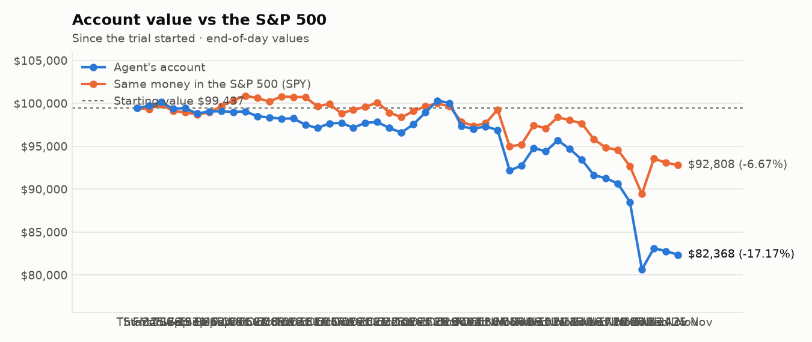
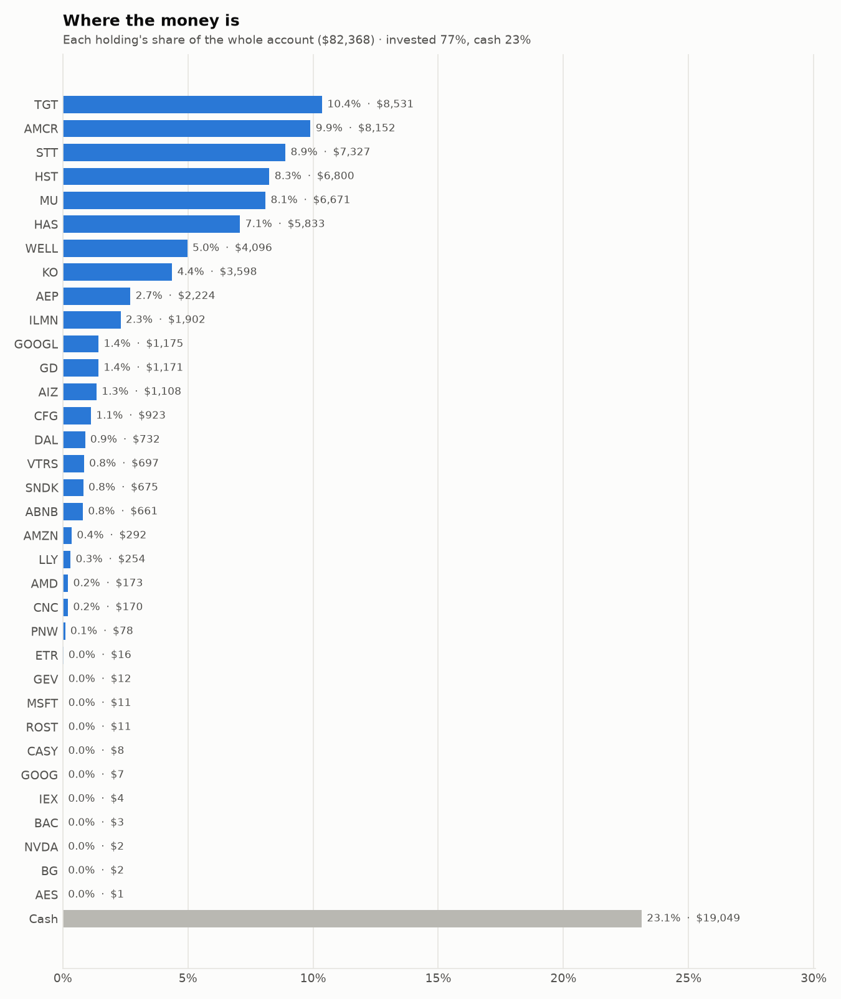
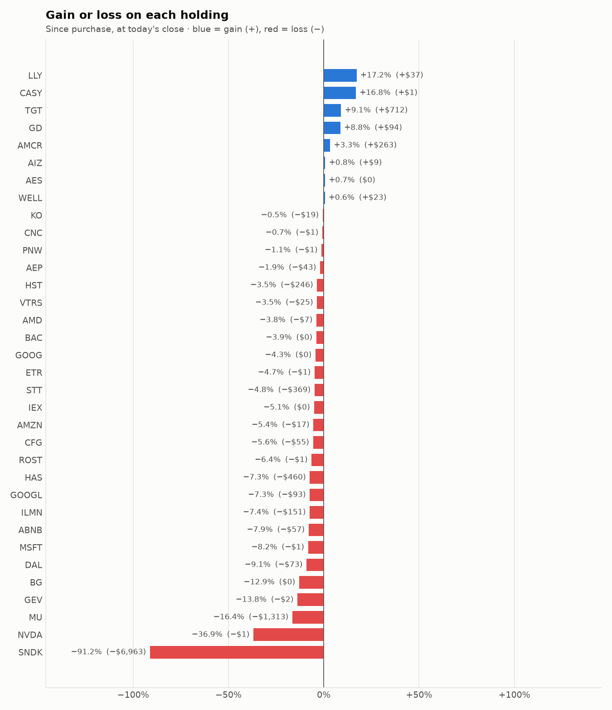

# 5-day trading report — 19 Nov to 25 Nov 2026
_Trading days 41–45 of the trial._

## Performance

- **Account value:** $90,662 → $82,368 (-9.1%)
- **S&P 500 (SPY) over the same days:** -1.9%
- **Agent vs S&P 500:** -7.29% (behind)

| Day | Account value | Day change | SPY | Buys | Sells |
|---|---|---|---|---|---|
| Thu 19 Nov | $88,519 | -2.4% | -2.0% | 4 | 5 |
| Fri 20 Nov | $80,648 | -8.9% | -3.5% | 0 | 0 |
| Mon 23 Nov | $83,118 | +3.1% | +4.6% | 0 | 0 |
| Tue 24 Nov | $82,787 | -0.4% | -0.5% | 0 | 0 |
| Wed 25 Nov | $82,368 | -0.5% | -0.3% | 0 | 0 |

## Risk scorecard (trial to date)

- **Return:** agent -17.17% vs S&P 500 -6.67% over 45 trading day(s)
- **Largest fall from a peak (max drawdown):** -19.61% — the worst the account has been below its own high
- **Volatility:** 28.5% a year — how much the account value swings day to day
- **Sharpe ratio:** -3.54 — return per unit of risk, yearly rate (above 1 is good, below 0 is losing)
- **Beta:** 1.09 — the account moves about in line with the S&P 500 (1.00 = exactly with it)
- **Alpha:** -9.91% — return lost beyond what the market's own move explains, given the beta above

## Charts

## What the research favoured

- **Main reason behind buys:** Momentum (4)
- **Sectors bought:** Information Technology (1), Financials (1), Consumer Discretionary (1), Health Care (1)
- **Average analyst consensus (-2..+2):** buys +0.97, sells +1.05
- **Average news tone:** buys +4.5, sells +3.6
- **Average combined research score:** buys +0.98, sells +0.61

## Sessions

- **2026-11-19 Morning rebalance:** traded — 8 order(s) placed
- **2026-11-19 Afternoon risk check:** traded — Sold 1 position(s) on the risk check (stop-loss: LITE)
- **2026-11-20 Morning rebalance:** HALTED — Safety check stopped the session: drawdown_halt: drawdown -12.2% exceeds halt threshold
- **2026-11-20 Afternoon risk check:** HALTED — Safety check stopped the session: drawdown_halt: drawdown -12.2% exceeds halt threshold
- **2026-11-23 Morning rebalance:** HALTED — Safety check stopped the session: drawdown_halt: drawdown -20.2% exceeds halt threshold
- **2026-11-23 Afternoon risk check:** HALTED — Safety check stopped the session: drawdown_halt: drawdown -20.2% exceeds halt threshold
- **2026-11-24 Morning rebalance:** HALTED — Safety check stopped the session: drawdown_halt: drawdown -17.8% exceeds halt threshold
- **2026-11-24 Afternoon risk check:** HALTED — Safety check stopped the session: drawdown_halt: drawdown -17.8% exceeds halt threshold
- **2026-11-25 Morning rebalance:** HALTED — Safety check stopped the session: drawdown_halt: drawdown -18.0% exceeds halt threshold
- **2026-11-25 Afternoon risk check:** HALTED — Safety check stopped the session: drawdown_halt: drawdown -18.0% exceeds halt threshold

# Key decisions and the research behind them

## Why I bought

### SNDK — bought 4.467 shares at ~$826.17 ($3,691)

**Why:** combined score +1.42; ranked #2 of 503; driven mainly by price momentum +3.00, low volatility -1.37; entering/adding to the top-ranked target portfolio; research detail: 43 recent headline(s), net negative tone (-1); analyst consensus +1.20/2 (12 strong buy, 18 buy, 5 hold, 0 sell, 0 strong sell)

**Research scores** (combined +1.42, ranked #2 in the S&P 500, sector: Information Technology):

| Factor | Score | Measures |
|---|---|---|
| Value | +1.25 | cheap vs. sector peers on P/E and P/B |
| Quality | +1.09 | profitability (ROE, margins) and balance-sheet strength |
| Momentum | +3.00 | 12-month price trend, excluding the last month |
| Low volatility | -1.37 | steadier price than sector peers |
| Research | +0.08 | recent news tone + analyst consensus |

**Company financials (Finnhub, trailing 12 months):** P/E 5.7, P/B 13.8, return on equity 134.3%, gross margin 80.0%, debt/equity 0.00

**Price trend (Alpaca):** 12-month return (excl. last month) +873.6%, last month -43.1%, volatility 92.4%/yr

**News (Finnhub): 43 headline(s) in the last 2 days, net tone -1.** Most influential:
- [SanDisk and Micron Fall 4% as GF Securities Cuts NAND Price Forecast and Warns of a Glut; SK Hynix Dips](https://finnhub.io/api/news?id=38286f2033adc286b86bb07cf90453b317ef17023db0c446d8e83ead4002ffdf) — 17 Nov, Yahoo (tone -2)
- [Own Sandisk? Your Five Years Hinge On Memory Prices](https://finnhub.io/api/news?id=19a7acc12d564f844ced56b5cfbdbe85610db893c5017aa32ba1bfc3d34e2501) — 17 Nov, Yahoo (tone +2)
- [Prediction: This Will Be Sandisk’s Stock Price by the End of 2027](https://finnhub.io/api/news?id=eb88a1adcea99d1c24ed2ecfada0590e6ceb4c4a7af0ca1eb9df1b75c76ae0db) — 18 Nov, Yahoo (tone +1)
- [Dear Sandisk Stock Fans, Mark Your Calendars for November 20](https://finnhub.io/api/news?id=1d2b6dd50e1c723bf0897bb9651301ebc6671ceead6abadb2c27655aa8ac3934) — 18 Nov, Yahoo (tone +1)
- [Not Micron, Not Sandisk. This Is My Top Memory Stock for 2027.](https://finnhub.io/api/news?id=6a8c4082ad6a809e69fb3205768e79b12972184a86849d6f1518d345d1640a9c) — 18 Nov, Yahoo (tone +1)

**Analysts (Finnhub, 2026-11-01):** 12 strong buy, 18 buy, 5 hold, 0 sell, 0 strong sell — consensus +1.20 on a -2 (strong sell) to +2 (strong buy) scale.

### STT — bought 19.617 shares at ~$166.26 ($3,261)

**Why:** combined score +1.01; ranked #7 of 503; driven mainly by price momentum +1.97, research (news + analyst consensus) +0.89; entering/adding to the top-ranked target portfolio; research detail: 5 recent headline(s), net positive tone (+5); analyst consensus +0.81/2 (3 strong buy, 11 buy, 7 hold, 0 sell, 0 strong sell)

**Research scores** (combined +1.01, ranked #7 in the S&P 500, sector: Financials):

| Factor | Score | Measures |
|---|---|---|
| Value | +0.43 | cheap vs. sector peers on P/E and P/B |
| Quality | -0.03 | profitability (ROE, margins) and balance-sheet strength |
| Momentum | +1.97 | 12-month price trend, excluding the last month |
| Low volatility | +0.42 | steadier price than sector peers |
| Research | +0.89 | recent news tone + analyst consensus |

**Company financials (Finnhub, trailing 12 months):** P/E 12.3, P/B 1.7, return on equity 13.1%, debt/equity 0.92

**Price trend (Alpaca):** 12-month return (excl. last month) +49.6%, last month -0.9%, volatility 22.0%/yr

**News (Finnhub): 5 headline(s) in the last 2 days, net tone +5.** Most influential:
- [Are Wall Street Analysts Predicting State Street Stock Will Climb or Sink?](https://finnhub.io/api/news?id=c22381f461eb833333ec08643bd3a20f7335ab70427b41326f75130bd99170cd) — 18 Nov, Yahoo (tone +3)
- [State Street Investment Management Launches New State Street® SPDR® Nasdaq® MyPaycheck ETF](https://finnhub.io/api/news?id=70abfea5404ea0e86ae70bc1dd9d80281688ff604ee539535db7237bd28a7e94) — 17 Nov, Yahoo (tone +1)
- [State Street (STT) Stock May Be 22% Undervalued On Saudi Arabia Expansion](https://finnhub.io/api/news?id=9462ecebc7d89ed675b82d1ed40c079ee9c04eb4b54f84fdd3ce101b82747be6) — 17 Nov, Yahoo (tone +1)
- [State Street Expands Prime Services into Equity Swaps](https://finnhub.io/api/news?id=f30ee334afd3dce8500bb807585a70e7ae75032e62b47763424418ab640ee7fc) — 17 Nov, Yahoo (tone +0)
- [Is State Street (STT) Undervalued On Its Preferred Dividend Announcement?](https://finnhub.io/api/news?id=c5b03e1ea5f3c7de6fe5fe073693c684cc2b497e0ee6b5cb8e2b39cfb3ac06b5) — 17 Nov, Yahoo (tone +0)

**Analysts (Finnhub, 2026-11-01):** 3 strong buy, 11 buy, 7 hold, 0 sell, 0 strong sell — consensus +0.81 on a -2 (strong sell) to +2 (strong buy) scale.

### HAS — bought 18.433 shares at ~$116.83 ($2,154)

**Why:** combined score +0.86; ranked #9 of 503; driven mainly by price momentum +1.59, research (news + analyst consensus) +0.77; entering/adding to the top-ranked target portfolio; research detail: 6 recent headline(s), net positive tone (+8); analyst consensus +1.26/2 (8 strong buy, 8 buy, 3 hold, 0 sell, 0 strong sell)

**Research scores** (combined +0.86, ranked #9 in the S&P 500, sector: Consumer Discretionary):

| Factor | Score | Measures |
|---|---|---|
| Value | -0.11 | cheap vs. sector peers on P/E and P/B |
| Quality | +0.71 | profitability (ROE, margins) and balance-sheet strength |
| Momentum | +1.59 | 12-month price trend, excluding the last month |
| Low volatility | +0.42 | steadier price than sector peers |
| Research | +0.77 | recent news tone + analyst consensus |

**Company financials (Finnhub, trailing 12 months):** P/E 17.4, P/B 13.8, return on equity 136.2%, gross margin 67.5%, debt/equity 3.84

**Price trend (Alpaca):** 12-month return (excl. last month) +46.3%, last month +8.4%, volatility 32.2%/yr

**News (Finnhub): 6 headline(s) in the last 2 days, net tone +8.** Most influential:
- [Stay Ahead of Market Uncertainty With LNG, TTE, LW and HAS](https://finnhub.io/api/news?id=9fc91d9f01096b2f2ccb5d056301d032fce17f15cd647e8122a9abb7d7cdd742) — 18 Nov, Yahoo (tone +2)
- [Best Growth Stocks to Buy for November 18th](https://finnhub.io/api/news?id=a44896868d3c8939325c235f9338147eca6cac310652ee2a1e43e2a1b9cfc7bd) — 18 Nov, Yahoo (tone +2)
- [3 Stocks Rallying After Strong Q3 Earnings and Raised Guidance](https://finnhub.io/api/news?id=4f49790b675206ad6a3fd9a7fc30b84fed6c2b534ce307615649ffa56b500293) — 17 Nov, Yahoo (tone +2)
- [Hasbro (HAS) Stock May Trade At A Discount To Fair Value](https://finnhub.io/api/news?id=c0cfbbd7f59fdb4f0e9eeecbee027f4c26f157e490585dad8dafcb24aea6358e) — 18 Nov, Yahoo (tone +1)
- [Hasbro (HAS) Stock Dropped, What Is Behind The Latest Attention?](https://finnhub.io/api/news?id=c5289d85d5a1a37124a06cd67d1f82bbcd27547fc926a9a303c498645301a694) — 18 Nov, Yahoo (tone +1)

**Analysts (Finnhub, 2026-11-01):** 8 strong buy, 8 buy, 3 hold, 0 sell, 0 strong sell — consensus +1.26 on a -2 (strong sell) to +2 (strong buy) scale.

### ILMN — bought 7.28 shares at ~$215.39 ($1,568)

**Why:** combined score +0.64; ranked #17 of 503; driven mainly by price momentum +2.26, low volatility -1.93; entering/adding to the top-ranked target portfolio; research detail: 7 recent headline(s), net positive tone (+6); analyst consensus +0.61/2 (6 strong buy, 9 buy, 10 hold, 2 sell, 1 strong sell)

**Research scores** (combined +0.64, ranked #17 in the S&P 500, sector: Health Care):

| Factor | Score | Measures |
|---|---|---|
| Value | -0.74 | cheap vs. sector peers on P/E and P/B |
| Quality | +0.41 | profitability (ROE, margins) and balance-sheet strength |
| Momentum | +2.26 | 12-month price trend, excluding the last month |
| Low volatility | -1.93 | steadier price than sector peers |
| Research | +0.12 | recent news tone + analyst consensus |

**Company financials (Finnhub, trailing 12 months):** P/E 34.2, P/B 13.1, return on equity 31.4%, gross margin 67.9%, debt/equity 0.57

**Price trend (Alpaca):** 12-month return (excl. last month) +180.6%, last month -21.6%, volatility 67.9%/yr

**News (Finnhub): 7 headline(s) in the last 2 days, net tone +6.** Most influential:
- [Illumina Stock Surges 74.8% in a Year: What's Fueling the Drive?](https://finnhub.io/api/news?id=327247f7c93e99da28ad3f35d0e276165ee0d0ba23f9e667765e7e272e02d54e) — 19 Nov, Yahoo (tone +4)
- [Genomic Data Set for RWE Applications - Global Strategic Business Report 2026: Capitalize on 16% CAGR and $1.5B in Total Revenue by 2032 with Illumina, Caris Life Sciences and Datavant](https://finnhub.io/api/news?id=6e736ebe877fdd29aedbcae6f9fc6678604a832749aac8125228d2ab20e06012) — 18 Nov, Yahoo (tone +1)
- [Illumina Sees Strong Clinical Demand, but Research Recovery Remains in Question](https://finnhub.io/api/news?id=9b0a032cea2ecd4cb1386c36ede74b856a28c29b54ddc7e2d41da5b4e1f167a3) — 17 Nov, Yahoo (tone +1)
- [Illumina Stock Outlook: Is Wall Street Bullish or Bearish?](https://finnhub.io/api/news?id=e2bb36731ee0e4e819a8a3f81094ea59ede582ae58bfe4cbc54a2f43c6adf4dd) — 18 Nov, Yahoo (tone +0)
- [Diamond Hill Mid Cap Strategy Q3 2026 Portfolio Review](https://finnhub.io/api/news?id=c8af3328fdce7f58f1ab8e6ba40de8c7c571dead4a9c2e407e3e70b8b13320b8) — 18 Nov, SeekingAlpha (tone +0)

**Analysts (Finnhub, 2026-11-01):** 6 strong buy, 9 buy, 10 hold, 2 sell, 1 strong sell — consensus +0.61 on a -2 (strong sell) to +2 (strong buy) scale.

## Why I sold

### VTRS — sold 290.809 shares at ~$19.98 ($5,810)

**Why:** combined score +0.57; ranked #22 of 503; driven mainly by research (news + analyst consensus) +1.03, price momentum +0.79; trimmed toward target weight, or dropped out of the top-ranked names; research detail: 8 recent headline(s), net positive tone (+8); analyst consensus +0.94/2 (6 strong buy, 6 buy, 5 hold, 1 sell, 0 strong sell)

**Research scores** (combined +0.57, ranked #22 in the S&P 500, sector: Health Care):

| Factor | Score | Measures |
|---|---|---|
| Value | +0.00 | cheap vs. sector peers on P/E and P/B |
| Quality | +0.00 | profitability (ROE, margins) and balance-sheet strength |
| Momentum | +0.79 | 12-month price trend, excluding the last month |
| Low volatility | +0.74 | steadier price than sector peers |
| Research | +1.03 | recent news tone + analyst consensus |

**Price trend (Alpaca):** 12-month return (excl. last month) +83.2%, last month +8.7%, volatility 26.6%/yr

**News (Finnhub): 8 headline(s) in the last 2 days, net tone +8.** Most influential:
- [Oppenheimer Maintains Outperform on Viatris, Raises Price Target to $26](https://finnhub.io/api/news?id=051217ceb04510989b1cace5d87549cdb7c83d14bf19b7faa1b10158d362d379) — 18 Nov, Benzinga (tone +2)
- [Are Investors Undervaluing Viatris (VTRS) Right Now?](https://finnhub.io/api/news?id=2d569c3aaed0cd38c9eb7fd7edaa6ce5ea655b6a5ae1ba179a92cafb1a56df87) — 17 Nov, Yahoo (tone +2)
- [United Natural Foods To Rally Around 24%? Here Are 10 Top Analyst Forecasts For Tuesday](https://finnhub.io/api/news?id=f63c863f0988cf46b0d36f646a713329f52abf49ef0593a23eac20157c833d86) — 17 Nov, Benzinga (tone +2)
- [Leerink Partners Maintains Outperform on Viatris, Raises Price Target to $24](https://finnhub.io/api/news?id=3ca9c12918f5a79cc8837cd586ad65e74dd5c62e7ba6f92880a143a2100f3dee) — 17 Nov, Benzinga (tone +2)
- [Invesco S&P 500 Equal Weight (RSP) Buys $0.6 Million More AppLovin on Nov. 17](https://finnhub.io/api/news?id=edb74f0d69e333823012ee7bb4e6e425dc055b407c6fd492ad14f0bac310ea71) — 19 Nov, Yahoo (tone +0)

**Analysts (Finnhub, 2026-11-01):** 6 strong buy, 6 buy, 5 hold, 1 sell, 0 strong sell — consensus +0.94 on a -2 (strong sell) to +2 (strong buy) scale.

### GM — sold 50.696 shares at ~$82.03 ($4,159)

**Why:** combined score +0.53; ranked #32 of 503; driven mainly by price momentum +1.15, research (news + analyst consensus) +0.54; trimmed toward target weight, or dropped out of the top-ranked names; research detail: 24 recent headline(s), net positive tone (+6); analyst consensus +1.14/2 (11 strong buy, 18 buy, 6 hold, 0 sell, 0 strong sell)

**Research scores** (combined +0.53, ranked #32 in the S&P 500, sector: Consumer Discretionary):

| Factor | Score | Measures |
|---|---|---|
| Value | +0.00 | cheap vs. sector peers on P/E and P/B |
| Quality | +0.00 | profitability (ROE, margins) and balance-sheet strength |
| Momentum | +1.15 | 12-month price trend, excluding the last month |
| Low volatility | -0.13 | steadier price than sector peers |
| Research | +0.54 | recent news tone + analyst consensus |

**Price trend (Alpaca):** 12-month return (excl. last month) +32.1%, last month +6.5%, volatility 39.2%/yr

**News (Finnhub): 24 headline(s) in the last 2 days, net tone +6.** Most influential:
- [General Motors Targets Higher 2027 Profit Despite Up to $1.5 Billion in Added Cost Pressure](https://finnhub.io/api/news?id=cdf73d9750141b2dca292fbff385c2e72b157d2a30552aa83e88f2c83f464604) — 18 Nov, Yahoo (tone +2)
- [GM Is Looking Outside the Company for Its Next CEO](https://finnhub.io/api/news?id=b1076af8ccd0db1a285208e7c3d27a207f9127aacca6935fef6c41c8133faa3a) — 18 Nov, Yahoo (tone +2)
- [Why Is General Motors (GM) Looking Beyond Mary Barra For Its Next CEO?](https://finnhub.io/api/news?id=89d35e511494144f0ee2b5aff739a12d52a8978e509c159c649577d090efcbd9) — 19 Nov, Yahoo (tone -1)
- [Ford Or GM Stock? The S&P 500 Beat Both](https://finnhub.io/api/news?id=d3483ec5de43a7e653bcabf423010ca4b388bc2866a601745d655b658ca63781) — 18 Nov, Yahoo (tone +1)
- [General Motors' Automation Push: Buy, Hold or Sell the Stock Now?](https://finnhub.io/api/news?id=d987e03f2bdebcafaeb17a26621e0f124cf3739052928642b6781634160baf06) — 18 Nov, Yahoo (tone +1)

**Analysts (Finnhub, 2026-11-01):** 11 strong buy, 18 buy, 6 hold, 0 sell, 0 strong sell — consensus +1.14 on a -2 (strong sell) to +2 (strong buy) scale.

### LITE — sold 5.262 shares at ~$531.47 ($2,797)

**Why:** stop-loss: -12.9% below the average purchase price of $613.19 (limit -12%); sold the whole position and won't buy it back for 7 days

**What triggered it:** the afternoon risk check trims a holding only when BOTH its recent news turns clearly negative AND its price is down 3%+ since purchase (it was -12.9%).

**News (Finnhub): 20 headline(s) in the last 2 days, net tone +1.** Most influential:
- [Applied Optoelectronics Rallies 5% Despite $550 Million Share Sale Plan; Coherent Jumps 8%, Lumentum Climbs 4%](https://finnhub.io/api/news?id=2b8e7224b17e7a859aad632eb728ad6429c14cf8c03b4af3684f1b023155babc) — 19 Nov, Yahoo (tone -1)
- [Lumentum Is Down 33% in a Month as Marvell’s Slide Shrinks Its Buyout Value. Can LITE Stock Get Back to Bernstein’s $700 Target?](https://finnhub.io/api/news?id=3e0219bf840c157217aa58ff78d7da53d8f10dfec1757e713c8b884bc27187e9) — 18 Nov, Yahoo (tone +1)
- [Applied Optoelectronics Sinks 9% on $550 Million Stock Sale Plan; Coherent and Lumentum Rise 4%](https://finnhub.io/api/news?id=6fd9edc922805cf4ddaa2545edcb9b932143faaaac23d78e81a2b038e432de1d) — 18 Nov, Yahoo (tone +1)
- [Lumentum: AI Fear Is Creating A Rare Buying Opportunity](https://finnhub.io/api/news?id=ec3396d8e98b7cfc72465698f893e7f52f6a43c757e9bc8875adbd29c4d20c11) — 17 Nov, SeekingAlpha (tone +1)
- [Coherent Jumps 8%, Applied Optoelectronics Climbs 7% as U.S. Pushes Ahead With Curbs on Chinese Optical Gear; Lumentum Gains 4%](https://finnhub.io/api/news?id=a5240ccbfb3c9b1cd517680be0718dc3da5add3c2212db434c3f6843789aec21) — 17 Nov, Yahoo (tone -1)

### AIZ — sold 7.507 shares at ~$315.51 ($2,369)

**Why:** combined score +0.59; ranked #20 of 503; driven mainly by price momentum +1.32, low volatility +0.87; trimmed toward target weight, or dropped out of the top-ranked names; research detail: 1 recent headline(s), net positive tone (+1); analyst consensus +1.00/2 (2 strong buy, 9 buy, 2 hold, 0 sell, 0 strong sell)

**Research scores** (combined +0.59, ranked #20 in the S&P 500, sector: Financials):

| Factor | Score | Measures |
|---|---|---|
| Value | -0.03 | cheap vs. sector peers on P/E and P/B |
| Quality | +0.29 | profitability (ROE, margins) and balance-sheet strength |
| Momentum | +1.32 | 12-month price trend, excluding the last month |
| Low volatility | +0.87 | steadier price than sector peers |
| Research | +0.19 | recent news tone + analyst consensus |

**Company financials (Finnhub, trailing 12 months):** P/E 14.7, P/B 2.2, return on equity 18.0%, debt/equity 0.37

**Price trend (Alpaca):** 12-month return (excl. last month) +35.8%, last month +12.4%, volatility 21.6%/yr

**News (Finnhub): 1 headline(s) in the last 2 days, net tone +1.** Most influential:
- [New Strong Buy Stocks for November 19th](https://finnhub.io/api/news?id=b1f3f6e418132564e2112248aee98552e58483aaf098950573aaa9ac7a4076c6) — 19 Nov, Yahoo (tone +1)

**Analysts (Finnhub, 2026-11-01):** 2 strong buy, 9 buy, 2 hold, 0 sell, 0 strong sell — consensus +1.00 on a -2 (strong sell) to +2 (strong buy) scale.

### WELL — sold 6.21 shares at ~$246.00 ($1,528)

**Why:** combined score +0.75; ranked #12 of 503; driven mainly by price momentum +1.91, research (news + analyst consensus) +1.16; trimmed toward target weight, or dropped out of the top-ranked names; research detail: 3 recent headline(s), net positive tone (+2); analyst consensus +1.11/2 (6 strong buy, 19 buy, 3 hold, 0 sell, 0 strong sell)

**Research scores** (combined +0.75, ranked #12 in the S&P 500, sector: Real Estate):

| Factor | Score | Measures |
|---|---|---|
| Value | -0.81 | cheap vs. sector peers on P/E and P/B |
| Quality | -0.31 | profitability (ROE, margins) and balance-sheet strength |
| Momentum | +1.91 | 12-month price trend, excluding the last month |
| Low volatility | -0.05 | steadier price than sector peers |
| Research | +1.16 | recent news tone + analyst consensus |

**Company financials (Finnhub, trailing 12 months):** P/E 106.1, P/B 3.4, return on equity 3.7%, gross margin 40.0%, debt/equity 0.40

**Price trend (Alpaca):** 12-month return (excl. last month) +36.0%, last month +3.8%, volatility 21.3%/yr

**News (Finnhub): 3 headline(s) in the last 2 days, net tone +2.** Most influential:
- [Welltower (NYSE:WELL) Passes Minervini Trend Template and High Growth Momentum Screen](https://finnhub.io/api/news?id=f76c6bee8ccaadb804bff9e043de4527aaa2d7c966c7b384312c0c8493c0b5f6) — 19 Nov, ChartMill (tone +2)
- [Welltower and Ventas Are Riding the Same Senior Housing Boom, but Their Valuations Tell Different Stories](https://finnhub.io/api/news?id=457003d424afd0bffed121e487c73063436816cb0edcb4f3b281d3f1b7f0c31f) — 17 Nov, Yahoo (tone +0)
- [Here's How Much $100 Invested In Welltower 5 Years Ago Would Be Worth Today](https://finnhub.io/api/news?id=b25ad3def762df5f411140ed006c50e38801960442a7bd6b561817626c55908d) — 17 Nov, Benzinga (tone +0)

**Analysts (Finnhub, 2026-11-01):** 6 strong buy, 19 buy, 3 hold, 0 sell, 0 strong sell — consensus +1.11 on a -2 (strong sell) to +2 (strong buy) scale.

## Holdings at the end of the period

| Stock | Shares | Avg cost | Price | Market value | % of account | Today | Gain/loss $ | Gain/loss % |
|---|---:|---:|---:|---:|---:|---:|---:|---:|
| TGT | 49.527 | $157.87 | $172.25 | $8,531 | 10.4% | -2.16% | +$712 | +9.11% |
| AMCR | 179.479 | $43.96 | $45.42 | $8,152 | 9.9% | +1.61% | +$263 | +3.33% |
| STT | 45.218 | $170.20 | $162.03 | $7,327 | 8.9% | +0.73% | −$369 | -4.80% |
| HST | 273.295 | $25.78 | $24.88 | $6,800 | 8.3% | +0.08% | −$246 | -3.49% |
| MU | 11.056 | $722.15 | $603.36 | $6,671 | 8.1% | -4.20% | −$1,313 | -16.45% |
| HAS | 52.75 | $119.30 | $110.58 | $5,833 | 7.1% | -1.48% | −$460 | -7.31% |
| WELL | 16.719 | $243.64 | $245.02 | $4,096 | 5.0% | -0.05% | +$23 | +0.57% |
| KO | 36.805 | $98.27 | $97.75 | $3,598 | 4.4% | +0.13% | −$19 | -0.54% |
| AEP | 17.402 | $130.26 | $127.79 | $2,224 | 2.7% | +0.38% | −$43 | -1.90% |
| ILMN | 9.491 | $216.32 | $200.42 | $1,902 | 2.3% | -2.00% | −$151 | -7.35% |
| GOOGL | 4.297 | $295.13 | $273.53 | $1,175 | 1.4% | -1.98% | −$93 | -7.32% |
| GD | 3.251 | $331.27 | $360.27 | $1,171 | 1.4% | +2.48% | +$94 | +8.75% |
| AIZ | 3.401 | $323.21 | $325.73 | $1,108 | 1.3% | +0.96% | +$9 | +0.78% |
| CFG | 14.943 | $65.43 | $61.76 | $923 | 1.1% | +0.96% | −$55 | -5.61% |
| DAL | 8.808 | $91.40 | $83.12 | $732 | 0.9% | -1.63% | −$73 | -9.06% |
| VTRS | 35.058 | $20.60 | $19.88 | $697 | 0.8% | +0.15% | −$25 | -3.50% |
| SNDK | 9.083 | $840.83 | $74.28 | $675 | 0.8% | -4.71% | −$6,963 | -91.17% |
| ABNB | 3.834 | $187.14 | $172.31 | $661 | 0.8% | -0.62% | −$57 | -7.92% |
| AMZN | 1.195 | $258.76 | $244.75 | $292 | 0.4% | -2.99% | −$17 | -5.41% |
| LLY | 0.182 | $1,189.78 | $1,395.00 | $254 | 0.3% | -0.89% | +$37 | +17.25% |
| AMD | 0.424 | $423.91 | $407.68 | $173 | 0.2% | -1.35% | −$7 | -3.83% |
| CNC | 2.63 | $65.21 | $64.74 | $170 | 0.2% | +0.61% | −$1 | -0.72% |
| PNW | 0.753 | $104.41 | $103.24 | $78 | 0.1% | +1.07% | −$1 | -1.12% |
| ETR | 0.145 | $112.67 | $107.32 | $16 | 0.0% | +1.29% | −$1 | -4.75% |
| GEV | 0.017 | $829.15 | $715.00 | $12 | 0.0% | -0.78% | −$2 | -13.77% |
| MSFT | 0.023 | $533.80 | $490.06 | $11 | 0.0% | -1.22% | −$1 | -8.19% |
| ROST | 0.049 | $238.50 | $223.29 | $11 | 0.0% | -1.28% | −$1 | -6.38% |
| CASY | 0.011 | $597.62 | $698.26 | $8 | 0.0% | +1.64% | +$1 | +16.84% |
| GOOG | 0.025 | $283.69 | $271.40 | $7 | 0.0% | -1.87% | −$0 | -4.33% |
| IEX | 0.018 | $237.47 | $225.25 | $4 | 0.0% | -0.23% | −$0 | -5.15% |
| BAC | 0.054 | $50.53 | $48.56 | $3 | 0.0% | +0.01% | −$0 | -3.89% |
| NVDA | 0.016 | $236.88 | $149.51 | $2 | 0.0% | -3.78% | −$1 | -36.88% |
| BG | 0.019 | $101.20 | $88.15 | $2 | 0.0% | +4.87% | −$0 | -12.90% |
| AES | 0.096 | $14.92 | $15.02 | $1 | 0.0% | +0.00% | +$0 | +0.67% |
| **Invested** | | | | **$63,319** | **76.9%** | | **−$8,760** | |
| **Cash** | | | | $19,049 | 23.1% | | | |
| **Total account** | | | | **$82,368** | 100% | | | |

_Scores are sector-neutral z-scores: 0 is average for the stock's sector, +1 is one standard deviation better. News tone is a keyword count over recent headlines, not a deep read. None of this guarantees a stock will rise; a few days of results can't show whether the strategy has a real edge over the S&P 500._
